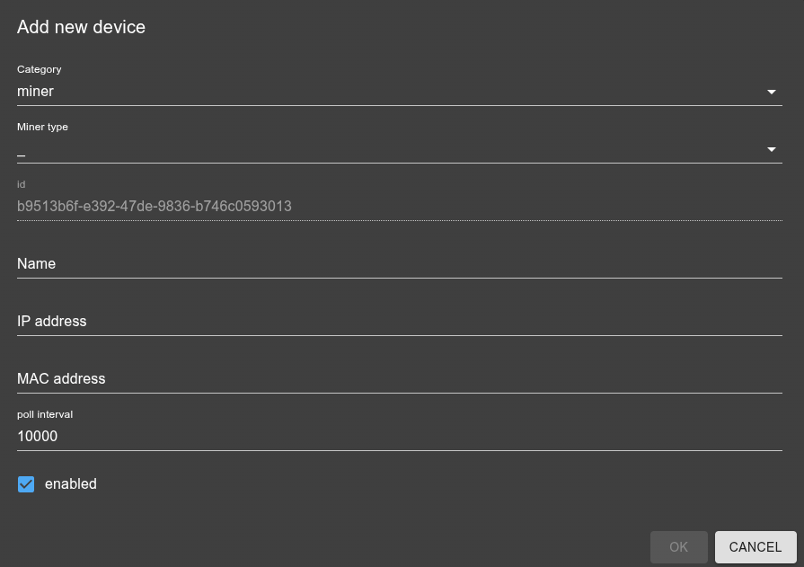

# ioBroker.miner

[](https://www.npmjs.com/package/iobroker.miner)
[](https://www.npmjs.com/package/iobroker.miner)


[](https://nodei.co/npm/iobroker.miner/)

**Tests:**  [](https://coveralls.io/github/SimonFischer04/ioBroker.miner?branch=main)

## miner adapter for ioBroker

Interact with different crypto miner apis

## Roadmap
- [X] v0.1: device management, trm implementation
- [X] more miners support: bos+, xmrig, avalon, ...?
- [ ] implement more features (controls + info from devices)
- [ ] pools support
- [ ] device discover
- [ ] sentry
- [ ] more: see Todo.md / issues

## Usage
When adding a new device inside the instance settings (or inside the Admin DeviceManager Tab) you should get a dialog like this:



The options should be pretty self-explanatory. All of them also have tooltips with more details. If anything is still unclear feel free to ask in an issue, discussion or the forum. 

### Braiins OS miner types
There are two Braiins miner implementations because Braiins changed the API stack across firmware generations:

- `bos`: use this for official Braiins OS firmware `>= 23.03`, typically Antminer S19 series and newer. This implementation uses the Braiins OS Public API (PAPI) over gRPC.
- `bosMiner`: use this for legacy Braiins OS firmware `< 23.03`, typically pre-S19 devices such as Antminer S9 and S17 series. This keeps using the older CGMiner-compatible API.

`bosMiner` also supports the `control.powerTarget` state. Legacy Braiins OS does not expose this through the CGMiner-compatible API, so the adapter uses an SSH workaround: it logs in to the miner, updates `power_target` in the `[autotuning]` section and `timestamp` in the `[format]` section of `/etc/bosminer.toml`, stores a backup at `/etc/bosminer.toml.iobroker-power-target.bak`, stops `bosminer`, writes the config, and starts `bosminer` again. Configure valid SSH credentials for `bosMiner` devices; the default username is `root` with no password.

Warning: changing `control.powerTarget` on old `bosMiner` devices requires a full `bosminer` stop/start cycle. Do not change this value frequently; use it for deliberate target changes, not for rapid automation loops.

If you are unsure which one to choose, check the firmware generation/device family first:

- S19/S21/T19 and newer Braiins OS images are listed in the current firmware download flow and should normally use `bos`.
- S17 images are published as `v 23.01` and S9 images as `v 22.08.1` on the Braiins download page, so those legacy generations should use `bosMiner`.

References:
- Braiins OS Public API: https://academy.braiins.com/braiins-os/papi-about
- Braiins OS firmware downloads: https://braiins.com/os-firmware/download

### Avalon web login without the app
The web interface of Avalon Nano 3 / 3S miners has no password form: it shows a QR code that has to be scanned with the Avalon Family app. The adapter can approve that login instead:

1. Enter the miner's web password in the device settings (`web password`). It is the password set for the miner in the Avalon Family app.
2. Open the miner's IP address in the browser, so the login page with the QR code shows.
3. Click "Approve web login" on the device in the device manager. The browser is logged in within 5 seconds.

This does the same as scanning the QR code: the adapter sends the miner the `qr_auth` command the app sends, signed with the web password.

### Avalon dust filter reminder
Avalon Nano 3 / 3S miners count how long their dust filter has been running since it was last cleaned. The adapter shows it as `custom.filter.runtime` (hours) and on the device card in the device manager.

- When the runtime reaches the reminder interval of the device settings (`filter cleaning reminder (days)`, default 30 days, 0 = off), `custom.filter.cleanDue` turns `true` (also on the device card), and the adapter raises an ioBroker notification (category "Dust filter needs cleaning"), which notification adapters such as notification-manager can forward e.g. to Telegram or e-mail.
- After cleaning the filter, reset the reminder: press "Reset Filter Reminder" in the device controls (behind the device's control button in the device manager), or set `custom.filter.reset` to `true`. This does the same as "Filter Clear" in the Avalon Family app: it sends the miner the `ascset|0,filter-clean,1` command, which sets its filter runtime back to 0.

Firmware checks for BOS use the last reported control-board type and installed version, including while the device is offline or disabled. A BOS device must have reported its identity at least once. Avalon update checks currently cover the exact Nano 3 model only: the app's `nano3` feed has no verified Nano 3S compatibility, so Nano 3S update status remains unknown.

## Object model

All objects are created under:

`miner.<instance>.miner.<minerId>`

`<minerId>` is the stable ID from the device configuration (`settings.id`). This allows multiple miner processes on the same host.

### Groups (channels)
- `info`: identity/config/firmware/connection meta
- `stats`: live performance metrics (hashrate, shares, power, temps, ...)
- `control`: writable controls (start/stop, reboot, ...)
- `raw`: raw API payloads (expert)

### Entities (optional subtrees)
Some miners expose sub-entities. If available, they are placed below the miner:
- `pools.<index>...`
- `hardware.gpus.<index>...`
- `hardware.hashboards.<index>...`

### Examples
- `miner.0.miner.<minerId>.enabled`
- `miner.0.miner.<minerId>.control.running`
- `miner.0.miner.<minerId>.stats.totalHashrate`
- `miner.0.miner.<minerId>.hardware.gpus.0.stats.temp`
- `miner.0.miner.<minerId>.raw.stats`

### Enable / disable a miner
Each miner device has a writable top-level `enabled` state:

`miner.<instance>.miner.<minerId>.enabled`

Set this state to `false` to disable the miner in the adapter at runtime. Disabled miners are unloaded and no polling/control handling is active for them. Set it back to `true` to initialize the miner again without restarting the adapter.

This is different from `control.running`: `enabled` controls whether the adapter manages the miner at all, while `control.running` asks a supported miner to start or stop mining.

### Example tree
This is just an overview / idea / plan. Not all of them are implemented yet, but it should give you an idea of the intended structure and naming. The actual implementation may differ in some details, but the general structure should be similar to this.
```
miner.0
  miner
    <minerId>                        (device)
      enabled                        (boolean)  enable/disable adapter handling for this miner
      info                           (channel)
        minerType                    (string)   e.g. xmRig / teamRedMiner / bosMiner
        host                         (string)
        version                      (string)   (maps to feature: version)
        online                        (boolean)  derived from lastSeen
        lastSeen                     (number)   unix ms
      stats                          (channel)
        totalHashrate                (number)   H/s (maps to feature: totalHashrate)
        power                        (number)   W
        dynamicPowerTarget           (number)   W, current dynamic target reported by miner
        efficiency                   (number)   H/W
        acceptedShares               (number)
        rejectedShares               (number)
      control                        (channel)  (writable states only here, top-level)
        running                      (boolean)  start/stop (maps to feature: running)
        reboot                       (boolean)  "button"
        profile                      (string)   performance profile (e.g. low/medium/high)
        powerTarget                  (number)   W, configured target to write to miner
      pools                          (channel)
        0                            (channel)
          info
            url                      (string)
            user                     (string)
          stats
            status                   (string)
            acceptedShares           (number)
            rejectedShares           (number)
        1 ...
      hardware                       (channel)
        gpus                         (channel)
          0                          (channel)
            info
              name                   (string)
            stats
              hashrate               (number)
              temp                   (number)   °C
              fanRpm                 (number)
              power                  (number)
          1 ...
        hashboards                   (channel)  (ASICs)
          0
            stats
              hashrate               (number)
              temp                   (number)
      raw                            (channel)
        stats                        (object/string) raw miner payload (maps to feature: rawStats)
      custom                         (channel)  features of a single miner type, not standardised across miners (yet)
        light                        (channel)  e.g. Avalon: LED light
          on                         (boolean)
          effect                     (number)   1 static, 2 flash, 3 breath, 4 loop
          brightness                 (number)   %
          colorTemperature           (number)   0-100
          color                      (string)   #RRGGBB
        lcd                          (channel)  e.g. Avalon: display
          on                         (boolean)
        filter                       (channel)  e.g. Avalon: dust filter
          runtime                    (number)   h since the last cleaning
          cleanDue                   (boolean)  reminder interval reached
          reset                      (boolean)  button: filter cleaned
```

### Custom features (`custom`)
Some miners can do things no other supported miner can, like the LED light of an Avalon Nano. Instead of adding such features to the common states, a miner declares them itself; they appear as sub-channels of `custom` (only for miners that have any) in the device manager: writable ones as controls behind the device's control button, read-only ones (e.g. a maintenance indicator) on the device card. A read-only boolean can raise an ioBroker notification when it turns `true`. Writing a state sends it to the miner; it is acknowledged once the miner accepted it, and the next poll reflects what the miner actually applied.

Some channels depend on the hardware, e.g. one per hashboard: they are created once a poll reports them, and kept (with their last values) when a unit is missing from a poll or the miner isn't reachable yet.

Once more than one miner type supports the same thing, it is moved to the common states (e.g. `control`), and the old `custom` state is removed.

| Miner | State | Notes |
| --- | --- | --- |
| Avalon | `custom.light.on`, `custom.light.effect`, `custom.light.brightness`, `custom.light.colorTemperature`, `custom.light.color` | `effect` keeps the last effect while the light is off and is used again when it is turned on; choosing an effect also turns the light on |
| Avalon | `custom.lcd.on` | display on / off |
| Avalon | `custom.filter.runtime`, `custom.filter.cleanDue`, `custom.filter.reset` | dust filter reminder, see [Avalon dust filter reminder](#avalon-dust-filter-reminder) |
| Braiins OS (`bos`) | `custom.hashboard<id>.*`: `enabled`, `chipsCount`, `chipType`, `highestChipTemp`, `boardTemp`, `lowestInletTemp`, `highestOutletTemp`, `lowestWaterInletTemp`, `highestWaterOutletTemp`, `voltage`, `frequency`, `hashrate`, `nominalHashrate`, `model`, `boardName`, `serialNumber` | read-only, one channel per hashboard (e.g. `custom.hashboard1`). Braiins OS reports chip data only per board, not per chip: `highestChipTemp` is the hottest chip on the board. Temperatures in °C, voltage in V, frequency in MHz, hashrates in H/s; the water temperatures are only filled on hydro-cooled miners |

## Changelog
<!--
    Placeholder for the next version (at the beginning of the line):
    ### **WORK IN PROGRESS**
-->
### **WORK IN PROGRESS**
* (claude) **NEW**: Avalon: dust filter reminder. The filter runtime since the last cleaning is shown as `custom.filter.runtime` and on the device card; once it reaches the reminder interval of the device settings (default 30 days, 0 = off), `custom.filter.cleanDue` turns `true` and an ioBroker notification is raised. After cleaning, reset it with the "Reset Filter Reminder" device control or `custom.filter.reset`, like "Filter Clear" in the Avalon Family app. Custom features can now raise notifications, and read-only ones are shown on the device card
* (claude) **NEW**: Avalon: control the LED light (on/off, effect, brightness, color temperature, color) and the display (on/off), as states under `custom.light` / `custom.lcd` and in the device manager behind the device's control button. They come with the existing poll request, so they cost no extra round-trip
* (claude) **NEW**: Avalon: `control.profile` (and the profile in the device manager) now shows the miner's active work mode, also when it was changed elsewhere, e.g. in the Avalon Family app. It comes with the existing poll request. A work mode the miner rejects is now logged as an error
* (claude) **NEW**: Braiins OS (`bos`): per-hashboard custom features under `custom.hashboard<id>`: chip count and type, hottest chip temperature, board/inlet/outlet (and water) temperatures, voltage, frequency, hashrate and nominal hashrate. Braiins OS reports chip data only per board, not per chip
* (claude) **NEW**: Custom feature channels can depend on the hardware (e.g. one per hashboard): they are created when a poll first reports them, and their objects are kept while the miner isn't polled yet
* (claude) **NEW**: `custom` channel for features only a single miner type has (not standardised across miners yet); the device manager shows the writable ones, plus running and profile, as device controls

### 1.2.0 (2026-11-03)
* (claude) **NEW**: Check miners for available firmware/software updates once a day and show them in the device manager: new states `info.latestVersion` and `info.updateAvailable` (Braiins OS, XMRig, TeamRedMiner, IceRiver OC firmware, Avalon Nano 3), plus the auto-upgrade status for Braiins OS. Can be turned off in the instance settings; a "check for updates" action checks right away (#195)
* (claude) **FIXED**: `info.online` now switches to `false` after 3 failed polls in a row and back to `true` on the next successful one; a poll that hangs counts as failed after its poll interval, but at least 30 seconds, and requests to Braiins OS (gRPC) and XMRig / IceRiver (HTTP) are now cancelled after that time instead of staying open (#222)
* (claude) **NEW**: Avalon Nano 3 / 3S: log a browser in to the miner's web interface without the Avalon Family app. Enter the miner's web password in the device settings, open the miner's login page, and use the new "Approve web login" device action (#182)
* (claude) **NEW**: Avalon: WiFi signal strength as `info.rssi` (dBm), also shown in the device manager. It comes with the existing poll request, so it costs no extra round-trip; miners on a wired connection or with firmware that doesn't report it simply leave it empty (#178)
* (claude) **NEW**: Power target in the device manager (Braiins OS `bos` and `bosMiner`): set it right on the device card; the value is only sent with "Set" or Enter, not on every keystroke. For `bos`, `control.powerTarget` now shows the miner's configured target (also when it was changed elsewhere), and values outside the range the miner accepts are rejected before they reach it (#176)
* (claude) **ENHANCED**: An unreachable miner is no longer polled at the full rate: the time between polls doubles with every failed poll, up to 5 minutes and slightly randomized, and returns to the poll interval on the next successful poll (#175)
* (claude) **FIXED**: The instance stayed yellow ("Connected to device or service": no) although its miners were reachable: `info.connection` now lists the reachable miners (comma-separated, like the sonoff adapter does), so the instance is green while at least one enabled miner is reachable and the admin shows which ones (#231)
* (SimonFischer04) Dependency updates

### 1.1.0 (2026-07-12)
- (copilot) Adapter requires node.js >= 22 now
* (SimonFischer04) **NEW**: Added a new `bos` miner type for newer Braiins OS firmware using the Braiins Public API
* (SimonFischer04) **ENHANCED**: Extended legacy `bosMiner` devices with writable `control.powerTarget` support for deliberate power target changes
* (SimonFischer04) **NEW**: Added top-level `enabled` state to dynamically enable or disable miner handling at runtime
* (SimonFischer04) **FIXED**: Removed example configuration (option1, option2) from native section and code (fixes #126 / E5040)

### 1.0.4 (2026-04-07)
* (SimonFischer04) fix repo url in package-json

### 1.0.3 (2026-04-07)
* (SimonFischer04) increase admin requirement to fix DM (does not work at all with current stable 7.7.22)

### 1.0.2 (2026-04-07)
* (SimonFischer04) **CI/CD**: Migrated deploy workflow from NPM classic tokens to Trusted Publishing (OIDC) (fixes #80)
* (SimonFischer04) cleanup readme

## Credits
- the logo was created using ChatGPT

## License

Copyright (c) 2026 SimonFischer04 <simi.fischa@gmail.com>  

This project is licensed under the GNU General Public License v3.0 - see [LICENSE](https://github.com/SimonFischer04/ioBroker.miner/blob/main/LICENSE) for details.