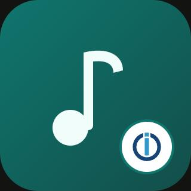

# ioBroker.music-assistant

[](https://www.npmjs.com/package/iobroker.music-assistant)
[](https://www.npmjs.com/package/iobroker.music-assistant)


[](https://nodei.co/npm/iobroker.music-assistant/)

**Tests:** 

## music-assistant adapter for ioBroker

Control Music Assistant players and queues from ioBroker

> **Disclaimer:** This is an unofficial, community-made adapter. It is not affiliated with,
> endorsed by, or supported by the Music Assistant project or the Open Home Foundation.
> "Music Assistant" and its logo are property of their respective owners.

## Prerequisites

- A running [Music Assistant](https://music-assistant.io) server, reachable from your ioBroker host -
  or Docker on the ioBroker host, then the adapter can run the server itself (see [Music Assistant in Docker](#music-assistant-in-docker)).
- An API token (on the Music Assistant server, go to **Settings → Profile** and create a long-lived
  token) or the username and password of a Music Assistant user.

## Configuration

In the adapter instance settings, enter:

| Field               | Description                                                  |
|---------------------|--------------------------------------------------------------|
| Host                | Hostname or IP of the Music Assistant server                 |
| Port                | WebSocket API port (default `8095`)                          |
| Token               | The long-lived API token created above                       |
| Username / Password | Alternative to the token: credentials of a Music Assistant user |

Long-lived tokens expire after one year in Music Assistant. With username and password the adapter
signs in on every start and never runs into this. If both are set, the token is tried first and the
credentials are used once it is refused.

### Players tab

The tab **Players** of the instance settings shows all players with cover, title, artist and position
and controls them: play/pause, stop, next/previous, seek, volume, mute, shuffle, repeat and power. The
text field below a player works like the state `playMedia` (see below). The tab only works while the
instance runs and reads and writes the same states as every other adapter, so nothing needs to be saved.

## Music Assistant in Docker

Instead of connecting to an existing server, the adapter can run Music Assistant itself in a Docker
container on the ioBroker host. Docker must be installed and running there, and the `iobroker` user
must have access to the docker CLI (to fix the rights, run `iob fix`).

1. Enable **Run Music Assistant in Docker** in the instance settings, enter a **Username** (default
   `admin`) and a **Password** (at least 8 characters) and save. Host, port and token are hidden then:
   the adapter connects to `127.0.0.1:8095` on its own. The container `iob_music_assistant_<instance>`
   with the image `ghcr.io/music-assistant/server` is created and started.
2. As soon as the server answers, the adapter creates this user as administrator in Music Assistant
   (the same first-time setup the web interface offers) and signs in with it. No token is needed.
3. Open `http://<ioBroker-host>:8095` in the browser - or click the _Music Assistant_ tile on the intro
   page of admin (also shown as link in the instance list; the adapter adds this link and restarts its
   instance once for it) - log in with the same username and password and finish the setup there
   (music sources, player providers).

The user is only created on the very first start, while Music Assistant has no user yet. Changing
username or password in the adapter settings later does not change it in Music Assistant: change the
password in Music Assistant first (**Settings → Profile**), then enter the new one in the adapter
settings. If the credentials are refused, the adapter logs an error and stops retrying until it is restarted.

Notes:

- The container runs with `network_mode: host`, because Music Assistant finds the players (Sonos,
  Chromecast, AirPlay, DLNA, ...) via mDNS/SSDP and the players fetch the audio stream from it. The
  web interface/API (port `8095`) and the stream server (port `8097`) are therefore opened directly on
  the host, and these ports must be free. With js-controller 8 the adapter reports both ports as
  used by its instance and warns if another instance already holds one of them. Host networking works on Linux; on Docker Desktop
  (Windows/macOS) it has to be enabled in the Docker settings and discovery may still be limited.
- All settings and the library live in the docker volume `ma_data` (`iob_music_assistant_<instance>_ma_data`),
  so they survive an update or a re-creation of the container. The volume is included in ioBroker backups.
- **Auto-update Docker image** pulls the latest image on every adapter start.
- **Stop container when instance stops** stops Music Assistant together with the instance. Disable it
  if Music Assistant should keep playing while the adapter is stopped.
- Network shares (SMB/NFS) that Music Assistant mounts itself need extra container privileges
  (`SYS_ADMIN`, `DAC_READ_SEARCH`), which are not granted. Mount the share on the host instead and add
  it as a folder (see below), or run Music Assistant yourself if you need this.

### Music from a disk or a NAS

Under **Folders of the host** up to three folders of the ioBroker host can be mounted into the
container, in the Docker syntax `/path/on/host:/path/in/container`, with `:ro` at the end for read-only
access:

| Folder 1                         | Folder 2                                |
|----------------------------------|-----------------------------------------|
| `/mnt/nas/music:/media/music:ro` | `/srv/audiobooks:/media/audiobooks:ro`  |

This gives the same mount as `- /mnt/nas/music:/media/music:ro` under `volumes:` of a docker-compose
file. In Music Assistant, add the music provider **Local files** with the path in the container
(`/media/music`). Empty folders are skipped. `/data` cannot be used as path in the container: it holds
the settings of Music Assistant.

- The host path must exist and be readable inside the container. A
  NAS share has to be mounted on the host first, e.g. via `/etc/fstab`, and before Docker starts.
- Changing a folder re-creates the container on the next start of the instance. Switching only `:ro`
  on or off does not: the plugin does not compare the read-only flag, delete the container once by hand then.

## States

For every Music Assistant player, the adapter creates the channel `music-assistant.0.players.<player_id>`
(role `media.music`) with:

| State                                                                         | Description                                                        |
|-------------------------------------------------------------------------------|--------------------------------------------------------------------|
| `state`                                                                       | `0` = pause, `1` = play, `2` = stop (role `media.state`)           |
| `playing`                                                                     | `true` while playing; writing `true` plays, `false` pauses (for widgets that expect a boolean) |
| `playbackState`                                                               | Raw state of Music Assistant: `idle`, `paused`, `playing`          |
| `available`, `powered`, `name`, `activeSource`, `queueId`                     | Player status (`powered` is writable)                              |
| `source`                                                                      | Writable source (`media.input`), see below                         |
| `volume` (0-100 %), `muted`                                                   | Writable volume control                                            |
| `shuffle`, `repeat` (`0` = off, `1` = all, `2` = one)                         | Writable, the settings of the player's queue                       |
| `mediaTitle`, `mediaArtist`, `mediaAlbum`, `mediaImage`                       | Now-playing metadata                                               |
| `elapsedTime`, `duration`, `seek`                                             | Position and length in seconds; write `seek` to jump to a position |
| `play`, `pause`, `playPause`, `stop`, `next`, `previous`                      | Writable buttons (`button.play`, `button.pause`, ...)              |
| `playMedia`                                                                   | Write a URI or a search text to play it, see below                 |

The player channel is laid out the way `@iobroker/type-detector` expects a media player, so
ioBroker.assistant, ioBroker.devices, the material UI and other adapters recognize it as a media
player. Assign the channel to a room (`enum.rooms`) for that: devices without a room or function are
not offered by these adapters.

Writable states are acknowledged with the value Music Assistant reports after the command, not with
the requested one - a volume the player cannot take shows its real value.

### Choose the source: `source`

`source` is the source the player plays: its own queue of Music Assistant (the ID of the player) or one of its
native sources, such as Spotify Connect, AirPlay or a line input. `common.states` lists them with their names and
follows the player; a passive source (one that only the player itself can start) is listed only while it is active.
Write the ID of a source to switch to it (`players/cmd/select_source`); an empty value or the ID of the player
switches back to the queue of Music Assistant. `activeSource` stays as it was: the raw value of Music Assistant.

### Play something: `playMedia`

- A **URI** as Music Assistant uses it, e.g. `library://playlist/3`, `spotify://track/4uLU6hMCjMI75M1A2tKUQC`
  or the URL of a stream, is played directly.
- Any other text is **searched** in all music sources. An item whose name is exactly the text wins
  (an artist before a playlist, album or track of the same name), otherwise the best matching track.
- A prefix narrows the search: `artist:Queen`, `album:A Night at the Opera`, `track:Bohemian Rhapsody`,
  `playlist:Party`, `radio:SWR3` (also `podcast:`, `audiobook:`, `genre:`).

It replaces what the player's queue is playing now.

### Pick from the library: message `getMedia`

The players of the web component and both widgets have a library button: the favorites, artists, albums, tracks,
playlists, radio stations, podcasts and audiobooks of Music Assistant with a search, 100 entries at a time with a
button to load more. They ask the adapter with the message `getMedia` and write the URI of the picked entry into
`playMedia` - an artist, an album or a playlist plays as a whole. The library opens where the user left it: the
same list, search and scroll position, with as many entries loaded as before (remembered per instance in the local
storage of the browser). Scripts can use it too:

```js
sendTo('music-assistant.0', 'getMedia', { list: 'radios', search: 'swr', limit: 50 }, answer => {
    // answer.items: [{ uri, name, subtitle, image, type }] - or answer.error
    setState('music-assistant.0.players.kitchen.playMedia', answer.items[0].uri);
});
```

`list` is `favorites`, `artists`, `albums`, `tracks`, `playlists`, `radios`, `podcasts` or `audiobooks`; `search`,
`limit` (1-500, default 100) and `offset` are optional. The lists are sorted by name. `favorites` are the favorite
items of all these types of the Music Assistant user the adapter signs in with. `subtitle` is the artist (and the
album of a track), the owner of a playlist or the publisher and authors of a podcast or audiobook. `image` is a thumbnail from the image
proxy of Music Assistant, at the address the server reports (its `base_url`), so the browser has to reach it.

A player that is deleted in Music Assistant is removed in ioBroker as well (also when it was deleted
while the adapter was not running), together with its queue.

For every player queue, `music-assistant.0.queues.<queue_id>` gets:

| State                                                                 | Description              |
|-----------------------------------------------------------------------|--------------------------|
| `state`, `displayName`, `available`, `currentItemName`, `elapsedTime` | Queue status             |
| `shuffleEnabled`, `repeatMode`                                        | Writable queue settings (`repeatMode`: 0 = off, 1 = all, 2 = one) |
| `control.play` / `pause` / `playPause` / `stop` / `next` / `previous` | Writable control buttons |

## Widgets for vis-2 and devices

The player exists as a native widget of vis-2 and of the dashboard of ioBroker.devices, built like the SONOS widgets
of ioBroker.sonos. Both carry the name of the web component (below), "Music Assistant player". vis-2 and devices then
show only the native widget in their palette; the web component stays for the UIs without one (Aura, admin) and
for older versions of vis-2 and devices, which list both.

### vis-2: widget set "Music Assistant"

One widget for all players of an instance: the players are chips on top - a click switches to that player, a playing
one shows a play icon. Below them the cover, title and artist, the position with a slider to jump within the track,
previous/play-pause/next, shuffle, repeat, mute and the volume. A player that is off gets a power button. A player
with native sources (Spotify Connect, AirPlay, ...) shows the active one after the title, as a list to switch it.
The library button after the title opens the library of Music Assistant (favorites, artists, albums, tracks,
playlists, radio, podcasts, audiobooks) to play.

| Setting                        | Description                                                         |
|--------------------------------|---------------------------------------------------------------------|
| Instance                       | the instance of music-assistant                                     |
| Start player                   | the player shown first, picked from a list; empty: the first player |
| Without card                   | no card around the widget                                           |
| Title                          | shown on the card                                                   |
| Show players                   | the chips to switch the player                                      |
| Hide unavailable players       | no chip for a player Music Assistant cannot reach                   |
| Show cover / volume / shuffle… | the parts of the player                                             |
| Show source selection          | the list of the sources after the title                             |
| Show library                   | the button of the library after the title                           |

### devices: one player per tile

The tile shows the cover with title, artist and the position; a click on it opens the whole player as a dialog -
cover, position slider, transport, shuffle, repeat, mute and volume, and below the name of the player the list of
its sources, if it has native ones (Spotify Connect, AirPlay, ...). The library button in the top right corner of
the dialog switches it to the library of Music Assistant (favorites, artists, albums, tracks, playlists, radio,
podcasts, audiobooks). The tile follows the size set in the dashboard:
1x1 is the cover with the texts on it, 2x0.5 a row with a small cover on a blurred one, 2x1 and 2x2 the large cover
with the texts below.

| Setting                    | Description                                                           |
|----------------------------|-----------------------------------------------------------------------|
| Instance                   | the instance of music-assistant                                       |
| Player                     | picked from the players the instance reports (message `getPlayers`)   |
| Show cover / volume / …    | cover, volume slider, position, shuffle and repeat                    |
| Show source selection      | the list of the sources in the player dialog                          |
| Show library               | the button of the library in the player dialog                        |
| Icon, Name                 | shown instead of the music note and the name of the player            |

## Web component: `<iob-ma-player>`

The adapter brings a player as a [web component](https://github.com/ioBroker/web-components): one element that
every ioBroker UI with support for `@iobroker/web-components` shows alike - vis-2, the dashboard of devices, Aura,
admin. It shows the cover, the title, the artist and the album, the position (also of a stream that has no end),
play/pause, previous/next, shuffle, repeat, mute and the volume, and a power button for a player that is off.
If the player has native sources (Spotify Connect, AirPlay, ...), the active one is shown after the name of the
player as a list to switch the source. The library button at the end of that line opens the library of Music
Assistant in a dialog - favorites, artists, albums, tracks, playlists, radio, podcasts and audiobooks with a search;
a click plays the entry on the player.

| Setting                   | Description                                                                         |
|---------------------------|-------------------------------------------------------------------------------------|
| Player                    | the channel of the player, `music-assistant.<n>.players.<name>`; any instance works |
| Name                      | shown instead of the name of the player                                             |
| Show cover                | the cover beside or above the texts                                                 |
| Show volume               | the mute button and the volume slider                                               |
| Show shuffle and repeat   | the two mode buttons                                                                |
| Show source selection     | the list of the sources after the name, if the player has more than its own queue   |
| Show library              | the button of the library after the name                                            |
| Accent color              | of the sliders and the active buttons; empty: the primary color of the host         |

The element takes the colors and the font of the page it is shown in: the text color and the font it inherits, the
primary color (for the accent), the colors of panels, lines and errors and light or dark from the theme the host
hands over (`@iobroker/web-components` 0.5 or newer). It measures its box and arranges itself by it, also while the
box is resized:

| Box                         | Layout                                                                      |
|-----------------------------|-----------------------------------------------------------------------------|
| wide (about 3:2 and wider)  | the cover on the left, beside it the texts and all controls                 |
| about square                | a small cover beside the texts, below them the position, buttons and volume |
| tall (narrower than 4:5)    | the cover on top, everything else below it                                  |
| low (under 120 px)          | one row: cover, texts, previous/play/next                                   |

Icons, cover and fonts grow and shrink with the box. What does not fit is left out: in a narrow box first shuffle and
repeat, then "previous"; in a low box first the position, then the volume. The title takes two lines where there is
room for them.

The element writes the states of the player channel only - the adapter sends the commands to Music Assistant.

## For developers

```bash
npm install
npm run build   # compile TypeScript and build all four GUIs (build:all)
npm run build:ts  # compile TypeScript only
npm run test    # type-check + package tests
npm run lint    # ESLint
npm run build:admin  # build the "Players" tab (src-admin/ -> admin/custom/, commit the result)
npm run build:wc     # build the web component (src-webcomponents/ -> admin/webcomponents/, commit the result)
npm run build:widgets  # build the vis-2 widgets (src-widgets/ -> widgets/music-assistant/, commit the result)
npm run build:devices  # build the devices widgets (src-devices/ -> admin/dm-widgets/, commit the result)
npm run build:gui      # all four of them
npm run build:all      # the adapter and all four GUIs, the same as npm run build
dev-server run  # run against a local test ioBroker instance (see README note below)
```

Note: `dev-server watch` relies on Windows' `wmic.exe` to manage child processes, which newer
Windows 11 builds no longer ship by default. On such machines use `dev-server run` and
start/stop the instance manually from the Admin UI instead.

## Changelog
<!--
    Placeholder for the next version (at the beginning of the line):
    ### **WORK IN PROGRESS**
-->
### **WORK IN PROGRESS**
- (copilot) Adapter requires node.js >= 22.19.0 now
* (@GermanBluefox) Added the writable state `source` (`media.input`) to switch the source of a player, and the source selection in the web component and both widgets
* (@GermanBluefox) Added the message `getMedia` (favorites, artists, albums, tracks, playlists, radio stations, podcasts and audiobooks of Music Assistant) and a library in the web component and both widgets to play from them
* (@M1kad0) Fixed player and queue channels sharing or colliding in their object id when Music Assistant ids differ only in case or in replaced characters
* (@M1kad0) Raised the required admin version to 8.0.0, which the custom component of the settings needs
* (@M1kad0) Translated the description of the Music Assistant web interface link into all languages
* (@M1kad0) Removed an unused translation key from the admin translations

### 0.2.1 (2026-11-07)
* (@M1kad0) Changed `queues.<id>.repeatMode` from a string (`off`/`one`/`all`) to a number (0 = off, 1 = all, 2 = one), like `players.<id>.repeat`, so that it matches the type of the role `media.mode.repeat`

### 0.2.0 (2026-11-05)
* (@GermanBluefox) Added the web component `<iob-ma-player>` for vis-2, devices and the other UIs that show web components (`common.webComponents`)
* (@GermanBluefox) Added native player widgets for vis-2 and for the dashboard of devices, built like the SONOS widgets. They have the name of the web component, so vis-2 and devices show only the native one
* (@GermanBluefox) Added the message `getPlayers`, which lists the players of the instance
* (@M1kad0) Added the boolean state `players.<id>.playing` (writable: `true` plays, `false` pauses) for widgets that expect a boolean play/pause state, e.g. the player of vis-2-widgets-material

### 0.1.0 (2026-11-03)
* (@GermanBluefox) Added the tab "Players" to the instance settings to see and control the players
* (@GermanBluefox) Breaking change: the buttons of a player moved from `players.<id>.control.*` directly into `players.<id>` and got the roles `button.play`, `button.pause`, ... The old `control` channel is deleted on the first start
* (@GermanBluefox) Players are now recognized as media players by the type-detector (ioBroker.assistant, devices, ...): new numeric state `state` (`media.state`), `playbackState` keeps the raw text with the role `text`; `shuffle`, `repeat`, `duration` and `seek` were added to the player
* (@GermanBluefox) Added `playMedia` to play a URI or the best hit of a search text
* (@GermanBluefox) Players and queues deleted in Music Assistant are removed from ioBroker
* (@GermanBluefox) Written values are acknowledged with what Music Assistant reports after the command
* (@GermanBluefox) States are only written when their value changes
* (@GermanBluefox) Added the option to run Music Assistant in Docker on the ioBroker host
* (@GermanBluefox) In Docker mode the adapter creates the admin user of Music Assistant itself and signs in with username/password - no token needed
* (@GermanBluefox) Username/password can be used instead of a token for an existing server as well
* (@GermanBluefox) In Docker mode up to three folders of the host (music library, NAS share) can be mounted into the container
* (@GermanBluefox) In Docker mode the host ports of the container (`8095`, `8097`) are reported to js-controller 8 (`registerUsedResource`)

### 0.0.2 (2026-10-18)
* (M1kad0) republish to fix the npm release

### 0.0.1 (2026-10-18)
* (M1kad0) initial release

## License
MIT License

Copyright (c) 2026 M1kad0 <leonie+iobroker@sgessinger.de>

Permission is hereby granted, free of charge, to any person obtaining a copy
of this software and associated documentation files (the "Software"), to deal
in the Software without restriction, including without limitation the rights
to use, copy, modify, merge, publish, distribute, sublicense, and/or sell
copies of the Software, and to permit persons to whom the Software is
furnished to do so, subject to the following conditions:

The above copyright notice and this permission notice shall be included in all
copies or substantial portions of the Software.

THE SOFTWARE IS PROVIDED "AS IS", WITHOUT WARRANTY OF ANY KIND, EXPRESS OR
IMPLIED, INCLUDING BUT NOT LIMITED TO THE WARRANTIES OF MERCHANTABILITY,
FITNESS FOR A PARTICULAR PURPOSE AND NONINFRINGEMENT. IN NO EVENT SHALL THE
AUTHORS OR COPYRIGHT HOLDERS BE LIABLE FOR ANY CLAIM, DAMAGES OR OTHER
LIABILITY, WHETHER IN AN ACTION OF CONTRACT, TORT OR OTHERWISE, ARISING FROM,
OUT OF OR IN CONNECTION WITH THE SOFTWARE OR THE USE OR OTHER DEALINGS IN THE
SOFTWARE.