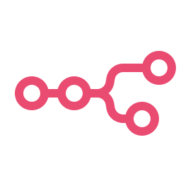

# ioBroker n8n adapter

With _n8n Adapter_ you can edit and execute [n8n](https://n8n.io/) workflows directly from ioBroker.

## Todo
- Remove not working nodes

<!--
	Placeholder for the next version (at the beginning of the line):
	### **WORK IN PROGRESS**
-->
## Changelog
### 0.3.1 (2026-10-15)
- (ioBroker-Bot) Adapter requires js-controller >= 6.0.11 now.
* (@GermanBluefox) Updated packages
* (@GermanBluefox) The tab in admin runs through the port and the login of admin (option "Open n8n via admin", on by default, admin 8.2.1 is required, with an older admin n8n is opened directly on its own port). n8n is then no longer reachable directly on its own port, webhooks still are
* (@GermanBluefox) Occupied TCP ports (service, n8n editor, n8n task broker) are reported to js-controller 8 (`registerUsedResource`)
* (@GermanBluefox) The n8n task broker port depends on the instance number (5679 + 10 * instance), so several instances can run on one host
* (@GermanBluefox) Admin 7.6.20 is enough again, the proxy of admin is only used with admin 8.2.1 or newer
* (@GermanBluefox) Tested with node.js 22 and 24 (node.js 26 is not supported by n8n 2.35 yet)

### 0.3.0 (2025-09-06)
* (@GermanBluefox) Made configurable ports and https settings

### 0.2.0 (2025-09-04)
* (@GermanBluefox) Implemented file selector. The format of trigger/read/write on file was changed.

### 0.1.3 (2025-09-02)
* (@GermanBluefox) Added link from instances to n8n

### 0.1.2 (2025-08-26)
* (@GermanBluefox) Used better format for device description

## License
The MIT License (MIT)

Copyright (c) 2025-2026, Denis Haev (dogafox@gmail.com)

All third party components incorporated into the ioBroker.n8n Software are licensed under the original license
provided by the owner of the applicable component.

Permission is hereby granted, free of charge, to any person obtaining a copy
of this software and associated documentation files (the "Software"), to deal
in the Software without restriction, including without limitation the rights
to use, copy, modify, merge, publish, distribute, sublicense, and/or sell
copies of the Software, and to permit persons to whom the Software is
furnished to do so, subject to the following conditions:

The above copyright notice and this permission notice shall be included in all
copies or substantial portions of the Software.

THE SOFTWARE IS PROVIDED "AS IS", WITHOUT WARRANTY OF ANY KIND, EXPRESS OR
IMPLIED, INCLUDING BUT NOT LIMITED TO THE WARRANTIES OF MERCHANTABILITY,
FITNESS FOR A PARTICULAR PURPOSE AND NONINFRINGEMENT. IN NO EVENT SHALL THE
AUTHORS OR COPYRIGHT HOLDERS BE LIABLE FOR ANY CLAIM, DAMAGES OR OTHER
LIABILITY, WHETHER IN AN ACTION OF CONTRACT, TORT OR OTHERWISE, ARISING FROM,
OUT OF OR IN CONNECTION WITH THE SOFTWARE OR THE USE OR OTHER DEALINGS IN THE
SOFTWARE.