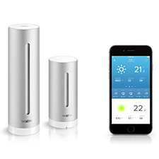

# ioBroker.netatmo

[](https://www.npmjs.com/package/iobroker.netatmo)
[](https://www.npmjs.com/package/iobroker.netatmo)


[](https://weblate.iobroker.net/engage/adapters/?utm_source=widget)

[](https://nodei.co/npm/iobroker.netatmo/)

**Tests:** 

**This adapter uses Sentry libraries to automatically report exceptions and code errors to the developers.** For more details and for information how to disable the error reporting see [Sentry-Plugin Documentation](https://github.com/ioBroker/plugin-sentry#plugin-sentry)! Sentry reporting is used starting with js-controller 3.0.

## Netatmo adapter for ioBroker

Connects ioBroker with the Netatmo cloud (Netatmo Connect API). Supported products:

| Product | Data | Own app required |
|---|---|---|
| Weather station (incl. outdoor, rain, wind and additional indoor modules) | measurements, min/max, trends, battery, radio/WiFi status | no |
| Healthy Home Coach | air quality, CO2, humidity, noise | no |
| Cameras (Welcome, Presence, Smart Door and Window Sensors) | status, events, persons, monitoring on/off | recommended (live stream and full control only with own app) |
| iDiamant / Bubendorff roller shutters | position, control | no |
| Smart Video Doorbell | status, ring, calls, events | yes |
| Smart Smoke Alarm | status, alarms | yes |
| Smart Carbon Monoxide Alarm | status, alarms | yes |

Thermostats and valves (Netatmo Energy) are not supported by this adapter.

## Requirements

* js-controller >= 6.0.0, admin >= 7.6.19
* A Netatmo account with the devices
* For realtime events (cameras, doorbell, smoke and CO alarm): an [iot instance](https://github.com/ioBroker/ioBroker.iot) (>= 1.14.0) connected to an ioBroker Pro account with an Assistant or Remote license. Without it, all data is only updated by polling.
* Recommended: an own Netatmo app (client ID and client secret), see below

## Configuration

### Tab "Devices & login"

1. Select the Netatmo products you want to use.
2. Optional, but recommended: create an own app at [dev.netatmo.com](https://dev.netatmo.com/apps/createanapp) and enter its client ID and client secret.
   An own app is required for doorbell, smoke and CO alarm and the full camera functions, and it allows update intervals below 10 minutes. Without it, a shared ioBroker app is used, whose API quota is shared by all users.
3. Click "Log in with Netatmo". A new window opens with the Netatmo login. After logging in and granting access, the adapter stores the tokens and restarts.

Log in again whenever you change the selected products or the client ID/secret, otherwise data may be missing. If no window opens, check the popup blocker of your browser.

### Tab "Realtime events"

Only shown if cameras, doorbell, smoke or CO alarm are selected.

* **iot instance**: instance used to receive the webhook events from Netatmo. Leave empty to disable realtime events.
* **Remove events older than** (hours), **Cleanup interval** (minutes), **Remove unknown persons last seen more than** (hours, cameras only)

### Tab "Advanced"

* **Update interval** (minutes): at least 10 minutes with the shared app, at least 1 minute with an own app. Netatmo updates weather data about every 10 minutes, so shorter intervals do not provide more weather data. Cameras, doorbell and alarms are polled at twice this interval.
* **Elevation** (meters above sea level): used for the dew point calculation.

Please respect the [Netatmo rate limits](https://dev.netatmo.com/guideline#rate-limits).

## Usage

The adapter creates states for all devices of the selected products. Devices that support events additionally get event states, which are filled by the realtime events (see requirements).

Some devices (e.g. cameras) are initialized with the latest event per type. For other devices (e.g. smoke/CO alarm) the event states are filled with the next event.

### Doorbell

* `ring` is set to `true` when somebody rings (`incoming_call`). It is reset automatically after 60 seconds, immediately on `missed_call`/`accepted_call`, and on adapter start. Netatmo does not reliably send `accepted_call` when a call is answered in the app.
* `incoming_call`, `accepted_call` and `missed_call` contain time, event ID and snapshot URL of the last event of this type.
* Netatmo delivers the webhook events with a delay of a few seconds up to about 2 minutes.

### iDiamant/Bubendorff roller shutters

### Device status

For every device the adapter writes the status values Netatmo delivers. Values a device type does not provide are not created.

| State | Devices | Meaning |
|---|---|---|
| `info.connection` (instance) | all | `true` while the Netatmo cloud is reachable and the login is valid |
| `<device>.info.reachable` | cameras, doorbell, smoke/CO alarm, shutters | `false` if the device is offline (e.g. no WiFi) |
| `<device>.info.error` | cameras, doorbell, smoke/CO alarm, shutters | Netatmo error of the device, e.g. `device_unreachable`, empty if ok |
| `<device>.info.wifi_strength`, `rf_strength` | depending on device | signal strength, lower is better |
| `<device>.info.battery_state`, `battery_level` | battery devices | battery state and voltage (mV) |
| `<device>.info.firmware` | depending on device | firmware version |
| `Reachable`, `Firmware` (weather station modules), `reachable` (Healthy Home Coach) | weather station, coach | reachability and firmware |

A device going offline is logged once as warning, coming back as info. Doorbell and cameras also update `info.reachable` immediately from the `connection`/`disconnection` realtime events, if Netatmo sends them.

The Netatmo API does not provide realtime data for roller shutters, so the values are polled with the update interval. They are not accurate in realtime when the shutters are controlled directly or via the Netatmo app.

When the shutters are controlled via the adapter, the values are updated 2 s and 17 s after the command.

Depending on the device the target position can be set to any value between 0 % and 100 %, or only to 0 % or 100 % (-1 = stop, -2 = jalousie mode for shutters with tiltable slats). The buttons open, close and stop can be used as well.

## sendTo commands

### setAway

Sets all persons as away (e.g. when used as alarm system):

```javascript
sendTo('netatmo.0', 'setAway', { homeId: '1234567890abcdefg' });
```

or for all homes:

```javascript
sendTo('netatmo.0', 'setAway');
```

Only specific persons:

```javascript
sendTo('netatmo.0', 'setAway', { homeId: '1234567890abcdefg', personsId: ['123123123123123'] });
```

`homeId` is the ID shown as top level folder of the home in the objects tab (optional if there is only one home), `personsId` the ID of a person in the "Known" persons folder.

### setHome

Same parameters as `setAway`, sets persons or complete homes as "home".

## Older versions

* **3.0.0**: Realtime events are received via the iot instance. The former Heroku service was shut down on 28.11.2022.
* **2.0.0**: New object structure based on the unique device IDs instead of names. Netatmo disabled the login with username and password in October 2022, authentication is done via the "Log in with Netatmo" button.

## Changelog
<!--
    Placeholder for the next version (at the beginning of the line):
    ### **WORK IN PROGRESS**
-->
### 3.2.0 (2026-11-04)
* (@Schimi1983) Fixed adapter crash when changing a state (e.g. camera monitoring) while the access token had expired
* (@Schimi1983) Token refresh: an invalid refresh token is now reported (re-authentication required) instead of silently starting without data; no endless refresh loop; only one refresh at a time (Netatmo rotates refresh tokens)
* (@Schimi1983) Access and refresh tokens and the client secret are no longer written to the log
* (@Schimi1983) Update intervals are validated also with own client ID (empty value led to polling every millisecond)
* (@Schimi1983) A failing event request no longer discards the home and device status of the update cycle
* (@Schimi1983) Device status for all devices: reachable, error, signal strength, battery and firmware; offline/online is logged; new state info.connection
* (@Schimi1983) Temporary Netatmo outages (5xx, timeouts, "Service temporarily unavailable") are logged as warning and only as error after 3 failed requests in a row; recovery is logged; no more duplicate log entries per error
* (@Schimi1983) Realtime events keep working after re-authentication
* (@Schimi1983) Doorbell: "ring" is reset automatically 60 seconds after the call (Netatmo does not reliably send accepted_call), immediately on accepted_call/missed_call, and on adapter start
* (@Schimi1983) README reworked according to the ioBroker guidelines, older changelog entries moved to CHANGELOG_OLD.md
* (@Schimi1983) Reworked configuration page: tabs, responsive layout, info boxes, units and input validation, translations for all languages; requires admin >= 7.6.19
* (@Schimi1983) Help text for event retention corrected (hours instead of minutes); default update interval 10 minutes
* (@Schimi1983) State roles corrected according to the ioBroker state roles (e.g. `date` instead of the non-existing `value.date`, `text` for texts instead of the generic `state`, `level`/`value.blind` for roller shutters); only roles changed, IDs, types and values stay the same
* (@Apollon77) Removed the usage of a deprecated API from Netatmo which was used to enrich person data
* (@Apollon77) Added product type NACamDoorTag
* (@Apollon77) Allows value -2 for target position of Bubendorff roller shutters to put a Bubendorff shutter with jalousieable slats in jalousie mode

### 3.1.0 (2023-01-06)
* (Apollon77) Add support for Bubendorff roller shutters
* (Apollon77) Fix Monitoring State for Welcomes
* (Apollon77) Allow to just use CO2/Smoke sensors
* (Apollon77) Optimize Shutdown procedure

### 3.0.0 (2022-12-14)
* (Apollon77/bluefox) BREAKING CHANGE: Restructure Realtime events to be received via iot instance (iot >= 1.14.0 required)

### 2.1.2 (2022-11-17)
* (bluefox) Added missing objects for `Welcome` devices

### 2.1.1 (2022-09-30)
* (Apollon77) Make sure device types that require custom credentials are not selectable in UI without entering them
* (Apollon77) Fix a potential crash case

## License

The MIT License (MIT)

Copyright (c) 2016-2026 Patrick Arns <iobroker@patrick-arns.de>

Permission is hereby granted, free of charge, to any person obtaining a copy
of this software and associated documentation files (the "Software"), to deal
in the Software without restriction, including without limitation the rights
to use, copy, modify, merge, publish, distribute, sublicense, and/or sell
copies of the Software, and to permit persons to whom the Software is
furnished to do so, subject to the following conditions:

The above copyright notice and this permission notice shall be included in
all copies or substantial portions of the Software.

THE SOFTWARE IS PROVIDED "AS IS", WITHOUT WARRANTY OF ANY KIND, EXPRESS OR
IMPLIED, INCLUDING BUT NOT LIMITED TO THE WARRANTIES OF MERCHANTABILITY,
FITNESS FOR A PARTICULAR PURPOSE AND NONINFRINGEMENT. IN NO EVENT SHALL THE
AUTHORS OR COPYRIGHT HOLDERS BE LIABLE FOR ANY CLAIM, DAMAGES OR OTHER
LIABILITY, WHETHER IN AN ACTION OF CONTRACT, TORT OR OTHERWISE, ARISING FROM,
OUT OF OR IN CONNECTION WITH THE SOFTWARE OR THE USE OR OTHER DEALINGS IN
THE SOFTWARE.