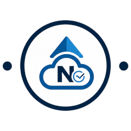

# ioBroker.nextcloud-monitoring

[](https://www.npmjs.com/package/iobroker.nextcloud-monitoring)

[](https://www.npmjs.com/package/iobroker.nextcloud-monitoring)


[](https://www.npmjs.com/package/iobroker.nextcloud-monitoring)

**Tests:**  

**This adapter uses Sentry libraries to automatically report exceptions and code errors to the developers.** For more details and instructions on disabling error reporting, please refer to the [Sentry-Plugin Documentation](https://github.com/ioBroker/plugin-sentry#plugin-sentry)! Use of Sentry reporting starts with js-controller 3.0.

I use my own Sentry server based on Glitchtip.

---

## Description
This adapter allows for detailed monitoring of your Nextcloud instance via the official OCS API (`serverinfo`). It provides numerous system data, user statistics, shares, as well as performance values from PHP (OPcache/FPM) and the database directly in ioBroker.

## Features
* **System Status:** CPU load, RAM usage, free disk space, and Nextcloud version.
* **User Statistics:** Number of active users (5 min, 1 hr, 24 hr), total number of files, and storage usage.
* **Shares:** Monitoring of link shares, Talk rooms, and federated shares.
* **Server Health:** PHP version, memory limit, OPcache hit rate, and detailed FPM process statistics.
* **Widget:** Use the internal widget, which creates an htmlWidget data point in the location folder; or, if you wish to customize it yourself, use [this one](https://github.com/H5N1v2/VIS2-widget-nextcloud-monitoring).

---

## Installation & Configuration

### 1. Connection Settings
* **Domain:** Enter your Nextcloud domain without `https://` (e.g., `cloud.yourdomain.com`).
* **Token:** The OCS API token of your Nextcloud (see section "How-To: Token").
* **Update Interval:** Time in minutes between API requests (Default: 10 min, Minimum: 5 min).
* **Multible Server:** You can now add multible Server e.g.: my_server_1, and next server e.g.: other_server_2
* **Widget:** 
1. **Enable:** Check the "Create Widget" checkbox in the instance settings for your location.
2. **Find State:** The adapter will create a state called `htmlWidget` (under `nextcloud-monitoring.0.SERVERNAME.htmlWidget`).
3. **In VIS/VIS2:** * Drag a standard **"HTML" widget** onto your view.
   * Set the "HTML" property of that widget to the binding of your state: `{nextcloud-monitoring.0.SERVERNAME.htmlWidget}`.
   * Adjust the width and height of the widget container to fit the content.

### 2. Data Options
* **Skip Apps:** Disables the detailed list of installed apps to reduce API load.
* **Skip Update Check:** Disables checking for new Nextcloud versions.

### 3. Requirements
* **js-controller >= 7.2.4** – needed to decrypt the OCS tokens, which are stored inside the server table (`servers.token`), when the adapter starts.
* **Admin >= 8.1.0** – needed because the JSON config of admin encrypts and decrypts password columns of a table only since this version (see `@iobroker/json-config` 10.1.0).

### 4. Token storage and access protection
* The OCS token of every server in the table is stored **encrypted** in the instance object (`encryptedNative: ["servers.token"]`).
* The token is **protected** against being read by other adapters (`protectedNative: ["servers.token"]`).
* The adapter itself gets the decrypted token when it starts. Tokens are never written to the log.
* Tokens of existing installations are kept - they are neither deleted nor reset. A token that was still stored as plain text (by an admin version that could not encrypt password columns of a table) is encrypted by the adapter on the next start, so the token does not have to be entered again.
* Saving other settings does not write the tokens back as plain text.

---

## How-To: Create & Set Token

Accessing the `serverinfo` API requires a valid API token. This token must be stored directly in the Nextcloud configuration.

### Generate the Token (Linux / Windows)
To enable access, you must generate a token (a random string) and register it in your Nextcloud instance using the `occ` tool.

**Command to generate the token:**
* **Linux (Terminal):** 

`openssl rand -hex 32`
* **Windows (PowerShell):** 

`$bytes = New-Object Byte[] 32; (New-Object System.Security.Cryptography.RNGCryptoServiceProvider).GetBytes($bytes); [System.BitConverter]::ToString($bytes).Replace("-", "").ToLower()`

* Alternatively, you can use online tools such as 

[it-tools.tech/token-generator](https://it-tools.tech/token-generator).*

## Set Token in Nextcloud
**Example for Linux (Standard path) in Terminal:**
```bash
sudo -u www-data php /path_to/your/nextcloud_folder/occ config:app:set serverinfo token --value YOUR_GENERATED_TOKEN
```
**Example for Linux (Directly in your Nextcloud folder) in Terminal:**
```bash
sudo -u www-data php occ config:app:set serverinfo token --value YOUR_GENERATED_TOKEN
```
**If you use your Nextcloud in a webspace or other Provider, mostly you don't need sudo, simply do:**
 ```bash
#Directly in your Nextcloudfolder
php occ config:app:set serverinfo token --value YOUR_GENERATED_TOKEN

#Or with path
php /path_to/your/nextcloud_folder/occ config:app:set serverinfo token --value YOUR_GENERATED_TOKEN
```

Command for Windows (PowerShell/CMD): Navigate to your Nextcloud directory and execute:

`php occ config:app:set serverinfo token --value YOUR_GENERATED_TOKEN`

Monitored Data Points (Excerpt)

| Path | Description | Data Type |
| :--- | :--- | :--- |
| `system.version` | Installed Nextcloud version | string |
| `system.cpuload_1` | CPU load of the last minute | number |
| `system.freespace` | Free disk space | string |
| `storage.num_users` | Total number of users | number |
| `server.php.opcache_hit_rate` | Efficiency of the PHP cache | string |
| `fpm.active_processes` | Active PHP-FPM processes | number |
| `activeUsers.last5min` | Users active in the last 5 minutes | number |

## Troubleshooting (FAQ)

### Invalid Domain: Enter the domain without a protocol.

    Correct: mycloud.com or mycloud.com/folder

    Incorrect: https://mycloud.com or http://mycloud.com/folder

### API delivers no data:

Ensure that the "Server Info" app (standard app) is enabled in your Nextcloud under "Apps". Without this app, the adapter cannot retrieve any data.

### Token Error:

Verify if the token was correctly saved in Nextcloud using:

* In Linux: 

`sudo -u www-data php /path_to/your/nextcloud_folder/occ config:app:get serverinfo token`

* Or if you are directly in folder, use:

`sudo -u www-data php occ config:app:get serverinfo token`

* If you use your Nextcloud in a webspace or other Provider, mostly you don't need sudo:

`php occ config:app:get serverinfo token` or `php /path_to/your/nextcloud_folder/occ config:app:get serverinfo token`

### Maintenance Mode:

If your Nextcloud is in maintenance mode, the adapter will not be able to fetch data and will log an info. This is normal behavior as the API is disabled during maintenance.

## Changelog
### 3.0.1 (2026-11-09)
* (H5N1v2) fix: [W1095] remove the unused legacy key `token` from `protectedNative` and from `native`; the adapter stores and protects the OCS token of the server table only (`servers.token`)
* (H5N1v2) fix: [S5054] datapoints are created with `setObjectNotExistsAsync()` instead of `setObject()`

### 3.0.0 (2026-11-08)
* (H5N1v2) fix: OCS tokens of all servers are now stored encrypted (`encryptedNative: servers.token`) and are protected against access by other adapters (`protectedNative`). Tokens of existing installations are kept and are encrypted automatically if they were still stored as plain text, so they do not have to be entered again
* (H5N1v2) fix: OPcache hit rate was written as string although the datapoint expects a number; existing datapoints with wrong type or role are now corrected automatically and state values are converted to match their datapoint type
* (H5N1v2) update dependencies: adapter requires js-controller >= 7.2.4 and admin >= 8.1.0 (needed for encrypted attributes inside a table)

### 2.1.2 (2026-09-12)
* (H5N1v2) add node.js 26.x testmatrix
* (H5N1v2) update dependencies

### 2.1.1 (2026-07-06)
* (H5N1v2) chore: update dependencies
* (H5N1v2) fix: [W5612] add translations for 'your-cloud.com' in multiple languages
* (H5N1v2) fix: [E6025] README.md must contain exactly one H1 heading, but found 6.

### 2.1.0 (2026-05-09)
* (H5N1v2) widget toggleable in the admin area.
* (H5N1v2) update dependencies.
* (copilot) Adapter requires node.js >= 22 now.

## Support & Feedback

If you encounter any **bugs**, have **feature requests**, or want to suggest **improvements**, please feel free to open an **Issue** on GitHub. This helps to track the progress and helps other users with similar problems.

[👉 Open a new Issue here](https://github.com/H5N1v2/iobroker.nextcloud-monitoring/issues)

---

## License
MIT License

Copyright (c) 2026 H5N1v2 <h5n1@iknox.de>

Permission is hereby granted, free of charge, to any person obtaining a copy
of this software and associated documentation files (the "Software"), to deal
in the Software without restriction, including without limitation the rights
to use, copy, modify, merge, publish, distribute, sublicense, and/or sell
copies of the Software, and to permit persons to whom the Software is
furnished to do so, subject to the following conditions:

The above copyright notice and this permission notice shall be included in all
copies or substantial portions of the Software.

THE SOFTWARE IS PROVIDED "AS IS", WITHOUT WARRANTY OF ANY KIND, EXPRESS OR
IMPLIED, INCLUDING BUT NOT LIMITED TO THE WARRANTIES OF MERCHANTABILITY,
FITNESS FOR A PARTICULAR PURPOSE AND NONINFRINGEMENT. IN NO EVENT SHALL THE
AUTHORS OR COPYRIGHT HOLDERS BE LIABLE FOR ANY CLAIM, DAMAGES OR OTHER
LIABILITY, WHETHER IN AN ACTION OF CONTRACT, TORT OR OTHERWISE, ARISING FROM,
OUT OF OR IN CONNECTION WITH THE SOFTWARE OR THE USE OR OTHER DEALINGS IN THE
SOFTWARE.