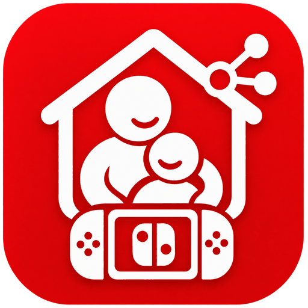

# ioBroker.nintendo-switch-parental

Unofficial [Nintendo Switch Parental Controls](https://www.nintendo.com/switch/parental-controls/) integration for ioBroker. I use it to read and change play time, daily limit, extra time, bedtime and more. It works for Nintendo Switch and Nintendo Switch 2 and talks to Nintendo's cloud, the same service the official smartphone app uses. The cloud API and the login flow are ported from [pynintendoparental](https://github.com/pantherale0/pynintendoparental), the library behind the Home Assistant integration.

**Nintendo** and **Nintendo Switch** are trademarks of Nintendo. This project is not affiliated with or endorsed by Nintendo. The API is not public and Nintendo may change or block it at any time.

## Features

- Play time today and this month, time remaining, last sync per console
- Daily limit, timer mode (daily / per weekday) and suspend-software mode
- Extra time: add or cancel
- Bedtime start and end
- Template: save the play time rules and write them back every night
- Pause today: block play until midnight
- Restriction level (age rating)
- Play time per player and, optionally, per game (with allow list)
- Polling every 1-60 minutes (default 5), commands are sent immediately

## Requirements

- Node.js 22 or newer, js-controller 6.0.11 or newer, admin 7.6.20 or newer
- A Nintendo Account that is the parent/guardian of at least one console in the Nintendo Switch Parental Controls app
- The console has to be online for Nintendo to receive the current play time

## Installation

Install via ioBroker Admin UI.

## Configuration

Open the instance settings and sign in with your Nintendo Account:

1. Click **Create login link**. A Nintendo login page opens.
2. Sign in. On the page *Linking an External Account*, right-click **Select this person** and copy the link address. Do not click the button.
3. Paste the link into **Copied link** and click **Complete login**.

The session token is stored encrypted and the adapter restarts. If Nintendo ever revokes the token, the log tells you to sign in again.

| Setting | Description |
|---------|-------------|
| Poll interval | Seconds between cloud reads (60-3600, default 300) |
| Timezone | Used for "today" and the weekday limits (default Europe/Berlin) |
| Language | Nintendo cloud language (default de-DE) |
| Create states for each game | Creates `apps.<applicationId>.*` per game |

## Datapoints

Per console under `devices.<deviceId>`:

| State | Access | Description |
|-------|--------|-------------|
| `name`, `model`, `firmware` | R | Console label, model (Switch / Switch 2) and firmware |
| `lastSync` | R | Last time the console synced its settings with Nintendo |
| `lastUpdate` | R | Last time the adapter got fresh data from Nintendo |
| `playTimeToday` | R | Minutes played today (all players) |
| `timeRemaining` | R | Minutes left today, considers limit, extra time and bedtime |
| `playTimeMonth` | R | Minutes played this month |
| `limit` | R/W | Daily limit in minutes, `-1` = no limit, maximum 360. Applies to today's regulation (the weekday in per-weekday mode) |
| `extraTime` | R | Extra time granted today in minutes, `-1` = unlimited |
| `addExtraTime` | W | Minutes of extra time to add today, `-1` = unlimited. Nintendo takes 60 minutes per request, so more is sent in steps |
| `cancelExtraTime` | W | Button, removes today's extra time |
| `bedtimeAlarm` | R/W | Bedtime start `HH:MM` (16:00-23:59), `00:00` = bedtime off |
| `bedtimeEnd` | R/W | Bedtime end `HH:MM` (05:00-09:00), `00:00` = bedtime off |
| `suspendSoftware` | R/W | `true`: software is suspended when time is up, `false`: alarm only |
| `timerMode` | R/W | `DAILY` or `EACH_DAY_OF_THE_WEEK` |
| `restrictionLevel` | R/W | `NONE`, `CHILDREN`, `YOUNG_TEENS`, `OLDER_TEENS` or `CUSTOM` |
| `alarmsEnabled` | R | Whether alarms are shown on the console |
| `saveTemplate` | W | Button, saves the current play time rules as template |
| `restoreTemplate` | W | Button, writes the template back to the console |
| `restoreDaily` | R/W | Switch, writes the template back every night shortly after midnight |
| `template` | R/W | The saved template as JSON |
| `pauseToday` | W | Button, sets today's limit to 0 until midnight |
| `resumeToday` | W | Button, ends the pause and restores the previous limit |
| `pausedLimit` | R | The limit from before the pause, empty when not paused |
| `players.<playerId>.*` | R | Nickname, profile image and play time today per user |
| `apps.<applicationId>.*` | R/W | Only with *Create states for each game*: title, play time today and `allowed` (allow list, ignores age restrictions) |

Instance: `info.connection` is `true` while Nintendo's cloud is reachable and the login is valid.

While extra time is active, the adapter refuses to change the limit, bedtime, suspend mode and timer mode, so cancel the extra time first. Invalid values are refused with a warning and the state returns to the real value right after.

## Template and pause

The template holds the whole schedule: timer mode, suspend mode, the limits of all days and the bedtime.

1. Set the rules in the Nintendo app as they should normally be.
2. Press `saveTemplate` once per console.
3. Switch on `restoreDaily`.

Every night shortly after midnight the adapter compares the rules at Nintendo with the template and writes the template back if they differ. One-off changes, for example a longer limit on a single day, therefore do not stay. `restoreTemplate` does the same on demand. The template can also be edited as JSON in `template`.

`pauseToday` sets today's limit to 0, so the console cannot be used. The previous limit is kept in `pausedLimit`. `resumeToday` or midnight puts it back. In per-weekday mode the limit belongs to the weekday, so without the pause ending the 0 would stay for the following weeks.

## Notes

- Settings changed here reach the console the next time it connects to the internet.
- While extra time is active, the adapter refuses to change the limit, bedtime, suspend mode and timer mode. Cancel the extra time first.
- Invalid values are refused with a warning and the state returns to the real value.
- Changing the PIN is not supported.
- The nightly restore runs up to five minutes after midnight. A failed restore is retried twice every 15 minutes. If the adapter was not running at midnight, old pauses end and the template is restored at the next start (`info.lastNightlyRun` holds the day of the last run).
- Pause and restore are refused while extra time is active.

## Changelog

### 0.1.5 (2026-11-27)
- (backfisch88) Fix: Nintendo rejected the old app version (`update_required`), now sends 2.7.0 (740)
- (backfisch88) New: `lastUpdate` shows when the adapter last got data from Nintendo
- (backfisch88) Change: `lastSync` is described as the last settings sync of the console

### 0.1.3 (2026-11-18)
- (backfisch88) Fix: roles of `limit` and `addExtraTime` (`level`)
- (backfisch88) Fix: a nightly run that failed on the last attempt is caught up at the next start
- (backfisch88) Change: the nightly run reads a console again only if it changed something

### 0.1.2 (2026-11-17)
- (backfisch88) Fix: size attributes for all admin settings
- (backfisch88) Fix: a missed midnight (pause end, template restore) is caught up at the next start
- (backfisch88) Fix: nightly run loads the console list itself if the first poll failed
- (backfisch88) Fix: extra time 0 is ignored, `addExtraTime` has a maximum of 360
- (backfisch88) Change: existing states get updated definitions, admin messages use all translations
- (backfisch88) Change: translated adapter description, same contact address everywhere

### 0.1.1 (2026-11-16)
- (backfisch88) Fix: extra time above 60 minutes is sent in steps

### 0.1.0 (2026-11-16)
- (backfisch88) New: template (save, restore, nightly restore)
- (backfisch88) New: pause today

Older changes can be found in CHANGELOG_OLD.md.

## Credits

The cloud API and login flow follow [pynintendoparental](https://github.com/pantherale0/pynintendoparental) (MIT, Justin Hammond) and [pynintendoauth](https://pypi.org/project/pynintendoauth/).

## License

MIT License

Copyright (c) 2026 Henrik Schönhofen (backfisch88) <henrik.schoenhofen@icloud.com>

See [LICENSE](https://github.com/backfisch88/ioBroker.nintendo-switch-parental/blob/main/LICENSE) for the full license text.