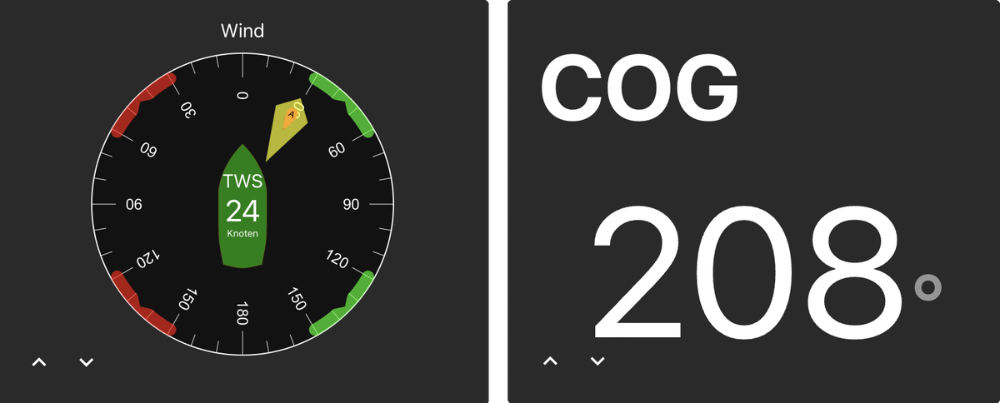
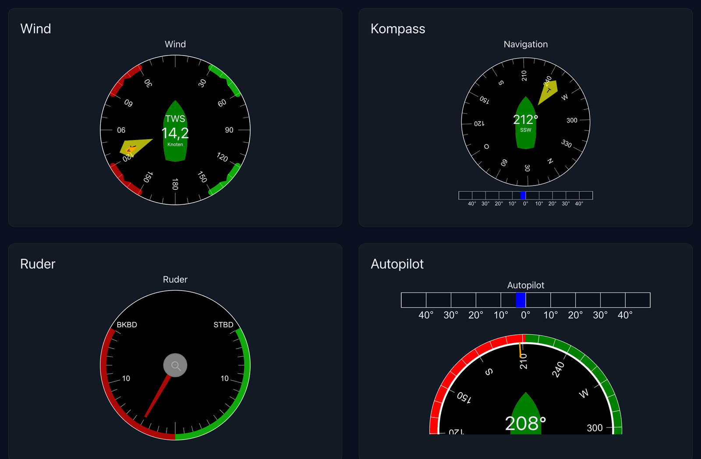
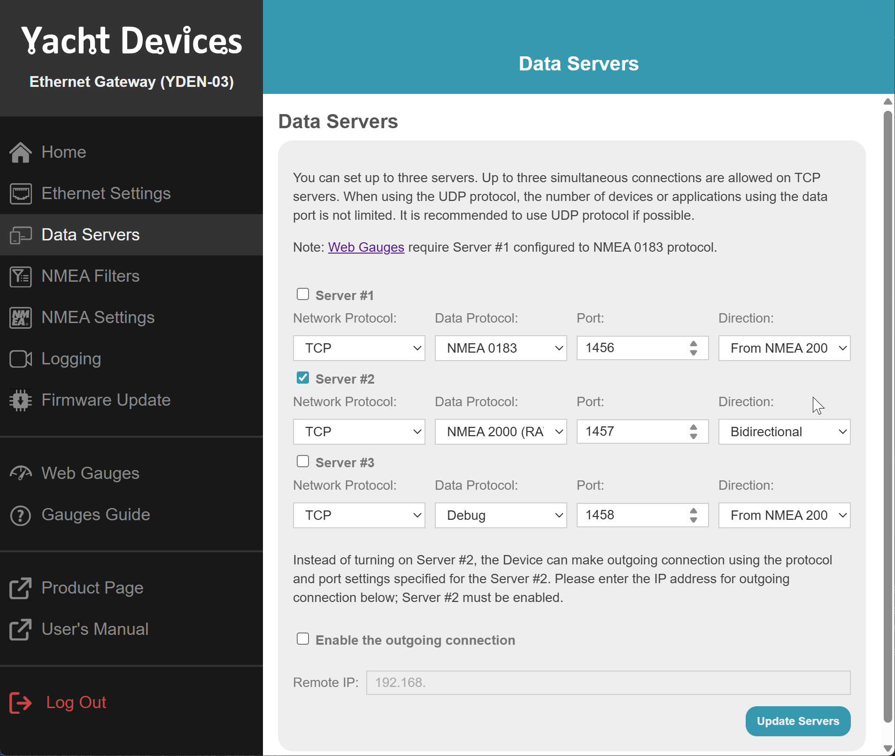

# ioBroker.nmea
This adapter allows connecting ioBroker to NMEA-2000 yacht bus.

**This adapter uses Sentry libraries to automatically report exceptions and code errors to the developers.**
For more details and for information how to disable the error reporting, see [Sentry-Plugin Documentation](https://github.com/ioBroker/plugin-sentry#plugin-sentry)!
Sentry reporting is used starting with js-controller 3.0.

To use this adapter, you need a hardware that can read NMEA-2000 bus and convert it to the serial port:
- [Actisense NGT-1 (USB)](https://actisense.com/products/ngt-1-nmea-2000-to-pc-interface/)
- [Actisense NGX1-USB (USB)](https://actisense.com/products/nmea-2000-gateway-ngx-1/)
- or [Raspberry PI with PiCAN-M](https://www.skpang.co.uk/collections/hats/products/copy-of-pican-m-with-can-bus-micro-c-and-rs422-connector-no-smps)
- [Yacht Devices YDWG-02/03](https://www.yachtd.com/products/wifi_gateway.html)
- [Yacht Devices YDEN-02/03](https://www.yachtd.com/products/ethernet_gateway.html)

PiCAN-M could work with Raspberry 4 and [5](https://copperhilltech.com/blog/testing-pican-can-bus-hats-with-the-raspberry-pi-5/).



The widget "NMEA Complex" four times in one vis-2 view, every instance shows one display: wind, compass,
rudder and autopilot.



[YouTube explanation](https://youtu.be/flp_-mypbRU?si=k0lp95OukQ88LBxj)

## How to use it on Raspberry PI with PiCAN-M

The PiCAN M is a compact add-on board designed for the Raspberry Pi 3/4.
It enables the connection of both NMEA2000 and NMEA0183 networks to a Raspberry Pi.
The board can be powered through an external 12V source.
Additionally, it offers the option to power the Raspberry Pi directly via the NMEA2000 bus when used with the PiCAN-M board.

**The PiCAN-M lacks appropriate protection against reverse polarity for the 12V supply voltage. When operated externally at 12V, it is necessary to include a 1A fuse in the power supply line.**

Because of the high requirements of Raspberry Pi to power supply, we suggest powering the Raspberry PI from the external power source (at least 3A).
Power over NMEA2000 and over USB could function in parallel without a problem.

### Installation
See chapter 3 in [PiCAN-M User Guide](https://github.com/ioBroker/ioBroker.nmea/blob/master/img/pican-m_UGB_10.pdf) for more details, but here is a short summary:

Edit file `/boot/config.txt` (with `sudo nano /boot/config.txt`) and add the following lines to the end of the file:
```
enable_uart=1
dtparam=i2c_arm=on
dtparam=spi=on
dtoverlay=mcp2515-can0,oscillator=16000000,interrupt=25 
```

Disable outputs on the UART console: 
- start in CLI `sudo raspi-config`
- go to `3 Interface Options`
- go ot `I5 Serial Port`
- Disable `shell accessible over serial` and `serial port hardware enabled`
- Exit from `raspi-config` and reboot

Install can-utils
```shell
sudo apt-get install can-utils
```

## Actisense NGT-1
Actisense NGT-1 is visible on Windows or Linux without any additional drivers. It is visible as a serial port 'COMn' (Windows) or ttyN(on linux).

## YDEN, YDWG
Enable server N2 with TCP protocol and bidirectional mode.



UDP could work too, but the gateway sends the data into the network continuously, so the bus could be overloaded.

## Todo
- Encode code
- AIS
- find out why sent data from address 100
- Integration of [iKonvert NMEA 2000](https://digitalyachtamerica.com/product/ikonvert-usb/)
- Integration of [Shipmodul MiniPlex-3-N2K](https://www.shipmodul.com/products.html)

## Data simulation
You can feed the data from external sensors to the NMEA2000 bus.
Actually, you can only simulate environmental data, like temperature, humidity, pressure.

With the flag `Combined environment` you can define the PGN number which will be used for temperature, humidity and pressure:
- If you unselect the flag `Combined environment`, so for the temperature will be used PGN 130314, for humidity PGN 130313 and for pressure PGN 130314.
- If you select the flag `Combined environment`, so all three values will be sent in PGN 130311 together with other possible environmental values.

## Time zone
There is a possibility to set the time zone from GPS coordinates.
For this the according option must be enabled in the adapter settings and allowed for `iobroker` user the command execution:
`sudo visudo`

```
iobroker ALL=(ALL) timedatectl set-timezone
```

## Autopilot
Actually, only one autopilot is supported: Raymarine

The development of Simrad/navico/B&G is not completed yet.

### Wind datum display
For Raymarine units that publish the "Pilot Wind Datum" (PGN 65345), the adapter stores the
raw angle in radians under `seatalkPilotWindDatum.windDatum` (this is the canonical value the
autopilot reads back when you change the wind angle, so it must stay in radians).

In addition, a read-only convenience state `seatalkPilotWindDatum.windDatumDisplay` is created.
It shows the angle exactly the way the Raymarine pilot head does:
- `0…180°` → starboard, `180…360°` → port,
- each as a `≤180°` value plus a language-dependent side letter (e.g. a datum of `230°`
  is shown as `130°P` in English and `130°B` in German). `0°` (dead ahead) and `180°`
  (dead astern) carry no side letter.

Use `windDatumDisplay` for visualization and `windDatum` for calculations/automation.

## Web components
Besides the vis-2 widgets and the devices widgets, the adapter offers web components for Aura and other hosts
(`common.webComponents`, `admin/webcomponents/`). Each one is a single module and shows the same as its native widget:

| Tag | Shows | Settings |
|-----|-------|----------|
| `iob-nmea-wind` | Wind instrument: apparent and true wind, heading, COG, set and drift, AWS, TWS, STW, SOG | instance, wind shift history, close-hauled zone, speed unit, sail trim |
| `iob-nmea-history-chart` | Live chart of a state with min/avg/max lines, filled from the default history instance | state, label, unit, time window, Y-axis, lines, decimals, color |
| `iob-nmea-autopilot` | Autopilot mode, locked heading, rudder and the buttons to steer (large changes ask for confirmation) | instance, AWA, rudder bar |
| `iob-nmea-ais-radar` | AIS targets around the own boat on a sea chart, with trails and COG vectors | instance, range, hide after, vectors, course up, own MMSI |
| `iob-nmea-anchor-position` | Anchor, boat, swing circle, track and anchor alarm on a map; the dialog sets the anchor and the alarm | instance, anchor/boat position states, chain length, depth at drop, map style |
| `iob-nmea-instrument` | Up to four values as on a marine instrument, one at a time | per value: state, name, unit, digits, color, plus sign, change flash |
| `iob-nmea-compass` | Compass with course over ground, true wind direction and rudder (the "Navigation" window of the vis-2 widget "Complex") | instance, rudder |
| `iob-nmea-rudder` | Rudder angle indicator that zooms in on small angles (the "Rudder" window of the vis-2 widget "Complex") | instance, full range, zoom threshold, hysteresis |

The sources are in `src-webcomponents/`; `npm run build:wc` builds them.

## Acknowledgements
NMEA 2000 decoding by [canboatjs](https://github.com/canboat/canboatjs), using the [CANboat](https://github.com/canboat/canboat) PGN database (Apache License 2.0).

<!--
	### **WORK IN PROGRESS**
-->
## Changelog

### **WORK IN PROGRESS**
- (@GermanBluefox) Added the short form of the web component manifests (tag, name, icon, size) to `common.webComponents`, so that hosts like Aura can list the components before the adapter is installed; the build writes it with `iob-web-components sync-io-package`

### 3.1.1 (2026-11-09)
- (@GermanBluefox) Web components: the heading of the wind display no longer covers a compass label, and the label of the outer ring of the AIS radar no longer sits on the "N"

### 3.1.0 (2026-11-08)
- (copilot) Adapter requires node.js >= 22.19.0 now
- (@GermanBluefox) The maps of the AIS radar and the anchor position work again: CARTO asks for an API key now, they use Esri Dark Gray and OpenStreetMap
- (@GermanBluefox) Added the web components `iob-nmea-wind`, `iob-nmea-history-chart`, `iob-nmea-autopilot`, `iob-nmea-ais-radar`, `iob-nmea-anchor-position`, `iob-nmea-instrument`, `iob-nmea-compass` and `iob-nmea-rudder` for Aura and other hosts (`common.webComponents`)
- (@GermanBluefox) The switch of the anchor position widget now arms the anchor watch instead of showing the alarm, which turns the alarm circle red; the widget "Instrument" is no longer a musical instrument in Chinese
- (@GermanBluefox) The anchor position widget can be given the chain length and the depth at drop for its swing circle; its settings show proper labels and help texts
- (@GermanBluefox) The anchor position widget speaks all languages, shows the anchor of the anchor alarm when no anchor position is chosen and loads the track from the history also for the own GNSS position; the settings "split view" and "sail trim" of the wind and autopilot widgets are translated into all languages

### 3.0.2 (2026-10-27)
- (@GermanBluefox) Deleted the states without object at the start, e.g. the AIS data of old vessels left by versions before 1.0.0 (needs js-controller 7.2.3 or newer)

### 3.0.1 (2026-10-19)
- (@GermanBluefox) Migrated widgets to React 19

### 2.0.0 (2026-08-04)
- (bluefox) Migrated to devices V3

## License
The MIT License (MIT)

Copyright (c) 2024-2026 bluefox <dogafox@gmail.com>

Permission is hereby granted, free of charge, to any person obtaining a copy
of this software and associated documentation files (the "Software"), to deal
in the Software without restriction, including without limitation the rights
to use, copy, modify, merge, publish, distribute, sublicense, and/or sell
copies of the Software, and to permit persons to whom the Software is
furnished to do so, subject to the following conditions:

The above copyright notice and this permission notice shall be included in
all copies or substantial portions of the Software.

THE SOFTWARE IS PROVIDED "AS IS", WITHOUT WARRANTY OF ANY KIND, EXPRESS OR
IMPLIED, INCLUDING BUT NOT LIMITED TO THE WARRANTIES OF MERCHANTABILITY,
FITNESS FOR A PARTICULAR PURPOSE AND NONINFRINGEMENT. IN NO EVENT SHALL THE
AUTHORS OR COPYRIGHT HOLDERS BE LIABLE FOR ANY CLAIM, DAMAGES OR OTHER
LIABILITY, WHETHER IN AN ACTION OF CONTRACT, TORT OR OTHERWISE, ARISING FROM,
OUT OF OR IN CONNECTION WITH THE SOFTWARE OR THE USE OR OTHER DEALINGS IN
THE SOFTWARE.