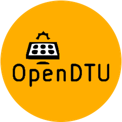

# ioBroker.opendtu

[](https://www.npmjs.com/package/iobroker.opendtu)
[](https://www.npmjs.com/package/iobroker.opendtu)


[](https://nodei.co/npm/iobroker.opendtu/)

**Tests:** 

**🇩🇪 [Deutsche Anleitung](https://github.com/iobroker-community-adapters/ioBroker.opendtu/blob/main/docs/de/README.md)**

## OpenDTU adapter for ioBroker

[OpenDTU](https://www.opendtu.solar) is a small box that talks to Hoymiles micro-inverters by radio – often used for balcony solar systems.
This adapter brings the values of your OpenDTU into ioBroker, live and without delay:

- current power of each inverter and of all inverters together
- yield of today and since commissioning
- values per solar panel, temperature, voltage and more
- **limit the power** of your inverters, e.g. for zero feed-in

## What you need

- an OpenDTU that is running and reachable in your home network (you can open its web page in the browser)
- its address, e.g. `192.168.1.50`
- the password of the OpenDTU web page – needed to limit the power (see [Password](#password))

## Setup

1. Install the adapter in ioBroker under **Adapters** and create an instance.
2. In the settings, enter the **address** of your OpenDTU – the same one you type into the browser.
3. Enter the **password** of the OpenDTU web page (user `admin`).
4. **Save**. After a few seconds the values appear under **Objects → opendtu.0**.

That's it. Protocol (HTTP) and port (80) only have to be changed in rare cases – they are visible in the expert mode of the admin.

### Options

| Option | What it does |
|---|---|
| Set values to 0 when an inverter is not reachable | Recommended. At night the inverters switch off. Without this option, the last values of the evening stay visible all night. Yield values are kept. |
| Keep my own names of the objects | Switch on if you renamed objects in ioBroker. The adapter then no longer overwrites the names. |

### Password

- To **read** the values, no password is needed as long as *"Allow readonly access to web interface without password"* is switched on in OpenDTU (*Settings → Security*). This is the default.
- To **limit the power** or to switch an inverter on and off, the password is always needed.

## Using the values

Each inverter gets its own folder named after its serial number (the name you gave it in OpenDTU is shown next to it).

| Object | Meaning |
|---|---|
| `opendtu.0.total.power` | current power of all inverters together (W) |
| `opendtu.0.total.yieldday` | yield of all inverters today (Wh) |
| `opendtu.0.total.yieldtotal` | yield of all inverters since commissioning (kWh) |
| `opendtu.0.<serial>.ac.phase_1.power` | current power of this inverter (W) |
| `opendtu.0.<serial>.yieldday` | yield of this inverter today (Wh) |
| `opendtu.0.<serial>.yieldtotal` | yield of this inverter since commissioning (kWh) |
| `opendtu.0.<serial>.dc.input_1.power` | power of the solar panel at input 1 (W) |
| `opendtu.0.<serial>.temperature` | temperature of the inverter (°C) |
| `opendtu.0.<serial>.available` | inverter reachable – `false` at night is normal |
| `opendtu.0.<serial>.producing` | inverter is producing power |
| `opendtu.0.dtu.available` | OpenDTU itself is reachable |

**Tip for energy statistics:** use `yieldtotal`. It only counts up and is not affected by restarts – ideal for adapters like *SourceAnalytix* or for your own charts.

## Limiting the power

In the folder `opendtu.0.<serial>.power_control` you can limit the power of an inverter. Simply write a number into one of these objects:

| Object | Limit | Kept after restart of the inverter? |
|---|---|---|
| `limit_nonpersistent_absolute` | in watts, e.g. `300` | no |
| `limit_nonpersistent_relative` | in percent, e.g. `50` | no |
| `limit_persistent_absolute` | in watts | yes |
| `limit_persistent_relative` | in percent | yes |

- For **automatic control** (e.g. zero feed-in, changes every few seconds or minutes) always use the **nonpersistent** objects.
- ⚠️ The **persistent** limits are saved in the inverter's memory, which only allows a limited number of writes. Change them **rarely**, e.g. once when setting up the system.
- The limit currently applied is shown in `current_limit_relative` and `current_limit_absolute`. After setting an absolute limit it can take up to about 4 minutes until this value is updated.
- `limit_set_status` shows whether the inverter accepted the last limit: `Pending` = sent, `Ok` = applied, `Failure` = not received yet (OpenDTU tries again by itself).

Example in a JavaScript script – limit the inverter to 300 W:

```js
setState('opendtu.0.116100000001.power_control.limit_nonpersistent_absolute', 300);
```

The buttons `power_on`, `power_off` and `restart` switch the inverter on, off or restart it.

## Messages of the inverter

`opendtu.0.<serial>.events.last` shows the last message of the inverter with its time (e.g. a grid fault or a start). `events.count` is the number of stored messages (the inverter clears them when it starts in the morning) and `events.json` the full list. You can use this for notifications, e.g. with a script or the *Notification Manager*.

## Questions and problems

**No values appear**
- Open the address from the settings in your browser. If the OpenDTU page does not open there, ioBroker cannot reach it either (check the address, Wi-Fi, firewall or VLAN).
- If you switched off *"Allow readonly access"* in OpenDTU, enter the password in the adapter settings.

**The limit is not applied**
- Check the password in the adapter settings – changing the limit always needs it.
- Look into the ioBroker log; the adapter writes a message there if OpenDTU rejects the command.

**At night all values are 0 / the inverters are "not available"**
- That is normal: Hoymiles inverters are powered by the solar panels and switch off in the dark.

**An inverter is often "not available" during the day**
- The radio connection is probably weak. Look at `opendtu.0.<serial>.radio.rssi` (below about −80 dBm is weak) and `opendtu.0.dtu.hints.radio_problem`. Place the OpenDTU closer to the inverters or turn its antenna.

**My network shows many DNS queries from ioBroker**
- Enter the IP address (e.g. `192.168.1.50`) instead of a name like `opendtu.local`.

<details>
<summary>For advanced users</summary>

### How the adapter works
- Live values are pushed by OpenDTU via the websocket `ws://<address>/livedata`. OpenDTU sends one message per inverter whenever new data arrives (about every 1–10 seconds), so there is no polling.
- Status of the OpenDTU itself (`dtu.*`: host name, IP, Wi-Fi signal, uptime) is read every 60 seconds from `/api/network/status` and `/api/system/status`.
- Commands are sent to `/api/limit/config` and `/api/power/config` (Basic authentication, user `admin`).
- `yieldtotal` is written again once a day at 00:01 so that statistic adapters notice the new day.

### Limit types
| Object | OpenDTU `limit_type` |
|---|---|
| `limit_nonpersistent_absolute` | 0 |
| `limit_nonpersistent_relative` | 1 |
| `limit_persistent_absolute` | 256 |
| `limit_persistent_relative` | 257 |

More details about the limits can be found in the [OpenDTU documentation](https://www.opendtu.solar/firmware/web_api/).

### Object structure
```
opendtu.0
├── info.connection         connected to OpenDTU
├── dtu                     OpenDTU itself (incl. hints, heap)
├── total                   sum of all inverters
└── <serial>                one folder per inverter
    ├── ac.phase_1          AC side (grid)
    ├── dc.input_1 … n      DC side (solar panels)
    ├── events              messages of the inverter
    ├── radio               radio statistics
    └── power_control       limits, on/off and command status
```
</details>

## Credits

This adapter would not have been possible without the great work of @o0Shojo0o (https://github.com/o0Shojo0o), who developed former releases of this adapter.

## How to report issues and feature requests

Please use [GitHub issues](https://github.com/iobroker-community-adapters/ioBroker.opendtu/issues). It helps a lot if you set the adapter to log level *debug* (Instances → expert mode → column *log level*) and attach the log file from the ioBroker `log` directory – **not** from the admin, which cuts long lines.

## Changelog
<!--
	Placeholder for the next version (at the beginning of the line):
	### **WORK IN PROGRESS**
-->
### **WORK IN PROGRESS**
- (Schimi1983) Translations of the settings page moved to the short file format, obsolete workflow file removed (repository checker #413)

### 4.1.1 (2026-11-04)
- (GermanBluefox) Fixed: a limit of 0 % that was not set by the adapter (e.g. in the OpenDTU web UI or via MQTT) was not shown

### 4.1.0 (2026-11-04)
- (Schimi1983) Status of the last limit and on/off command, maximum power of the inverter [#226]
- (Schimi1983) Event log of each inverter (number, last event, list) [#261]
- (Schimi1983) Radio statistics per inverter and hints of OpenDTU (time not synchronized, radio problem, default password)
- (Schimi1983) Temperature, memory and firmware of the OpenDTU; model and firmware of each inverter
- (Schimi1983) Daily maximum power and temperature (OpenDTU v26.9 and newer)
- (Schimi1983) Fixed: host name of the OpenDTU was never shown
- (Schimi1983) Fixed: after a restart of the OpenDTU the current limit showed 0 % for some minutes
- (Schimi1983) Total DC power over all inverters, message ID of the last event (for notifications)
- (Schimi1983) Event log is also updated when it is full (OpenDTU keeps 15 events per inverter)
- (Schimi1983) Clearer object names (e.g. current limit in % and W, persistent / non-persistent limits)
- (Schimi1983) Roles of all objects corrected according to the ioBroker state roles (e.g. yield `value.energy.produced`, availability `indicator.reachable`, limits `level`, buttons write-only)

### 4.0.0 (2026-11-03)
- (copilot) Adapter requires node.js >= 22.19.0 now
- (copilot) Adapter requires admin >= 7.7.22 now
- (copilot) Adapter requires js-controller >= 6.0.11 now
- (Schimi1983) README rewritten for beginners, German guide added (docs/de/README.md)
- (Schimi1983) Settings page: short guide, help texts in simple words, protocol and port only in expert mode, address is checked before saving
- (Schimi1983) New state `info.connection`, the instance shows green/yellow again
- (Schimi1983) Clear log messages for wrong or missing password, connection problems are logged only once
- (Schimi1983) Password is no longer part of the websocket URL
- (Schimi1983) Reconnect waits longer while OpenDTU is offline (2 s up to 60 s), fewer DNS queries [#192]
- (Schimi1983) Fixed: adapter reconnected after it was stopped
- (Schimi1983) Fixed: several adapter instances in compact mode influenced each other
- (Schimi1983) Fixed: with several inverters an offline inverter could show old values again
- (Schimi1983) Commands are confirmed (ack) only after OpenDTU accepted them, invalid limits are rejected
- (Schimi1983) Address field accepts input like `http://192.168.1.10/`
- (Schimi1983) Fixed: `total.yieldtotal` and `total.yieldday` dropped after midnight or an OpenDTU restart until all inverters answered; counters such as SourceAnalytix saw this as a meter reset
- (mcm1957) Dependencies have been updated.

### 3.1.0 (2024-12-02)
- (mattreim) Variable polling interval has been removed and polling intervals hev been increased.
- (mattreim) Description has been translated into supported languages.
- (mattreim) Admin-UI has been adapted for some display sizes.
- (mcm1957) Dependencies have been updated.

### 3.0.1 (2024-10-26)
- (simatec) Admin-UI has been adapted for small displays.
- (mcm1957) Dependencies have been updated.

## License
MIT License

Copyright (c) 2026 iobroker-community-adapters <iobroker-community-adapters@gmx.de>  
Copyright (c) 2024 ioBroker Community Developers <iobroker-community-adapters@gmx.de>  
Copyright (c) 2024 Dennis Rathjen <dennis.rathjen@outlook.de>

Permission is hereby granted, free of charge, to any person obtaining a copy
of this software and associated documentation files (the "Software"), to deal
in the Software without restriction, including without limitation the rights
to use, copy, modify, merge, publish, distribute, sublicense, and/or sell
copies of the Software, and to permit persons to whom the Software is
furnished to do so, subject to the following conditions:

The above copyright notice and this permission notice shall be included in all
copies or substantial portions of the Software.

THE SOFTWARE IS PROVIDED "AS IS", WITHOUT WARRANTY OF ANY KIND, EXPRESS OR
IMPLIED, INCLUDING BUT NOT LIMITED TO THE WARRANTIES OF MERCHANTABILITY,
FITNESS FOR A PARTICULAR PURPOSE AND NONINFRINGEMENT. IN NO EVENT SHALL THE
AUTHORS OR COPYRIGHT HOLDERS BE LIABLE FOR ANY CLAIM, DAMAGES OR OTHER
LIABILITY, WHETHER IN AN ACTION OF CONTRACT, TORT OR OTHERWISE, ARISING FROM,
OUT OF OR IN CONNECTION WITH THE SOFTWARE OR THE USE OR OTHER DEALINGS IN THE
SOFTWARE.