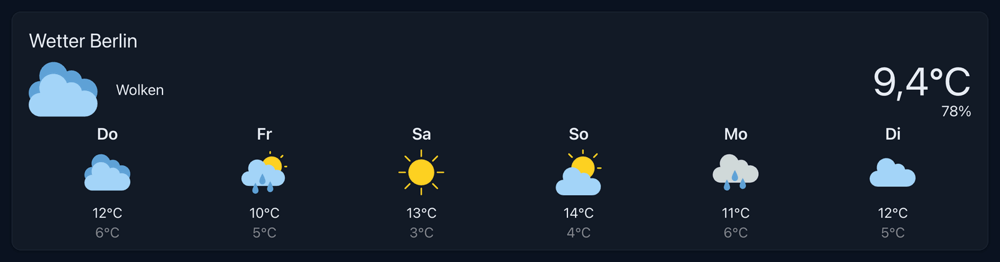

# ioBroker.openweathermap

**This adapter uses Sentry libraries to automatically report exceptions and code errors to the developers.** For more details and for information how to disable the error reporting see [Sentry-Plugin Documentation](https://github.com/ioBroker/plugin-sentry#plugin-sentry)! Sentry reporting is used starting with js-controller 3.0.

Fetches 5 days weather forecast from [https://openweathermap.org/](https://github.com/ioBroker/ioBroker.openweathermap/blob/master/openweathermap.org)

You need an api key to access the data. The api key you can get for free after registration [here](https://home.openweathermap.org/api_keys).

## vis-2 widget
The widget "Weather" shows the current weather and the forecast for up to six days. The button "i" opens a dialog
with more details (wind, pressure, precipitation). The temperature and the humidity can be taken from a real sensor
instead of OpenWeatherMap (settings "Current temperature ID" and "Current humidity ID").

The size of the icons is set with "Icon size (current)" and "Icon size (days)" in pixels. Empty values keep the
default sizes.

## Web component
The same weather is also available as the web component `<iob-openweathermap-weather>` (`@iobroker/web-components`,
listed in `common.webComponents`) for Aura, admin, ioBroker.devices and every other host of web components. vis-2
offers its native widget "Weather" instead, as both carry the same name.

It shows the current weather above the forecast days (or beside them in a wide and low box) and scales with its box.
A click shows the details - wind, humidity, pressure and precipitation of today and of every day - in a dialog of the
host. Settings: the instance, a title, what to show (all, only the current weather, only the days), the number of
days (1-6), and optionally the IDs of a real temperature and humidity sensor. The units follow the instance setting
(metric or imperial). The icon sizes of the vis-2 widget are not needed: the icons scale with the box.

<!--
	### **WORK IN PROGRESS**
-->
## Changelog

### **WORK IN PROGRESS**
* (@GermanBluefox) Added the short form of the web component manifests (tag, name, icon, size) to `common.webComponents`, so that hosts like Aura can list the components before the adapter is installed; the build writes it with `iob-web-components sync-io-package`

### 2.3.0 (2026-11-08)
* (@GermanBluefox) Added the web component `iob-openweathermap-weather` for Aura and other hosts (`common.webComponents`)
* (@GermanBluefox) Corrected wrong translations of the vis-2 widget and the web component, e.g. the weather "Clear" and the "Close" button
* (@GermanBluefox) Corrected the Dutch wind direction south-southeast (ZZO instead of ZSO)
* (@GermanBluefox) The API key is stored encrypted and shown as a password field. An existing key is encrypted automatically at the next start of the instance
* (@GermanBluefox) The vis-2 widget applies the CSS settings for text color, font and background color to all of its texts, the info button and the card

### 2.2.0 (2026-11-05)
* (@GermanBluefox) The place can be selected on a map in the instance settings (needs an admin version with map support for the coordinates field)
* (@GermanBluefox) Updated packages

### 2.1.0 (2026-10-29)
* (@GermanBluefox) Added settings for the icon size of the current weather and of the forecast days in the vis-2 widget

### 2.0.4 (2026-10-22)
* (@GermanBluefox) Fixed raw translation keys (e.g. openweathermap_Wed) in the widget with vis-2 2.15.x (#750)
* (@GermanBluefox) The widget requires vis-2 2.20.2 or newer, if vis-2 is installed

### 2.0.3 (2026-10-17)
* (@GermanBluefox) Updated packages

## License

The MIT License (MIT)

Copyright (c) 2018-2026 bluefox <dogafox@gmail.com>

Permission is hereby granted, free of charge, to any person obtaining a copy
of this software and associated documentation files (the "Software"), to deal
in the Software without restriction, including without limitation the rights
to use, copy, modify, merge, publish, distribute, sublicense, and/or sell
copies of the Software, and to permit persons to whom the Software is
furnished to do so, subject to the following conditions:

The above copyright notice and this permission notice shall be included in all
copies or substantial portions of the Software.

THE SOFTWARE IS PROVIDED "AS IS", WITHOUT WARRANTY OF ANY KIND, EXPRESS OR
IMPLIED, INCLUDING BUT NOT LIMITED TO THE WARRANTIES OF MERCHANTABILITY,
FITNESS FOR A PARTICULAR PURPOSE AND NONINFRINGEMENT. IN NO EVENT SHALL THE
AUTHORS OR COPYRIGHT HOLDERS BE LIABLE FOR ANY CLAIM, DAMAGES OR OTHER
LIABILITY, WHETHER IN AN ACTION OF CONTRACT, TORT OR OTHERWISE, ARISING FROM,
OUT OF OR IN CONNECTION WITH THE SOFTWARE OR THE USE OR OTHER DEALINGS IN THE
SOFTWARE.