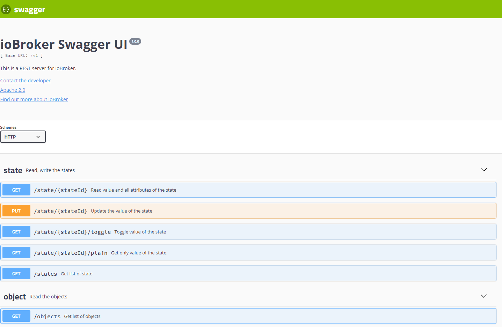

# REST-API adapter

  [](https://www.npmjs.com/package/iobroker.rest-api)
[](https://www.npmjs.com/package/iobroker.rest-api)
[](https://travis-ci.org/ioBroker/ioBroker.rest-api)

[](https://nodei.co/npm/iobroker.rest-api/)

**This adapter uses Sentry libraries to automatically report exceptions and code errors to the developers.** For more details and for information on how to disable the error reporting, see [Sentry-Plugin Documentation](https://github.com/ioBroker/plugin-sentry#plugin-sentry)! Sentry reporting is used starting with js-controller 3.0.

This is a RESTFul interface to read the objects and states from ioBroker and to write/control the states over HTTP Get/Post requests.

The purpose of this adapter is similar to simple-api. But this adapter supports long-polling and URL hooks for subscribing.

It has a beneficial web interface to play with the requests:



## Usage
Call in browser `http://ipaddress:8093/` and use Swagger UI to request and modify the states and objects.

Some request examples:
- `http://ipaddress:8093/v1/state/system.adapter.rest-api.0.memHeapTotal` - read state as JSON
- `http://ipaddress:8093/v1/state/system.adapter.rest-api.0.memHeapTotal/plain` - read state as string (only value)
- `http://ipaddress:8093/v1/state/system.adapter.rest-api.0.memHeapTotal?value=5` - write state with GET (only for back compatibility with simple-api)
- `http://ipaddress:8093/v1/sendto/javascript.0?message=toScript&data={"message":"MESSAGE","data":"FROM REST-API"}` - send a message to `javascript.0` in script `scriptName`

### Authentication
To enable the authentication, you must set the `Authentication` option in the configuration dialog.

There are three types of authentication supported:
- Credentials in a query
- Basic authentication
- OAuth2 (Bearer)

For authentication in a query, you must set `user` and `pass` in query like:
```http
http://ipaddress:8093/v1/state/system.adapter.rest-api.0.memHeapTotal?user=admin&pass=admin
```

For basic authentication, you must set the `Authorization` header with the value `Basic base64(user:pass)`.

For Oauth2 authentication, you must set the `Authorization` header with the value `Bearer <AccessToken>`.

The access token can be retrieved with an HTTP request like:
```http
http://ipaddress:8093/oauth/token?grant_type=password&username=<user>&password=<password>&client_id=ioBroker
```

The answer is like:
```json
{
    "access_token": "21f89e3eee32d3af08a71c1cc44ec72e0e3014a9",
    "expires_in": "2025-02-23T11:39:32.208Z",
    "refresh_token": "66d35faa5d53ca8242cfe57367210e76b7ffded7",
    "refresh_token_expires_in": "2025-03-25T10:39:32.208Z",
    "token_type": "Bearer"
}
```         

## Subscribe to the state's or object's changes
Your application could get notifications by every change of the state or object.

For that, your application must provide an HTTP(S) end-point to accept the updates.

Example in node.js see here [demoNodeClient.js](https://github.com/ioBroker/ioBroker.rest-api/blob/master/examples/demoNodeClient.js)

## Long polling
This adapter supports subscribing on data changes via long polling. 

Example for the browser could be found here: [demoNodeClient.js](https://github.com/ioBroker/ioBroker.rest-api/blob/master/examples/demoBrowserClient.html)  

## Web extension
This adapter can run as a web extension. In this case, the path is available under `http://ipaddress:8082/rest-api/`

## Reverse proxy
If the adapter runs behind a reverse proxy under a sub-path, set this path in the instance settings (`Reverse proxy path`, e.g. `/rest-api`).
Swagger UI then sends its requests to `/rest-api/v1/...` instead of `/v1/...`.
The proxy must strip the prefix before forwarding the request, e.g. for nginx:

```nginx
location /rest-api/ {
    proxy_pass http://iobroker-host:8093/;
}
```

If the adapter runs as a web extension, the path is prepended to `/rest-api/` of the web adapter.

## Write many states with one request
`PATCH /v1/states` writes several states with one request (replacement for `setBulk` of `simple-api`):

```http
PATCH http://ipaddress:8093/v1/states
Content-Type: application/json

[
    { "id": "0_userdata.0.nfc.UserID", "val": "4711" },
    { "id": "0_userdata.0.nfc.NFCID", "val": "04A224B2C35E80" },
    { "id": "0_userdata.0.nfc.TagContent", "val": "door", "ack": true }
]
```

Instead of an array, an object can be sent: `{ "0_userdata.0.a": 1, "0_userdata.0.b": { "val": 2, "ack": true } }`.

The answer contains one entry per state in the same order: `{ id, val, ack }` or `{ id, index, error }` if this state could not be written.
With `?stopOnError=true` the processing stops at the first error. Maximum 1000 states per request.

**Important:** the states are written one after another in the given order. It is **not** a transaction: every state fires its own change event, 
and a script triggered by the first state may not see the new values of the following states yet. 
If a script needs all values together, trigger it only on the **last** state of the list and read the other states there.

## Notice
- `POST` is always for creating a resource (does not matter if it was duplicated)
- `PUT` is for checking if resource exists then update, else create new resource
- `PATCH` is always for updating a resource

## Commands
Additionally, you can execute many socket commands via a special interface:

`http://ipaddress:8093/v1/command/<commandName>?arg1=Value2&arg2=Value2`

E.g.
- `http://ipaddress:8093/v1/command/getState?id=system.adapter.admin.0.alive` - to read the state of `system.adapter.admin.0.alive`
- `http://ipaddress:8093/v1/command/readFile?adapter=admin.admin&fileName=admin.png` - to read the file `admin.admin/admin.png` as JSON result
- `http://ipaddress:8093/v1/command/readFile?adapter=admin.admin&fileName=admin.png?binary` - to read the file `admin.admin/admin.png` as file
- `http://ipaddress:8093/v1/command/extendObject?id=system.adapter.admin.0?obj={"common":{"enabled":true}}` - to restart admin

You can request all commands with the POST method too. As body must be an object with parameters. E.g.:
```bash
curl --location --request POST 'http://ipaddress:8093/v1/command/sendTo' \
--header 'Content-Type: application/json' \
--data-raw '{
"adapterInstance": "history.0",
"command": "getHistory",
"message": {"id": "system.adapter.admin.0.memRss","options": {"aggregate": "onchange", "addId": true}}
}'
```

You cannot send a POST request to commands via GUI.

<!-- START -->
### States
- `getStates(pattern)` - get the list of states for a pattern (e.g. for system.adapter.admin.0.*). GUI can have problems with visualization of the answer.
- `getForeignStates(pattern)` - same as getStates
- `getState(id)` - get state value by ID
- `setState(id, state)` - set state value with JSON object (e.g. `{"val": 1, "ack": true}`)
- `getBinaryState(id)` - get binary state by ID
- `setBinaryState(id, base64)` - set binary state by ID

### Objects
- `getObject(id)` - get object by ID
- `getObjects(list)` - get all states and rooms. GUI can have problems with visualization of the answer.
- `getObjectView(design, search, params)` - get specific objects, e.g. design=system, search=state, params=`{"startkey": "system.adapter.admin.", "endkey": "system.adapter.admin.\u9999"}`
- `setObject(id, obj)` - set object with JSON object (e.g. `{"common": {"type": "boolean"}, "native": {}, "type": "state"}`)
- `delObject(id, options)` - delete an object by ID

### Files
- `readFile(adapter, fileName)` - read file, e.g. adapter=vis.0, fileName=main/vis-views.json. Additionally, you can set an option in query binary=true to get the answer as a file and not as JSON
- `readFile64(adapter, fileName)` - read file as base64 string, e.g. adapter=vis.0, fileName=main/vis-views.json. Additionally, you can set an option in query binary=true to get the answer as a file and not as JSON
- `writeFile64(adapter, fileName, data64, options)` - write file, e.g. adapter=vis.0, fileName=main/vis-test.json, data64=eyJhIjogMX0=
- `unlink(adapter, name)` - delete file or folder
- `deleteFile(adapter, name)` - delete file
- `deleteFolder(adapter, name)` - delete folder
- `renameFile(adapter, oldName, newName)` - rename file
- `rename(adapter, oldName, newName)` - rename file or folder
- `mkdir(adapter, dirName)` - create folder
- `readDir(adapter, dirName, options)` - read content of folder
- `chmodFile(adapter, fileName, options)` - change file mode. E.g. adapter=vis.0, fileName=main/*, options = `{"mode": 0x644}`
- `chownFile(adapter, fileName, options)` - change file owner. E.g. adapter=vis.0, fileName=main/*, options = `{"owner": "newOwner", "ownerGroup": "newgroup"}`
- `fileExists(adapter, fileName)` - check if a file exists

### Admins
- `getHostByIp(ip)` - read host information by IP. e.g. by localhost
- `readLogs(host)` - read file name and size of log files. You can read them with http://ipaddress:8093/<fileName>
- `delState(id)` - delete state and object. Same as delObject
- `getRatings(update)` - read adapter ratings (as in admin)
- `getCurrentInstance()` - read adapter namespace (always rest-api.0)
- `decrypt(encryptedText)` - decrypt string with system secret
- `encrypt(plainText)` - encrypt string with system secret
- `getAdapters(adapterName)` - get objects of type "adapter". You can optionally define adapterName
- `updateLicenses(login, password)` - read licenses from ioBroker.net portal
- `getCompactInstances()` - read list of instances with short information
- `getCompactAdapters()` - read list of installed adapters with short information
- `getCompactInstalled(host)` - read short information about installed adapters
- `getCompactSystemConfig()` - read short system config
- `getCompactSystemRepositories()`
- `getCompactRepository(host)` - read short repository
- `getCompactHosts()` - get short information about hosts
- `addUser(user, pass)` - add new user
- `delUser(user)` - delete user
- `addGroup(group, desc, acl)` - create a new group
- `delGroup(group)` - delete group
- `changePassword(user, pass)` - change user password
- `getAllObjects()` - read all objects as a list. GUI can have problems with visualization of the answer.
- `extendObject(id, obj)` - modify an object by ID with JSON. (.e.g. `{"common":{"enabled": true}}`) 
- `getForeignObjects(pattern, type)` - same as getObjects
- `delObjects(id, options)` - delete objects by pattern

### Others
- `updateTokenExpiration(accessToken)`
- `log(text, level[info])` - no answer - add log entry to ioBroker log
- `checkFeatureSupported(feature)` - check if feature is supported by js-controller.
- `getHistory(id, options)` - read history. See for options: https://github.com/ioBroker/ioBroker.history/blob/master/docs/en/README.md#access-values-from-javascript-adapter
- `httpGet(url)` - read URL from server. You can set binary=true to get an answer as a file
- `sendTo(adapterInstance, command, message)` - send command to instance. E.g. adapterInstance=history.0, command=getHistory, message=`{"id": "system.adapter.admin.0.memRss","options": {"aggregate": "onchange", "addId": true}}`
- `listPermissions()` - read static information with function permissions
- `getUserPermissions()` - read object with user permissions
- `getVersion()` - read adapter name and version
- `getAdapterName()` - read adapter name (always rest-api)
- `clientSubscribe(targetInstance, messageType, data)`
- `getAdapterInstances(adapterName)` - get objects of type "instance". You can optionally define adapterName

<!-- END -->

<!--
	Placeholder for the next version (at the beginning of the line):
	### **WORK IN PROGRESS**
-->

## Changelog
### 4.1.2 (2026-10-13)
- (@GermanBluefox) Added `PATCH /v1/states` to write many states with one request (bulk update)
- (@GermanBluefox) Fixed `413 Payload Too Large` for request bodies larger than 100kB when authentication is enabled
- (@GermanBluefox) Added option `Reverse proxy path` to make Swagger UI work behind a reverse proxy

### 4.0.4 (2026-10-13)
- (@GermanBluefox) Updated packages
- (@GermanBluefox) Added option to use HTTP/2 on a secure connection (enabled by default, falls back to HTTP/1.1)
- (@GermanBluefox) Report the used port to js-controller

### 4.0.3 (2026-10-13)
- (iobroker-bot) Adapter requires node.js >= 22 now.
- (@GermanBluefox) Replaced `process.exit()` with `terminate()` for compact mode and added tests on Windows and macOS

### 4.0.2 (2026-06-14)
* (@GermanBluefox) Packages were updated
* (@GermanBluefox) Allowed to define the response content type by sendTo queries
* (@GermanBluefox) Corrected some minor issues

### 4.0.1 (2026-02-17)
* (@GermanBluefox) Corrected some minor issues

## License
Apache 2.0, see [LICENSE](https://github.com/ioBroker/ioBroker.rest-api/blob/master/LICENSE)

Copyright (c) 2017-2026 bluefox <dogafox@gmail.com>