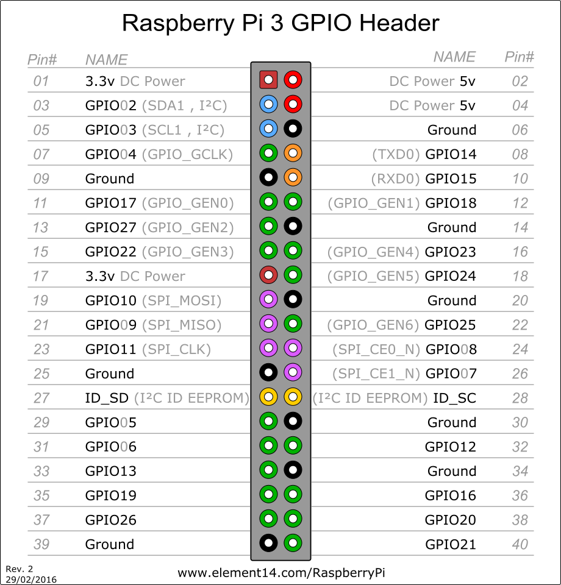

# ioBroker.rpi2

[](https://www.npmjs.com/package/iobroker.rpi2)
[](https://www.npmjs.com/package/iobroker.rpi2)


## Versions


RPI-Monitor Adapter for ioBroker

RPI-Monitor implementation for integration into ioBroker. It is the same implementation as for iobroker.rpi, but with GPIOs.

## Important Information

**ioBroker needs special permissions to control GPIOs.** On most Linux distributions this can be achieved by adding the ioBroker user to the `gpio` group.

You need to install `libgpiod-dev` in version **2.2 or newer** **before** installing the adapter (see below), otherwise the installation is aborted.
Debian 13 / Trixie ships 2.2.1. Debian 12 / Bookworm only has older versions (1.6, or 2.1 from other sources), which are **not** enough.
You can check the installed version with `dpkg -s libgpiod-dev | grep Version`.

> [!CAUTION]
> Version 3.x.x and newer of this adapter supports and requires Debian 13 / Trixie (Linux kernel 5.10 or newer). Do not update if you are using older o/s.

## Installation

After installation you can configure the monitor settings in the instance settings.

After start of `iobroker.rpi`, all selected modules generates
an object tree in ioBroker within rpi.<instance>.<modulename>
e.g. `rpi.0.cpu`

The adapter needs some os dependencies. Usually js-controller should take care of this, but if you have problems,
please install the following packages manually:

```bash
sudo apt update
sudo apt install -y build-essential
sudo apt install -y libgpiod-dev
sudo apt install -y pkg-config
```

`libgpiod-dev` (version 2.2 or newer) is always required, the installation checks for it (with `pkg-config` if installed).

### Disk temperature
You can read NVMe and SATA/USB drive temperatures (`temperature.disk_temp`, enable *Temperature* in the instance settings).
The adapter reports the first drive that has a temperature, checking `/dev/nvme0` to `/dev/nvme9` first, then `/dev/sda` to `/dev/sdz`.
To do this, you need to install the `smartmontools` package and allow the `iobroker` user to run `smartctl` as root:

```bash
sudo apt install smartmontools
sudo visudo -f /etc/sudoers.d/iobroker-disktemp
```

Do not add the rule to the sudoers file `/etc/sudoers.d/iobroker`, it is reset by `iob fix`. Add these lines to the new file:

```
Cmnd_Alias SMARTCTL = /usr/sbin/smartctl -A /dev/sd[a-z], \
                      /usr/sbin/smartctl -A /dev/nvme[0-9]
Defaults!SMARTCTL !syslog, !pam_session
iobroker ALL=(root) NOPASSWD: SMARTCTL
```

The rule allows only reading the values of these drives, not changing any drive settings.
`!syslog` and `!pam_session` keep the regular readings out of the system log.
Some USB-SATA adapters do not pass the SMART data through. To check, run `sudo -u iobroker sudo -n smartctl -A /dev/sda`
and look for `Temperature_Celsius` or `Temperature:` in the output.

## GPIOs
You can read and control GPIOs too.
All what you need to do is to configure in the settings the GPIOs options (additional tab).



After some ports are enabled following states appear in the object tree:
- rpi.0.gpio.PORT.state

The numeration of ports is BCM (BroadComm pins on chip). You can get the enumeration with ```gpio readall```.
For instance PI2:

```
+-----+-----+---------+------+---+---Pi 2---+---+------+---------+-----+-----+
| BCM | wPi |   Name  | Mode | V | Physical | V | Mode | Name    | wPi | BCM |
+-----+-----+---------+------+---+----++----+---+------+---------+-----+-----+
|     |     |    3.3v |      |   |  1 || 2  |   |      | 5v      |     |     |
|   2 |   8 |   SDA.1 | ALT0 | 1 |  3 || 4  |   |      | 5V      |     |     |
|   3 |   9 |   SCL.1 | ALT0 | 1 |  5 || 6  |   |      | 0v      |     |     |
|   4 |   7 | GPIO. 7 |   IN | 1 |  7 || 8  | 0 | IN   | TxD     | 15  | 14  |
|     |     |      0v |      |   |  9 || 10 | 1 | IN   | RxD     | 16  | 15  |
|  17 |   0 | GPIO. 0 |   IN | 0 | 11 || 12 | 0 | IN   | GPIO. 1 | 1   | 18  |
|  27 |   2 | GPIO. 2 |   IN | 0 | 13 || 14 |   |      | 0v      |     |     |
|  22 |   3 | GPIO. 3 |   IN | 0 | 15 || 16 | 0 | IN   | GPIO. 4 | 4   | 23  |
|     |     |    3.3v |      |   | 17 || 18 | 0 | IN   | GPIO. 5 | 5   | 24  |
|  10 |  12 |    MOSI |   IN | 0 | 19 || 20 |   |      | 0v      |     |     |
|   9 |  13 |    MISO |   IN | 0 | 21 || 22 | 1 | IN   | GPIO. 6 | 6   | 25  |
|  11 |  14 |    SCLK |   IN | 0 | 23 || 24 | 1 | IN   | CE0     | 10  | 8   |
|     |     |      0v |      |   | 25 || 26 | 1 | IN   | CE1     | 11  | 7   |
|   0 |  30 |   SDA.0 |   IN | 1 | 27 || 28 | 1 | IN   | SCL.0   | 31  | 1   |
|   5 |  21 | GPIO.21 |   IN | 1 | 29 || 30 |   |      | 0v      |     |     |
|   6 |  22 | GPIO.22 |   IN | 1 | 31 || 32 | 0 | IN   | GPIO.26 | 26  | 12  |
|  13 |  23 | GPIO.23 |   IN | 0 | 33 || 34 |   |      | 0v      |     |     |
|  19 |  24 | GPIO.24 |   IN | 0 | 35 || 36 | 0 | IN   | GPIO.27 | 27  | 16  |
|  26 |  25 | GPIO.25 |  OUT | 1 | 37 || 38 | 0 | IN   | GPIO.28 | 28  | 20  |
|     |     |      0v |      |   | 39 || 40 | 0 | IN   | GPIO.29 | 29  | 21  |
+-----+-----+---------+------+---+----++----+---+------+---------+-----+-----+
| BCM | wPi |   Name  | Mode | V | Physical | V | Mode | Name    | wPi | BCM |
+-----+-----+---------+------+---+---Pi 2---+---+------+---------+-----+-----+
```

### Inputs
- **Pull Up** / **Pull Down** switch on the internal pull resistor of the input. With *Pull Up*, the input is active low: connect a switch between the GPIO and GND, and the state is `true` while the switch is closed. With *Pull Down*, connect the switch to 3.3 V instead; the state is `true` while it is closed.
  Without either, the pull resistor is left as it is - the default of the Raspberry Pi (pull-up for GPIO 0-8, pull-down for all others) or what you set in `config.txt`, e.g. `gpio=17=pu`.
- **Debounce / Poll (ms)**: a change is only reported once the input has been stable for this time, e.g. 20-50 ms for switches and buttons. The kernel does this; if your system does not support it, the adapter does it itself and logs a message.

## DHTxx/AM23xx Sensors
You can read from DHT11, DHT21 (AM2301), DHT22 and AM2302 temperature/humidity sensors.

Connect such a sensor to a GPIO pin as described on the [node-dht-sensor](https://www.npmjs.com/package/node-dht-sensor) package page. Multiple sensors can be connected to *multiple* pins (this is *not* a bus system) as discussed.

In the GPIO table, select `DHT11` for DHT11 sensors and `DHT22/AM23xx` for all others, and enter the poll interval in milliseconds into the *Debounce / Poll* column. The sensors cannot be read faster than every 2000 ms (DHT11: 1000 ms); without a value, the adapter polls every 30000 ms.

For each sensor the adapter creates `gpio.N.temperature`, `gpio.N.humidity` and `gpio.N.dewpoint`. The dew point is calculated from temperature and humidity with the Magnus formula. It is only as accurate as the sensor: about ±1 °C with a DHT22, considerably less with a DHT11.

The adapter reads a sensor in one of two ways and logs at startup which one it uses for each sensor.

### Linux kernel driver (recommended)

Linux has its own driver for these sensors (it handles DHT11, DHT22 and AM2302, and should handle DHT21 as well). Enable it for each sensor by adding a line to `/boot/firmware/config.txt` (`/boot/config.txt` on older systems) and reboot:

```
dtoverlay=dht11,gpiopin=17
```

`gpiopin` is the GPIO (BCM) number, the same as in the adapter's GPIO table. You can check that it works with `cat /sys/bus/iio/devices/iio:device*/in_temp_input` (the value is in 1/1000 °C). The adapter detects the driver and uses it automatically, there is nothing else to configure.

The overlay is part of Raspberry Pi OS since 2015 (Raspbian Jessie) and works on every Raspberry Pi, including the Pi 5, Pi 500 and Compute Module 5. Kernels from before November 2024 often failed to decode newer DHT11 sensors that report decimal places ("Don't know how to decode data" in `dmesg`); Raspberry Pi OS 13 (Trixie), which this adapter requires, has the fix.

### node-dht-sensor

Without the kernel driver, the adapter falls back to node-dht-sensor. This works on Raspberry Pi 1 to 4 only. On a Raspberry Pi 5 (also Pi 500 and Compute Module 5) it cannot work, because it accesses GPIO registers the Pi 5 does not have - use the kernel driver there. Unlike node-dht-sensor, the kernel driver also keeps working after Node.js upgrades and adapter reinstalls.

## Changelog

<!--
	PLACEHOLDER for the next version:
	### **WORK IN PROGRESS**
-->
### 5.0.0 (2026-11-11)
- (Garfonso/Claude) **BREAKING**: *Pull Up* and *Pull Down* switch on the internal pull resistors of inputs (#31). Before, *Pull Up* only inverted the value; it still does. If you used *Pull Up* just to invert an input that is switched to 3.3 V, the input now stays high: untick *Pull Up* and tick *Invert* instead. Also check inputs with *Pull Up* and an external pull-down resistor.
- (Garfonso/Claude) **BREAKING**: Inputs are debounced by the kernel. A change is reported once the input has been stable for the debounce time, instead of right away followed by a pause. Changes therefore arrive later by that time, and pulses shorter than the debounce time (e.g. from S0 or reed contact meters) are ignored - lower the debounce time below the shortest pulse. In return a short glitch no longer leaves the state wrong.
- (Grothesk242) **BREAKING**: `temperature.nvme_temp` is replaced by `temperature.disk_temp`. It is read with smartmontools from the first NVMe or SATA/USB drive that reports a temperature. The old state is deleted. Install `smartmontools` and replace the old `nvme` sudo rule by the new one from the README.
- (Garfonso/Claude) **NEW**: DHT sensors also report the dew point (`gpio.N.dewpoint`), calculated from temperature and humidity.
- (Garfonso/Claude) **ENHANCED**: An input that cannot be set up no longer disables all other GPIOs; the reason is logged.
- (Garfonso/Claude) A missing drive, WLAN or sudo rule is no longer logged as an error, and no longer shows a disk temperature of 0.
- (copilot) Adapter requires node.js >= 22.19.0 now
- (Garfonso/Claude) Removed `python` from the OS dependencies, there is no such package on current Debian.
- (Garfonso/Claude) DHT sensors: the README and the log messages recommend the Linux kernel driver, the instructions for rebuilding node-dht-sensor are removed. An already rebuilt node-dht-sensor keeps working.
- (Garfonso/Claude) The check for libgpiod 2.2 moved from the adapter's preinstall script into `@garfonso/opengpio`.
- (Garfonso/Claude) Removed the unused `ci` dependency, updated dependencies and added missing translations in the admin page.

### 4.0.0 (2026-10-07)
- (copilot) Adapter requires node.js >= 22 now
- (copilot) Adapter requires admin >= 7.7.22 now
- (mcm1957) Dependencies have been updated.
- (copilot) **ENHANCED**: Added `temperature.fan_activity` object to monitor fan RPM via `/sys/devices/platform/cooling_fan/...`; falls back to `0` when unavailable.
- (Garfonso/Claude) Improve GPIO handling.
- (Garfonso/Claude) **FIXED**: GPIO outputs no longer switch off and on again during adapter start (#431).
- (Garfonso/Claude) Use the `@garfonso/opengpio` npm package instead of a git branch of the fork.
- (Garfonso/Claude) **FIXED**: The fan parser unit test matched the old single-hwmon path and failed since the fan reading fix.
- (Garfonso/Claude) **FIXED**: DHT sensors ignored the configured poll interval (with no interval they were read continuously, so every read failed) and every sensor's timer read all sensors.
- (Garfonso/Claude) **NEW**: DHT sensors are read through the Linux dht11 kernel driver if it is enabled (`dtoverlay=dht11,gpiopin=<n>`). This makes them work on a Raspberry Pi 5 without rebuilding node-dht-sensor (#406).
- (Garfonso/Claude) **ENHANCED**: DHT sensor problems are logged with their cause and how to fix them; the startup log shows how each sensor is read.
- (Garfonso/Claude) **FIXED**: Raspberry Pi 500 and Compute Module 5 are recognised as Raspberry Pi 5 boards and use the same GPIO chip.
- (Garfonso/Claude) **FIXED**: The humidity object of a DHT sensor was named "temperature".
- (Garfonso/Claude) **BREAKING**: GPIO and DHT sensor handling changed in several places (see above). This mostly fixes problems, but please check your GPIO setup after updating.

### 3.0.2 (2025-12-01)
* (@klein0r) Check for required libgpiod-dev package version

### 3.0.1 (2025-11-28)
* (@klein0r) Updated logo, workflows and documentation
* (@klein0r) admin 7.6.17 and js-controller 6.0.11 (or later) are required

### 3.0.0 (2025-11-28)
* (@klein0r) NodeJS 20.x (or newer) is required
* (@klein0r) Updated opengpio to v2 (works on Debian trixie)

## License
MIT License

Copyright (c) 2026 iobroker-community-adapters <iobroker-community-adapters@gmx.de>  
Copyright (c) 2024-2025 Garfonso <garfonso@mobo.info>

Permission is hereby granted, free of charge, to any person obtaining a copy
of this software and associated documentation files (the "Software"), to deal
in the Software without restriction, including without limitation the rights
to use, copy, modify, merge, publish, distribute, sublicense, and/or sell
copies of the Software, and to permit persons to whom the Software is
furnished to do so, subject to the following conditions:

The above copyright notice and this permission notice shall be included in all
copies or substantial portions of the Software.

THE SOFTWARE IS PROVIDED "AS IS", WITHOUT WARRANTY OF ANY KIND, EXPRESS OR
IMPLIED, INCLUDING BUT NOT LIMITED TO THE WARRANTIES OF MERCHANTABILITY,
FITNESS FOR A PARTICULAR PURPOSE AND NONINFRINGEMENT. IN NO EVENT SHALL THE
AUTHORS OR COPYRIGHT HOLDERS BE LIABLE FOR ANY CLAIM, DAMAGES OR OTHER
LIABILITY, WHETHER IN AN ACTION OF CONTRACT, TORT OR OTHERWISE, ARISING FROM,
OUT OF OR IN CONNECTION WITH THE SOFTWARE OR THE USE OR OTHER DEALINGS IN THE
SOFTWARE.