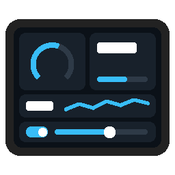

# ioBroker.satellite-display

[](https://www.npmjs.com/package/iobroker.satellite-display)
[](https://www.npmjs.com/package/iobroker.satellite-display)
[](LICENSE)

[](https://nodei.co/npm/iobroker.satellite-display/)


Tile pages on the touch display of ESPHome voice satellites, filled from ioBroker: values, gauges, charts,
switches, dimmers and buttons, each bound to a state. A touch on a switch, a dimmer or a button writes the state.

It is made for the [Waveshare ESP32-S3-AUDIO voice satellite](https://github.com/sadam6752-tech/esphome-waveshare-esp32-s3-audio-va)
with the [Waveshare 2.8inch Capacitive Touch LCD](https://www.waveshare.com/wiki/2.8inch_Capacitive_Touch_LCD)
(firmware **2.0.0** or newer). The voice of the satellite stays with
[ioBroker.assistant](https://github.com/ioBroker/ioBroker.assistant): this adapter opens its own connection to the
ESPHome Native API next to it and only handles the display.

A display without voice works too: the firmware repository has `panel-lcd2.yaml` for the
[Waveshare ESP32-S3-Touch-LCD-2](https://www.waveshare.com/wiki/ESP32-S3-Touch-LCD-2), a 2 inch tile panel with the
same tile pages and screen lock. Add it like a satellite (IP address, port 6053).

```
ioBroker states  ──▶  satellite-display  ──▶  satellite (tile pages)
       ▲                                           │
       └──────────────  a touch on a tile  ◀───────┘
```

## Tiles

Each satellite has up to **4 pages**. A page is a grid of 2 columns × 4 rows on the 320 × 240 screen and holds up
to 8 tiles. Swipe left from the clock to reach them; a page without tiles is skipped.

| Size   | Cells | Pixels    |
| ------ | ----- | --------- |
| small  | 1 × 1 | 151 × 52  |
| square | 1 × 2 | 151 × 111 |
| wide   | 2 × 1 | 308 × 52  |
| large  | 2 × 2 | 308 × 111 |

| Kind             | Shows                                                                             | Sizes               | A touch                            |
| ---------------- | --------------------------------------------------------------------------------- | ------------------- | ---------------------------------- |
| Value            | name, number with unit, or a text                                                 | all                 | –                                  |
| Gauge            | name, arc from the scale start to its end, number                                 | square, large       | –                                  |
| Value with bar   | name, number, bar along the scale                                                 | all                 | –                                  |
| Value with chart | name, number, line of the last 60 values                                          | small, wide, large  | –                                  |
| Switch           | name, toggle; the tile lights up when on                                          | small, square, wide | toggles the state                  |
| Dimmer           | name, toggle, slider, percent                                                     | wide, large         | toggle and slider write the states |
| Button           | icon, name                                                                        | small, square, wide | writes `true` to the state         |
| Thermostat       | name, arc with the current temperature, − target +, a dot for the heating relay   | square, large       | − and + write the target           |
| Group            | up to 4 values in one tile, each with its name: rows when tall, columns when flat | all                 | –                                  |
| Tank             | name, a tank filled along the scale, the value, optional a second amount (litres) | square, large       | –                                  |
| Battery          | name, a battery filled along the scale, a bolt while charging, optional the power | all                 | –                                  |
| Status           | icon, name, a value or a text; the icon and the tile light up while on            | small, square, wide | –                                  |

Four more kinds are drawn by **tablets only** (the web app and the ioBroker Visu app; a satellite leaves them out
with a warning). A tablet has two more sizes for them: 3 × 2 and 4 × 3 cells.

| Kind          | Shows                                                                                                | A touch                               |
| ------------- | ---------------------------------------------------------------------------------------------------- | ------------------------------------- |
| Map           | OpenStreetMap with the boat, its course and its track; optional AIS targets, anchor circle, seamarks | pan, pinch, + −, back to the boat     |
| Energy flow   | solar, battery, grid and consumption around the inverter, dots running with the power                | –                                     |
| History chart | up to 4 series over hours or days from the history adapter, with axes                                | the period; a finger shows the values |
| Camera        | the picture of a camera, refreshed every few seconds, or its live stream (MJPEG)                     | the picture on the whole screen       |

## Settings

1. **Satellites:** name (room), IP address and API port (6053) of each satellite. An API encryption key is only needed
   when you built the firmware with one; the ready-made firmware has none.
2. **Tiles:** a graphical editor. Choose the satellite and the page; the preview shows the screen with the current
   values. Click a free cell to add a tile, drag a tile to a free cell to move it or onto another tile to swap the
   two, click a tile to edit it on the right: kind, size, the state (with the object browser of the admin), name,
   unit, icon and scale. Choosing a state fills in its name and unit; you can change them. Name, unit and scale may
   also stay empty: they come from the object of the state. "Copy page" copies the page to another page or
   satellite, Ctrl+Z undoes the last changes. "Show on the satellite" puts the tiles of the editor on the satellite
   without saving, to try sizes and places (the instance must run). A tile the adapter would leave out is marked red, with the reason (a
   size its kind does not come in, a thermostat without its target, more than eight tiles on a page).
3. **Charts (optional):** a history adapter (history, sql, influxdb). A chart then starts with the last hours of its
   state instead of empty.

Details of the kinds:

- **Switch:** reads the state as on/off (`true`, a number other than 0, `"on"` …) and writes the type of the state
  (`true`/`false`, `1`/`0`).
- **Dimmer:** the state is the level, 0-100 or the range of its object (`min`/`max`, e.g. 0-1 or 0-255); the slider
  writes the level when it is released. The second state is its on/off. Without a second state a level of 0 is off,
  and switching on restores the last level.
- **Button:** writes `true` (or `1` for a number state), e.g. to a scene or a script trigger.
- **Colours:** the tab **Appearance** sets the main colour of all tiles (value, arc, bar, line, toggles); a tile can
  have its own main colour and background. A **background state** colours the tile from another state: while it is
  on (`true`, a number other than 0) the tile takes the chosen colour; a state that holds a colour (`#7F1D1D`) gives
  that colour, e.g. from a script. A threshold still turns the tile red. Needs the satellite firmware **2.0.4** for
  the background (the main colour works from 2.0.3).
- **Icons:** every kind can show an icon. A small (1 × 1) or wide tile shows it left in the middle, a large one top
  left; the square tiles (1 × 2) keep their layout. "Only the icon" puts it in the place of the name. A small or wide
  switch with an icon and a name has no toggle: the whole tile is the switch and lights up when on; with only the
  icon it keeps the toggle. "The whole tile switches" sets this for every switch, the square one too. Needs the
  satellite firmware **2.0.4**.
- **Thresholds:** value, gauge, bar, chart, thermostat, group, tank and battery tiles have "Red below" and "Red above": beyond them the
  value and its arc, bar or line turn red, e.g. a battery below 20 %. Needs the satellite firmware **2.0.3**; an older
  one keeps the colours.
- **Thermostat:** three states: the current temperature (the arc), the target temperature (written by − and +)
  and, optional, the heating relay (the dot: green on, grey off). − and + change the target on the screen at
  once by the step (0.5 unless set); one second after the last press the adapter writes it. The scale and the
  limits of the target come from the object of the target temperature (`min`/`max`), else 5-30. Needs the
  satellite firmware **2.0.1**; an older firmware is reported in the log and the tile is left out.
- **Group, tank, battery, status:** need the satellite firmware **2.4.0**; an older firmware is reported in the log
  and the tile is left out (a tablet always has them).
    - A group shows the states 1-4, each with its own name and unit (empty: those of the object) and the decimals of
      the tile; the title is an optional heading over the rows of a tall group. The thresholds colour each row.
    - A tank shows its fill level along the scale (empty: that of the object, else 0-100) and, optional, a second state
      below it, e.g. the litres. The thresholds colour the fill.
    - A battery shows its state of charge and, optional, the power (second state). The bolt shows while it charges:
      from its own state (third state) when set, else while the power is positive. Green unless a colour or a
      threshold says otherwise.
    - A status lights up while its state is on (`true`, a number other than 0, "on" …) and shows the text of
      `common.states`, an/aus, or the number with its unit.
- **Map** (tablet): latitude and longitude (required), course or heading in degrees and the speed in knots
  (optional). The adapter records the track (a point every 20 m, the hours of the tile, 24 by default) also while the
  tablet is away and keeps it over a restart. With the instance of ioBroker.nmea (e.g. `nmea.0`) the map shows the
  AIS targets around (the nearest 100, without our own boat) and the circle of the anchor alarm. Tiles of
  OpenStreetMap, as its [tile usage policy](https://operations.osmfoundation.org/policies/tiles/) allows for light use
  with the attribution shown; other tile servers can be set (`{z}/{x}/{y}`), and the seamarks of OpenSeaMap
  switched on.
- **Energy flow** (tablet): solar power, battery power (positive = charging), grid or shore power (positive =
  taken), consumption and the charge of the battery, each optional. A power in kW is converted to W; without a state
  of its own the consumption is computed (solar + grid − battery).
- **History chart** (tablet): the history of each series from the history instance of the tab **Charts**
  (history, sql or influxdb), 300 points, read again every 10 minutes and when the period is switched on the
  tablet (1 h, 6 h, 24 h, 7 d, 30 d). Series with two units get an axis each.
- **Camera** (tablet): the address of a picture (e.g. Frigate `http://…:5000/api/<camera>/latest.jpg?h=480`) or of
  an MJPEG stream (`…/api/<camera>?fps=5&h=480`, refresh 0), or a state holding such an address (also a
  `data:image/…` URL). The adapter fetches the picture and hands it to the tablet: the address, with a user and
  password in it, never leaves ioBroker. A picture is fetched only while its page is on screen; at most 4 live
  streams per tablet.
- A value that is no number (text, `true`/`false`) shows as text on a value tile. When the object of the state has
  `common.states` (e.g. `0: Aus, 1: Heizen, 2: Kühlen`), the value tile shows that text instead of the number.

The toggle and the slider change at once on the screen. When the device does not follow, the tile shows the real
state again after three seconds.

## Screen lock

A satellite can be locked with a PIN of 4 to 6 digits (tab **Satellites**: "Screen lock" and "PIN"). While it is
locked the display shows only the clock and the date and a lock instead of the gear; the pages of tiles, the system
page and the settings cannot be reached, and the satellite does not react to the wake word. Announcements, alarms,
timers and music still sound. A touch opens a keypad; the PIN is checked as soon as all digits are typed. After 5
wrong PINs in a row the keypad waits a minute; without a key it closes after 30 seconds.

The tab **Authentication** decides when an unlocked satellite locks again: after some minutes without a touch, when
the display goes back to the clock by itself, or only by hand. The open lock next to the gear locks at once in every
mode. The state `satellites.<name>.locked` shows the lock and locks or unlocks from ioBroker (e.g. at night or with
the alarm system); `satellites.<name>.failedPins` counts the wrong PINs.

The PIN does not leave ioBroker: the satellite gets its SHA-256 hash and keeps it in its flash, so the lock also
works after a restart and without ioBroker. Needs the satellite firmware **2.1.0**.

**Tablets** (tab **Tablets**: "Screen lock" and "PIN") lock the same way and follow the same tab **Authentication**:
"when the display goes back to the clock" is the moment their clock page comes (a minute without a touch when the
clock is off), and the lock in their bar locks at once. A locked tablet with the clock page shows the clock first and
the keypad after a touch. Their states are `tablets.<name>.locked` and `tablets.<name>.failedPins`. A tablet checks
the PIN in its browser: that keeps children and guests out, but it does not stop someone who knows the developer tools
of a browser (a satellite checks the PIN in its firmware).

## Tablets (web app, off by default)

An Android or iOS tablet can show tiles like a satellite without voice: the adapter serves a web app (PWA) and the
tablet keeps a connection to it. Nothing of this runs until it is switched on: without the checkbox the adapter opens
no port and creates no objects for tablets.

1. Tab **Tablets**: switch on "Tablets with the web app (PWA)", choose the port (default 8094) and enter a row per
   tablet: its screen size in pixels (e.g. an iPad 2048 x 1536 in landscape, 1536 x 2048 upright: the tile editor
   draws the tablet in that shape) and its grid, columns x rows of a page and the number of pages (a 10" tablet in
   landscape: 4 x 3).
2. Save, then press "Show links and QR codes": each tablet has its own link with an access key, as text and as a
   QR code.
3. Point the camera of the tablet at its code (or open the link there) and add the page to the home screen. It starts full screen, keeps the screen on (where
   the browser allows it) and connects again by itself after the tablet was asleep.

**Pairing with the ioBroker Visu app (Android)**: instead of a row by hand, switch the web app on, save and press
"Pair a tablet". The QR code it shows is a one-time link, valid for 10 minutes. In the ioBroker Visu app on the tablet
(settings, tab App, satellite-display, "Scan") the tablet scans it, sends its name and its screen size in CSS pixels
(e.g. 1280 x 800 for a 10" tablet in landscape), and the adapter enters it as a new row - an upright screen with the
grid turned, 3 x 4 - saves the settings and restarts; the app gets the link of the tablet and connects. The settings
page reloads by itself to show the new row (unless it holds changes that are not saved). Then give the tablet tiles in
the tile editor. A name a satellite or a tablet already has gets a number. The pairing link opened in a browser only
explains itself: a browser cannot pair.

A tile names its tablet in the field "satellite" like a satellite; the commands for an AI agent (below) place tiles on
a tablet the same way, and `getTiles` names the grid of every display. The screen lock with a PIN (tab **Tablets**,
"Screen lock") works as on a satellite; the tablet checks the PIN itself.

- **HTTPS**: a browser installs the web app and keeps the screen on only from a secure origin, on iOS always. Switch
  on "Use HTTPS" and choose a certificate of the ioBroker collection (Admin > Settings > Certificates), the same pair
  the web adapter uses. When HTTPS is on and the certificate cannot be loaded, the web app stays off (it does not fall
  back to plain HTTP). Without HTTPS the page still works in a browser or a kiosk app, without installing it.
- **iOS** closes the connection when the screen goes dark; the page connects again when it is shown. For a panel on
  the wall use Guided Access and keep the display on in the settings of the iPad.
- The **access key** is kept in the object `tablets.<name>` and stays the same across restarts. Who knows the link
  can see and switch the tiles of that tablet, nothing else. Remove the row of the tablet (or switch the web app off)
  to make its link invalid; a new row gets a new key, and a tablet with an old link says that its link is out of date.
  "New link" on the card of a tablet gives it a new key at once (when the link got into wrong hands or the tablet is
  given away): the old link stops working, also on the home screen of the tablet.
- **Renaming** a tablet or a satellite in the settings keeps it the same device: at the next start the adapter finds
  that one name is gone and one is new, gives the tablet its old access key (its link keeps working) and moves the
  tiles to the new name. When more than one device of a kind changed at once, the tile editor shows the tiles of an
  old name with "Move to ..." and "Delete these tiles".
- The port is declared in the registry of used resources of js-controller 8, so the admin can show it as taken.
- The tile editor of the admin shows the tablets next to the satellites, on the grid of each.
- **Pages**: a swipe turns the page, and so does a tap on a dot in the bar (needed on a page that a map fills, where a
  swipe moves the map). After a minute without a touch the tablet goes back to its first page.
- **Clock when idle** (tab **Tablets**, off by default): after the set minutes without a touch the tablets show the
  time and the date, as a satellite shows its clock. A touch shows the keypad of the screen lock, or the tiles when the
  tablet is not locked. With the lock mode "when the display goes back to the clock" the tablet locks when its clock
  comes.
- **Page titles**: a page of a tablet can have a title (e.g. "Heizung"), set in the tile editor next to the page
  buttons or by an AI agent (`setPageTitle`). The bar of the tablet shows it next to the name of the tablet while that
  page is shown; the keypad of the screen lock shows only the name. Satellites have no place for it.

## Devices (Device Manager)

The tab **Devices** shows every satellite and tablet of the instance as a card of the ioBroker Device Manager
(`@iobroker/dm-utils`); admin can also place the Device Manager in its left side bar. The settings stay in the tabs
Satellites and Tablets: add, remove and rename displays there. The tab works while the instance runs.

- **Card**: the connection (from `connected`), the address of a satellite, the kind of display.
- **Controls** (the button with the sliders on the card), only what the display has: the screen lock (with a PIN), the
  brightness of the display and the volume of the player.
- **Actions**: "Send the tiles again" on every card; on a tablet, while the web app runs, "Link and QR code" and "New
  link" (asks first; the old link stops working at once, also on the home screen of the tablet).
- **Details** (menu of the card): grid and pages, the number of tiles, and the link with the QR code of a tablet.
- **Links of the tablets** in the bar above the cards: the QR codes of all tablets in one dialog.
- **Pair a tablet** in the bar above the cards, while the web app runs: the one-time QR code of the pairing (see
  Tablets).

## Commands (e.g. for an AI agent)

The tiles can also be changed with `sendTo('satellite-display.0', command, message)`, e.g. by ioBroker.pi-agent
("add a narrow switch for the light in the living room to the display of Gast"). The answers are short JSON; an error
names what to ask the user (which satellite, which page when all are full).

| Command        | Message                                                                                      | Does                                                                                                                                                  |
| -------------- | -------------------------------------------------------------------------------------------- | ----------------------------------------------------------------------------------------------------------------------------------------------------- |
| `help`         | –                                                                                            | describes the commands, kinds, sizes, icons and the grid: `{help, commands: [{command, write}]}`, `write` = changes the tiles                          |
| `getTiles`     | `{satellite?}`                                                                               | lists the satellites and tablets, their grids, their tiles (with an `id`) and the free cells                                                          |
| `addTile`      | `{satellite, type, state, size?, icon?, label?, unit?, state2?, state3?, page?, col?, row?}` | adds a tile, without a place in the first free cell; answers where it went (a group also takes `state4`, `title`, `label2`-`label4`, `unit2`-`unit4`) |
| `updateTile`   | `{id, ...fields}`                                                                            | changes a tile                                                                                                                                        |
| `moveTile`     | `{id, page, col?, row?}`                                                                     | moves a tile, without `col`/`row` to the first free cell of the page                                                                                  |
| `removeTile`   | `{id}`                                                                                       | removes a tile                                                                                                                                        |
| `setPageTitle` | `{satellite, page, title}`                                                                   | the title of a page of a tablet, shown in its bar; empty removes it                                                                                   |

A change is saved in the settings of the instance, which then restarts and sends the tiles (a few seconds). In
ioBroker.pi-agent the instance needs "Write allowed" in the write permissions.

## States

| State                                                           | Meaning                                                                                                     |
| --------------------------------------------------------------- | ----------------------------------------------------------------------------------------------------------- |
| `info.connection`                                               | all satellites are connected and have their tiles (with tablets only: the web app runs)                     |
| `satellites.<name>.connected`                                   | this satellite is connected and has its tiles (role `indicator.reachable`)                                  |
| `satellites.<name>.lastTouch`                                   | the last touch on a tile, as JSON (`page`, `slot`, `input`, `value`, `ts`)                                  |
| `satellites.<name>.resend`                                      | button: sends all tiles again                                                                               |
| `satellites.<name>.locked`                                      | the screen is locked; write `true` / `false` to lock or unlock (only with a screen lock)                    |
| `satellites.<name>.failedPins`                                  | wrong PINs in a row on the display (only with a screen lock)                                                |
| `satellites.<name>.media.url`                                   | play this stream URL (only displays with a player, e.g. the tile panel with an I2S amplifier); empty = stop |
| `satellites.<name>.media.volume`                                | volume 0-100 %                                                                                              |
| `satellites.<name>.media.title`                                 | title shown in the bar of the clock while it plays (e.g. the station)                                       |
| `satellites.<name>.media.stop`                                  | button: stop playing                                                                                        |
| `satellites.<name>.media.state`                                 | `play` (also while it announces), `pause` or `stop`                                                         |
| `satellites.<name>.brightness`                                  | brightness of the display 0-100 %, 0 = dark (only displays that take it from ioBroker, e.g. the tile panel) |
| `tablets.<name>.connected`                                      | this tablet is connected and has its tiles (a sleeping tablet is not)                                       |
| `tablets.<name>.lastTouch`, `.resend`, `.locked`, `.failedPins` | as for a satellite                                                                                          |

The satellite keeps no layout: after a restart or a lost connection the adapter sends all tiles and their values
again by itself.

## Notes

- The small bar and chart tiles (1 × 1) need the satellite firmware **2.0.2**; an older one leaves them empty and
  writes a warning into its own log.
- The satellite firmware must be **2.0.0** or newer; an older firmware is reported in the log ("tile pages need the
  satellite firmware 2.0.0").
- The format between adapter and firmware is described in
  [docs/TILES.md of the firmware](https://github.com/sadam6752-tech/esphome-waveshare-esp32-s3-audio-va/blob/main/docs/TILES.md).
- The icons are a fixed set built into the firmware; the settings offer exactly that list.
- The web app of the tablets draws the same icons from [Material Design Icons](https://pictogrammers.com) 7.4.47
  (Apache License 2.0), generated into `www/icons.js` by `tools/build-icons.js`.
- A satellite or tablet that is removed or renamed in the settings takes its objects along, except states that carry
  settings of other adapters (History, InfluxDB, SQL ...): those stay with the folders above them, and the log names
  them. Remove those settings and delete the objects by hand when the data is no longer needed. The same holds for
  `locked` and `failedPins` when the screen lock is switched off, and for `tablets.*` when the web app is off.
- After an update of the adapter, reload the admin page (F5) once: an open admin keeps the old tile editor in memory.

## Changelog

Older changes: CHANGELOG_OLD.md

<!--
    Placeholder for the next version (at the beginning of the line):
    ### **WORK IN PROGRESS**
-->

### 0.4.3 (2026-11-20)

- (sadam6752-tech) The text above the Devices tab has all size attributes (checker W5507)

### 0.4.2 (2026-11-19)

- (sadam6752-tech) The adapter declares that it answers `help` (`common.supportedMessages.help`, js-controller PR #3638), and the answer lists the commands with whether they change something (`commands: [{command, write}]`), so agents such as ioBroker.pi-agent find and use them

### 0.4.1 (2026-11-17)

- (GermanBluefox) "Pair a tablet" (tab Tablets and Device Manager): a one-time QR code that the ioBroker Visu app scans;
  the tablet enters itself in the settings with its name and screen size and gets its link
- (GermanBluefox) The web app of the tablets runs without a tablet entered too, so that one can pair itself
- (GermanBluefox) The links and QR codes of the tablets name the LAN address of the host, no longer the first address of
  its list, which was the one of Tailscale (100.x) on a host with Tailscale
- (GermanBluefox) Four new tile types, on the satellites (firmware 2.4.0) and the tablets: group (up to four values
  in one tile), tank (fill level, optional litres), battery (charge, bolt while charging, optional power) and status
  (an icon that lights up while on); the tile editor draws them, the commands `addTile`/`updateTile` take them
- (GermanBluefox) Tablet web app: the name of a value tile is no longer bold, and the toggle of a wide switch sits in
  the middle of its line instead of half cut off at the bottom edge
- (GermanBluefox) Four tile types for tablets only: map (OpenStreetMap with the boat, its track, AIS targets and the
  anchor circle of ioBroker.nmea, seamarks of OpenSeaMap), energy flow (solar, battery, grid, consumption), history
  chart (up to four series with axes, the period switched on the tablet) and camera (a picture or an MJPEG stream,
  fetched by the adapter, so the address with its password stays in ioBroker); two more sizes on a tablet, 3 × 2 and
  4 × 3
- (GermanBluefox) Tablet web app: a tap on a page dot in the bar goes to that page

### 0.4.0 (2026-11-16)

- (sadam6752-tech) New tab Devices with the ioBroker Device Manager: every satellite and tablet as a card with its
  connection, screen lock, brightness and volume, "Send the tiles again", and for a tablet the link with the QR code
  and "New link"; the details show grid, pages and tiles, the bar above the cards the links of all tablets

### 0.3.2 (2026-11-16)

- (sadam6752-tech) Objects of a removed or renamed satellite or tablet, of the tablets when the web app is off and of
  the screen lock when it is off are no longer deleted when they carry settings of other adapters (History, InfluxDB,
  SQL): they stay with a warning in the log (review of the repository PR)
- (sadam6752-tech) The API encryption key of a satellite is hidden in the settings (with a button to show it)
- (sadam6752-tech) `@iobroker/testing` 6.3.2

## License

MIT License

Copyright (c) 2026 sadam6752-tech <sadam6752@gmail.com>

Permission is hereby granted, free of charge, to any person obtaining a copy
of this software and associated documentation files (the "Software"), to deal
in the Software without restriction, including without limitation the rights
to use, copy, modify, merge, publish, distribute, sublicense, and/or sell
copies of the Software, and to permit persons to whom the Software is
furnished to do so, subject to the following conditions:

The above copyright notice and this permission notice shall be included in all
copies or substantial portions of the Software.

THE SOFTWARE IS PROVIDED "AS IS", WITHOUT WARRANTY OF ANY KIND, EXPRESS OR
IMPLIED, INCLUDING BUT NOT LIMITED TO THE WARRANTIES OF MERCHANTABILITY,
FITNESS FOR A PARTICULAR PURPOSE AND NONINFRINGEMENT. IN NO EVENT SHALL THE
AUTHORS OR COPYRIGHT HOLDERS BE LIABLE FOR ANY CLAIM, DAMAGES OR OTHER
LIABILITY, WHETHER IN AN ACTION OF CONTRACT, TORT OR OTHERWISE, ARISING FROM,
OUT OF OR IN CONNECTION WITH THE SOFTWARE OR THE USE OR OTHER DEALINGS IN THE
SOFTWARE.