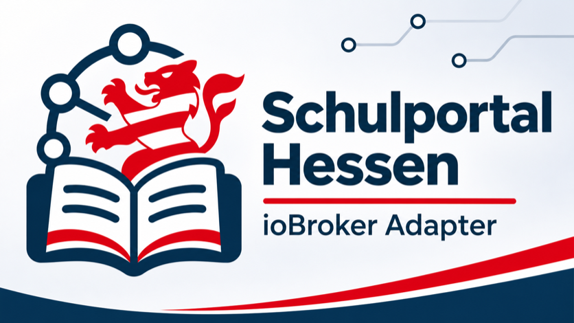

# ioBroker.schulportal-hessen

## Overview

This adapter reads data from [Schulportal Hessen](https://schulportal.hessen.de/) into ioBroker. Each instance connects to one school and one account; use another instance for an additional account. Available data depends on the school's enabled modules and your account permissions.

## Requirements

- Node.js 22 or newer, js-controller 7.2.2 or newer, and ioBroker Admin 8.3.5 or newer.
- An active Schulportal Hessen account and a school listed in the public school directory.

## Setup

1. In **Admin → Settings → Credentials**, create a **Custom** credential with your portal username in `login` and your password in `password`.
2. Keep the adapter instance running while configuring it. Under **Search schools by name, town, or ID**, enter at least two characters, then choose the school under **Select a matching school**. For a login link ending in `i=5202`, search for `5202`.
3. Select the credential and save. Optionally set a display name and a **Refresh interval** (5–1440 minutes; default: 60).

## Using the adapter

Look under `schulportal-hessen.<instance>` in the ioBroker object tree:

| Objects | Data |
| --- | --- |
| `profile` | Profile information, including name and school when available |
| `students.timetable`, `students.lessons` | Timetable and lesson data; for parent accounts, personal timetables and lessons appear under `students.<student>` when supported |
| `students.<student>.timetable.today`, `students.<student>.timetable.tomorrow`, `students.<student>.timetable.week.<weekday>` | Each day channel includes read-only `schoolStart` and `schoolEnd` states for the earliest valid lesson start and latest valid lesson end; values are empty when no valid time is available |
| `substitutions.today.json`, `substitutions.tomorrow.json` | Substitutions for today and tomorrow; other available dates are listed under `substitutions` |
| `calendar.portal`, `calendar.school` | Ongoing and upcoming portal and school-calendar events |
| `learningGroups` | Learning groups and assessments |
| `inbox` | Inbox messages and replies |
| `files` | File and folder information; files are not downloaded |

Write `true` to `info.refresh` to refresh immediately. For troubleshooting, check `info.connection`, `info.status`, `info.lastError`, and the affected data area's `status` and `lastUpdate`. Failed or incomplete reads keep the last successfully retrieved data.

## Privacy and limitations

The adapter does not send or edit portal content. Retrieving a conversation **may mark it as read** in the portal. The adapter stores personal data, including inbox messages, in ioBroker. Restrict access to these states and take care when sharing exports or backups. Login credentials stay in ioBroker's central credential store.

## Changelog

<!--
	Placeholder for the next version (at the beginning of the line):
	### **WORK IN PROGRESS**
-->
### 0.2.0 (2026-11-26)

- (Voodoo2man) Added earliest lesson start and latest lesson end states to timetable day channels.

### 0.1.1 (2026-11-24)

- (Voodoo2man) Archived older release notes and raised the Dependabot limit to 15 open pull requests per ecosystem.
- (Voodoo2man) Enabled recommended workflow concurrency to cancel superseded runs.
- (Voodoo2man) Enabled auto-merging only for direct npm patch updates after successful CI; branch protection and rulesets remain unchanged.

## License

[MIT License](https://github.com/Voodoo2man/ioBroker.schulportal-hessen/blob/main/LICENSE)

Copyright (c) 2026 Voodoo2man <Voodoo2man@outlook.de>