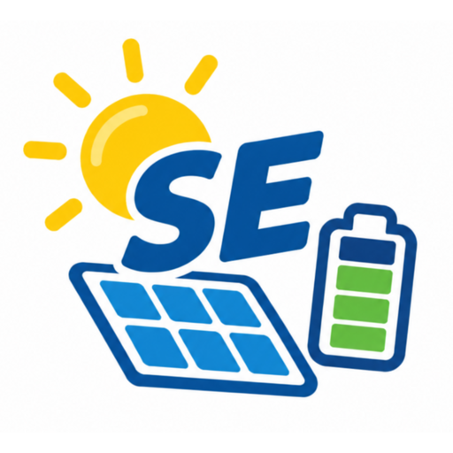

# ioBroker adapter for SolarEdge hybrid inverters

**Tests:** 

> ⚠️ **Work in progress — use at your own risk.** This adapter is under active development. Interfaces and state
> trees may change between versions.

## Disclaimer

This project is an independent open-source project and is not affiliated with, endorsed by, or sponsored by SolarEdge Technologies, Inc. or its affiliates.

SolarEdge and SolarEdge Home Hub are trademarks of SolarEdge Technologies, Inc. This project uses these names solely to identify the products with which the adapter is compatible.

## Features and Functions

Monitors and controls SolarEdge hybrid inverters over **Modbus TCP** (SunSpec). It reads PV, battery and
operational data from the inverter and exposes it as ioBroker states. It also exposes the inverter's StorEdge
**Global StorEdge Control Block** as a writable set of states, so you (or your own ioBroker scripts) can drive
Remote Control and related storage settings directly (see [StorEdge control block](#storedge-control-block)).

## Requirements

- A [SolarEdge Home Hub (hybrid) inverter](https://www.solaredge.com/en/products/residential/pv-inverters/solaredge-home-hub-inverters) with **Modbus TCP enabled** and reachable on your network.

> Modbus TCP is usually enabled in the inverter's SetApp / installer menu. The default TCP port is **502** or **1502**.

## Installation

Install **sehybrid** from the ioBroker admin (Adapters tab), then create an instance.

## Configuration

Open the instance settings and configure the connection to your inverter:

| Setting | Default | Description |
|---------|---------|-------------|
| Host | *(empty)* | IP address or hostname of the inverter. Polling does not start until this is set. |
| Port | `502` or `1502` | Modbus TCP port of the inverter. |
| Unit ID | `1` | Modbus unit / slave ID of the inverter. |
| Poll interval | `30` | How often (in seconds) the adapter reads data from the inverter. |

There is no separate configuration for the StorEdge control block — it is always created and always active,
independent of any setting (see [StorEdge control block](#storedge-control-block)).

## States

The adapter organizes the values it reads into channels:

- **info.connection** — `true` while the adapter is successfully polling the inverter, `false` otherwise.
- **Inverter** — power, energy, AC/DC measurements and status from the inverter.
- **Meter** — data from connected SunSpec meters (import/export, power, energy).
- **Battery** — state of charge, power, temperature and status for connected batteries.
- **StorEdgeControlBlock** — the nine StorEdge control registers, always created, read and write (see below).

The exact list of states depends on your inverter model and the meters/batteries attached to it.

## StorEdge control block

The adapter always exposes the inverter's **Global StorEdge Control Block** — nine manufacturer-documented
registers starting at `0xE004` — as a flat `StorEdgeControlBlock` channel. This is created unconditionally on
every adapter start; there is no enable switch and no configuration for it.

Every poll cycle, all nine states are refreshed with the inverter's live values (`ack=true`). Every one of the
nine states also accepts writes: set a new value (`ack=false`) from a script, the admin object tree, or any
other adapter, and it is range-validated and written straight through to the inverter via Modbus:

| State (`StorEdgeControlBlock.*`) | Description |
| --- | --- |
| `storageControlMode` | Storage Control Mode |
| `storageAcChargePolicy` | AC Charge Policy |
| `storageAcChargeLimit` | AC Charge Limit |
| `storageBackupReservedSetting` | Backup Reserved Setting |
| `storageChargeDischargeDefaultMode` | Charge/Discharge Default Mode |
| `remoteControlCommandTimeout` | Remote Control Command Timeout |
| `remoteControlCommandMode` | Remote Control Command Mode (reads `null` while the inverter is not in Remote Control — see note below) |
| `remoteControlChargeLimit` | Remote Control Charge Limit |
| `remoteControlDischargeLimit` | Remote Control Discharge Limit |

The register address, encoding, unit, range and Modbus function code for each state are in the generated
[StorEdge control block registers](#storedge-control-block-registers) reference below.

> **`remoteControlCommandMode` is `null` unless Remote Control is active.** The inverter only reports a real
> command mode (`0`–`7`) in this register while `storageControlMode` is set to `4` (Remote Control). When the
> inverter is in any other storage control mode, register `0xE00D` returns the SunSpec `NOT_IMPLEMENTED`
> sentinel `0xFFFF`, which the adapter maps to `null`. This is expected, not an error — the register becomes a
> real value again as soon as `storageControlMode = 4` is set (and reverts to `null` after the inverter leaves
> Remote Control, e.g. once `remoteControlCommandTimeout` elapses). The adapter writes this `null` through on
> every poll so the state always reflects the live register rather than retaining a stale mode from an earlier
> Remote Control hold.

Each state's accepted range is documented on the object itself (`common.min`/`common.max` in the admin object
tree). A write outside that range is rejected: the adapter logs an error, does not write to the inverter, and
the state keeps its previous value. There is no write-only-if-changed suppression — every valid write you make
is sent to the inverter, every time.

The adapter itself never computes or drives a value into these registers on its own (there is no built-in
consumption-based automation). Driving these registers to implement something like Remote Control discharge
limiting based on house/wallbox consumption is up to your own ioBroker scripts, which can simply write to
`StorEdgeControlBlock.remoteControlDischargeLimit` (and the other registers Remote Control mode requires) like
any other writable state.

> **Portal prerequisite for Remote Control:** if you intend to use Storage Control Mode `4` (Remote Control),
> disable the StorEdge storage profile in the SolarEdge monitoring portal / SetApp (Admin → Energy Manager →
> Storage Profile) first. Otherwise the inverter's own cloud profile fights the Modbus commands and reverts
> Remote Control back to *Maximize Self Consumption* after about 10 seconds. This is a manual, one-time step on
> the inverter side; the adapter cannot do it for you. This mirrors the community-documented fix
> (see [binsentsu/home-assistant-solaredge-modbus #130](https://github.com/binsentsu/home-assistant-solaredge-modbus/issues/130)).

> **Float encoding note:** the StorEdge power-control registers use *Big Endian, word-swapped* float32
> (bytes big-endian, the two 16-bit words swapped — the low word first). This matches the "Big Endian Word
> swap" datatype in the standard ioBroker Modbus adapter and was verified live against the inverter.

> **Safety:** writing to `StorEdgeControlBlock` states writes directly to your inverter's battery-control
> registers. Verify behavior carefully before relying on any automation built on top of it. This adapter is a
> work-in-progress; use at your own risk.

## Modbus register reference

The tables below are the full Modbus register reference, generated directly from the adapter's source maps
(`src/lib/sunspec-map.ts` and `src/lib/storedge-control-map.ts`) — they are the single source of truth, so the
reference never drifts from the code. Do not edit the content between the generated markers by hand; run
`npm run docs:readme` to regenerate it.

### Inverter values

<!-- BEGIN:GENERATED:sunspec-inverter -->

| Name | Register | Datatype | Model | Description |
| --- | --- | --- | --- | --- |
| acCurrent | 40071 | uint16 | 101 | I_AC_Current — AC Total Current value |
| acCurrentA | 40072 | uint16 | 101 | I_AC_CurrentA — AC Phase A Current value |
| acCurrentB | 40073 | uint16 | 101 | I_AC_CurrentB — AC Phase B Current value |
| acCurrentC | 40074 | uint16 | 101 | I_AC_CurrentC — AC Phase C Current value |
| acVoltageAB | 40076 | uint16 | 101 | I_AC_VoltageAB — AC Voltage Phase AB value |
| acVoltageBC | 40077 | uint16 | 101 | I_AC_VoltageBC — AC Voltage Phase BC value |
| acVoltageCA | 40078 | uint16 | 101 | I_AC_VoltageCA — AC Voltage Phase CA value |
| acVoltageAN | 40079 | uint16 | 101 | I_AC_VoltageAN — AC Voltage Phase A to N value |
| acVoltageBN | 40080 | uint16 | 101 | I_AC_VoltageBN — AC Voltage Phase B to N value |
| acVoltageCN | 40081 | uint16 | 101 | I_AC_VoltageCN — AC Voltage Phase C to N value |
| acPower | 40083 | int16 | 101 | I_AC_Power — AC Power value |
| acFrequency | 40085 | uint16 | 101 | I_AC_Frequency — AC Frequency value |
| acVA | 40087 | int16 | 101 | I_AC_VA — Apparent Power |
| acVAR | 40089 | int16 | 101 | I_AC_VAR — Reactive Power |
| acPF | 40091 | int16 | 101 | I_AC_PF — Power Factor |
| acEnergyWh | 40093 | acc32 | 101 | I_AC_Energy_WH — AC Lifetime Energy production |
| dcCurrent | 40096 | uint16 | 101 | I_DC_Current — DC Current value |
| dcVoltage | 40098 | uint16 | 101 | I_DC_Voltage — DC Voltage value |
| dcPower | 40100 | int16 | 101 | I_DC_Power — DC Power value |
| tempSink | 40103 | int16 | 101 | I_Temp_Sink — Heat Sink Temperature |
| status | 40107 | uint16 | 101 | I_Status — Operating State |
| statusVendor | 40108 | uint16 | 101 | I_Status_Vendor — Vendor-defined operating state and error codes |

<!-- END:GENERATED:sunspec-inverter -->

### Meter values

<!-- BEGIN:GENERATED:sunspec-meter -->

| Name | Register | Datatype | Model | Description |
| --- | --- | --- | --- | --- |
| mCurrent | 40190 | int16 | 201 | M_AC_Current — AC Current (sum of active phases) |
| mCurrentA | 40191 | int16 | 201 | M_AC_Current_A — Phase A AC Current |
| mCurrentB | 40192 | int16 | 201 | M_AC_Current_B — Phase B AC Current |
| mCurrentC | 40193 | int16 | 201 | M_AC_Current_C — Phase C AC Current |
| mVoltageLN | 40195 | int16 | 201 | M_AC_Voltage_LN — Line to Neutral AC Voltage |
| mVoltageAN | 40196 | int16 | 201 | M_AC_Voltage_AN — Phase A to Neutral AC Voltage |
| mVoltageBN | 40197 | int16 | 201 | M_AC_Voltage_BN — Phase B to Neutral AC Voltage |
| mVoltageCN | 40198 | int16 | 201 | M_AC_Voltage_CN — Phase C to Neutral AC Voltage |
| mVoltageLL | 40199 | int16 | 201 | M_AC_Voltage_LL — Line to Line AC Voltage |
| mVoltageAB | 40200 | int16 | 201 | M_AC_Voltage_AB — Phase A to Phase B AC Voltage |
| mVoltageBC | 40201 | int16 | 201 | M_AC_Voltage_BC — Phase B to Phase C AC Voltage |
| mVoltageCA | 40202 | int16 | 201 | M_AC_Voltage_CA — Phase C to Phase A AC Voltage |
| mFrequency | 40204 | int16 | 201 | M_AC_Freq — AC Frequency |
| mPower | 40206 | int16 | 201 | M_AC_Power — Total Real Power (sum of active phases) |
| mPowerA | 40207 | int16 | 201 | M_AC_Power_A — Phase A AC Real Power |
| mPowerB | 40208 | int16 | 201 | M_AC_Power_B — Phase B AC Real Power |
| mPowerC | 40209 | int16 | 201 | M_AC_Power_C — Phase C AC Real Power |
| mVA | 40211 | int16 | 201 | M_AC_VA — Total AC Apparent Power (sum of active phases) |
| mVAA | 40212 | int16 | 201 | M_AC_VA_A — Phase A AC Apparent Power |
| mVAB | 40213 | int16 | 201 | M_AC_VA_B — Phase B AC Apparent Power |
| mVAC | 40214 | int16 | 201 | M_AC_VA_C — Phase C AC Apparent Power |
| mVAR | 40216 | int16 | 201 | M_AC_VAR — Total AC Reactive Power (sum of active phases) |
| mVARA | 40217 | int16 | 201 | M_AC_VAR_A — Phase A AC Reactive Power |
| mVARB | 40218 | int16 | 201 | M_AC_VAR_B — Phase B AC Reactive Power |
| mVARC | 40219 | int16 | 201 | M_AC_VAR_C — Phase C AC Reactive Power |
| mPF | 40221 | int16 | 201 | M_AC_PF — Average Power Factor |
| mPFA | 40222 | int16 | 201 | M_AC_PF_A — Phase A Power Factor |
| mPFB | 40223 | int16 | 201 | M_AC_PF_B — Phase B Power Factor |
| mPFC | 40224 | int16 | 201 | M_AC_PF_C — Phase C Power Factor |
| mExportedWh | 40226 | acc32 | 201 | M_Exported — Total Exported Real Energy |
| mExportedWhA | 40228 | acc32 | 201 | M_Exported_A — Phase A Exported Real Energy |
| mExportedWhB | 40230 | acc32 | 201 | M_Exported_B — Phase B Exported Real Energy |
| mExportedWhC | 40232 | acc32 | 201 | M_Exported_C — Phase C Exported Real Energy |
| mImportedWh | 40234 | acc32 | 201 | M_Imported — Total Imported Real Energy |
| mImportedWhA | 40236 | acc32 | 201 | M_Imported_A — Phase A Imported Real Energy |
| mImportedWhB | 40238 | acc32 | 201 | M_Imported_B — Phase B Imported Real Energy |
| mImportedWhC | 40240 | acc32 | 201 | M_Imported_C — Phase C Imported Real Energy |

<!-- END:GENERATED:sunspec-meter -->

### Battery values

<!-- BEGIN:GENERATED:sunspec-battery -->

| Name | Register | Datatype | Model | Description |
| --- | --- | --- | --- | --- |
| ratedEnergy | 57666 | float32le | battery | Battery Rated_Energy — Rated Energy |
| maxChargeContinuousPower | 57668 | float32le | battery | Battery Max_Charge_Continuous_Power — Maximum Charge Continuous Power |
| maxDischargeContinuousPower | 57670 | float32le | battery | Battery Max_Discharge_Continuous_Power — Maximum Discharge Continuous Power |
| maxChargePeakPower | 57672 | float32le | battery | Battery Max_Charge_Peak_Power — Maximum Charge Peak Power |
| maxDischargePeakPower | 57674 | float32le | battery | Battery Max_Discharge_Peak_Power — Maximum Discharge Peak Power |
| averageTemperature | 57708 | float32le | battery | Battery Average_Temperature — Average Temperature |
| maximumTemperature | 57710 | float32le | battery | Battery Maximum_Temperature — Maximum Temperature |
| instantaneousVoltage | 57712 | float32le | battery | Battery Instantaneous_Voltage — Instantaneous Voltage |
| instantaneousCurrent | 57714 | float32le | battery | Battery Instantaneous_Current — Instantaneous Current |
| instantaneousPower | 57716 | float32le | battery | Battery Instantaneous_Power — Instantaneous Power |
| lifetimeExportEnergy | 57718 | uint64le | battery | Battery Lifetime_Export_Energy — Total Exported Energy |
| lifetimeImportEnergy | 57722 | uint64le | battery | Battery Lifetime_Import_Energy — Total Imported Energy |
| maximumEnergy | 57726 | float32le | battery | Battery Maximum_Energy — Maximum Energy |
| availableEnergy | 57728 | float32le | battery | Battery Available_Energy — Available Energy |
| soh | 57730 | float32le | battery | Battery SOH — State of Health |
| soe | 57732 | float32le | battery | Battery SOE — State of Energy |
| status | 57734 | uint32le | battery | Battery Status — Status (0 Off,1 Standby,2 Init,3 Charge,4 Discharge,5 Fault,6 Idle) |
| statusInternal | 57736 | uint32le | battery | Battery Status_Internal — Internal Status |

<!-- END:GENERATED:sunspec-battery -->

### StorEdge control block registers

<!-- BEGIN:GENERATED:storedge-control -->

| Name | Address | Encoding | Unit | Range | Function code |
| --- | --- | --- | --- | --- | --- |
| storageControlMode | 0xE004 | uint16 |  | 0..4 | FC06 |
| storageAcChargePolicy | 0xE005 | uint16 |  | 0..3 | FC06 |
| storageAcChargeLimit | 0xE006 | float32 | kWh | 0..∞ | FC16 |
| storageBackupReservedSetting | 0xE008 | float32 | % | 0..100 | FC16 |
| storageChargeDischargeDefaultMode | 0xE00A | uint16 |  | 0..7 | FC06 |
| remoteControlCommandTimeout | 0xE00B | uint32 | s | 0..86400 | FC16 |
| remoteControlCommandMode | 0xE00D | uint16 |  | 0..7 | FC06 |
| remoteControlChargeLimit | 0xE00E | float32 | W | 0..10000 | FC16 |
| remoteControlDischargeLimit | 0xE010 | float32 | W | 0..10000 | FC16 |

<!-- END:GENERATED:storedge-control -->

## Troubleshooting

- **No data / `info.connection` stays `false`** — check that the Host is set correctly, Modbus TCP is enabled
  on the inverter, and port `502` or `1502` is reachable from your ioBroker host.
- **Connection errors in the log** — verify the Unit ID matches your inverter and that no other client is
  holding the single Modbus TCP connection the inverter allows.
- **Remote Control reverts to Maximize Self Consumption after a few seconds** — you have not disabled the
  StorEdge storage profile in the SolarEdge monitoring portal / SetApp. See the prerequisite above.
- **A write to a `StorEdgeControlBlock` state has no effect** — check the adapter log; the value is likely
  outside that state's documented range (visible as `common.min`/`common.max` on the object) and was rejected
  before being sent to the inverter.

## Support

Please report issues at [GitHub Issues](https://github.com/heresiarch/ioBroker.sehybrid/issues).

Developers: see [README_dev.md](/#/docs/adapterref/iobroker.sehybrid/README_dev.md) for build, test and release instructions.

## Changelog
### 1.1.2 (2026-10-31)
* fix log priority for modbus write op
* fix translation in io-package.json

### 1.1.1 (2026-10-15)
* fix size attributes

### 1.1.0 (2026-10-15)
* jsonConfig Migration for Admin UI
* fix Readme.md
* fix JSDoc warnings

### 1.0.21 (2026-10-15)
* fix GH workflow lint errors

### 1.0.20 (2026-10-15)
* Removed the manual connection-test button from the Admin UI configuration
* Removed static Sunspec Register Tables from Admin UI, added them to doc in Readme.md

## License

Copyright (c) 2026 René Meyer <heresiarch@online.de>
see [LICENSE](https://github.com/heresiarch/ioBroker.sehybrid/blob/main/LICENSE)