#  ioBroker.senec

## SENEC Adapter for ioBroker

Monitor and control your SENEC home battery storage system. The adapter supports four independent connectors that can be used individually or combined:

- **Local** (lala.cgi) — Direct LAN polling with 10-second real-time updates. Provides full BMS data, grid meter readings, wallbox data, and appliance control.
- **SENEC App API** — Cloud-based polling via the SENEC App API. Dashboard data, measurement history, system details, and wallbox information.
- **mein-senec.de** — Web portal polling. Status overview, measurement history, autarky, emergency power, peak shaving, SG-Ready, and switchable socket control.
- **SENEC.Connect** — Azure-based API. Battery and meter data via subscription key.

Not all connectors are required. Choose based on your needs — local-only setups work fine, as do cloud-only configurations for systems without local web access.

### Supported Systems

Practically every SENEC storage system works: the Home range from the early lead-acid and lithium
models through V2, V2.1 and V3, the current V4 | P4 | E4 generation, the Business models, and the
partner variants ADS Tec, OEM LG and Solarinvert.

Systems with a local web interface can use all five connectors. Those without one — the V4
generation among them — work through the SENEC App API, mein-senec.de and SENEC.Connect. The
local OpenAPI on port 4424 needs a local web interface too, so it is available on the V2 and V3
generations and not on V4 | P4 | E4. Which data points appear varies by model.

See the [full list of models](https://github.com/nobl/ioBroker.senec/blob/master/docs/SUPPORTED_SYSTEMS.md) to find your system by name.

## Disclaimer
**All product and company names or logos are trademarks™ or registered® trademarks of their respective holders. Use of them does not imply any affiliation with or endorsement by them or any associated subsidiaries! This personal project is maintained in spare time and has no business goal.**

**No warranty, and no liability.** This adapter is a spare-time project, provided as-is under the MIT license. It talks to an expensive appliance over interfaces SENEC neither documents nor supports, and it can send commands that change how that appliance behaves. Everything you do with it is your own responsibility. The author accepts no liability for damage to your system, lost or wrong data, missed feed-in, or any other consequence of using it — and cannot tell you whether using it affects your warranty or support arrangements with SENEC or your installer. If that is not acceptable to you, please do not use this adapter.

## Prerequisites

- ioBroker with Node.js >= 22
- SENEC battery system on the local network (for Local connector)
- mein-senec.de account (for API and Web connectors)
- ioBroker.web adapter installed (for the built-in dashboard)

## Installation

Install the adapter from the ioBroker adapter repository. After installation, create an adapter instance and configure at least one connector.

## Configuration

The adapter settings are organized in tabs — one per connector plus general settings and debug options. The two local interfaces, `lala.cgi` and the OpenAPI on port 4424, share the *Local Connection* tab and the appliance address.

### SENEC Account

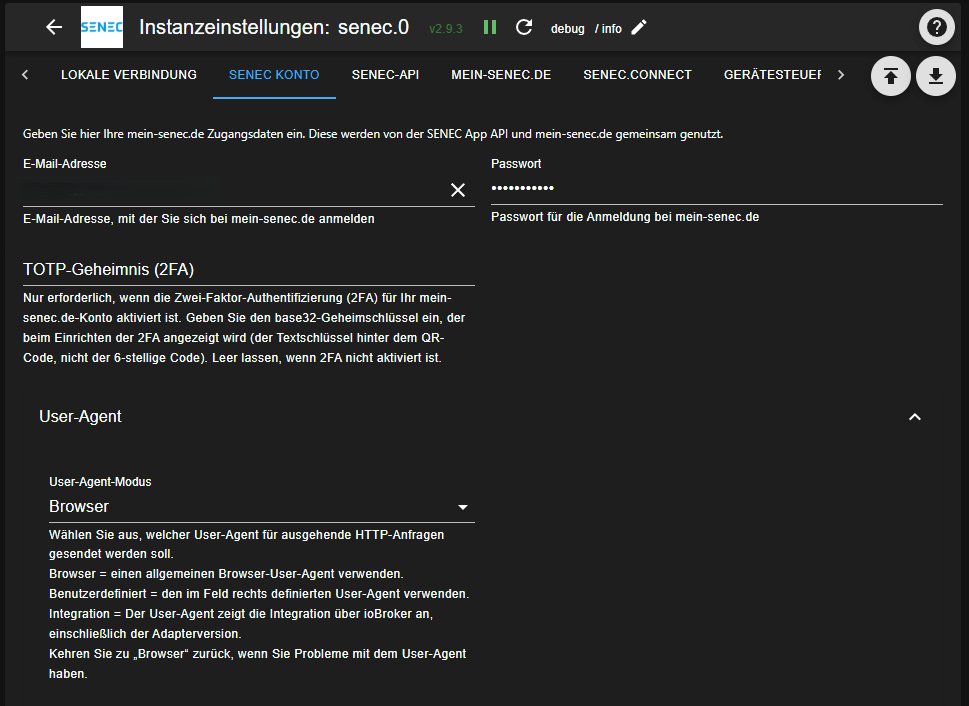

Enter your mein-senec.de credentials here. These are shared by the SENEC App API and mein-senec.de connectors. You can also configure the User-Agent mode for outbound HTTP requests.

#### Two-Factor Authentication (2FA)

If two-factor authentication is enabled on your mein-senec.de account, the adapter can log in on its own — it does not need you to be there to type a code.

Enrolment shows a QR code for your authenticator app and, next to it, the same secret as text. That text secret is what goes into the **TOTP Secret** field. Take it from the setup screen while it is on display; once 2FA is active the secret is not shown again, and you would have to re-enrol to see a new one. Spaces and dashes in it do not matter.

What belongs there is the permanent secret, not the six-digit code your app shows — that changes every thirty seconds and would be stale before the adapter ever used it.

One secret covers both cloud connectors, since they authenticate against the same account. If 2FA is required and the field is empty, the adapter says so plainly in the log rather than reporting a failed login.

### Local Connection (lala.cgi)

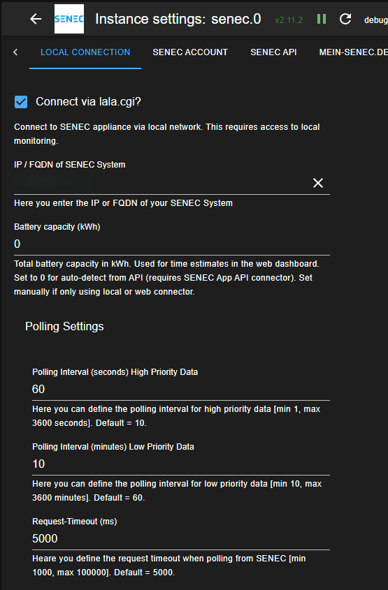

| Setting | Description | Default |
|---------|-------------|---------|
| Connect via lala.cgi | Enable local polling | Off |
| SENEC System IP | IP address or FQDN of your SENEC device | — |

Expand **Polling Settings** to adjust timing:

| Setting | Description | Default |
|---------|-------------|---------|
| Polling interval (high priority) | How often to poll real-time data (seconds) | 10 |
| Polling interval (low priority) | How often to poll slow-changing data (minutes) | 60 |
| Request timeout | Timeout for HTTP requests (ms) | 5000 |

The adapter retries automatically with exponential backoff on connection failures — no manual retry configuration needed. If the SENEC device is temporarily unreachable (reboot, firmware update), polling resumes automatically when the device comes back online.

#### TLS Certificate Validation

The adapter validates the SENEC device's HTTPS certificate using a multi-layer approach:

1. **User CA** — Upload the SenecGui-Root CA certificate via the dashboard (System tab → TLS Certificate). Download it from mein-senec.de (Documents / General Documents / SenecGui-Root) and upload the .pem or .zip file. SENEC distributes this certificate behind a login, so the adapter cannot bundle it.
2. **Cached CA** — If no user cert is provided, the adapter can automatically download the CA from mein-senec.de (requires the mein-senec.de connector to be enabled). The downloaded cert is cached in adapter state and persists across restarts.
3. **TOFU (Trust On First Use)** — If no CA cert validates, the adapter records the device's certificate fingerprint on first contact and compares every later connection against it. A warning is logged if the fingerprint changes (e.g. after a firmware update), and the new fingerprint is then accepted automatically.

The adapter tries each layer in order and uses the first one that validates.

TOFU is continuity monitoring, not certificate pinning: it tells you that the appliance's certificate changed, but it does not refuse the new one, and it does not verify the certificate chain. It is a deliberate trade-off for a device on your own network — a legitimate certificate change must never leave the adapter disconnected until you notice a log line. For full verification, supply the CA: uploading it is optional but it is the stronger option.

If automatic CA download failed and you want to retry, set `_local.tls.certFetchFailed` to `false` — the adapter will attempt the download again on the next restart or immediately if running.

**Important**: Polling too frequently or requesting too many data points can overload your SENEC device. This may cause the device to restart, become unresponsive, or fail to synchronize with the SENEC cloud. If you experience issues, reduce the polling frequency or stop the adapter.

#### Additional High-Priority Polling Data Points

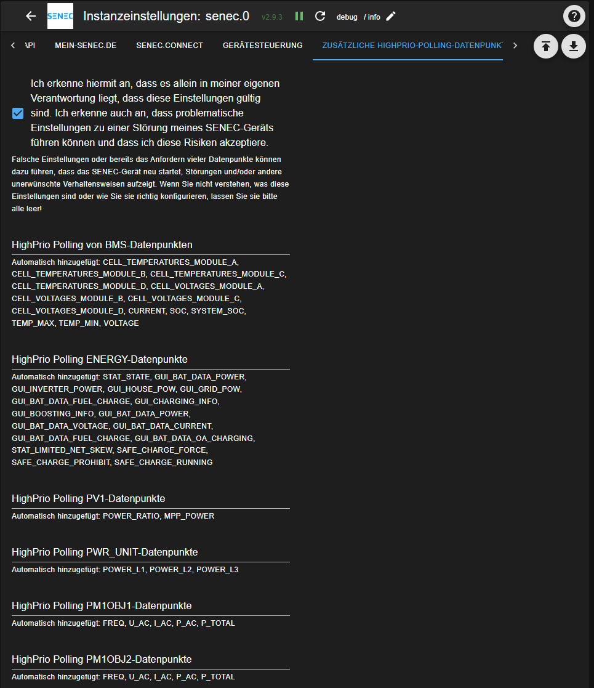

You can add additional data sections (e.g. BMS, PV1, WALLBOX) to the high-priority polling cycle. This requires accepting a disclaimer acknowledging the risks. Only characters A-Z, digits 0-9, and commas are allowed.

### Local OpenAPI (port 4424)

A second local interface, independent of `lala.cgi` and served over HTTPS on port 4424 of the appliance. It shares the *Local Connection* tab and the appliance address with the local connector, and either one works without the other.

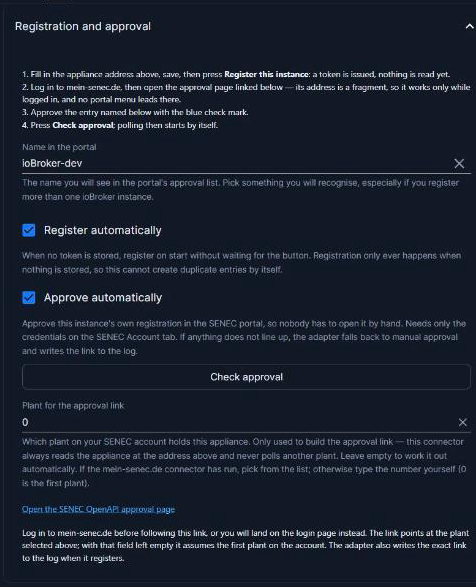

| Setting | Description | Default |
|---------|-------------|---------|
| Use the appliance's local OpenAPI | Enable polling on port 4424 | Off |
| Device name | The name you approve in the SENEC portal | ioBroker |
| Register automatically | Ask the appliance for a token on start when none is stored | On |
| Approve automatically | Approve this instance's own registration through the portal | On |
| Plant for the approval link | Which plant of your account holds this appliance | Automatic |
| Poll interval | How often to read the selected sections (seconds) | 60 |
| Request timeout | How long to wait for one request (ms) | 10000 |
| Sections to poll | Which routes to request each cycle. The nameplate is read in addition to whatever is selected; wallboxes have to be switched on deliberately | Battery, Meter, Nameplate |

It is read-only. The routes that would set a charge or discharge power refuse every request a customer token can make, before and after approval alike, so there is nothing there to write with. What the interface offers and refuses is recorded in [LOCAL_OPENAPI_4424.md](https://github.com/nobl/ioBroker.senec/blob/master/docs/LOCAL_OPENAPI_4424.md).

Only systems with a local web interface open this port: the V2 and V3 generations do, the V4 | P4 | E4 generation does not. No appliance is known that serves 4424 but not `lala.cgi`, so this is an addition to local polling rather than a replacement for it.

The poll interval defaults to 60 seconds deliberately. How much this listener tolerates has not been established, and the appliance is easy to overload — the warning above about polling `lala.cgi` too hard applies here as well.

#### Registration

Unlike `lala.cgi`, this interface needs a one-time registration that only the account holder can approve.

**With your SENEC account credentials filled in on the *SENEC Account* tab, all of it happens by itself:** the adapter registers, approves its own registration and starts polling. The mein-senec.de connector does not have to be enabled for this — the adapter signs in once for the approval and drops the session again straight afterwards.

Setting the mein-senec.de connector up first, saving, and letting the adapter restart before switching this on makes the log easier to follow: the session is already there by then and the plant is already known, so this connector signs in not at all.

Without credentials, approve it by hand:

1. Fill in the appliance address at the top of the tab and save.
2. Press **Register this instance**. The appliance issues a token and the adapter stores it. Nothing is read yet.
3. **Log in to mein-senec.de first**, then follow the approval link on the tab. The address is a fragment, so opening it while logged out drops you at the login screen and loses the destination. The page is not reachable from the portal menu — only by that link.
4. Approve the entry named after your device name, using the blue check mark.
5. Press **Check approval**. Once it reports approved, polling starts by itself.

`_openapi.info.approvalState` reports where things stand at any time: `unregistered`, `pending`, `approved`, `rejected` — the token was withdrawn in the portal or belongs to another appliance — or `error`.

**Forget token** discards the stored token and, where your credentials are configured and the plant could be determined, withdraws the registration in the portal as well, so no orphaned entry is left behind; the appliance stops accepting the old token about a minute later. Where it cannot ask the portal it says so, and the entry has to be removed there by hand. With automatic registration on, a fresh token is requested immediately, which is also the way to start over. Registering twice without withdrawing the first entry leaves two entries under the same name and nothing to tell them apart by, which is why registering is refused while a token is stored.

### SENEC App API

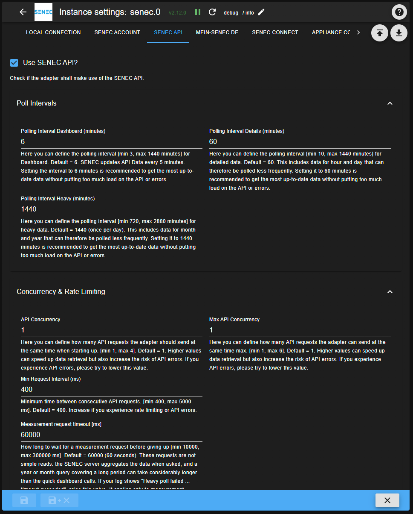

| Setting | Description | Default |
|---------|-------------|---------|
| Use SENEC App API | Enable cloud API polling | Off |
| Dashboard interval | Polling interval for dashboard/current data (minutes) | 6 |
| Details interval | Polling interval for day-level measurement data (minutes) | 60 |
| Heavy interval | Polling interval for month/year measurements (minutes) | 1440 (24h) |
| Concurrency / Max concurrency | Parallel API request limits | 1 / 1 |
| Min request interval | Minimum time between API requests (ms) | 400 |
| API request timeout | How long to wait for an ordinary API request — dashboard, system status, details (ms). Raise it if the log shows those requests timing out | 30000 |
| Measurement request timeout | How long to wait for a measurement aggregation (ms). Raise it if the log shows heavy polls timing out | 60000 |

#### History Rebuild

The API connector can rebuild historical measurement data (AllTime totals) from scratch. Configure the rebuild mode and start year if needed. This runs as a background process during the heavy polling tier.

### mein-senec.de

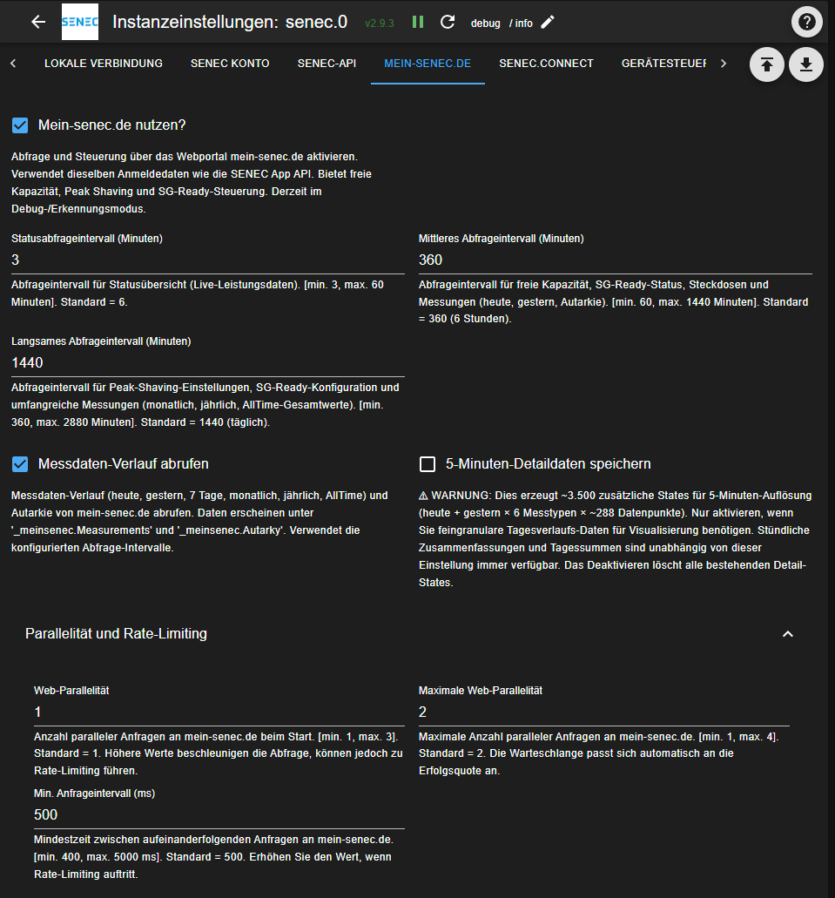

| Setting | Description | Default |
|---------|-------------|---------|
| Use mein-senec.de | Enable web portal polling | Off |
| Status interval | Polling interval for status data (minutes) | 6 |
| Medium interval | Polling interval for yesterday/autarky/spare capacity (minutes) | 360 (6h) |
| Slow interval | Polling interval for monthly/yearly/AllTime data (minutes) | 1440 (24h) |
| Poll measurement history | Enable measurement data polling | Off |
| Include 5-min detail data | Poll fine-grained detail data (~3,500 additional states) | Off |
| Concurrency / Max concurrency | Parallel request limits | 1 / 2 |
| Min request interval | Minimum time between requests (ms) | 500 |

### Additional Systems on the Account

If your mein-senec.de account holds more than one system — a replaced appliance still shows up alongside its successor — the adapter discovers all of them at startup and registers each under `_meinsenec.Plants.{steuereinheitnummer}.`.

Only the first system is polled by default. Each additional one gets its own switch at `control.Plants.{steuereinheitnummer}.poll`, off until you set it. Turning it on adds that system to the slow polling tier, filling the same measurement structure the main system uses:

| State | Contents |
|-------|----------|
| `_meinsenec.Plants.{sn}.System.*` | Product name, device number, plant number |
| `_meinsenec.Plants.{sn}.Measurements.Daily.today` / `.yesterday` | Hourly measurement data |
| `_meinsenec.Plants.{sn}.Measurements.Monthly.*` | Daily breakdown per month |
| `_meinsenec.Plants.{sn}.Measurements.Yearly.*` | Monthly breakdown per year |
| `_meinsenec.Plants.{sn}.Measurements.AllTime.*` | Lifetime totals |
| `_meinsenec.Plants.{sn}.Autarky.*` | Autarky per period |

Lifetime totals are fetched once when a system is first discovered, even with the switch off, so a decommissioned appliance's final figures are available without polling it continuously.

Bear in mind that each enabled system multiplies the requests made to the portal. If you only want the historical totals of an old appliance, leaving its switch off is usually enough.

### SENEC.Connect

| Setting | Description | Default |
|---------|-------------|---------|
| Use SENEC.Connect | Enable Azure API polling | Off |
| Polling interval | How often to poll (seconds) | 300 |
| Request timeout | How long to wait for a response (ms) | 30000 |
| Subscription key | Azure API subscription key | — |
| Include sections | Which data sections to request | battery,meter,evse,bessNameplate |

### External Sources

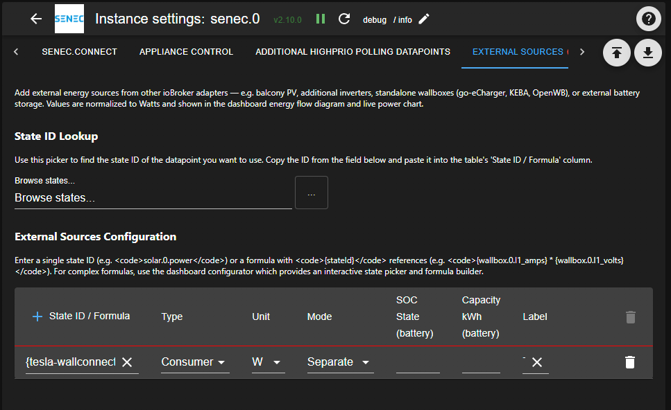

Add external energy sources from other ioBroker adapters — e.g. balcony PV, additional inverters, standalone wallboxes, heat pumps, or external battery storage. Values are normalized to Watts and shown in the dashboard energy flow diagram and live power chart.

Use the **State ID Lookup** picker to find the state ID of the datapoint you want to use, then paste it into the table.

| Column | Description |
|--------|-------------|
| State ID / Formula | Single state ID (e.g. `solar.0.power`) or formula with `{stateId}` references (e.g. `{wallbox.0.l1_amps} * {wallbox.0.l1_volts}`) |
| Type | PV, Consumer (wallbox, heat pump, etc.), or Battery |
| Unit | W or kW — applied to the final value |
| Mode | **Integrate** = add to SENEC total (single node). **Separate** = show as individual node in energy flow |
| SOC State | (Battery only) State ID for the charge level (%) |
| Capacity | (Battery only) Battery capacity in kWh — enables time estimates |
| Label | Display name shown on the energy flow diagram |

Formulas support `+ - * / ( )` operators. State IDs without curly braces are auto-detected if they contain math operators. For complex formulas, a dashboard-based configurator with interactive state pickers is planned.

### Appliance Control

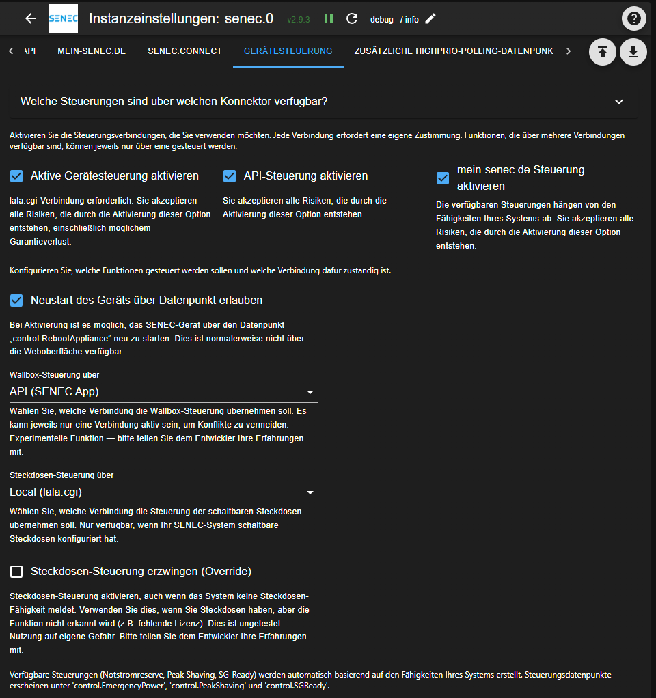

Control features allow you to change settings on your SENEC device. Each control is available via specific connectors:

| Control | Local | API | Web |
|---------|:-----:|:---:|:---:|
| Force battery charging | x | | |
| Block battery discharge | x | | |
| Appliance reboot | x | | |
| Emergency power reserve | | | x |
| Peak shaving | | | x |
| SG-Ready | | | x |
| Switchable sockets | x | | x |
| Wallbox control | x | x | |

**Use at your own risk.** Control features must be explicitly enabled in the settings with a disclaimer acknowledgment. The adapter does not protect against conflicting commands from multiple connectors.

### Debug & Logging

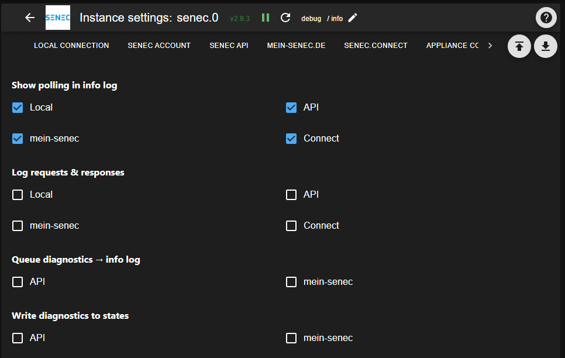

Configurable per connector (Local, local OpenAPI, API, mein-senec.de, Connect):

- **Show polling in info log** — Promotes polling status messages from debug to info level
- **Log requests & responses** — Logs HTTP details at debug level (may log sensitive data)
- **Queue diagnostics to info log** — Promotes queue statistics to info level (API + Web only)
- **Write diagnostics to states** — Writes queue data to dedicated ioBroker states (API + Web only)

#### Collecting a Debug Log

Most problems become obvious from a log, and almost none are diagnosable without one.

1. Set the instance log level to **debug**: ioBroker admin → Instances → the senec instance → the log level dropdown (the wrench icon opens the instance settings; the level sits in the row itself). `silly` exists too, but it is rarely more useful and produces a great deal of noise.
2. In the adapter's **Debug & Logging** tab, enable *Log requests & responses* for the connector that is misbehaving. This is the setting that turns "a request failed" into "this URL answered with this status".
3. Let it run long enough to catch the problem at least once. For anything on the slow tiers — measurements, monthly or yearly data — that can mean waiting for the next cycle rather than a restart.
4. Collect the log from ioBroker's Log tab, or from `/opt/iobroker/log/` if you would rather have the file.
5. Turn the level back to **info** afterwards. Debug logging is verbose and will fill a disk over weeks.

**Before sharing a log, read through it.** Request logging includes URLs and responses, and those can contain your system ID, plant number and device serial. None of it is a password, but it is yours. Replace anything you would rather not publish.

#### Reporting an Issue

Issues go to [GitHub](https://github.com/nobl/ioBroker.senec/issues). What makes one quick to act on:

- **Which system** — the model, and the firmware version if you have it (`FACTORY.*` and `SYS_UPDATE.*` hold both when the local connector runs)
- **Which connectors** are enabled, since the same symptom has different causes on local and cloud
- **Adapter and ioBroker version**, plus the Node.js version
- **What you expected and what happened instead** — "the battery level is missing" is actionable; "it does not work" needs a round of questions first
- **The relevant part of the log**, at debug level, with a few lines either side of the failure rather than the single error line

Worth knowing before you file: implausible readings usually come from the appliance rather than from the adapter. It mostly passes values through, so a temperature or state of charge that looks wrong on the dashboard will generally look just as wrong in the appliance's own web interface. Checking there first often answers the question outright — and when it does not, that comparison is itself the most useful thing you can put in the report.

## Built-in Dashboard

The adapter includes a full-featured web dashboard accessible at `http://<iobroker-ip>:8082/senec/`. It requires the ioBroker.web adapter and appears on the ioBroker.web welcome page.

Features:
- Dark and light theme (toggle in the top bar)
- Internationalization — 11 languages, follows browser locale
- Real-time updates via socket.io state subscriptions
- Data from all connectors with source indicator badges
- Keyboard accessible (tab navigation, ARIA labels)

### Overview Tab

**Energy Flow Diagram** — Live SVG visualization showing power flow between PV, battery, grid, house, and wallbox. Animated curved paths with power-proportional thickness. Battery SOC gauge with fill level. Operating mode badge. Time estimates (until empty/full). Period totals (today/month/year) with autarky percentage. Data source selector (Auto/Local/API/Web).

**Live Power Curve** — Real-time line chart showing power over time for all five metrics (PV, house, grid, battery, wallbox). Smooth monotone cubic interpolation between data points. Time window presets from 10 minutes to 24 hours, plus mouse wheel zoom (5min–30 days, downsampled for performance). Drag to pan through history with lazy loading and midnight date markers. Toggle individual lines, including an optional battery level line (off by default) drawn against its own right-hand 0–100 % axis. Pause/disable controls. Click "Live" to snap back to real-time. If a history adapter (InfluxDB, SQL, or History) is enabled on the power states, the chart backfills with historical data on page load. Each state is resolved on its own, so they may be recorded by different history adapters, and a state without recording only affects its own line. The ⓘ button lists the states behind every line together with the history adapter recording them — use it to find out why a line has no past data.

**Event Timeline** — Compact 24-hour strip showing today's warnings (orange), errors (red), and panics (purple) from the device log. Hover for full details. Auto-refreshes every 10 minutes. Requires the device IP to be configured.

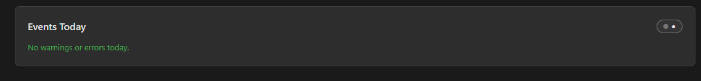

### Battery Tab

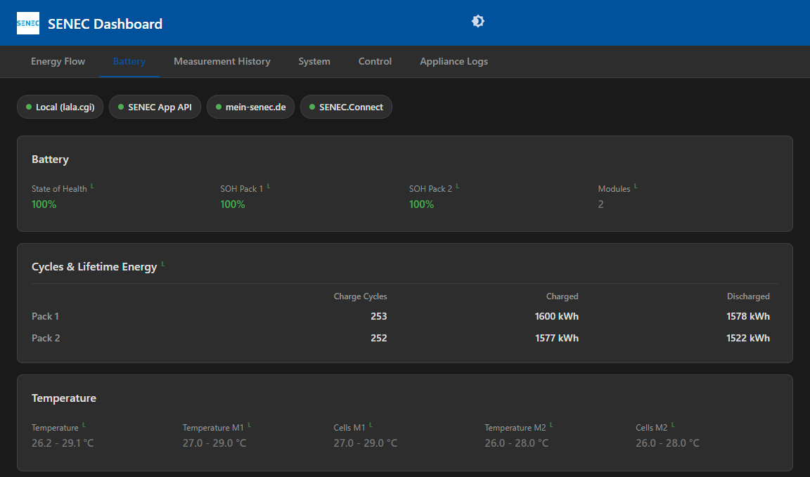

- **State of Health** — System and per-pack SOH with color-coded indicators (green > 80%, orange > 60%, red)
- **Module Status** — Active/charging/discharging module counts
- **Charge Cycles** — Per-pack cycle count and lifetime charged/discharged energy
- **Cell Voltage Heatmap** — Color-coded grid showing individual cell voltages across all modules. Red = lowest, green = highest. Per-module delta indicators. Instantly reveals cell imbalance.
- **Temperatures** — Overall, per-module, and per-cell temperatures
- **Pack Electrical** — Per-pack voltage and current

Data sourced from Local (BMS) and/or API (SystemDetails) with source badges.

### Charts Tab

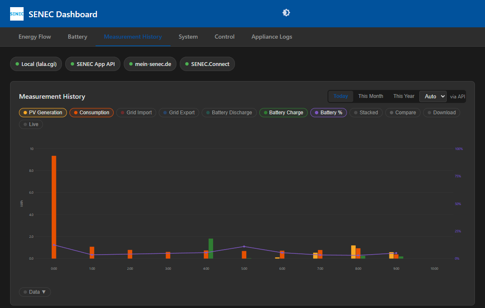

Measurement bar charts for energy data:
- **Today** — Hourly bars (auto-trims to hours with data)
- **This Month** — Daily bars
- **This Year** — Monthly bars

Features:
- Toggle individual measurement types (PV, consumption, grid import/export, battery charge/discharge)
- Stacked view (production vs. consumption)
- Comparison mode (yesterday, previous month, selectable year)
- Battery level (%) line overlay. The API connector reads it from the measurement history. mein-senec.de offers no such history, so the web connector samples the live charge level instead: hourly averages for the day view, daily averages for the month view. Those values therefore start when the adapter does — a day it was not running over midnight has no daily average, and none can be fetched retroactively. The year view has no battery level on the web connector.
- Data source selector (Auto/API/Web)
- Data table view
- PNG image export
- Auto-update mode

### System Tab

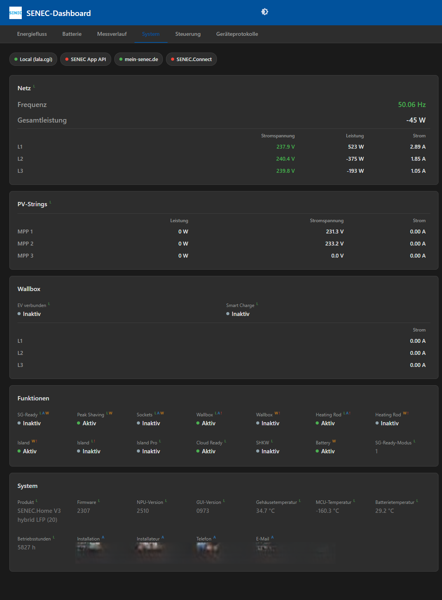

- **Grid Quality** — Frequency, total power, per-phase voltage/power/current. Supports EnFluRi 1 and EnFluRi 2 (auto-detected).
- **PV Strings** — Per-tracker MPP power, voltage, and current
- **Wallbox** — EV connected status, smart charge, per-phase charging current
- **Feature Flags** — Active features per connector with mismatch detection
- **System Details** — Product, firmware, GUI/NPU version, inverter state, temperatures (casing, MCU, battery, inverter), operating hours, installation date, installer contact

Source indicator badges show which connector provides each value.

### Control Tab

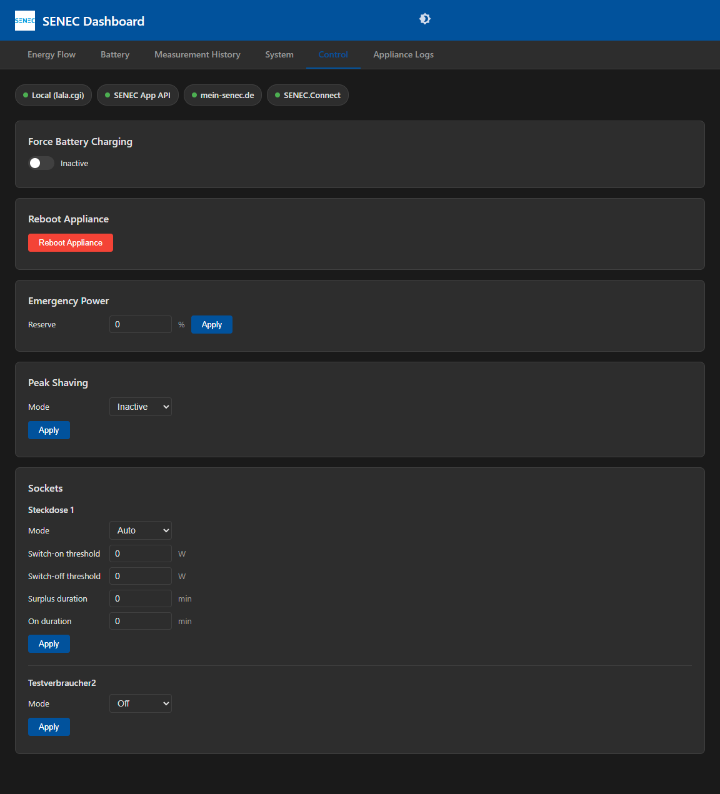

Interactive controls matching the adapter's control capabilities:
- Force battery charging (toggle)
- Appliance reboot (with confirmation dialog)
- Emergency power reserve (percentage slider)
- Peak shaving (mode-dependent fields)
- SG-Ready (enable + thresholds)
- Switchable sockets (per-socket mode, threshold settings, name editing)
- Wallbox (smart charge, current limit)

Controls check connector availability and show warnings if the required connector is not active. Apply button provides "Sent" confirmation feedback.

### Statistics Tab

mein-senec.de keeps a weekly CSV export at 5-minute resolution going back years — far more data than belongs in ioBroker states. So nothing is persisted: the adapter stores only the list of available weeks, refreshed once a day, and downloads a single week on demand when you ask for it. The data lives only as long as the tab is open.

- Plant selector, listing previous appliances on the account as well (hidden when there is only one). The plant this instance polls is preselected.
- Week selector showing each week's date range
- Day filter — narrow a ~2,000-row week to a single day
- Resolution — hourly means or raw 5-minute rows
- Column toggles for the ten exported columns, including battery voltage, current and charge level
- Sortable headers; a third click restores chronological order
- Summary row with minimum, mean and maximum of the rows shown
- Table or chart view; in the chart, power columns share a left kW axis while percentages get their own right-hand 0–100 % axis, and gaps in a series break the line rather than being bridged
- Download the current selection as CSV

Requires the mein-senec.de connector to be enabled and connected.

### Logs Tab

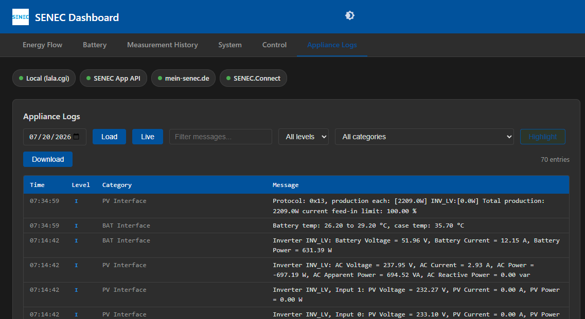

Browse SENEC device logs by date:
- Filterable table (Time, Level, Category, Message)
- Level filters: Info, Warning, Error, Panic
- Category filter (auto-populated from log entries)
- Free-text search
- Color-coded row highlighting by severity
- Newest entries first
- Live mode — auto-refreshes today's log (UTC-aware)
- Download raw log files

Requires the device IP to be configured (even if the Local connector is not enabled).

## State Reference

The adapter creates states organized by connector and data section. All states are read-only unless explicitly marked as control states.

### Connection & Status (`info.*`)

| State | Description |
|-------|-------------|
| `info.connection` | Overall connection status (true if any connector is active) |
| `info.connectionStatus` | Detailed connection status: `all` (all configured connectors connected), `partial` (some connected), `none` |
| `info.localConnected` | Local (lala.cgi) connection status |
| `info.apiConnected` | SENEC App API connection status |
| `info.webConnected` | mein-senec.de connection status |
| `info.connectConnected` | SENEC.Connect connection status |
| `info.openapiConnected` | Local OpenAPI (port 4424) connection status |
| `info.lastPoll.HighPrio` | Timestamp of last high-priority local poll |
| `info.lastPoll.LowPrio` | Timestamp of last low-priority local poll |

### TLS States (`_local.tls.*`)

| State | Type | Write | Description |
|-------|------|:-----:|-------------|
| `_local.tls.mode` | string | no | Active TLS validation mode: `user`, `cached`, `tofu`, or `none` |
| `_local.tls.fingerprint` | string | no | SHA-256 fingerprint of the accepted device certificate (TOFU mode, encrypted) |
| `_local.tls.userCaPem` | string | yes | User-uploaded CA certificate PEM (encrypted) |
| `_local.tls.cachedCaPem` | string | no | CA certificate PEM downloaded from mein-senec.de (encrypted) |
| `_local.tls.certFetchFailed` | boolean | yes | Set to `false` to trigger a new CA download attempt |

### Local States

Data from lala.cgi polling is stored directly under the section name (e.g. `ENERGY.*`, `BMS.*`, `PV1.*`, `WIZARD.*`).

**Key ENERGY states:**

| State | Type | Description |
|-------|------|-------------|
| `ENERGY.GUI_INVERTER_POWER` | number (W) | Current PV generation |
| `ENERGY.GUI_BAT_DATA_POWER` | number (W) | Battery power (positive = charging, negative = discharging) |
| `ENERGY.GUI_GRID_POW` | number (W) | Grid power (positive = importing, negative = exporting) |
| `ENERGY.GUI_HOUSE_POW` | number (W) | Current house consumption |
| `ENERGY.GUI_BAT_DATA_FUEL_CHARGE` | number (%) | Battery state of charge |
| `ENERGY.STAT_STATE` | number | System operating state code |
| `ENERGY.STAT_STATE_Text` | string | System state in human-readable text |
| `ENERGY.STAT_HOURS_OF_OPERATION` | number (h) | System uptime |

**Key BMS states:**

| State | Type | Description |
|-------|------|-------------|
| `BMS.MODULE_COUNT` | number | Number of battery modules |
| `BMS.SOH.{n}` | number (%) | State of health per module |
| `BMS.CYCLES.{n}` | number | Charge cycles per module |
| `BMS.CELL_VOLTAGES_MODULE_{A-D}.{n}` | number (mV) | Individual cell voltages |
| `BMS.TEMP_MIN.{n}` / `BMS.TEMP_MAX.{n}` | number (°C) | Module temperature range |
| `BMS.VOLTAGE.{n}` / `BMS.CURRENT.{n}` | number (V/A) | Pack voltage and current |

### API States (`_api.*`)

Cloud API data is stored under `_api.Anlagen.{systemId}.*`:

- `Dashboard.currently.*` — Real-time power values (W)
- `Measurements.Daily.*` — Hourly measurement data (kWh)
- `Measurements.Monthly.*` — Daily measurement data (kWh)
- `Measurements.Yearly.*` — Monthly measurement data (kWh)
- `Measurements.AllTime.*` — Lifetime totals (kWh)
- `SystemDetails.*` — Battery details, temperatures, firmware
- `SystemStatus.*` — Operating state, feature flags

### Web States (`_meinsenec.*`)

mein-senec.de data is stored under `_meinsenec.*`:

- `Status.*` — Current power values (kW), operating state
- `Measurements.*` — Historical measurement data (kWh)
- `Autarky.*` — Self-sufficiency percentages (day/week/month/year/all)
- `EmergencyPower.*` — Emergency power reserve settings
- `PeakShaving.*` — Peak shaving configuration
- `SGReady.*` — SG-Ready settings
- `Sockets.*` — Switchable socket states

### Connect States (`_connect.*`)

SENEC.Connect data is stored under `_connect.Systems.{system_id}.*` with battery and meter subsections. An account can hold more than one system; each one gets its own channel, named after its model and keyed on the system id reported in `bessNameplate` — so a system keeps its states even when the API returns the systems in a different order. `_connect.info.systemCount` reports how many systems the API sees.

The `bessNameplate` section is always requested, regardless of the configured sections, because it carries that id.

Wallboxes are stored the same way, under the `id` each one reports: `_connect.Systems.{system_id}.evse.{wallbox_id}.*`. A wallbox that disappears from the response has its states removed rather than left behind at their last values.

If a system reports no `system_id`, its serial number is used instead, and a system is remembered by every identifier it has ever reported — so a response that omits one of them does not move the system to a new path. If a response carries no identity at all, that system falls back to its position in the response, exactly as before 2.15.0, and cleanup is suspended for as long as this lasts.

States of a system the API no longer reports are removed. Adapters before 2.15.0 numbered the systems by their position in the response (`_connect.Systems.0.*`); those states are deleted on the first poll after the update, once the systems have been identified.

**If you record SENEC.Connect states with a history adapter** (History, InfluxDB, SQL), that setting lives on the state itself and is lost when the old state is deleted. Recording does not resume by itself — switch logging back on for the states under the new paths after updating.

### OpenAPI States (`_openapi.*`)

Readings from the appliance's local OpenAPI are stored under `_openapi.*`, one channel per section:

| Channel | Contents |
|---------|----------|
| `_openapi.battery.*` | State of charge, operating state, power, voltage, current |
| `_openapi.meter.*` | Grid power, house consumption, PV, surplus |
| `_openapi.bessNameplate.*` | Model, serial number, capacity and rated values |
| `_openapi.evse.{wallbox_id}.*` | One channel per wallbox slot — the appliance reports four whether or not a wallbox is attached |
| `_openapi.bess.*` | Only when selected — several of its values come back empty |
| `_openapi.info.approvalState` | `unregistered`, `pending`, `approved`, `rejected` or `error` |
| `_openapi.info.lastPoll` | Timestamp of the last successful poll |

The nameplate is read on every cycle whether or not it is selected. The appliance is normally identified from the common name of the certificate it presents on port 4424 — that name is the appliance's own serial number, so the certificate pins the individual appliance exactly, which the one on the local web interface cannot. The nameplate is the fallback for the case where that name cannot be read: its serial number then identifies the appliance instead, and it is what still allows the plant to be matched in your account — and therefore the registration to be approved automatically.

The registration token is stored encrypted in `_openapi.token`, so what the object tree holds is the ciphertext rather than the token itself. The state is flagged as not readable, but that flag is advisory in ioBroker — the encryption is the actual protection.

These states come from the appliance directly and are independent of the `lala.cgi` states. Where both report the same quantity, they are measured by the appliance at different points and need not agree to the watt.

### External States (`_external.*`)

External source data is stored under `_external.{type}.{index}.*`:

| State | Description |
|-------|-------------|
| `_external.pv.{n}.power` | External PV power (W) |
| `_external.consumer.{n}.power` | External consumer power (W) |
| `_external.battery.{n}.power` | External battery power (W, signed) |
| `_external.battery.{n}.soc` | External battery state of charge (%) |
| `_external.battery.{n}.capacity` | External battery capacity (kWh) |
| `_external.{type}.{n}.label` | User-defined label |
| `_external.{type}.{n}.mode` | Display mode (integrate/separate) |
| `_external.{type}.{n}.sourceId` | Foreign state ID or formula |

### Control States (`control.*`)

Writable states for appliance control:

| State | Type | Description |
|-------|------|-------------|
| `control.ForceLoadBattery` | boolean | Force battery charging on/off |
| `control.RebootAppliance` | boolean | Trigger appliance reboot |
| `control.EmergencyPower.ReserveInPercent` | number | Emergency power reserve (%) |
| `control.PeakShaving.*` | various | Peak shaving settings |
| `control.SGReady.*` | various | SG-Ready settings |
| `control.Sockets.{n}.*` | various | Per-socket control |
| `control.Wallbox.{n}.*` | various | Wallbox control |

Control states are only created when the corresponding feature is enabled and available via the configured connector.

## Troubleshooting

**Device not responding / frequent restarts**: Reduce the high-priority polling interval or remove custom high-priority data points. The SENEC device has limited resources.

**No data from API/Web**: Check your mein-senec.de credentials in the SENEC Account tab. The adapter logs authentication errors at warning level.

**Dashboard not loading**: Ensure ioBroker.web is running on port 8082. The dashboard is served as a web extension at `/senec/`.

**Missing states**: Available states depend on your SENEC model, firmware version, and configured connectors. Not all states are available on all systems.

**Control states not appearing**: Control features must be explicitly enabled in the Appliance Control settings tab. Each control requires a specific connector to be active.

**TLS certificate errors on local connection**: The adapter handles certificate validation automatically. Check `_local.tls.mode` to see which validation method is active. If you see TOFU mode and want to upgrade to CA validation, enable the mein-senec.de connector — the adapter will attempt to download the CA cert automatically. If a previous download failed, set `_local.tls.certFetchFailed` to `false` to retry.

## Getting Help

For questions, setups and comparing notes with other users, there is a [dedicated thread in the ioBroker forum](https://forum.iobroker.net/topic/30620/neuer-adapter-senec-home-adapter) — mainly German, and usually the quickest way to an answer.

If something looks like a bug, open an issue on [GitHub](https://github.com/nobl/ioBroker.senec/issues). [Collecting a debug log](#collecting-a-debug-log) and [what makes a report actionable](#reporting-an-issue) are described above.

## Changelog

<!--
  Placeholder for the next version (at the beginning of the line):
  ### **WORK IN PROGRESS**
-->
### 2.16.3 (2026-10-27)
- dependency updates

### 2.16.2 (2026-10-26)
- fixed bogus readme

### 2.16.1 (2026-10-26)
- New: The web dashboard now reads the **local OpenAPI**. Until now its values were polled but nothing on the dashboard looked at them, so an installation running only that connector saw an energy flow with no data in it. The energy flow, the live power chart and its history backfill now take it as a source of their own — selectable beside the diagram, and chosen automatically when `lala.cgi` polling is off. `lala.cgi` still wins where both run, because it polls six times as often.
- New: A *Battery (now)* card — state of charge, charge or discharge power, voltage, current and capacity — filled from whichever connectors you have enabled. An installation running only the local OpenAPI previously showed no battery readings at all.
- New: A *Local OpenAPI* card on the system tab, showing where the registration stands (including *not registered*, with what to do about it), whether the appliance is reachable, how long ago it last answered, and the certificate fingerprint. Reachability is reported separately from registration, because an approved registration whose appliance is switched off is still approved.
- New: The system tab fills in from the OpenAPI nameplate where it has nothing else — model, serial number, manufacturer, rated charge and discharge power, the AC-side readings, and each wallbox slot. Values read this way carry an **O** badge, alongside the existing L, A and W.
- New: `_openapi.info.lastCompletePoll` records the last cycle in which *every* requested section answered. `_openapi.info.lastPoll` is stamped as soon as one does, which is what the connection state needs, but anything reading several sections as one measurement needs to know they came from the same cycle.
- Fix: **The dashboard no longer shows values from a connector you have switched off.** Nothing deletes a connector's states when you disable it, so every card went on rendering whatever it last wrote — on one development system that meant an energy flow, an operating-mode badge and an entire battery tab built from readings two months old, presented as current. This applies everywhere, including the *Measurement History* tab, which could even pick a disabled connector as its source. A row that can come from several connectors keeps whichever is still in use, and a connector that is enabled but currently failing keeps its place, so nothing disappears while a connection is merely flapping.
- Fix: **The dashboard now recovers from a dropped connection.** It never did: the recovery ran only on the very first connect, so after any blip the page stopped noticing deleted states — a wallbox slot that had gone stayed on display — stopped hearing about configuration changes, and left a permanent hole in the live chart.
- Fix: Several ways the live power chart could stop backfilling and never start again: a history request lost to a dropped connection, a connection lost while it was working out which states are recorded, or panning while disconnected, which marked that stretch as loaded without ever asking for it. Collapsing or pausing the chart also left a permanent hole for the interval it skipped; it is now filled in when you resume.
- Fix: Switching the chart's data source while history was loading could mix the two sources together and issue several overlapping sets of queries at once.
- Fix: The live chart no longer empties and reloads its entire history every time the `lala.cgi` connector drops a single poll.
- Fix: Tabs that your enabled connectors cannot fill are hidden rather than shown empty, and the *Control* tab is no longer hidden when `lala.cgi` polling is off — a command is dispatched to whichever connector can carry it.
- Fix: The energy flow no longer presents zeros as a measurement when the connector it chose has published no power reading, and today's totals are cleared when no connector supplies them rather than staying on the last figures a cloud connector reported.
- Fix: A value the appliance reports as unavailable, or as a number too large to represent, is no longer published as `NaN` or `Infinity` on a state declared numeric — which silently breaks recording in InfluxDB — and no longer makes an export read as an import.
- Fix: A last-update time older than 36 hours now carries its date, instead of showing a time of day that reads as current at a glance.
- Fix: An external energy source's configured name is escaped where it is drawn into the energy-flow diagram.
- Fix: A few states could still be written while the adapter was shutting down.
- Dependency updates

### 2.16.0 (2026-10-25)
- New: A connector for the appliance's **local OpenAPI on port 4424** — a second local interface, independent of `lala.cgi` and read-only. It is **off by default** and available on **V2 and V3 systems only**; V4, P4 and E4 do not open the port. It shares the *Local Connection* tab and the appliance address with the `lala.cgi` connector, and either one works without the other. It needs a one-time registration that is approved in the SENEC portal, on a page reachable only by link. **With your SENEC account credentials filled in, the adapter handles that itself** — registering, approving and starting to poll, without the mein-senec.de connector having to be enabled; otherwise it writes the exact approval link to the log for you to open. `_openapi.info.approvalState` shows where the registration stands — not registered, waiting, approved, or no longer accepted — with buttons beside it to re-check the approval, or to de-register and discard the token. It serves battery, meter, nameplate and wallbox readings under `_openapi.*`. There is nothing writable: the two routes that would set a charge or discharge power refuse every request an end customer can make, approved or not. What the interface offers and refuses is documented in [docs/LOCAL_OPENAPI_4424.md](docs/LOCAL_OPENAPI_4424.md).
- New: The appliance address moved to the top of the *Local Connection* tab and is shown whenever either local connector is enabled. It was previously hidden unless `lala.cgi` polling was switched on, which left anyone who wanted only the new connector unable to enter it at all.
- New: The battery state read through SENEC.Connect now has a companion state spelling the code out in words, at `_connect.Systems.<system_id>.battery.state_Text`. Only `lala.cgi` states carried these before.
- Change: `BAT1.SPARE_CAPACITY` is now named *Emergency Power Reserve* and carries `%` as its unit. It is the local mirror of the emergency power reserve set on mein-senec.de, so the value you set in the portal is what appears here. It was previously listed under its raw name with no unit, which told nobody what the number meant.
- Change: SENEC.Connect honours a `Retry-After` the API sends with a 429 or 503 instead of coming back at the configured interval regardless. The endpoint is rate-limited per subscription, and ignoring the wait it asks for invites a longer block.
- Change: The house consumption from SENEC.Connect is now named for what its schema says it is — the figure excludes the wallbox load, which matters to anyone comparing it against the appliance's own.
- Fix: The documentation listed a writable state `control.BlockDischarge` for blocking battery discharge. No such state exists and none ever has, so the row is removed. The force-charge switch in the same table was misnamed too: it is `control.ForceLoadBattery`, not `control.ForceCharge`, and it is created on every instance alongside `control.RebootAppliance`. Whether the appliance offers a discharge block at all is tracked as a question of its own (#543).
- Fix: The documentation named `_local.FACTORY` and `_local.SYS_UPDATE` as the states holding model and firmware version for a bug report. Those are `FACTORY.*` and `SYS_UPDATE.*` at the root of the instance — `_local.` holds the TLS states and nothing else.
- Dependency updates

### 2.15.6 (2026-10-06)
- Dependency updates

### Former Updates

## License
MIT License

Copyright (c) 2020-2026 Norbert Bluemle <github@bluemle.org>

Permission is hereby granted, free of charge, to any person obtaining a copy
of this software and associated documentation files (the "Software"), to deal
in the Software without restriction, including without limitation the rights
to use, copy, modify, merge, publish, distribute, sublicense, and/or sell
copies of the Software, and to permit persons to whom the Software is
furnished to do so, subject to the following conditions:

The above copyright notice and this permission notice shall be included in all
copies or substantial portions of the Software.

THE SOFTWARE IS PROVIDED "AS IS", WITHOUT WARRANTY OF ANY KIND, EXPRESS OR
IMPLIED, INCLUDING BUT NOT LIMITED TO THE WARRANTIES OF MERCHANTABILITY,
FITNESS FOR A PARTICULAR PURPOSE AND NONINFRINGEMENT. IN NO EVENT SHALL THE
AUTHORS OR COPYRIGHT HOLDERS BE LIABLE FOR ANY CLAIM, DAMAGES OR OTHER
LIABILITY, WHETHER IN AN ACTION OF CONTRACT, TORT OR OTHERWISE, ARISING FROM,
OUT OF OR IN CONNECTION WITH THE SOFTWARE OR THE USE OR OTHER DEALINGS IN THE
SOFTWARE.