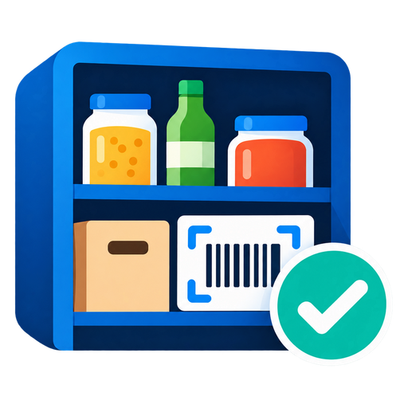

  

# ioBroker.shelfmate

**ShelfMate – deine Vorräte im Blick.**

ShelfMate ist ein Vorratsmanager für ioBroker. Damit weißt du jederzeit, welche Lebensmittel du zu Hause hast, wo sie liegen und was nachgekauft werden muss.

Produkte lassen sich per Barcode scannen, in Regalen oder Schränken verwalten und bei Bedarf automatisch auf die Einkaufsliste setzen. Auch Mindestbestände, Haltbarkeitsdaten und der Verbrauch werden berücksichtigt.

Die Bedienung erfolgt über eine Web-App, die du auf dem Smartphone öffnen und zum Homescreen hinzufügen kannst. Eine separate App ist nicht nötig.

**English:** [README.md](/#/adapters/shelfmate)  
**Anleitungen:** [Deutsch](https://github.com/backfisch88/ioBroker.shelfmate/blob/main/docs/de/tutorial.md) · [English](/#/docs/adapterref/iobroker.shelfmate/docs/en/tutorial.md)

---

## Funktionen

### Produkte und Lagerorte

- Produkte per Barcode oder manuell hinzufügen, beim manuellen Anlegen mit Namensvorschlägen und passender Kategorie
- Warennummern (PLU) von Obst und Gemüse und Data-Matrix-Etiketten von Waagen werden erkannt; eine eigene Liste in `plu.data` benennt Händler-Nummern
- Eigene Produktdatenbank (Datenpunkt, Datei oder Netzwerk-Adresse; JSON oder CSV mit freien Feldnamen), die zuerst gefragt wird; Produkte mit eigenen Barcodes behalten ihren Barcode
- Produktdaten automatisch über Open Food Facts laden (Name, Marke, Packungsgröße, Nutri-Score und Kategorien)
- Produktdaten jederzeit bearbeiten und aktualisieren
- Eigene EAN-13-Barcodes für Produkte ohne Barcode erstellen
- Eigene Produktbilder hochladen (werden automatisch verkleinert)
- Lagerbereiche und Lagerorte anlegen, zum Beispiel Küche, Vorratsschrank oder Keller
- Lagerorte über QR-Codes auswählen
- Bestände einlagern, entnehmen und zwischen Lagerorten verschieben
- Alle Buchungen in einer Historie nachvollziehen
- Produkte schnell über die Suche finden, inklusive Vorschlägen während der Eingabe
- Produkte verschiedener Marken zu Gruppen zusammenfassen, zum Beispiel Mehl oder Zucker

### Mindestbestand und Einkaufsliste

- Mindestbestand für einzelne Produkte oder ganze Produktgruppen festlegen
- Produkte automatisch auf die Einkaufsliste setzen, sobald der Mindestbestand erreicht ist
- Einkaufslisten über Datenpunkte, Bring! oder Bring! Spezial verwalten
- Optional die fehlende Menge mitschreiben (Bring! Spezial und Script-Modus)
- Bei Bring! Spezial werden Mengen und Zusätze auf demselben Eintrag zusammengeführt, statt doppelte Einträge anzulegen
- Produkte beim Auffüllen automatisch von der Einkaufsliste entfernen
- Verbrauch der letzten 30 Tage auswerten
- Passenden Mindestbestand anhand des bisherigen Verbrauchs vorschlagen

### Haltbarkeit und MHD

- Mindesthaltbarkeitsdatum optional pro Produkt oder pro Einlagerung speichern
- Vor bald ablaufenden und abgelaufenen Produkten warnen
- Standard-Haltbarkeit für viele Lebensmittel automatisch vorschlagen
- Haltbarkeit nach dem Öffnen berücksichtigen
- Gefrierorte mit eigener Gefrier-Haltbarkeit; TK-Produkte behalten ihre normale Haltbarkeit
- Produkte als geöffnet oder verdorben markieren
- Automatisch eingetragene Werte am Funken-Symbol erkennen
- Eigene Haltbarkeitswerte für Produkte und Gruppen festlegen
- Babynahrung im Gläschen bekommt nach dem Öffnen nur 1 bis 2 Tage
- Haltbarkeitsregeln (Stichwörter mit Tagen vor und nach dem Öffnen) selbst bearbeiten und alle Produkte mit ihrer Haltbarkeit durchsuchen

### Zutaten prüfen

Du möchtest etwas kochen und wissen, ob alle Zutaten vorhanden sind?

ShelfMate kann eine Zutatenliste, zum Beispiel aus einer Rezept-App, mit deinem Vorrat vergleichen.

Fehlende Zutaten lassen sich direkt auf die Einkaufsliste setzen. Was bereits vorhanden ist, wird nicht erneut hinzugefügt.

### Scannen und Etiketten

- Barcodes mit der Smartphone-Kamera oder einem Scanner erfassen
- QR-Codes für Lagerorte erstellen und drucken
- EAN- und QR-Etiketten in eigenen Größen drucken, zum Beispiel 50 × 30 mm
- Etiketten für Regale, Boxen, Gefrierfach (mit freier Textzeile, zum Beispiel dem Gewicht) und geöffnete Produkte; ein EAN-Etikett und ein Gefrier-Etikett mit EAN und Einfrierdatum lassen sich auch auf der Produktseite drucken
- Code-Bibliothek: eigene Codes speichern, als Etikett drucken und wählen, welche Steuer-Codes ins PDF kommen
- Einstellen, welche Etiketten in der App angeboten werden
- Zähl-Modus: Jeder Scan lagert ohne Lagerort ein Stück ein, drei Scans sind drei Stück
- Scanner-Modus für das Ein- und Auslagern ohne geöffnete Web-App, auch mit Scannern mit Speicher; Scanner mit USB-Dongle oder Bluetooth werden direkt am ioBroker-Host gelesen
- MHD für mehrere Produkte auf einmal: im Einräum-Modus per Scan-Code, über `SM:COPY` kopieren oder in der Liste „Ohne MHD“ für markierte Lagerorte
- Mehrfach scannen löst frei wählbare Aktionen aus (am letzten Lagerort einlagern, als leer markieren, auf die Einkaufsliste setzen und mehr)
- Unbekannte Barcodes werden im Scanner-Modus automatisch angelegt (Daten von Open Food Facts) und bei fehlenden Daten zum Ergänzen vorgemerkt
- Inventur per Produktliste oder Scanner durchführen

### Übersicht und Benachrichtigungen

- Gesamten Bestand nach Lagerort anzeigen
- Warnungen bei Mindestbestand und ablaufenden Produkten
- Benachrichtigungen über Telegram, telegrammenu2, Pushover, Signal, WhatsApp, Matrix oder E-Mail
- Tägliche Übersicht über bald ablaufende und abgelaufene Produkte, auf Wunsch nur an bestimmten Tagen vor dem Datum (zum Beispiel 7,4,3,2,1,0)
- Der Reiter „Aufgaben“ sammelt alles Offene: neue Produkte ergänzen, fällige Inventur, Vorschläge für Gruppen und Mindestbestand sowie Produkte ohne Datum (Datum leer lassen = die angekreuzten Packungen bleiben ohne MHD)
- Inventur-Erinnerungen
- Vorschläge für Produktgruppen und Mindestbestände
- Bestand ausgewählter Lagerorte (zum Beispiel Kühlschrank) als Verbrauchswaren-Liste in Datenpunkten, mit geöffneten Produkten und bald ablaufendem MHD
- Datenpunkte für die Einbindung in VIS oder eigene Skripte
- JSON-Backups sowie Export als CSV oder PDF

### Web-App

- Läuft direkt im Browser auf Smartphone, Tablet und PC
- Kann auf dem iPhone- oder Android-Homescreen abgelegt werden
- Suchleisten im Glas-Look, die beim Scrollen oben bleiben, mit Knopf zum Löschen des Textes
- Moderne Glasoptik im Stil von iOS 27: gläserne Navigationsleiste, die sich beim Scrollen zu einem Kreis zusammenfaltet, gläserne Schalter und Regler, systemnahe Schrift
- Akzentfarbe und Hintergrundfarbe wählbar; ein Regler bestimmt, wie durchsichtig die gläsernen Teile sind
- Offline-Warteschlange für Buchungen bei Verbindungsproblemen
- Gerätenamen vergeben, damit Buchungen in der Historie zugeordnet werden können
- Letzte Buchung rückgängig machen
- HTTPS-Unterstützung mit eigenen oder automatisch erstellten Zertifikaten
- Optionaler Zugriffsschlüssel für die API
- Mehrsprachig: Deutsch, Englisch, Russisch, Portugiesisch, Niederländisch, Französisch, Italienisch, Spanisch, Polnisch, Ukrainisch und Chinesisch

---

## Voraussetzungen

- ioBroker js-controller >= 6.0.11
- Admin >= 7.6.20
- Node.js >= 22.12
- HTTPS mit einem Zertifikat, dem das Smartphone vertraut (für Kamera und Offline-Funktionen)

## Installation

ShelfMate wird wie jeder andere ioBroker-Adapter installiert.

1. Im ioBroker-Admin den Adapter **shelfmate** installieren.
2. Eine Instanz anlegen.
3. Die Web-App über `https://<Host>:8120/` öffnen.
4. Optional die Seite zum Homescreen hinzufügen.

Der Standardport ist `8120` und kann in den Einstellungen geändert werden.

## Erste Schritte

1. **Lagerorte anlegen:** Erstelle deine Lagerbereiche und Lagerorte, zum Beispiel Küche → Vorratsschrank → Fach 1.
2. **QR-Codes drucken:** Bringe die passenden QR-Codes an deinen Lagerorten an.
3. **Produkte hinzufügen:** Scanne einen Barcode oder lege ein Produkt manuell an. Viele Produktdaten werden automatisch von Open Food Facts geladen.
4. **Vorräte einlagern:** Wähle den Lagerort per QR-Code aus und buche die gewünschte Menge ein.
5. **Mindestbestand festlegen:** ShelfMate kann Produkte automatisch auf deine Einkaufsliste setzen, sobald der Vorrat knapp wird.

Eine ausführliche Beschreibung findest du in der [Anleitung](https://github.com/backfisch88/ioBroker.shelfmate/blob/main/docs/de/tutorial.md).

---

## Einstellungen

Die wichtigsten Funktionen lassen sich direkt in der Adapterkonfiguration anpassen.

| Einstellung | Beschreibung |
| --- | --- |
| Darstellung (in der App) | Design, Akzentfarbe (Standard: Blau), Hintergrundfarbe (Standard: Grau), Transparenz und Unschärfe der gläsernen Teile. Gilt nur für dieses Gerät |
| Port / Bind-Adresse | Port und Netzwerkschnittstelle des Webservers (Standard: 8120) |
| HTTPS | HTTPS aktivieren und Zertifikate auswählen |
| Zertifikat erstellen | Erstellt ein selbstsigniertes Zertifikat für Hostname und IP-Adressen, gültig für 825 Tage. Danach die Instanz neu starten |
| Zertifikate | Zertifikate aus ioBroker oder zum Beispiel vom acme-Adapter verwenden |
| Zugriffsschlüssel | Optionaler Schutz für den API-Zugriff, einmalige Eingabe pro Gerät |
| Einkaufsliste | Aus, Script, Bring! oder Bring! Spezial |
| MHD-Verwaltung | Aus, pro Produkt oder pro Einlagerung |
| Datumsformat | TT.MM.JJJJ, TT/MM/JJJJ oder JJJJ-MM-TT |
| Benachrichtigungen | Adapter, Empfänger und gewünschte Meldungen auswählen |
| Automatische Haltbarkeit | Standardwerte immer, nur im Scanner-Modus oder nie eintragen |
| Standardwerte verwenden | Alle hinterlegten Haltbarkeiten oder nur die eingebaute Trockenwarenliste |
| Ablaufwarnung | Festlegen, wie viele Tage vor Ablauf gewarnt wird |
| Zutaten-Prüfung | Fehlende Zutaten automatisch auf die Einkaufsliste setzen und optional eine Nachricht über Zutaten bekommen, die nicht auf die Liste kamen |
| Eigene Produktdatenbank | Festlegen, ob sie zuerst, allein oder gar nicht gefragt wird; Datenpunkt, Datei oder Netzwerk-Adresse (JSON oder CSV) angeben und eigene Feldnamen zuordnen |
| Scanner-Modus | Scanner-Gerät, Zeitabstände, Präfix, Suffix und QR-Code-Art einstellen; „Scans = Menge“ lagert pro Scan ein Stück ohne Lagerort ein (Standard-Lagerort für neue Produkte, `SM:OUT` zum Entnehmen) |
| Etiketten | Verfügbare Etikettentypen und Druckoptionen auswählen |
| Inventur-Erinnerung | Erinnerung nach einer festgelegten Anzahl von Tagen ohne Inventur |

### Mindesthaltbarkeit

Für die MHD-Verwaltung gibt es drei Möglichkeiten:

- **Aus:** Keine MHD-Verwaltung.
- **Pro Produkt:** Ein gemeinsames MHD für das Produkt.
- **Pro Einlagerung:** Jede Einlagerung kann ein eigenes MHD haben. Bei der Entnahme wird zuerst der älteste Bestand berücksichtigt.

ShelfMate kann außerdem Standard-Haltbarkeiten automatisch eintragen. Selbst eingetragene Werte haben Vorrang.

### Einkaufsliste

ShelfMate unterstützt vier Modi:

- **Aus:** Keine automatische Einkaufsliste.
- **Script:** Übergabe über ioBroker-Datenpunkte. Mit der Option für die fehlende Menge erhält das Script `Name, Menge` (zum Beispiel `Milch, 2`); der Listen-Datenpunkt darf mehr Felder als `name` enthalten, sie werden ignoriert. Der zuletzt hinzugefügte Artikel steht außerdem als JSON in `shopping.lastItem`.
- **Bring!:** Produkte werden zur Bring!-Einkaufsliste hinzugefügt.
- **Bring! Spezial:** Vorhandene Einträge werden nicht übersprungen. Mengen werden hochgezählt, Zusätze ergänzt (zum Beispiel `Feta, Kräuter, 200g`).

Optional können Produkte beim Auffüllen wieder von der Liste entfernt werden.

Weitere Informationen findest du in der [Anleitung zu den Einkaufslisten](https://github.com/backfisch88/ioBroker.shelfmate/blob/main/docs/de/tutorial.md#einkaufslisten-modi).

### Benachrichtigungen

Meldungen können über folgende Adapter gesendet werden:

- Telegram und telegrammenu2
- Pushover
- Signal
- WhatsApp
- Matrix
- E-Mail

Du kannst auswählen, ob ShelfMate bei niedrigem Bestand, bei ablaufenden Produkten oder bei einer fälligen Inventur benachrichtigen soll.

Für die tägliche Ablaufmeldung lässt sich eine feste Uhrzeit einstellen und dazu die Tage vor dem Datum, an denen gemeldet wird (zum Beispiel `7,4,3,2,1,0`; `0` = am Tag selbst, leer = täglich innerhalb der Warnfrist).

---

## Datenpunkte

ShelfMate stellt wichtige Informationen und Funktionen als ioBroker-Datenpunkte bereit.

### Bestand und Statistiken

| Datenpunkt | Beschreibung |
| --- | --- |
| `info.connection` | Webserver läuft |
| `stats.products` | Anzahl der Produkte |
| `stats.locations` | Anzahl der Lagerorte |
| `stats.inventory` | Gesamter Bestand als JSON |
| `stats.inventoryHtml` | Bestand als HTML-Tabelle für VIS |
| `stats.lowStockCount` | Anzahl der Produkte mit niedrigem Bestand |
| `stats.lowStockList` | Liste der Produkte mit niedrigem Bestand |
| `stats.consumption` | Verbrauch der letzten 30 Tage |
| `stats.expiringCount` | Anzahl bald ablaufender und abgelaufener Produkte |
| `stats.expiring` | Ablaufende Produkte als JSON |
| `stats.expiringHtml` | Ablaufende Produkte als HTML-Tabelle |

### Einkaufsliste und Zutaten

| Datenpunkt | Beschreibung |
| --- | --- |
| `shopping.addItem` | Produkt zur Einkaufsliste hinzufügen (`ack=false`) |
| `shopping.lastItem` | Script-Modus: zuletzt hinzugefügter Artikel als JSON (Name, Menge, Einheit, Text) |
| `check.request` | Zutatenliste zur Prüfung übergeben (`ack=false`) |
| `check.result` | Ergebnis der letzten Zutaten-Prüfung als JSON |
| `check.available` | Vorhandene Zutaten |
| `check.missing` | Fehlende Zutaten |
| `check.allAvailable` | `true`, wenn alle Zutaten vorhanden sind |
| `check.addMissing` | Fehlende Zutaten auf die Einkaufsliste setzen |

### Scanner-Modus

| Datenpunkt | Beschreibung |
| --- | --- |
| `ownDb.data` | Eigene Produktdatenbank als JSON-Liste; Produkte mit eigenen Barcodes werden automatisch ergänzt |
| `plu.data` | Eigene Warennummern (PLU) als JSON, zum Beispiel `{"4238": "Banane Bio"}`; sie gehen der eingebauten Liste vor |
| `scanner.active` | Scanner-Modus ein- oder ausschalten |
| `scanner.input` | Barcode oder QR-Code übergeben (`ack=false`) |
| `scanner.lastCode` | Zuletzt gescannter Code |
| `scanner.lastAction` | Letzte Aktion eines mehrfachen Scans (Regel) als Text |
| `scanner.result` | Ergebnis des letzten Scans |

Beispiel für `scanner.result`:

`Fusilli ×1 eingelagert in Regal 1`

Weitere Informationen: [Scanner-Modus ohne App](https://github.com/backfisch88/ioBroker.shelfmate/blob/main/docs/de/tutorial.md#scanner-modus-ohne-app)

---

## Datensicherung

Alle Bestandsdaten werden in der Datei `shelfmate.json` im Datenverzeichnis des Adapters gespeichert.

Über die Web-App kannst du:

- Ein JSON-Backup herunterladen
- Ein vorhandenes Backup wiederherstellen
- Bestände als CSV oder PDF exportieren
- Alle Daten löschen

Beim Import eines Backups oder beim Löschen der Daten wird der vorherige Stand als `shelfmate.json.bak` gesichert.

---

## Dokumentation

Eine ausführliche Anleitung mit Beispielen und Erklärungen gibt es hier:

- [Anleitung auf Deutsch](https://github.com/backfisch88/ioBroker.shelfmate/blob/main/docs/de/tutorial.md)
- [Tutorial in English](/#/docs/adapterref/iobroker.shelfmate/docs/en/tutorial.md)

Darin werden unter anderem die Bedienung der Web-App, Lagerorte, Produktgruppen, Mindestbestand, MHD, Scanner-Modus, Etiketten, Einkaufsliste und Inventur erklärt.

---

## Rückmeldung

Ideen, Wünsche oder Fehler können gerne als [GitHub-Issue](https://github.com/backfisch88/ioBroker.shelfmate/issues) gemeldet werden.

## Änderungsverlauf

Den vollständigen Änderungsverlauf findest du in der [englischen README](/#/adapters/shelfmate#changelog).

## Lizenz

Die mitgelieferte Schrift Inter (`www/fonts/`) steht unter der SIL Open Font License 1.1, siehe `www/fonts/interLicense.txt`.

MIT-Lizenz

Copyright (c) 2026 Henrik Schoenhofen  
[LICENSE](https://github.com/backfisch88/ioBroker.shelfmate/blob/main/LICENSE)