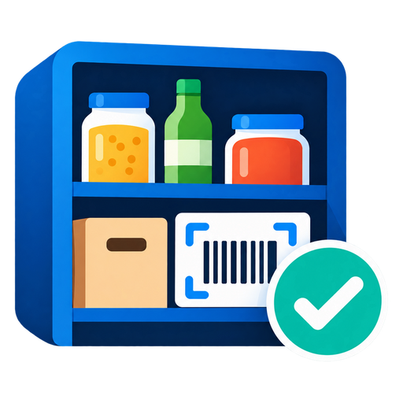

  

# ioBroker.shelfmate

**ShelfMate – your pantry at a glance.**

ShelfMate is a pantry manager for ioBroker. It tells you at any time which food you have at home, where it is stored and what needs to be bought again.

Scan products by barcode, manage them on shelves and in cupboards, and put them on your shopping list automatically when needed. Minimum stock, best-before dates and consumption are taken into account as well.

You use it through a web app that you open on your phone and add to the home screen. A separate app is not needed.

**Deutsch:** [README.de.md](/#/docs/adapterref/iobroker.shelfmate/README.de.md)  
**Guides:** [English](/#/docs/adapterref/iobroker.shelfmate/docs/en/tutorial.md) · [Deutsch](https://github.com/backfisch88/ioBroker.shelfmate/blob/main/docs/de/tutorial.md)

---

## Features

### Products and storage locations

- Add products by barcode or by hand, with name suggestions and a matching category when creating by hand
- Produce numbers (PLU) of fruit and vegetables and the data matrix labels of scales are recognised; an own list in `plu.data` names retailer-assigned numbers
- Use an own product database (data point, file or web address; JSON or CSV with free field names) that is asked first; products with own barcodes keep their barcode
- Load product data from Open Food Facts and its sister databases (cosmetics, pet food, household) automatically (name, brand, package size, Nutri-Score and categories); the source is shown in the app
- Unknown barcodes: a button searches the web for name, brand and picture, also for all new products at once (with a review page before anything is saved) or for the picture only (only on request, can be turned off)
- Edit and refresh product data at any time
- Create your own EAN-13 barcodes for products without a barcode
- Upload your own product images (scaled down automatically)
- Create storage areas and locations, for example kitchen, pantry or cellar
- Select storage locations with QR codes
- Stock in, take out and move stock between locations
- Follow every booking in a history
- Find products quickly with the search, including suggestions while you type
- Combine products of different brands into groups, for example flour or sugar

### Minimum stock and shopping list

- Set a minimum stock for single products or whole product groups
- Put products on the shopping list automatically when the minimum stock is reached
- Manage the shopping list through data points, Bring! or Bring! special
- With Bring! special, quantities and variants are merged on the same entry instead of creating duplicates
- Remove products from the shopping list automatically when the stock is refilled
- Optionally write the missing quantity on the shopping list
- List the stock of consumables locations (for example the fridge) in data points
- Evaluate the consumption of the last 30 days
- Suggest a fitting minimum stock based on past consumption

### Shelf life and best-before date

- Store the best-before date (MHD) optionally per product or per stocking
- Warn about products that expire soon or have expired
- Tab "Tasks" collects everything to do: new products to complete, due stocktaking, group and minimum stock suggestions, and products without a date (leave the date empty to keep chosen packages without one)
- Suggest a standard shelf life for many foods automatically
- Take the shelf life after opening into account
- Freezer locations with their own frozen shelf life; products bought frozen keep their normal shelf life
- Mark products as opened or spoiled
- Recognise automatically filled-in values by the sparkle symbol
- Set your own shelf life values for products and groups
- Baby food in jars gets a short standard shelf life after opening (1 to 2 days)
- Edit the shelf life rules (keywords with days before and after opening) and search all products with their shelf life, including the value after opening

### Check ingredients

Want to cook something and know whether all ingredients are at home?
ShelfMate can compare a list of ingredients, for example from a recipe app, with your stock.
Missing ingredients can be put on the shopping list directly. What is already in stock is not added again.

### Scanning and labels

- Capture barcodes with the phone camera or a scanner
- Create and print QR codes for storage locations
- Print EAN and QR labels in your own sizes, for example 50 × 30 mm
- Labels for shelves, boxes, the freezer (with a free text line, for example the weight) and opened products; an EAN label and a freezer label with EAN and freezing date can also be printed from the product page
- Choose which labels the app offers
- Code library: save your own codes (for example from other scanners or apps), print them as labels and choose which of the control codes go into the PDF
- Scanner mode for stocking in and out without the web app open; scanners with a USB dongle or Bluetooth are read directly on the ioBroker host
- Repeated scans (three or more) trigger actions you choose: stock in at the last location, mark as empty, put on the shopping list and more
- Counting mode: every scan stocks in one piece without a location, three scans are three pieces
- Do a stocktaking by product list or by scanner

### Overview and notifications

- Show the whole stock by storage location
- Warnings for minimum stock and expiring products
- Notifications through Telegram, telegrammenu2, Pushover, Signal, WhatsApp, Matrix or e-mail
- Daily summary of products that expire soon or have expired, optionally only on chosen days before the date (for example 7,4,3,2,1,0)
- Stocktaking reminders
- Suggestions for product groups and minimum stock
- Data points for VIS or your own scripts
- JSON backups and export as CSV or PDF

### Web app

- Runs directly in the browser on phone, tablet and PC
- Can be added to the iPhone or Android home screen
- Modern glass look in the style of iOS 27: glass tab bar that folds into a circle while scrolling, glass switches and sliders, system-like fonts
- Search bars in glass look that stay at the top while you scroll, with a button to clear the text
- Choose the accent colour and the background colour; two sliders set how transparent and how blurred the glass parts are
- Offline queue for bookings when the connection is lost
- Give each device a name so bookings can be told apart in the history
- Undo the last booking
- HTTPS with your own or automatically created certificates
- Optional access key for the API
- Multilingual: German, English, Russian, Portuguese, Dutch, French, Italian, Spanish, Polish, Ukrainian and Chinese

---

## Requirements

- ioBroker js-controller >= 6.0.11
- Admin >= 7.6.20
- Node.js >= 22.12
- HTTPS with a certificate your phone trusts (for the camera and the offline functions)

## Installation

ShelfMate is installed like any other ioBroker adapter.

1. Install the adapter **shelfmate** in the ioBroker admin.
2. Create an instance.
3. Open the web app at `https://<host>:8120/`.
4. Optionally add the page to the home screen.

The default port is `8120` and can be changed in the settings.

## Getting started

1. **Create storage locations:** Create your storage areas and locations, for example Kitchen → Pantry → Shelf 1.
2. **Print QR codes:** Attach the matching QR codes to your storage locations.
3. **Add products:** Scan a barcode or create a product by hand. Much of the product data is loaded from Open Food Facts automatically.
4. **Stock in:** Select the location by QR code and book in the amount.
5. **Set a minimum stock:** ShelfMate can put products on your shopping list automatically when the stock gets low.

A detailed description is in the [guide](/#/docs/adapterref/iobroker.shelfmate/docs/en/tutorial.md).

---

## Settings

The most important functions can be adjusted directly in the adapter configuration.

| Setting | Description |
| --- | --- |
| Appearance (in the app) | Theme, accent colour (default blue), background colour (default grey), transparency and blur of the glass parts. Applies to this device only |
| Port / bind address | Port and network interface of the web server (default: 8120) |
| HTTPS | Turn on HTTPS and choose the certificates |
| Create certificate | Creates a self-signed certificate for the host name and IP addresses, valid for 825 days. Restart the instance afterwards |
| Certificates | Use certificates from ioBroker or, for example, from the acme adapter |
| Access key | Optional protection for API access, entered once per device |
| Shopping list | Off, script, Bring! or Bring! special |
| Web search for unknown products | Adds the "Search the web" button to the product editor (on by default). It only runs when tapped and only sends the barcode |
| Token for ean-search.org | Optional free token. With it, the web search uses the official interface of ean-search.org and is not blocked after a few lookups |
| Key for Open EAN database | Optional free query ID of opengtindb.org. With it, the web search also asks the Open EAN / GTIN database for the name |
| Group name on the list | Grouped products go on the shopping list with the group name (default). Off: the first empty product of the group |
| Best-before management | Off, per product or per stocking |
| Date format | DD.MM.YYYY, DD/MM/YYYY or YYYY-MM-DD |
| Notifications | Choose the adapter, the recipient and the messages you want |
| Fill in shelf life automatically | Enter standard values always, only in scanner mode or never |
| Which standard values | All stored shelf lives or only the built-in dry goods list |
| Expiry warning | How many days before expiry to warn |
| Ingredient check | Put missing ingredients on the shopping list automatically and, optionally, get a message about the ingredients that were not put on it |
| Own product database | Choose whether it is asked first, only or never; add a data point, a file or a web address (JSON or CSV) and map your own field names |
| Scanner mode | Set the scanner device, time gaps, prefix, suffix and the QR code type; "Scans = quantity" stocks in one piece per scan without a location (default location for new products, `SM:OUT` to take out) |
| Labels | Choose the available label types and print options |
| Stocktaking reminder | Reminder after a set number of days without a stocktaking |

### Best-before date

There are three modes for the best-before management:

- **Off:** No best-before management.
- **Per product:** One shared best-before date for the product.
- **Per stocking:** Every stocking can have its own best-before date. When taking out, the oldest stock is used first.

ShelfMate can also fill in standard shelf lives automatically. Values you enter yourself always win.

### Shopping list

ShelfMate supports four modes:

- **Off:** No automatic shopping list.
- **Script:** Handed over through ioBroker data points. With the option to write the missing amount, the script receives `Name, amount` (for example `Milk, 2`); the list state may contain more fields than `name`, they are ignored. The item added last is also available as JSON in `shopping.lastItem`.
- **Bring!:** Products are added to the Bring! shopping list.
- **Bring! special:** Existing entries are not skipped. Quantities are counted up and variants are added (for example `Feta, Kräuter, 200g`).

Optionally, products are removed from the list again when the stock is refilled.

More details are in the [guide to the shopping list](/#/docs/adapterref/iobroker.shelfmate/docs/en/tutorial.md#shopping-list-modes).

### Notifications

Messages can be sent through these adapters:

- Telegram and telegrammenu2
- Pushover
- Signal
- WhatsApp
- Matrix
- E-mail

You choose whether ShelfMate notifies you about low stock, expiring products or a stocktaking that is due.
For the daily expiry message you can set a fixed time and the days before the date on which it is sent (for example `7,4,3,2,1,0`; `0` = on the day, empty = every day within the warning period).

---

## Data points

ShelfMate provides important information and functions as ioBroker data points.

### Stock and statistics

| Data point | Description |
| --- | --- |
| `info.connection` | Web server is running |
| `stats.products` | Number of products |
| `stats.locations` | Number of storage locations |
| `stats.inventory` | Whole stock as JSON |
| `stats.inventoryHtml` | Stock as an HTML table for VIS |
| `stats.lowStockCount` | Number of products with low stock |
| `stats.lowStockList` | List of products with low stock |
| `stats.consumption` | Consumption of the last 30 days |
| `history.last24h` | Everything booked in the last 24 hours as JSON, newest first |
| `history.last24hCount` | Number of bookings in the last 24 hours |
| `stats.expiringCount` | Number of products that expire soon or have expired |
| `stats.expiring` | Expiring products as JSON |
| `stats.expiringHtml` | Expiring products as an HTML table |

### Shopping list and ingredients

| Data point | Description |
| --- | --- |
| `shopping.addItem` | Add a product to the shopping list (`ack=false`) |
| `shopping.lastItem` | Script mode: item added last as JSON (name, quantity, unit, text) |
| `check.request` | Hand over a list of ingredients to check (`ack=false`) |
| `check.result` | Result of the last ingredient check as JSON |
| `check.available` | Ingredients in stock |
| `check.missing` | Missing ingredients |
| `check.allAvailable` | `true` if all ingredients are in stock |
| `check.addMissing` | Put the missing ingredients on the shopping list |

### Scanner mode

| Data point | Description |
| --- | --- |
| `ownDb.data` | Own product database as a JSON list; products with own barcodes are added automatically |
| `plu.data` | Own produce numbers (PLU) as JSON, for example `{"4238": "Banane Bio"}`; they win over the built-in list |
| `scanner.active` | Turn scanner mode on or off |
| `scanner.input` | Hand over a barcode or QR code (`ack=false`) |
| `scanner.lastCode` | Last scanned code |
| `scanner.lastAction` | Last action of a repeated scan (rule), as text |
| `scanner.result` | Result of the last scan |

Example for `scanner.result`:

`Fusilli ×1 stocked in at Shelf 1`

More information: [Scanner mode without the app](/#/docs/adapterref/iobroker.shelfmate/docs/en/tutorial.md#scanner-mode-without-the-app)

---

## Backup

All stock data is stored in the file `shelfmate.json` in the adapter's data directory.
In the web app you can:

- Download a JSON backup
- Restore an existing backup
- Export the stock as CSV or PDF
- Delete all data

When you import a backup or delete the data, the previous state is saved as `shelfmate.json.bak`.

---

## Documentation

A detailed guide with examples and explanations:

- [Guide in English](/#/docs/adapterref/iobroker.shelfmate/docs/en/tutorial.md)
- [Anleitung auf Deutsch](https://github.com/backfisch88/ioBroker.shelfmate/blob/main/docs/de/tutorial.md)

It explains the web app, storage locations, product groups, minimum stock, best-before date, scanner mode, labels, shopping list and stocktaking, among other things.

---

## Feedback

Ideas, wishes or bugs are welcome as a [GitHub issue](https://github.com/backfisch88/ioBroker.shelfmate/issues).

## Changelog
### **WORK IN PROGRESS**
- Changed: the locations page is grouped by area; areas fold open and closed, and are edited inside the area (no separate areas list)
- New: small icons in the locations list for freezer, consumables and "record best-before when stocking in"; areas show the total
- Improved: the consumables text data point is translated into all languages
- Fixed: English example for the data point `plu.data`
- New: clear feedback for every camera scan (vibration, coloured frame and a status bar with product name and count: searching, found, new, unknown)
- New: stocking in by camera has the buttons "To the list" and "Stock in (n)" under the picture
- Fixed: the web search left the name of products created by scanning as "Unknown product …" (only brand and size were taken over)
- Fixed: stocking in - a new product scanned while the lookup was still running, or when the location was scanned right after, ended up with 0 pieces; finishing now waits for running lookups

### 0.5.2 (2026-11-10)
- New: scanner mode "Scans = quantity" (every scan stocks in one piece, default location in the settings) and the control code `SM:OUT` to take out
- New: EAN label and freezer label with EAN and freezing date as buttons on the product page (settings under labels)
- New: a freezer location can move opened packages to another location automatically (for example the fridge); the history shows the move, and "Undo opening" puts the package back into the freezer
- New: produce numbers (PLU) and GS1 data matrix labels of scales are recognised; built-in list of about 1,500 numbers (IFPS 2024) with names in all languages, own entries in the data point `plu.data`
- Docs: tip against the camera question on every start of the iPhone app
- Changed: product groups in the overview start closed and no longer remember being opened
- New: own product database, asked before Open Food Facts: data point `ownDb.data` (always there, own barcodes are added to it), plus data point, file or web address from the settings; JSON list, JSON object or CSV; free field names; own first, own only or off
- New: optional message through the notification adapter with the ingredients of a check that were not put on the shopping list because they are in stock, with the products that were counted
- New: mark storage locations as freezer; stock in there gets a frozen shelf life (own value per product or a default from the settings, 180 days), moving into the freezer sets a new date, and "Frozen product" keeps the normal shelf life for products bought frozen
- New: history entries open the product
- Changed: the ingredient check counts only products named like the ingredient (or in a group of that name), no longer "Gehackte Tomaten" for "Tomaten"

### 0.5.1 (2026-11-04)
- New: free text instead of "Haltbar bis" on the freezer label (settings, labels)
- Improved: the scanner finds the barcode anywhere in the picture, also on dark backgrounds; faster product lookup
- Fixed: product database reported as unreachable on single scans

### 0.5.0 (2026-11-01)
- New: web search for unknown barcodes in the product editor (dm, Shop Apotheke, vitality-fit, barcode databases, search engines); optional token for ean-search.org and key for the Open EAN database
- New: Open Food Facts sister databases (cosmetics, pet food, household); the source is shown in the app
- New: category Medikamente; medicines take their tags from Shop Apotheke
- New: barcode field at the top of a new product (the one under "More" stays)
- New: group name on the shopping list (setting), data points `history.last24h` and `history.last24hCount`
- Improved: never more than two requests to the outside at once
- Fixed: the camera restarts by itself when it hangs after a scan (iPhone)

### 0.4.1 (2026-10-29)
- Changed: the ingredient check no longer uses tags; it looks at the product name, then the group, then a whole word in the name, so "Milch" no longer finds milk rice or coconut milk
- Improved: Bring! Special waits for the next list update of the Bring adapter (changed or not, at most 150 seconds) before it writes the next batch; everything queued at that time is written in a row

### 0.4.0 (2026-10-28)
- New: set minimum stock and group for several products at once (Tasks → Minimum stock / Groups); new products join a matching group automatically
- New: editable shelf life rules (Tasks → Shelf life), search in the shelf life list, baby food in jars now has 120 days
- New: code library under Settings → Scanner with your own codes and printable labels
- New: help texts behind a small "i" icon; they fold away again when you tap elsewhere or change the page
- New: Inter font on devices without the Apple system font
- Changed: dates in expiry messages, the HTML list and the consumables text follow the date format from the system settings
- Improved: glass look of search bars, tab bar and buttons, redesigned product details page, all buttons the same height
- Fixed: back arrow and swipe-back in the scanner, scroll position when going back, texts that stayed German in other languages

### 0.3.0 (2026-10-24)
- New: glass look in the style of iOS 27 – glass tab bar that folds into a circle while scrolling (the icon shrinks with it), glass scan button, glass switches, tick circles and sliders that light up while pressed, system-like fonts and text sizes
- New: accent colour (default blue) and background colour (default grey) under Settings → Appearance, with custom colours; plus and minus stay green and red
- New: sliders "Transparency" and "Blur" for the glass parts (tab bar, scan button, back button, search bars, messages); the cards stay as they are
- New: the text size follows the system text size (iOS Dynamic Type, Android font size); pinching to zoom stays off
- Changed: Tasks → "Tools" groups shelf life and database; re-reading all tags now asks first; "Customize" in the shelf life rules is now "Edit"
- Changed: one scale for corner radii, the same empty and loading states everywhere, transitions for suggestion lists, the clear button, segmented controls and sections
- New: entering a best-before date: × button to clear a field, quick buttons with the dates already stored for the same product, "same as above" when editing several packages; the field is emptied after "Set date"
- New: the brand is shown next to the product name in the task lists
- Changed: the back arrow and the swipe-back gesture return to the page you came from (also when a product was opened from Tasks); the page behind a swipe uses the current background
- Fixed: the app no longer reports a new version on every start

### 0.2.1 (2026-10-23)
- New: expiry messages can be staggered with a list of days before the date (for example `7,4,3,2,1,0`); empty keeps one message per day within the warning period
- New: tab "Tasks" replaces "Scan" in the bottom navigation with a dot when something is to do; the scan button above the navigation can be switched off per device
- New: settings to show products with a soon best-before date and opened products first, per device
- New: leave the date empty in "Ohne MHD" to keep the ticked packages without a date; round tick circles everywhere; numeric keypad and a "+" shortcut for the date fields
- Fixed: multi-line QR codes of locations are joined into one scan; umlauts in location names match; the private key of the certificate is no longer written to the debug log; layout fixes (filter chips scroll sideways, history undo tile on iPad landscape, sticky search bar)

### 0.2.0 (2026-10-23)
- New: optional quantity on the shopping list ("Flour, 2"): the missing amount (minimum stock minus stock) is written when the minimum is reached, and only the difference when the stock keeps falling (Bring! special and script mode)
- New: mark a storage location as consumables (for example the fridge); its stock appears in the data points `stats.consumables` (JSON, with opened amount and nearest best-before date) and `stats.consumablesText` (one line per product)
- New: script mode also writes the last item as JSON to the data point `shopping.lastItem` (name, quantity, unit, text)
- New: best-before date block while stocking (`SM:DATE:7` in stocking mode), `SM:COPY` copies a date, locations can be marked "record best-before date" and the filter "Ohne MHD" sets one date for several products
- New: repeated scans (3 times and more) trigger configurable actions (stock in at the last location, several at once, mark as empty, toggle opened/closed, shopping list), with a time window and the data point `scanner.lastAction`
- New: headless scanner creates unknown products (Open Food Facts lookup, tags, shown under "edit new products" when incomplete)
- New: wording of the expiry message can be changed (title, line with placeholders for brand, days and amount)
- New: the short scanner code of a location can be switched back to the normal QR code
- Changed: the shopping button sits flush with the tab menu on the phone
- Fixed: product groups can be collapsed while searching or filtering by tag, and the list keeps its position when a group is opened or closed
- Fixed: hints are synchronised between devices, long group keys are no longer cut off
- Fixed: a doubled adapter start no longer resets `info.connection` of the running process
- New: when creating a product by hand, the name field suggests products from a ready-made list (about 1,200) and sets the category
- Changed: documentation split into a short README and a guide (English and German); the Bring! special examples now show how quantities and variants merge on one entry
- New: product editor in collapsible sections (basics, stock, group and tags, shelf life, more) with a short summary on every closed section, Nutri-Score as a coloured row of buttons, package size next to the unit
- New: product page with a tidier button layout (stock in / take out, move / open, shopping list, edit / delete)
- New: a small sparkle symbol on the product page shows that the standard shelf life, the shelf life after opening or a best-before date was filled in automatically; earlier automatic dates are recognised when "Fill in shelf life automatically" runs again
- New: option for when the standard shelf life is filled in automatically (always, only without the app, never) and what is filled in (everything with a standard shelf life or only dry goods from the built-in list)
- New: "Reload from Open Food Facts" in the product editor for products that came from there
- New: best-before dates of opened packages can be edited as well
- New: search field with a clear button; suggestions can be tapped on the phone
- New: ingredient check now reserves the minimum stock (needed amount minus stock plus minimum stock) and prefers products that are named like the ingredient; `check.request` is emptied after every run
- Improved: standard shelf life list with stricter values (for example oils, juices, nuts, pesto, dressings, wholemeal flour), no standard value for fresh baked goods and baby porridge powder, more precise matching for drinks, oils, yeast and sauces
- Fixed: going back from a product that is part of a unfolded group keeps the scroll position; removing shelf lives in the settings list updates at once
- New: status filters on the overview (opened, best before soon, expired, reorder, empty), search suggestions as a dropdown under the search field, expired and soon-to-expire batches highlighted
- New: a product without its own shelf life takes the one of its product group; settings list to review, change and remove all own shelf lives
- New: option for when the standard shelf life is filled in automatically (always, only without the app, never)
- New: shelf life after opening is suggested automatically as well (own value, product group, then the list); same switch as the standard shelf life
- Improved: much larger standard shelf life list (specific words first, compound words, soups, spices, baking, drinks), fixed wrongly excluded products such as milk porridge and chopped tomatoes
- New: ingredient check: write ingredients to `check.request`, get what is in stock and what is missing as datapoints, optionally put the missing ones on the shopping list
- New: date format setting (31.10.2026, 31/10/2026 or 2026-10-31) applied to all dates in the web app
- New: set the best-before date of every package of existing stock on its own line on the product page, or headless for all unopened stock with the scanner codes `SM:DATE:<days>` (undoable)
- New: quick date input for the best-before date (`+3d`, `+2w`, `+1m`, `+1y`, `12/26`, `2412`, `24.12.26`, `tomorrow`, `x` = no date), with a live preview
- New: suggestions while typing in the search (product names, brands, tags)
- New: suggested shelf life for dry goods from a built-in list (can be switched off)
- Fixed: white screen when the app is opened without a connection to the server (barcode script now comes from the cache and no longer blocks the page)
- Changed: the access key is now stored encrypted; if you had set one, enter it again once in the adapter settings
- Fixed: missing translations (loading texts, opened lines)
- Changed: all emojis in the app replaced by one consistent set of flat, multicolour SVG icons
- New: opened products carry a 📭 symbol in the overview
- Fixed: product, location and history lists no longer flicker on background updates
- Changed: the tab menu stays visible on every page
- New: "Reset statistics" button in the settings (history is kept)
- New: optional standard shelf life and shelf life after opening per product
- New: mark a unit as opened, mark stock as spoiled, undo the last booking (app and scanner codes)
- New: scanner mode: book stock in and out with scanned codes through data points (`scanner.input`, `scanner.active`, `scanner.result`), without the app
- New: a wireless scanner whose dongle sits in the ioBroker host (keyboard device) is read directly, with prefix and suffix
- New: own label size for the shelf label, the box label and the full-page code (A6, A5, A4), the small label size stays the default
- New: unknown barcodes are created from Open Food Facts while stocking; products without data show up as a suggestion to edit
- New: stocking page in the app (location, products, location again) for whole shelves
- New: stocking mode for the scanner: scan a location, then all products, then the location again (for example a shelf of baby food jars)
- New: setting for location labels: QR code or Code 128 barcode (for scanners without 2D)
- New: short scanner code for locations (`SM:L:<id>`) and a printable sheet with quantity and cancel codes

### 0.1.13 (2026-10-21)
- New: area filter in the overview; the location filter then only offers the locations of that area
- Fix: the camera is switched off reliably when you leave the scanner while it is still starting (the camera indicator stayed on)
- Fix: the product list no longer flickers (it was redrawn every few seconds, even without changes); expanded groups span the full row on wide screens
- Fix: stocktaking rows keep the input field and check mark side by side, also with long product names

### 0.1.12 (2026-10-21)
- New: on wide screens (tablet, desktop) products, storage locations and the history are shown in two or three columns; the phone layout is unchanged

### 0.1.11 (2026-10-21)
- New: notifications through any installed notification adapter (Telegram, telegrammenu2, Pushover, Signal, WhatsApp, Matrix, e-mail): minimum stock reached and a daily message about expired / expiring products, with a test button
- New: consumption of the last 30 days per product in the app and as data point `stats.consumption`, with a suggestion for the minimum stock
- New: stocktaking per storage location (list or scan variant, chosen in the settings)
- New: stocktaking reminder (interval in days) in the notification settings; a stocktaking without differences also counts as done and shows "Last stocktaking" per location
- New: bulb icon in the header with all suggestions; group suggestions show product images and package sizes and keep the scroll position
- New: device name in the settings, shown in the history for every booking
- New: export of the stock as CSV or as a PDF in the settings under "Data"
- Change: minimum stock suggestions only for regularly used products (removals on at least 4 days in at least 3 different weeks)
- New: tutorials for the main functions in the README
- Change: stocktaking by scanning shows product images and a summary per finished location; a location is finished only by scanning its own QR code again
- New: stocktaking by scanning: scan a location QR, then its products, then the same location QR again to finish it (also with the camera); a summary shows which locations of the area are done
- Chore: non-critical Dependabot updates are merged automatically after the checks
- New: group suggestions (Settings / Data): products with similar names can be combined into one group with one tap
- New: more label templates ("opened on", freezer, large shelf, box with contents, QR only); the adapter settings choose which label buttons the app shows

### 0.1.10 (2026-10-21)
- Maintenance: repository checker fixes (Node 26 in the test matrix, workflow, metadata, Node.js >= 22.12); the certificate collection is chosen from a drop-down list

### 0.1.9 (2026-10-21)
- New: adding to or removing from the shopping list works offline; the change is queued and sent once the connection is back

### 0.1.8 (2026-10-21)
- New: "Delete all data" button in the settings (two confirmations; the previous state is kept as `shelfmate.json.bak`)
- New: a new installation (and "Delete all data") starts with an example area and location (e.g. "Pantry · Shelf 1") in the ioBroker system language and the Barilla Fusilli No. 98 from Open Food Facts as example product
- Fix: confirmation dialogs are now translated

### 0.1.7 (2026-10-20)
- New: the brand is printed on the EAN label in front of the product name (long names wrap to two lines)
- Change: "Generate EAN" no longer asks for confirmation

### 0.1.6 (2026-10-20)
- New: products with the same product type (group, e.g. flour) are grouped in the overview and can be expanded; the "reorder" mark appears once for the group

### 0.1.5 (2026-10-20)
- New: label size (width × height in mm) in the app settings; EAN and QR labels follow its aspect ratio, the QR code fills the label
- New: the barcode of products taken from Open Food Facts is locked (greyed out); the label can still be printed
- Fix: the Nutri-Score letter A was shown as "Nach" because of a translation lookup error

### 0.1.4 (2026-10-20)
- New: "New product" button in the scanner
- New: own EAN-13 codes for products without a barcode, with a label preview and a printable label
- New: upload your own product image (scaled down and compressed automatically)
- Chore: merged the unpublished 0.1.1 entry into 0.1.2

### 0.1.3 (2026-10-20)
- New: the app and the HTML data points follow the ioBroker system language (11 languages)
- New: Open Food Facts lookups use the app language (English as fallback)
- New: button in the settings that creates a self-signed certificate

Older entries: CHANGELOG_OLD.md

## License
The bundled font Inter (`www/fonts/`) is licensed under the SIL Open Font License 1.1, see `www/fonts/interLicense.txt`.

MIT License

Copyright (c) 2026 Henrik Schoenhofen <henrik.schoenhofen@icloud.com>

Permission is hereby granted, free of charge, to any person obtaining a copy of this software and associated documentation files (the "Software"), to deal in the Software without restriction, including without limitation the rights to use, copy, modify, merge, publish, distribute, sublicense, and/or sell copies of the Software, and to permit persons to whom the Software is furnished to do so, subject to the following conditions:

The above copyright notice and this permission notice shall be included in all copies or substantial portions of the Software.

THE SOFTWARE IS PROVIDED "AS IS", WITHOUT WARRANTY OF ANY KIND, EXPRESS OR IMPLIED, INCLUDING BUT NOT LIMITED TO THE WARRANTIES OF MERCHANTABILITY, FITNESS FOR A PARTICULAR PURPOSE AND NONINFRINGEMENT. IN NO EVENT SHALL THE AUTHORS OR COPYRIGHT HOLDERS BE LIABLE FOR ANY CLAIM, DAMAGES OR OTHER LIABILITY, WHETHER IN AN ACTION OF CONTRACT, TORT OR OTHERWISE, ARISING FROM, OUT OF OR IN CONNECTION WITH THE SOFTWARE OR THE USE OR OTHER DEALINGS IN THE SOFTWARE.