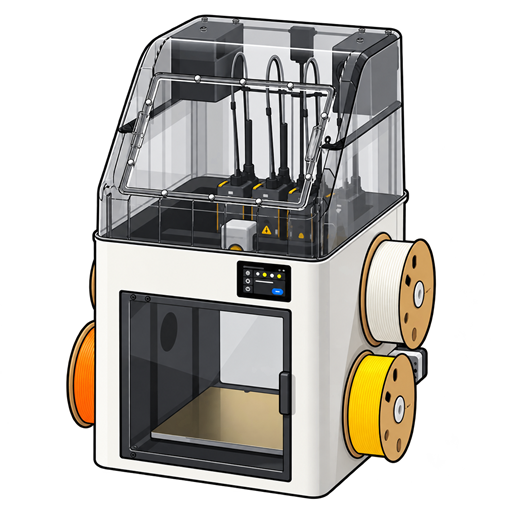

# ioBroker.snapmaker-u1

[](https://www.npmjs.com/package/iobroker.snapmaker-u1)
[](https://github.com/Negalein/ioBroker.snapmaker-u1/actions/workflows/test-and-release.yml)

Englische Hauptdokumentation: [README.md](/#/adapters/snapmaker-u1).

Deutscher ioBroker-Adapter zur lokalen Überwachung eines [Snapmaker U1](https://www.snapmaker.com/) über Moonraker. Er stellt Druckstatus, ETA, Kameras, AFC-/Spoolman-Metadaten, Druckvorschauen und abgesicherte PAXX12-Steuerungen bereit.

> **Frühe Entwicklungsversion:** Steuerfunktionen sind nur für den ausdrücklich gewählten Modus **PAXX12** vorgesehen. Die Original-Firmware wurde für Steuerbefehle nicht validiert. Den Drucker während jeder Steuerung beaufsichtigen.

## Funktionen

- Lokale Moonraker-Verbindung über konfigurierbaren Host und Port (Standard: `7125`).
- Druckstatus, Dateiname, Filamentverbrauch, Fortschritt, Pausenstatus, Meldungen, Schichten und Dateifortschritt.
- Slicer-Metadaten, Restzeit, Slicer-Restzeit und geschätzte Endzeit unter `printer.job.*`.
- Klipper-Status, Bereitschaft und Verbindungsfehler unter `printer.info.*`.
- Tool-, Bett- und Kammertemperaturen, Sollwerte, Heizleistungen, Pressure Advance, Smooth Time sowie Bewegungs- und Flow-Diagnosen.
- Kameraerkennung und Druckvorschau-URL. Die ETA bleibt auch bei deaktivierter Vorschau verfügbar.
- Automatisch erkannte, schreibgeschützte Lüfter-/RPM- und Temperatursensorwerte unter `printer.fans.*` und `printer.sensors.*`.
- AFC-/Spoolman-Status und Lane-Metadaten über Moonraker; keine direkte Spoolman-Verbindung und keine Schreibvorgänge.
- Abgesicherte Home-, Jog-, Druck-, Toolhead- und Extrusionssteuerung für PAXX12.

## Kameras, Vorschau und Lüfter

Mit **Kameras erkennen und auswählen** werden aktive Moonraker-Kameras ausgelesen und gespeichert; es findet kein Netzwerkscan statt. Ausgewählte Kameras erscheinen unter `cameras.<Moonraker UID>` mit Name, Aktiv-Status, Stream-/Snapshot-URL, Dienst, Drehung und Spiegelung. Der Adapter liest nur die Konfiguration, öffnet keine Dauerstreams und kann die Erreichbarkeit nicht garantieren.

`printer.job.previewUrl` enthält das größte eingebettete Vorschaubild der ausgewählten G-Code-Datei. Kamera- und Thumbnail-Fehler werden nur auf Debug-Ebene protokolliert und trennen den Drucker nicht.

Die Deckellüfter werden über `printer.cover.circulation.speed` und `printer.cover.exhaust.speed` gesteuert. Einen Prozentwert 0–100 mit `ack=false` schreiben. Befehle sind serialisiert und ungültige Werte werden abgelehnt.

## PAXX12-Sicherheit

Zum Aktivieren der Steuerung den **Firmware-Modus** auf **PAXX12-Firmware** setzen. `auto` und `original` lehnen bewusst alle Home-, Jog- und Drucksteuerungsanfragen ab.

Jede Anfrage holt zuerst einen frischen Moonraker-Status und durchläuft eine Sicherheitsprüfung. Der Adapter sendet ausschließlich feste, intern erzeugte Klipper-Befehle; es gibt keinen frei beschreibbaren G-Code-Datenpunkt.

- `printer.control.home.all`, `.x`, `.y` und `.z` verwenden `G28` und sind nur im Leerlauf erlaubt.
- Jog-Befehle sind auf **0,1–25 mm** bei **1–100 mm/s** begrenzt. Sie verlangen referenzierte Achsen und gültige Moonraker-Achsgrenzen.
- `Pause` ist nur beim Drucken, `Resume` nur bei Pause und `Cancel` nur beim Drucken oder bei Pause verfügbar.
- Fehler und abgelehnte Anfragen stehen in `printer.control.lastError`.

Für Toolheads erkennt der Adapter die tatsächlichen Klipper-Objekte und sicheren Laufzeitgrenzen. Bei vorhandenen PAXX12-AFC-Lite-Makros werden ausschließlich `CHANGE_TOOL LANE=E0` bis `E3` und `LANE_UNLOAD LANE=E0` bis `E3` verwendet. Einzelne Solltemperaturen und manuelle Extrusion werden zusätzlich gegen Live-Temperatur, Extruderstatus und gemeldete Grenzen geprüft. Eine Parkfunktion bleibt deaktiviert, bis ein sicheres U1-/PAXX12-Parkmakro validiert ist.

Die Makros sind anhand [der PAXX12-AFC-Lite-Konfiguration](https://github.com/paxx12-snapmaker-u1/SnapmakerU1-Extended-Firmware/blob/main/overlays/firmware-extended/31-feature-afc-lite/root/usr/local/share/firmware-config/tweaks/klipper/afc.cfg) überprüft. Die Daten werden über Moonrakers [Printer-Object-Endpunkte](https://moonraker.readthedocs.io/en/latest/external_api/printer/) abgefragt; Temperaturbefehle basieren auf Klippers [G-Code-Dokumentation](https://www.klipper3d.org/G-Codes.html).

## Konfiguration

| Einstellung | Bedeutung |
| --- | --- |
| Moonraker-Host oder IP-Adresse | Lokaler Hostname oder IP-Adresse, ohne `http://` und ohne Pfad. |
| Moonraker-Port | HTTP-Port von Moonraker, standardmäßig `7125`. |
| Firmware-Modus | Automatisch erkennen, Original-Firmware oder PAXX12. |
| Anfrage-Timeout | Maximale Dauer einer Moonraker-Anfrage in Sekunden. |
| Polling-Intervall | Zeit zwischen Statusprüfungen in Sekunden. |
| Spoolman-Integration | Aktiviert AFC- und Spoolman-Statusabfragen über Moonraker. |
| Kameras erkennen und auswählen | Liest aktive Kameras und speichert die Auswahl. |
| Druckvorschau | Aktiviert die Thumbnail-URL der aktuellen G-Code-Datei. |

## Wichtige Datenpunktgruppen

| Gruppe | Inhalt |
| --- | --- |
| `info.connection` / `printer.info.*` | Verbindung, Hostname, Firmware, Klippy-Status und Fehler. |
| `printer.job.*` | Datei, Zeiten, ETA, Slicer, Schichten, Meldungen, Fortschritt und Vorschau. |
| `printer.motion.*` | Position, Bewegungsgrenzen, Geschwindigkeit sowie Speed-/Flow-Faktor. |
| `printer.tools.*` / `printer.bed.*` | Temperaturen, Sollwerte, Leistung und erweiterte Extruderdaten. |
| `printer.fans.*` / `printer.sensors.*` | Dynamisch erkannte schreibgeschützte Lüfter-/RPM- und Sensorwerte. |
| `printer.afc.*` / `printer.spoolman.*` | AFC-Lanes, Fehler und Spoolman-Metadaten. |
| `printer.control.*` | Abgesicherte PAXX12-Steuerungen und deren Diagnosen. |

## Entwicklung

Erfordert Node.js 22.19.0 oder neuer und ioBroker Admin 7.6.20 oder neuer.

```bash
npm ci
npm run check
npm test
npm run lint
npm run build
```

## Releases

Ein veröffentlichter GitHub-Release ist nur gültig, wenn sein Tag zur Version in `package.json` passt und auf `main` zeigt. Nach erfolgreichen Prüfungen veröffentlicht GitHub Actions stabile Releases als npm-Tag `latest`, Pre-Releases als `next`. Bereits veröffentlichte Versionen werden nicht nachträglich verändert.

## Roadmap

1. Toolwechsel, Lane-Unload, Temperatur und manuelle Extrusion an einem physischen PAXX12-U1 validieren.
2. Parksteuerung erst nach dokumentiertem und physisch validiertem Parkmakro ergänzen.
3. Moonraker-Payloads an einem U1 mit Original-Firmware prüfen, bevor dafür Steuerungen aktiviert werden.
4. Automatisierte Tests für Druck-, Material- und Mediendaten ausbauen.

## Haftungsausschluss

Snapmaker und U1 sind Marken ihrer jeweiligen Inhaber. Dies ist ein unabhängiges Community-Projekt und weder mit Snapmaker verbunden noch von Snapmaker unterstützt.

## Änderungsprotokoll

### 0.0.12 (2026-11-15)

- (Negalein) Offiziellen ioBroker-Release-Workflow verwendet und die sieben neuesten veröffentlichten Release-Hinweise beibehalten.

### 0.0.11 (2026-11-15)

- (Negalein) Ungültige Rolle des Beschleunigungsdatenpunkts korrigiert und bestehende Installationen migriert.

### 0.0.10 (2026-11-15)

- (Negalein) Getesteten Ablauf Tag zu npm zu GitHub-Release wiederhergestellt und korrigiertes Dokumentationspaket veröffentlicht.

### 0.0.9 (2026-11-15)

- (Negalein) Englische Haupt-README wiederhergestellt und eigene deutsche README ergänzt.

### 0.0.8 (2026-11-15)

- (Negalein) Deutsche README für GitHub und npm.

### 0.0.7 (2026-11-15)

- (Negalein) Vollständiges kompiliertes Adapterpaket für ETA- und Diagnose-Telemetrie veröffentlicht.

### 0.0.6 (2026-11-15)

- (Negalein) Druck-ETA, Fertigstellungszeit, Schichten, Meldungen und Diagnose-Telemetrie ergänzt.

Vollständige Release-Hinweise: CHANGELOG.md.

## Lizenz

Copyright (c) 2026 Negalein <negalein@gmail.com>

Lizenziert unter der [MIT-Lizenz](https://github.com/Negalein/ioBroker.snapmaker-u1/blob/main/LICENSE).