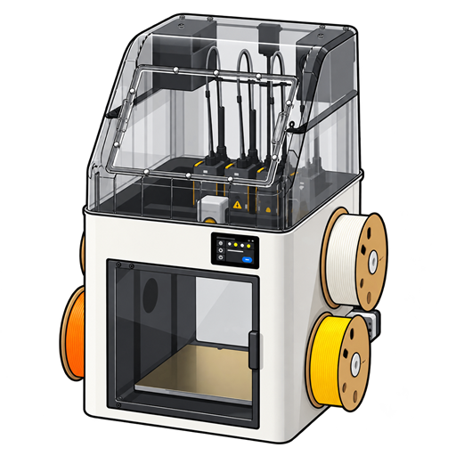

# ioBroker.snapmaker-u1

[](https://www.npmjs.com/package/iobroker.snapmaker-u1)
[](https://github.com/Negalein/ioBroker.snapmaker-u1/actions/workflows/test-and-release.yml)

German documentation: [README-German.md](/#/docs/adapterref/iobroker.snapmaker-u1/README-German.md).

An ioBroker adapter for monitoring a [Snapmaker U1](https://www.snapmaker.com/) through its local Moonraker service, with top-cover fan control, AFC/Spoolman metadata, camera discovery, print-preview URLs and guarded PAXX12 motion, print and optional toolhead controls.

> This is an early development version. The v0.0.3/v0.0.4 control points are deliberately restricted to an explicitly selected **PAXX12** firmware mode. They do not claim compatibility with the original Snapmaker firmware, which has not been validated. Use printer controls only while attending a clear, safe printer.

## Current functionality

### Cameras and print preview

In the settings, open **Discover and select cameras** to retrieve enabled cameras from Moonraker and save a multiple selection. Save the printer host first and keep the adapter running for discovery. No network scan is performed.

Selected cameras are published below `cameras.<namespace-safe ID derived from the Moonraker UID>` with name, enabled flag, stream URL, snapshot URL, service, rotation and mirror settings. The adapter reads camera configuration only; it does not open continuous video streams or claim that a camera is reachable. WebRTC requires a compatible viewer. Historical camera objects remain after deselection but are no longer refreshed.

`printer.job.previewUrl` contains the largest embedded thumbnail of the current G-code file. It is cleared when no file is selected or preview is disabled. The same file-metadata request supplies the slicer estimate, remaining-duration forecast and estimated completion time; those values remain available when print preview is disabled. Camera/thumbnail failures are logged at debug level and do not mark the printer disconnected. Camera URLs must be reachable from the browser displaying them. Camera discovery, settings and data points have been tested in an installed ioBroker instance with PAXX12. A configured camera entry is not proof of a reachable stream.

Top-cover fan control: write a numeric percentage (0–100, `ack=false`) to `printer.cover.circulation.speed` or `printer.cover.exhaust.speed`. Commands are serialized and acknowledged from a subsequent printer status query. Both fans were live-tested with a five-percentage-point change and restored. Firmware automation may subsequently change fan speeds. Invalid values are rejected.

Enable **Spoolman integration** to read AFC lane material, filament name, color, spool ID, loaded flag and raw status for lanes 0–3, plus the current AFC lane and error flag. Moonraker's Spoolman connection status and active spool ID are exposed under `printer.spoolman`. AFC metadata and bridge status are read through Moonraker. Configure the optional direct Spoolman API service for weights and notifications under `snapmaker-u1.N.spoolman`; see [setup and migration](/#/docs/adapterref/iobroker.snapmaker-u1/docs/spoolman.md). No spool assignments or consumption reports are written by this adapter.

Read-only status polling has been verified on PAXX12 `2.0.0-paxx12-24`:

- `printer.job`: state, filename, elapsed print duration (seconds), filament used (mm), progress (percent), and paused flag.
- `printer.job`: slicer name/version, slicer estimate, calculated remaining duration, estimated completion timestamp, layers, messages, file progress and last completed filename where Moonraker provides the underlying values.
- `printer.tools.active`: active extruder name.
- `printer.tools.tool0` through `tool3`: actual temperature, target temperature, heater power, pressure advance, smooth time, and tool status.
- `printer.bed`: actual and target temperature plus heater power.
- `printer.chamber.temperature`: chamber temperature.
- `printer.fans.*` and `printer.sensors.*`: dynamically discovered, read-only fan/RPM and temperature telemetry. Existing named cover-fan states remain unchanged.

The monitoring states are read-only. The two fan speed states and the guarded PAXX12 control states described below are writable. Missing or invalid values are skipped. The owner has tested version 0.0.2 in ioBroker, including live printer data, cameras, AFC/Spoolman metadata and reconnection after power-off. Original firmware compatibility remains unverified.

- Connects locally to Moonraker at a configurable host and port (default: `7125`).
- Publishes `info.connection`, printer hostname, Klipper software version, status, and the last successful update. The existing state ID `printer.info.firmware` is retained.
- Supports the original firmware and PAXX12 as selectable configuration modes; protocol-specific features will follow after validation against real devices.
- Reads AFC and Spoolman metadata through Moonraker. Direct Spoolman inventory access is not implemented.

### Motion and print control (PAXX12 only)

Set **Firmware mode** to **PAXX12 firmware** to enable the control states. `auto` and `original` modes deliberately reject every Home, Jog, Pause, Resume and Cancel request. This avoids claiming support for the original firmware before it has been physically verified.

Each new motion/print control request first fetches a fresh Moonraker status and passes one central safety check. The adapter sends only fixed, internally generated Klipper commands; it does not expose a free-form G-code state.

- Home commands use `G28` or `G28 X`, `G28 Y`, `G28 Z` and are allowed only when `print_stats.state` is `standby`, `complete` or `cancelled`.
- Jog commands are limited to **0.1–25 mm** at **1–100 mm/s**. They require an idle printer, a homed target axis, finite current coordinates, and Moonraker-reported `axis_minimum`/`axis_maximum` values that contain the target. The generated script saves and restores the Klipper G-code state.
- `Pause` is permitted only while printing; `Resume` only while paused; and `Cancel` only while printing or paused.
- Commands are serialized, buttons reset to `false` after handling, and rejected/failed requests are published in `printer.control.lastError`.

The control commands and their safety rules are unit-tested, but the new motion and job-control paths still need validation on a physical PAXX12-equipped U1 before relying on them in everyday operation.

### Toolhead control (PAXX12 + detected capability only)

Version 0.0.4 does not assume that every PAXX12 printer has the same macros. On startup, periodically, and immediately before every toolhead request, the adapter asks Moonraker for the loaded Klipper objects. It reads Klipper's parsed extruder configuration only to determine the connected printer's safe limits. If discovery is unavailable, the command is rejected; it never falls back to guessed macro names or a free-form G-code state.

The current PAXX12 AFC Lite source documents the `CHANGE_TOOL` and `LANE_UNLOAD` macros for lanes E0–E3. `CHANGE_TOOL` performs its own automatic load as part of the tool change. The adapter uses only these exact macros, and only when both the macro and the matching `AFC_lane E0`–`E3` object are present. A tool change or unload also requires an idle printer and a known, fault-free `AFC.error_state`.

- `printer.control.toolhead.change.e0` through `.e3` issue the fixed `CHANGE_TOOL LANE=E0` through `E3` command. These are **change-and-load** buttons; there is no invented standalone load command.
- `printer.control.toolhead.unload.e0` through `.e3` issue the fixed `LANE_UNLOAD LANE=E0` through `E3` command.
- No parking button is exposed in v0.0.4. No U1/PAXX12 parking macro was verified in the supported firmware source, so `printer.control.toolhead.capabilities.parkToolhead` remains `false` rather than sending an inferred park sequence.
- `printer.control.tools.tool0.target` through `.tool3.target` set individual targets with Klipper's documented `SET_HEATER_TEMPERATURE` only if that extruder object and its runtime `max_temp` are reported. The adapter retains a five-degree margin below the reported cutoff and excludes a PAXX12 faulty-toolhead configuration with near-zero `max_power`.
- `printer.control.extrusion.extrude` and `.retract` move only the currently active, detected extruder. They are limited to **0.1–10 mm** at **0.1–10 mm/s**, require an idle printer, the live `can_extrude` flag, and a temperature at or above that extruder's reported minimum (Klipper's default is 170 °C). The generated script uses relative extrusion only and restores the saved G-code state.

Capability and error diagnostics are published below `printer.control.toolhead`: the detected macro names, whether `CHANGE_TOOL`/`LANE_UNLOAD` are usable, current command availability, a human-readable reason, and the latest rejected or failed control request. Existing AFC monitoring under `printer.afc` is retained; no AFC, Spoolman, camera, fan, or v0.0.3 control state is renamed or removed. In PAXX12 mode, AFC status is queried for the toolhead safety check even if the optional direct Spoolman integration is off; no Spoolman data is written.

The supported AFC Lite macros are verified against [the PAXX12 AFC Lite configuration](https://github.com/paxx12-snapmaker-u1/SnapmakerU1-Extended-Firmware/blob/main/overlays/firmware-extended/31-feature-afc-lite/root/usr/local/share/firmware-config/tweaks/klipper/afc.cfg). Capability discovery uses Moonraker's documented [printer-object list and query endpoints](https://moonraker.readthedocs.io/en/latest/external_api/printer/). Target temperatures and active-extruder behavior use Klipper's documented [`SET_HEATER_TEMPERATURE` and multi-extruder commands](https://www.klipper3d.org/G-Codes.html). This adapter release has unit tests, not a physical validation of the v0.0.4 action paths: keep attendance and verify macro behaviour on the actual printer before routine use.

## Configuration

| Setting                      | Description                                                                         |
| ---------------------------- | ----------------------------------------------------------------------------------- |
| Moonraker host or IP address | Hostname or local IP address of the printer. Do not include `http://` or a path.    |
| Moonraker port               | Moonraker HTTP port; `7125` by default.                                             |
| Firmware mode                | Auto detect, original firmware, or PAXX12.                                          |
| Request timeout              | Maximum duration of one Moonraker request, in seconds.                              |
| Polling interval             | Time between health checks, in seconds.                                             |
| Spoolman integration         | Enables AFC lane and Spoolman status queries through Moonraker.                     |
| Spoolman host and port       | Reserved for future direct inventory queries; currently not used for communication. |
| Discover and select cameras  | Reads enabled Moonraker camera entries and saves the selected cameras.              |
| Print preview                | Enables the current G-code thumbnail URL.                                           |

## States

| State                                                                                                 | Type           | Meaning                                                                                                   |
| ----------------------------------------------------------------------------------------------------- | -------------- | --------------------------------------------------------------------------------------------------------- |
| `info.connection`                                                                                     | boolean        | Whether the latest Moonraker health check succeeded.                                                      |
| `printer.info.hostname`                                                                               | string         | Hostname reported by Moonraker.                                                                           |
| `printer.info.firmware`                                                                               | string         | Klipper software version returned by Moonraker's printer info endpoint.                                   |
| `printer.info.status`                                                                                 | string         | Printer state message reported by Moonraker.                                                              |
| `printer.info.klippyState` / `.ready` / `.lastError`                                                   | string/boolean | Klipper state, readiness and latest connection error.                                                     |
| `printer.info.lastUpdate`                                                                             | number         | Timestamp of the last successful query.                                                                   |
| `printer.job.filename`, `.duration`, `.totalDuration`, `.message`, `.displayMessage`                  | string/number  | Current file, elapsed/total duration and printer messages.                                                |
| `printer.job.slicer`, `.slicerVersion`, `.slicerEstimatedDuration`                                    | string/number  | Slicer metadata extracted by Moonraker from the G-code file.                                             |
| `printer.job.remaining`, `.slicerRemaining`, `.estimatedEnd`, `.estimateAvailable`                    | number/boolean | Live ETA forecast in seconds and predicted completion timestamp.                                          |
| `printer.job.layer.current`, `.total`, `.progress`                                                     | number         | Current and total layers plus calculated layer progress.                                                  |
| `printer.job.filePosition`, `.fileProgress`, `.lastCompletedFile`                                      | number/string  | G-code byte position, file progress and last live-completed file.                                        |
| `printer.motion.position.x`, `.y`, `.z`                                                               | number         | Current toolhead coordinates reported by Moonraker, in mm.                                                |
| `printer.motion.maxVelocity`, `.maxAcceleration`, `.commandedSpeed`, `.speedFactor`, `.flowFactor`     | number         | Read-only motion limits, latest commanded speed, speed and flow factors.                                 |
| `printer.tools.tool0` … `.tool3`                                                                      | number/string  | Includes read-only heater power, pressure advance and smooth-time telemetry when reported.                |
| `printer.bed.power`                                                                                    | number         | Read-only bed heater output in percent.                                                                   |
| `printer.fans.*` / `printer.sensors.*`                                                                 | number         | Dynamically discovered read-only fan/RPM and temperature telemetry.                                       |
| `printer.control.home.all`, `.x`, `.y`, `.z`                                                          | boolean button | Write `true` to home all axes or the selected axis. Resets to `false`.                                    |
| `printer.control.jog.step`                                                                            | number         | Jog distance in mm (0.1–25).                                                                              |
| `printer.control.jog.speed`                                                                           | number         | Jog speed in mm/s (1–100).                                                                                |
| `printer.control.jog.xPositive`, `.xNegative`, `.yPositive`, `.yNegative`, `.zPositive`, `.zNegative` | boolean button | Write `true` to move by the configured step and speed. Resets to `false`.                                 |
| `printer.control.job.pause`, `.resume`, `.cancel`                                                     | boolean button | Write `true` to control the current print when its current state permits it. Resets to `false`.           |
| `printer.control.safety.enabled`                                                                      | boolean        | `true` only when PAXX12 mode was explicitly selected.                                                     |
| `printer.control.safety.homingAllowed`, `.joggingAllowed`, `.jobControlAllowed`                       | boolean        | Current availability hints from the last Moonraker status. Every request is checked again before sending. |
| `printer.control.safety.reason`                                                                       | string         | Reason why control is unavailable or a reminder that individual requests are rechecked.                   |
| `printer.control.lastCommand` / `printer.control.lastError`                                           | string         | Last accepted control state ID / latest rejected or failed request reason.                                |
| `printer.control.toolhead.change.e0` … `.e3`                                                          | boolean button | Changes to and loads the selected AFC lane only when the matching `CHANGE_TOOL` capability is detected.   |
| `printer.control.toolhead.unload.e0` … `.e3`                                                          | boolean button | Unloads the selected AFC lane only when the matching `LANE_UNLOAD` capability is detected.                |
| `printer.control.tools.tool0.target` … `.tool3.target`                                                | number         | Requested target for one extruder; runtime Klipper limits are checked before sending.                     |
| `printer.control.extrusion.distance` / `.speed`                                                       | number         | Manual extrusion amount (0.1–10 mm) / speed (0.1–10 mm/s).                                                |
| `printer.control.extrusion.extrude` / `.retract`                                                      | boolean button | Manually extrudes or retracts the active hot tool after all live safety checks pass.                      |
| `printer.control.toolhead.capabilities.*`                                                             | boolean/string | Detected macros and supported optional actions; verified parking remains `false` in v0.0.4.                |
| `printer.control.toolhead.safety.*` / `.diagnostics.*`                                                | boolean/string | Current command availability, diagnostic reason, and latest failed/rejected toolhead request.             |

## Development

Requires Node.js 22.19.0 or newer and ioBroker Admin 7.6.20 or newer. CI covers Node.js 22, 24 and 26.

```bash
npm ci
npm run check
npm test
npm run lint
npm run build
```

The repository was generated with the official [`@iobroker/create-adapter`](https://github.com/ioBroker/create-adapter) tooling and uses TypeScript, JSON Config, adapter tests, and GitHub Actions.

## Releases

A version tag is accepted only when it matches the version in `package.json` and points to a commit on `main`. After all CI checks pass:

- a stable tag such as `v0.0.4` is published to npm as `latest`, then a normal GitHub release is created;
- a pre-release tag such as `v0.0.5-beta.1` is published to npm as `next`, then a GitHub pre-release is created.

This keeps the GitHub **Latest** release and npm's `latest` tag aligned. Existing versions published before this automation are not changed retroactively.

## Roadmap

1. Validate v0.0.4 tool change, lane unload, temperature, and manual extrusion paths on a physical PAXX12 U1, then document the tested firmware/macro combination.
2. Add a parking control only after a U1/PAXX12 parking macro and its safe preconditions are documented and physically validated.
3. Validate Moonraker payloads and capabilities on a physical U1 running original firmware before enabling any control for it.
4. Extend automated tests for print, material and media data.
5. Validate shutdown and restart in compact mode.
6. Complete hardware acceptance for the native Spoolman service before legacy script cutover.

## Disclaimer

Snapmaker and U1 are trademarks of their respective owners. This is an independent community project and is not affiliated with or endorsed by Snapmaker.

## Changelog

### 0.0.14 (2026-11-24)

- (Negalein) Add native four-lane Spoolman API monitoring and configurable Telegram warnings. Publish data exclusively under `snapmaker-u1.N.spoolman`; migrate VIS widgets to these native states.
- (Negalein) Fix readable camera labels, reset Spoolman health on disconnect/stop, and refresh weights every 30 seconds by default.
- Live Telegram delivery and the three VIS widgets still require acceptance on the active server.

### 0.0.13 (2026-11-20)

- (Negalein) Align state roles with the ioBroker role model and add an optional help message for AI agents and script authors.

### 0.0.12 (2026-11-15)

- (Negalein) Use the official ioBroker release workflow and keep the seven newest published release notes.

### 0.0.11 (2026-11-15)

- (Negalein) Fix the invalid acceleration state role and migrate existing installations.

### 0.0.10 (2026-11-15)

- (Negalein) Restore the tested tag-to-npm-to-GitHub-release workflow and publish the corrected documentation package.

### 0.0.9 (2026-11-15)

- (Negalein) Restore the English main README and add a separate German README.

### 0.0.8 (2026-11-15)

- (Negalein) Add the separate German README for GitHub and npm.

Older entries are available in CHANGELOG_OLD.md.

### Native Spoolman integration

See [Spoolman setup, states and safe VIS migration](/#/docs/adapterref/iobroker.snapmaker-u1/docs/spoolman.md). The legacy script remains active until successful hardware acceptance; native Telegram notifications are off by default. VIS widgets must use native adapter states directly.

## License

Copyright (c) 2026 Negalein <negalein@gmail.com>

Licensed under the [MIT License](https://github.com/Negalein/ioBroker.snapmaker-u1/blob/main/LICENSE).