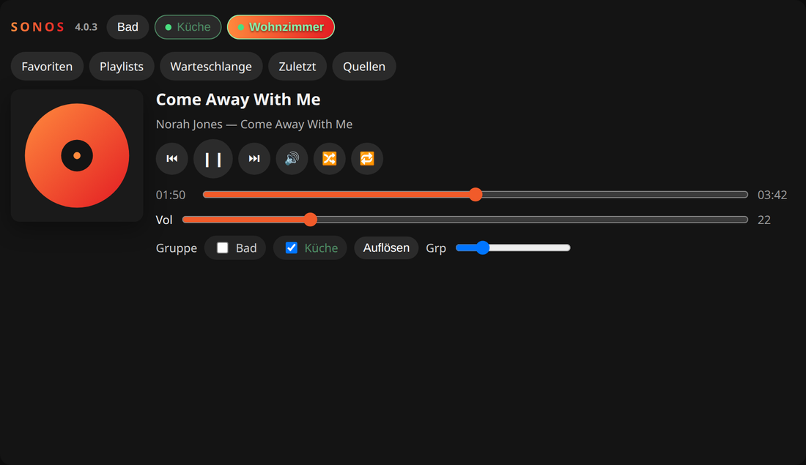
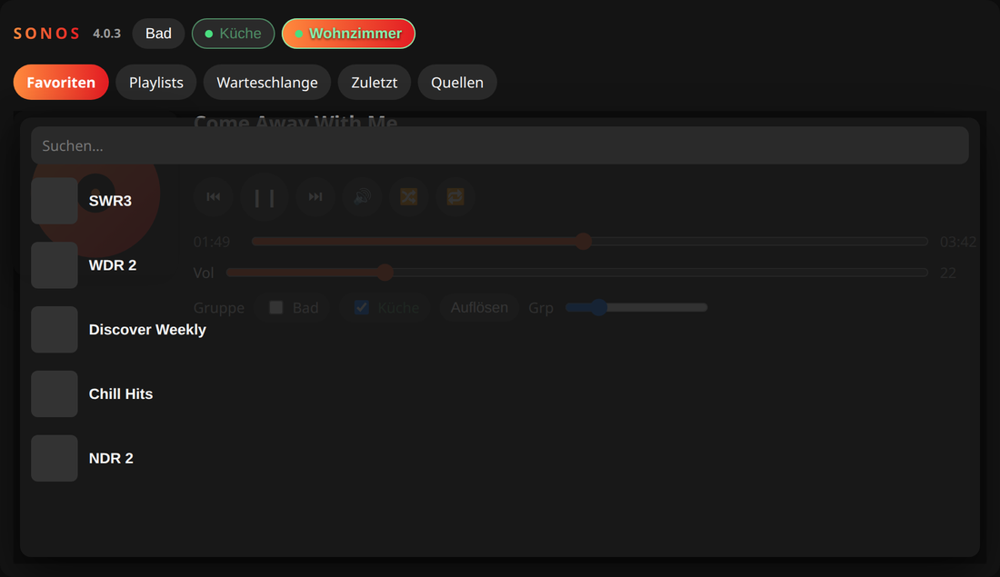
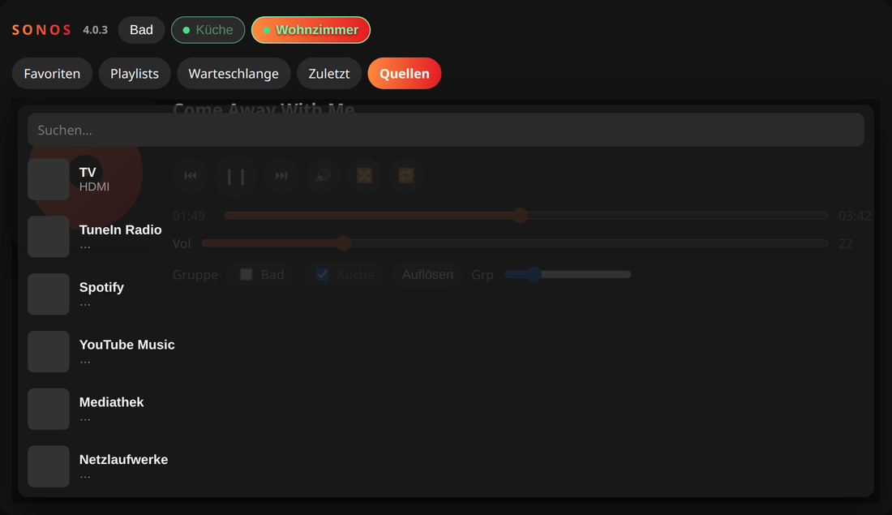
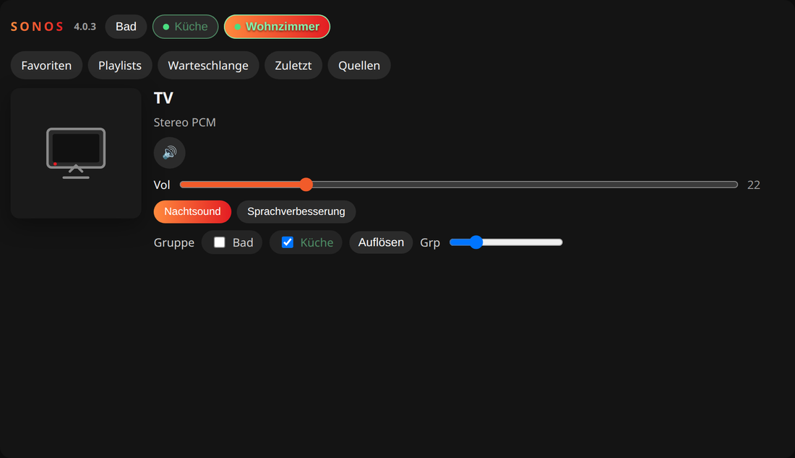

# ioBroker.sonos


[](https://www.npmjs.com/package/iobroker.sonos)


[](https://weblate.iobroker.net/engage/adapters/?utm_source=widget)
[](https://www.npmjs.com/package/iobroker.sonos)

Control and monitor SONOS devices with ioBroker.

## Widgets

The adapter ships one widget for both visualisation adapters. Both are installed with the adapter;
**vis** and **vis-2** are restarted automatically, and the editor needs a hard reload (Ctrl+F5).

**Sonos Control** switches rooms, controls playback, forms groups and starts favorites, playlists,
queue tracks, recent tracks and sources. Bind it to an *instance*, for example `sonos.0` - not to a
single state such as `play`. The widget discovers every speaker of that instance on its own.

Every discovered speaker appears as a chip at the top. Group membership is toggled with the
checkboxes. If a room belongs to a group, the now-playing area shows the track of the group, not the
last local title of that room. The library buttons (**Favorites**, **Playlists**, **Queue**,
**Recent**, **Sources**) open a sheet below them. **Recent** lists the last tracks of the selected
room.



*Rooms, grouping and now-playing*



*The library buttons open a sheet below the rooms*



*Sources: TuneIn, the music library, network shares, line-in and TV HDMI*



*TV HDMI: title TV, format, mute, night sound and speech enhancement*

### vis-2 and vis 1

There are two implementations of **Sonos Control** under the same template id `tplSonosControl`:
a React one for vis-2 (`src-widgets`) and the original jQuery one for vis 1 (`widgets/sonos.html`).

Each editor only ever shows one of them. Because the adapter declares `common.visWidgets`, vis-2
skips `widgets/sonos.html` completely and loads the React widget; vis 1 does not know about React
widget sets and loads the jQuery one. Views that were built with the vis-1 widget keep their
`oid` binding when they are opened in vis-2.

vis-2 additionally offers **Sonos room**, one speaker as a compact card with cover, title, transport
and volume. Its last button opens the same source selection in a dialog, so a single card can also
start a favorite, a playlist or a source. It has no vis-1 counterpart.

In vis-2 each part of Sonos Control (rooms, groups, volume, library) can be switched off, and the
widget can start on a given room.

### Sources

**Sources** browses TuneIn radio, the music library, network shares and line-in through the
speaker's content directory. Music services are listed only when the household actually reports
them, and services with a SMAPI catalog (Spotify for example) can be searched after a one-time
sign-in. Services without such a catalog only show what is already saved in the Sonos app as a
favorite or playlist.

**TV** appears only on speakers that really have an HDMI or optical input (Arc, Beam, Playbar,
Playbase, Ray, Amp). On the TV input there is no transport control - play, pause, seek, next and
previous are not offered; mute, night sound and speech enhancement are.

## Widgets for ioBroker.devices

Besides the vis widgets the adapter delivers two widgets for the dashboard of the
**ioBroker.devices** adapter. They are added there with **+ → SONOS player** / **SONOS rooms**, and
every widget is configured with its own settings dialog - no state has to be picked by hand.

**SONOS player** is one speaker. The settings ask for the instance and the speaker; the list of
speakers comes from the adapter itself, so it always matches the devices on the *SONOS devices* tab.

| Size      | What is shown                                                                       |
|-----------|-------------------------------------------------------------------------------------|
| 1x1       | The cover as background, the speaker, title, artist, play state and the progress    |
| 2x0.5     | A strip: cover thumbnail on the blurred cover, the speaker, title, artist, progress |
| 2x1, 2x2  | The large cover with the speaker and play state on it, title, artist and progress   |

The tiles are built like the media player of ioBroker.devices: a click opens the full player as a
dialog - cover, title, artist and album, the progress slider to jump within the track, previous /
play-pause / next, shuffle, repeat (off → all → one track), mute, volume and the source selection.

Cover, progress, volume, the shuffle/repeat buttons and the source button can be switched off
individually. On a speaker that plays its TV input, the transport buttons and the progress are
hidden because the HDMI input cannot be controlled - mute, volume and the source selection stay.

The source button opens the same selection the vis widget shows - favorites, playlists, the queue,
recently played and the browsable sources of the speaker - as a second dialog on top of the player.

**SONOS rooms** is the whole household in one widget: how many speakers are playing, what each of
them plays, and their volume. The small sizes show the counter and open the list in a dialog; 2x1
and 2x2 show the list directly.

Every row also has a source button that opens the source selection for that speaker, so a
favorite or a playlist can be started without leaving the overview.

It also forms groups: the link button of a speaker marks it as the group master, and the link
button of every other speaker then adds it to that group or removes it again. Clicking the master a
second time leaves the mode.

## Control tab in admin

The instance settings have a third tab, **Control**. It is the same player as in vis, but inside
admin: pick a speaker on the left and control it on the right - transport, progress, volume,
grouping, and the library with favorites, playlists, queue, recently played and sources.

This is meant for checking that a freshly added speaker really answers, without leaving the adapter
configuration. The tab talks to the running instance, so it stays empty while the instance is
stopped.

## Control page in the browser

The adapter ships a control page for the **web** adapter. It is reachable at

```
http://<ioBroker>:8082/sonos/
```

and offers the same as the vis widget: the room chips, what is playing with its cover, transport,
progress, volume, the grouping checkboxes and the source selection with favorites, playlists,
queue, recently played and the browsable sources of the speaker.

No web extension is involved. `iobroker upload sonos` puts the `www/` folder of the adapter into
its ioBroker file storage, and the web adapter serves it from there - its catch-all route reads the
first path segment of the URL as the adapter name. That is the same mechanism the adapter already
uses to hand a TTS file to a speaker.

The page talks to ioBroker through the socket of the web instance that serves it, so it inherits
that instance's authentication and its user rights. The socket client is not bundled: the page asks
the web adapter for `socket.io.js` and gets whatever that instance uses - socket.io or
`@iobroker/ws`.

`?instance=sonos.1` pins the page to one instance, `?room=Kitchen` opens it on a given speaker.
Without them the page falls back to the instance and the speaker it was used with last, both
remembered in the browser; only when nothing is remembered yet does it open the first instance and
its first speaker.

In admin the page also appears as a tile on the overview, next to the tiles of the other adapters.

## Handling of groups
* States for handling SONOS groups:
   * **`coordinator`**: set/get the coordinator, so the SONOS device which is the master and coordinating the group. It requires the IP address (channel name) of the SONOS device to be the coordinator, but with underscore `_` instead of dot `.`, so use for example `192_168_0_100` for IP address `192.168.0.100`. If the device does not belong to any group, then the value is equal to the own channel name (IP).
   * **`group_volume`**: the volume of the group
   * **`group_muted`**: mute status of the group.
   * **`add_to_group`**: Add a certain SONOS device to the SONOS device under which this state is. Use IP address with underscores (see above).
   * **`remove_from_group`**: Remove a certain SONOS device from the SONOS device under which this state is. Use IP address with underscores (see above).

*) These states will be updated if changes are made in the SONOS app.

## Stereo pairs
Two speakers paired to one room in the SONOS app - one plays left, the other right - are controlled
through one of them only, SONOS hides the other one. Every channel shows whether its speaker
belongs to a pair:
* **`pair_role`**: `left` or `right` for a speaker of a stereo pair, empty otherwise
* **`pair_partner`**: the other speaker of the pair, as IP address with underscores like `coordinator`, e.g. `192_168_1_21`

The channel of a paired speaker also gets a description in the object tree that names its partner
and tells which of the two controls the pair. The hidden speaker reports no playback and no volume
and takes no commands: use the channel of its partner. It needs no channel of its own; if it has
one, only `alive` and what belongs to the device itself - `led`, `button_lock`, the battery - work there.

## Battery
Speakers with a battery - Move and Roam - get two more states as soon as they report it:
* **`battery_level`**: the charge in percent
* **`battery_charging`**: `true` while the speaker is on its charging base or on USB power

The battery is read every 5 minutes. A speaker that is asleep keeps its last values, `alive`
shows whether they are current. Only S2 firmware reports the battery this way.

## Status LED, button lock and sleep timer
* **`led`**: switches the status LED of the speaker on or off
* **`button_lock`**: `true` locks the buttons on the speaker
* **`sleep_timer`**: minutes until the group stops playing. Write the minutes to set the sleep
  timer, `0` to cancel it. It belongs to the group, so every speaker of the group shows the same
  time, and writing it on any of them sets it for the whole group.

`led` and `button_lock` are created as soon as a device reports them, so a device without buttons
gets no `button_lock`. They are read every 5 minutes, `sleep_timer` every minute.

A Boost or a Bridge is no player, so the search does not find it. To switch its status LED, add its
IP address to the devices in the settings; `led` then appears under its channel.

## Alarms
The alarms of the SONOS app are under `sonos.0.alarms`, one channel per alarm, named by the ID that
SONOS gave it, e.g. `sonos.0.alarms.17`. Changes made in the SONOS app show up within a minute.

Every alarm has these states, all but `next_start` can be written:
* **`enabled`**: switches the alarm on or off
* **`time`**: start time as `hh:mm`, in the local time of the SONOS household
* **`recurrence`**: `ONCE`, `DAILY`, `WEEKDAYS`, `WEEKENDS` or `ON_` followed by the days, 0 is Sunday: `ON_135` rings on Monday, Wednesday and Friday
* **`duration`**: how long the alarm plays, `hh:mm`
* **`volume`**: 0 to 100
* **`room`**: the room that plays the alarm; write the name or the IP address of another speaker to move the alarm there
* **`source`**: what the alarm plays; write the title of a SONOS favorite, a URI or `SONOS Chime`
* **`play_mode`**: `NORMAL`, `REPEAT_ALL`, `SHUFFLE_NOREPEAT` or `SHUFFLE` (shuffle and repeat)
* **`include_grouped`**: the rooms grouped with the room play the alarm too
* **`next_start`**: when the alarm rings next, as a timestamp in ms; `null` while it is disabled
* **`delete`**: deletes the alarm

To create an alarm, write JSON to `sonos.0.alarms.create`. Only `room` and `time` are required, the
other settings are named like the states above:
```json
{"room": "Bedroom", "time": "06:45", "recurrence": "WEEKDAYS", "volume": 15, "source": "Radio Bob"}
```
Settings that are left out start as daily, for one hour, with the SONOS chime at volume 20.

Every speaker also has **`alarm_next`**: when the next enabled alarm of its room rings. A script can
use it, for example, to switch on a wake-up light ten minutes before the music starts:
```js
let timer;
on({ id: 'sonos.0.root.192_168_1_50.alarm_next' }, obj => {
    clearTimeout(timer);
    if (obj.state.val) {
        timer = setTimeout(() => setState('hue.0.Bedroom.on', true), obj.state.val - 10 * 60000 - Date.now());
    }
});
```
`next_start` and `alarm_next` are calculated in the time zone of the ioBroker host, which has to be
the one of the SONOS household.

## Using it with the sayIt adapter
To use the [sayit adapter](https://github.com/ioBroker/ioBroker.sayit) with this SONOS adapter, ensure that the [web adapter](https://github.com/ioBroker/ioBroker.web) is instantiated and running too. The web adapter is required to allow the SONOS adapter to read the generated MP3 file from the sayit adapter.

sayIt writes the URL of the MP3 file to `sonos.X.root.<speaker>.tts`, and the speaker loads it from
the web adapter. So the speakers must be able to reach that URL: the web adapter must not require
authentication, and the address in the URL must be the one of the ioBroker host in your network.

If the speaker cannot play a file - it cannot load the URL or does not support the format - the
adapter logs the error, gives the speaker its volume and playback back and goes on with the next
announcement. Older versions left the volume at 0 and did not play any announcement afterwards
until the adapter was restarted.

## Favorites & Queue in VIS
Use states `favorites_list_html` and `queue_html` to show playlists and current queue with basic HTML widget in VIS. By clicking on a row, the playlist or track will be played immediately.

Writing `favorites_set` or `playlist_set` starts the favorite or playlist. Set **`autoplay`** of
the speaker to `false` to only load it without starting playback (default `true`).

For an own UI the same lists are available as JSON: `favorites_list_array`, `playlist_list_array`
and `queue_array`. `queue` joins the tracks with a comma and cannot be split back reliably, so use
`queue_array` - it carries one `{ artist, title, album, cover }` entry per track, and the index of
an entry is the value for `current_track_number`.
Format the table with the following CSS classes:

### Favorites
* `sonosFavoriteTable`: whole favorite table
* `sonosFavoriteRow`: rows with favorite information
* `sonosFavoriteNumber`: Number of favorites
* `sonosFavoriteCover`: Album art of favorite (grab image with `.sonosFavoriteCover img`)
* `sonosFavoriteTitle`: Name of favorite

### Queue
* `.sonosQueueTable`: whole table
* `.sonosQueueRow`: rows containing track information
* `.currentTrack`: added to the row containg the current playing track
* `.sonosQueueTrackNumber`: Number or track
* `.sonosQueueTrackCover`: Album art of track (grab image with `.sonosQueueTrackCover img`)
* `.sonosQueueTrackArtist`: Name of artist
* `.sonosQueueTrackAlbum`: Name of album (use `display:none`if not needed)
* `.sonosQueueTrackTitle`: Name of title

For long lists add `overflow:auto;` or `overflow-y:auto;` to basic HTML widget.
Please note: highlighting current playing favorite is not supported.

### Sample CSS
```
.sonosFavoriteTable {
    color: #bbb;
    font-size: 12px;
}
.sonosFavoriteRow {
    cursor: pointer;
}
.sonosFavoriteNumber {}
.sonosFavoriteCover img {
    width: 30px;
    height: 30px;
}
.sonosFavoriteTitle {}

.sonosQueueTable {
    color: #bbb;
    font-size: 12px;
}
.sonosQueueRow {
    display: table-row;
    cursor: pointer;
}
.sonosQueueRow.currentTrack {
    color: #fff;
    font-weight: bold;
}
.sonosQueueTrackNumber {}
.sonosQueueTrackCover img {
    width: 30px;
    height: 30px;
    display: table-column;
}
.sonosQueueTrackArtist {
    display: table-row;
}
.sonosQueueTrackAlbum {
    display: none;
}
.sonosQueueTrackTitle {
    display: table-row;
}
```

## Development

Four front-ends live next to the adapter, all built with vite - the first three additionally with
module federation:

| Sources        | Build output        | Loaded by                                    |
|----------------|---------------------|----------------------------------------------|
| `src-widgets/` | `widgets/sonos/`    | vis-2                                        |
| `src-admin/`   | `admin/custom/`     | the **Control** tab of the instance settings |
| `src-devices/` | `admin/dm-widgets/` | the dashboard of ioBroker.devices            |
| `src-web/`     | `www/`              | the **web** adapter, at `/sonos/`            |

```bash
npm run npm            # install the adapter and all four front-ends
npm run build          # all four of them plus the adapter - what CI and npm publish run
npm run build:widgets  # the vis-2 widget set         -> widgets/sonos/
npm run build:web      # the control page             -> www/
npm run build:admin    # the Control tab component    -> admin/custom/
npm run build:devices  # the ioBroker.devices widgets -> admin/dm-widgets/
npm run build:all      # the same as build, in a single tasks.mts run
```

All of them are driven by `tasks.mts`, which node runs straight from source with its own type
stripping - there is no build step for the build script, but `npm run check:ts` type-checks it and
rejects syntax that could not be stripped.

`admin/custom/` and `admin/dm-widgets/` are committed, because a cold module federation build
pre-builds the whole shared GUI stack and takes several minutes. `npm run build` rebuilds them
together with everything else, `npm run build:admin` / `npm run build:devices` rebuild only one of
them - either way, commit the output when something below `src-admin/` or `src-devices/` changed.

`src-devices` has a dev harness: `cd src-devices && npm start` opens the widgets on
`http://localhost:3000` against a real ioBroker admin on `localhost:8081`, so they can be developed
without rebuilding into `ioBroker.devices` every time.

`src-web` has the same: `cd src-web && npm start` serves the control page on
`http://localhost:3000` and proxies the socket, the socket client and the cover images to a web
instance on `localhost:8082`. The page recognises its dev server by that port, so it cannot be
changed - and because `src-devices` listens on 3000 as well, only one of the two harnesses can run
at a time.

## To Do
* Make `@svrooij/sonos` the default once the experimental backend has proven itself on real
  households, and drop `sonos-discovery`

## Configuration
- Web server - [optional] If web server enabled or not
- Update of elapsed time(ms) - Interval in ms how often to update elapsed timer when the title is playing. (Default 2000)
- Fade in (text2speech) - Interval in ms over which the volume is raised at the start of an announcement. 0 disables the fade in. (Default 0)
- Fade out (text2speech) - Interval in ms over which the volume is lowered at the end of an announcement. 0 disables the fade out. (Default 0)
- Sonos library - which client library talks to the speakers, see below
- Event port - only for `@svrooij/sonos`: the TCP port the speakers send their events to. Change it only if another program already uses it. (Default 6329)

### Speakers with a new IP address
The channel of a speaker is named after the address it had when it was added (`root.192_168_1_50`).
The first time the speaker is found at that address, the channel is bound to its serial id
(`RINCON_...`, stored in `native.uuid` of the channel). If the router gives the speaker another address
later, it keeps its channel and its states - scripts and views keep working - and the log tells the
new address once. Another speaker that gets the old address does not take the channel over. The
search in the settings does not offer a moved speaker a second time.

A speaker that replaces another one - e.g. a new model that gets the fixed address of the old one -
takes the channel over with its states as soon as the old speaker is no longer part of the SONOS
system; remove it in the SONOS app if it is still listed there. While the old speaker belongs to the
system, also under another address, the channel stays with it and the log says so once. To hand the
channel over anyway, delete `uuid` in the native part of the channel (Admin → Objects) and restart the
instance.

### Sonos library

The adapter ships two client libraries and the setting picks one. Nothing else changes:
the states, their names and their values are the same either way.

| Setting                         | Library           | Status                               |
|---------------------------------|-------------------|--------------------------------------|
| `sonos-discovery (default)`     | `sonos-discovery` | What the adapter has always used     |
| `@svrooij/sonos (experimental)` | `@svrooij/sonos`  | Maintained replacement, being tested |

`sonos-discovery` has not seen a release since 2022 and one of its dependencies broke the
adapter on start, so the replacement is being prepared. It is offered here so that it can be
tried on real households - there is no SONOS hardware in the CI, and the parts that only real
speakers exercise cannot be covered by tests.

If you try it, the interesting cases are grouping speakers and dissolving the group again,
announcements over running playback, starting a favorite or a playlist, the TV input on a
soundbar, and searching a music service. **Switch back to the default if anything misbehaves**
and please report what you saw - the setting exists so that nobody has to downgrade the
adapter to get a working state back.

<!--
	Placeholder for the next version (at the beginning of the line):
	### **WORK IN PROGRESS**
-->
## Changelog
### 4.5.0 (2026-11-04)
* (@GermanBluefox) Stereo pairs are marked: `pair_role` (`left`/`right`) and `pair_partner` tell which speakers belong together, and the description of the channel says which of the two SONOS controls the pair through. The hidden speaker of a pair never got values and ignored commands without telling why - a command written to it now names the channel to use instead
* (@GermanBluefox) A speaker that replaces another one at the same IP address takes over its channel once the old speaker is no longer part of the SONOS system. Since 4.4.0 the new speaker got no channel and the old channel stayed empty without a word in the log (#140)

### 4.4.0 (2026-11-04)
* (@GermanBluefox) A speaker that gets a new IP address keeps its channel and states: the channel is bound to the serial id of the speaker the first time it is found, and another speaker that gets the old address does not take it over (#140)
* (@GermanBluefox) Errors of the `sonos-discovery` backend appear in the ioBroker log: the library wrote them to the console, so an event it could not process - which then never reached the states - left no trace (#177)
* (@GermanBluefox) TTS (sayIt): a file the speaker cannot play, no longer leaves the volume at 0 and blocks every further announcement until a restart - the state before TTS is restored and the next announcement is played (#176)
* (@GermanBluefox) A track without a cover of its own shows the cover of what was started - the station logo or the art Alexa sends along with Amazon Music and Sonos Radio. Only real images are cached as cover: an audio file or a stream answered for the cover URL shows the default cover instead of a broken one, and an aborted download no longer stays in the cache (#64)
* (@GermanBluefox) A speaker that leaves a group no longer keeps the playback of the group (`state_simple` stayed `true`, the title of the group was shown): after the topology change its own state is read again (#121)
* (@GermanBluefox) vis-2 player: the tabs of the source selection always fit into the widget - without room for the labels they show the icons only - and the mute button moved into the volume row instead of wrapping into a line of its own

### 4.3.0 (2026-11-02)
- (copilot) Adapter requires node.js >= 22.19.0 now
* (@GermanBluefox) The event port of the new backend (`@svrooij/sonos`) is set in the instance settings instead of the environment variable `SONOS_LISTENER_PORT`
* (@GermanBluefox) Fixed the column widths of the settings on large screens and the German text for fade-in
* (@GermanBluefox) The objects of the speakers are created without the deprecated `createChannel`/`createState`, so js-controller no longer logs them as deprecated (#238)
* (@GermanBluefox) Fixed `current_elapsed_s`: a time like `1:02:03` jumped to second 3 instead of 1 h 2 min 3 s
* (@GermanBluefox) An adapter stopped while it was still starting no longer starts the SONOS library and its timers afterwards (warning "setInterval called, but adapter is shutting down")
* (@GermanBluefox) Added the alarms: every alarm of the SONOS app is under `alarms` and can be switched, changed and deleted, `alarms.create` creates new ones, and `alarm_next` of every speaker tells when its next alarm rings (#65, #325)
* (@GermanBluefox) Added the battery of Move and Roam: `battery_level` and `battery_charging` (#116, #211)
* (@GermanBluefox) Added `led` for the status LED - also of a Boost - `button_lock` and `sleep_timer` (#253, #66)
* (@GermanBluefox) Added `autoplay`: set it to `false` to only load a favorite or playlist with `favorites_set`/`playlist_set` without starting playback (#173)

### 4.2.16 (2026-10-26)
* (@GermanBluefox) `current_cover` changes with every new cover (`/sonos/coverImage/<ip>.png?v=<hash>`), so vis, Lovelace and the browser show the new cover instead of the old one - for example when switching back to a radio station (#204, #205)

### 4.2.15 (2026-10-26)
* (@GermanBluefox) `alive` turns false when a speaker is switched off or goes to sleep: every speaker is checked every 30 seconds (#252)
* (@GermanBluefox) Covers that were not used for 30 days are removed from the cache folder `iobroker-data/sonosCache`, which grew without limit (#222)

Older changes can be found in CHANGELOG_OLD.md

## License

The MIT License (MIT)

Copyright (c) 2014-2026, bluefox <dogafox@gmail.com>

Permission is hereby granted, free of charge, to any person obtaining a copy
of this software and associated documentation files (the "Software"), to deal
in the Software without restriction, including without limitation the rights
to use, copy, modify, merge, publish, distribute, sublicense, and/or sell
copies of the Software, and to permit persons to whom the Software is
furnished to do so, subject to the following conditions:

The above copyright notice and this permission notice shall be included in
all copies or substantial portions of the Software.

THE SOFTWARE IS PROVIDED "AS IS", WITHOUT WARRANTY OF ANY KIND, EXPRESS OR
IMPLIED, INCLUDING BUT NOT LIMITED TO THE WARRANTIES OF MERCHANTABILITY,
FITNESS FOR A PARTICULAR PURPOSE AND NONINFRINGEMENT. IN NO EVENT SHALL THE
AUTHORS OR COPYRIGHT HOLDERS BE LIABLE FOR ANY CLAIM, DAMAGES OR OTHER
LIABILITY, WHETHER IN AN ACTION OF CONTRACT, TORT OR OTHERWISE, ARISING FROM,
OUT OF OR IN CONNECTION WITH THE SOFTWARE OR THE USE OR OTHER DEALINGS IN
THE SOFTWARE.