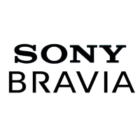

# ioBroker.sony-bravia

**This adapter uses Sentry libraries to automatically report exceptions and code errors to the developers.** For more details and for information how to disable the error reporting see [Sentry-Plugin Documentation](https://github.com/ioBroker/plugin-sentry#plugin-sentry)! Sentry reporting is used starting with js-controller 3.0.

## A Sony Bravia Android Smart-TV adapter for ioBroker

This is an ioBroker adapter for your Sony Bravia Smart-TV with Android OS. Tested with KD-65X8507C.

## TV Setup
* Turn on your TV
* On the TV go to Settings > Network > Home network setup > Remote device/Renderer > On
* On the TV go to Settings > Network > Home network setup > IP Control > Authentication > Normal and Pre-Shared Key
* On the TV go to Settings > Network > Home network setup > Remote device/Renderer > Enter Pre-Shared Key > 0000 (or whatever you want your PSK Key to be)
* On the TV go to Settings > Network > Home network setup > Remote device/Renderer > Simple IP Control > On

## Channel `tv` (for visualizations)

Besides the existing objects the adapter creates the channel `sony-bravia.0.tv`. It follows the device type `tv` of the
ioBroker type-detector, so visualizations (e.g. vis-2 material widgets) and the devices adapter recognize the TV
and can control it:

| State                          | Role                            | Meaning                                                                       |
|--------------------------------|---------------------------------|-------------------------------------------------------------------------------|
| `tv.power`                     | `switch.power`                  | Switch the TV on/off (needs "Remote start" / network standby to switch on)    |
| `tv.key`                       | `media.key`                     | Send a key: `UP`, `DOWN`, `LEFT`, `RIGHT`, `SELECT`, `BACK`, `HOME`, `NUMBER_1`, ... |
| `tv.volume`                    | `level.volume`                  | Volume of the speakers, 0-100 %                                               |
| `tv.muted`                     | `media.mute`                    | Mute                                                                          |
| `tv.volumeUp`, `tv.volumeDown` | `button.volume.up` / `.down`    | Volume buttons                                                                |
| `tv.input`                     | `media.input`                   | Input: `TV`, `SAT`, `HDMI1`...`HDMI4`, `AV`, `COMPONENT`, `SCART` (the ones the TV has) |
| `tv.app`                       | `media.app`                     | Start an app: `YOUTUBE`, `NETFLIX`, `PRIME_VIDEO`, ... (the ones installed on the TV) |
| `tv.unreach`                   | `indicator.maintenance.unreach` | The TV does not answer                                                        |

## Changelog
<!--
    Placeholder for the next version (at the beginning of the line):
    ### **WORK IN PROGRESS**
-->
### 1.2.0 (2026-10-29)
- (bluefox) The adapter was refactored to TypeScript and JsonConfig
- (bluefox) Replaced the deprecated `request` library with `axios`
- (bluefox) Fixed the buttons PicOff, PictureOff, Teletext and WirelessSubwoofer (IRCC codes with `+` or `/`)
- (bluefox) Apps and channels with non-latin titles no longer abort the creation of the remaining objects
- (bluefox) The IP field offers the TVs found in the network
- (bluefox) Added the channel `tv` for the device type `tv` of the type-detector, so visualizations can control the TV
- (bluefox) Added a remote control to the instance settings (tab "Remote control", requires admin 8)
- (copilot) Adapter requires node.js >= 22 now
- (iobroker-bot) Adapter requires node.js >= 20 now.
- (copilot) Adapter requires admin >= 7.7.22 now
- (copilot) Adapter requires js-controller >= 6.0.11 now
- (copilot) Adapter requires admin >= 7.6.17 now

### 1.1.0 (2024-04-28)
* (mcm1957) Adapter requires node.js >= 18 and js-controller >= 5 now
* (mcm1957) Dependencies have been updated

### 1.0.9 (2022-06-27)
* (Apollon77) Fix crash case on send introduced with last version

### 1.0.8 (2022-04-25)
* (Apollon77) Fix crash cases reported by sentry

### 1.0.7 (2022-04-24)
* (Apollon77) Fix tier definition

## License
The MIT License (MIT)

Copyright (c) 2023-2026 iobroker-community-adapters <iobroker-community-adapters@gmx.de>  
Copyright (c) 2018-2022 ldittmar <iobroker@lmdsoft.de>

Permission is hereby granted, free of charge, to any person obtaining a copy
of this software and associated documentation files (the "Software"), to deal
in the Software without restriction, including without limitation the rights
to use, copy, modify, merge, publish, distribute, sublicense, and/or sell
copies of the Software, and to permit persons to whom the Software is
furnished to do so, subject to the following conditions:

The above copyright notice and this permission notice shall be included in
all copies or substantial portions of the Software.

THE SOFTWARE IS PROVIDED "AS IS", WITHOUT WARRANTY OF ANY KIND, EXPRESS OR
IMPLIED, INCLUDING BUT NOT LIMITED TO THE WARRANTIES OF MERCHANTABILITY,
FITNESS FOR A PARTICULAR PURPOSE AND NONINFRINGEMENT. IN NO EVENT SHALL THE
AUTHORS OR COPYRIGHT HOLDERS BE LIABLE FOR ANY CLAIM, DAMAGES OR OTHER
LIABILITY, WHETHER IN AN ACTION OF CONTRACT, TORT OR OTHERWISE, ARISING FROM,
OUT OF OR IN CONNECTION WITH THE SOFTWARE OR THE USE OR OTHER DEALINGS IN
THE SOFTWARE.