# ioBroker.sunseeker

[Back to README](https://github.com/iobroker-community-adapters/ioBroker.sunseeker/blob/main/README.md)

This adapter was developed and tested with two Sunseeker S4 units. Other models should also be controllable.
If any settings are missing, please open an issue or ask in the forum.

```:warning:
 ⚠ Please do not run ioBroker and Home Assistant in parallel. If necessary, please disable `xxx.map.livemap_update` and set the interval to 1440.
 ⚠ Faulty points can render the map unusable. Changes to the code could render the mower unusable.
```

# Summary

- [Instance Settings](#instance-settings)
    - [Adapter settings](#adapter-settings)
- [Folder structure](#folder-structure)
- [antiTheft](#anti-theft)
- [events](#event-message)
    - [Example of event notification](#eventnotification)
    - [Example of daily event notification](#events)
    - [Example system messages](#systemmessage)
- [expert](#expert)
- [map](#map)
    - [Boundary properties](#boundary-properties)
    - [Forbidden region](#forbidden-region)
    - [Current Map Info](#current-map-info)
    - [Livemap Settings](#livemap-settings)
    - [Maps (Backup Maps)](#maps-backup-maps)
    - [Obstacles](#obstacles)
    - [Passages](#passages)
    - [Pattern](#pattern)
    - [Safe areas (placed_blank)](#safe-areas-placed_blank)
    - [Overview Zones](#overview-zones)
        - [Apply custom JSON to all zones](#setallcustomraw)
    - [Zone](#zone)
        - [Points](#points)
        - [Array](#array)
        - [Content start_mowing_selected_area](#content-start_mowing_selected_area)
    - [Custom Zone Settings](#custom-zone-settings)
        - [Apply custom JSON for zone settings](#setcustomraw)
- [mower_raw](#all-data-from-the-mower-via-the-cloud-and-mqtt-connection)
- [notice](#logs)
- [remote](#remote-control)
- [schedule](#schedule)
- [settings](#settings)
    - [Settings Multi-Angle](#settings-multi-angle)
- [Sharing](#sharing)
- [auth](#authorization)
- [rateLimit](#request-limit)
    - [Example Request JSON](#json-request)
    - [Example Restart JSON](#json-restart)

# Instance Settings

### Adapter settings

[Summary](#summary)

| Settings                                             | Description                                                                                                                                                                                                                                                                                                                                    |
| ---------------------------------------------------- | ---------------------------------------------------------------------------------------------------------------------------------------------------------------------------------------------------------------------------------------------------------------------------------------------------------------------------------------------- |
| `Username / Email`                                   | Username                                                                                                                                                                                                                                                                                                                                       |
| `Password`                                           | Password                                                                                                                                                                                                                                                                                                                                       |
| `Region`                                             | Select region – EU or US                                                                                                                                                                                                                                                                                                                       |
| `New if your mower is wireless`                      | New models such as S/X/V/V1 and "Old" for mowers with boundary wires (see Readme)                                                                                                                                                                                                                                                              |
| `Polling Interval (Minutes)`                         | With the exception of the notification setting, all data is also transmitted via the MQTT connections. You can also manually trigger an update using the `notice.update` button. If you switch to a 5-minute interval, for example, the adapter requires approximately 6,000 requests; at a 60-minute interval, it requires only 400 requests. |
| `Language (Known Languages: da, de, fr, fi, pl, en)` | Language for user interface and event code                                                                                                                                                                                                                                                                                                     |
| `HTTPS Request Limit (500-10000)`                    | Maximum number of requests the adapter is permitted to send per day. Protection against API changes.                                                                                                                                                                                                                                           |
| `Adapter restart limit`                              | Maximum adapter restarts per day. Protection against API changes.                                                                                                                                                                                                                                                                              |
| `HTTP request error limit`                           | Maximum number of requests to the cloud in the event of errors. Protection against API changes.                                                                                                                                                                                                                                                |
| `Delete mqtt data`                                   | Delete the MQTT connection credentials and create new ones. Only do this if there are problems or if requested by a developer.                                                                                                                                                                                                                 |
| `Delete session data`                                | Delete the access credentials for the cloud connection and create them again. Only if there are problems or at the request of a developer.                                                                                                                                                                                                     |

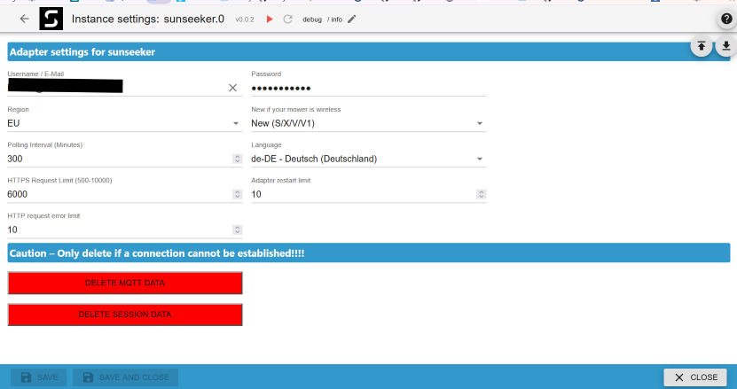

[Summary](#summary)

### Folder structure

| Object ID     | Description                                                                                               |
| ------------- | --------------------------------------------------------------------------------------------------------- |
| xxx           | Mower serial number (device)                                                                              |
| xxx.antiTheft | Anti-theft protection (4G or GPS module)                                                                  |
| xxx.events    | Event logs                                                                                                |
| xxx.expert    | Visible to developers only                                                                                |
| xxx.map       | Settings for zones, maps, areas, and patterns                                                             |
| xxx.mower_raw | All data from the cloud and MQTT connection (read-only)                                                   |
| xxx.notice    | Notification settings                                                                                     |
| xxx.remote    | Remote control                                                                                            |
| xxx.schedule  | Mowing schedule settings. Only two mowing schedules per day are supported.                                |
| xxx.settings  | General settings.                                                                                         |
| xxx.Sharing   | Account sharing                                                                                           |
| auth          | Access credentials and MQTT connection status.                                                            |
| info          | Cloud and MQTT connection status. Max. 3 connections; if even one goes offline, the adapter turns yellow. |
| rateLimit     | Rate limit information (errors are not displayed).                                                        |

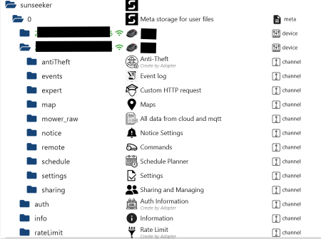

[Summary](#summary)

### Anti-theft

| Object ID                      | Description                          |
| ------------------------------ | ------------------------------------ |
| xxx.antiTheft.batteryVoltage   | Battery voltage status               |
| xxx.antiTheft.bindDeviceSn     | Serial number of the connected mower |
| xxx.antiTheft.deviceOnlineFlag | Module status                        |
| xxx.antiTheft.fence            | Digital fence size (L/M/H)           |
| xxx.antiTheft.fenceCenterLat   | Latitude (center of digital fence)   |
| xxx.antiTheft.fenceCenterLon   | Longitude (center of digital fence)  |
| xxx.antiTheft.fence_digital    | Activate/deactivate digital fence    |
| xxx.antiTheft.lastOnlineTime   | Time of last status change to online |
| xxx.antiTheft.lastPositionTime | Time of last position update         |

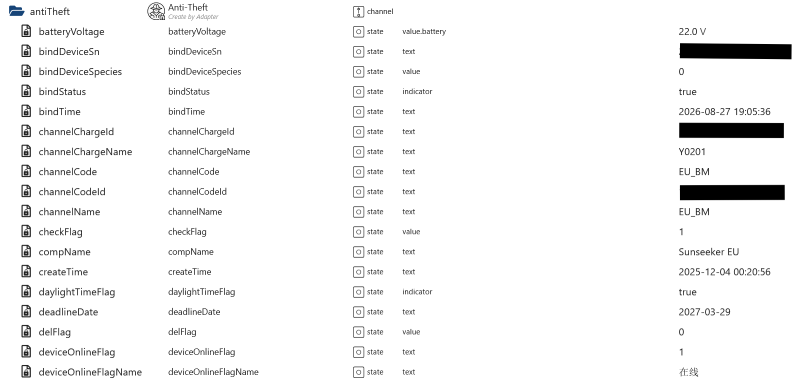
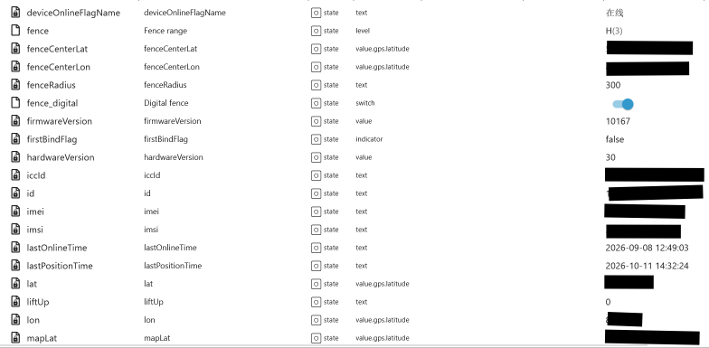
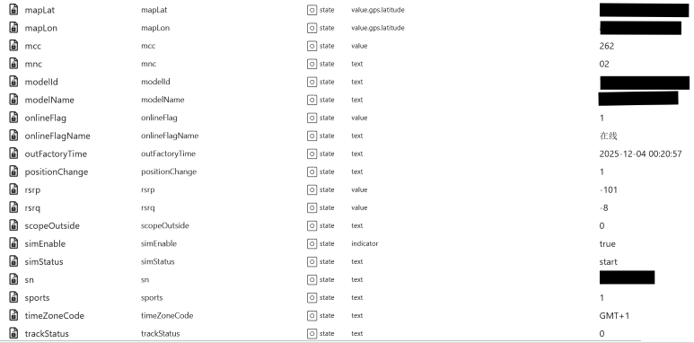
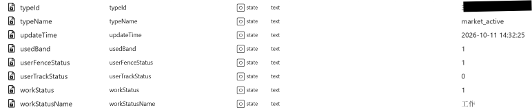

[Summary](#summary)

### Event message

| Object ID                      | Description                      |
| ------------------------------ | -------------------------------- |
| xxx.events.eventNotification   | Event notification               |
| xxx.events.eventUpdate         | Reload all events                |
| xxx.events.events              | Device Messages as JSON          |
| xxx.events.makeAllRead         | Mark all events as 'read'        |
| xxx.events.systemMessage       | System messages                  |
| xxx.events.unreadEventMessage  | Number of unread events          |
| xxx.events.unreadSystemMessage | Number of unread system messages |

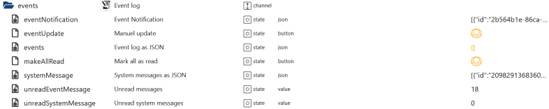

[Summary](#summary)

### eventNotification

```json
[
    {
        "id": "25046fa6-7766-4ed4-87a0-952f515442ca",
        "sn": null,
        "workRecordId": "0",
        "type": 2,
        "code": "Regen erkannt",
        "poseX": "",
        "poseY": "",
        "time": "1791584104176",
        "timeStr": "2026-10-09 22:15:04",
        "timeZoneId": "Europe/Berlin",
        "count": null,
        "nrtkBase": 0,
        "firmwareVersion": "1.1.28.3103"
    },
    {
        "id": "6f351d8c-9832-4e5b-b4b5-7c306151f1c9",
        "sn": null,
        "workRecordId": "0",
        "type": 2,
        "code": "Regen erkannt",
        "poseX": "",
        "poseY": "",
        "time": "1791403996503",
        "timeStr": "2026-10-07 20:13:16",
        "timeZoneId": "Europe/Berlin",
        "count": null,
        "nrtkBase": 0,
        "firmwareVersion": "1.1.28.3103"
    },
    {
        "id": "917a42c4-edd1-49cc-9f2f-ebebfae9342a",
        "sn": null,
        "workRecordId": "0",
        "type": 2,
        "code": "Der Roboter lädt",
        "poseX": "",
        "poseY": "",
        "time": "1791382963985",
        "timeStr": "2026-10-07 14:22:43",
        "timeZoneId": "Europe/Berlin",
        "count": null,
        "nrtkBase": 0,
        "firmwareVersion": "1.1.28.3103"
    }
]
```

### events

```json
[
    {
        "id": "2114652384020443001",
        "appUserId": null,
        "title": "Robot update successful",
        "content": "xxx:Robot update successful.",
        "readFlag": false,
        "createdAt": "2026-10-26 09:36:31",
        "messageTypeCode": "otaSuccess",
        "feedbackContent": null,
        "sendAt": "1793007391",
        "type": 2,
        "sn": null,
        "userDelFlag": false,
        "messageCode": null,
        "nrtkBase": null
    },
    {
        "id": "2114333791798816000",
        "appUserId": null,
        "title": "Robot lifted",
        "content": "xxx:Click to view the solution.",
        "readFlag": false,
        "createdAt": "2026-10-25 12:30:33",
        "messageTypeCode": "deviceExceptionMessage",
        "feedbackContent": null,
        "sendAt": "1792931433",
        "type": 2,
        "sn": "null",
        "userDelFlag": false,
        "messageCode": "-1",
        "nrtkBase": 0
    },
    {
        "id": "2114333789689335002",
        "appUserId": null,
        "title": "Robot lifted",
        "content": "xxx:Click to view the solution.",
        "readFlag": false,
        "createdAt": "2026-10-25 12:30:32",
        "messageTypeCode": "deviceExceptionMessage",
        "feedbackContent": null,
        "sendAt": "1792931432",
        "type": 2,
        "sn": "null",
        "userDelFlag": false,
        "messageCode": "-1",
        "nrtkBase": 0
    }
]
```

### systemMessage

```json
[
    {
        "id": "2098292481602727980",
        "appUserId": 12632759,
        "title": "Aktion für 70 Beta-Tester",
        "content": "Gehören Sie zu den Ersten, die unsere neue Technologie erleben, und gestalten Sie mit, was als Nächstes kommt.",
        "readFlag": true,
        "createdAt": "2026-09-11 06:07:59",
        "messageTypeCode": "communityActivityMessage",
        "feedbackContent": null,
        "sendAt": "1789106879",
        "type": 1,
        "sn": null,
        "userDelFlag": false,
        "messageCode": null,
        "nrtkBase": null
    },
    {
        "id": "2084552495081664535",
        "appUserId": 12632759,
        "title": "Gewinnen Sie einen Sunseeker Elite X Gen 2 – Das Gewinnspiel läuft noch!",
        "content": "Teilen Sie Ihr Feedback und gewinnen Sie mit etwas Glück X Gen 2 Mähroboter und Merchandise-Pakete. Gesamtwert der Preise: über 8.000 €.",
        "readFlag": true,
        "createdAt": "2026-08-04 08:10:01",
        "messageTypeCode": "communityActivityMessage",
        "feedbackContent": null,
        "sendAt": "1785831001",
        "type": 1,
        "sn": null,
        "userDelFlag": false,
        "messageCode": null,
        "nrtkBase": null
    },
    {
        "id": "2083090986003931175",
        "appUserId": 12632759,
        "title": "Umfrage-Gewinnspiel – Gewinnen Sie einen Sunseeker Elite X Gen 2!",
        "content": "Teilen Sie Ihr Feedback und gewinnen Sie X Gen 2 Mähroboter sowie Merchandise-Pakete. Gesamtwert der Preise: über 8.000 €.",
        "readFlag": true,
        "createdAt": "2026-07-31 07:22:39",
        "messageTypeCode": "communityActivityMessage",
        "feedbackContent": null,
        "sendAt": "1785482559",
        "type": 1,
        "sn": null,
        "userDelFlag": false,
        "messageCode": null,
        "nrtkBase": null
    }
]
```

[Summary](#summary)

### Expert

`For developers only. Requests can be sent directly to the cloud.`

| Object ID           | Description         |
| ------------------- | ------------------- |
| xxx.expert.request  | Own request as JSON |
| xxx.expert.response | Response            |

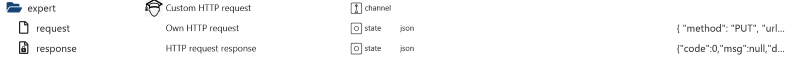

[Summary](#summary)

### Map

| Object ID              | Description                                   |
| ---------------------- | --------------------------------------------- |
| xxx.map.blank          | Edge properties                               |
| xxx.map.forbidden      | Forbidden zones                               |
| xxx.map.info           | Current map info                              |
| xxx.map.map_settings   | Live map settings                             |
| xxx.map.maps           | Backup maps                                   |
| xxx.map.obstacles      | Obstacles                                     |
| xxx.map.passages       | Passages                                      |
| xxx.map.pattern        | Pattern                                       |
| xxx.map.placed_blank   | Safe areas                                    |
| xxx.map.zones          | Zones                                         |
| xxx.map.backup         | Backup maps as JSON (data for `xxx.map.maps`) |
| xxx.map.livemap        | Live map                                      |
| xxx.map.livemap_update | Update live map while mowing                  |
| xxx.map.mapData        | Active map data (all points)                  |
| xxx.map.net            | Network coverage as a map                     |
| xxx.map.pathData       | Mowing path data                              |
| xxx.map.texture        | Textures as a map                             |
| xxx.map.wifi           | Wi-Fi coverage as a map                       |

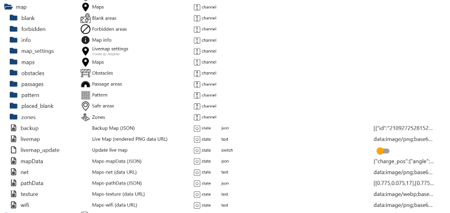

[Summary](#summary)

### Boundary properties

| Object ID                     | Description              |
| ----------------------------- | ------------------------ |
| xxx.map.blank.01.delete_blank | Delete Boundary property |
| xxx.map.blank.01.id           | ID                       |
| xxx.map.blank.01.points       | Points of the blank area |
| xxx.map.blank.01.points_num   | Number of points         |

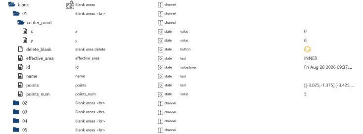

[Summary](#summary)

### Forbidden region

| Object ID                             | Description                                                                                                 |
| ------------------------------------- | ----------------------------------------------------------------------------------------------------------- |
| xxx.map.forbidden.01.delete_forbidden | Delete forbidden area                                                                                       |
| xxx.map.forbidden.01.effective_area   | Whether the area applies inside or outside the boundary                                                     |
| xxx.map.forbidden.01.id               | Timestamp of when the area was created                                                                      |
| xxx.map.forbidden.01.name             | Cannot be assigned                                                                                          |
| xxx.map.forbidden.01.points           | Points defining the area.                                                                                   |
| xxx.map.forbidden.01.points_num       | Number of points                                                                                            |
| xxx.map.forbidden.01.tag              | Area tag (2+dark=night, 1+normal=wall, 2+normal=general)                                                    |
| xxx.map.forbidden.01.type             | Area type (general, night, or wall)                                                                         |
| xxx.map.forbidden.forbidden_create    | Create forbidden area                                                                                       |
| xxx.map.forbidden.forbidden_map       | Map preview with points                                                                                     |
| xxx.map.forbidden.forbidden_points    | Points as an array (e.g., points from .01.points). Creating forbidden areas via VIS is not yet implemented. |
| xxx.map.forbidden.forbidden_type      | General, night, or wall                                                                                     |

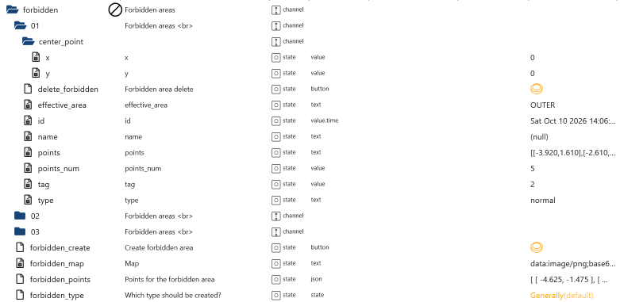

[Summary](#summary)

### Current Map Info

| Object ID                    | Description                                          |
| ---------------------------- | ---------------------------------------------------- |
| xxx.map.info.mapModifyTime   | Last modified                                        |
| xxx.map.info.mapPathFileName | File name                                            |
| xxx.map.info.mapPathFileUrl  | URL link to download the current map data            |
| xxx.map.info.realPathFileUlr | URL link to download the current mowing history data |

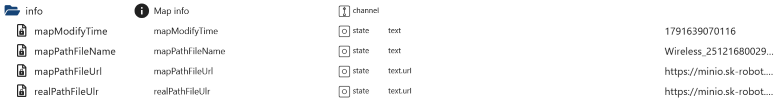

[Summary](#summary)

### Livemap Settings

| Object ID                                            | Description                                                               |
| ---------------------------------------------------- | ------------------------------------------------------------------------- |
| xxx.map.map_settings.charger_path                    | Path to the charging station image                                        |
| xxx.map.map_settings.charger_scale                   | Scale charging station image. The smaller the value, the larger the image |
| xxx.map.map_settings.divide_area_work_active         | Show work area divisions on the map                                       |
| xxx.map.map_settings.divide_area_work_lineWidth      | Line width                                                                |
| xxx.map.map_settings.divide_area_work_stroke         | Stroke color                                                              |
| xxx.map.map_settings.polyline_color                  | Mowing line color                                                         |
| xxx.map.map_settings.polyline_lineWidth              | Line width                                                                |
| xxx.map.map_settings.region_channel_active           | Show passages                                                             |
| xxx.map.map_settings.region_channel_fill             | Fill color                                                                |
| xxx.map.map_settings.region_channel_lineWidth        | Line width                                                                |
| xxx.map.map_settings.region_channel_stroke           | Stroke color                                                              |
| xxx.map.map_settings.region_forbidden_active         | Show forbidden areas                                                      |
| xxx.map.map_settings.region_forbidden_dark_fill      | Fill color                                                                |
| xxx.map.map_settings.region_forbidden_dark_lineWidth | Line width                                                                |
| xxx.map.map_settings.region_forbidden_dark_stroke    | Stroke color                                                              |
| xxx.map.map_settings.region_forbidden_fill           | Fill color                                                                |
| xxx.map.map_settings.region_forbidden_lineWidth      | Line width                                                                |
| xxx.map.map_settings.region_forbidden_stroke         | Stroke color                                                              |
| xxx.map.map_settings.region_forbidden_wall_fill      | Fill color                                                                |
| xxx.map.map_settings.region_forbidden_wall_lineWidth | Line width                                                                |
| xxx.map.map_settings.region_forbidden_wall_stroke    | Stroke color                                                              |
| xxx.map.map_settings.region_obstacle_active          | Show obstacles                                                            |
| xxx.map.map_settings.region_obstacle_fill            | Fill color                                                                |
| xxx.map.map_settings.region_obstacle_lineWidth       | Line width                                                                |
| xxx.map.map_settings.region_obstacle_stroke          | Stroke color                                                              |
| xxx.map.map_settings.region_pattern_active           | Show pattern                                                              |
| xxx.map.map_settings.region_pattern_fill             | Fill color                                                                |
| xxx.map.map_settings.region_pattern_lineWidth        | Line width                                                                |
| xxx.map.map_settings.region_pattern_stroke           | Stroke color                                                              |
| xxx.map.map_settings.region_placed_blank_active      | Show safe areas                                                           |
| xxx.map.map_settings.region_placed_blank_fill        | Fill color                                                                |
| xxx.map.map_settings.region_placed_blank_lineWidth   | Line width                                                                |
| xxx.map.map_settings.region_placed_blank_stroke      | Stroke color                                                              |
| xxx.map.map_settings.region_work_fill                | Fill color                                                                |
| xxx.map.map_settings.region_work_lineWidth           | Line width                                                                |
| xxx.map.map_settings.region_work_stroke              | Stroke color                                                              |
| xxx.map.map_settings.robot_charger_scale             | Scale mower image. The smaller the value, the larger the image            |
| xxx.map.map_settings.robot_path                      | Path to mower image                                                       |

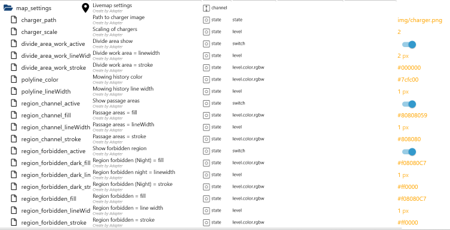
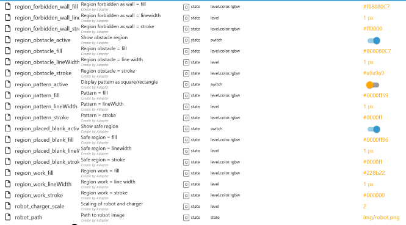

[Summary](#summary)

### Maps (Backup Maps)

| Object ID                     | Description                                                             |
| ----------------------------- | ----------------------------------------------------------------------- |
| xxx.map.maps.01.createTime    | Timestamp of map creation                                               |
| xxx.map.maps.01.delete        | Delete map. Must first be confirmed via `xxx.map.maps.01.delete_select` |
| xxx.map.maps.01.delete_select | Confirm map deletion (set to true)                                      |
| xxx.map.maps.01.id            | ID                                                                      |
| xxx.map.maps.01.mapArea       | Map area in m²                                                          |
| xxx.map.maps.01.mapId         | Map ID                                                                  |
| xxx.map.maps.01.mapName       | Map name (editable)                                                     |
| xxx.map.maps.01.mapUrl        | Map URL                                                                 |
| xxx.map.maps.01.sn            | Mower serial number                                                     |
| xxx.map.maps.01.thumbnailUrl  | Thumbnail map URL                                                       |
| xxx.map.maps.01.updateTime    | Last modification                                                       |
| xxx.map.maps.01.useThisMap    | Use this map. The currently active map must be deleted first            |
| xxx.map.maps.01.used          | Map active                                                              |

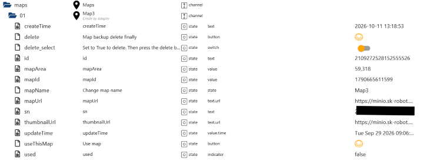

[Summary](#summary)

### Obstacles

| Object ID                            | Description                                                         |
| ------------------------------------ | ------------------------------------------------------------------- |
| xxx.map.obstacles.01.delete_obstacle | Delete obstacle                                                     |
| xxx.map.obstacles.01.effective_area  | Inside or outside the area                                          |
| xxx.map.obstacles.01.id              | ID                                                                  |
| xxx.map.obstacles.01.name            | No function                                                         |
| xxx.map.obstacles.01.points          | Obstacle points                                                     |
| xxx.map.obstacles.01.points_num      | Number of points                                                    |
| xxx.map.obstacles.obstacle_create    | Create obstacle                                                     |
| xxx.map.obstacles.obstacle_map       | Obstacle preview                                                    |
| xxx.map.obstacles.obstacle_points    | Obstacle points. Creating obstacles via VIS is not yet implemented. |

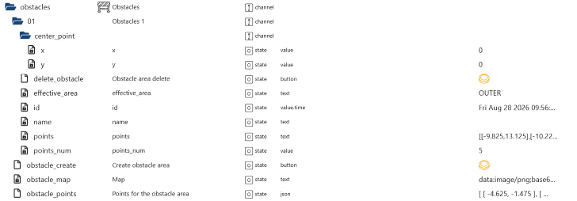

[Summary](#summary)

### Passages

| Object ID                          | Description                                                       |
| ---------------------------------- | ----------------------------------------------------------------- |
| xxx.map.passages.01.delete_passage | Delete passage                                                    |
| xxx.map.passages.01.effective_area | Inside or outside the area                                        |
| xxx.map.passages.01.id             | ID                                                                |
| xxx.map.passages.01.name           | No function                                                       |
| xxx.map.passages.01.points         | Passage points.                                                   |
| xxx.map.passages.01.points_num     | Number of points                                                  |
| xxx.map.passages.01.split_line     | Dividing line                                                     |
| xxx.map.passages.passage_create    | Create passage                                                    |
| xxx.map.passages.passage_map       | Passage preview                                                   |
| xxx.map.passages.passage_points    | Passage points. Creating passages via VIS is not yet implemented. |

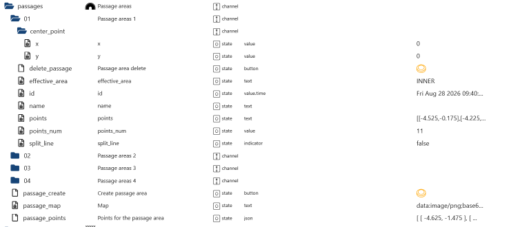

[Summary](#summary)

### Pattern

| Object ID                          | Description                                                                                                                                                                                     |
| ---------------------------------- | ----------------------------------------------------------------------------------------------------------------------------------------------------------------------------------------------- |
| xxx.map.pattern.01.area_id         | Area ID                                                                                                                                                                                         |
| xxx.map.pattern.01.effective_area  | Inside or outside the area                                                                                                                                                                      |
| xxx.map.pattern.01.enable          | Enable pattern                                                                                                                                                                                  |
| xxx.map.pattern.01.expiration_time | Date and time when the pattern will be automatically deleted                                                                                                                                    |
| xxx.map.pattern.01.id              | ID                                                                                                                                                                                              |
| xxx.map.pattern.01.img_value       | Change pattern                                                                                                                                                                                  |
| xxx.map.pattern.01.last_edit_time  | Timestamp of the pattern's last modification                                                                                                                                                    |
| xxx.map.pattern.01.min_width       | Minimum size                                                                                                                                                                                    |
| xxx.map.pattern.01.name            | No function                                                                                                                                                                                     |
| xxx.map.pattern.01.pattern_delete  | Delete pattern                                                                                                                                                                                  |
| xxx.map.pattern.01.points          | Pattern points (square)                                                                                                                                                                         |
| xxx.map.pattern.01.points_num      | Number of points                                                                                                                                                                                |
| xxx.map.pattern.create_pattern     | Create pattern. First configure `delete_automatic`, `points_pattern`, and `selecte_pattern`.                                                                                                    |
| xxx.map.pattern.delete_all_pattern | Delete all patterns.                                                                                                                                                                            |
| xxx.map.pattern.pattern_map        | Preview.                                                                                                                                                                                        |
| xxx.map.pattern.points_pattern     | Creating patterns via VIS is not yet implemented; the points must be entered here. Simply create a few patterns using the app and copy the points from `xxx.map.mapData` -> `region_customize`. |
| xxx.map.pattern.delete_automatic   | Time at which the new pattern should be deleted                                                                                                                                                 |
| xxx.map.pattern.selecte_pattern    | Select pattern                                                                                                                                                                                  |

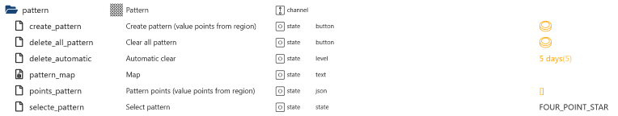

[Summary](#summary)

### Safe areas (placed_blank)

| Object ID                                   | Description                                                                   |
| ------------------------------------------- | ----------------------------------------------------------------------------- |
| xxx.map.placed_blank.01.delete_placed_blank | Delete safe zone                                                              |
| xxx.map.placed_blank.01.effective_area      | Inside or outside the zone                                                    |
| xxx.map.placed_blank.01.id                  | ID                                                                            |
| xxx.map.placed_blank.01.name                | No function                                                                   |
| xxx.map.placed_blank.01.points              | Safe zone points                                                              |
| xxx.map.placed_blank.01.points_num          | Number of points                                                              |
| xxx.map.placed_blank.placed_blank_create    | Create safe zone using points from `xxx.map.placed_blank.placed_blank_points` |
| xxx.map.placed_blank.placed_blank_map       | Preview using points from `xxx.map.placed_blank.placed_blank_points`          |
| xxx.map.placed_blank.placed_blank_points    | Safe zone points. Creating zones via VIS is not yet implemented.              |

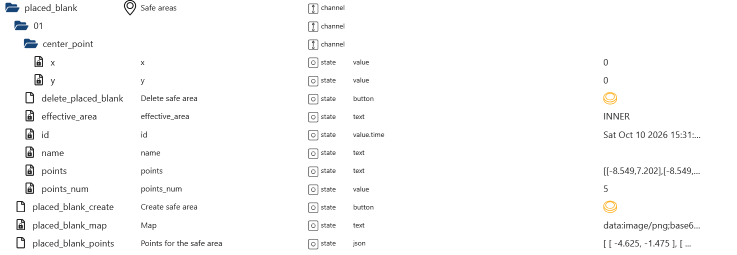

[Summary](#summary)

### Overview Zones

| Object ID                              | Description                                                                                                                   |
| -------------------------------------- | ----------------------------------------------------------------------------------------------------------------------------- |
| xxx.map.zones.change_active_map_name   | Change map name                                                                                                               |
| xxx.map.zones.delete_active_map        | Delete active map; `xxx.map.zones.delete_active_map_select` must be set to `true`                                             |
| xxx.map.zones.delete_active_map_select | Set to `true` to confirm deletion, then press `delete_active_map`                                                             |
| xxx.map.zones.merge_zones              | Merge zones, e.g., [1, 2] to merge Zone 1 and Zone 2                                                                          |
| xxx.map.zones.setAllCustomRaw          | You can also modify and send the JSON instead of changing the states                                                          |
| xxx.map.zones.settings_all_zones       | Apply 0 for default settings (`xxx.settings.multi_angle`) for all zones, or 1 for custom settings (`xxx.map.zones.01.custom`) |

# setAllCustomRaw

```json
[
    {
        "work_gap": 2,
        "region_size": 10,
        "blade_height": 100,
        "estimate_time": 8,
        "blade_speed": 2800,
        "plan_mode": 4,
        "region_id": 1787902995078,
        "start": 1,
        "finish": 0,
        "work_speed": 2,
        "setting": false
    },
    {
        "work_gap": 2,
        "region_size": 28,
        "blade_height": 100,
        "estimate_time": 22,
        "blade_speed": 2800,
        "plan_mode": 4,
        "region_id": 1787903286041,
        "start": 0,
        "finish": 1,
        "work_speed": 2,
        "setting": false
    },
    {
        "work_gap": 2,
        "region_size": 20,
        "blade_height": 100,
        "estimate_time": 15,
        "blade_speed": 2800,
        "plan_mode": 4,
        "region_id": 1789910964606,
        "start": 0,
        "finish": 1,
        "work_speed": 2,
        "setting": false
    }
]
```

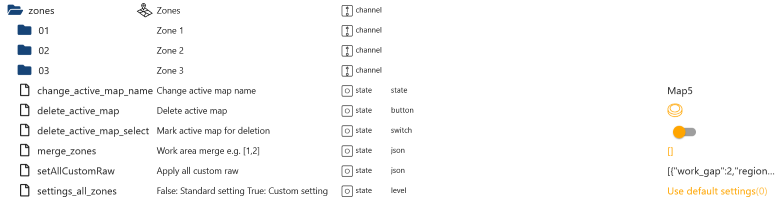

[Summary](#summary)

### Zone

| Object ID                                   | Description                                                                                                                                                             |
| ------------------------------------------- | ----------------------------------------------------------------------------------------------------------------------------------------------------------------------- |
| xxx.map.zones.01.area_size                  | Zone size                                                                                                                                                               |
| xxx.map.zones.01.effective_area             | Effective area                                                                                                                                                          |
| xxx.map.zones.01.id                         | ID                                                                                                                                                                      |
| xxx.map.zones.01.mapId                      | Map ID                                                                                                                                                                  |
| xxx.map.zones.01.name                       | Zone name (editable)                                                                                                                                                    |
| xxx.map.zones.01.points                     | Zone GPS data                                                                                                                                                           |
| xxx.map.zones.01.points_num                 | Number of GPS points                                                                                                                                                    |
| xxx.map.zones.01.split_zones                | Split this zone using GPS data. Splitting via VIS is not yet implemented.                                                                                               |
| xxx.map.zones.01.start_mowing_selected_area | Creating areas via VIS is not yet implemented. The path to be mowed can be obtained from `xxx.map.pathData`. Copy the desired points into an array and paste them here. |
| xxx.map.zones.01.time_balanced              | Time-balanced (read-only)                                                                                                                                               |
| xxx.map.zones.01.time_fine_tune             | Time fine-tuning (read-only)                                                                                                                                            |
| xxx.map.zones.01.time_high_efficiency       | Sustained high efficiency (read-only)                                                                                                                                   |

# Points

```json
[-0.3, 0.112, 11]
```

# Array

```json
[]
```

# Content start_mowing_selected_area

```json
[[-0.3, 0.112, 11]]
```

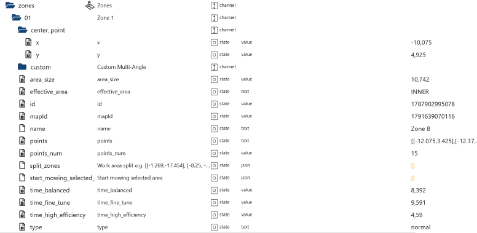

[Summary](#summary)

### Custom Zone Settings

| Object ID                                        | Description                                                                                                                                                                    |
| ------------------------------------------------ | ------------------------------------------------------------------------------------------------------------------------------------------------------------------------------ |
| xxx.map.zones.01.custom.multi_angle.01           | A maximum of three angles is supported                                                                                                                                         |
| xxx.map.zones.01.custom.multi_angle.01.active    | Activate/deactivate angle                                                                                                                                                      |
| xxx.map.zones.01.custom.multi_angle.01.angle     | Change angle between 0° and 180°                                                                                                                                               |
| xxx.map.zones.01.custom.multi_angle.angle        | Enter new angle between 0° and 180°                                                                                                                                            |
| xxx.map.zones.01.custom.multi_angle.angle_active | Activate/deactivate new angle                                                                                                                                                  |
| xxx.map.zones.01.custom.multi_angle.angle_create | Create new angle                                                                                                                                                               |
| xxx.map.zones.01.custom.multi_angle.delete_angle | Delete an angle                                                                                                                                                                |
| xxx.map.zones.01.custom.currentCustomRaw         | Current JSON of custom settings from the cloud                                                                                                                                 |
| xxx.map.zones.01.custom.plan_mode                | Cutting direction                                                                                                                                                              |
| xxx.map.zones.01.custom.region_id                | Zone ID                                                                                                                                                                        |
| xxx.map.zones.01.custom.setCustomRaw             | Instead of modifying individual states, you can also send a JSON object. Use and modify the JSON from `currentCustomRaw`<br>If angles are used, option 4 must be selected here |
| xxx.map.zones.01.custom.setCustomZoneSettings    | Send `currentCustomRaw`                                                                                                                                                        |
| xxx.map.zones.01.custom.setting                  | Use default settings from `xxx.settings.multi_angle`                                                                                                                           |
| xxx.map.zones.01.custom.start                    | Apply changes immediately or during the next mowing operation                                                                                                                  |
| xxx.map.zones.01.custom.work_gap                 | Cutting distance                                                                                                                                                               |
| xxx.map.zones.01.custom.work_speed               | Mowing speed                                                                                                                                                                   |

# setCustomRaw

```json
{
    "work_gap": 3,
    "region_size": 54,
    "blade_height": 40,
    "estimate_time": 30,
    "multi_zigzag_angles": [
        {
            "active": true,
            "angle": 74
        },
        {
            "active": true,
            "angle": 68
        },
        {
            "active": true,
            "angle": 117
        }
    ],
    "blade_speed": 2800,
    "plan_mode": 0,
    "region_id": 1789399960596,
    "start": 0,
    "finish": 1,
    "work_speed": 1,
    "setting": true
}
```

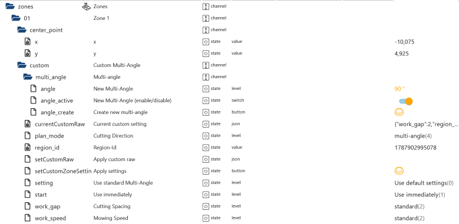

[Summary](#summary)

### All data from the mower via the cloud and MQTT connection.

`Only some of the objects are described here`

| Object ID                            | Description                                                     |
| ------------------------------------ | --------------------------------------------------------------- |
| xxx.mower_raw.blade                  | Blade settings (MQTT)                                           |
| xxx.mower_raw.charge_pos             | Charging station position (MQTT)                                |
| xxx.mower_raw.consumable_items       | Consumables (MQTT)                                              |
| xxx.mower_raw.file_17                | New path file uploaded (MQTT)                                   |
| xxx.mower_raw.file_7                 | New map file uploaded (MQTT)                                    |
| xxx.mower_raw.current_work_param     | Current work parameters (MQTT)                                  |
| xxx.mower_raw.mcu_ver                | Microcontroller unit (MQTT)                                     |
| xxx.mower_raw.mow_efficiency         | Mowing efficiency (MQTT)                                        |
| xxx.mower_raw.current_file           | Current path file (MQTT)                                        |
| xxx.mower_raw.path_info              | Current number of points in mowing history (MQTT+GPS)           |
| xxx.mower_raw.notice                 | Last message (MQTT)                                             |
| xxx.mower_raw.rain                   | Rain setting (MQTT)                                             |
| xxx.mower_raw.robot_pos              | Mower position (MQTT)                                           |
| xxx.mower_raw.rtk_pos                | Real-time kinematic positioning (MQTT)                          |
| xxx.mower_raw.schedule_info          | Last modified time slot (MQTT)                                  |
| xxx.mower_raw.support_custom_pattern | All possible patterns (MQTT)                                    |
| xxx.mower_raw.appUserId              | User ID                                                         |
| xxx.mower_raw.auto_upgrade           | Automatic firmware update on/off                                |
| xxx.mower_raw.backup_map_amount      | Number of backup maps                                           |
| xxx.mower_raw.base_sn                | Charging station serial number                                  |
| xxx.mower_raw.bindAntiTheftId        | ID of the 4G or GPS module                                      |
| xxx.mower_raw.bladeHeight            | Blade height                                                    |
| xxx.mower_raw.bladeSpeed             | Blade speed                                                     |
| xxx.mower_raw.camera_sn              | Camera serial number                                            |
| xxx.mower_raw.camera_temp            | Camera temperature                                              |
| xxx.mower_raw.code                   | Cloud response: 0 = OK; values greater than 0 indicate an error |
| xxx.mower_raw.dev_model              | Mower model                                                     |
| xxx.mower_raw.dev_name               | Mower name                                                      |
| xxx.mower_raw.deviceId               | Mower ID                                                        |
| xxx.mower_raw.deviceSn               | Mower serial number                                             |
| xxx.mower_raw.elec                   | Battery level                                                   |
| xxx.mower_raw.event_code             | Last event                                                      |
| xxx.mower_raw.id                     | ID for MQTT message mapping                                     |
| xxx.mower_raw.iobroker_sid           | Created by the adapter; required for the live map               |
| xxx.mower_raw.key                    | Key for MQTT message mapping                                    |
| xxx.mower_raw.net_4g_sig             | 4G signal strength                                              |
| xxx.mower_raw.path                   | Current path (required for the live map)                        |
| xxx.mower_raw.sid                    | App SID for the live map                                        |
| xxx.mower_raw.soc_temp               | Battery temperature                                             |

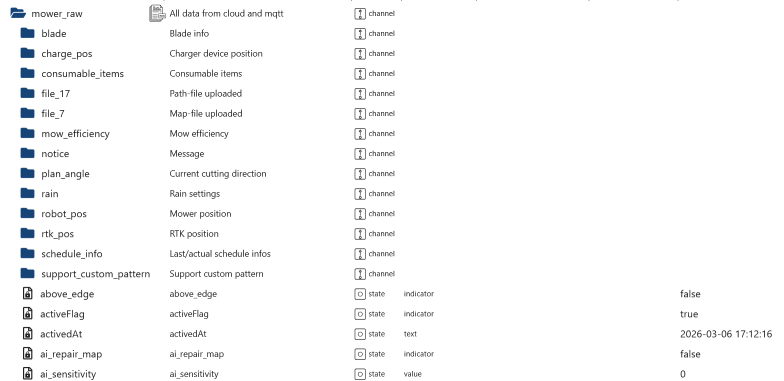
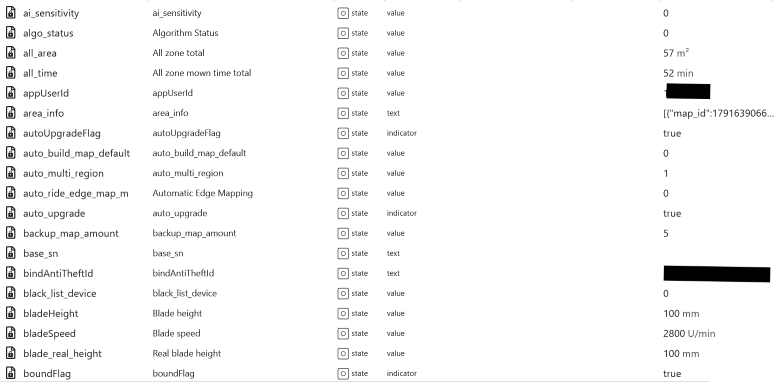
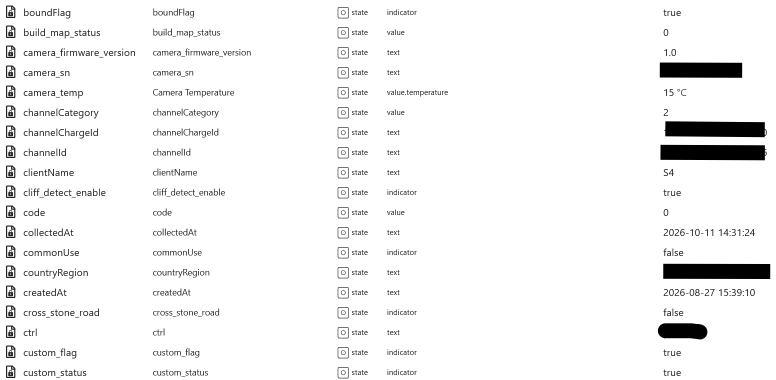
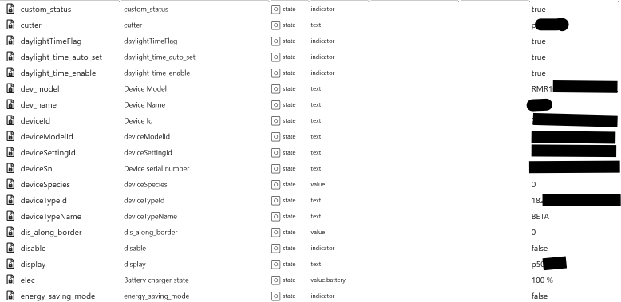
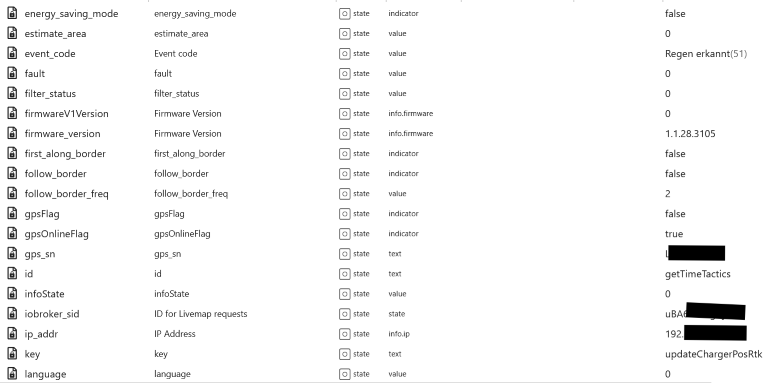
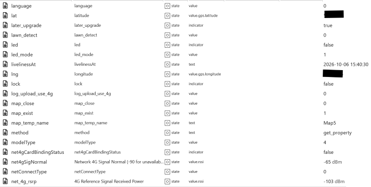
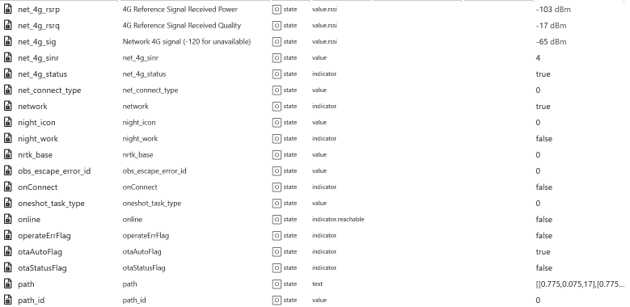
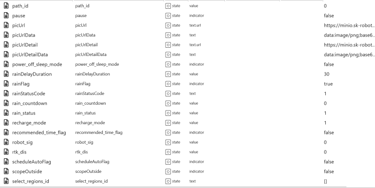
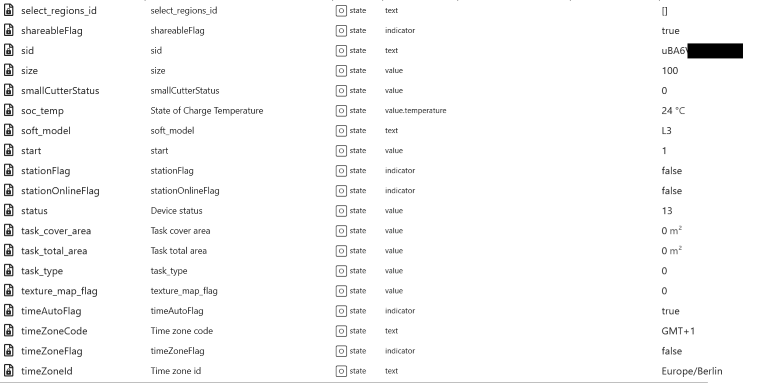
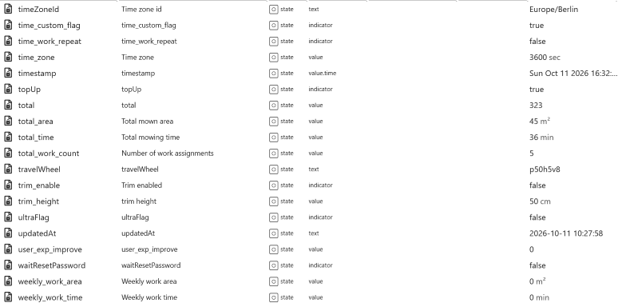
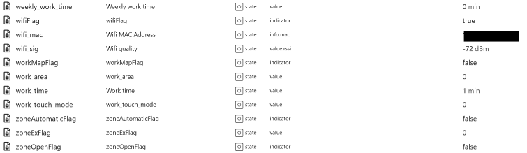

[Summary](#summary)

### Logs

| Object ID                            | Description                |
| ------------------------------------ | -------------------------- |
| xxx.notice.commonMesgage             | General notifications      |
| xxx.notice.communityActivityMessage  | Recommended events         |
| xxx.notice.deadLineWarnMessageBlade  | Replace blade              |
| xxx.notice.deadLineWarnMessageCutter | Clean small mower deck     |
| xxx.notice.deadLineWarnTrimmerRope   | Replace trimmer line       |
| xxx.notice.deviceExceptionMessage    | Operational irregularities |
| xxx.notice.taskStatus                | Task status                |
| xxx.notice.trackWarningMessage       | Tracking                   |
| xxx.notice.update                    | Reload settings            |

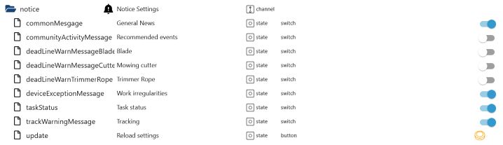

[Summary](#summary)

### Remote Control

| Object ID                      | Description                                       |
| ------------------------------ | ------------------------------------------------- |
| xxx.remote.dock                | Return to charging station                        |
| xxx.remote.pause               | Pause                                             |
| xxx.remote.refresh             | Refresh status                                    |
| xxx.remote.refresh_property    | Refresh properties                                |
| xxx.remote.set_border_distance | Edge cutting distance (Model V1)                  |
| xxx.remote.set_border_first    | Cut edge first (Model V1)                         |
| xxx.remote.set_return_path     | Docking mode (Model V1)                           |
| xxx.remote.set_screen_duration | Automatic screen timeout (Model V1)               |
| xxx.remote.start               | Start mowing                                      |
| xxx.remote.startZones          | Mow selected zones, e.g., [zoneId1, zoneId2]      |
| xxx.remote.stop                | Stop                                              |
| xxx.remote.stop_find_charger   | Cancel the return to the charging station         |
| xxx.remote.border              | Edge cutting (V models: mode 5 with `value:true`) |

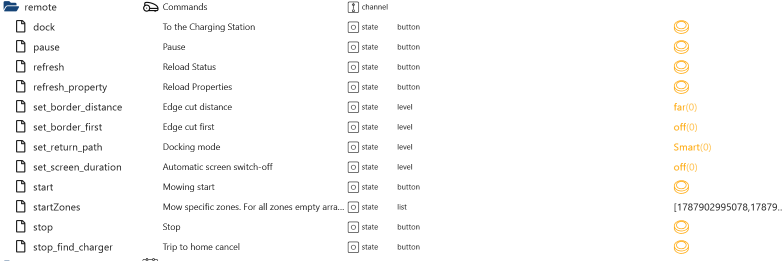

[Summary](#summary)

### Schedule

| Object ID                                  | Description                                              |
| ------------------------------------------ | -------------------------------------------------------- |
| xxx.schedule.getSchedule                   | Reload schedule from the cloud                           |
| xxx.schedule.pauseSchedule                 | Pause schedule                                           |
| xxx.schedule.schedule_mode                 | Activate/deactivate schedule; custom or recommended mode |
| xxx.schedule.schedule_time_work_repeat     | Mow for the entire scheduled work time                   |
| xxx.schedule.schedule_time_zone            | Time zone                                                |
| xxx.schedule.setSchedule                   | Send all changes to the cloud                            |
| xxx.schedule.zones_available               | Available zones for e.g. `0_sunday_1.zones`              |
| xxx.schedule.0_sunday_1.active             | Always keep set to true                                  |
| xxx.schedule.0_sunday_1.end                | End time in HH:mm format                                 |
| xxx.schedule.0_sunday_1.need_follow_border | Unknown                                                  |
| xxx.schedule.0_sunday_1.start              | Start time in HH:mm format                               |
| xxx.schedule.0_sunday_1.unlock             | Always keep set to true                                  |
| xxx.schedule.0_sunday_1.work_order         | Custom sequence. A zone must be entered. 0=On/1=Off      |
| xxx.schedule.0_sunday_1.zones              | Zone(s) to be mowed; if empty, all zones are mowed.      |

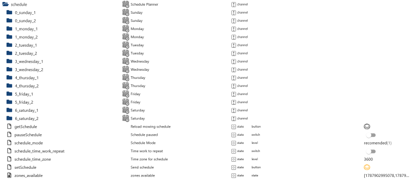
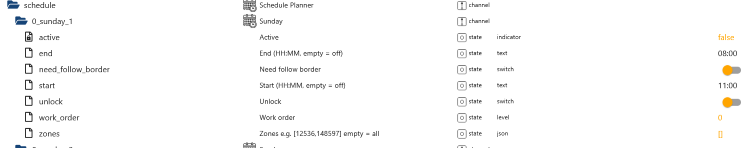

[Summary](#summary)

### Settings

| State                          | Description                                                                                                                                         | Range                                                            | Unit | Notes          |
| ------------------------------ | --------------------------------------------------------------------------------------------------------------------------------------------------- | ---------------------------------------------------------------- | ---- | -------------- |
| `bladeSpeed`                   | Blade speed                                                                                                                                         | 2800 – 3000 (step 100)                                           | rpm  | New API only   |
| `bladeHeight`                  | Blade height                                                                                                                                        | 20 – 100 (step 5)                                                | mm   | New API only   |
| `rainFlag`                     | Enable/disable rain delay                                                                                                                           | boolean                                                          | —    | Old + New API  |
| `rainDelayDuration`            | Rain delay duration (min)                                                                                                                           | 0 – 720 (step 1)                                                 | min  | Old + New API  |
| `night_work`                   | Enable/disable night work                                                                                                                           | boolean                                                          | —    | New API only   |
| `recharge_mode`                | Docking path                                                                                                                                        | 0 = direct path<br>1 = smart<br>2 = along edge                   | —    | New API only   |
| `work_touch_mode`              | Obstacle avoidance strategy                                                                                                                         | 0 = no touch<br>1 = slow touch                                   | —    | New API only   |
| `auto_ride_edge_map_m`         | Auto edge-following mapping                                                                                                                         | 0 = not enabled<br>1 = enabled                                   | —    | New API only   |
| `dis_along_border`             | Edge distance                                                                                                                                       | 0 = close<br>1 = far                                             | —    | New API only   |
| `first_along_border`           | Mowing preference                                                                                                                                   | boolean                                                          | —    | New API only   |
| `follow_border_freq`           | Edge cutting frequency                                                                                                                              | 1 = every time<br>2 = every second time<br>3 = every third time  | —    | New API only   |
| `follow_border_laps`           | Edge mowing rounds                                                                                                                                  | 1 = everytime<br>2 = every second time<br>3 = every third time   | —    | New API only   |
| `plan_mode`                    | Cutting direction. For angle must be set 4                                                                                                          | 0 = default<br>1 = traceless<br>3 = efficient<br>4 = multi-angle | —    | New API only   |
| `gap`                          | Cutting spacing                                                                                                                                     | 1 = narrow<br>2 = standard<br>3 = wide                           | —    | New API only   |
| `workSpeed`                    | Mowing speed                                                                                                                                        | 1 = slow<br>2 = standard<br>3 = fast                             | —    | New API only   |
| `ai_sensitivity`               | AI sensitivity                                                                                                                                      | 0 = low<br>1 = high                                              | —    | New API only   |
| `dev_name`                     | Change device name                                                                                                                                  | string                                                           | —    | New API only   |
| `energy_saving_mode`           | Energy-saving mode                                                                                                                                  | boolean                                                          | —    | New API only   |
| `pin_old`                      | Enter old PIN                                                                                                                                       | number                                                           | —    | New API only   |
| `pin_new`                      | To change the PIN, enter the new PIN here and<br> the old PIN under `pin_old`                                                                       | number                                                           | —    | New API only   |
| `custom_flag`                  | Unknown                                                                                                                                             | boolean                                                          | —    | New API only   |
| `auto_upgrade`                 | Enable/disable automatic firmware update                                                                                                            | boolean                                                          | —    | New API only   |
| `reset_bladeplate`             | Reset blade plate counter                                                                                                                           | boolean                                                          | —    | New API only   |
| `reset_blade`                  | Reset blade counter                                                                                                                                 | boolean                                                          | —    | New API only   |
| `reset_small_bladeplate`       | Reset small blade plate counter                                                                                                                     | boolean                                                          | —    | New API only X |
| `reset_small_blade`            | Reset small blade counter                                                                                                                           | boolean                                                          | —    | New API only X |
| `firmware_available`           | Currently available firmware                                                                                                                        | string                                                           | —    | New API only   |
| `firmware_description`         | Description of current firmware                                                                                                                     | string                                                           | —    | New API only   |
| `firmware_update_available`    | Is an update available? true = yes, false = no                                                                                                      | boolean                                                          | —    | New API only   |
| `firmware_update_check_manual` | Checks are performed every 24 hours after adapter startup.<br>Use this to manually check if an update is available.                                 | boolean                                                          | —    | New API only   |
| `firmware_update_start`        | Start firmware update                                                                                                                               | boolean                                                          | —    | New API only   |
| `topUp`                        | Only visible when using more than one mower in the APP. Set devices for the home page in the app. The `mower_raw.topUp` state is not being changed. | boolean                                                          | —    | New API only   |
| `topUp_array`                  | Only visible when using more than one mower in the APP. Sorting of devices for the view in the APP.                                                 | boolean                                                          | —    | New API only   |

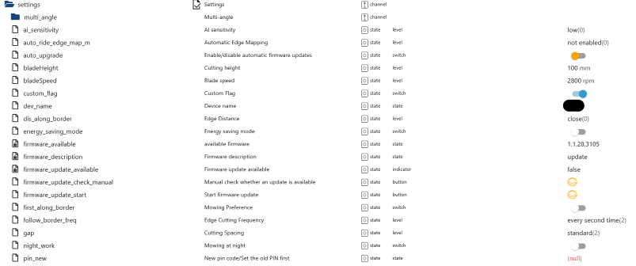
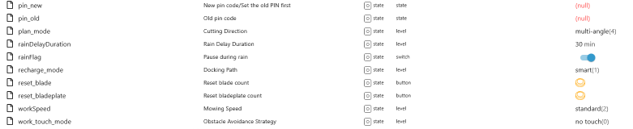

[Summary](#summary)

### Settings Multi-Angle

| Object ID                             | Description                          |
| ------------------------------------- | ------------------------------------ |
| xxx.settings.multi_angle.01           | Up to three angles can be configured |
| xxx.settings.multi_angle.01.active    | Activate/deactivate angle            |
| xxx.settings.multi_angle.01.angle     | Change angle between 0° and 180°     |
| xxx.settings.multi_angle.angle        | Enter new angle between 0° and 180°  |
| xxx.settings.multi_angle.angle_active | Activate/deactivate new angle        |
| xxx.settings.multi_angle.angle_create | Create new angle                     |
| xxx.settings.multi_angle.delete_angle | Delete an angle                      |

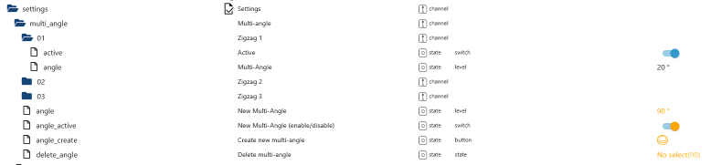

[Summary](#summary)

### Sharing

| Object ID                             | Description                                                        |
| ------------------------------------- | ------------------------------------------------------------------ |
| xxx.sharing.share_user                | Info and settings for all account links and the user's own account |
| xxx.sharing.share_user.xxx            | ID and data for the account link                                   |
| xxx.sharing.share_user.xxx.deviceUser | Information about the device associated with the link              |
| xxx.sharing.share_user.xxx.user       | Information about the user associated with the link                |

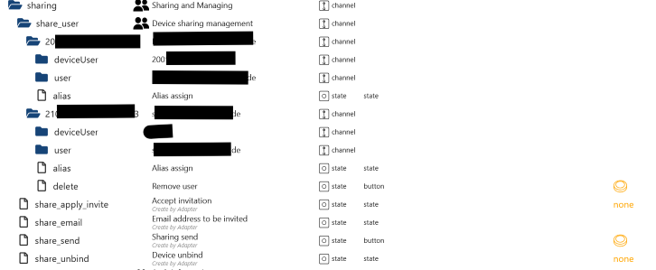

| Object ID                              | Description                                                                                |
| -------------------------------------- | ------------------------------------------------------------------------------------------ |
| xxx.sharing.share_user.xxx.alias       | Assign alias.                                                                              |
| xxx.sharing.share_user.xxx.mark_revoke | Mark account for deletion                                                                  |
| xxx.sharing.share_user.xxx.revoke      | Permanently delete marked account                                                          |
| xxx.sharing.share_apply_invite         | Object is created only when a request is received.<br>Enable requests for account linking. |
| xxx.sharing.share_email                | Email address of the account with which you wish to share your account.                    |
| xxx.sharing.share_send                 | Send request.                                                                              |
| xxx.sharing.select_device              | Select mower to delete it from the app                                                     |
| xxx.sharing.select_device_delete       | Delete selected mower                                                                      |

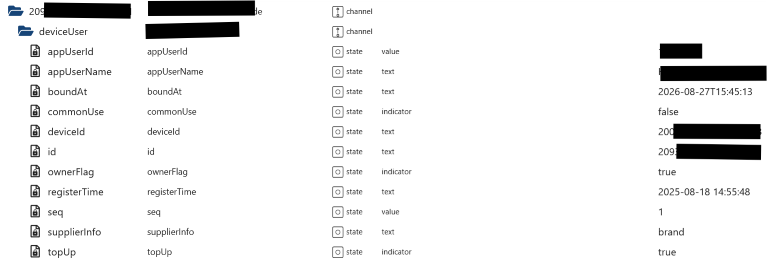
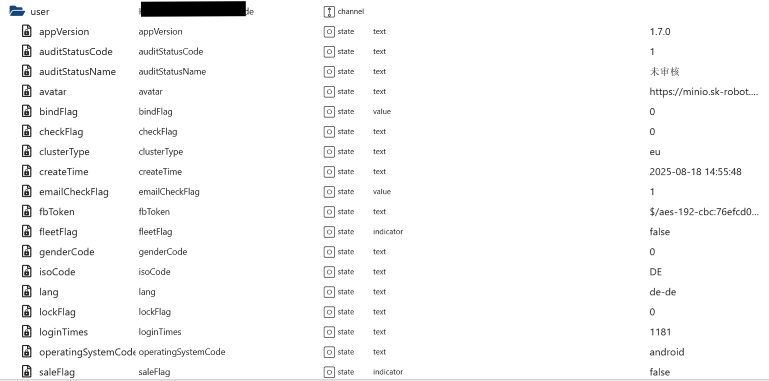
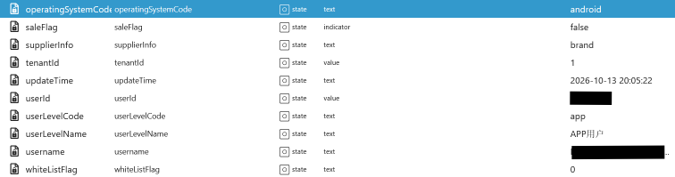

[Summary](#summary)

### Authorization

| Object ID               | Description                                                         |
| ----------------------- | ------------------------------------------------------------------- |
| auth.app_id             | Created by the adapter and required for some requests to the cloud. |
| auth.mqtt_connected     | MQTT connection status for S/X/V models                             |
| auth.mqtt_connected_V1  | MQTT connection status for V1 model                                 |
| auth.mqtt_connected_old | MQTT connection status for wired mowers                             |
| auth.mqtt_connection    | Access credentials for the MQTT connection                          |
| auth.session            | Access credentials for the cloud connection                         |

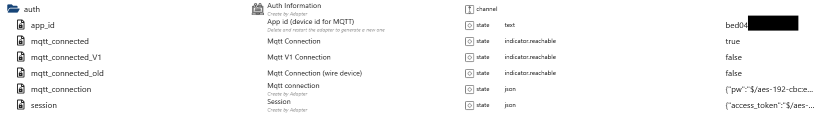

[Summary](#summary)

### Request limit

| Object ID         | Description                                                                        |
| ----------------- | ---------------------------------------------------------------------------------- |
| rateLimit.request | Displays the requests sent to the cloud. A safeguard against faulty scripts.       |
| rateLimit.restart | Counts the number of adapter restarts per day. A safeguard against faulty scripts. |

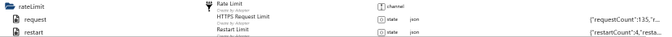

### JSON Request

```json
{
    "requestCount": 291,
    "requestLast": 1791627513938,
    "requestTime": "2026-10-10T10:18:33.938Z",
    "requestBlock": false,
    "day": "41-6",
    "request": [
        {
            "count": 291,
            "method": "GET",
            "urlPath": "/wireless_map/wireless_device/get?deviceSn=123",
            "timestamp": 1791657143977,
            "time": "2026-10-10T18:32:23.977Z"
        },
        {
            "count": 290,
            "method": "POST",
            "urlPath": "/ota/firmware-large/wireless/check",
            "data": "{\"deviceSn\":\"123\",\"deviceSpecies\":0,\"deviceType\":0,\"version\":\"1.1.28.3105\"}",
            "timestamp": 1791657088209,
            "time": "2026-10-10T18:31:28.209Z"
        }
    ]
}
```

### JSON Restart

```json
{
    "restartCount": 9,
    "restartLast": 1791627513938,
    "restartTime": "2026-10-10T10:18:33.938Z",
    "day": "41-6"
}
```

[Summary](#summary)

## Changelog

<!--
    Placeholder for the next version (at the beginning of the line):
    ### **WORK IN PROGRESS**
-->

### **WORK IN PROGRESS**

- (Lucky-ESA) Adaptation for the S5-Gen-2 mower

### 0.0.5 (2026-10-24)

- (Lucky-ESA) MQTT reconnected fixed

### 0.0.4 (2026-10-18)

- (Lucky-ESA) Added account sharing
- (Lucky-ESA) Added device sorting

### 0.0.3 (2026-10-11)

- (Lucky-ESA) Settings added
- (Lucky-ESA) Refresh properties button added
- (Lucky-ESA) Multi-angle added
- (Lucky-ESA) Custom Multi-angle added
- (Lucky-ESA) Mirroring of App version 1.7.0 regarding login, header, and MQTT password.
- (Lucky-ESA) Pattern, anti-theft added

### 0.0.2 (2026-05-29)

- (ioBroker-Bot) Adapter requires admin >= 7.8.23 now.
- (Lucky-ESA) Added event log

### 0.0.1 (2026-05-15)

- (TA2k) initial release

## License

MIT License

Copyright (c) 2026 iobroker-community-adapters <iobroker-community-adapters@gmx.de>  
Copyright (c) 2026 TA2k <tombox2020@gmail.com>

Permission is hereby granted, free of charge, to any person obtaining a copy
of this software and associated documentation files (the "Software"), to deal
in the Software without restriction, including without limitation the rights
to use, copy, modify, merge, publish, distribute, sublicense, and/or sell
copies of the Software, and to permit persons to whom the Software is
furnished to do so, subject to the following conditions:

The above copyright notice and this permission notice shall be included in all
copies or substantial portions of the Software.

THE SOFTWARE IS PROVIDED "AS IS", WITHOUT WARRANTY OF ANY KIND, EXPRESS OR
IMPLIED, INCLUDING BUT NOT LIMITED TO THE WARRANTIES OF MERCHANTABILITY,
FITNESS FOR A PARTICULAR PURPOSE AND NONINFRINGEMENT. IN NO EVENT SHALL THE
AUTHORS OR COPYRIGHT HOLDERS BE LIABLE FOR ANY CLAIM, DAMAGES OR OTHER
LIABILITY, WHETHER IN AN ACTION OF CONTRACT, TORT OR OTHERWISE, ARISING FROM,
OUT OF OR IN CONNECTION WITH THE SOFTWARE OR THE USE OR OTHER DEALINGS IN THE
SOFTWARE.