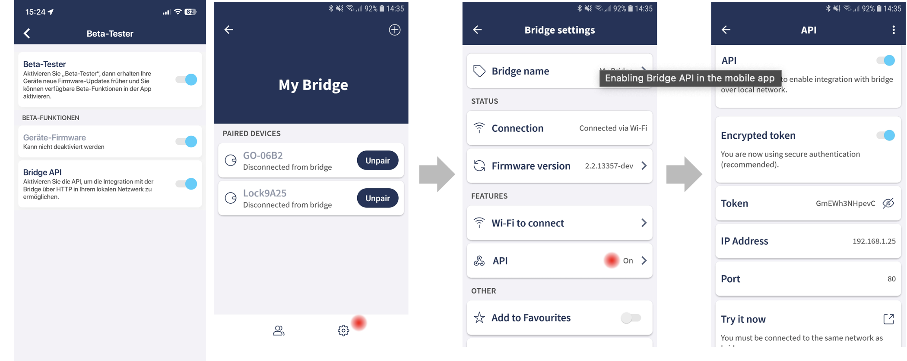

# ioBroker.tedee

[](https://www.npmjs.com/package/iobroker.tedee)
[](https://www.npmjs.com/package/iobroker.tedee)


**Tests:** 

**This adapter uses Sentry libraries to automatically report exceptions and code errors to the developers.** For more details and for information how to disable the error reporting see [Sentry-Plugin Documentation](https://github.com/ioBroker/plugin-sentry#plugin-sentry)! Sentry reporting is used starting with js-controller 3.0.

## What does this adapter do?

It connects your **Tedee smart lock** (Lock PRO, Lock GO) with ioBroker. The adapter talks directly to the **Tedee Bridge** in your home network, no cloud is needed.

- see whether the door is locked and how full the battery is
- lock, unlock and open the door from ioBroker, VIS, scripts, Alexa or HomeKit
- see who opened the door and how (app, keypad PIN, fingerprint, button, by hand)
- optional: manage the PIN codes of the Tedee Keypad

Changes of the lock arrive in ioBroker within a second.

## Setup

You need a Tedee lock, a Tedee Bridge and the Tedee app.

1. **Tedee app:** select the bridge → **Settings** → **API** and switch the API on. Note the IP address and the token shown there. (If the API menu is missing: enable **Beta testing** in your user profile first.)
2. **ioBroker:** install the adapter, open the instance settings and enter the **Bridge IP** and the **Bridge token**. Save.
3. Done. Your lock appears under **Objects** → `tedee.0` with its name from the Tedee app.



All other settings are only needed in special cases, see [Troubleshooting](#troubleshooting).

## Daily use

Replace `12345` with the number of your lock (see the objects under `tedee.0`).

| You want to …              | Data point                   | Value                                            |
| -------------------------- | ---------------------------- | ------------------------------------------------ |
| lock the door              | `tedee.0.12345.remote.open`  | `false`                                          |
| unlock the door            | `tedee.0.12345.remote.open`  | `true`                                           |
| open the door (pull latch) | `tedee.0.12345.remote.pull`  | `true`                                           |
| know if the door is locked | `tedee.0.12345.remote.open`  | `false` = locked, `true` = unlocked              |
| see the exact lock state   | `tedee.0.12345.state`        | e.g. 6 = Locked, 2 = Unlocked, 7 = Pulled        |
| see the battery            | `tedee.0.12345.batteryLevel` | percent                                          |
| see who opened the door    | `tedee.0.12345.lastAction.*` | see [Who opened the door?](#who-opened-the-door) |

**Example** (JavaScript adapter): lock the door every evening at 21:00

```js
schedule('0 21 * * *', () => setState('tedee.0.12345.remote.open', false));
```

In Blockly use the block **control** with the data point `remote.open` and the value `false`.

**Alexa, HomeKit, Material:** the lock is detected as a lock automatically (devices adapter / type-detector).

### Changes in 1.0.0

Version 1.0.0 replaced `remote.lock` by `remote.open`. **The meaning is the other way round:** `remote.open` = `false` locks the door. `remote.lock` is deleted on the first start, a warning in the log reminds you. Please change your scripts and VIS views. More details in the [technical reference](#technical-reference).

## Who opened the door?

The channel `tedee.0.12345.lastAction` shows the last operation:

- `action`: `lock`, `unlock` or `pull`. Use this data point as trigger in scripts.
- `sourceName`: how, e.g. `Keypad`, `Fingerprint`, `App / cloud API`, `Button`, `Manual (turned by hand)`
- `pinAlias`: name of the PIN when the keypad was used, e.g. `Guest`

## PIN management (optional)

With a Tedee Keypad you can see the PINs of your lock in ioBroker and create, change and delete them, e.g. a guest PIN that only works on weekends.

1. Instance settings → tab **PINs** → **Enable PIN management**.
2. Every PIN appears under `tedee.0.12345.pins` with its name and validity. The button `delete` removes a PIN from the lock.
3. New PINs are created with a script (`sendTo`), see the examples below.

The PIN codes themselves are never saved in ioBroker or written to the log. Everybody who can write data points or run scripts in your ioBroker can change the PINs of your door.

<details>
<summary>Details: data points, commands and examples for the PIN management</summary>

#### States

| State                       | Content                                                               |
| --------------------------- | --------------------------------------------------------------------- |
| `pins.count`                | number of PINs                                                        |
| `pins.list`                 | all PINs as JSON array (same fields as below), e.g. for VIS tables    |
| `pins.listVersion`          | version of the PIN list on the lock, increases with every change      |
| `pins.refresh`              | button: reload the PINs from the lock                                 |
| `pins.<pinId>.alias`        | name of the PIN                                                       |
| `pins.<pinId>.active`       | `true` if the PIN can be used right now (date, weekday, daily window) |
| `pins.<pinId>.validFrom`    | start of validity (timestamp, `null` = unbounded)                     |
| `pins.<pinId>.validTo`      | end of validity (timestamp, `null` = unbounded)                       |
| `pins.<pinId>.dayStart`     | daily window start `HH:MM` (empty = whole day)                        |
| `pins.<pinId>.dayEnd`       | daily window end `HH:MM` (empty = whole day)                          |
| `pins.<pinId>.weekdays`     | weekdays as bitmask: 1 = Mon, 2 = Tue, 4 = Wed … 64 = Sun, 127 = all  |
| `pins.<pinId>.weekdaysText` | weekdays as text, e.g. `Sat,Sun` or `every day`                       |
| `pins.<pinId>.delete`       | button: delete this PIN from the lock                                 |

The list is loaded at adapter start, after every change made by the adapter and every 15 minutes (changes made in the Tedee app). Use `pins.refresh` to load it immediately. `active` is calculated with the time zone of the ioBroker host.

#### Commands (sendTo)

All commands return `{ error: '...' }` if something went wrong. `lockId` can be omitted if only one lock is connected.

| Command       | Parameters                                                             | Result                    |
| ------------- | ---------------------------------------------------------------------- | ------------------------- |
| `getPins`     | `lockId`                                                               | `{ lockId, pins: [...] }` |
| `getPin`      | `lockId`, `pinId`, `includeCode` (optional, `true` = also return code) | `{ lockId, pin: {...} }`  |
| `createPin`   | `lockId`, `pin`, `alias`, optional: validity fields (see below)        | `{ lockId, pinId }`       |
| `updatePin`   | `lockId`, `pinId`, only the fields to change                           | `{ lockId, pinId }`       |
| `deletePin`   | `lockId`, `pinId`                                                      | `{ lockId, pinId }`       |
| `refreshPins` | `lockId`                                                               | `{ lockId, pins: [...] }` |

Fields for `createPin` / `updatePin`:

| Field          | Format                                                                                        |
| -------------- | --------------------------------------------------------------------------------------------- |
| `pin`          | string with 5 – 8 digits, e.g. `'048213'` (use a string, otherwise leading zeros are lost)    |
| `alias`        | name, max. 32 bytes                                                                           |
| `startDate`    | `'2026-11-01'`, `'2026-11-01T08:00'`, timestamp in ms or s; `null` = unbounded                |
| `endDate`      | as `startDate`; a plain date means the end of that day (23:59:59)                             |
| `dayStartTime` | `'08:00'` or seconds from midnight; `null` = whole day                                        |
| `dayEndTime`   | `'16:30'` or seconds from midnight; `null` = whole day                                        |
| `weekdays`     | `['Sat', 'Sun']` (also German `['Sa', 'So']`), day numbers `[6, 7]` (1 = Mon) or bitmask `96` |

`updatePin` keeps all fields that are not given, including the PIN code.

#### Examples (JavaScript adapter)

```js
// list all PINs
sendTo('tedee.0', 'getPins', {}, (res) => log(JSON.stringify(res)));

// guest PIN: November, weekends, 10:00 - 18:00
sendTo(
  'tedee.0',
  'createPin',
  {
    pin: '482913',
    alias: 'Guest',
    startDate: '2026-11-01',
    endDate: '2026-11-30',
    weekdays: ['Sat', 'Sun'],
    dayStartTime: '10:00',
    dayEndTime: '18:00',
  },
  (res) => (res.error ? log(res.error, 'warn') : log(`created PIN ${res.pinId}`)),
);

// extend the guest PIN until end of December, everything else stays
sendTo('tedee.0', 'updatePin', { pinId: 5, endDate: '2026-12-31' }, (res) => log(JSON.stringify(res)));

// delete a PIN
sendTo('tedee.0', 'deletePin', { pinId: 5 }, (res) => log(JSON.stringify(res)));
```

#### Example (Blockly)

Use the block **sendTo** (category _Sendto_), set the instance `tedee.0` and the command, and add one parameter per field with the gear icon. Keep the PIN as text, otherwise leading zeros are lost. Weekdays can be given as text, e.g. `Sa,So` or `Sat,Sun`. Do not set a log level on this block, it would write the parameters incl. the PIN code to the log. The adapter logs the result itself (`PIN "Guest" created (id 5)` or the error).

To import the example: Blockly editor → **Import blocks** (icon at the top right) → paste the XML. Change the values before you run it, the example creates a real PIN on your lock.

<details>
<summary>Blockly XML: create a guest PIN and delete a PIN</summary>

```xml
<xml xmlns="https://developers.google.com/blockly/xml">
  <block type="sendto_custom" x="20" y="20">
    <mutation xmlns="http://www.w3.org/1999/xhtml" items="pin,alias,startDate,endDate,weekdays,dayStartTime,dayEndTime"></mutation>
    <field name="INSTANCE">tedee.0</field>
    <field name="COMMAND">createPin</field>
    <field name="LOG"></field>
    <field name="WITH_STATEMENT">FALSE</field>
    <value name="ARG0"><shadow type="text"><field name="TEXT">482913</field></shadow></value>
    <value name="ARG1"><shadow type="text"><field name="TEXT">Guest</field></shadow></value>
    <value name="ARG2"><shadow type="text"><field name="TEXT">2026-11-01</field></shadow></value>
    <value name="ARG3"><shadow type="text"><field name="TEXT">2026-11-30</field></shadow></value>
    <value name="ARG4"><shadow type="text"><field name="TEXT">Sa,So</field></shadow></value>
    <value name="ARG5"><shadow type="text"><field name="TEXT">10:00</field></shadow></value>
    <value name="ARG6"><shadow type="text"><field name="TEXT">18:00</field></shadow></value>
  </block>
  <block type="sendto_custom" x="20" y="300">
    <mutation xmlns="http://www.w3.org/1999/xhtml" items="pinId"></mutation>
    <field name="INSTANCE">tedee.0</field>
    <field name="COMMAND">deletePin</field>
    <field name="LOG"></field>
    <field name="WITH_STATEMENT">FALSE</field>
    <value name="ARG0"><shadow type="math_number"><field name="NUM">5</field></shadow></value>
  </block>
</xml>
```

</details>

The blocks generate the same code as the JavaScript example above, e.g. `sendTo('tedee.0', 'createPin', { 'pin': '482913', 'alias': 'Guest', ... });`. Connect them to a trigger (e.g. a VIS button state) or run the script once.

#### Notes

- While the bridge reads the PIN list, it cannot handle other requests (about 1 second per 5 PINs, plus one request per PIN for the details).
- If the Tedee app changes PINs at the same moment, the bridge answers "another PIN operation is in progress" — just try again.
- With PIN management enabled, **Load PIN names for lastAction** is not needed, `lastAction.pinAlias` uses the same list.
- When PIN management is switched off, the `pins` channels are removed at the next start.

</details>

## Troubleshooting

**The lock status does not change in ioBroker**

The bridge sends every change to ioBroker (port 29170). Check:

- The bridge must be able to reach the ioBroker computer on port 29170, e.g. allow it in the firewall if the bridge is in a separate (IoT) network.
- With **Docker** or several network cards: enter the IP address of the ioBroker computer, which the bridge can reach, as **Callback host** in the instance settings (tab Connection → Advanced).

Other systems using the bridge (e.g. Home Assistant) keep working, the adapter only removes its own registrations.

**"Bridge is busy" in the log**

The bridge handles one request at a time. This message is harmless, the next update follows automatically.

## Technical reference

<details>
<summary>All data points, roles and unlock modes</summary>

Each lock is a device `tedee.0.<lockId>`. Roles follow the [ioBroker state roles](https://github.com/ioBroker/ioBroker.docs/blob/master/docs/en/dev/stateroles.md).

| State                                     | Role                  | Content                                                                       |
| ----------------------------------------- | --------------------- | ----------------------------------------------------------------------------- |
| `state`                                   | `value.lock`          | lock state, see below                                                         |
| `batteryLevel`                            | `value.battery`       | battery in %                                                                  |
| `isCharging`                              | `indicator`           | battery is charging                                                           |
| `isConnected`                             | `indicator.reachable` | lock is connected to the bridge                                               |
| `jammed`                                  | `indicator.error`     | lock is jammed                                                                |
| `rssi`                                    | `value.rssi`          | signal strength in dBm                                                        |
| `doorState`                               | `value`               | door sensor: 0 not paired, 1 disconnected, 2 opened, 3 closed, 4 uncalibrated |
| `version`, `serialNumber`, `name`, `type` | `info.*` / `value`    | firmware, serial number, name, device type                                    |
| `deviceSettings.*`                        | `indicator` / `value` | settings of the lock (read only, change them in the Tedee app)                |

Lock states (`state`): 0 Uncalibrated, 1 Calibrating, 2 Unlocked, 3 Semi locked, 4 Unlocking, 5 Locking, 6 Locked, 7 Pulled, 8 Pulling, 9 Unknown, 18 Updating, 255 Unpulling

The bridge is the device `tedee.0.bridge` (`isConnected` = connected to the Tedee cloud). Keypads appear as device with their first event (e.g. battery level). `info.connection` shows whether the bridge is reachable.

Commands in `tedee.0.<lockId>.remote`:

| State     | Role               | Write                                                       |
| --------- | ------------------ | ----------------------------------------------------------- |
| `open`    | `switch.lock`      | `true` = unlock, `false` = lock. Shows the current position |
| `unlock`  | `level`            | unlock with mode (see below)                                |
| `pull`    | `button.open.door` | `true` = pull the latch (open the door)                     |
| `refresh` | `button`           | `true` = read the lock data now                             |

Unlock modes (`remote.unlock`):

- 0 - Normal. From close position: unlock only or unlock with auto pull if enabled. From open position: nothing.
- 2 - Force. Force movement until lock hits resistance.
- 3 - Without Pull. From close position: unlock only without auto pull. From open position: nothing.
- 4 - Unlock or Pull. From close position: unlock only or unlock with auto pull if enabled. From open position: pull.

`lastAction`:

| State        | Content                                                                     |
| ------------ | --------------------------------------------------------------------------- |
| `action`     | `unlock`, `lock` or `pull`. Written last, use it as trigger in scripts      |
| `source`     | how, see table below                                                        |
| `sourceName` | text of `source`                                                            |
| `userId`     | Tedee user id (app), PIN id (keypad) or fingerprint id; empty if unknown    |
| `pinAlias`   | name of the PIN for keypad actions (Bridge API 1.19+, loaded from the lock) |

| `source` | Meaning                                                     |
| -------- | ----------------------------------------------------------- |
| 0        | turned by hand (knob or key)                                |
| 1        | button on the lock                                          |
| 2        | Tedee app (`userId` = Tedee user)                           |
| 7        | auto pull spring after app or button                        |
| 10       | keypad (`userId` = PIN id, empty = lock button without PIN) |
| 18       | local Bridge API, e.g. ioBroker `remote.*`                  |
| 20       | auto pull spring after a local Bridge API command           |
| 22       | auto pull spring after keypad                               |
| 23       | fingerprint (`userId` = finger id)                          |
| 24       | auto pull spring after fingerprint                          |

The `source` values are not documented by Tedee and were determined with a Lock PRO and Keypad PRO. Unknown values are shown as `Unknown (n)`, please report them. The PIN names for `pinAlias` are read from the lock at start (about 1 second per 5 PINs, the bridge is blocked meanwhile). Switch off **Load PIN names for lastAction** (tab PINs) if you do not need them.

Changes in 1.0.0:

| Before (0.4.x)                                                          | Now                                                               |
| ----------------------------------------------------------------------- | ----------------------------------------------------------------- |
| `remote.lock` `true` = lock                                             | `remote.open` `false` = lock, `true` = unlock (ioBroker standard) |
| `remote.lock` `false` = unlock                                          | `remote.open` `true`                                              |
| `remote.pull`, `remote.refresh` switch                                  | buttons, only `true` triggers                                     |
| `isConnected`, `jammed`, `isCharging`, `deviceSettings.*Enabled` as 0/1 | `true` / `false`                                                  |
| root states `source`, `user_id` (raw webhook)                           | removed, use the channel `lastAction`                             |

Webhooks: the adapter starts a small web server (port 29170 or the next free port) and registers it at the bridge. Without **Callback host** the first IPv4 address of the ioBroker system is used. The **Update interval** only reads the lock additionally as a backup.

</details>

## Changelog

<!--
    Placeholder for the next version (at the beginning of the line):
    ### **WORK IN PROGRESS**
-->
### 1.0.1 (2026-10-31)

- (Schimi1983) README and instance settings rewritten for beginners: setup in 3 steps, daily use, troubleshooting; technical details collapsed, smaller logo

### 1.0.0 (2026-10-30)

- (Schimi1983) Breaking: `remote.lock` replaced by `remote.open` with the ioBroker role `switch.lock` (`true` = unlock, `false` = lock), see "Changes in 1.0.0"
- (Schimi1983) All states get ioBroker roles, units and names (battery, signal strength, reachable, jammed, firmware ...), 0/1 values are booleans now
- (Schimi1983) Locks, keypads and the bridge are devices, the lock is detected by the type-detector (Alexa, HomeKit, Material)
- (Schimi1983) `remote.pull` and `remote.refresh` are buttons, `info.connection` shows whether the bridge is reachable
- (Schimi1983) json2iob removed, states are only written when they change

### 0.4.2 (2026-10-30)

- (Schimi1983) Fix: lock commands logged an empty line `""`, now `Command lock sent to lock <id>`
- (Schimi1983) `lastAction.source` 18 = command via the local Bridge API (e.g. ioBroker), 20 = auto pull after such a command
- (Schimi1983) `lastAction` also shows locks, unlocks and pulls by hand (source 0), source 1 is now "Button" only

### 0.4.1 (2026-10-29)

- (Schimi1983) Repository checker findings fixed: Node.js 24 for lint and deploy, placeholder translation, Dependabot added [#52]
- (Schimi1983) Webhook server uses the built-in Node.js HTTP server, express and body-parser removed (52 packages less)
- (Schimi1983) Dependencies updated (security fix for node-forge)

### 0.4.0 (2026-10-29)

- (Schimi1983) New: PIN management for keypad PINs (show, create, change, delete), see section "PIN management" [#49]
- (Schimi1983) New: channel `lastAction` shows who and how the lock was operated, incl. the PIN name [#13]
- (Schimi1983) New: optional setting "Callback host" for webhooks (Docker, several network interfaces, IPv6)
- (Schimi1983) Instance settings reworked: tabs, help texts, translations
- (Schimi1983) Fix: webhooks are registered with the IP address instead of the host name
- (Schimi1983) Fix: webhooks of other systems (e.g. Home Assistant) are no longer deleted
- (Schimi1983) Fix: lock commands are no longer repeated on errors and no longer fail with ECONNRESET
- (Schimi1983) Fix: unlock mode is validated, polling waits for the previous request
- (Schimi1983) Fix: lock states 3 (partially open) and 255 (unpulling)
- (Schimi1983) Fix: clean shutdown, the adapter was killed on stop
- (Schimi1983, ioBroker-Bot) Node.js >= 22, js-controller >= 6.0.11 and admin >= 7.8.23 required
- (Schimi1983) Dependencies updated, ESLint 9, tests for Node.js 22, 24 and 26

### 0.3.2 (2024-04-10)

- add retry when request fails

### 0.3.1 (2023-12-16)

- (TA2k) initial release

## Disclaimer

Tedee is a trademark of tedee. I am in no way endorsed by or affiliated with tedee, or any associated subsidiaries, logos or trademarks

## License

MIT License

Copyright (c) 2024-2026 TA2k <tombox2020@gmail.com>

Permission is hereby granted, free of charge, to any person obtaining a copy
of this software and associated documentation files (the "Software"), to deal
in the Software without restriction, including without limitation the rights
to use, copy, modify, merge, publish, distribute, sublicense, and/or sell
copies of the Software, and to permit persons to whom the Software is
furnished to do so, subject to the following conditions:

The above copyright notice and this permission notice shall be included in all
copies or substantial portions of the Software.

THE SOFTWARE IS PROVIDED "AS IS", WITHOUT WARRANTY OF ANY KIND, EXPRESS OR
IMPLIED, INCLUDING BUT NOT LIMITED TO THE WARRANTIES OF MERCHANTABILITY,
FITNESS FOR A PARTICULAR PURPOSE AND NONINFRINGEMENT. IN NO EVENT SHALL THE
AUTHORS OR COPYRIGHT HOLDERS BE LIABLE FOR ANY CLAIM, DAMAGES OR OTHER
LIABILITY, WHETHER IN AN ACTION OF CONTRACT, TORT OR OTHERWISE, ARISING FROM,
OUT OF OR IN CONNECTION WITH THE SOFTWARE OR THE USE OR OTHER DEALINGS IN THE
SOFTWARE.