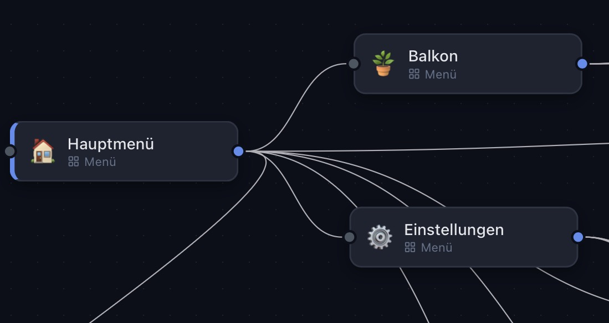
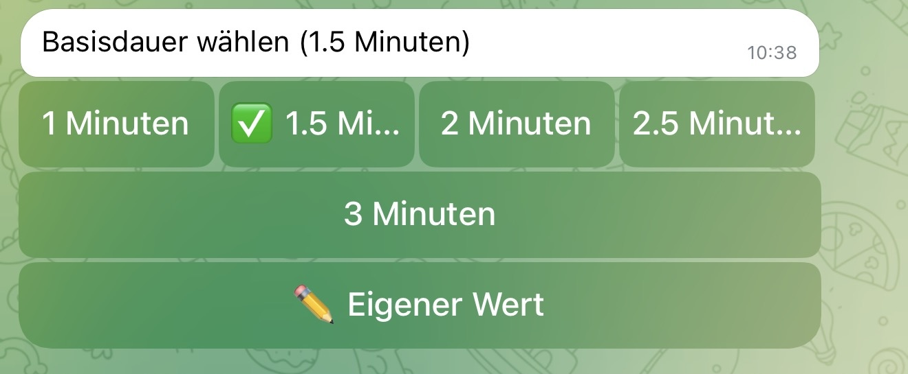
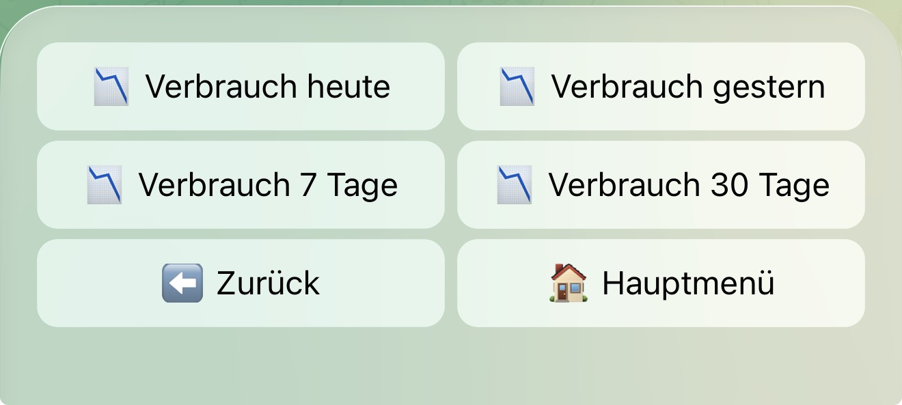
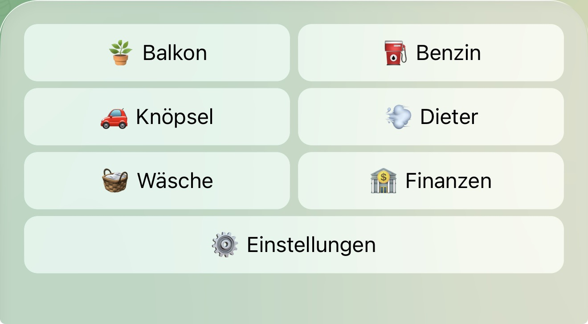

# ioBroker.telegrammenu2

[](https://www.npmjs.com/package/iobroker.telegrammenu2)
[](https://opensource.org/licenses/MIT)

A self-contained Telegram bot adapter for ioBroker, built around a **visual, no-code menu editor**. Design your bot's menus, buttons, and notifications by dragging nodes on a canvas - no scripting required for most use cases.



## Why this exists

Building a Telegram bot for your smart home usually means writing (and maintaining) a pile of `sendTo()` calls, keyboard layouts, and command-routing logic by hand. This adapter turns that into a visual graph: menus are nodes, buttons are their children, and the whole tree exports straight into the adapter's registry. Change something in the editor, hit save, done.

## Features

- **Visual node editor** - a full [React Flow](https://reactflow.dev/) graph editor running as its own ioBroker Admin tab. Build your menu tree, wire up buttons, connect to a live ioBroker instance to load/save, or export/import as JSON.
- **Six button types**, all wired up in the editor without code:
  - **Menu** - a container of buttons, optionally with a dynamic title (from a script or a live datapoint), an image, or a permission requirement
  - **Toggle / Number / Text input** - bound directly to a datapoint (on/off, fixed value, numeric keypad, or free-text entry)
  - **Action** - the standard back / main-menu / cancel navigation buttons
  - **Command** - calls a script (via `onMessage`) or fires an HTTP request, with optional Basic Auth
  - **Multi-status** - a single button that cycles through more than two states, each with its own emoji, label, and target datapoint/value
- **Auto-generated menus** - user management, notification preferences, and notification pausing are built in and update themselves automatically; no manual button wiring needed
- **Percent-step / number-range pickers** - pick a value from an inline keyboard (with the current value marked ✅) or tap "custom value" to enter one via a real numeric keypad, including decimals

  

- **Message templates** - `{{datapoint.id}}` placeholders resolve to live values anywhere in a button's text or confirmation message, including inline math (`{{datapoint.id / 60}}`) and automatic boolean/date formatting
- **Status-dependent icons** - a menu or button's emoji can change based on a datapoint's current value/rules, including comparison operators (see below)
- **Permission system** - per-button/per-menu permissions, a user approval gate for new Telegram users, and an admin menu to manage roles and rights (see "Users & Permissions" below)
- **Notification engine** - `sendTo('telegrammenu2.0', 'notify', { area, type, text })` with per-area/per-type user preferences, grouping of rapid-fire notifications, snooze/pause per area, and optional HTML formatting or link-preview suppression
- **Event listeners** - watch any datapoint and automatically push an interactive menu to every authorized user when a condition matches (value, comparison operator, optional `ack` check)
- **Script bridge** - any `javascript.0` script can register an `onMessage` handler and return `{ text, html, noPreview, menuKey, awaitReply }` to answer a button press, ask a follow-up question, or jump to another menu

## Global settings

A handful of settings apply adapter-wide and live as plain fields on the **`main`** menu (the one with `menuKey: "main"`) - set them via the "Global settings" section on that node in the editor:

| Field | Default | Effect |
|---|---|---|
| `buttonsPerRow` | `2` | How many buttons per row for auto-wrapped keyboards (regular menus and auto-menus like the user list) |
| `groupingEnabled` | `true` | Whether rapid-fire notifications of the same type get bundled into one message |
| `groupableExcludeTypes` | `['warn', 'error']` | Notification types that are always sent immediately, never bundled |
| `boolTranslateEnabled` | `true` | Whether `true`/`false` values resolved via `{{datapoint.id}}` get translated |
| `boolTrueText` / `boolFalseText` | `✅ an` / `⛔ aus` | The translated text for `true`/`false` |
| `dateTranslateEnabled` | `true` | Whether ISO date/time values resolved via `{{datapoint.id}}` get reformatted |
| `dateFormat` / `dateTimeFormat` | `DD.MM.YYYY` / `DD.MM.YYYY HH:mm` | The output format for date-only vs. date+time values |

## Users & Permissions

Every Telegram user who messages the bot is auto-registered on first contact with role `guest` and `approved: false` - they see a "waiting for approval" message and nothing else until an admin approves them (via an inline button that appears automatically in the admins' chat). Once approved, permissions are per-user boolean flags (`users.<key>.permissions.<name>`), checked against whatever string you put in a menu's or button's `perm` field:

```javascript
{ text: '🔥 Heating', cmd: 'TG:NAV:HEATING', nextMenu: 'heating_main', perm: 'heating' }
```

Permission and area names may contain any characters (e.g. umlauts); the object ids use an ASCII version (`Wäsche` → `users.<key>.permissions.Waesche`).

A user only sees/can use this if `users.<theirKey>.permissions.heating` is `true`. The special value `perm: 'admin'` instead checks the user's `role` field directly (`users.<key>.role === 'admin'`) rather than a named permission. Admins get a built-in "👤 Users" auto-menu (`source: 'users'`) to toggle any user's individual permissions and role without touching states by hand.

## Advanced examples

**Custom confirmation text** on a percent-step/number-range menu (`confirmMessage` field, separate from the menu's normal opening text) - `{value}` and `{unit}` are substituted with whatever was just set:

```
🌡️ Target temperature set to {value}{unit}.
```

**Sending a notification with HTML formatting and no link preview:**

```javascript
sendTo('telegrammenu2.0', 'notify', {
  area: 'Heating',
  type: 'info',
  text: '<b>Boiler restarted</b>\nSee https://your-dashboard.example for details.',
  extra: 'html,nopreview',
});
```

**Auto-opening a menu when a datapoint crosses a threshold** (`trigger` field on any menu):

```javascript
trigger: { datapoint: '0_userdata.0.Heating.error', value: 'true', ackOnly: true }
```

Pushes that menu to every user with permission for it, the moment the datapoint reports `true` with `ack: true`. `value` supports comparison operators too (`>25`, `<=10`, etc.) - used the same way for status-dependent icons:

```javascript
icon: {
  datapoint: '0_userdata.0.Car.batterySoc',
  rules: [{ value: '<25', emoji: '⚡️' }],
  fallback: '🚗',
}
```

## How it works

```
Telegram ⇄ ioBroker.telegram ⇄ telegrammenu2 (this adapter) ⇄ your scripts/datapoints
```

The adapter listens to your existing `telegram.x` instance's incoming-message state, matches the text or `callback_data` against the menu currently open for that chat, and either:
- **handles it directly** (writes to a datapoint, shows a submenu, runs an HTTP request), or
- **calls out to a script** you registered via `onMessage`, and sends back whatever text/menu it returns.

Menus are stored as plain JSON objects, one per key, under the adapter's own `registry.*` states - this is exactly what the visual editor reads and writes. You can also hand-edit or import this JSON directly (see `registryExample.json`).

## Quick start

1. Install the adapter, point it at your existing Telegram adapter instance (`native.telegramInstance`, default `telegram.0`).
2. Open the **Menu Editor** tab in ioBroker Admin. On first start, a minimal default registry is imported automatically (a main menu linking to Settings → Users / Notifications).
3. Add a **Menu** node, wire up some **Toggle**/**Command** buttons under it, hit **"Save to ioBroker"**.
4. Message your bot with `/start`.

See `registryExample.json` for a worked example (a weather button with a message template, a sub-menu with datapoint-bound controls, and a status-dependent icon) - import it via the editor's "Import JSON" button to try it out.

A sub-menu - reached via the main menu, with a "back"/"main menu" combo button at the end:



...reached from a main menu like this one:



## Building your own script-backed buttons

Any `Command`-type button can call a script instead of (or in addition to) writing a datapoint directly:

```javascript
// in a javascript.0 script
onMessage('TG:WEATHER:SHOW', (data, callback) => {
  const temp = getState('0_userdata.0.Weather.temperature').val;
  callback({ text: `🌤️ It's currently ${temp}°C outside.` });
});
```

No registration call needed - just set the script's ID and the command string on the button in the editor. The callback can also return `html: true`, `noPreview: true`, `awaitReply: true` (to ask a follow-up question), or `menuKey` (to jump straight into another menu).

## Requirements

- Node.js >= 22 (uses the built-in `fetch` for the HTTP-request buttons)
- ioBroker Admin >= 8 (the editor is a JSON tab with a custom component)
- js-controller >= 6.0.11
- An existing, configured `iobroker.telegram` instance

## Development

The editor source is in `src-admin`. `npm run build` builds it into `admin/custom`.

## Changelog

### 0.3.2
- Removed: instance field in the editor (the adapter is a singleton)
- Changed: updated icon library (lucide-react 1)

### 0.3.1
- Fixed: admin tab type is now `json`
- Changed: Dependabot also checks `src-admin`

### 0.3.0
- New: object browser for datapoint fields and placeholders in the editor
- Changed: editor is built from source (`src-admin`) as a JSON tab with a custom component, requires Admin 8
- Changed: editor follows the Admin theme
- Fixed: objects with `common.custom` settings are no longer deleted (menu reset/delete, user deny, ID migration); the migration carries the settings over to the new ID
- Fixed: registry changes made by the adapter itself no longer trigger a redundant trigger rescan
- Changed: updated `@iobroker/testing` to 6.3.2

### 0.2.5

- New: `info.connection` mirrors the telegram instance connection
- New: light and dark theme in the editor, calmer look
- Changed: object ids are ASCII only and unique regardless of case, existing objects are migrated on start
- Changed: notification types are shown translated
- Changed: message type detection uses English keywords, `[type]` and `::notify::type::` markers still work
- Changed: `{status}` gets a space before it
- Changed: `common.singleton` is set, code moved from `core/` to `lib/`
- Fixed: remaining German texts in bot and editor (11 languages), back/main menu language
- Removed: unused plugin loader

### 0.2.3

- Repository maintenance: npm Trusted Publishing (OIDC) configured, no functional changes

### 0.2.2

- Repository maintenance: official ioBroker CI setup (linting, unit/integration/package tests), consistent versioning across package.json/io-package.json/git tags, corrected admin config schema, and release-script configuration

### 0.2.0

- Added percent-step/number-range value pickers (inline keyboard with the current value marked, plus a numeric-keypad "custom value" option supporting decimals)
- Added event listeners: automatically push a menu to authorized users when a datapoint condition matches
- Added HTTP-request buttons (with optional Basic Auth)
- Added multi-status buttons (more than two states, each with its own emoji/label/target)
- Added an adjustable "buttons per row" global setting
- Fixed status-dependent icons on menus not supporting comparison operators (e.g. `<25`) the way button icons already did
- Public-release cleanup: removed the legacy JS-adapter compatibility bridge and demo/example content, generic example registry, English README
- Fixed a compact-mode safety issue where event-trigger state was stored at module scope instead of per adapter instance

### 0.1.0

- Initial version: visual node editor, menu/button system, notification engine with permissions, and script bridge

Older entries: see CHANGELOG_OLD.md.

## License

MIT License

Copyright (c) 2026 backfisch88 <henrik.schoenhofen@icloud.com>

Permission is hereby granted, free of charge, to any person obtaining a copy
of this software and associated documentation files (the "Software"), to deal
in the Software without restriction, including without limitation the rights
to use, copy, modify, merge, publish, distribute, sublicense, and/or sell
copies of the Software, and to permit persons to whom the Software is
furnished to do so, subject to the following conditions:

The above copyright notice and this permission notice shall be included in all
copies or substantial portions of the Software.

THE SOFTWARE IS PROVIDED "AS IS", WITHOUT WARRANTY OF ANY KIND, EXPRESS OR
IMPLIED, INCLUDING BUT NOT LIMITED TO THE WARRANTIES OF MERCHANTABILITY,
FITNESS FOR A PARTICULAR PURPOSE AND NONINFRINGEMENT. IN NO EVENT SHALL THE
AUTHORS OR COPYRIGHT HOLDERS BE LIABLE FOR ANY CLAIM, DAMAGES OR OTHER
LIABILITY, WHETHER IN AN ACTION OF CONTRACT, TORT OR OTHERWISE, ARISING FROM,
OUT OF OR IN CONNECTION WITH THE SOFTWARE OR THE USE OR OTHER DEALINGS IN THE
SOFTWARE.