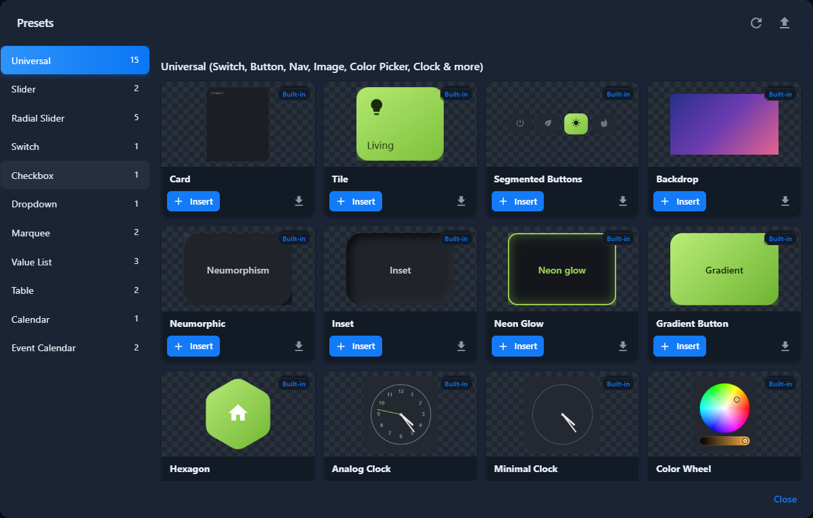

> 🌐 **English** | [Deutsch](https://github.com/inventwo/ioBroker.vis-2-widgets-inventwo/blob/master/docs/de/design-presets.md)

# Presets

Presets let you save the look of a widget once and reuse it on other widgets — in the same view, in other views, or in other projects. Presets can also be exported as a file and shared with other users.

Presets are available for **all inventwo widgets**: Universal, Slider, Radial Slider, Switch, Checkbox, Dropdown, Marquee, Value List, Table, Calendar and Event Calendar. A preset always belongs to **one widget type** and can only be applied to widgets of that type (a Slider preset cannot be applied to a Switch).

A preset only contains the **design** of a widget, never its function or content. Datapoints (Object IDs), values, texts, icons, images, views and actions are never transferred. Which attributes count as design for each widget type is listed in [What Is Transferred per Widget](#what-is-transferred-per-widget).

Presets and [themes](/#/docs/adapterref/iobroker.vis-2-widgets-inventwo/docs/en/themes.md) share the work: a preset sets the **form** of a widget (layout, sizes, spacing, font sizes, shape, angles, feedback), a theme its **look** (colors, corners, border, shadow, font). See [Presets on theme-coupled widgets](#presets-on-theme-coupled-widgets).

---

## Where to Find It

There are two places:

- **Attribute group** — select an inventwo widget in the VIS 2 editor. The group **inventwo - Presets** is located below the general group, directly after the group **inventwo - Theme** ([Themes](/#/docs/adapterref/iobroker.vis-2-widgets-inventwo/docs/en/themes.md)). Here you save, apply, copy and paste the design of the selected widget(s).
- **Palette entry** — in edit mode, the inventwo widget set in the widget palette on the left contains the entry **Presets**. It opens a gallery with the presets of all widget types (see [Preset Gallery](#preset-gallery)).

---

## Built-in Presets

The adapter ships with ready-made presets for all widget types, one per form, named after it: e.g. **Card**, **Tile**, **Segmented Buttons**, **Neumorphic** and **Hexagon** for the Universal widget, **Thermostat** and **Needle Gauge** for the Radial Slider, **Table** and **Striped Table** for the Table. There are no color variants: the colors come from a [theme](/#/docs/adapterref/iobroker.vis-2-widgets-inventwo/docs/en/themes.md). Applied to a widget that is not coupled to a theme, a built-in preset brings its own colors along. They are marked with the label **Built-in** and are listed before your own presets: in the dropdown under **Built-in presets**, followed by **My presets**.

- Built-in presets can be **applied**, **exported** and **added to a view** from the gallery, exactly like your own presets.
- They are **read-only**: they cannot be deleted or overwritten.
- Their names are **reserved** per widget type (regardless of upper/lower case). Saving a preset under such a name is not possible; choose another name. When importing a file, a preset with the name of a built-in preset is imported with a suffix like ` (2)`.
- They are part of the adapter, not of the file `design-presets.json`, and they are **updated with adapter updates**. To keep a modified version, apply the built-in preset to a widget, change it and save it under a new name.
- If your own presets cannot be loaded (e.g. the file storage is not reachable), the built-in presets are still shown together with the error message.

### Templates with a basic setup
Some built-in presets are **templates**: besides the design they bring a matching basic setup, e.g. type, mode, content type or value range. Datapoints, passwords, URLs and views are never part of it; select them afterwards as usual.

| Widget | Template | Basic setup |
|---|---|---|
| Universal | **Analog Clock**, **Minimal Clock** | Type "Read only", content analog clock |
| Universal | **Color Wheel**, **White Tone** | Type "Read only", content color picker (color wheel or white tone slider), color model hex |
| Universal | **Plus/Minus Buttons** | Type "Increase/decrease value", two separate buttons −1 / +1 |
| Universal | **Popup Tile** | Type "View in dialog", closes on click outside |
| Universal | **Segmented Buttons** | Separate buttons with three states |
| Slider | **Shutter** | Vertical shutter slider 0–100 |
| Radial Slider | **Thermostat** | 5–30 °C in steps of 0.5 |
| Radial Slider | **Half Gauge** | Half-circle gauge, read only |
| Radial Slider | **Progress Ring** | Progress ring 0–100 %, read only |
| Radial Slider | **Dimmer Ring** | Dimmer 0–100 % |
| Marquee | **Vertical Ticker** | Text scrolling from bottom to top |
| Event Calendar | **Agenda** | List view of the week |

- **Insert** from the gallery creates the widget with design, basic setup and a matching **start size**.
- **Apply** on an existing widget also sets the basic setup, so it changes e.g. the type or value range. The status message says so. Undo works as usual.
- The white tone slider of **White Tone** writes the color value (hex) of the white tone, not a Kelvin number.
- Your own presets only contain the design, never a basic setup.

---

## The Attribute Group

The group shows a **Preset** dropdown with the [built-in presets](#built-in-presets) and all saved presets of this widget type, each with a small preview picture. Below the dropdown the preview of the selected preset is shown. The actions are compact icon buttons in one row, grouped by thin separator lines: **Apply · Save as preset · Delete** | **Copy design · Paste design** | **Import · Export · Export all**. If the attribute panel is too narrow, a whole group moves to the next line. Hover over a button to see its name.

| Button | What it does |
|---|---|
| **Apply** | Applies the selected preset to all selected widgets. |
| **Save as preset** | Asks for a name and saves the design of the selected widget together with a preview picture. If one of your presets with that name already exists, it is overwritten after a warning. Names of built-in presets cannot be used. |
| **Delete** | Deletes the selected preset (after confirmation). Only your own presets can be deleted. |
| **Copy design** | Copies the design of the selected widget without saving a preset (see below). |
| **Paste design** | Pastes the copied design into all selected widgets. |
| **Import** | Imports presets from a `.json` file, e.g. from an export or shared by another user. |
| **Export** | Downloads the selected preset as a `.json` file. |
| **Export all** | Downloads all **own** presets of this widget type as one `.json` file. Built-in presets are not included, as they ship with the adapter anyway; a single built-in preset can be exported with **Export**. |

### Quick copy between widgets
For a one-off transfer you don't need to save a preset:

1. Select the widget whose design you want to copy and click **Copy design**.
2. Select one or more target widgets of the same type and click **Paste design**.

The copied design is kept in the browser's local storage (one per widget type), so it is only available in this browser.

### Presets on theme-coupled widgets
If a widget is coupled to a [theme](/#/docs/adapterref/iobroker.vis-2-widgets-inventwo/docs/en/themes.md), **Apply** and **Paste design** leave out every field the theme controls for that widget (colors, corners, border, shadow; see the token table in the theme documentation). The widget gets the form of the preset and keeps the look of its theme; own values you set in these fields stay as they are. The status message says so. Widgets that are not coupled get the complete design. With several selected widgets, the theme fields are left out for all of them as soon as one of them is coupled.

Saving a preset and inserting a widget from the gallery are not affected.

### Multiple widgets at once
**Apply** and **Paste design** work on all currently selected widgets of the same type. Select several widgets in the editor and apply the design to all of them in one step.

**Save as preset** and **Copy design** require exactly **one** selected widget.

### Preview pictures
When a preset is saved, a small picture of the widget is taken and stored with the preset. It shows only the widget itself: the view background and the background, border and shadow from the **CSS** tab are left out, as the preset does not transfer them either. It is shown in the dropdown, below the dropdown and in the gallery. The picture is only an orientation aid and may differ slightly from the real widget:

- text may be drawn in a fallback font, because fonts are not embedded,
- pseudo-elements (`::before`/`::after`) are not captured,
- images from other servers may be missing.

If no picture can be created, the preset is saved anyway — without a preview.

---

## Preset Gallery

Click **Presets** in the inventwo widget set of the palette (edit mode). A dialog opens with the widget types on the left (with the number of presets each) and the presets of the selected type on the right, each as a card with preview picture and name. The gallery opens on the type you looked at last. Built-in presets carry the label **Built-in**; your own presets also show their save date.

| Action | What it does |
|---|---|
| **Insert** | Adds a new widget of the preset's type to the currently selected view. It gets the design of the preset, for [templates](#templates-with-a-basic-setup) also their basic setup and start size; all other attributes get their normal default values. Then select the datapoint, texts etc. as usual. |
| **Export** (icon) | Downloads this preset as a `.json` file. |
| **Delete** (icon) | Deletes this preset (after confirmation). Only shown for your own presets. |
| **Refresh** (icon in the title) | Reloads the list, e.g. after presets were saved in another browser tab. |
| **Import** (icon in the title) | Imports presets from a `.json` file for **all** widget types it contains, e.g. an export with presets of several widget types. Afterwards the gallery shows the first widget type that got presets. |

New presets are saved in the attribute group of a widget.

---

## What Is Transferred per Widget

In general: datapoints, values, texts, icons, images, views and actions are **never** part of a preset. The tables list the design attributes and notable settings that are deliberately left out.

### Universal Widget
| Transferred | Not transferred |
|---|---|
| Colors, borders, shadows (incl. additional layers), spacing, corners, shape, alignment, transparency, text style | Type, mode, number of states and state values |
| Default colors and state colors per state number, content size and mirroring per state | Texts, icons, images |
| Hover and click feedback (colors, duration) | Views, actions, passwords/PINs |
| Content position, size, rotation, mirroring, image fit | Content type |
| Look of the analog clock, the color picker and the dialog (size, position, background, title, close button, corners) | Content of the dialog (view) |
| Layout of separated buttons (direction, size, spacing) | |

### Slider
| Transferred | Not transferred |
|---|---|
| Track (colors, bar type, width, corners, shadow) | Min, max, step |
| Thumb (color, size, corners, shadow) | Color zones themselves (number, from values, colors) — their thresholds depend on min/max |
| Orientation, title spacing, min/max display, value label display | Step mode and custom steps |
| Display of step marks (show, inside, above) | Title, unit, read-only |
| Coloring mode and transition of color zones | |

### Radial Slider
| Transferred | Not transferred |
|---|---|
| Start and end angle | Min, max, step |
| Track and thumb (colors, width/size, shadow) | Scale interval |
| Size and color of value and label | Color zones themselves (number, from values, colors) — their thresholds depend on min/max |
| Scale (ticks, minor ticks, labels, colors) and needle | Value display (show value, decimals, unit, label, second datapoint, last change) |
| Coloring mode and transition of color zones, zone color for the value | Read-only |

### Switch
| Transferred | Not transferred |
|---|---|
| Track and thumb (colors off/on, size, corners, shadow) | True/false values |
| Text position | Texts |

### Checkbox
| Transferred | Not transferred |
|---|---|
| Box color, active color, box size | True/false values |
| Text position | Texts |

### Dropdown
| Transferred | Not transferred |
|---|---|
| Font size, text, background, highlight and border colors, border width, corners | Options (state list and custom options) |
| Title style (font size, color, padding, background from condition) | Background conditions |
| Shadow of the list and of the widget | Show value/text, read-only, title |

### Marquee
| Transferred | Not transferred |
|---|---|
| Direction, speed, text repetition, gap, background color | Text |
| | Pause on hover |

### Value List
| Transferred | Not transferred |
|---|---|
| Bullet type, custom bullet, bullet color and spacing | Manual text, separator |
| Line spacing, padding | Trimming, ignoring empty entries |

### Table
| Transferred | Not transferred |
|---|---|
| Header and row colors (odd/even), heights of header, rows and pagination | Columns and all column settings |
| Header and row lines | Row color conditions |
| Corners, border, outer shadow | Sorting, pagination, max rows, header/sum row display |
| Sticky header | |

### Calendar
| Transferred | Not transferred |
|---|---|
| Colors of header, weekdays, days, selected day, today and week numbers | Format, read-only, disable past/future |
| Day size, corners, shadow of the selected day | Navigation, first day of week, week numbers display |
| Highlighting of today | |

### Event Calendar
| Transferred | Not transferred |
|---|---|
| Header (text and buttons), weekdays, days, weekends, week numbers | Color rules |
| Today and now indicator | Calendar sources and legend |
| Events (colors, corners, font size), borders | View, navigation, first day of week, week numbers display, max events per day |

---

## Good to Know

### "From widget" references
If a design group of the source widget uses **From widget** (style taken from another widget), the preset stores the effective values of the referenced widget — so the preset looks exactly like the source widget.

When a preset is applied, the **From widget** references of the design groups are removed on the target widget. Otherwise the referenced widget would still override the preset and its look would not take effect. For states this only happens for the state numbers the preset contains colors for; other states keep their reference.

### Bindings are not stored
Values with vis bindings (e.g. `{...}` in a color field) are not stored in the preset, because they refer to datapoints.

### States (Universal Widget)
State colors are stored per state number (state 1, state 2, …). The number of states is not part of the design:

- If the target widget has **fewer** states, no states are added. The colors of the missing states are still stored in the widget and show up as soon as you add these states.
- If the target widget has **more** states, the additional states keep their own colors.

### CSS tab
Settings from the vis **CSS** tab (e.g. font size or font family) are not part of a preset. Only the inventwo attributes are transferred.

The reason: the interface vis-2 provides for attribute fields of a widget set can only change the widget's attributes, not its CSS settings. Including them would require workarounds outside the official interface.

---

## Storage and Backup

Presets are stored on the ioBroker server in the file `design-presets.json` in the file storage of the instance `vis-2-widgets-inventwo.0`. This means:

- they are available in **all projects** and for **all users** of the editor,
- they are included in a normal ioBroker backup.

Built-in presets are not stored in this file; they are part of the adapter.

---

## Export and Import

The export file is a JSON file (format id `inventwo-design-presets`, with a format version) and contains the preview pictures. Please don't edit it by hand.

When importing in the attribute group of a widget, only presets for this widget type are imported. The import in the [gallery](#preset-gallery) takes the presets of all supported widget types; presets of unknown widget types are skipped. In both cases:
- only design attributes are taken over — everything else in the file is ignored,
- a preset with the same name is replaced,
- a preset with the name of a built-in preset gets a suffix like ` (2)` instead,
- files larger than 1 MB are rejected, and at most 500 presets per file are read,
- values longer than 2000 characters are dropped,
- preview pictures are only taken over as PNG data URLs.

---

## See Also

- [Universal Widget](/#/docs/adapterref/iobroker.vis-2-widgets-inventwo/docs/en/widgets/universal-widget.md)
- [Themes](/#/docs/adapterref/iobroker.vis-2-widgets-inventwo/docs/en/themes.md) — couple widgets to a shared, script-controllable theme
- [Styling and Shapes](/#/docs/adapterref/iobroker.vis-2-widgets-inventwo/docs/en/widgets/universal/styling-and-shapes.md) — all style groups of the Universal Widget