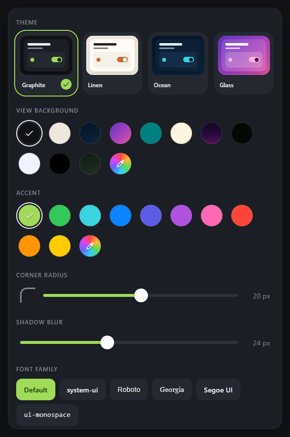
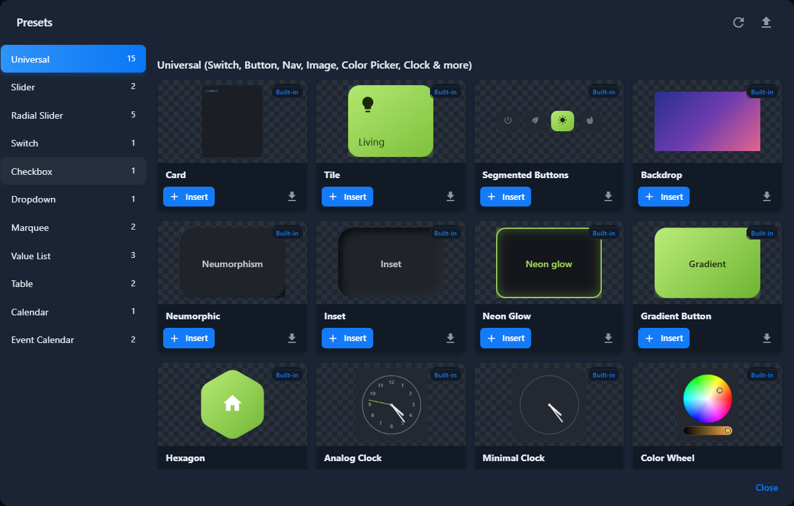
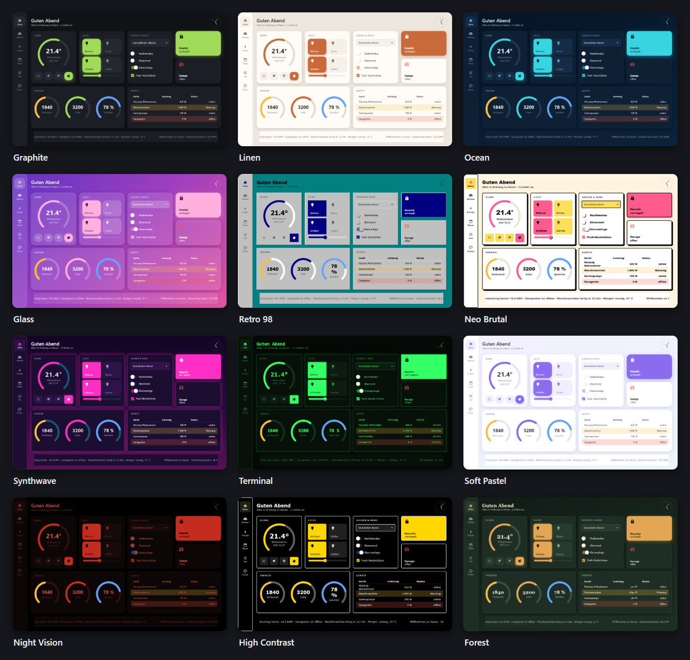

> 🌐 **English** | [Deutsch](https://github.com/inventwo/ioBroker.vis-2-widgets-inventwo/blob/master/docs/de/index.md)

# inventwo Widgets for ioBroker VIS 2 — User Guide

Welcome to the inventwo widget documentation. This guide explains how to use each widget in the VIS 2 editor to build your own smart home dashboards.

## What are inventwo widgets?

The inventwo widget set adds highly customizable tiles, controls, and display elements to VIS 2. All styling is done directly in the VIS 2 editor sidebar — no CSS knowledge required.

---

## Widget Overview

### Universal Widget
**The most powerful widget in the set.** One tile that can act as a button, switch, navigation link, dialog opener, or read-only status display — and changes its appearance depending on the datapoint value.

→ [Universal Widget](/#/docs/adapterref/iobroker.vis-2-widgets-inventwo/docs/en/widgets/universal-widget.md)

---

### Slider
**A horizontal or vertical slider for numeric values.** Drag the thumb to set a value, e.g. brightness, temperature, or volume. Fully styled — rail color, active color, thumb shape, and step marks.

→ [Slider Widget](/#/docs/adapterref/iobroker.vis-2-widgets-inventwo/docs/en/widgets/slider-widget.md)

---

### Radial Slider
**A circular arc slider for numeric values.** Works the same as the regular slider but is displayed as a round dial, great for thermostat-style tiles.

→ [Radial Slider Widget](/#/docs/adapterref/iobroker.vis-2-widgets-inventwo/docs/en/widgets/radial-slider-widget.md)

---

### Switch
**A toggle switch for on/off or any two-state datapoint.** Looks like a classic on/off switch. Track and thumb are independently styled.

→ [Switch Widget](/#/docs/adapterref/iobroker.vis-2-widgets-inventwo/docs/en/widgets/switch-widget.md)

---

### Checkbox
**A checkbox for on/off or any two-state datapoint.** Simpler than the switch — just a checkbox with a label.

→ [Checkbox Widget](/#/docs/adapterref/iobroker.vis-2-widgets-inventwo/docs/en/widgets/checkbox-widget.md)

---

### Table
**Displays a JSON array datapoint as a formatted table.** Sort columns, filter rows, highlight rows by value, and format cells as text, numbers, dates, or images.

→ [Table Widget](/#/docs/adapterref/iobroker.vis-2-widgets-inventwo/docs/en/widgets/table-widget.md)

---

### Dropdown
**A dropdown menu that reads its options from an ioBroker object's state list.** Select a value and it is written back to the datapoint.

→ [Dropdown Widget](/#/docs/adapterref/iobroker.vis-2-widgets-inventwo/docs/en/widgets/dropdown-widget.md)

---

### Marquee
**Scrolling text from a datapoint or manually entered text.** Useful for news tickers, status messages, or long labels that don't fit in a fixed space.

→ [Marquee Widget](/#/docs/adapterref/iobroker.vis-2-widgets-inventwo/docs/en/widgets/marquee-widget.md)

---

### Value List
**Splits a text value into a formatted bullet list.** Great for displaying comma-separated or newline-separated values as a readable list.

→ [Value List Widget](/#/docs/adapterref/iobroker.vis-2-widgets-inventwo/docs/en/widgets/value-list-widget.md)

---

### Calendar
**A full month calendar view.** Works as a datepicker (read and write a date), a read-only date display, or a today-highlighter — freely combinable, with full color and layout customization.

→ [Calendar Widget](/#/docs/adapterref/iobroker.vis-2-widgets-inventwo/docs/en/widgets/calendar-widget.md)

---

### Event Calendar
**Shows events in a Google-Calendar-style view.** Month, week, day, multi-month and list views, several calendars at once with a legend, and color rules by event title. Reads the JSON of the ioBroker **ical** adapter directly.

→ [Event Calendar Widget](/#/docs/adapterref/iobroker.vis-2-widgets-inventwo/docs/en/widgets/event-calendar-widget.md)

---

### Theme Customizer
**Lets users change the look at runtime.** Theme cards for all themes, view background, colors with suggestions and a color picker, corners, border, shadow and font, e.g. on a wall tablet — for all devices or only the current one.

→ [Theme Customizer Widget](/#/docs/adapterref/iobroker.vis-2-widgets-inventwo/docs/en/widgets/theme-customizer-widget.md)

---

## Presets

Ready-made forms for every widget — cards, tiles, segmented buttons, clocks, color wheel, gauges, rings, agenda and more. The **Presets** entry in the widget palette shows them with preview pictures and adds a new widget to the view with one click; templates such as **Analog Clock** or **Progress Ring** also set up the widget, so you only pick the datapoint. Save your own presets, apply them to many widgets at once, copy and paste designs, or export and import them as a file. Datapoints, texts and actions are never transferred.

→ [Presets](/#/docs/adapterref/iobroker.vis-2-widgets-inventwo/docs/en/design-presets.md)

---

## Themes

Couple widgets to a theme — a shared set of colors, corners, border, shadow and font — and restyle the whole dashboard in one place. Twelve themes are built in, and the theme manager lets you create your own.

 Every theme value is a datapoint, so scripts can switch between a light and a dark theme or change the accent color. The values are also available as CSS variables, e.g. `var(--iw-background)` as view background (see [View background that follows the theme](/#/docs/adapterref/iobroker.vis-2-widgets-inventwo/docs/en/themes.md#view-background-that-follows-the-theme)).

→ [Themes](/#/docs/adapterref/iobroker.vis-2-widgets-inventwo/docs/en/themes.md)

---

## Coming from vis-1?

The adapter settings contain an assistant that converts the old widgets of the vis-1 adapter **vis-inventwo** in an imported project into the widgets of this set.

→ [Migrating inventwo vis-1 widgets](/#/docs/adapterref/iobroker.vis-2-widgets-inventwo/docs/en/migration.md)

---

## Where to Start

- **Building a control panel with buttons?** → [Universal Widget](/#/docs/adapterref/iobroker.vis-2-widgets-inventwo/docs/en/widgets/universal-widget.md)
- **Controlling a dimmer or temperature?** → [Slider Widget](/#/docs/adapterref/iobroker.vis-2-widgets-inventwo/docs/en/widgets/slider-widget.md) or [Radial Slider Widget](/#/docs/adapterref/iobroker.vis-2-widgets-inventwo/docs/en/widgets/radial-slider-widget.md)
- **Simple on/off controls?** → [Switch Widget](/#/docs/adapterref/iobroker.vis-2-widgets-inventwo/docs/en/widgets/switch-widget.md) or [Checkbox Widget](/#/docs/adapterref/iobroker.vis-2-widgets-inventwo/docs/en/widgets/checkbox-widget.md)
- **Displaying tabular data?** → [Table Widget](/#/docs/adapterref/iobroker.vis-2-widgets-inventwo/docs/en/widgets/table-widget.md)
- **Picking or displaying a date?** → [Calendar Widget](/#/docs/adapterref/iobroker.vis-2-widgets-inventwo/docs/en/widgets/calendar-widget.md)
- **Showing events or appointments?** → [Event Calendar Widget](/#/docs/adapterref/iobroker.vis-2-widgets-inventwo/docs/en/widgets/event-calendar-widget.md)
- **Selecting a mode or scene?** → [Dropdown Widget](/#/docs/adapterref/iobroker.vis-2-widgets-inventwo/docs/en/widgets/dropdown-widget.md)
- **One look for all widgets, light and dark?** → [Themes](/#/docs/adapterref/iobroker.vis-2-widgets-inventwo/docs/en/themes.md)