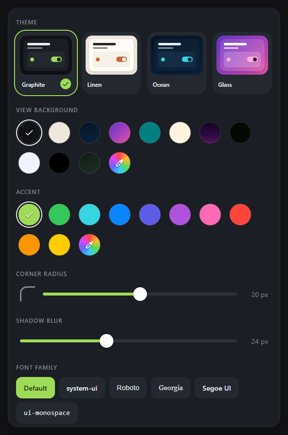

> 🌐 **English** | [Deutsch](https://github.com/inventwo/ioBroker.vis-2-widgets-inventwo/blob/master/docs/de/widgets/theme-customizer-widget.md)

# Theme Customizer Widget

The Theme Customizer widget lets users change the look of the dashboard at runtime — for example on a wall tablet: switch the active [theme](/#/docs/adapterref/iobroker.vis-2-widgets-inventwo/docs/en/themes.md) and adjust its values — colors, corners, border, shadow and font. You decide which values the widget offers. All widgets coupled to the active theme follow immediately. The widget styles itself with the active theme, like every other coupled card: surface, text color, corners, border, shadow and font.

---

## How to Add the Widget

1. Open the theme manager once (button **Themes** in the inventwo widget set of the palette), so the [built-in themes](/#/docs/adapterref/iobroker.vis-2-widgets-inventwo/docs/en/themes.md#built-in-themes) are created.
2. Drag **Theme Customizer** from the **inventwo design** widget list onto your view.
3. Choose under **Apply changes to** whether a selection applies to all devices or only to the device it is made on.
4. Couple your other widgets to **Active theme** in the group **inventwo - Theme** (see [Coupling a Widget](/#/docs/adapterref/iobroker.vis-2-widgets-inventwo/docs/en/themes.md#coupling-a-widget)).

In edit mode the widget shows its content but does not change anything. Try it in the runtime.

---

## Sections

| Section | What it does |
|---|---|
| **Theme** | One card per theme with a small preview. Tap a card to make this theme the active theme. |
| **Colors** (accent, view background, surface, text, border color, shadow color, …) | Round color chips with suggestions. Tap one to set this color in the active theme. The last button (rainbow, pipette) opens a color picker for an own color, including opacity: while dragging, the coupled widgets follow live. |
| **Numbers** (corner radius, border width, shadow offset, blur and spread) | Slider with the value in px. |
| **Border style** | Buttons: None, Solid, Dashed, Dotted, Double, Groove, Ridge, Inset, Outset. |
| **Font** | Buttons with font suggestions, each shown in its own font. **Default** = font of the view. |

Accent color and corner radius are shown by default; every other value is switched on in the widget settings (see [Customizer groups](#customizer-groups)). The values appear in the order of the theme manager.

> **Theme values always apply to all devices:** colors, corners, border, shadow and font change the values (datapoints) of the theme itself, regardless of the setting **Apply changes to**.

---

## Settings

### Common

| Setting | What it does |
|---|---|
| **Title** | Optional title above the sections. |
| **Apply changes to** | Where the selected theme is stored. **All devices** (default): in the datapoint `vis-2-widgets-inventwo.0.themes.active`. **This device only**: in the browser of this device; it overrides the global theme there. **User chooses**: the widget shows a switch **This device only**, so the user decides. Switching it on keeps the current theme on this device; switching it off follows the global theme again. |

### Sections

| Setting | What it does |
|---|---|
| **Show themes** | Shows the theme cards. Default: on. |
| **Theme filter** | Dropdown with all themes: check the themes that should appear as cards. No selection = all themes. Deleted themes stay marked as "Unknown theme" until you uncheck them. |
| **Offer color picker** | Adds a color picker button to every color. Off = only the suggestions can be chosen. Default: on. |

### Customizer Groups

The groups **Customizer: Colors**, **Customizer: Shape**, **Customizer: Border**, **Customizer: Shadow** and **Customizer: Font** contain one checkbox per theme value (same names as in the theme manager). A checked value is shown in the widget.

| Setting | What it does |
|---|---|
| **Suggestions** (every color) | Semicolon-separated CSS colors, e.g. `#ff9800;rgb(0,150,255);rgba(0,0,0,0.4)`. Empty = default suggestions: ten colors for the accent, the values of all themes for every other color. |
| **Fonts** (font) | Semicolon-separated CSS font families, e.g. `Roboto, sans-serif;Georgia, serif`. Empty = a default selection. |

### Layout

| Setting | What it does |
|---|---|
| **Theme layout** | **Grid** (cards wrap to several lines, default) or **Row (scrollable)**. |
| **Card size** | Width of the theme cards: 80–260 px. Default: 130. |

---

## Tips

- **Permissions:** the widget writes datapoints. If the vis user has no write permission, the widget shows a short message and nothing is changed.
- **Device override:** a device set to **This device only** does not follow changes of `themes.active` (e.g. from a script) until it is switched back.
- **Fixed themes:** widgets coupled to a specific theme (not **Active theme**) are not affected by switching the active theme — but they are affected by value changes of their theme (e.g. accent color or corners).

---

## See Also

- [Themes](/#/docs/adapterref/iobroker.vis-2-widgets-inventwo/docs/en/themes.md) — tokens, coupling, theme manager, datapoints, scripts and CSS variables
- [Presets](/#/docs/adapterref/iobroker.vis-2-widgets-inventwo/docs/en/design-presets.md) — save, apply, copy and share the design of a widget