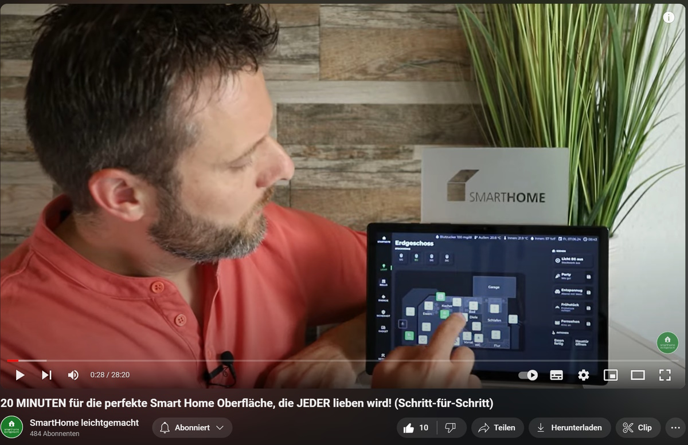
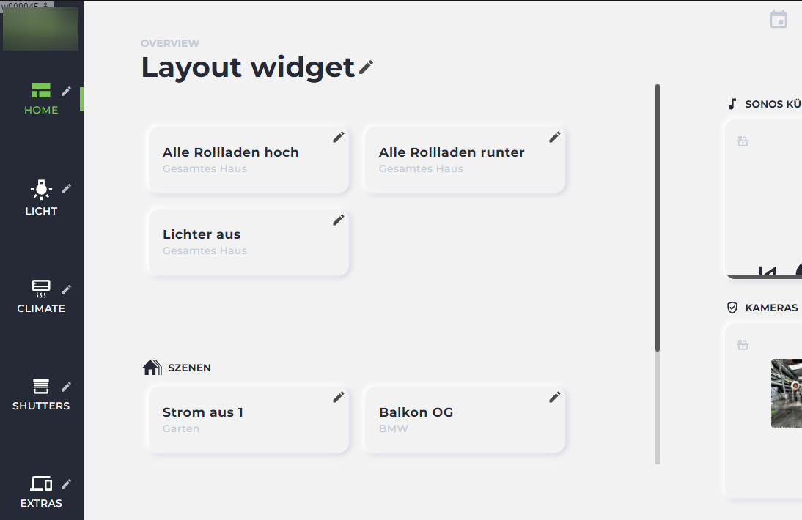
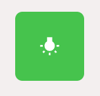
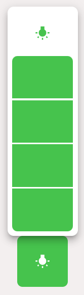
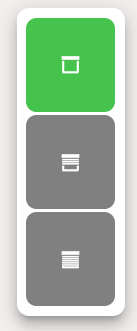
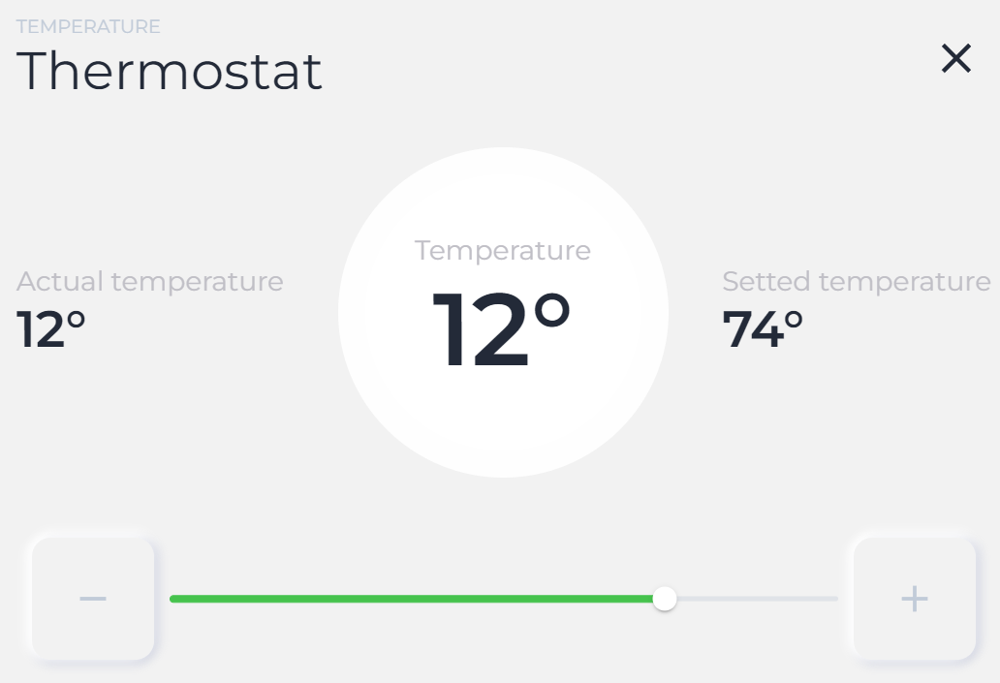
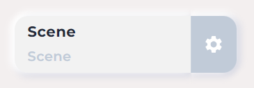
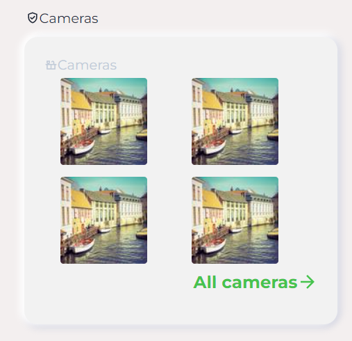
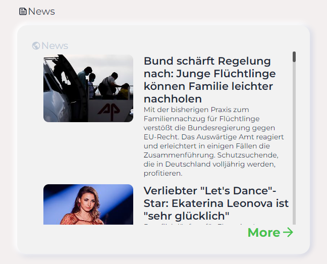
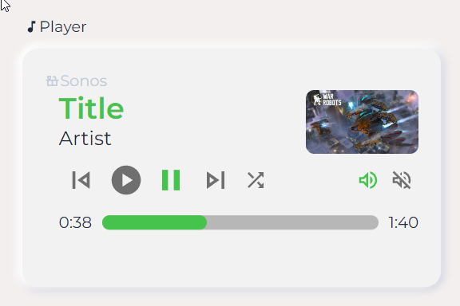

# Special Jaeger Design widgets for ioBroker.vis 2.0

  

You can find videos how to use the widgets [here](https://www.youtube.com/playlist?list=PLddhldeLVrtl5Bhj6AAbkLabuIuyV0bVe) (in german).

Videos wie die Widgets benutzt werden können, kann man [hier](https://www.youtube.com/playlist?list=PLddhldeLVrtl5Bhj6AAbkLabuIuyV0bVe) finden.

## Kommerzielle Nutzung
Bitte beachten Sie, dass dieser Adapter keine kostenlose Version bietet. Für die Nutzung der Widgets ist der Erwerb einer Lizenz erforderlich (aktueller Preis: 50 € inkl. MwSt.).
Die Installation und das Testen im Editor sind jedoch kostenlos möglich.

## Übersicht zur Erstellung einer Smart Home Oberfläche mit dem "VIS-2 JAEGER Design Adapter"
### Voraussetzungen
- Ein ioBroker System
- Der Jäger Design Adapter (ca. 50€)
- Grundkenntnisse im Umgang mit ioBroker

### Einführung
Der Jäger Design Adapter basiert auf dem vis-2 Adapter und ermöglicht es, eine Oberfläche per Click and Drop zu gestalten. Verschiedene Widgets können hinzugefügt und angepasst werden, um Smart Home Geräte zu steuern.

### Grundaufbau der Oberfläche
Die Oberfläche besteht aus mehreren Bereichen:
- **Hauptmenü**: Links befindet sich eine Spalte mit den Hauptmenüpunkten, die einfach angelegt werden können.
- **Statusleiste**: Oben können verschiedene wichtige Statusanzeigen hinzugefügt werden.
- **Mittlerer Bereich**: Hier können Szenen, Aktionen und Hinweise angezeigt werden. Die rechte Seite ist frei gestaltbar und kann Informationen wie Sicherheit, Wetter, Hausgeräte und Energieverbrauch anzeigen.
  

### Beleuchtung
Im Hauptmenü können verschiedene Stockwerke ausgewählt werden. Der Grundriss des Erdgeschosses zeigt alle Lichter, die durch Icons dargestellt werden. Einige Icons können nur an- oder ausgeschaltet werden, während andere dimmbar sind. Durch längeres Drücken auf ein Icon öffnet sich ein Pop-up-Fenster mit einem Slider zur Einstellung der Helligkeit.

Beleuchtungsszenen auf der rechten Seite können einfach abgerufen und auch Lichteinstellungen gespeichert werden:

### Rollladen
Im Menü "Rollladen" kann der Zustand der Beschattung gesehen werden. Icons zeigen die Höhe der Rollladen an, und durch Klicken auf ein Icon öffnet sich ein Pop-up-Fenster zur Einstellung der Höhe und Lamellenneigung.

### Energie
Im Menü "Energie" können die Raumtemperaturen in den einzelnen Räumen gesehen werden. Icons zeigen die Ist- und Solltemperaturen sowie den Zustand der Heizung und Fenster an. Durch Klicken auf ein Icon öffnet sich ein Pop-up-Fenster zur Änderung der Solltemperaturen und zur Steuerung weiterer Aktionen wie Klimaanlage oder Warmluftanlage.

### Sicherheit
Im Menü "Sicherheit" kann der Zustand der Fenster gesehen werden. Geöffnete Fenster werden rot dargestellt.

### Weitere Funktionen
Es können auch frei definierte Oberflächen erstellt werden, wie z.B. die Verbrauchsdarstellung des Adapters "consumption" oder die Darstellung von Nightscout für Diabetes. Im Menü "Settings" können diverse Einstellungen vorgenommen werden.

### YouTube Tutorials
Für detaillierte Anleitungen und weitere Informationen wird empfohlen, die verlinkten YouTube Tutorials anzuschauen.

## Die Widgets

Der Adapter legt neun Widgets in die vis-2-Palette, im Satz **Jaeger design**. Wenn man in der Palette über ein Widget fährt, steht unter der Vorschau eine kurze Beschreibung.

Alle Widgets teilen sich ein Farbschema. Nur das Layout-Widget trägt das vollständige Schema; jedes andere Widget übernimmt die Farben entweder von ihm (*Palette → Vom Widget*) oder legt eigene fest. Vier Themes sind eingebaut: `green`, `blue`, `green-dark` und `blue-dark`.

### Layout

Der Rahmen um alles andere. Es rendert die komplette Oberfläche: das Hauptmenü links, die Statusleiste oben, die Etagenauswahl, die Startseite mit Szenen und Aktionen, die frei gestaltbare rechte Spalte und — auf Handy oder Tablet — eine wischbare Schublade statt der Menüspalte.

Es hat ein einziges Attribut, **Einstellungen**, das den Editor öffnet, in dem die ganze Oberfläche beschrieben wird: Menüpunkte, Etagen und ihre Views, Szenen, Aktionen, Info-Gruppen und die Farben. Pro View genau ein Layout-Widget verwenden; standardmäßig füllt es die View vollständig aus.

### State

Eine quadratische Symboltaste für ein Objekt — der Baustein der Grundrisse. Ein Klick schaltet den Wert um; mit *Bestimmten Wert schreiben* wird stattdessen ein fester Wert geschrieben, und *Anzeigen, ob Wert gesetzt ist* hebt die Taste hervor, solange dieser Wert aktiv ist.

- **Anzahl der Werte** — mehrere Werte, jeder mit eigenem Symbol, eigener Farbe, Hintergrundfarbe und Tooltip.
- **Steuerungsdialog anzeigen** — statt umzuschalten öffnet sich ein Dialog mit allen Werten.
- **Keine Kontrolle** — nur Anzeige, die Taste lässt sich nicht drücken.
- **Nachfragen** vor dem Schreiben, mit eigenem Text.
- Wahlweise eine Beschriftung über oder unter dem Symbol.

### Dimmer

Helligkeitssteuerung für eine dimmbare Leuchte. Das Widget selbst zeigt den aktuellen Stand als senkrechten Balken; langes Drücken (*Drückendauer für Popup*) öffnet das Popup mit dem Regler, aufgeteilt in die eingestellte Zahl von **Abschnitten**.

- **Speichertasten** — Tasten für feste Helligkeitswerte unter dem Regler, jede mit eigenem Symbol und Text. Der Wert kommt entweder aus einem Objekt oder wird direkt geschrieben.
- **Objekt-ID für EIN/AUS** und **Wert für EIN** für Leuchten, deren Ein-/Ausschalter ein eigenes Objekt ist.
- Wahlweise den Wert im Widget anzeigen, das Symbol drehen und das Popup nach dem Setzen schließen.

### Shutter

Dasselbe Prinzip für Rollladen und Jalousien. Das Symbol zeigt die aktuelle Position, wahlweise als Rollladen-, Jalousien- oder Beschattungssymbol. Mit **Schattenverschluss-ID** kommt ein zweites Objekt für den Lamellenwinkel dazu, sodass Höhe und Lamellen im selben Popup eingestellt werden.

Weil Aktoren sich nicht einig sind, was 0 % bedeutet, lassen sich Wert und Anzeige unabhängig voneinander invertieren — getrennt für die Höhe und für die Lamellen. Speichertasten legen Höhe und Lamellenwinkel gemeinsam ab.

### Thermostat

Die Wunschtemperatur als Drehanzeige. Der Dialog stellt Ist-Temperatur, Luftfeuchtigkeit und Ventilstellung neben den Sollwert und bietet Minus-/Plus-Tasten und einen Regler. Minimum, Maximum, Schrittweite und Einheit sind einstellbar, und als Dezimaltrennzeichen kann ein Komma verwendet werden.

Darunter ist Platz für zusätzliche **Tasten** — Boost, Abwesend, Klimaanlage, was die Heizung eben hergibt. Jede hat ein eigenes Objekt, einen eigenen Wert, ein Symbol, eine Beschriftung und einen eigenen Stil.

### Scene

Eine breite Taste mit Titel und Untertitel, die eine Szene des `scenes`-Adapters startet oder schlicht einen Wert schreibt. Mit **Speichern** kommt rechts eine zweite Taste dazu (das Zahnrad im Bild): Sie schreibt die aktuellen Zustände aller Mitglieder zurück in die Szene.

Weitere Optionen: kein aktiver Zustand, `false` statt `true` schreiben, Nachfrage mit eigenem Text und die Anzeige der letzten Änderungszeit.

### Cameras

Eine Karte mit einem Raster von Kamerabildern. Jede Kamera kommt entweder aus dem `cameras`-Adapter oder von einer freien URL, die auch aus einem Objekt gelesen werden kann, und hat ihr eigenes Aktualisierungsintervall.

*Vollbild zulassen* öffnet eine einzelne Kamera groß, mit eigener URL und eigenem Intervall für das Vollbild — so können die Vorschaubilder klein bleiben. „Mehr anzeigen" verlinkt auf ein anderes Widget oder eine andere Seite.

### Actual news

Eine Karte mit einem RSS-Feed: Bild, Überschrift und Anriss pro Eintrag, scrollbar. Die Feed-URL wird direkt eingetragen oder aus einem Objekt gelesen, lässt sich also zur Laufzeit umschalten. Das Aktualisierungsintervall ist einstellbar, und „Mehr" verlinkt auf ein Widget oder eine Seite.

### Player

Eine Medienspieler-Karte: Titel, Interpret, Cover, Play/Pause, vorheriger/nächster Titel, Zufallswiedergabe, Stummschaltung, ein Lautstärkeregler und der Balken mit abgelaufener und gesamter Spielzeit. Jedes Element hängt an einem eigenen Objekt, das Widget passt damit zu jedem Player-Adapter — Sonos, Squeezebox, Alexa und so weiter. Elemente, deren Objekt leer bleibt, werden nicht angezeigt.