# Material widgets for ioBroker.vis 2.0

  

## Widgets

### Buttons and switches

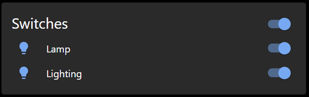

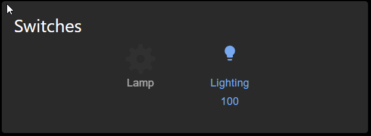

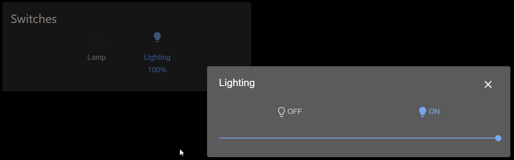

### Clock

-   Analog

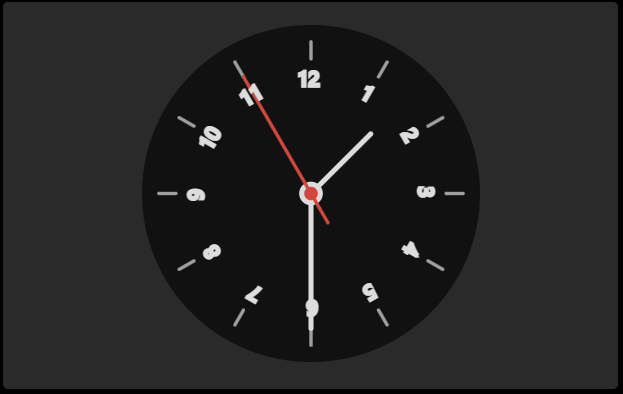

-   Analog variation

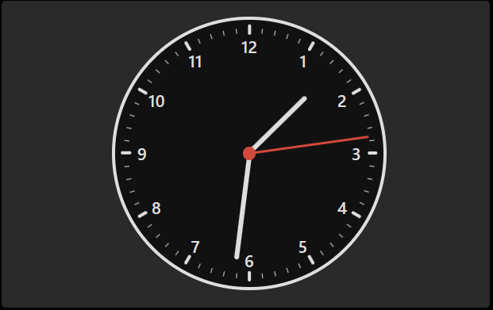

-   Digital

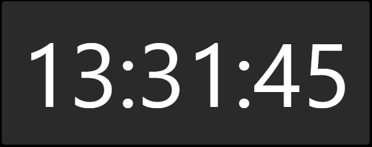

-   Digital2 (SVG Text)

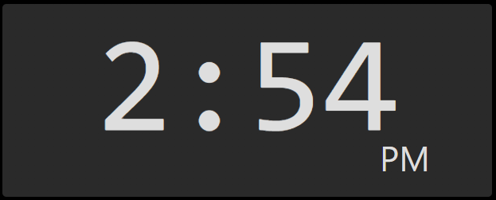

### Simple state

With this widget, you can control one device. Boolean or number.

-   Number

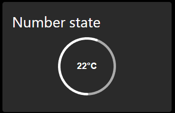

-   Control

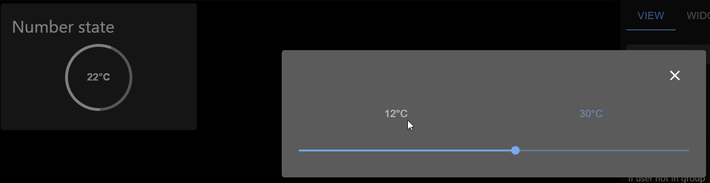

### View in widget

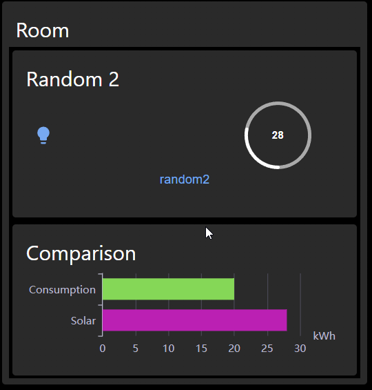

Not as a button: View could be shown in full size, and you can control elements in view.

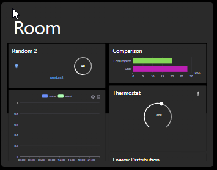

As button: You can show a small thumbnail of view, and by pressing on it, it will be shown in full size.

### Thermostat

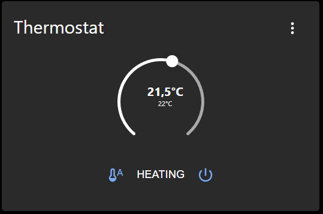

Additionally, it can show a history if you activated it.

### Actual value with chart

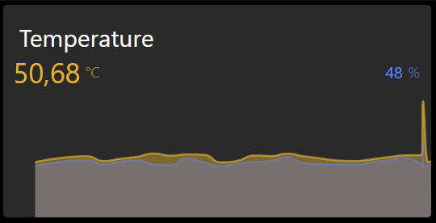

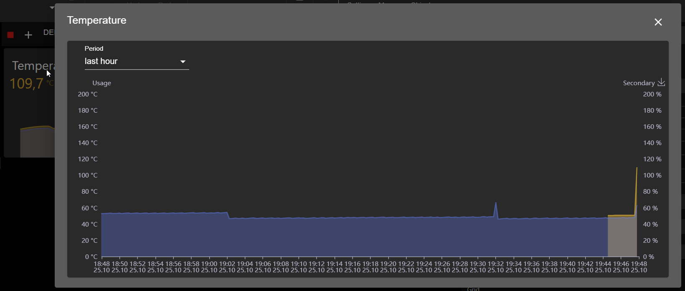

### Security control

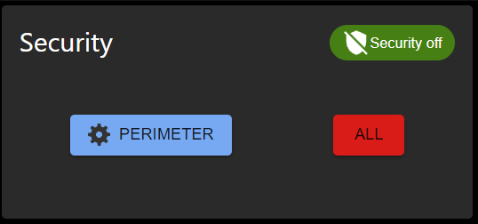

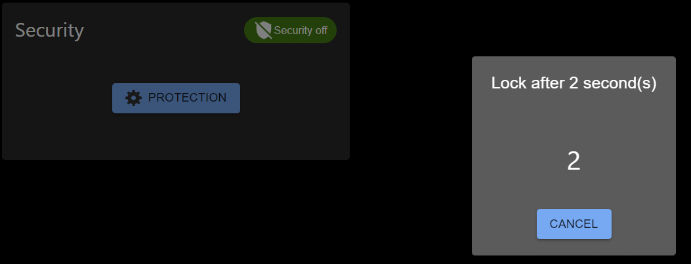

You can define the delay in seconds.

By activation, the defined ID will be written with the number of the delay seconds,
and after the delay is over, the defined ID will be set to 0, and the alarm ID will be set to true.

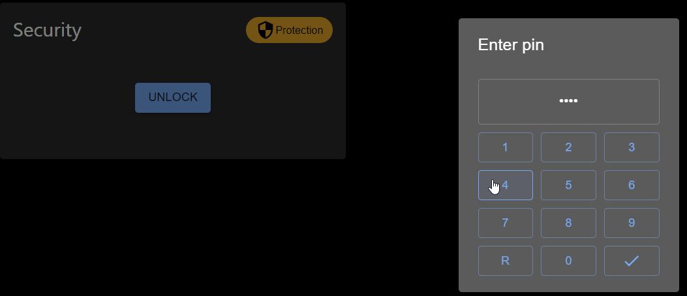

### Player

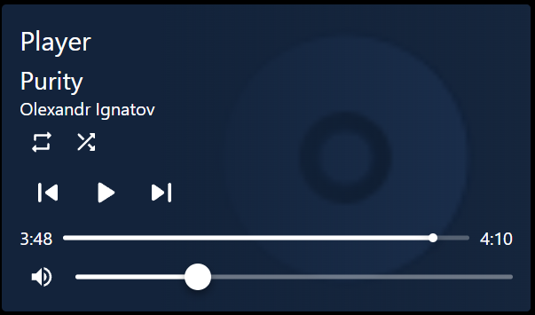

### Map

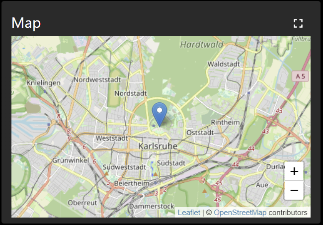

Position could be defined as a combined state, like `9.2344;41.374652` - `longitude;latitude` or as two separate states.

### Camera

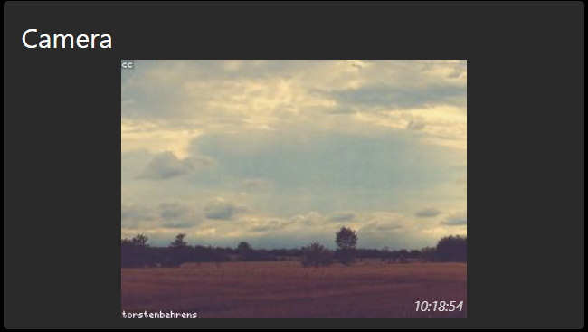

### HTML Template

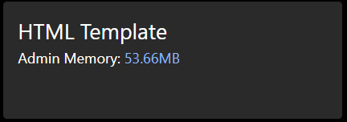

HTML template can be used to show any HTML code.
Additionally, you can show an image or iframe with this widget too.

### Blinds

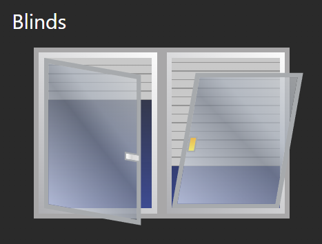

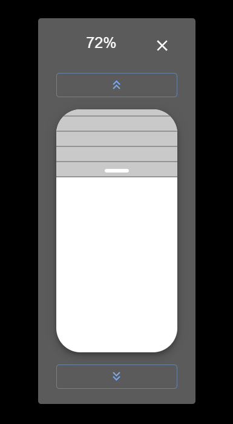

### Color Lamp

With the RGB lamp widget, you can control different types of RGB lamps. Here are some examples:

-   RGB colors are set in one state like '#RRGGBB'
-   R/G/B colors are set in different states from 0 to 255
-   RGBW as one variable like '#RRGGBBWW'
-   R/G/B/W colors are set in different states from 0 to 255
-   hue/sat/lum as 3 different states
-   color temperature as one state from 2700 to 6500 or defined by min/max of the object
-   White mode state can be used to switch between RGB and white mode via a special state

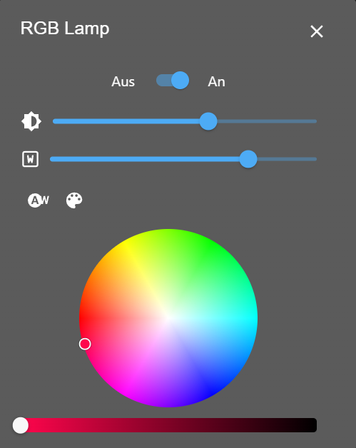

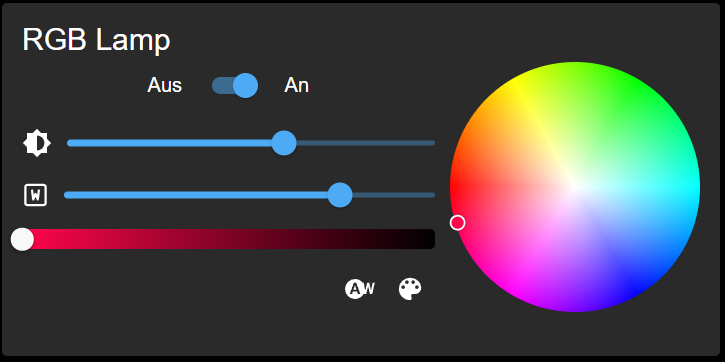

### Door lock

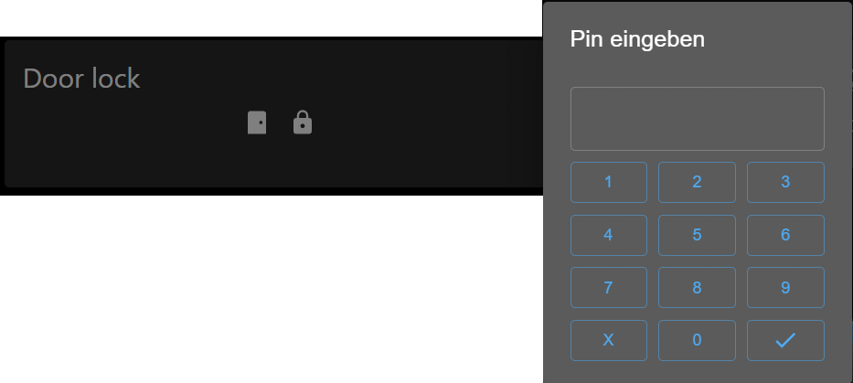

### Vacuum cleaner

This widget is primary for Xiaomi vacuum cleaner. But it can be used for any other vacuum cleaner too.

The only difference is that Xiaomi supports the room cleaning.

### TV

Remote control for a TV of the device type `tv` (e.g. from the adapter `samsungtv`). Select any state of the TV and the other states are detected.

-   **Tile**: name, status, power and app buttons; a click opens the remote in a dialog
-   **Remote control**: the full remote in the widget

Every section of the remote (inputs, arrow keys, volume, number pad, apps...) can be switched off, and the shown apps and inputs can be selected. While the TV is off, only the power button is shown.

### Time picker

## Todo

-   Extend Blinds with shutter
<!--
    Placeholder for the next version (at the beginning of the line):
    ### **WORK IN PROGRESS**
-->

## Changelog
### **WORK IN PROGRESS**

-   (@GermanBluefox) Added the TV widget, see [TV](#tv)

### 2.0.4 (2026-10-19)

-   (@GermanBluefox) RGB light: the auto-detection does not overwrite the selected state anymore and takes the first matching state (#381)
-   (@GermanBluefox) Switches: brightness and white sliders use the maximum of the object, color temperature limits can be below 500 (#475)
-   (@GermanBluefox) Switches: the "switch" state is visible again for RGB and thermostat (#449)
-   (@GermanBluefox) Switches: boolean states with `read: false` or role `button` are detected as button, buttons work with touch and send only `true` (#614, #609)
-   (@GermanBluefox) Switches: `common.states` in the format "0:off;1:on" and numeric states are supported in the select (#607)
-   (@GermanBluefox) Charts read aggregated (min/max) values for periods over 30 minutes instead of raw data (#412)
-   (@GermanBluefox) Switches, Map and theme switcher unsubscribe correctly on unmount (#530)
-   (@GermanBluefox) Lock: added options to invert the lock state and the door sensor (#633)
-   (@GermanBluefox) Camera: the image is updated even if the cache refresh fails (#340)
-   (@GermanBluefox) Player: fixed the display conditions of "repeat" and "next"
-   (@GermanBluefox) Blinds: clear labels for the sash type, touch support for the slider (#627, #292)
-   (@GermanBluefox) Corrected German translations (#552)

### 2.0.3 (2026-10-19)

-   (@GermanBluefox) Fixed the crash of the charts (React error #130) in "Actual", "Switches" and the chart dialog (#694)
-   (@GermanBluefox) Fixed the endless re-rendering (React error #185) of the chart in "Actual" in the grid layout

### 2.0.2 (2026-10-16)

-   (@GermanBluefox) Added `tslib` and `esbuild` to the widget packages, because the build on GitHub could not resolve them

### 2.0.1 (2026-10-16)

-   (@GermanBluefox) Corrected the TypeScript configuration for TypeScript 7 and the widget test

### 2.0.0 (2026-10-15)

-   (@GermanBluefox) Migrated to React 19 and vis-2@2.20.x

## License

The MIT License (MIT)

Copyright (c) 2022-2026 Denis Haev <dogafox@gmail.com>

Permission is hereby granted, free of charge, to any person obtaining a copy
of this software and associated documentation files (the "Software"), to deal
in the Software without restriction, including without limitation the rights
to use, copy, modify, merge, publish, distribute, sublicense, and/or sell
copies of the Software, and to permit persons to whom the Software is
furnished to do so, subject to the following conditions:

The above copyright notice and this permission notice shall be included in
all copies or substantial portions of the Software.

THE SOFTWARE IS PROVIDED "AS IS", WITHOUT WARRANTY OF ANY KIND, EXPRESS OR
IMPLIED, INCLUDING BUT NOT LIMITED TO THE WARRANTIES OF MERCHANTABILITY,
FITNESS FOR A PARTICULAR PURPOSE AND NONINFRINGEMENT. IN NO EVENT SHALL THE
AUTHORS OR COPYRIGHT HOLDERS BE LIABLE FOR ANY CLAIM, DAMAGES OR OTHER
LIABILITY, WHETHER IN AN ACTION OF CONTRACT, TORT OR OTHERWISE, ARISING FROM,
OUT OF OR IN CONNECTION WITH THE SOFTWARE OR THE USE OR OTHER DEALINGS IN
THE SOFTWARE.