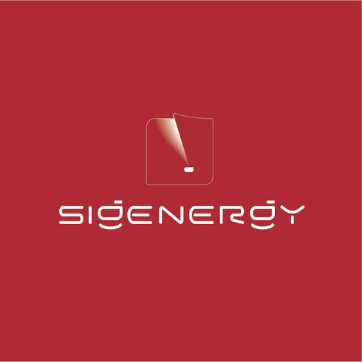
# ioBroker.vis-2-widgets-sigenergy

**Tests:** 

## vis-2-widgets-sigenergy adapter for ioBroker

VIS-2 widget set for the Sigenergy energy storage adapter (`ioBroker.sigenergy`).
Contains 11 widgets for visualisation and control of energy flow, energy house, battery status, real-time power, daily statistics, AC charger, DC charger, inverter, SigenMicro micro-inverter overview, PV strings and vehicle charge level.

Since version 2.0.0 the widgets are a native vis-2 React widget set (React 19, MUI 9).

## Requirements

- ioBroker with the `sigenergy` adapter installed and configured
- ioBroker VIS-2 adapter (≥ 2.20.0) — vis-2 2.20 is the first version based on React 19 and MUI 9
- The classic VIS (vis-1) is not supported

## Upgrading from 1.x

- Existing widgets keep working without being placed again: the widget IDs and all settings (object IDs, titles, dark mode, names) are the same as before.
- vis-2 must be updated to 2.20.0 or newer first. Older vis-2 versions run React 18 and cannot load this widget set.
- All texts follow the language of vis-2 (11 languages). Titles you entered yourself are kept; an empty title shows the default title in the user's language.
- Status explanations (AC/DC charger) are shown as a tooltip that is no longer cut off by the widget and stays readable at any widget size.

## Widgets

### Energy Flow Diagram
Displays the current energy flow between solar panels, battery, grid and house as an animated SVG diagram.
Animated arrows visualise active connections in real time.

**OIDs:** `pvPower`, `essPower`, `gridActivePower`, `housePower`, `essSoc`

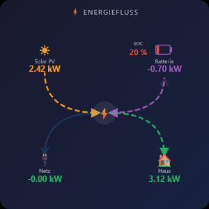

#### Flow directions

| Data point | Value > 0 | Value < 0 |
|---|---|---|
| `essPower` | Battery charging → arrow from centre to battery | Battery discharging → arrow from battery to centre |
| `gridActivePower` | Grid consumption → arrow from grid to centre | Grid feed-in → arrow from centre to grid |
| `pvPower` | PV producing → arrow from PV to centre | — |
| `housePower` | House consuming → arrow from centre to house | — |

### Energy House
Shows the energy flow as an isometric house with garage, car and the Sigenergy devices: PV on the roof, SigenStor battery and gateway on the house wall, AC wallbox on the garage, DC charger in front of it, a balcony power plant with SigenMicro on the garage roof and the grid connection. Animated dashes run along the cables in the direction of the energy flow, faster with more power. Day and night follow the sun at the location of the ioBroker system settings. Everything is drawn as vector graphics, so the widget stays sharp at any size and keeps its proportions.

**OIDs:** `pvPower`, `housePower`, `essPower`, `essSoc`, `gridActivePower`, `acCharger.chargingPower`, `acCharger.systemState`, `dcCharger.outputPower`, `dcCharger.runningState`, `sigenmicro.totalPower`; optional: outdoor temperature (`oid_temp`) and a status text (`oid_status`)

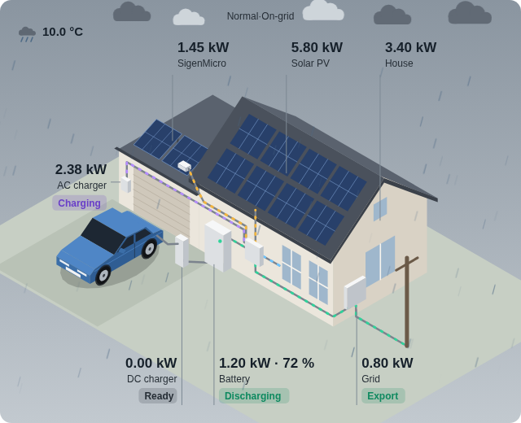

| Setting | Default | Description |
|---|---|---|
| sig_daynight | Automatic | Automatic (position of the sun), always day or always night |
| sig_animation | on | Animated flow along the cables |
| `sig_show_garage`, `sig_show_car`, `sig_show_ac`, `sig_show_dc`, `sig_show_micro` | on | Show or hide garage, car, AC charger, DC charger and the balcony power plant. The balcony power plant needs the garage; without the garage the AC wallbox hangs on the house wall |

**Weather (optional):** with a weather state the sky follows the real weather — sun, clouds, rain, snow, fog or thunderstorm; without one it stays clear. Use the language-independent code of the weather adapter; English condition texts are read as well.

| Adapter | Weather condition | Cloud cover (%) | Precipitation (mm/h) | Numeric weather code |
|---|---|---|---|---|
| open-meteo-weather | `…weather.current.weather_code` | `…weather.current.cloud_cover` | `…weather.current.precipitation` | Automatic |
| openweathermap | `forecast.current.icon` | `forecast.current.clouds` | `forecast.current.precipitation` | Automatic |
| daswetter | `location_1.ForecastHourly.Current.symbol` | `…Current.clouds` | `…Current.rain` | DasWetter symbol |

daswetter writes the `Current` channel only with the option to copy the current hour; otherwise use `ForecastHourly.Hour_1`. `symbol_URL` works as well, with the code setting on Automatic.

Cloud cover and precipitation refine the condition or stand in for it; precipitation at or below 1 °C is drawn as snow.

### Battery Status & Forecasts
Displays SOC, SOH, charging power and forecasts for time to full charge, remaining runtime, self-consumption and autarky rate.

**OIDs:** `essSoc`, `essSoh`, `essPower`, `batteryTimeToFull`, `batteryTimeRemaining`, `selfConsumptionRate`, `autarkyRate`

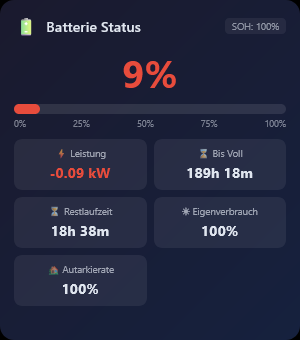

### Real-Time Power
Compact list view of all current power values with colour-coded direction indicators.

**OIDs:** `pvPower`, `essPower`, `gridActivePower`, `housePower`, `essSoc`

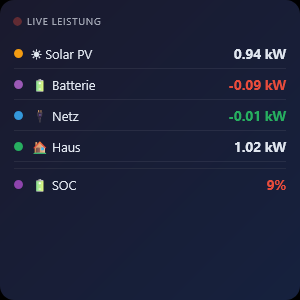

### Energy Statistics
Daily overview with autarky rate, self-consumption, SOC history, charge/discharge energy and battery coverage.

**OIDs:** `autarkyRate`, `selfConsumptionRate`, `dayMaxSoc`, `dayMinSoc`, `essDailyChargeEnergy`, `essDailyDischargeEnergy`, `batteryCoverageToday`, `batteryDailyChargeTime`

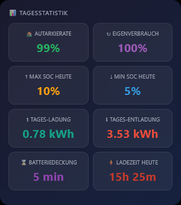

### AC Charger (Sigen EVAC)
Monitoring and control of the Sigenergy AC charger (EVAC). Shows charging power, system state, rated power, rated current and total energy consumed. Alarms are highlighted in colour. The state badge shows the simplified charging state according to IEC 61851-1 (Initialising, Free, Connected, Charging, Error); hovering over it reveals a detailed explanation of the current state. The charging current can be set directly via a slider (6 A up to the charger's rated current); the upper limit can additionally be capped with the widget setting `sig_maxCurrent`. While charging is active, the Start button is locked and the Stop button is highlighted.

**OIDs:** `acCharger.systemState`, `acCharger.chargingPower`, `acCharger.totalEnergyConsumed`, `acCharger.ratedPower`, `acCharger.ratedCurrent`, `acCharger.alarm1/2/3`, `acCharger.control.startStop`, `acCharger.control.outputCurrent`

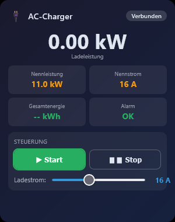

### DC Charger
Monitoring and control of the Sigenergy DC charger. Shows output power, vehicle SOC with progress bar, vehicle battery voltage, charging current and the energy and duration of the current charging session. The state badge shows the operating state of the charging station (`dcCharger.runningState`: free, connected/preparing, scheduled, charging, discharging, ended, warning, fault/unavailable); hovering over it reveals a detailed explanation. While charging or discharging is active, the Start button is locked and the Stop button is highlighted. If the state OID is not set, it is derived from the output power OID; without a state value the badge falls back to the output power and the tooltip explains why, depending on the protocol version detected by the adapter.

**OIDs:** `dcCharger.runningState`, `dcCharger.outputPower`, `dcCharger.vehicleSoc`, `dcCharger.vehicleBatteryVoltage`, `dcCharger.chargingCurrent`, `dcCharger.currentChargingCapacity`, `dcCharger.currentChargingDuration`, `dcCharger.control.startStop`, `info.protocolVersion` (`oid_protocol`)

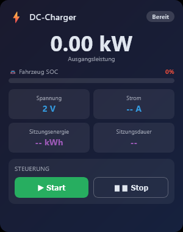

### Inverter
Comprehensive monitoring and control of the inverter with tab navigation. Displays operating state, power data, battery temperatures, phase voltages, all 5 alarm registers and device information (model, serial number, firmware).

| Tab | Content |
|---|---|
| **Power** | Active power, PV power, battery charge/discharge power, power share slider (−100 % to +100 %) |
| **Battery** | SOC & SOH with bars, avg. cell temperature/voltage, max./min. temperature |
| **Grid** | Phase voltages L1/L2/L3, grid frequency, power factor, PCS internal temperature |
| **Alarms** | 5 alarm registers (PCS ×2, ESS, gateway, DC charger) with hex code and colour marking |
| **Info** | Model type, serial number, firmware version, Remote-EMS toggle |

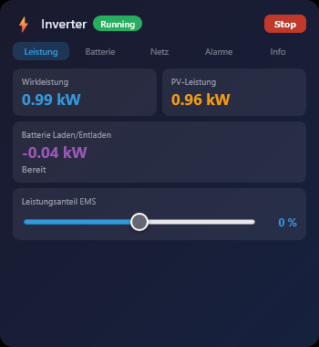

**OIDs:** `inverter.activePower`, `inverter.pvPower`, `inverter.essChargeDischargePower`, `inverter.runningState`, `inverter.essBatterySoc/Soh`, `inverter.essAvgCellTemperature/Voltage`, `inverter.phaseA/B/CVoltage`, `inverter.gridFrequency`, `inverter.pcsInternalTemp`, `inverter.alarm1–5`, `inverter.firmwareVersion`, `inverter.modelType`, `inverter.serialNumber`, `inverter.control.startStop`, `inverter.control.remoteEmsDispatchEnable`, `inverter.control.activePowerPercent`

### PV Power
Display of up to 3 PV strings with live power values and animated flow arrows leading to the hybrid inverter. Arrow colours change dynamically based on power level (orange <1 kW, yellow <2 kW, green >2 kW).

#### Widget settings
| Parameter | Type | Default | Description |
|---|---|---|---|
| oid_pv1 … oid_pv3 | OID | sigenergy.0.plant.pv1Power … pv3Power | PV string power OIDs |
| oid_pvtotal | OID | sigenergy.0.plant.pvPower | Total PV power OID |
| sig_title | text | PV Power | Widget title |
| sig_name1 … sig_name3 | text | String 1 … String 3 | Configurable names per string |
| sig_darkmode | checkbox | true | Dark / Light mode |

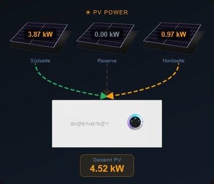

**OIDs:** `plant.pv1Power`, `plant.pv2Power`, `plant.pv3Power`, `plant.pvPower`

### SigenMicro Overview
Overview and detail view of SigenMicro micro-inverters. Since `ioBroker.sigenergy` 3.5.0 the adapter reads them from the Sigenergy cloud (tab "SigenMicro (Cloud)" in the adapter settings) and creates one device per micro-inverter under `sigenergy.0.sigenmicro.<serial>`. **Requires `ioBroker.sigenergy` ≥ 3.5.0 with the cloud enabled.** The cloud is polled every 300 s (OpenAPI) or 60 s (app interface), so the widget cannot update faster.

| Tab | Content |
|---|---|
| **Overview** | All devices as animated AC bus with status per device; tiles for AC power (adapter total `sigenmicro.totalPower`, otherwise the sum of the devices), yield today, lifetime yield and devices online |
| **one tab per device** | Image, name, rated power, serial number, firmware, time of the last cloud update, status badge, all live values with unit and OID, and the PV inputs pv1 … pv4 that the adapter reports |

#### Status
| Status | Condition | Display |
|---|---|---|
| Producing | `online` = true, `activePower` > 0 | green, bus animated |
| Online | `online` = true, `activePower` = 0 | blue |
| Offline | `online` = false — normal at night | grey |
| No data | no value received yet | grey |

If `info.cloudConnection` is `false`, the widget shows the warning "Cloud connection lost", because the values may be outdated.

#### Dynamic layout
| Devices | Rows | Image size |
|---|---|---|
| 1–5 | 1 row | 80 × 90 px |
| 6–10 | 1 row | 52 × 60 px |
| 11–15 | 2 rows | 46 × 52 px |
| 16–20 | 2 rows | 40 × 46 px |

#### Widget settings
| Parameter | Type | Default | Description |
|---|---|---|---|
| micro_count | number (1–20) | 3 | Number of micro-inverters to display |
| sig_title | text | SigenMicro Micro-Inverter | Widget title |
| sig_darkmode | checkbox | true | Dark / light mode |
| micro_device1 … micro_device20 | selection | — | Micro-inverter from the list of SigenMicro devices of the sigenergy instances (serial number and name). The widget reads all states of the device itself. Widgets from 1.x keep their former state selection |
| micro_take_all | button | — | Takes over all SigenMicro devices of the account at once (number and selection) |
| micro_name1 … micro_name20 | text | — | Display name of the device (default: Micro 01, Micro 02, …) |

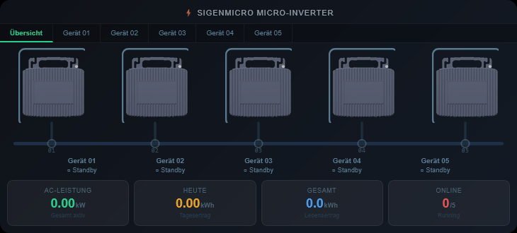

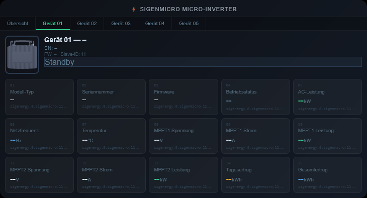

**States per device (`sigenergy.0.sigenmicro.<serial>`):**
online, activePower, reactivePower, pvPower, pv1…pv4.voltage / current / power, gridVoltage, gridCurrent, gridFrequency, powerFactor, temperature, insulationResistance, dailyYield, totalYield, serialNumber, firmware, ratedPower, lastUpdate

**Additionally:** `sigenergy.0.sigenmicro.totalPower`, `sigenergy.0.info.cloudConnection` — the instance is taken from the selected OID

> **Upgrade from 1.8.x:** the former Modbus states (`runningState`, `outputPower`, `mppt*`, `modelType` …) no longer exist in the adapter. Choose the micro-inverters again in the widget settings — from the list or with "Take all SigenMicro".

### Vehicle Charge Level (EV SOC)
Displays a configurable vehicle image (e.g. Fiat 500e) as the central visual element. A colour-coded badge in the top-right corner shows a lightning bolt, the current charge level in percent and the label "CHARGE" (translated). A progress bar at the bottom reflects the current SOC. When the optional charging state is active, the badge emits a pulsing green glow.

#### Colour logic
| Charge level | Colour |
|---|---|
| ≤ 15 % | Red (#f87171) |
| ≤ 35 % | Yellow (#fbbf24) |
| > 35 % | Green (#4ade80) |

#### Widget settings
| Parameter | Type | Default | Description |
|---|---|---|---|
| oid_ev_soc | OID | — | State of Charge 0–100 |
| oid_charging | OID | — | Charging state (optional) — green glow when active |
| sig_title | text | — (empty: "Vehicle charge level", translated) | Vehicle name shown below the image |
| sig_car_image | image | — | Vehicle image from ioBroker file browser (e.g. /vis-2/img/) |
| sig_darkmode | checkbox | true | Dark / Light mode |

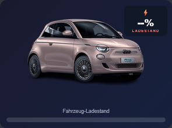

**OIDs:** `oid_ev_soc`, `oid_charging`

## Appearance

All widgets support a **light and dark mode**, switchable via the widget setting `Dark mode`. The widgets scale with their size: width and height follow the widget independently, while the text keeps its proportions.

## Changelog
### 2.2.0 (2026-11-18)
* (ssbingo) **Energy house shows the real weather:** with a weather state (WMO code of open-meteo-weather, OpenWeatherMap icon or id, DasWetter symbol, AccuWeather icon or an English text), optionally cloud cover and precipitation, the sky shows sun, clouds, rain, snow, fog or thunderstorm instead of always the sun; the symbol next to the temperature follows the weather

### 2.1.0 (2026-11-18)
* (ssbingo) **New widget "Energy house":** the energy flow as an isometric house with garage, car, PV on the roof, SigenStor and gateway on the house wall, AC wallbox, DC charger, a balcony power plant with SigenMicro on the garage roof and the grid connection; animated cables in the direction of the flow, day and night after the position of the sun, optional outdoor temperature and status text, every part can be hidden

### 2.0.2 (2026-11-18)
* (ssbingo) SigenMicro: new tab bar — "Overview" keeps its width, the device tabs share the rest in equal columns and no longer run out of the widget; up to 3 devices the tabs show the names, with more devices compact numbers 01, 02 … (as on the nodes, name as tooltip); above 10 devices two rows like the nodes
* (ssbingo) SigenMicro: the labels sit exactly below their nodes, each label row directly below its node row; a click on a node or label opens the detail tab of the device; better contrast of the tile texts; if several selected devices report the same device name, the serial number is shown
* (ssbingo) Stretched widgets: texts are no longer squeezed twice, centred texts stay centred, and the titles of AC/DC charger, inverter and battery as well as the SigenMicro status badge and section header keep their proportions

### 2.0.1 (2026-11-17)
* (ssbingo) README screenshots renewed: all widgets as rendered by the React widget set in vis-2 2.20, with English texts
* (ssbingo) Dependencies updated (vite 7.3.8, `@iobroker/gui-components` 10.4.6, `@iobroker/testing` 6.3.2)

### 2.0.0 (2026-11-17)
* (ssbingo) **Breaking:** the widgets are now a native vis-2 React widget set (React 19, MUI 9) and require vis-2 2.20.0 or newer. The classic VIS (vis-1) is no longer supported
* (ssbingo) Existing widgets keep working without being placed again: the widget IDs and all settings are unchanged
* (ssbingo) All texts are translated into the 11 ioBroker languages (previously mostly German). Titles you entered are kept; an empty title shows the default title in the user's language
* (ssbingo) AC/DC charger: the status explanation is a MUI tooltip that is no longer cut off by the widget; the charging current and the EMS power share are MUI sliders that write when released
* (ssbingo) No commands are sent from the vis-2 editor anymore; a click there only selects the widget
* (ssbingo) Energy flow: the setting "Animated flow" now takes effect
* (ssbingo) SigenMicro: the detail tab shows the values in three columns, the object ID on one line
* (ssbingo) SigenMicro: the micro-inverters are chosen in the editor by device (serial number and name) from the SigenMicro devices of the sigenergy instances; the widget reads all states itself. New button "Take all SigenMicro" takes over all devices at once. Widgets from 1.x keep working with their former state selection
* (ssbingo) Build with Vite and module federation; the widgets were tested in vis-2 2.20.11

### 1.9.1 (2026-11-17)
* (ssbingo) vis-2 2.20.x: the widgets apply `box-sizing: border-box` to their own content again. vis-2 2.20 no longer loads MUI's `CssBaseline`, which used to switch the whole document to border-box, so padded cards, tiles and buttons could grow wider than designed. The rule is scoped to this widget set; the widget set itself contains no React/MUI code and runs as a classic vis widget set on vis-2 2.20 (React 19, MUI 9)

### 1.9.0 (2026-11-17)
* (ssbingo) **SigenMicro Overview reworked for the new cloud connection of `ioBroker.sigenergy` 3.5.0.** The widget now reads `sigenergy.0.sigenmicro.<serial>.*` (online, activePower, pvPower, PV inputs pv1…pv4, grid values, temperature, insulation resistance, yield, firmware, rated power, last update), the account total `sigenmicro.totalPower` and `info.cloudConnection`. The former Modbus register model (`runningState`, `outputPower`, `mppt*`, `modelType`) is gone
* (ssbingo) SigenMicro: status derived from `online` and the AC power (Producing / Online / Offline / No data), warning when the cloud connection is lost, time of the last cloud update and rated power in the detail tab, PV inputs shown only when reported, new optional display name per device (`micro_nameN`), all widget texts in English
* (ssbingo) SigenMicro: the anchor OID may be any state of the micro-inverter; derived states are now subscribed via `vis.conn.subscribe` (VIS only subscribes attribute OIDs) and released again when the widget is removed. **After updating, select a state under `sigenergy.0.sigenmicro.<serial>` again for each `oid_microN`**
* (ssbingo) CI: Dependabot auto-merge workflow updated from the ioBroker template — it uses `pull_request` instead of `pull_request_target` (#46, #47); `@iobroker/testing` updated from 6.2.1 to 6.3.1

### 1.8.11 (2026-09-12)
* (ssbingo) CI: the package tests now run on Node.js 22, 24 and 26 (new `adapter-tests` job, repository checker #41); `@iobroker/testing` updated from 5.3.0 to 6.2.1

### 1.8.10 (2026-09-07)
* (ssbingo) Removed the `admin` entry from `globalDependencies`: a widget set has no admin UI, so no admin version needs to be required (repository checker S1091)

### 1.8.9 (2026-09-07)
* (ssbingo) DC charger: a station that marks its running state register as not valid no longer shows up as a red "Unbekannt" badge. The Sigenergy protocol signals "register not valid" by setting all bits, and a SigenStor EC **with** a DC charger answers that way for register 31513 while its neighbouring registers (rated power, PV yield, meters) read normally. The badge is now derived from the output power in that case and the tooltip states that this is neither an adapter nor a configuration problem
* (ssbingo) DC charger: the raw sentinel 65535 is recognised as well, so the badge is also correct on adapter versions before 3.3.1, which pass the value through instead of reporting no value
* (ssbingo) DC charger: new OID setting `oid_protocol` (default `sigenergy.0.info.protocolVersion`). The protocol version was previously derived from the instance prefix only, and such an OID is never subscribed by VIS, so `vis.states` stayed empty and the tooltip claimed "Protokollversion noch nicht erkannt" even though the adapter had detected V2.9 at startup. Declared as a regular `/id` attribute it is subscribed like every other OID
* (ssbingo) DC charger: when the protocol version cannot be read, the tooltip no longer asserts that none was detected — it says the version is not readable here and points at the new setting
* (ssbingo) DC charger: reworded the tooltip shown when the adapter reports no state although the device announces protocol V2.8 or newer — it no longer claims an adapter update is needed, since the station itself may be marking the register as not valid

### 1.8.8 (2026-09-07)
* (ssbingo) DC charger: if the state OID is not set, it is derived from the output power OID (…dcCharger.outputPower → …dcCharger.runningState), so widgets placed before 1.8.7 show the operating state without editing them
* (ssbingo) DC charger: when no operating state is available, the tooltip explains why depending on the protocol version detected by the adapter (`info.protocolVersion` / `info.protocolLevel`): register 31513 requires Sigenergy protocol V2.8; with V2.8 or newer it points to the adapter log or an adapter update; negative output power is shown as discharging

### 1.8.7 (2026-09-07)
* (ssbingo) DC charger: new state OID `dcCharger.runningState` (default) – the state badge now shows the operating state of the charging station (free, connected/preparing, scheduled, charging, discharging, ended, warning, fault/unavailable) with a detailed explanation as tooltip; without the OID the badge is derived from the output power as before
* (ssbingo) DC charger: while charging or discharging is active, the Start button is locked and the Stop button is highlighted; negative output power (discharging) is shown in purple

### 1.8.6 (2026-09-07)
* (ssbingo) AC charger: the tooltip on the state badge is now rendered as a separate popup with a fixed font size and opaque background, so it is readable regardless of widget size and is no longer overlapped by widget content
* (ssbingo) AC charger: while charging is active, the Start button is locked and the Stop button is highlighted
* (ssbingo) Widget set now reports the correct version in the browser console

### 1.8.5 (2026-09-07)
* (ssbingo) AC charger: the charging current slider is now limited to the charger's rated current; new widget setting `sig_maxCurrent` for a manual upper limit (prevents Modbus errors when setting more than the rated current)
* (ssbingo) AC charger: system state now covers all IEC 61851-1 states (0–7: initialising, free, connected, charging, error); hovering over the state badge shows a detailed explanation

### 1.8.4 (2026-09-04)
* (ssbingo) Lowered minimum admin requirement to >=7.8.23 (admin 8 is no longer required)
* (ssbingo) CI: locked ioBroker/testing-action-deploy to major version v1; fixed Dependabot auto-merge workflow
* (ssbingo) Updated dependencies: @tsconfig/node22 22.0.6, @alcalzone/release-script-plugin-license 5.2.2

### 1.8.3 (2026-08-05)
* (ssbingo) Declared minimum requirements: js-controller >=6.0.11, admin >=8.0.0, Node.js >=22
* (ssbingo) Updated dependencies: actions/checkout 7.0.1, ioBroker/testing-action-deploy 1.5.2, @iobroker/testing 5.3.0

### 1.8.2 (2026-06-28)
* (ssbingo) Updated CI actions: actions/checkout to v7.0.0, ioBroker/testing-action-deploy to v1.5.0

### 1.8.1 (2026-06-08)
* (ssbingo) Fixed JSON syntax error in io-package.json; added widget screenshot to documentation

### 1.8.0 (2026-06-08)
* (ssbingo) New widget: "Fahrzeug-Ladestand" — shows a configurable EV image with animated SOC bar, color-coded charge level (red/yellow/green), and optional blinking charging badge

### 1.7.9 (2026-05-27)
* (ssbingo) Removed obsolete .eslintrc.json and .prettierignore

### 1.7.8 (2026-05-27)
* (ssbingo) Added ESLint linting, updated CI to Node.js 24; adapter requires node.js >= 22

### 1.7.7 (2026-04-20)
* (ssbingo) Text no longer distorts under non-uniform scaling — letters keep their proportions while containers continue to fill the widget area

### 1.7.6 (2026-04-20)
* (ssbingo) Scaling is now non-uniform: width and height react independently to container changes, keeping both axes individually adjustable

### 1.7.5 (2026-04-20)
* (ssbingo) Widget scaling now also reacts to height changes — content scales proportionally on both axes and is centered within the widget

### 1.7.4 (2026-04-20)
* (ssbingo) All 9 widgets now scale their content responsively with the widget size (fonts, padding, SVG, images)

### 1.7.3 (2026-04-20)
* (ssbingo) All 9 widgets now share a unified background based on the PV-Power widget design

Older changelog entries can be found in CHANGELOG_OLD.md

## Documentation

- 🇬🇧 [English](/#/adapters/vis-2-widgets-sigenergy) — this file
- 🇩🇪 [Deutsch](https://github.com/ssbingo/ioBroker.vis-2-widgets-sigenergy/blob/main/doc/de/README.md)
- 🇷🇺 [Русский](https://github.com/ssbingo/ioBroker.vis-2-widgets-sigenergy/blob/main/doc/ru/README.md)
- 🇳🇱 [Nederlands](https://github.com/ssbingo/ioBroker.vis-2-widgets-sigenergy/blob/main/doc/nl/README.md)
- 🇫🇷 [Français](https://github.com/ssbingo/ioBroker.vis-2-widgets-sigenergy/blob/main/doc/fr/README.md)
- 🇮🇹 [Italiano](https://github.com/ssbingo/ioBroker.vis-2-widgets-sigenergy/blob/main/doc/it/README.md)
- 🇪🇸 [Español](https://github.com/ssbingo/ioBroker.vis-2-widgets-sigenergy/blob/main/doc/es/README.md)
- 🇵🇱 [Polski](https://github.com/ssbingo/ioBroker.vis-2-widgets-sigenergy/blob/main/doc/pl/README.md)
- 🇵🇹 [Português](https://github.com/ssbingo/ioBroker.vis-2-widgets-sigenergy/blob/main/doc/pt/README.md)

## License
MIT License

Copyright (c) 2026 ssbingo <s.sternitzke@online.de>

Permission is hereby granted, free of charge, to any person obtaining a copy
of this software and associated documentation files (the "Software"), to deal
in the Software without restriction, including without limitation the rights
to use, copy, modify, merge, publish, distribute, sublicense, and/or sell
copies of the Software, and to permit persons to whom the Software is
furnished to do so, subject to the following conditions:

The above copyright notice and this permission notice shall be included in all
copies or substantial portions of the Software.

THE SOFTWARE IS PROVIDED "AS IS", WITHOUT WARRANTY OF ANY KIND, EXPRESS OR
IMPLIED, INCLUDING BUT NOT LIMITED TO THE WARRANTIES OF MERCHANTABILITY,
FITNESS FOR A PARTICULAR PURPOSE AND NONINFRINGEMENT. IN NO EVENT SHALL THE
AUTHORS OR COPYRIGHT HOLDERS BE LIABLE FOR ANY CLAIM, DAMAGES OR OTHER
LIABILITY, WHETHER IN AN ACTION OF CONTRACT, TORT OR OTHERWISE, ARISING FROM,
OUT OF OR IN CONNECTION WITH THE SOFTWARE OR THE USE OR OTHER DEALINGS IN THE
SOFTWARE.