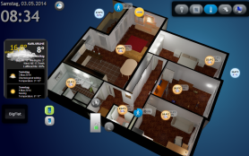
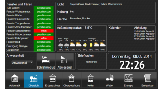
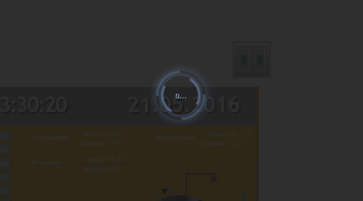

# Next generation visualization for ioBroker: vis-2 

  [](https://www.npmjs.com/package/iobroker.vis-2)
[](https://www.npmjs.com/package/iobroker.vis-2)

[](https://nodei.co/npm/iobroker.vis-2/)

WEB visualization for ioBroker platform.

## Overview
- [License requirements](#license-requirements)
- [Installation & Documentation](#installation--documentation)
- [Bindings of objects](#bindings-of-objects)
- [Filters](#filters)
- [Control interface](#control-interface)
- [Default view](#default-view)
- [Navigation](#navigation)
- [Permissions System](#permissions-system)
- [Settings](#settings)
- [SVG and curentColor](#svg-and-currentcolor)

## License requirements
To use this adapter in `ioBroker` you need to accept the source code license of the adapter. The source code of this adapter is available under the CC BY-NC license.

Additionally, you need a license to use the adapter. The following license editions are available on https://iobroker.net/www/pricing 
* **Community-License: Free for private use!**: Get a free license by registering an account on [https://iobroker.net](https://iobroker.net). The license if checked online against the ioBroker license server when the vis-2 adapter is started, so an online connection at this time point is required!
* **Private use Offline-License**: For paying a small support fee, you can get rid of the required online license check on adapter startup. **Only for Private use!**
* **Commercial License**: When using Vis in a commercial environment or selling Vis as a part of ioBroker packages to your customers, this license is for you. License check is also not requiring an online connection.

## Installation & Documentation




### Widgets

- [Standard widgets](/#/docs/adapterref/iobroker.vis-2/packages/iobroker.vis-2/docs/widgets-standard.md) - the devices of a house, as cards for
  a page with sections (`relative`) and as markers for a floor plan (`absolute`), with a picture of every one
  of them
- [jQui widgets](/#/docs/adapterref/iobroker.vis-2/packages/iobroker.vis-2/docs/widgets-jQui.md) - the widgets that came over from vis-1

## Bindings of objects
Normally, most of the widgets have ObjectID attribute, and this attribute can be bound with some value of object ID.
But there is another option for how to bind *any* attribute of widget to some ObjectID. 

Just write into attribute `{object.id}` e.g. `{hm-rpc.0.OEQ1880105.4.ACTUAL_TEMPERATURE}` and it will be bound to this object's value. 
If you use the special format, you can even make some simple operations with it, e.g., multiplying or formatting.

E.g., to calculate the hypotenuse of a triangle:

`{h:javascript.0.myCustom.height;w:javascript.0.myCustom.width;Math.max(20, Math.sqrt(h*h + w*w))}` will be interpreted as function:

```js
value = await (async function () {
    var h = (await getState('javascript.0.myCustom.height')).val;
    var w = (await getState('javascript.0.myCustom.width')).val;
    return Math.max(20, Math.sqrt(h * h + w * w));
})();
```

or 

`{h:javascript.0.myCustom.height;w:javascript.0.myCustom.width;h*w}` will simply multiply height with width.

You can use *any* JavaScript (browser) functions. Arguments must be defined with ':', if not, it will be interpreted as formula.

Take care about types. All of them are defined as strings. To be sure, that value will be treated as a number use parseFloat function.

So our Hypotenuse calculation will be:
```
{h:javascript.0.myCustom.height;w:javascript.0.myCustom.width;Math.max(20, Math.sqrt(Math.pow(parseFloat(h), 2) + Math.pow(parseFloat(w), 2)))}
```

### Deprecated format
Patten has the following format:

```
{objectID;operation1;operation2;...}
```

The following operations are supported:

- `*` - multiplying. Argument must be in brackets, like "*(4)". In this sample, we multiply the value with 4.
- `+` - add. Argument must be in brackets, like "+(4.5)". In this sample we add to value 4.5.
- `-` - subtract. Argument must be in brackets, like "-(-674.5)". In this sample we subtract from value -674.5.
- `/` - dividing. Argument must be in brackets, like "/(0.5)". In this sample, we divide the value by 0.5.
- `%` - modulo. Argument must be in brackets, like "%(5)". In this sample, we take modulo of 5.
- `round` - round the value.
- `round(N)` - round the value with N places after point, e.g., 34.678;round(1) => 34.7
- `hex` - convert value to hexadecimal value. All letters are lower cased.
- `hex2` - convert value to hexadecimal value. All letters are lower cased. If value less 16, so the leading zero will be added.
- `HEX` - same as hex, but upper-cased.
- `HEX2` - same as hex2, but upper-cased.
- `date` - format date according to given format. Format is the same as in [iobroker.javascript](https://github.com/iobroker/iobroker.javascript/blob/master/README.md#formatdate)
- `min(N)` - if value is less than N, take the N, else value
- `max(M)` - if value is greater than M, take the M, else value
- `sqrt` - square root
- `pow(n)` - power of N.
- `pow` - power of 2.
- `floor` - Math.floor
- `ceil` - Math.ceil
- `json` - operation for getting JSON or object property. E.g., `{id;json(common.name.en)}`
- `random(R)` - Math.random() * R, or just Math.random() if no argument
- `formatValue(decimals)` - format value according to system settings and use decimals
- `date(format)` - format value as date. The format is like: "YYYY-MM-DD hh:mm:ss.sss"
- `momentDate(format, useTodayOrYesterday)` - format value as date using Moment.js. [Approved formats must be entered according to the moment.js library](https://momentjs.com/docs/#/displaying/format/). With `useTodayOrYesterday=true` the `moment.js` format `ddd`/`dddd` are overwritten with today / yesterday
- `array(element1,element2[,element3,element4])` - returns the element of index. e.g.: `{id.ack;array(ack is false,ack is true)}`. A boolean takes the second element when it is true and the first when it is false, so `{id;array(off,on)}` works on a switch

You can use this pattern in any text, like

```
My calculations with {objectID1;operation1;operation2;...} are {objectID2;operation3;operation4;...}
```

or color calculations:

```
#{objectRed;/(100);*(255);HEX2}{objectGreen;HEX2}{objectBlue;HEX2}
```

To show timestamp of an object write `.ts` or `.lc` (for last change) at the end of object id, e.g.:

```
Last change: {objectRed.lc;date(hh:mm)}
```

### Special bindings
There are a number of different internal bindings to provide additional information in views:
* `username` - shows logged-in user
* `view` - name of actual view
* `wname` - widget name
* `widget` - is an object with all data of widget. Can be used only in JS part, like `{a:a;widget.data.name}`
* `widgetOid` - use the OID of the widget to assign the widget's value in the assignment section, like `{t:widgetOid.val;t}`
* `wid` - name of actual widget
* `language` - can be `de`, `en` or `ru`.
* `instance` - browser instance
* `login` - if login required or not (e.g., to show/hide logout button)
* `local_*` - if state name is started from `local_` it will not be reported to ioBroker but will update all widgets, that depends on this state. (Local variable for current browser session)

Note: to use ":" in calculations (e.g., in string formula), use "::" instead.

**Remember** that style definitions will be interpreted as bindings, so use `{{style: value}}` or just

```
{
	style: value
}
```

for that.

## Filters
To visualize on the one view the whole number of widgets, you can use filters to reduce the count of widgets simultaneously shown on the view.
 
Every widget has a field `filter`. If you set it to some value, e.g. `light`, so you can use other widget `(bars - filters, filter - dropdown)` to control which filter is actually active.

The entries of the `filter - dropdown` widget (buttons as well as dropdown items) have the CSS class `vis-filter-item`, and the currently active entries additionally `vis-filter-item-active`, so they can be styled in the project CSS, e.g.:

```css
/* buttons (horizontal / vertical) */
.vis-filter-item-active {
    background-color: #ff0000;
}

/* entries of the dropdown */
.vis-filter-item-active.Mui-selected {
    background-color: #ff0000;
}
```

Two rules are required, because the active entry of the dropdown additionally has the class `Mui-selected`, and its own background color is more specific than `.vis-filter-item-active` alone.

Please note:
* If a color is configured for an entry in the widget itself, it is written as an inline style and cannot be overwritten with the `color` property from the project CSS. Leave the color of the entry empty if you want to set it via CSS.
* The entries of the dropdown are rendered outside the widget (in a popup on page level), so they can only be addressed globally and not with a selector for a single widget, like `#w00001 .vis-filter-item-active`. The buttons are a part of the widget and can be addressed this way.

## Control interface
Vis creates 3 variables:

- `control.instance` - Here the browser instance should be written or `FFFFFFFF` if every browser must be controlled.
- `control.data`     - Parameter for command. See a specific command description.
- `control.command`  - Command name. Write this variable triggering the command. That means before the command will be written, the "instance" and "data" must be prepared with data.

Commands:

* `alert` - show an alert window in the vis-2. "control.data" has the following format "message;title;jquery-icon". Title and jquery-icon are optional. Icon names can be found [here](http://jqueryui.com/themeroller/). To show icon "ui-icon-info" write `Message;;info`.
* `changeView` - switch to desired view. "control.data" must have the name of view. You can specify the project name too as `project/view`. The default project is `main`.
* `refresh` - reload the vis-2, for instance after the project is changed to reload on all browsers.
* `reload` - same as refresh.
* `dialog` - Show dialog window. Dialog must exist on view. One of:

    - `static    - HTML    - Dialog`,
    - `static    - Icon    - Dialog`,
    - `container - HTML    - view in jqui Dialog`,
    - `container - ext cmd - view in jqui Dialog`,
    - `container - Icon    - view in jqui Dialog`,
    - `container - Button  - view in jqui Dialog`.

    `control.data` must have id of dialog widget, e.g. `w00056`.
* `dialogClose`
* `popup` - opens a new browser window. Link must be specified in `control.data`, e.g., http://google.com
* `playSound` - play sound file. The link to file is specified in `control.data`, e.g., http://www.modular-planet.de/fx/marsians/Marsiansrev.mp3.
  You can upload your own file in vis-2 and let it play as for instance `/vis-2.0/main/img/myFile.mp3`.
  **Important** browser cannot play audio till the user has not clicked at least once on the page. It is a browser security policy. [Here](https://github.com/Hugo22O/chrome-autoplay) you can read more.

If the user changes the view or at the start, the variables will be filled by the vis-2 with

- `control.instance`: browser instance and `ack=true`
- `control.data`: project and view name in form `project/view`, e.g. `main/view` (and `ack=true`)
- `control.command`: `changedView` and `ack=true`

You can write the JSON string or Object into `control.command` as `{instance: 'AABBCCDD', command: 'cmd', data: 'ddd'}`. In this case, the instance and data will be taken from the JSON object.

Example for JavaScript adapter:

```js
setState('vis-2.0.control.command', JSON.stringify({ instance: '*', command: 'refresh', data: '' }));
```

Pass the object as a JSON string: `setState()` of the JavaScript adapter takes an object without `val` for the state itself, not for its value, and the command never arrives.

If you write the JSON as a string, ensure that it is parseable, e.g. `{"instance": "*", "command": "refresh", "data": ""}`, note the `"`. 

## Default view
You can define for every view the desired resolution (Menu=>Tools=>Resolution).
This is only the visual border in edit mode to show you the screen size on some specific device. In the real-time mode, it will not be visible and all widgets outside the border will be visible.  

Additionally, you can define if this view must be used as default for this resolution. 

So every time the `index.html` (without `#viewName`) is called, the best suitable for this resolution view will be opened.
If only one view has *"Default"* flag, so this view will be opened independently of screen resolution or orientation.      

E.g., you can create two views "Landscape-Mobile" and "Portrait-Mobile" and these two views will be switched automatically when you change the orientation or screen size.

There is a helper widget "basic - Screen Resolution" that shows actual screen resolution and the best suitable default view for this resolution. 

## Navigation
Every widget that leads to a view - the `Go to view` option of the jQui widgets, `basic - HTML navigation`, … - gets
the CSS class `vis-nav-active` as long as the view it points to is the view that is shown. So the entry of the current
view can be highlighted in the CSS of the project:

```css
.vis-nav-active button {
    border: 1px solid #0d72b8;
}
```

## Permissions System
### Project
In the project management dialog, you can configure `read` and `write` permissions for each ioBroker user.

The `read` flag means that the project is accessible for this user in the Runtime. 
The `write` flag means that the project is accessible for this user in the Edit Mode.

When a new user is created via ioBroker Admin adapter, it will have both permissions by default.

### View
You can also specify which views the user is allowed to access for runtime and edit mode. 
When one of the access rights is not granted on the project level, it does not have any effect to specify them on view level, as the project as a whole will not be accessible.

Note that whenever you try to access a view where the current user has no permission for, the user will see the project selection panel instead.

### Widget
If the user has no `read` permissions, the widget will not be rendered in the runtime. If user has no `write` permissions, the widget
will not be rendered in edit mode.

## Settings
### Reload if sleep longer than
When the screen of a tablet turns off, the browser stops the page. When it wakes up, the page works off every state change it missed and is slow for many seconds. With "Reload if sleep longer than (seconds)" in the project settings, the runtime reloads instead after a sleep that long, and reads the states once. A page in the background counts as asleep too, from when it is shown again.

The time is at least 30 seconds; empty or 0 means never, which is the default. The runtime waits for the server to answer before it reloads, so that a device whose Wi-Fi is not back yet does not end on an error page. The editor never reloads by itself.

### Back to a view without input
In the project settings, under "Back to a view without input", you can choose a view and a number of seconds. When nobody has used the runtime for that long, it opens this view again - e.g. a panel on the wall goes back to its start page by itself. Every key press, click, touch or turn of the mouse wheel starts the time anew; moving the mouse alone does not.

This happens only in the runtime, not in the editor.

### Dark reconnect screen
Sometimes (in the night) it is required to have the dark loading screen. With this option, you can set it.

Notice that these settings are valid only for reconnection and not for the first connecting.



## SVG and currentColor
The currentColor keyword in CSS allows elements to inherit the current text color from their parent element.
It can be particularly useful in SVGs (Scalable Vector Graphics) because it allows for more dynamic styling and easier integration with HTML content.

You can use the currentColor keyword in place of a specific color value for any property inside the SVG that accepts a color value.
Here's a simple example with a circle in an SVG:
```xml
<svg width="100" height="100" xmlns="http://www.w3.org/2000/svg">
    <circle cx="50" cy="50" r="40" fill="currentColor" />
</svg>
```
In this case, if the SVG takes the color of the parent element.
E.g., if it was used in a menu and the menu is red, the circle would be red.

## Background services of widget sets
The runtime renders only the open view and the views with "Render always", so a widget lives only while its view is
shown. A widget set may bring **background services** for what must not stop with its view - e.g. a phone that has to
stay registered to ring, and that shows the dialog of an incoming call over whichever view is open.

A service is a React component, exposed by the module federation of the set like a widget (default export), and named
in `io-package.json`:

```json
"visWidgets": {
    "vis2IntercomWidgets": {
        "url": "intercom/customWidgets.js",
        "components": ["Phone"],
        "services": ["PhoneService"]
    }
}
```

The runtime renders every service once, next to the views, as long as the project is open - not in the editor. It gets
the props `VisServiceProps` of `@iobroker/types-vis-2`:

- `widgets` - the widgets of the set (their `widgetSet` is one of the names of the set, see below) in all views of the project that the user may
  see: with read permission for the project, the view and the widget, and not excluded by `visibility-groups`. Each is
  `{ view, id, tpl, data }`, with `data` as stored in the project - the bindings are not resolved.
- `adapter`, `socket`, `user` (without `system.user.`), `lang` and `changeView(view)`.

The `visSet` that the widgets of a set return in `getWidgetInfo()` names the set; the runtime loads only the sets the
project uses. A set may be named after the adapter, or after the key or the `name` of its collection in `visWidgets` -
so one adapter can bring several sets, each with its own `visSet`.

A service is only loaded with its set, i.e. if the project uses a widget of the set. A crashing service is left out,
the views and the other services go on.

An older vis-2 ignores `services`, so the widgets have to work without them, e.g. hold the phone themselves. Whether the
running vis-2 renders services, a widget asks with `window.visRxWidget.FEATURES?.includes('services')` - e.g. to tell
the user in the editor that the view needs "Render always" only if it does not.

## Development and Debugging

In order to make adjustments to the vis-2 editor itself, to search for errors and to debug, the following steps must be carried out.

1. fork the iobroker/iobroker.vis-2 repository into your own account via the user interface of GitHub

2. clone the repository into a directory. copy the url from your GitHub repository. the command looks like

```shell
git clone https://github.com/<your profile name>/ioBroker.vis-2.git
```

3. open the downloaded repository with your IDE

4. to install and download all necessary libraries, run the following command in a terminal in the root directory of the repository

```shell
npm run install-monorepo
```

5. to start the editor in the browser, please execute the following command.
An already separately running iobroker server instance must be available on port 8082.

```shell
npm run start
```

The development server listens on port 3000 and asks `http://localhost:8082` for everything it does not
serve itself. Both can be changed where that does not fit:

```shell
VIS_PORT=3005 npm run start                       # another port, if 3000 is taken
IOB_URL=http://192.168.178.45:8082 npm run start  # an ioBroker on another machine
```

- Debugging is available in the browser e.g. chrome F12
- if you change a file, automatic reload of the editor is supported

## Todo
- AI Assistant
- Navigation verbessern
- Backup konzept (Project-History)

<!--
    Placeholder for the next version (at the beginning of the line):
    ### **WORK IN PROGRESS**
-->
## Changelog
### **WORK IN PROGRESS**
* (@GermanBluefox) Added: the AI assistant uses the AI settings of the system that are set up once in admin (System settings → AI) - for new instances and for instances without own keys
* (@GermanBluefox) Added: OpenRouter, if it is chosen in the system-wide AI settings of admin (`@iobroker/ai-core` 0.0.6)

### 2.20.5 (2026-10-25)
* (@typhosj) vis-2 can be installed from the Admin again: the license dialog stayed empty and could not be accepted, because the Admin loads `licenseInformation.link` as the text of that dialog and the browser may not read the pricing page. The link points at `LICENSE-INFORMATION.txt` now, a plain text with the source code license and the license editions (#707)
* (@GermanBluefox) Typing into an attribute of a widget no longer loses keys or jumps with the cursor when the typing pauses for a moment: the saved text came back into the field after the next key was already typed. A value typed just before selecting another widget is no longer shown in the field of that widget, if both had the same value before (#546, #508)
* (@GermanBluefox) The runtime can reload after the device slept, e.g. a tablet whose screen was off: "Reload if sleep longer than (seconds)" in the project settings. Before, it worked off every missed change and was slow for many seconds. The README described this setting and a "Reconnect interval", which vis-2 did not have (#339)
* (@GermanBluefox) A shortcut on the home screen of a phone or a tablet opens the project and the view it was made of. Its address ended before the `?`, so it opened `/vis-2/` with the default project (#102)
* (@GermanBluefox) The control interface (`control.command`) works on phones and tablets whose clock is some seconds off the one of the server. vis-2 ignored every command that looked older than 5 seconds by the clock of the browser. Now only the command the state had when the runtime started is ignored. The JavaScript example of the README passes the command as a JSON string, as an object it never arrived (#487, #481, #611)
* (@GermanBluefox) The datapoint `vis-2.0.datapoints.<project>` that counts the states of a project replaces the spaces and the dots in the name of the project by `_`. Before, it replaced the letter "s" instead of the spaces, so "test" became `te_t` (#474)
* (@GermanBluefox) A formula in a binding takes a value with double quotes, e.g. JSON from iCal or MQTT like `{"connected":true}`, as the object or the text it is. The script broke on the quotes and the binding showed 0 (#45)
* (@GermanBluefox) An adapter can bring several vis-2 widget sets: the `visSet` of a widget may be the key or the `name` of its collection in `common.visWidgets`, not only the adapter. Before, the runtime loaded only a set named like its adapter, and the widgets of any other set showed up as unknown (#691)
* (@GermanBluefox) The runtime can go back to a view by itself when nobody has used it for a while: "Back to a view without input" in the project settings, with the view and the seconds. Every key press, click or touch starts the time anew (#13)
* (@GermanBluefox) The jQui widgets "Write value" and "Increment with Icon" write a number into a number state and a boolean into a boolean one. Before, the value of the attribute was always written as text (#439)
* (@GermanBluefox) vis-1 scripts and HTML widgets can call `servConn` again, e.g. `servConn.setState()` or `servConn.getStates()` (#55)
* (@GermanBluefox) vis-2 loads on hosts whose name contains "iobroker.in", like `iobroker.internal`. It took them for the cloud and tried to load its configuration from there (#484)
* (@GermanBluefox) Dependabot pull requests are merged by a workflow that runs on `pull_request` instead of `pull_request_target`, which GitHub restricts from November 2, 2026 (#692)

### 2.20.4 (2026-10-23)
* (@GermanBluefox) `config.js` names the vis-1 widget sets of `widgets.html` (`visConfig.widgetsHtml`), so that the cloud can put the file together out of its own copies. `visConfig.widgetSets` lists the installed vis-1 sets again: since the adapter moved to `build/`, it named only the five sets every vis-2 has
* (@typhosj) A widget set whose upload into the file storage was stopped by a restart is uploaded again on the next start. Before, its files stayed missing, the browser got a 404 for them and showed "Unknown widget type" until `iobroker upload vis-2` was run (#697)
* (@GermanBluefox) vis-2 remembers the files of its last complete upload (`info.uploadedFingerprint`) and uploads again when the files on disk changed since, also when the adapter was killed after copying a widget set and before uploading it. A widget file still missing in the file storage after an upload is reported as a warning and no longer uploads everything again at every change of a widget adapter. The first start after the update uploads the files once
* (@typhosj) After switching views, a binding of a widget no longer shows "undefined" until its state changes again. A state change that came in before the widget had applied the previous one dropped the values of that one. Unmounted widgets also stay no longer subscribed: every view switch had left their callbacks behind, so each state change ran more of them the longer the runtime was used (#565)
* (@typhosj) The list that the jQui "States control" opens as a select takes the background and the text color of the widget. Before, it kept the colors of the theme around the entries, which with a dark system theme, as in the night mode of iOS, framed a light list in black. A transparent background of the widget leaves the theme its own, so the view does not shine through the list (#573)
* (@typhosj) A time or a date can be typed into the jQui inputs "Input Time" and "Input Date" again. Each typed digit was written into the state at once, and the value coming back made the field start the part being typed anew: "0845" became 00:45. A date or time that is not complete yet is no longer written
* (@typhosj) The entry of a view in the navigation menu can be shown only while a state fulfills a condition, with the same conditions as the visibility of a widget: "Entry only if state", "Condition" and "Value" in the navigation settings of the view (#592)
* (@typhosj) A script in the HTML of the widgets "HTML", "HTML navigation" and "Link" runs again whenever the values of its bindings change, like in vis-1, and again after a view switch. Before, it ran only once, before the bindings had their values, so `var x = {state}` gave nothing, and after a view switch it did not run at all. A script that starts a timer or adds an event listener now does that again at every change, so it has to end the previous one itself, e.g. `clearInterval(window.myTimer); window.myTimer = setInterval(...)` (#514)
* (@typhosj) The jQui input "Input Time" can take the date too, with the new option "With date". It writes the date and time as text in a format of its own, `YYYY-MM-DD HH:mm` by default, or as a date with "As date" - like the vis-1 widget "Input Datetime" did (#577)
* (@typhosj) The height of the app bar can be set, from 24 to 120 px, per view under "App bar" or for the whole project in the project settings. Before, it was always 48 px (#569)

### 2.20.3 (2026-10-19)
* (@typhosj) The editor loads the widgets again when it starts with the CSS or the scripts tab open. The code editor of these tabs brings a module loader, and jQuery UI and the jQuery plugins of some widget sets registered with that loader instead of with jQuery, so `$.ui` was missing (#693)
* (@GermanBluefox) Show all unloaded widget-sets in warning dialog
* (@GermanBluefox) Editor: on narrow screens, or when the resolution of the view does not fit between the side panels, the palette and the attributes open as floating panels
* (@GermanBluefox) Editor: the toolbar switches to a narrower form on low windows and stays in one row; groups that do not fit open as a menu and expand again when there is room
* (@GermanBluefox) The runtime no longer shows an old project when the web adapter serves it from its file cache
* (@GermanBluefox) The defaults of the groups that a count opens are taken from the type of each selected widget, not of the last one
* (@typhosj) The editor writes the default values of an attribute group that repeats as often as another attribute says, like `count`: when the widget is added and when that attribute grows later. Before, the fields of these groups had no value until they were edited by hand (#509)
* (@GermanBluefox) The device wizard names a device after its channel again when the devices of a room sit in a folder named like the room, e.g. `0_userdata.0.Bathroom.Light.on`: the folder replaced the name of the channel, the room was then cut out of it, and the device was listed under its object ID

### 2.20.2 (2026-10-16)
* (@GermanBluefox) Many, many updates: wizard, new widgets, load optimizations, AI assistant, and more. See the 2.20.1 for details.

### 2.20.1
* (@GermanBluefox) Widget sets may bring background services (`common.visWidgets.<set>.services`): the runtime renders them once next to the views, with the widgets of the set in all views the user may see, whichever view is shown - e.g. so that a phone stays registered without "Render always"
* (@GermanBluefox) The runtime shows the first view much sooner - measured on a tablet profile (4x slower CPU, WLAN): 4.5 s instead of 7 s for a small project, 9 s instead of 23 s for one of 760 widgets, and 0.6 s instead of 1.5 s on a desktop:
  * The runtime loads 3.4 MB of JavaScript instead of 4.6 MB: `@iobroker/gui-components` is tree-shaken, the date pickers are loaded with the widgets that use them, the words of the standard widgets only in the language of the system
  * The requests of the start go out side by side instead of one after the other, and the project file and its style sheets come over HTTP - compressed, from the browser cache while unchanged - and already while the socket connects
  * The adapter lists the widget sets in `config.js`, so the runtime no longer reads every instance object of the system (1 MB) to find them
  * The widget sets of the first view are loaded first; the others follow while it is already shown. A view of React widgets does not wait for the vis-1 libraries anymore
  * Of `widgets.html` only the widget sets the project uses go into the page - with the style sheets and web fonts of all others, which were loaded although their scripts were skipped
  * jQuery, jQuery UI, can.js and the scripts of a vis-1 widget set are fetched side by side (and still run in their order), the files of a widget set are announced to the browser out of its federation manifest, and the shared modules of vis-2 with the page
* (@GermanBluefox) Changed: the AI assistant uses the shared libraries `@iobroker/ai-core` and `@iobroker/ai-gui`
* (@GermanBluefox) Fixed: the AI push session is bound to the user who opened it, and testing the values of the AI settings form needs the "execute" right
* (@GermanBluefox) The endpoint and the credential of an assistant request come out of the instance configuration and no longer out of the request. Both were taken from the message, and the key they resolve - a secret of this system, out of the configuration or out of the central credential store - travels with the request as its authorisation: whoever may send a message to this instance could therefore have that key carried to an address of their own. The editor never sent either of them, so nothing changes for it. The test buttons of the configuration page keep trying what stands in the form, with one limit: an address out of the form counts only together with a key out of the form - one's own key to one's own endpoint gives nothing away. In the central-store mode the saved address is used, so an endpoint of one's own has to be saved before it can be tested there
* (@GermanBluefox) Only an entry that was stored as an AI credential is read from the central credential store. The store holds the secrets of the whole system - a database password, the login of a camera - and a request for "the key of this provider" reached every one of them
* (@GermanBluefox) An answer of the assistant may take as long as it takes. A socket callback is given up on after thirty seconds, and the web adapter lets go of a `sendTo` even earlier, while a model that is handed a page of widgets and a dozen tools regularly needs longer - the answer then arrived at a callback nobody was holding any more: an empty bubble, no error, and nothing in any log. The editor now subscribes to an instance message, the callback carries nothing but the acknowledgement, and the finished answer is pushed to that one editor whenever it is ready
* (@GermanBluefox) The length of an answer is a setting: *Maximum answer length* in the AI tab of the instance configuration. Only Anthropic needs it - it refuses a request without one - and the 8192 tokens it was fixed at are not always enough for a page built in one go
* (@GermanBluefox) The assistant renders what it answers. A model writes `**Schalter-Widget**` and a datapoint in backticks whether it is asked to or not, and the panel showed the asterisks, so the reader did the parsing: the answers now have their headings, lists, quotes and code as what they were written as, while what the user typed stays the text they typed
* (@GermanBluefox) The two standard widget sets are written up: [docs/widgets-standard.md](/#/docs/adapterref/iobroker.vis-2/packages/iobroker.vis-2/docs/widgets-standard.md) has a picture of every one of the twenty-seven devices, what it reads and writes, every attribute it carries, and what it looks like as a marker on a plan
* (@GermanBluefox) A chart in a section keeps the height of its card. It drew itself as high as the box it had just measured, which made that box higher, which made the next drawing higher: a card six thousand pixels tall with an axis label every tenth of a degree
* (@GermanBluefox) A table whose columns are given widths keeps all of them on a narrow card. Every column has a floor of its own now and the card scrolls sideways when they no longer fit, instead of the column without a width being squeezed to nothing - heading, data and all - on a phone
* (@GermanBluefox) A measured value takes its unit out of the object where its own field is empty, the way the fill level and the input field already did, so a card the assistant built says `21,4 °C` and not `21,4`
* (@GermanBluefox) The name of a list row and the dropdown beside it share the line. The dropdown was as wide as its longest word, which left `Betrie...` of `Betriebsart`; now both end in an ellipsis instead of one of them
* (@GermanBluefox) The minus and plus of a number field are left out where the card is too narrow for them - the plus stood outside the card, over its neighbour - and a number that can only be read is written with the decimal separator of the language
* (@GermanBluefox) vis-2 brings two widget sets of its own for the devices of a house: **Relative**, where a widget is a tile that fills its cell of a section, and **Absolute**, where it is as large as it was dragged. Both show the same devices in the same style - the card, a quiet name over a big value, the control at the bottom edge, and every colour out of the theme, so the two new themes carry them as well - and a device is described once and comes out in both sets. The two sets are not the same widget in two sizes: a page with an absolute layout has a picture of the flat under it, so a device there is **a marker no bigger than a coin** - a ring in the colour of its state around a dark disc with its icon, glowing in that colour so it is found on a busy picture. What it shows follows the shape it is dragged to: wider than tall it is a capsule with the number beside the icon, square it shows the number alone because both would have to be too small, taller than wide it stands the icon over the number. Picking the state for one takes over what the object already knows - its name, its unit, its limits and the icon of its channel - so none of that has to be typed again, and a marker says as much or as little as it is told to: only its icon, the icon with the name under it, or both with the state as well.
* (@GermanBluefox) A widget attribute can be an icon **or** a picture, in one field: two buttons beside it open the picker of the standard small icons and the file browser of ioBroker, and whichever was chosen last is what the widget shows. The widgets of the sets `Relative` and `Absolute` name their icon that way In a section a widget is a card instead, in one of three arrangements: the name above the value, a single row, or a tile in the colour of its state. The first three devices are there: switch, measured value and blind. Neither set measures the box it ended up in, so neither can chase its own size the way the widgets of the material set did
* (@GermanBluefox) A page can be built out of the devices of the installation: `Add view` offers `From devices...`, which finds what the type detector knows, sorts it into the rooms - or the functions - it belongs to, and writes one page with a section per room, or a page per room with its entry in the navigation. Every device becomes a widget of `Basic` or `jQui`, so no other adapter is needed: what can be switched becomes a switch, what can be set a slider, what can be read a value. The names can be changed and single devices left out before anything is written, and all of it is one step of the undo
* (@GermanBluefox) The search of the palette looks at the widget sets as well, by their name and by their label: typing `metro` found nothing, because that is a set and not a widget
* (@GermanBluefox) A field that still holds `nothing_selected` - what a new widget is created with - shows `--`, and the dialog behind it opens with nothing selected instead of looking for an object of that name
* (@GermanBluefox) The widgets can be selected, moved and resized with a finger in the editor: every gesture runs on pointer events now instead of mouse events only, and what starts one does not scroll the page (after #658 by @typhosj)
* (@typhosj) Every signal image of a widget names its small icon again. The label was a word per index, of which there were three - the third of them read `[3]` - so the signals beyond them showed the raw key after six of them became possible (#562)
* (@typhosj) The tab of the editor keeps its own name and icon. The title and the favicon of the project name the runtime, and an editor tab that carried them could not be told apart from the runtime tab of the same project (#537)
* (@typhosj) A `border-radius` on a jQui widget is drawn again. Only the frame moves to the button inside the widget, so that it is not drawn twice - the radius stays on the widget as well, whose square background filled in the corners the button had rounded away (#663)
* (@typhosj) The label of a jQui button follows a `text-align` of left or right in the style of the widget. The button lays out its label as a flex box, which does not care for `text-align`, so the label stayed in the middle (#426)
* (@typhosj) The widget set of an uninstalled adapter leaves the palette when vis-2 starts again. Once vis-2 had found the first installed widget set, every later one in the directory counted as installed too, so a removed set was kept, stayed in `widgets.html` and went back into the file storage with the next upload: `iobroker del echarts` deleted its widgets, and the restart that followed put them back
* (@typhosj) A page with the widget `Swipe` can be scrolled with a finger again. The widget held back every move of the finger, also up and down where no view was set. It holds back only a move towards a view now, and it also hears a swipe that starts on the page below the view, where the finger is once the page is scrolled (#499)
* (@typhosj) The push mode of the widget `Binary control` works on a touch screen: the state is on for as long as a finger holds the button. It ran on mouse events, which a finger fires only when it is lifted. The same held back the repetition of the widget `Write state` while its button is held. A mouse released outside of the button now releases it too, instead of leaving the state on or the repetition running (#475)
* (@typhosj) A group that is shown in more views (`multi-views`) is drawn in those views again. The widgets of its copy still belonged to the group of their own view, which the other view does not have, so each of them failed to render (#431)
* (@typhosj) A widget that is taken out of a view in `multi-views`, or deleted, leaves that view in the editor at once. Its copy stayed there until the editor was loaded again (#417)
* (@typhosj) The title of the widget `Border` takes HTML again, as it did in vis-1 - `<b>` makes it bold instead of being shown as text (#563)
* (@typhosj) The background of a view covers its whole screen size in the editor. With a screen size larger than the editor, the background stopped where the first screenful ended, and everything scrolled to beyond it was white (#560)
* (@typhosj) The text of the jQui inputs - input, date, date and time, and the select of the states control - takes the color of the widget, set in its style or by a CSS class. It kept the text color of the theme (#521)
* (@typhosj) The editor cuts the content of a widget at its border, as the runtime does. An image larger than its widget was shown whole in the editor and cut in the runtime: the editor lifted the clipping for the name plate of the widget, which does not sit inside the widget anymore (#582)
* (@typhosj) The jQui slider writes every value to its control ID. A value was left out when the object ID shown by the slider had it at that moment - so a slider that shows the temperature of a room and sets its thermostat could not set the temperature the room had (#580)
* (@typhosj) The groups of the editor toolbar wrap into another row when the window is too narrow for them. They ran on under the user, theme and menu buttons at the right edge and lay over the name of the user, first of all in the narrowest form of the toolbar (#570)
* (@GermanBluefox) The widget `Number` shows `--` instead of `NaN` when its object has no numeric value
* (@GermanBluefox) The editor scrolls the view by itself while a widget is dragged or resized near its edge, so a widget can reach a place that is out of sight
* (@GermanBluefox) A new view - and the first view of a new project - uses the grid layout with sections and starts with one empty section. Existing views keep their layout
* (@GermanBluefox) A widget can be dragged in the editor without selecting it first: the press selects it and moves it at once. A press that is only a click does not shift a widget by a pixel anymore
* (@GermanBluefox) The sections of the grid layout can be styled in the new attributes tab `Section`: header with title and icon, background, border, border radius, inner spacing, or the look of a panel. The tab shows the section of the selected widget, or the section clicked on. It is not offered while an absolute widget is selected, as such a widget has no section
* (@GermanBluefox) The labels of many attributes explain themselves in a tooltip with a picture: the responsive settings, grid, screen limit and navigation of a view, all attributes of a section, and the common CSS attributes of a widget (position, place, size, z-index, overflow, opacity, transform, border, padding, margin, shadow, visibility by view width)
* (@GermanBluefox) A button next to the title of the attributes switches their tabs between names and icons, so that all tabs fit into a narrow panel
* (@GermanBluefox) A section of the grid layout can be shown only to some user groups, only at some widths of the view, or only while a state fulfills a condition. The editor offers the condition and the value the way the state has them: true and false for a boolean, the list of a state with states, a number with its unit
* (@GermanBluefox) A section can be opened and closed by its header, can start closed, and can open and close by a condition on a state. The browser remembers what the user chose
* (@GermanBluefox) More attributes of a section: subtitle, bindings in the title, color, size and alignment of the title, color of the icon, a line below the header, a link to another view, background image, text color, shadow, glass effect, CSS class, width, a new row, the height of its row or a minimal one, and cells of its own size
* (@GermanBluefox) Every attribute of a section can be used as a binding, like every field of a widget: the link icon next to its label switches the input to the text of the binding, e.g. `{javascript.0.alarm}` as the border width. A number stays a number and a checkbox stays on or off, and the view shows the result at once
* (@GermanBluefox) The tabs of the open views can be put in another order by dragging them. The order is the one of the project, so it is there again the next time the editor is opened
* (@GermanBluefox) The button that opens the runtime shows the page that is being worked on. It used to open whatever page was selected when the editor was started, because the address was built once and never again
* (@GermanBluefox) A widget that fills the whole view could make the editor flicker: it grew a little too tall, the scrollbar of the work area appeared, the area became narrower, the widget became shorter, and the bar went again. The work area keeps the room for its scrollbar free now
* (@GermanBluefox) A project in which a widget has no widget set could not be opened in the built adapter: filling it in wrote into the project of the store, which is frozen, and the page died with `Cannot add property widgetSet, object is not extensible`. The repair works on a copy now
* (@GermanBluefox) The theme switcher offers the two new themes `modernDark` and `modernLight` as well, and its switch stays in the family it is in: a view on `modernLight` turns to `modernDark`, not to `dark`. The variant `Text` of the widget has a word in every language again
* (@GermanBluefox) The numbers 4 to 8 of the analog clock stood on their heads: they turned with the dial and did not turn back
* (@GermanBluefox) The history chart of the thermostat and of the static information is drawn by vis-2 itself now - a line or a step curve with its axes, a crosshair that reads the values, panning with the mouse and zooming with the wheel. echarts is not needed for it anymore and left the adapter
* (@GermanBluefox) Dragging the ring of the thermostat, the color wheel or a blind does not paint the text under the cursor blue anymore
* (@GermanBluefox) The RGB light moved into vis-2 as well. Its color wheel and the slider for the brightness are drawn by vis-2 itself now, and the second way of choosing - the palette - is the color picker of the ioBroker components, so the widget brings no color library of its own
* (@GermanBluefox) The attribute `instance` of a widget shows the icon of the adapter on the field itself, not only in the open list
* (@GermanBluefox) While a widget is dragged out of the palette, the section it would land in is marked. Over no section it becomes an absolute widget, as before, and nothing is marked
* (@GermanBluefox) An entry a widget set renders itself - the wizard of the material set, say - stands above the tiles of its set over the whole width, instead of being stretched into a tile as if it were a widget to drag
* (@GermanBluefox) The binding operation `array(...)` takes a boolean as well: true picks the second element, false the first. Until now such a binding - the example `{id.ack;array(…,…)}` of the documentation included - gave `undefined`
* (@GermanBluefox) The editor dims an empty section the same way as a hidden one, since the runtime leaves an empty section out, and says so when the cursor rests on it
* (@GermanBluefox) The name of a view in the narrow navigation menu is hidden again, instead of standing cut off beside its icon
* (@GermanBluefox) A section is selected by a click on it where no widget is, and moved to another place by dragging it from there - the other sections make room while it is dragged.
* (@GermanBluefox) The CSS attribute `display` of a view is not offered anymore in the grid layout, where it has no effect
* (@typhosj) `licenseInformation.link` points at the license editions now. For a non-free license that link is meant to name validity, shop and seller, which the source license file does not
* (@typhosj) A timestamp that arrives as a string is shown as a date again instead of `NaN:NaN:NaN`, and a value that cannot be parsed at all is shown as it is
* (@typhosj) A widget that leads to the view that is shown gets the CSS class `vis-nav-active`, so the current entry of a self-built navigation can be highlighted. The jQui buttons mark themselves by the active view now instead of the address of the browser, which they never noticed changing
* (@typhosj) The project setting `States Debounce Time` is applied again: the commands for one object ID are collected during that period. It had no effect at all, as the value was never read from the project
* (@typhosj) The switch of the `binary control` widget shows the state of the object again if no text and no icon are defined
* (@typhosj) `widgetOid` delivers the object ID of a widget inside a group again instead of the name of the group attribute
* (@typhosj) A view can show the navigation menu without being an entry of it: the new view setting `Hide this view in the menu`
* (@typhosj) A resize of the window does not leave the opened view anymore, unless that view offers itself for a resolution
* (@typhosj) Fixed the widget attributes keeping the groups of the previously selected widget after a view change
* (@typhosj) The view of a jQui dialog is drawn inside the dialog again and no longer over its title
* (@typhosj) Fixed the crash of the `bulb on/off` widget if the value of its object is `null`
* (@typhosj) An `iFrame` or `echarts` widget is transparent again in the dark mode. The CSS variables put `color-scheme: dark` on `:root`, and a browser paints an opaque canvas behind an iframe whose document declares itself transparent (#661)
* (@typhosj, @GermanBluefox) The content of a widget is not cut off anymore: `CssBaseline` is gone. It switched the whole document to `border-box` and painted the body, while the widgets - the built-in ones and those of other adapters alike - are laid out for the default `content-box` (#661)
* (@typhosj) The text of a `Fab` button is readable again in the dark mode. MUI writes `text.primary` into it as soon as the CSS variables are generated, which is white, although the background of the button stays light grey in both themes (#661)
* (@GermanBluefox) vis-2 uses MUI 9 and `@iobroker/gui-components` now, the successor of `@iobroker/adapter-react-v5`
* (@GermanBluefox) `@mui/styles` is gone: it does not exist beyond MUI 6 and vis-2 never used it. It stays in the shared modules of the module federation so that a widget set built against MUI 6 keeps its own copy
* (@GermanBluefox) Replaced the unmaintained `mui-nested-menu`, whose peer range ends at MUI 7, with an own sub menu entry built from MUI components
* (@GermanBluefox) Followed the MUI props that were consolidated into `slotProps` (`TransitionProps`, `TabIndicatorProps`, `InputLabelProps`, `PaperProps`) and the renamed `HelpOutline` icon
* (@GermanBluefox) vis-2 runs on React 19 now
* (@GermanBluefox) Replaced the unmaintained `react-beautiful-dnd` with its api-compatible fork `@hello-pangea/dnd`, which is the only one of the two that supports React 19
* (@GermanBluefox) Fixed the connectors of react-dnd being passed as a `ref`: React 19 takes what a ref callback returns as its cleanup function, and those connectors return a React element, so React would have tried to call an element on unmount
* (@GermanBluefox) Fixed the type of `window.VisMaterialIconSelector`, which named the state of the component instead of its properties
* (@GermanBluefox) A widget set that was built for an older React is recognized by its federation manifest and skipped with a readable message, instead of dying somewhere inside the module federation loader where no error boundary can catch it. As long as vis-2 itself runs on react 18 nothing is skipped
* (@GermanBluefox) Widget sets that were skipped are named in a dialog in the editor and in the runtime, so a view with missing widgets does not leave the user guessing. It is shown once per affected set
* (@GermanBluefox) Dropped the `mime` dependency; copied widget files are compared byte for byte instead of by type
* (@GermanBluefox) `@iobroker/types-vis-2`: `@iobroker/vis-2-widgets-react-dev` left the list of shared modules. vis-2 never provided it anyway, and bundled as a share it dragged its undeclared `@iobroker/adapter-react-v5` into the host build
* (@GermanBluefox) The check that skips widget sets built for an older React works on a real installation too: it asked for the federation manifest under `/vis-2/vis-2/...`, was always answered 404 and let every set through
* (@GermanBluefox) The build declares one placeholder remote (`vis2-dynamic-remotes.js`), which makes `@module-federation/vite` 1.21 treat vis-2 as the host it is. Without it the plugin deferred every shared module to the federation bootstrap and vis-2 died on `jsx is not a function` / `createCssVarsProvider is not a function`
* (@GermanBluefox) `@iobroker/types-vis-2`: `@mui/icons-material` and the i18n JSONs of `@iobroker/gui-components` are not shared modules anymore, and `moment` is one now. Since a shared entry is bundled as a whole namespace, the icons alone put all ~10700 of them into every vis-2 delivery although vis-2 uses 83 - the build shrinks from 11 MB to 5.9 MB. A widget set bundles the icons it really uses instead, which is what already happened for every set of an older MUI major
* (@GermanBluefox) Dropped the unused `echarts` and `echarts-for-react` dependencies of the editor
* (@GermanBluefox) A widget could not be dropped on a view anymore: the workspace wrapper carried no height, so the `height: 100%` of the canvas resolved to `auto` and the drop area collapsed to zero pixels. The workspace is a flex column now - the tabs take their height, the canvas takes the rest
* (@GermanBluefox) `@iobroker/types-vis-2`: `@mui/material` and `@mui/system` are singletons now instead of being versioned by the range of the consumer. A widget set built against 9.1.0 while vis-2 ships 9.1.2 used to carry its own copy; it renders with the MUI of vis-2 now, whatever patch or minor it was built against. Widget sets of an older MUI major are react 18 builds and are skipped before they are evaluated anyway
* (@GermanBluefox) The federation host uses the `loaded-first` share strategy, so a widget set cannot replace the shared react, MUI or gui-components of vis-2 with its own copy

## License
 Copyright (c) 2021-2026 Denis Haev, https://github.com/GermanBluefox <dogafox@gmail.com>,
  
 Creative Common Attribution-NonCommercial (CC BY-NC)

 http://creativecommons.org/licenses/by-nc/4.0/


Short content:
Licensees may copy, distribute, display and perform the work and make derivative works based on it only if they give the author or licensor the credits in the manner specified by these.
Licensees may copy, distribute, display, and perform the work and make derivative works based on it only for noncommercial purposes.
(Free for non-commercial use).