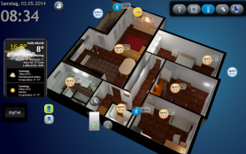
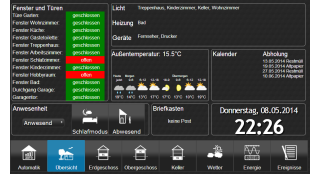
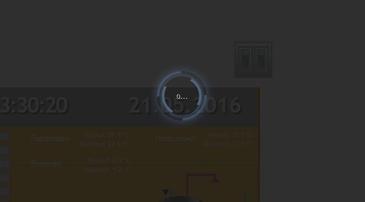

# Next generation visualization for ioBroker: vis-2 

  [](https://www.npmjs.com/package/iobroker.vis-2)
[](https://www.npmjs.com/package/iobroker.vis-2)

[](https://nodei.co/npm/iobroker.vis-2/)

WEB visualization for ioBroker platform.

## Overview
- [License requirements](#license-requirements)
- [Installation & Documentation](#installation--documentation)
- [Bindings of objects](#bindings-of-objects)
- [Filters](#filters)
- [Control interface](#control-interface)
- [Default view](#default-view)
- [Navigation](#navigation)
- [Permissions System](#permissions-system)
- [Settings](#settings)
- [SVG and curentColor](#svg-and-currentcolor)

## License requirements
To use this adapter in `ioBroker` you need to accept the source code license of the adapter. The source code of this adapter is available under the CC BY-NC license.

Additionally, you need a license to use the adapter. The following license editions are available on https://iobroker.net/www/pricing 
* **Community-License: Free for private use!**: Get a free license by registering an account on [https://iobroker.net](https://iobroker.net). The license if checked online against the ioBroker license server when the vis-2 adapter is started, so an online connection at this time point is required!
* **Private use Offline-License**: For paying a small support fee, you can get rid of the required online license check on adapter startup. **Only for Private use!**
* **Commercial License**: When using Vis in a commercial environment or selling Vis as a part of ioBroker packages to your customers, this license is for you. License check is also not requiring an online connection.

## Installation & Documentation




### Widgets

- [Standard widgets](/#/docs/adapterref/iobroker.vis-2/packages/iobroker.vis-2/docs/widgets-standard.md) - the devices of a house, as cards for
  a page with sections (`relative`) and as markers for a floor plan (`absolute`), with a picture of every one
  of them
- [jQui widgets](/#/docs/adapterref/iobroker.vis-2/packages/iobroker.vis-2/docs/widgets-jQui.md) - the widgets that came over from vis-1

## Bindings of objects
Normally, most of the widgets have ObjectID attribute, and this attribute can be bound with some value of object ID.
But there is another option for how to bind *any* attribute of widget to some ObjectID. 

Just write into attribute `{object.id}` e.g. `{hm-rpc.0.OEQ1880105.4.ACTUAL_TEMPERATURE}` and it will be bound to this object's value. 
If you use the special format, you can even make some simple operations with it, e.g., multiplying or formatting.

The CSS attributes of a view can be bound the same way, e.g. the background color of a view
`{a:javascript.0.alarm;a ? 'red' : 'green'}`.

E.g., to calculate the hypotenuse of a triangle:

`{h:javascript.0.myCustom.height;w:javascript.0.myCustom.width;Math.max(20, Math.sqrt(h*h + w*w))}` will be interpreted as function:

```js
value = await (async function () {
    var h = (await getState('javascript.0.myCustom.height')).val;
    var w = (await getState('javascript.0.myCustom.width')).val;
    return Math.max(20, Math.sqrt(h * h + w * w));
})();
```

or 

`{h:javascript.0.myCustom.height;w:javascript.0.myCustom.width;h*w}` will simply multiply height with width.

You can use *any* JavaScript (browser) functions. Arguments must be defined with ':', if not, it will be interpreted as formula.

Take care about types. All of them are defined as strings. To be sure, that value will be treated as a number use parseFloat function.

So our Hypotenuse calculation will be:
```
{h:javascript.0.myCustom.height;w:javascript.0.myCustom.width;Math.max(20, Math.sqrt(Math.pow(parseFloat(h), 2) + Math.pow(parseFloat(w), 2)))}
```

### Deprecated format
Patten has the following format:

```
{objectID;operation1;operation2;...}
```

The following operations are supported:

- `*` - multiplying. Argument must be in brackets, like "*(4)". In this sample, we multiply the value with 4.
- `+` - add. Argument must be in brackets, like "+(4.5)". In this sample we add to value 4.5.
- `-` - subtract. Argument must be in brackets, like "-(-674.5)". In this sample we subtract from value -674.5.
- `/` - dividing. Argument must be in brackets, like "/(0.5)". In this sample, we divide the value by 0.5.
- `%` - modulo. Argument must be in brackets, like "%(5)". In this sample, we take modulo of 5.
- `round` - round the value.
- `round(N)` - round the value with N places after point, e.g., 34.678;round(1) => 34.7
- `hex` - convert value to hexadecimal value. All letters are lower cased.
- `hex2` - convert value to hexadecimal value. All letters are lower cased. If value less 16, so the leading zero will be added.
- `HEX` - same as hex, but upper-cased.
- `HEX2` - same as hex2, but upper-cased.
- `date` - format date according to given format. Format is the same as in [iobroker.javascript](https://github.com/iobroker/iobroker.javascript/blob/master/README.md#formatdate)
- `min(N)` - if value is less than N, take the N, else value
- `max(M)` - if value is greater than M, take the M, else value
- `sqrt` - square root
- `pow(n)` - power of N.
- `pow` - power of 2.
- `floor` - Math.floor
- `ceil` - Math.ceil
- `json` - operation for getting JSON or object property. E.g., `{id;json(common.name.en)}`
- `random(R)` - Math.random() * R, or just Math.random() if no argument
- `formatValue(decimals)` - format value according to system settings and use decimals
- `date(format)` - format value as date. The format is like: "YYYY-MM-DD hh:mm:ss.sss"
- `momentDate(format, useTodayOrYesterday)` - format value as date using Moment.js. [Approved formats must be entered according to the moment.js library](https://momentjs.com/docs/#/displaying/format/). With `useTodayOrYesterday=true` the `moment.js` format `ddd`/`dddd` are overwritten with today / yesterday
- `array(element1,element2[,element3,element4])` - returns the element of index. e.g.: `{id.ack;array(ack is false,ack is true)}`. A boolean takes the second element when it is true and the first when it is false, so `{id;array(off,on)}` works on a switch
- `states` - the text of the value in `common.states` of the object, e.g. `{hm-rpc.0.ABC.STATE;states}` shows "Open" instead of `1`. A value that is not in the list stays as it is; `states(unknown)` shows the text in brackets instead. A text in several languages is shown in the language of vis. The object is read once when the binding is shown first, until then the binding shows the plain value. Only in this format: in the format with variables (`{v:id;...}`) the formula is JavaScript, which knows nothing of `common.states`

You can use this pattern in any text, like

```
My calculations with {objectID1;operation1;operation2;...} are {objectID2;operation3;operation4;...}
```

or color calculations:

```
#{objectRed;/(100);*(255);HEX2}{objectGreen;HEX2}{objectBlue;HEX2}
```

To show timestamp of an object write `.ts` or `.lc` (for last change) at the end of object id, e.g.:

```
Last change: {objectRed.lc;date(hh:mm)}
```

### Special bindings
There are a number of different internal bindings to provide additional information in views:
* `username` - shows logged-in user
* `view` - name of actual view
* `wname` - widget name
* `widget` - is an object with all data of widget. Can be used only in JS part, like `{a:a;widget.data.name}`
* `widgetOid` - use the OID of the widget to assign the widget's value in the assignment section, like `{t:widgetOid.val;t}`
* `wid` - name of actual widget
* `language` - can be `de`, `en` or `ru`.
* `instance` - browser instance
* `login` - if login required or not (e.g., to show/hide logout button)
* `local_*` - if state name is started from `local_` it will not be reported to ioBroker but will update all widgets, that depends on this state. (Local variable for current browser session)

Note: to use ":" in calculations (e.g., in string formula), use "::" instead.

**Remember** that style definitions will be interpreted as bindings, so use `{{style: value}}` or just

```
{
	style: value
}
```

for that.

## Filters
To visualize on the one view the whole number of widgets, you can use filters to reduce the count of widgets simultaneously shown on the view.
 
Every widget has a field `filter`. If you set it to some value, e.g. `light`, so you can use other widget `(bars - filters, filter - dropdown)` to control which filter is actually active.

The entries of the `filter - dropdown` widget (buttons as well as dropdown items) have the CSS class `vis-filter-item`, and the currently active entries additionally `vis-filter-item-active`, so they can be styled in the project CSS, e.g.:

```css
/* buttons (horizontal / vertical) */
.vis-filter-item-active {
    background-color: #ff0000;
}

/* entries of the dropdown */
.vis-filter-item-active.Mui-selected {
    background-color: #ff0000;
}
```

Two rules are required, because the active entry of the dropdown additionally has the class `Mui-selected`, and its own background color is more specific than `.vis-filter-item-active` alone.

Please note:
* If a color is configured for an entry in the widget itself, it is written as an inline style and cannot be overwritten with the `color` property from the project CSS. Leave the color of the entry empty if you want to set it via CSS.
* The entries of the dropdown are rendered outside the widget (in a popup on page level), so they can only be addressed globally and not with a selector for a single widget, like `#w00001 .vis-filter-item-active`. The buttons are a part of the widget and can be addressed this way.

## Control interface
Vis creates 3 variables:

- `control.instance` - Here the browser instance should be written or `FFFFFFFF` if every browser must be controlled.
- `control.data`     - Parameter for command. See a specific command description.
- `control.command`  - Command name. Write this variable triggering the command. That means before the command will be written, the "instance" and "data" must be prepared with data.

Commands:

* `alert` - show an alert window in the vis-2. "control.data" has the following format "message;title;jquery-icon". Title and jquery-icon are optional. Icon names can be found [here](http://jqueryui.com/themeroller/). To show icon "ui-icon-info" write `Message;;info`.
* `changeView` - switch to desired view. "control.data" must have the name of view. You can specify the project name too as `project/view`. The default project is `main`.
* `refresh` - reload the vis-2, for instance after the project is changed to reload on all browsers.
* `reload` - same as refresh.
* `dialog` - Show dialog window. Dialog must exist on view. One of:

    - `static    - HTML    - Dialog`,
    - `static    - Icon    - Dialog`,
    - `container - HTML    - view in jqui Dialog`,
    - `container - ext cmd - view in jqui Dialog`,
    - `container - Icon    - view in jqui Dialog`,
    - `container - Button  - view in jqui Dialog`.

    `control.data` must have id of dialog widget, e.g. `w00056`.
* `dialogClose`
* `popup` - opens a new browser window. Link must be specified in `control.data`, e.g., http://google.com
* `playSound` - play sound file. The link to file is specified in `control.data`, e.g., http://www.modular-planet.de/fx/marsians/Marsiansrev.mp3.
  You can upload your own file in vis-2 and let it play as for instance `/vis-2.0/main/img/myFile.mp3`.
  **Important** browser cannot play audio till the user has not clicked at least once on the page. It is a browser security policy. [Here](https://github.com/Hugo22O/chrome-autoplay) you can read more.

If the user changes the view or at the start, the variables will be filled by the vis-2 with

- `control.instance`: browser instance and `ack=true`
- `control.data`: project and view name in form `project/view`, e.g. `main/view` (and `ack=true`)
- `control.command`: `changedView` and `ack=true`

You can write the JSON string or Object into `control.command` as `{instance: 'AABBCCDD', command: 'cmd', data: 'ddd'}`. In this case, the instance and data will be taken from the JSON object.

Example for JavaScript adapter:

```js
setState('vis-2.0.control.command', JSON.stringify({ instance: '*', command: 'refresh', data: '' }));
```

Pass the object as a JSON string: `setState()` of the JavaScript adapter takes an object without `val` for the state itself, not for its value, and the command never arrives.

If you write the JSON as a string, ensure that it is parseable, e.g. `{"instance": "*", "command": "refresh", "data": ""}`, note the `"`. 

An AI agent (e.g. pi-agent, or the MCP server with `send_to`) learns all this from vis-2 itself: the message `help`
(`sendTo('vis-2.0', 'help', {}, answer => …)`) answers `{help, commands}` - this interface with the data of every
command, the projects with their views and dialogs, and the browsers that reported their view since the start of the
instance with their IDs.

## Default view
You can define for every view the desired resolution (Menu=>Tools=>Resolution).
This is only the visual border in edit mode to show you the screen size on some specific device. In the real-time mode, it will not be visible and all widgets outside the border will be visible.  

Additionally, you can define if this view must be used as default for this resolution. 

So every time the `index.html` (without `#viewName`) is called, the best suitable for this resolution view will be opened.
If only one view has *"Default"* flag, so this view will be opened independently of screen resolution or orientation.      

E.g., you can create two views "Landscape-Mobile" and "Portrait-Mobile" and these two views will be switched automatically when you change the orientation or screen size.

There is a helper widget "basic - Screen Resolution" that shows actual screen resolution and the best suitable default view for this resolution. 

## Navigation
Every widget that leads to a view - the `Go to view` option of the jQui widgets, `basic - HTML navigation`, … - gets
the CSS class `vis-nav-active` as long as the view it points to is the view that is shown. So the entry of the current
view can be highlighted in the CSS of the project:

```css
.vis-nav-active button {
    border: 1px solid #0d72b8;
}
```

## Permissions System
### Project
In the project management dialog, you can configure `read` and `write` permissions for each ioBroker user.

The `read` flag means that the project is accessible for this user in the Runtime. 
The `write` flag means that the project is accessible for this user in the Edit Mode.

When a new user is created via ioBroker Admin adapter, it will have both permissions by default.

### View
You can also specify which views the user is allowed to access for runtime and edit mode. 
When one of the access rights is not granted on the project level, it does not have any effect to specify them on view level, as the project as a whole will not be accessible.

Note that whenever you try to access a view where the current user has no permission for, the user will see the project selection panel instead.

### Widget
If the user has no `read` permissions, the widget will not be rendered in the runtime. If user has no `write` permissions, the widget
will not be rendered in edit mode.

## Settings
### Reload if sleep longer than
When the screen of a tablet turns off, the browser stops the page. When it wakes up, the page works off every state change it missed and is slow for many seconds. With "Reload if sleep longer than (seconds)" in the project settings, the runtime reloads instead after a sleep that long, and reads the states once. A page in the background counts as asleep too, from when it is shown again.

The time is at least 30 seconds; empty or 0 means never, which is the default. The runtime waits for the server to answer before it reloads, so that a device whose Wi-Fi is not back yet does not end on an error page. The editor never reloads by itself.

### Back to a view without input
In the project settings, under "Back to a view without input", you can choose a view and a number of seconds. When nobody has used the runtime for that long, it opens this view again - e.g. a panel on the wall goes back to its start page by itself. Every key press, click, touch or turn of the mouse wheel starts the time anew; moving the mouse alone does not.

This happens only in the runtime, not in the editor.

### Dark reconnect screen
Sometimes (in the night) it is required to have the dark loading screen. With this option, you can set it.

Notice that these settings are valid only for reconnection and not for the first connecting.



## SVG and currentColor
The currentColor keyword in CSS allows elements to inherit the current text color from their parent element.
It can be particularly useful in SVGs (Scalable Vector Graphics) because it allows for more dynamic styling and easier integration with HTML content.

You can use the currentColor keyword in place of a specific color value for any property inside the SVG that accepts a color value.
Here's a simple example with a circle in an SVG:
```xml
<svg width="100" height="100" xmlns="http://www.w3.org/2000/svg">
    <circle cx="50" cy="50" r="40" fill="currentColor" />
</svg>
```
In this case, if the SVG takes the color of the parent element.
E.g., if it was used in a menu and the menu is red, the circle would be red.

## Background services of widget sets
The runtime renders only the open view and the views with "Render always", so a widget lives only while its view is
shown. A widget set may bring **background services** for what must not stop with its view - e.g. a phone that has to
stay registered to ring, and that shows the dialog of an incoming call over whichever view is open.

A service is a React component, exposed by the module federation of the set like a widget (default export), and named
in `io-package.json`:

```json
"visWidgets": {
    "vis2IntercomWidgets": {
        "url": "intercom/customWidgets.js",
        "components": ["Phone"],
        "services": ["PhoneService"]
    }
}
```

The runtime renders every service once, next to the views, as long as the project is open - not in the editor. It gets
the props `VisServiceProps` of `@iobroker/types-vis-2`:

- `widgets` - the widgets of the set (their `widgetSet` is one of the names of the set, see below) in all views of the project that the user may
  see: with read permission for the project, the view and the widget, and not excluded by `visibility-groups`. Each is
  `{ view, id, tpl, data }`, with `data` as stored in the project - the bindings are not resolved.
- `adapter`, `socket`, `user` (without `system.user.`), `lang` and `changeView(view)`.

The `visSet` that the widgets of a set return in `getWidgetInfo()` names the set; the runtime loads only the sets the
project uses. A set may be named after the adapter, or after the key or the `name` of its collection in `visWidgets` -
so one adapter can bring several sets, each with its own `visSet`.

A service is only loaded with its set, i.e. if the project uses a widget of the set. A crashing service is left out,
the views and the other services go on.

An older vis-2 ignores `services`, so the widgets have to work without them, e.g. hold the phone themselves. Whether the
running vis-2 renders services, a widget asks with `window.visRxWidget.FEATURES?.includes('services')` - e.g. to tell
the user in the editor that the view needs "Render always" only if it does not.

## Development and Debugging

In order to make adjustments to the vis-2 editor itself, to search for errors and to debug, the following steps must be carried out.

1. fork the iobroker/iobroker.vis-2 repository into your own account via the user interface of GitHub

2. clone the repository into a directory. copy the url from your GitHub repository. the command looks like

```shell
git clone https://github.com/<your profile name>/ioBroker.vis-2.git
```

3. open the downloaded repository with your IDE

4. to install and download all necessary libraries, run the following command in a terminal in the root directory of the repository

```shell
npm run install-monorepo
```

5. to start the editor in the browser, please execute the following command.
An already separately running iobroker server instance must be available on port 8082.

```shell
npm run start
```

The development server listens on port 3000 and asks `http://localhost:8082` for everything it does not
serve itself. Both can be changed where that does not fit:

```shell
VIS_PORT=3005 npm run start                       # another port, if 3000 is taken
IOB_URL=http://192.168.178.45:8082 npm run start  # an ioBroker on another machine
```

- Debugging is available in the browser e.g. chrome F12
- if you change a file, automatic reload of the editor is supported

## Todo
- AI Assistant
- Navigation verbessern
- Backup konzept (Project-History)

<!--
    Placeholder for the next version (at the beginning of the line):
    ### **WORK IN PROGRESS**
-->
## Changelog
### 2.20.12 (2026-11-26)
* (@GermanBluefox) Editor: the code editors for HTML, CSS, JavaScript and JSON show the button "Format code" with its label in a row above the code. Until now it was a small icon in the corner that covered the code and was hardly noticed; in a narrow panel such as the CSS tab only the icon remains. A code that cannot be formatted shows its error beside the button
* (@GermanBluefox) HTML widgets (HTML, HTML state, HTML navigation): `_PRJ_NAME/` in the HTML stands for the folder of the project, as it does in the image fields - `` loads `../vis-2.0/<project>/logo.jpg`
* (@GermanBluefox) Editor: the dialog "Import project" got a clearer drop zone - an icon, the allowed file type, the selected file as a card with its real size (base64 size before) and a long file name wrapped instead of running over the border. While the server unpacks the project, which can take a while, a spinner shows it in the dialog and in the button "Import"
* (@GermanBluefox) Editor: palette and attributes can be pinned as columns beside the view. Since 2.20.3 they float over the view with a fixed width as soon as its resolution does not fit between them - with a view as wide as the screen always, so the attributes had to be opened over the view for every widget. The pin in the head of both panels keeps them as columns, and the view scrolls between them; a window narrower than 1200 pixels still lets them float
* (@GermanBluefox) servConn._socket.emit forwards sendTo again and throws on unknown commands (#749)
* (@GermanBluefox) vis-2 answers the message `help` (`common.supportedMessages.help`): an AI agent such as pi-agent learns how to steer the browsers through `control.command` (the data of every command), the projects with their views and dialogs, and the IDs of the browsers that reported their view (to be written into `instance` exactly as listed)
* (@GermanBluefox) Fully Kiosk Browser and other Android WebViews no longer darken the views on their own in the dark mode. Since 2.20 the page declared no color scheme any more, so the WebView darkened it itself and the vis-1 widgets (hqwidgets, jqui-mfd) came out with swapped light and dark colors, while Chrome showed them right. The page declares `color-scheme: only light` now, which looks the same in every other browser; iframes stay transparent. The workaround `:root { color-scheme: only light !important; }` in the project CSS is no longer needed
* (@GermanBluefox) Standard widgets: a colour from the colour picker of the editor (`rgb(20, 123, 248)`) works for the faint fill of jump marks, buttons, lists, media players, locks and vacuum cleaners. The opacity was appended as two hex digits, which made `rgb(...)` invalid, and the buttons came out grey
* (@GermanBluefox) Standard widgets: a text that only begins with a number is shown as text - `07:24` was shown as 7, `17.11.2026, 09:46` as 17,11. A number with a unit behind it (`21,4 °C`, `45%`) is still a number
* (@GermanBluefox) Chart: the value axes are as wide as their labels, so the top label with the unit keeps its first digits (`5,0 km/h` instead of `35,0 km/h`)
* (@GermanBluefox) Window widget: the lines of the drawing stay fine at every size, like those of the blind beside it, instead of growing several pixels thick on a large card
* (@GermanBluefox) Editor: "Show all views" no longer crashes the editor with "Maximum update depth exceeded". It listed the views that were open already a second time and saved that in the project, so the editor crashed again on every load; such a project is repaired when it is loaded
* (@GermanBluefox) "Limit screen size": a page that is higher or wider than the window starts at the top left and can be scrolled; only a page that fits is centred. Before, what stuck out above and on the left could not be reached - a page of 1280 px in a window of 738 px lost its first 271 px

### 2.20.11 (2026-11-17)
* (@GermanBluefox) Safari 27 (macOS, iOS, iPadOS) and the ioBroker app no longer load the whole page again after every change of the view when vis-2 is opened over plain HTTP: the view changes without a navigation now. Links to a view (`<a href="#view">`) in HTML widgets and link buttons to `#view` do the same (#743)

### 2.20.10 (2026-11-17)
* (@GermanBluefox) Grid layout: a section can have its own background for the light and for the dark theme. While such a theme is active, it wins over the background of the section and over the colour of the panel, e.g. to set a section apart from its widgets in both themes
* (@GermanBluefox) The widgets whose ID contains "_" are shown again: since 2.20.2 the runtime took every such widget for a copy of a widget of another view ("multi-views") and dropped it, which left the views of generated projects empty and took out every widget whose ID contained a space. Saving in the editor dropped them too. A copy is now known by a mark, not by its ID, and the editor names the widget it comes from correctly even when its ID contains "_" (#744)
* (@GermanBluefox) The widgets of the vis-1 widget sets (e.g. hqwidgets, materialdesign, trashschedule) are rendered again after a view change in the editor: a new engine takes over `vis.binds` with the sets already registered instead of starting with empty binds (#741)
* (@GermanBluefox) Removed the unnecessary vertical scrollbar in runtime (4px overflow caused by inline-block body) (#734)
* (@GermanBluefox) Runtime: the widget sets without widgets, which bring only styles or fonts (e.g. google-fonts of vis-google-fonts), are loaded again, so the chosen font is shown in the runtime and not only in the editor (#735)
* (@GermanBluefox) The button of the AI assistant is in the tabs bar of the editor. As a floating button it covered controls in the attributes, e.g. the signal images (#739)
* (@GermanBluefox) Web components: the setting types `selectSendTo` and `autocompleteSendTo` (`@iobroker/web-components` 0.8) - the options of a select or the suggestions of a text field are asked from an instance of the adapter. Without an instance to ask or without an answer the field stays a text field and says why
* (@GermanBluefox) Fixed ticks in gauge widget and missing tooltip translation (#732)
* (@GermanBluefox) Navigation: the header of the menu can show an icon or an image - a logo - in front of its text. It belongs to the project and is the same on every page with a menu, wherever it is set: in the attributes of any view or in the project settings
* (@GermanBluefox) Grid layout: a section can be its header alone ("Only the header"). The runtime shows none of its widgets and keeps it even without any, so a heading over the page needs no invisible widget any more
* (@GermanBluefox) Grid layout: the space between the header of a section and its widgets can be set, and the subtitle can be written in italics
* (@GermanBluefox) Runtime: a theme switched in the runtime (theme widget) also switches the colour of the page under the views. A light theme stood on a black page wherever nothing covered it, e.g. under a menu without its own colour, and the page took the colour of the system on loading instead of the chosen theme
* (@GermanBluefox) Standard widgets: the clock has no symbol in its corner any more, unless one is set, and a long date like "Mittwoch, 11. November" is made smaller instead of being cut off at both ends
* (@GermanBluefox) Standard widgets: the theme switcher can leave out the word Light / Dark
* (@GermanBluefox) Editor: the projects dialog reads the list of projects from the server every time it opens, so a project added, renamed or deleted elsewhere shows up without reloading the editor. A list that cannot be read keeps the one shown before instead of offering to create a first project
* (@GermanBluefox) Standard widgets, set relative: the header of a card can be switched to "Only the name", "Only the icon" or "Nothing". What it leaves out makes room: without a name the icon moves in front of the value and that row moves up, so a tile one row high shows icon, value and switch; without both the content starts at the top edge
* (@GermanBluefox) Standard widgets: the size of the value can be set (set relative). A long name takes a second line instead of being cut off after a few letters, and shows in full as a tooltip. A word and a value that do not fit side by side are put under each other instead of breaking in the middle ("Noch 1:28" over a lonely "h" on a washing machine), and a long word as the value is broken at a syllable on a narrow tile instead of losing its end ("Unterw"). The size of the icon can also be a share ("60%"), and the photo of a person follows it; on a wide card the photo stands beside name and value over the whole height
* (@GermanBluefox) Standard widgets: new widget "Energy flow" - panels, grid, battery and house with moving dots on the lines between them, faster the more power flows. Three states are enough; the flows and the consumption of the house are worked out, a state in kW is read as kW, and grid and battery can count the other way round
* (@GermanBluefox) Standard widgets: new widget "Status count" - how many of a group of states are on and which ("3 windows open"), with a sentence for some and one for none, a colour, an alarm option and the names of those that are on
* (@GermanBluefox) Sensor widget: new kind "Person (presence)" with a large round photo that turns grey while the person is away. Without a photo the own symbol of the widget is shown, without that the initials of the name
* (@GermanBluefox) Alarm widget: the names of the zones get the whole width of their tile and two lines. A zone can say open / closed instead of on / off (yellow while open), and the texts for on and off can be set
* (@GermanBluefox) Table widget: a column that holds a time can be written as time, date, date and time, weekday and time, "Today 14:30 / Tomorrow 09:00" or with an own pattern like `W DD.MM. hh:mm`, and the rows can be filtered: not over yet, today, or the rest of today. The table checks again every minute
* (@GermanBluefox) Thermostat widget: the dial fills its card instead of keeping a margin around it, the knob follows the finger also in a card wider than the dial, and presets that do not fit into one row wrap instead of being cut to "1…"
* (@GermanBluefox) Weather widget: the large picture of OpenWeatherMap is loaded in its largest size and shown at most at its own size, so it stays sharp, and the picture behind the card stays inside the card
* (@GermanBluefox) Navigation: the menu at the bottom edge shows four pages and a "More" button for the rest when there are more than five; a hand-made page with links to the others is no longer needed. Without an app bar, the button that opens a hidden menu has a background and a shadow of its own and is found on a dark page too
* (@GermanBluefox) Editor: a setting of the menu changed in the project settings says how many pages still carry a value of their own, and "Use for all pages" makes them follow the project when it is saved. The attributes of a view show the value the page gets from the project instead of an empty field

### 2.20.9 (2026-11-10)
* (@GermanBluefox) Editor: a whole view can be exported and imported with the new buttons in the toolbar of the views, not only from the views dialog. The export saves the view as a file or copies it, the import takes a file, opened or dropped on the field, or pasted JSON. It also takes any view out of a whole project (`vis-views.json`), proposes a free name and warns before a view is replaced
* (@GermanBluefox) Editor, grid layout: a pasted widget goes into a section - into the selected one, after the selected widget, or next to the widget it is a copy of; a cut widget goes back to its place. Ctrl+V now also works while widgets are selected, and a duplicated widget follows its original
* (@GermanBluefox) Editor, grid layout: a whole section can be copied, cut and pasted (Ctrl+C / Ctrl+X / Ctrl+V on a selected section), duplicated with a button under it, and exported and imported in the attributes of the section. The import also offers the sections of an exported view or of a whole project
* (@GermanBluefox) Editor: a deleted widget leaves its section. A new widget that got the same ID turned up in that section
* (@GermanBluefox) Editor: a widget that shows another one in itself keeps showing its copy when the view is copied or imported, and the widgets the editor only shows because another view shares them are no longer copied along
* (@GermanBluefox) Editor: the buttons of the toolbar are as wide as their label, so "Einstellungen" no longer runs into "Projekte"
* (@GermanBluefox) Editor: a view that is copied or imported keeps the order of its widgets and their sections in the grid layout. The widgets get new IDs, but the sections still listed the old ones, so all widgets ended up in one section at the end. An invalid JSON in the import no longer breaks the dialog
* (@jkvarel) Attributes of type `widget` show the name given to a widget in the "General" group in the list of widgets instead of its type
* (@GermanBluefox) If the widgets of an adapter on another host cannot be fetched because the js-controller is too old, the log names the host vis-2 runs on, whose js-controller has to be updated
* (@GermanBluefox) A formula of a binding that fails is reported once in the console instead of in three lines every time the widget is rendered, and not at all while one of its values has not been received yet, e.g. `{v:id;v.toFixed(2)}` while the page loads
* (@GermanBluefox) A widget from the palette can be dropped on a view again when the view is taller than the editor and scrolled down: the section under the cursor was marked, but letting go did nothing. The palette no longer scrolls by itself while a widget is dragged out of it
* (@GermanBluefox) Standard widgets (relative and absolute): the size of the name and of the icon can be set, and the CSS settings of a widget now reach its content: font size, colour, font style and the other text settings apply to the value, also inside dials and gauges, and background, border, corner radius, shadow and padding apply to the card
* (@GermanBluefox) Thermostat and knob: the control can be round, horizontal or vertical. The sliders of the thermostat show the same scale from cold to warm as its dial
* (@GermanBluefox) The check of a license of a widget set asks iobroker.net at most every 5 minutes per license instead of once per page, and accepts only the name of an adapter
* (@GermanBluefox) Editor: dragging a color picker quickly no longer crashes the page with "Maximum update depth exceeded". The field handed a color back while the picker already showed the next one, and the two pushed each other back and forth
* (@GermanBluefox) jQui inputs for time and date: on a touch screen a touch on the value opens the picker again, as a touch on the symbol does, and no number stays marked after it is closed. The value is no longer typed there, so the keyboard of the device does not come up, and if the input can be emptied, the picker has a button for it
* (@GermanBluefox) Editor: on the Mac the delete key removes the selected widgets, because that key sends `Backspace`. On other keyboards `Backspace` now does the same as `Delete`
* (@GermanBluefox) Editor: on the Mac `Cmd` now works where `Ctrl` does: undo, redo, copy, cut, paste and select all, adding a widget to the selection with a click, and moving or resizing a widget by 10 pixels with the arrow keys
* (@GermanBluefox) Weather widget: the accent colour and the colour of the sun can be set. The pictures of OpenWeatherMap are now drawn by the widget, with a yellow sun that has rays and a glow, and the picture behind the card is larger. A new option keeps the pictures of the adapter
* (@GermanBluefox) Editor and widgets use the animated icons of `@iobroker/gui-components`: the lid of the trash can opens over delete buttons, what is copied to the clipboard is confirmed with a check mark, folders open and close, play and pause turn into each other, the sun and the moon of the theme widget too, and the bell of an alarm rings
* (@GermanBluefox) Standard widgets: colours that change run into each other instead of jumping, and the sun of the weather widget turns its rays, the rain falls and the lightning flickers. All of it stops when the system is set to reduce motion

### 2.20.8 (2026-11-07)
* (@GermanBluefox) The widgets of an adapter that is installed on another host than vis-2 are shown now: vis-2 fetches its `widgets` folder from that host (js-controller 8.0 or newer on both hosts) and keeps a copy in its data directory, which is fetched again only when the version of the adapter changes and is used while that host is not running

## License
 Copyright (c) 2021-2026 Denis Haev, https://github.com/GermanBluefox <dogafox@gmail.com>,
  
 Creative Common Attribution-NonCommercial (CC BY-NC)

 http://creativecommons.org/licenses/by-nc/4.0/


Short content:
Licensees may copy, distribute, display and perform the work and make derivative works based on it only if they give the author or licensor the credits in the manner specified by these.
Licensees may copy, distribute, display, and perform the work and make derivative works based on it only for noncommercial purposes.
(Free for non-commercial use).