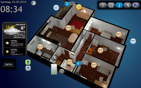
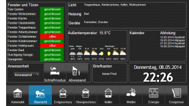
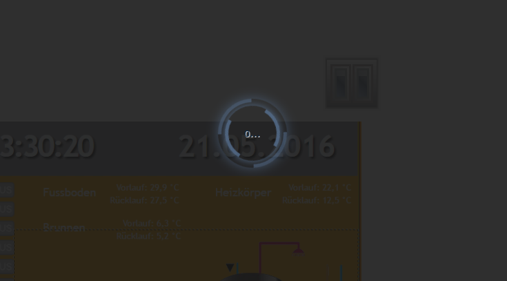

# Next generation visualization for ioBroker: vis-2 

  [](https://www.npmjs.com/package/iobroker.vis-2)
[](https://www.npmjs.com/package/iobroker.vis-2)

[](https://nodei.co/npm/iobroker.vis-2/)

WEB visualization for ioBroker platform.

## Overview
- [License requirements](#license-requirements)
- [Installation & Documentation](#installation--documentation)
- [Bindings of objects](#bindings-of-objects)
- [Filters](#filters)
- [Control interface](#control-interface)
- [Default view](#default-view)
- [Navigation](#navigation)
- [Permissions System](#permissions-system)
- [Settings](#settings)
- [SVG and curentColor](#svg-and-currentcolor)

## License requirements
To use this adapter in `ioBroker` you need to accept the source code license of the adapter. The source code of this adapter is available under the CC BY-NC license.

Additionally, you need a license to use the adapter. The following license editions are available on https://iobroker.net/www/pricing 
* **Community-License: Free for private use!**: Get a free license by registering an account on [https://iobroker.net](https://iobroker.net). The license if checked online against the ioBroker license server when the vis-2 adapter is started, so an online connection at this time point is required!
* **Private use Offline-License**: For paying a small support fee, you can get rid of the required online license check on adapter startup. **Only for Private use!**
* **Commercial License**: When using Vis in a commercial environment or selling Vis as a part of ioBroker packages to your customers, this license is for you. License check is also not requiring an online connection.

## Installation & Documentation




### Widgets

- [Standard widgets](/#/docs/adapterref/iobroker.vis-2/packages/iobroker.vis-2/docs/widgets-standard.md) - the devices of a house, as cards for
  a page with sections (`relative`) and as markers for a floor plan (`absolute`), with a picture of every one
  of them
- [jQui widgets](/#/docs/adapterref/iobroker.vis-2/packages/iobroker.vis-2/docs/widgets-jQui.md) - the widgets that came over from vis-1

## Bindings of objects
Normally, most of the widgets have ObjectID attribute, and this attribute can be bound with some value of object ID.
But there is another option for how to bind *any* attribute of widget to some ObjectID. 

Just write into attribute `{object.id}` e.g. `{hm-rpc.0.OEQ1880105.4.ACTUAL_TEMPERATURE}` and it will be bound to this object's value. 
If you use the special format, you can even make some simple operations with it, e.g., multiplying or formatting.

The CSS attributes of a view can be bound the same way, e.g. the background color of a view
`{a:javascript.0.alarm;a ? 'red' : 'green'}`.

E.g., to calculate the hypotenuse of a triangle:

`{h:javascript.0.myCustom.height;w:javascript.0.myCustom.width;Math.max(20, Math.sqrt(h*h + w*w))}` will be interpreted as function:

```js
value = await (async function () {
    var h = (await getState('javascript.0.myCustom.height')).val;
    var w = (await getState('javascript.0.myCustom.width')).val;
    return Math.max(20, Math.sqrt(h * h + w * w));
})();
```

or 

`{h:javascript.0.myCustom.height;w:javascript.0.myCustom.width;h*w}` will simply multiply height with width.

You can use *any* JavaScript (browser) functions. Arguments must be defined with ':', if not, it will be interpreted as formula.

Take care about types. All of them are defined as strings. To be sure, that value will be treated as a number use parseFloat function.

So our Hypotenuse calculation will be:
```
{h:javascript.0.myCustom.height;w:javascript.0.myCustom.width;Math.max(20, Math.sqrt(Math.pow(parseFloat(h), 2) + Math.pow(parseFloat(w), 2)))}
```

### Deprecated format
Patten has the following format:

```
{objectID;operation1;operation2;...}
```

The following operations are supported:

- `*` - multiplying. Argument must be in brackets, like "*(4)". In this sample, we multiply the value with 4.
- `+` - add. Argument must be in brackets, like "+(4.5)". In this sample we add to value 4.5.
- `-` - subtract. Argument must be in brackets, like "-(-674.5)". In this sample we subtract from value -674.5.
- `/` - dividing. Argument must be in brackets, like "/(0.5)". In this sample, we divide the value by 0.5.
- `%` - modulo. Argument must be in brackets, like "%(5)". In this sample, we take modulo of 5.
- `round` - round the value.
- `round(N)` - round the value with N places after point, e.g., 34.678;round(1) => 34.7
- `hex` - convert value to hexadecimal value. All letters are lower cased.
- `hex2` - convert value to hexadecimal value. All letters are lower cased. If value less 16, so the leading zero will be added.
- `HEX` - same as hex, but upper-cased.
- `HEX2` - same as hex2, but upper-cased.
- `date` - format date according to given format. Format is the same as in [iobroker.javascript](https://github.com/iobroker/iobroker.javascript/blob/master/README.md#formatdate)
- `min(N)` - if value is less than N, take the N, else value
- `max(M)` - if value is greater than M, take the M, else value
- `sqrt` - square root
- `pow(n)` - power of N.
- `pow` - power of 2.
- `floor` - Math.floor
- `ceil` - Math.ceil
- `json` - operation for getting JSON or object property. E.g., `{id;json(common.name.en)}`
- `random(R)` - Math.random() * R, or just Math.random() if no argument
- `formatValue(decimals)` - format value according to system settings and use decimals
- `date(format)` - format value as date. The format is like: "YYYY-MM-DD hh:mm:ss.sss"
- `momentDate(format, useTodayOrYesterday)` - format value as date using Moment.js. [Approved formats must be entered according to the moment.js library](https://momentjs.com/docs/#/displaying/format/). With `useTodayOrYesterday=true` the `moment.js` format `ddd`/`dddd` are overwritten with today / yesterday
- `array(element1,element2[,element3,element4])` - returns the element of index. e.g.: `{id.ack;array(ack is false,ack is true)}`. A boolean takes the second element when it is true and the first when it is false, so `{id;array(off,on)}` works on a switch
- `states` - the text of the value in `common.states` of the object, e.g. `{hm-rpc.0.ABC.STATE;states}` shows "Open" instead of `1`. A value that is not in the list stays as it is; `states(unknown)` shows the text in brackets instead. A text in several languages is shown in the language of vis. The object is read once when the binding is shown first, until then the binding shows the plain value. Only in this format: in the format with variables (`{v:id;...}`) the formula is JavaScript, which knows nothing of `common.states`

You can use this pattern in any text, like

```
My calculations with {objectID1;operation1;operation2;...} are {objectID2;operation3;operation4;...}
```

or color calculations:

```
#{objectRed;/(100);*(255);HEX2}{objectGreen;HEX2}{objectBlue;HEX2}
```

To show timestamp of an object write `.ts` or `.lc` (for last change) at the end of object id, e.g.:

```
Last change: {objectRed.lc;date(hh:mm)}
```

### Special bindings
There are a number of different internal bindings to provide additional information in views:
* `username` - shows logged-in user
* `view` - name of actual view
* `wname` - widget name
* `widget` - is an object with all data of widget. Can be used only in JS part, like `{a:a;widget.data.name}`
* `widgetOid` - use the OID of the widget to assign the widget's value in the assignment section, like `{t:widgetOid.val;t}`
* `wid` - name of actual widget
* `language` - can be `de`, `en` or `ru`.
* `instance` - browser instance
* `login` - if login required or not (e.g., to show/hide logout button)
* `local_*` - if state name is started from `local_` it will not be reported to ioBroker but will update all widgets, that depends on this state. (Local variable for current browser session)

Note: to use ":" in calculations (e.g., in string formula), use "::" instead.

**Remember** that style definitions will be interpreted as bindings, so use `{{style: value}}` or just

```
{
	style: value
}
```

for that.

## Filters
To visualize on the one view the whole number of widgets, you can use filters to reduce the count of widgets simultaneously shown on the view.
 
Every widget has a field `filter`. If you set it to some value, e.g. `light`, so you can use other widget `(bars - filters, filter - dropdown)` to control which filter is actually active.

The entries of the `filter - dropdown` widget (buttons as well as dropdown items) have the CSS class `vis-filter-item`, and the currently active entries additionally `vis-filter-item-active`, so they can be styled in the project CSS, e.g.:

```css
/* buttons (horizontal / vertical) */
.vis-filter-item-active {
    background-color: #ff0000;
}

/* entries of the dropdown */
.vis-filter-item-active.Mui-selected {
    background-color: #ff0000;
}
```

Two rules are required, because the active entry of the dropdown additionally has the class `Mui-selected`, and its own background color is more specific than `.vis-filter-item-active` alone.

Please note:
* If a color is configured for an entry in the widget itself, it is written as an inline style and cannot be overwritten with the `color` property from the project CSS. Leave the color of the entry empty if you want to set it via CSS.
* The entries of the dropdown are rendered outside the widget (in a popup on page level), so they can only be addressed globally and not with a selector for a single widget, like `#w00001 .vis-filter-item-active`. The buttons are a part of the widget and can be addressed this way.

## Control interface
Vis creates 3 variables:

- `control.instance` - Here the browser instance should be written or `FFFFFFFF` if every browser must be controlled.
- `control.data`     - Parameter for command. See a specific command description.
- `control.command`  - Command name. Write this variable triggering the command. That means before the command will be written, the "instance" and "data" must be prepared with data.

Commands:

* `alert` - show an alert window in the vis-2. "control.data" has the following format "message;title;jquery-icon". Title and jquery-icon are optional. Icon names can be found [here](http://jqueryui.com/themeroller/). To show icon "ui-icon-info" write `Message;;info`.
* `changeView` - switch to desired view. "control.data" must have the name of view. You can specify the project name too as `project/view`. The default project is `main`.
* `refresh` - reload the vis-2, for instance after the project is changed to reload on all browsers.
* `reload` - same as refresh.
* `dialog` - Show dialog window. Dialog must exist on view. One of:

    - `static    - HTML    - Dialog`,
    - `static    - Icon    - Dialog`,
    - `container - HTML    - view in jqui Dialog`,
    - `container - ext cmd - view in jqui Dialog`,
    - `container - Icon    - view in jqui Dialog`,
    - `container - Button  - view in jqui Dialog`.

    `control.data` must have id of dialog widget, e.g. `w00056`.
* `dialogClose`
* `popup` - opens a new browser window. Link must be specified in `control.data`, e.g., http://google.com
* `playSound` - play sound file. The link to file is specified in `control.data`, e.g., http://www.modular-planet.de/fx/marsians/Marsiansrev.mp3.
  You can upload your own file in vis-2 and let it play as for instance `/vis-2.0/main/img/myFile.mp3`.
  **Important** browser cannot play audio till the user has not clicked at least once on the page. It is a browser security policy. [Here](https://github.com/Hugo22O/chrome-autoplay) you can read more.

If the user changes the view or at the start, the variables will be filled by the vis-2 with

- `control.instance`: browser instance and `ack=true`
- `control.data`: project and view name in form `project/view`, e.g. `main/view` (and `ack=true`)
- `control.command`: `changedView` and `ack=true`

You can write the JSON string or Object into `control.command` as `{instance: 'AABBCCDD', command: 'cmd', data: 'ddd'}`. In this case, the instance and data will be taken from the JSON object.

Example for JavaScript adapter:

```js
setState('vis-2.0.control.command', JSON.stringify({ instance: '*', command: 'refresh', data: '' }));
```

Pass the object as a JSON string: `setState()` of the JavaScript adapter takes an object without `val` for the state itself, not for its value, and the command never arrives.

If you write the JSON as a string, ensure that it is parseable, e.g. `{"instance": "*", "command": "refresh", "data": ""}`, note the `"`. 

## Default view
You can define for every view the desired resolution (Menu=>Tools=>Resolution).
This is only the visual border in edit mode to show you the screen size on some specific device. In the real-time mode, it will not be visible and all widgets outside the border will be visible.  

Additionally, you can define if this view must be used as default for this resolution. 

So every time the `index.html` (without `#viewName`) is called, the best suitable for this resolution view will be opened.
If only one view has *"Default"* flag, so this view will be opened independently of screen resolution or orientation.      

E.g., you can create two views "Landscape-Mobile" and "Portrait-Mobile" and these two views will be switched automatically when you change the orientation or screen size.

There is a helper widget "basic - Screen Resolution" that shows actual screen resolution and the best suitable default view for this resolution. 

## Navigation
Every widget that leads to a view - the `Go to view` option of the jQui widgets, `basic - HTML navigation`, … - gets
the CSS class `vis-nav-active` as long as the view it points to is the view that is shown. So the entry of the current
view can be highlighted in the CSS of the project:

```css
.vis-nav-active button {
    border: 1px solid #0d72b8;
}
```

## Permissions System
### Project
In the project management dialog, you can configure `read` and `write` permissions for each ioBroker user.

The `read` flag means that the project is accessible for this user in the Runtime. 
The `write` flag means that the project is accessible for this user in the Edit Mode.

When a new user is created via ioBroker Admin adapter, it will have both permissions by default.

### View
You can also specify which views the user is allowed to access for runtime and edit mode. 
When one of the access rights is not granted on the project level, it does not have any effect to specify them on view level, as the project as a whole will not be accessible.

Note that whenever you try to access a view where the current user has no permission for, the user will see the project selection panel instead.

### Widget
If the user has no `read` permissions, the widget will not be rendered in the runtime. If user has no `write` permissions, the widget
will not be rendered in edit mode.

## Settings
### Reload if sleep longer than
When the screen of a tablet turns off, the browser stops the page. When it wakes up, the page works off every state change it missed and is slow for many seconds. With "Reload if sleep longer than (seconds)" in the project settings, the runtime reloads instead after a sleep that long, and reads the states once. A page in the background counts as asleep too, from when it is shown again.

The time is at least 30 seconds; empty or 0 means never, which is the default. The runtime waits for the server to answer before it reloads, so that a device whose Wi-Fi is not back yet does not end on an error page. The editor never reloads by itself.

### Back to a view without input
In the project settings, under "Back to a view without input", you can choose a view and a number of seconds. When nobody has used the runtime for that long, it opens this view again - e.g. a panel on the wall goes back to its start page by itself. Every key press, click, touch or turn of the mouse wheel starts the time anew; moving the mouse alone does not.

This happens only in the runtime, not in the editor.

### Dark reconnect screen
Sometimes (in the night) it is required to have the dark loading screen. With this option, you can set it.

Notice that these settings are valid only for reconnection and not for the first connecting.



## SVG and currentColor
The currentColor keyword in CSS allows elements to inherit the current text color from their parent element.
It can be particularly useful in SVGs (Scalable Vector Graphics) because it allows for more dynamic styling and easier integration with HTML content.

You can use the currentColor keyword in place of a specific color value for any property inside the SVG that accepts a color value.
Here's a simple example with a circle in an SVG:
```xml
<svg width="100" height="100" xmlns="http://www.w3.org/2000/svg">
    <circle cx="50" cy="50" r="40" fill="currentColor" />
</svg>
```
In this case, if the SVG takes the color of the parent element.
E.g., if it was used in a menu and the menu is red, the circle would be red.

## Background services of widget sets
The runtime renders only the open view and the views with "Render always", so a widget lives only while its view is
shown. A widget set may bring **background services** for what must not stop with its view - e.g. a phone that has to
stay registered to ring, and that shows the dialog of an incoming call over whichever view is open.

A service is a React component, exposed by the module federation of the set like a widget (default export), and named
in `io-package.json`:

```json
"visWidgets": {
    "vis2IntercomWidgets": {
        "url": "intercom/customWidgets.js",
        "components": ["Phone"],
        "services": ["PhoneService"]
    }
}
```

The runtime renders every service once, next to the views, as long as the project is open - not in the editor. It gets
the props `VisServiceProps` of `@iobroker/types-vis-2`:

- `widgets` - the widgets of the set (their `widgetSet` is one of the names of the set, see below) in all views of the project that the user may
  see: with read permission for the project, the view and the widget, and not excluded by `visibility-groups`. Each is
  `{ view, id, tpl, data }`, with `data` as stored in the project - the bindings are not resolved.
- `adapter`, `socket`, `user` (without `system.user.`), `lang` and `changeView(view)`.

The `visSet` that the widgets of a set return in `getWidgetInfo()` names the set; the runtime loads only the sets the
project uses. A set may be named after the adapter, or after the key or the `name` of its collection in `visWidgets` -
so one adapter can bring several sets, each with its own `visSet`.

A service is only loaded with its set, i.e. if the project uses a widget of the set. A crashing service is left out,
the views and the other services go on.

An older vis-2 ignores `services`, so the widgets have to work without them, e.g. hold the phone themselves. Whether the
running vis-2 renders services, a widget asks with `window.visRxWidget.FEATURES?.includes('services')` - e.g. to tell
the user in the editor that the view needs "Render always" only if it does not.

## Development and Debugging

In order to make adjustments to the vis-2 editor itself, to search for errors and to debug, the following steps must be carried out.

1. fork the iobroker/iobroker.vis-2 repository into your own account via the user interface of GitHub

2. clone the repository into a directory. copy the url from your GitHub repository. the command looks like

```shell
git clone https://github.com/<your profile name>/ioBroker.vis-2.git
```

3. open the downloaded repository with your IDE

4. to install and download all necessary libraries, run the following command in a terminal in the root directory of the repository

```shell
npm run install-monorepo
```

5. to start the editor in the browser, please execute the following command.
An already separately running iobroker server instance must be available on port 8082.

```shell
npm run start
```

The development server listens on port 3000 and asks `http://localhost:8082` for everything it does not
serve itself. Both can be changed where that does not fit:

```shell
VIS_PORT=3005 npm run start                       # another port, if 3000 is taken
IOB_URL=http://192.168.178.45:8082 npm run start  # an ioBroker on another machine
```

- Debugging is available in the browser e.g. chrome F12
- if you change a file, automatic reload of the editor is supported

## Todo
- AI Assistant
- Navigation verbessern
- Backup konzept (Project-History)

<!--
    Placeholder for the next version (at the beginning of the line):
    ### **WORK IN PROGRESS**
-->
## Changelog
### **WORK IN PROGRESS**
* (@GermanBluefox) Added the binding operation `states`: `{hm-rpc.0.ABC.STATE;states}` shows the text of the value in `common.states` of the object instead of the value, e.g. "Open" instead of `1`; `states(unknown)` gives a text for a value that is not in the list
* (@GermanBluefox) Web components of adapters (`common.webComponents`, see [`@iobroker/web-components`](https://github.com/ioBroker/web-components)) are offered as widgets: their settings become the attributes of the widget, the module of a component is loaded when it is shown, and its dialogs open as dialogs of vis. See [packages/iobroker.vis-2/docs/web-components.md](/#/docs/adapterref/iobroker.vis-2/packages/iobroker.vis-2/docs/web-components.md)
* (@GermanBluefox) Web components are sorted into the palette set of their adapter, beside the widgets of the adapter if it has some, instead of all into one set "Web components". The runtime loads them when the project shows one, without the widgets of their adapter
* (@GermanBluefox) An object setting of a web component with `root` (e.g. `"types": "config", "root": "flow.0.diagrams"`) offers only the objects below it. Widget sets can give an `id` attribute a `root` too
* (@GermanBluefox) The dev server forwards `/lib/esm/` to ioBroker, where web components written with React import it from

### 2.20.6 (2026-11-02)
* (@Bernd9000) Fixed: the attributes of the signal images 3 to 5 (object ID, condition, value, image, size, style, text style, classes, blinking, horizontal, vertical, hide by edit) have their names translated in the editor. Only the signals 0 to 2 had translations, so the others showed the raw key, e.g. `signals-oid-3`, once six signals became possible
* (@typhosj) Added: a button in the header of the palette hides the vis-1 widgets, which are drawn by can.js and kept for old projects - so a palette without old projects lists only vis-2 widgets. The browser remembers the choice; widgets already placed stay as they are (#504)
* (@typhosj) A view with a background class like "Carbon fibre" shows it in the colors of the class. The view and the page got the background color of the theme on top, white in a light theme, so the gaps of the pattern were white - on iOS devices, which mostly run in light mode, and everywhere else in light mode too (#511)
* (@typhosj) Added: the jQui "Write value" has the option "Only icon" - the button shows its icon alone, in the size of the widget. Without it an empty text fell back to the value the button writes, so an icon always had a text next to it (#440)
* (@typhosj) Added: the jQui "States control" (and "Select from list", "Radio list") has the option "Values from the object" - the list takes its values and texts from `common.states` of the object when the page is shown, so it follows a list that changes in the object without "Generate" in the editor. Icons, colors and tooltips set for a value stay with that value (#482)
* (@typhosj) The jQui "Binary state" of type "html", and of type "button" with the jQuery style, puts its content to the left or the right when the widget has a `text-align` of left or right. It always stood in the middle, so such widgets one below the other could not be lined up (#512)
* (@typhosj) The select of the jQui "States control" and "Select from list" shows the value in the font of the widget - family, size, weight, style and spacing from "CSS Font & Text". Before, only the items of the opened list took it, the closed field kept the small font of the theme (#284)
* (@typhosj) A vis-1 widget is rendered again in the runtime when a binding in one of its attributes changes, like in vis-1. A widget that reads an attribute only once kept the first value of the binding, e.g. the color of the metro slider `{v:javascript.0.temp;v > 20 ? 'green' : 'red'}` (#301)
* (@typhosj) A binding in the CSS of a view, e.g. `{a:javascript.0.alarm;a ? 'red' : 'green'}` as its background color, is evaluated and follows its states, in the runtime and in the editor. Before, the text of the binding went into the style as it was, the browser dropped it, and the view had no background (#19)
* (@GermanBluefox) Added: the AI assistant uses the AI settings of the system that are set up once in admin (System settings → AI) - for new instances and for instances without own keys
* (@GermanBluefox) Added: OpenRouter, if it is chosen in the system-wide AI settings of admin (`@iobroker/ai-core` 0.0.6)
* (@GermanBluefox) Added: the code editors for HTML, CSS, JavaScript and JSON can format the code with prettier (button in the editor or Shift+Alt+F)
* (@GermanBluefox) The editor shows its toolbar, the tabs and the view again when the palette and the attributes are both hidden. The work area was drawn twice then - alone and once more below it - so every widget was there twice and the editor was scrolled until its toolbar was out of sight
* (@GermanBluefox) A page whose menu hides itself after a selection is no longer covered by the narrow menu. The menu remembers being narrow across all pages, and such a page gives itself the whole width, so the narrow menu that another page left behind lay on its left edge for good and hid the first column of widgets
* (@GermanBluefox) Widgets that the AI assistant puts on a page with the absolute layout stay where it places them. Widgets that are relative by default, like the gauges, flowed one after the other and ignored their position
* (@GermanBluefox) The background of a view covers its widgets in the editor, also those that lie beyond its screen size or, in a view without a screen size, below the editor area. The background stopped at the screen size or at the editor area, so a widget further down - common in views brought over from vis-1 - stood on the background of the editor

### 2.20.5 (2026-10-25)
* (@typhosj) vis-2 can be installed from the Admin again: the license dialog stayed empty and could not be accepted, because the Admin loads `licenseInformation.link` as the text of that dialog and the browser may not read the pricing page. The link points at `LICENSE-INFORMATION.txt` now, a plain text with the source code license and the license editions (#707)
* (@GermanBluefox) Typing into an attribute of a widget no longer loses keys or jumps with the cursor when the typing pauses for a moment: the saved text came back into the field after the next key was already typed. A value typed just before selecting another widget is no longer shown in the field of that widget, if both had the same value before (#546, #508)
* (@GermanBluefox) The runtime can reload after the device slept, e.g. a tablet whose screen was off: "Reload if sleep longer than (seconds)" in the project settings. Before, it worked off every missed change and was slow for many seconds. The README described this setting and a "Reconnect interval", which vis-2 did not have (#339)
* (@GermanBluefox) A shortcut on the home screen of a phone or a tablet opens the project and the view it was made of. Its address ended before the `?`, so it opened `/vis-2/` with the default project (#102)
* (@GermanBluefox) The control interface (`control.command`) works on phones and tablets whose clock is some seconds off the one of the server. vis-2 ignored every command that looked older than 5 seconds by the clock of the browser. Now only the command the state had when the runtime started is ignored. The JavaScript example of the README passes the command as a JSON string, as an object it never arrived (#487, #481, #611)
* (@GermanBluefox) The datapoint `vis-2.0.datapoints.<project>` that counts the states of a project replaces the spaces and the dots in the name of the project by `_`. Before, it replaced the letter "s" instead of the spaces, so "test" became `te_t` (#474)
* (@GermanBluefox) A formula in a binding takes a value with double quotes, e.g. JSON from iCal or MQTT like `{"connected":true}`, as the object or the text it is. The script broke on the quotes and the binding showed 0 (#45)
* (@GermanBluefox) An adapter can bring several vis-2 widget sets: the `visSet` of a widget may be the key or the `name` of its collection in `common.visWidgets`, not only the adapter. Before, the runtime loaded only a set named like its adapter, and the widgets of any other set showed up as unknown (#691)
* (@GermanBluefox) The runtime can go back to a view by itself when nobody has used it for a while: "Back to a view without input" in the project settings, with the view and the seconds. Every key press, click or touch starts the time anew (#13)
* (@GermanBluefox) The jQui widgets "Write value" and "Increment with Icon" write a number into a number state and a boolean into a boolean one. Before, the value of the attribute was always written as text (#439)
* (@GermanBluefox) vis-1 scripts and HTML widgets can call `servConn` again, e.g. `servConn.setState()` or `servConn.getStates()` (#55)
* (@GermanBluefox) vis-2 loads on hosts whose name contains "iobroker.in", like `iobroker.internal`. It took them for the cloud and tried to load its configuration from there (#484)
* (@GermanBluefox) Dependabot pull requests are merged by a workflow that runs on `pull_request` instead of `pull_request_target`, which GitHub restricts from November 2, 2026 (#692)

### 2.20.4 (2026-10-23)
* (@GermanBluefox) `config.js` names the vis-1 widget sets of `widgets.html` (`visConfig.widgetsHtml`), so that the cloud can put the file together out of its own copies. `visConfig.widgetSets` lists the installed vis-1 sets again: since the adapter moved to `build/`, it named only the five sets every vis-2 has
* (@typhosj) A widget set whose upload into the file storage was stopped by a restart is uploaded again on the next start. Before, its files stayed missing, the browser got a 404 for them and showed "Unknown widget type" until `iobroker upload vis-2` was run (#697)
* (@GermanBluefox) vis-2 remembers the files of its last complete upload (`info.uploadedFingerprint`) and uploads again when the files on disk changed since, also when the adapter was killed after copying a widget set and before uploading it. A widget file still missing in the file storage after an upload is reported as a warning and no longer uploads everything again at every change of a widget adapter. The first start after the update uploads the files once
* (@typhosj) After switching views, a binding of a widget no longer shows "undefined" until its state changes again. A state change that came in before the widget had applied the previous one dropped the values of that one. Unmounted widgets also stay no longer subscribed: every view switch had left their callbacks behind, so each state change ran more of them the longer the runtime was used (#565)
* (@typhosj) The list that the jQui "States control" opens as a select takes the background and the text color of the widget. Before, it kept the colors of the theme around the entries, which with a dark system theme, as in the night mode of iOS, framed a light list in black. A transparent background of the widget leaves the theme its own, so the view does not shine through the list (#573)
* (@typhosj) A time or a date can be typed into the jQui inputs "Input Time" and "Input Date" again. Each typed digit was written into the state at once, and the value coming back made the field start the part being typed anew: "0845" became 00:45. A date or time that is not complete yet is no longer written
* (@typhosj) The entry of a view in the navigation menu can be shown only while a state fulfills a condition, with the same conditions as the visibility of a widget: "Entry only if state", "Condition" and "Value" in the navigation settings of the view (#592)
* (@typhosj) A script in the HTML of the widgets "HTML", "HTML navigation" and "Link" runs again whenever the values of its bindings change, like in vis-1, and again after a view switch. Before, it ran only once, before the bindings had their values, so `var x = {state}` gave nothing, and after a view switch it did not run at all. A script that starts a timer or adds an event listener now does that again at every change, so it has to end the previous one itself, e.g. `clearInterval(window.myTimer); window.myTimer = setInterval(...)` (#514)
* (@typhosj) The jQui input "Input Time" can take the date too, with the new option "With date". It writes the date and time as text in a format of its own, `YYYY-MM-DD HH:mm` by default, or as a date with "As date" - like the vis-1 widget "Input Datetime" did (#577)
* (@typhosj) The height of the app bar can be set, from 24 to 120 px, per view under "App bar" or for the whole project in the project settings. Before, it was always 48 px (#569)

### 2.20.3 (2026-10-19)
* (@typhosj) The editor loads the widgets again when it starts with the CSS or the scripts tab open. The code editor of these tabs brings a module loader, and jQuery UI and the jQuery plugins of some widget sets registered with that loader instead of with jQuery, so `$.ui` was missing (#693)
* (@GermanBluefox) Show all unloaded widget-sets in warning dialog
* (@GermanBluefox) Editor: on narrow screens, or when the resolution of the view does not fit between the side panels, the palette and the attributes open as floating panels
* (@GermanBluefox) Editor: the toolbar switches to a narrower form on low windows and stays in one row; groups that do not fit open as a menu and expand again when there is room
* (@GermanBluefox) The runtime no longer shows an old project when the web adapter serves it from its file cache
* (@GermanBluefox) The defaults of the groups that a count opens are taken from the type of each selected widget, not of the last one
* (@typhosj) The editor writes the default values of an attribute group that repeats as often as another attribute says, like `count`: when the widget is added and when that attribute grows later. Before, the fields of these groups had no value until they were edited by hand (#509)
* (@GermanBluefox) The device wizard names a device after its channel again when the devices of a room sit in a folder named like the room, e.g. `0_userdata.0.Bathroom.Light.on`: the folder replaced the name of the channel, the room was then cut out of it, and the device was listed under its object ID

### 2.20.2 (2026-10-16)
* (@GermanBluefox) Many, many updates: wizard, new widgets, load optimizations, AI assistant, and more. See the 2.20.1 for details.

## License
 Copyright (c) 2021-2026 Denis Haev, https://github.com/GermanBluefox <dogafox@gmail.com>,
  
 Creative Common Attribution-NonCommercial (CC BY-NC)

 http://creativecommons.org/licenses/by-nc/4.0/


Short content:
Licensees may copy, distribute, display and perform the work and make derivative works based on it only if they give the author or licensor the credits in the manner specified by these.
Licensees may copy, distribute, display, and perform the work and make derivative works based on it only for noncommercial purposes.
(Free for non-commercial use).