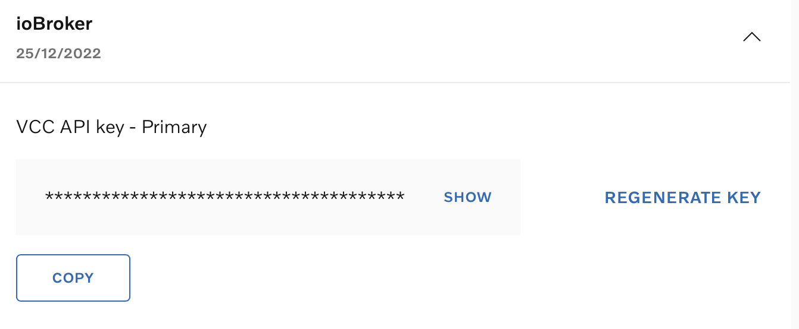

# ioBroker.volvo

## Volvo Cars Adapter for ioBroker

This adapter connects your Volvo car to ioBroker using the [Volvo Connected Vehicle API](https://developer.volvocars.com/apis/) and [Energy API v2](https://developer.volvocars.com/apis/energy/v2/overview/).

### Supported Features

- 🔋 Battery charge level, electric range, charging status (PHEV / BEV)
- ⛽ Fuel level, odometer, trip statistics
- 🚪 Door, window, and lock status
- 📍 GPS location
- 🔧 Diagnostics (service warnings, brake fluid, oil, tyres, lights)
- 🔑 Remote commands (lock/unlock, honk, flash, climatization)
- 🔌 Volvo wallbox (Energy Device API): wallbox info, charging sessions, start/pause charging, charging/discharging current limit
- 🔄 Automatic data refresh at configurable intervals
- 🔐 Token persistence — survives adapter restarts without re-login

---

## Setup Guide

### 1. Get a VCC API Key

1. Go to [developer.volvocars.com](https://developer.volvocars.com/account/) and sign in (Google or GitHub account).
2. Create a new **Application**.
3. Copy the **VCC API Key (Primary)**.

### 2. Configure the Adapter

1. Open the adapter settings in ioBroker.
2. Enter your **Volvo ID email** and **password** (the same credentials you use in the Volvo Cars app).
3. Paste the **VCC API Key**.
4. Set the **update interval** (default: 5 minutes).

### 3. Login with OTP

The Volvo API uses a two-factor authentication flow with a one-time password (OTP):

1. Click **"Start Login (Send OTP)"** in the adapter settings.
2. Check your email for the OTP code from Volvo.
3. Enter the code and click **"Submit OTP"**.
4. The adapter stores the login and renews it automatically. You only need to repeat the OTP login if the adapter was stopped for about 90 days or Volvo ends the session (e.g. after a password change).

> **Note:** If the login is no longer valid, the adapter logs one error and pauses updates. Simply repeat the OTP login from the adapter settings.

---

## Data Points

The adapter creates the following data point structure under `volvo.0.<VIN>`:

| Path | Description |
|---|---|
| `energy.batteryChargeLevel.*` | Battery charge level (%), updated timestamp |
| `energy.electricRange.*` | Electric driving range (km) |
| `energy.chargingStatus.*` | Charging status (IDLE, CHARGING, etc.) |
| `energy.chargerConnectionStatus.*` | Charger connection (CONNECTED, DISCONNECTED) |
| `status.doors.*` | Door states (OPEN/CLOSED), central lock |
| `status.windows.*` | Window states including sunroof |
| `status.fuel.*` | Fuel amount (liters) |
| `status.odometer.*` | Odometer reading (km) |
| `status.diagnostics.*` | Service warnings, distance/time to service |
| `status.statistics.*` | Fuel/energy consumption, trip meters |
| `status.engine-status.*` | Engine running state |
| `status.warnings.*` | Light warnings (brake lights, fog, indicators, etc.) |
| `location.*` | GPS coordinates, heading, timestamp |
| `remote.*` | Remote commands (buttons) |

## Remote Commands

Use the buttons under `volvo.0.<VIN>.remote` to control your vehicle:

- `lock` / `unlock` — Lock or unlock the car
- `climatization-start` / `climatization-stop` — Start or stop pre-conditioning
- `honk` / `flash` / `honk-flash` — Sound horn, flash lights, or both
- `lock-reduced-guard` — Lock with reduced guard
- `refresh` — Manually refresh all data

## Volvo Wallbox (optional)

Only Volvo wallboxes are supported (Energy Device API). Volvo's API cannot list your wallboxes, so enter the **EVSE ID** from the document Volvo provided with the wallbox in the adapter settings (several IDs separated by commas). Leave the field empty if you have no Volvo wallbox — the adapter then makes no wallbox requests.

If you add a wallbox after your last login, log in again once with the OTP so the adapter gets the wallbox permissions.

Data points under `volvo.0.wallbox.<EVSE ID>` (characters like `*` are replaced by `_`):

| Path | Description |
|---|---|
| `info.*` | Wallbox information from the API |
| `chargingSessions.count` / `totalEnergy` / `json` | Charging sessions of the last 7 days |
| `chargingSessions.last.*` | Latest charging session |
| `remote.start` / `remote.pause` | Start or pause charging |
| `remote.chargingAmpLimit` / `remote.dischargingAmpLimit` | Write a current limit in A |
| `remote.refresh` | Refresh the wallbox data |
| `remote.lastCommandStatus` | Result of the last command (JSON) |

> **Note:** The wallbox support was built from Volvo's API documentation without a device to test with. Please report problems in a GitHub issue.

---

## Changelog

### 4.0.1
- Fix: remote commands (lock, unlock, climatization, …) failed with error 415, Volvo now requires a JSON body for commands

### 4.0.0
- **Breaking:** Volvo ID moves to a new login system (Keycloak) and the old one stops working after January 2027. The adapter now logs in like the current Volvo Cars app. **Please log in again once:** click "Start Login (Send OTP)" in the adapter settings and submit the OTP from the email
- Change: the login stays valid as long as the adapter runs; a new OTP login is only needed after about 90 days without the adapter running
- New: Volvo wallbox support via the Energy Device API (wallbox info, charging sessions, start/pause, current limits); enter the EVSE ID in the settings. Built from the documentation without a test device
- Removed: the warning before the fixed 180-day login limit, Volvo no longer has such a limit
- Fix: when a car is removed from the Volvo ID (e.g. replaced by a new one), the adapter logs one warning and reloads the vehicle list instead of logging 403 errors every few minutes until a restart

### 3.1.0
- New: login method of the Volvo Cars app (Authorization Code with PKCE, DPoP-bound tokens). Volvo disabled the client the adapter used before, see [#155](https://github.com/TA2k/ioBroker.volvo/issues/155). **Please log in again once:** click "Start Login (Send OTP)" in the adapter settings and submit the OTP from the email
- Change: the OTP email is only sent when you click "Start Login (Send OTP)", no longer automatically on adapter start
- Change: the OTP is submitted with the "Submit OTP" button only; it is no longer saved in the settings

### 3.0.4
- Fix: Volvo disabled the login client used by this adapter on 2026-10-26 (`invalid_client`). The adapter now logs one clear error and pauses updates instead of repeating errors every few minutes. Login does not work until a new login method is implemented, see [#155](https://github.com/TA2k/ioBroker.volvo/issues/155)
- Chore: dependency updates
  - `json2iob` 2.6.26 → 2.6.28
  - `qs` 6.16.0 → 6.16.1
  - `@iobroker/testing` 6.2.2 → 6.3.1, `@types/node` 22.20.4 → 22.20.5

### 3.0.3
- Fix: no more log spam after the Volvo login (refresh token, ~180 days) expired; updates pause until you log in again
- New: warning 7 days before the login expires
- Chore: dependency updates

### 3.0.2
- Chore: dependency updates
  - `axios` 1.16.1 → 1.19.0
  - `qs` 6.15.2 → 6.16.0
  - `@iobroker/adapter-core` 3.3.2 → 3.4.3
  - `json2iob` 2.6.22 → 2.6.25
  - dev: `@iobroker/testing` 5.3.0, `@tsconfig/node22` 22.0.6, `@types/node` 22.20.1, `@alcalzone/release-script` 5.2.1, `@alcalzone/release-script-plugin-license` 5.2.2
  - transitive: `brace-expansion`, `adm-zip`, `deepl-node`, `browserslist`, `js-yaml`, `form-data`

### 3.0.1
- Fix: address ioBroker repo checker findings:
  - `eslint.config.mjs` now imports `@iobroker/eslint-config`
  - Added `prettier.config.mjs`
  - License copyright line updated to `(c)` format
  - All `setInterval`/`setTimeout` migrated to `this.setInterval`/`this.setTimeout`
  - i18n migrated to short format (`{lang}.json`)

Older changes: CHANGELOG_OLD.md

## License

MIT License

Copyright (c) 2020-2026 TA2k <tombox2020@gmail.com>

Permission is hereby granted, free of charge, to any person obtaining a copy
of this software and associated documentation files (the "Software"), to deal
in the Software without restriction, including without limitation the rights
to use, copy, modify, merge, publish, distribute, sublicense, and/or sell
copies of the Software, and to permit persons to whom the Software is
furnished to do so, subject to the following conditions:

The above copyright notice and this permission notice shall be included in all
copies or substantial portions of the Software.

THE SOFTWARE IS PROVIDED "AS IS", WITHOUT WARRANTY OF ANY KIND, EXPRESS OR
IMPLIED, INCLUDING BUT NOT LIMITED TO THE WARRANTIES OF MERCHANTABILITY,
FITNESS FOR A PARTICULAR PURPOSE AND NONINFRINGEMENT. IN NO EVENT SHALL THE
AUTHORS OR COPYRIGHT HOLDERS BE LIABLE FOR ANY CLAIM, DAMAGES OR OTHER
LIABILITY, WHETHER IN AN ACTION OF CONTRACT, TORT OR OTHERWISE, ARISING FROM,
OUT OF OR IN CONNECTION WITH THE SOFTWARE OR THE USE OR OTHER DEALINGS IN THE
SOFTWARE.