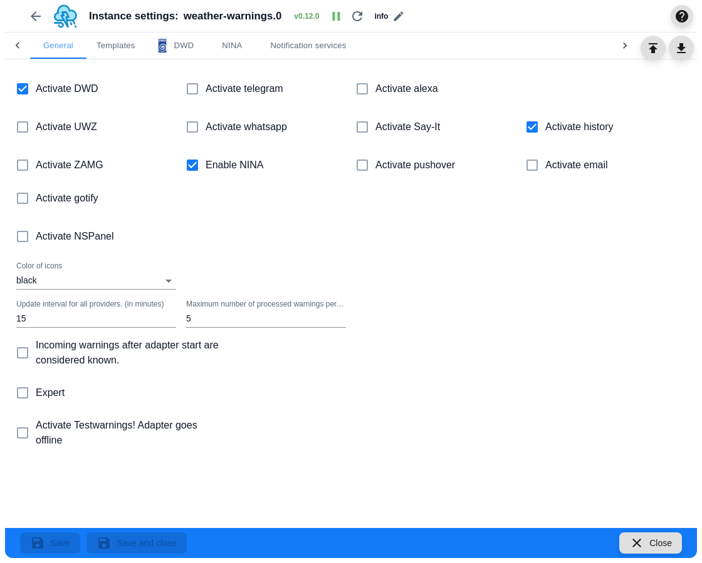
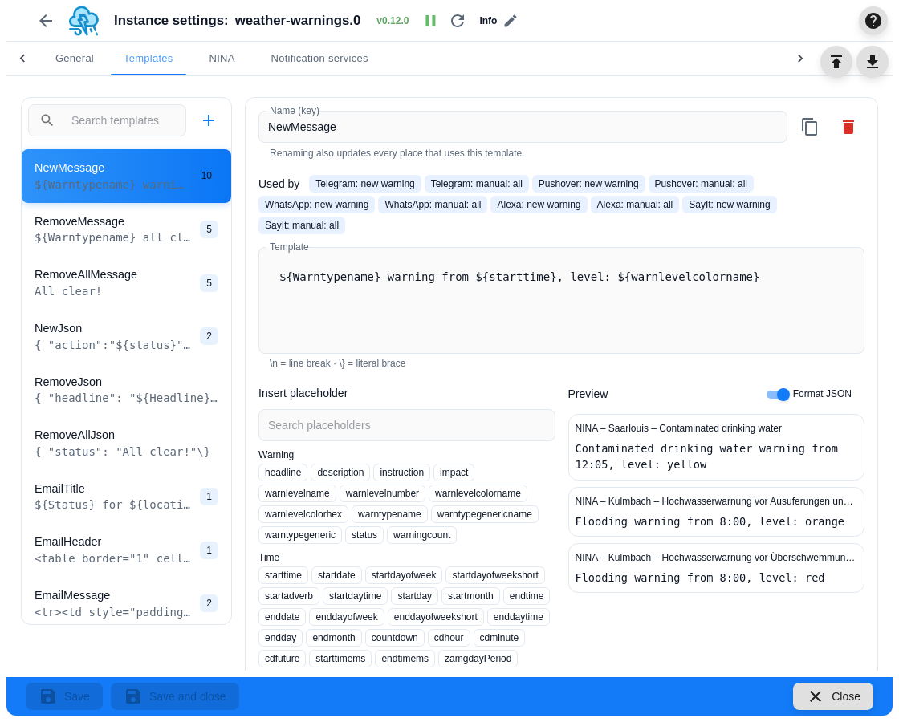
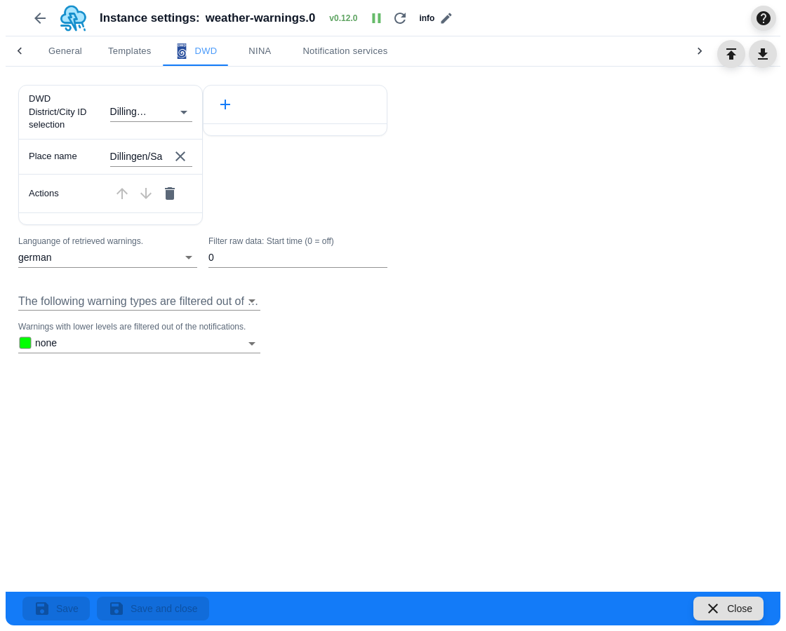
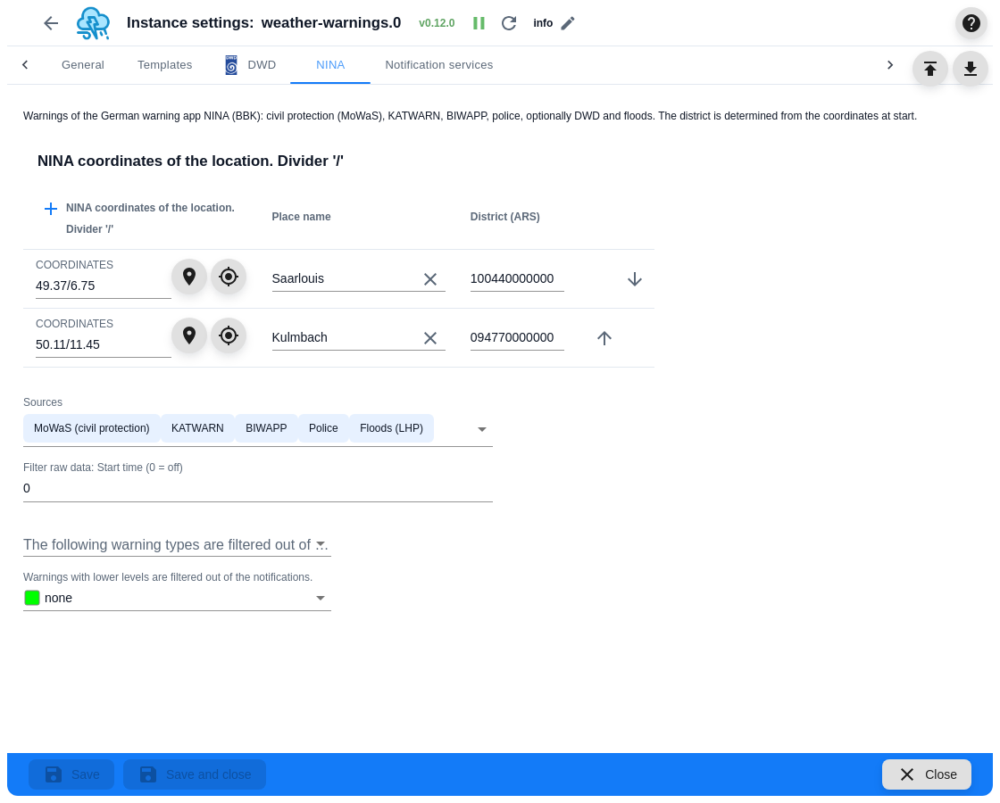
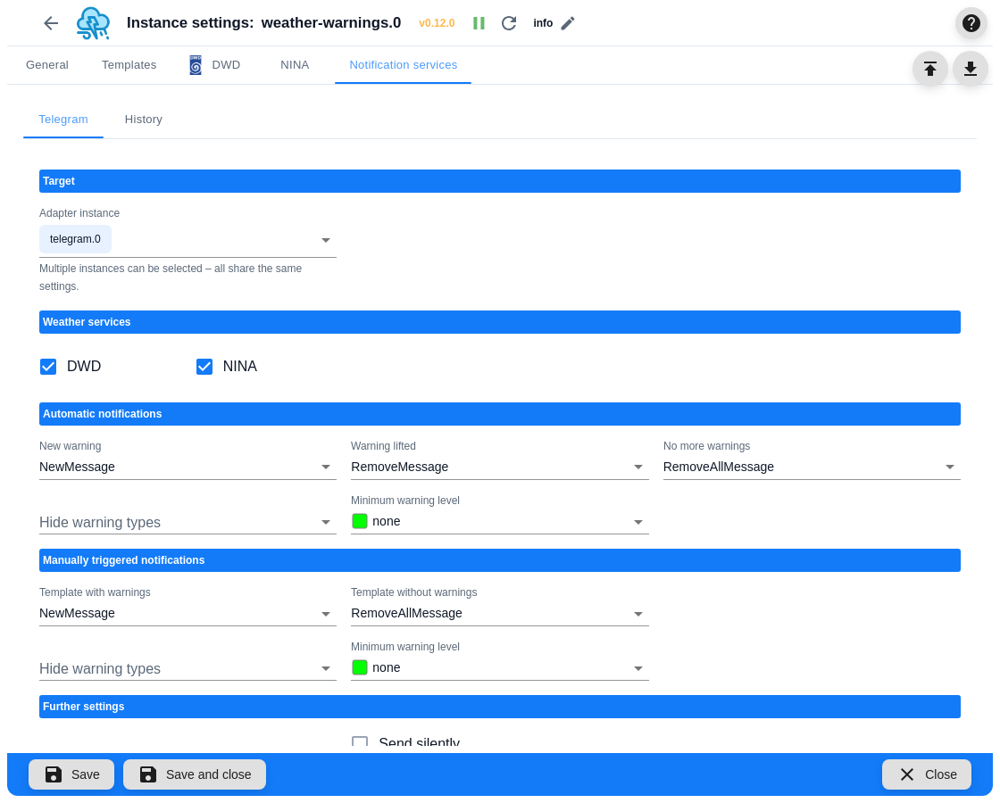

# ioBroker.weather-warnings

**Tests:** 

## weather-warnings adapter for ioBroker

[Deutsche Readme](/#/docs/adapterref/iobroker.weather-warnings/README_DE.md)

This adapter collects official weather and civil protection warnings for your locations and
- sends them as text or voice messages (Telegram, WhatsApp, Pushover, Gotify, email, NSPanel, Alexa, SayIt),
- writes them into states (raw data, formatted values, warnings grouped by type) for VIS and scripts.

All texts are built from templates that you can edit in the admin with a live preview.

### Providers

| Provider | Area | Location | Notes |
|---|---|---|---|
| **DWD** (Deutscher Wetterdienst) | Germany | municipality or district from a list | official weather warnings |
| **UWZ** (Unwetterzentrale) | Europe | coordinates | weather warnings |
| **ZAMG / GeoSphere** | Austria | coordinates | weather warnings |
| **NINA** (BBK warning app) | Germany | coordinates → district | civil protection: MoWaS, KATWARN, BIWAPP, police; optional DWD and floods (LHP) |

Several locations per provider are possible. Each location is a separate device below `provider.<provider>.<location>`.

### Notification services

Telegram, WhatsApp, Pushover, Gotify, Email, NSPanel (nspanel-lovelace-ui), Alexa (alexa2), SayIt, plus two adapter-internal outputs:
- **History**: a list of the last warnings in a state
- **JSON array**: the current warnings as JSON for scripts

Telegram, WhatsApp, Pushover, Gotify and Email can send to several adapter instances at once.

## Requirements

- Node.js 22 or newer
- js-controller 6.0.11 or newer
- Admin 8.1.0 or newer

## Installation

Install the adapter from the ioBroker admin. After the first start the instance writes the message templates in the system language. If the configuration page was already open, **reload it** to see them.

## Configuration

### General

- **Activate DWD / UWZ / ZAMG / NINA**: enables the data retrieval of this provider. Each provider gets its own tab.
- **Activate Telegram / Pushover / …**: enables a notification service. Its settings are on the tab *Notification services*.
- **Color of icons**: colour set used for `${iconurl}`.
- **Update interval**: in minutes, for all providers (minimum 5).
- **Maximum number of processed warnings per provider**: number of state slots `00`, `01`, … per location.
- **Incoming warnings after adapter start are considered known**: warnings that already exist when the adapter starts do not trigger a notification.
- **Expert**: shows additional settings (quiet times for voice output, alternative icon URLs, which state folders are written, test options).
- **Activate test warnings**: uses built-in test data instead of the real providers.

### Templates

The messages are built from templates. The editor shows
- the list of templates (searchable) with the number of places that use each one,
- where a template is used (**Used by**), renaming a template updates all these places,
- a palette of all placeholders – click to insert,
- a **live preview** rendered by the adapter with the current warnings (or sample data if there are none).

Template syntax:
- `${token}` is replaced by a value of the warning, e.g. `${headline}`, `${starttime}`. A capital first letter (`${Warntypename}`) capitalises the value.
- `${_myTemplate}` inserts another template. Templates whose key starts with `_` are not offered to the services.
- `${[a,b,c,d,e]warnlevelnumber}` picks an entry by a numeric token, e.g. `${[0,🟢,🟡,🟠,🔴]warnlevelnumber}`.
- `${(value=token)then#else}` or `${(value=token)then}` – comparisons `=`, `!=`, `<`, `>`.
- `\n` is a line break; in JSON templates a closing brace must be written as `\}`.

**Restore templates** resets all templates to the default ones in the current system language (your templates are lost). **Add default templates** only adds missing ones.

All placeholders

| Placeholder | Meaning |
|---|---|
| `headline`, `description`, `instruction`, `impact` | texts of the warning (`impact` ZAMG only) |
| `warnlevelname`, `warnlevelnumber` | level as text / number 0–4 |
| `warnlevelcolorname`, `warnlevelcolorhex` | colour of the level as text / hex |
| `warntypename` | warning type as delivered by the provider |
| `warntypegenericname`, `warntypegeneric` | unified warning type (see below) as text / number |
| `weatheremoji`, `iconurl`, `htmlicon` | emoji, URL of the icon, icon as base64 `` |
| `location`, `locationcustom`, `provider` | area from the provider, your place name, provider |
| `starttime`, `startdate`, `startday`, `startmonth`, `startdayofweek`, `startdayofweekshort` | start |
| `endtime`, `enddate`, `endday`, `endmonth`, `enddayofweek`, `enddayofweekshort` | end |
| `startdaytime`, `enddaytime`, `startadverb` | time of day, "today/tomorrow/…" |
| `countdown`, `cdhour`, `cdminute`, `cdfuture` | time until the start |
| `starttimems`, `endtimems` | timestamps in ms (`endtimems` is 0 if the warning has no end) |
| `ceiling`, `altitude` | height range (DWD, UWZ) |
| `status`, `warningcount` | new / hold / all clear, number of warnings |
| `zamgdayPeriod` | ZAMG: whole-day warning |

### Providers

- **DWD**: choose the municipality or district from the list (about 10 000 entries). After entering a place, switch to another tab and back – the list is too big to refresh immediately.
- **UWZ**: coordinates `latitude/longitude`. The adapter looks up the UWZ area once and stores it.
- **ZAMG**: coordinates within Austria.
- **Place name**: your own name for the location, available as `${locationcustom}`.
- **Filter raw data: start time**: ignores warnings that start more than X hours in the future (0 = off).
- **Warning types**: the selected types are discarded.
- **Level**: warnings below this level are discarded. The coloured square shows the colour of the level.

#### NINA

NINA is the official warning app of the Federal Office of Civil Protection (BBK). It contains warnings that weather services do not have: hazardous substances, drinking water, unexploded bombs, power failures, police operations, floods, …

- **Coordinates**: prefilled from the ioBroker system settings. At start the adapter determines the district (Landkreis) from the coordinates and shows its key (ARS) in the table. NINA warns per district, so two places in the same district are only queried once.
- **Sources**: which NINA sources are used. Default: MoWaS (civil protection), KATWARN, BIWAPP and police. **DWD** is available as its own provider and **floods (LHP)** are very local, so both are off by default.
- Warnings without an end (common for MoWaS) are shown as "until further notice" in `${endtime}`; they end when NINA removes them.
- All clear messages end the referenced warning; updates of a warning replace it without a new notification (unless the level rises).
- The texts are taken in the system language if NINA provides it (otherwise English or German, flood warnings are German only).

### Notification services

Every activated service has its own page with the same sections:
- **Target**: the adapter instance(s) to send to. Without a valid target the service is not started (see log).
- **Weather services**: which providers are sent with this service.
- **Automatic notifications**: templates for *new warning*, *warning lifted* (other warnings still active) and *no more warnings*, plus a type filter and a minimum level. Choosing `none` as template sends nothing for this case.
- **Manually triggered notifications**: templates used when you write to `commands.send_message.<service>` – one for "there are warnings", one for "no warnings".
- **Further settings**: service specific options, e.g.
  - Telegram: user names, chat ID, silent message, parse mode
  - Pushover / Gotify: priority, sound, device, content type
  - NSPanel: popup, screensaver headline or both, priority, always on
  - Alexa: devices, volume, audio file before the message, sound per warning type (expert)
  - SayIt: instances and volume
  - Email: recipients, title, header and footer templates, line break
  - History: write every formatted value into the history

Voice output (Alexa, SayIt) can be muted by **quiet time profiles** (expert, tab *Additional settings*), switchable with `commands.silentTime.*`.

## Warning levels and types

| Level | Meaning | Colour |
|---|---|---|
| 0 | none | green |
| 1 | minor | yellow |
| 2 | moderate | orange |
| 3 | severe | red |
| 4 | extreme | violet (DWD: dark red) |

Each provider uses its own warning types. The adapter maps them to unified types, which are used for filters, icons and the `alerts` states:

`storm`, `snowfall`, `rain`, `cold`, `forest_fire`, `thunderstorm`, `black_ice_slippery`, `heat`, `hail`, `fog`, `thaw`, `flood`, `civil_protection`, `unknown`

`flood` and `civil_protection` (all non-weather events of NINA) come from NINA.

## States

| State | Content |
|---|---|
| `provider.<provider>.<location>.warning.NN` | raw data of the warning as delivered by the provider (NINA: already cleaned up) |
| `provider.<provider>.<location>.formatedKeys.NN` | all placeholders with their current value, plus your templates starting with `_` |
| `provider.<provider>.<location>.alerts.<type>` | per warning type: `level`, `start`, `end`, `headline`, `active`, `type` – the highest active warning of this type |
| `provider.<provider>.<location>.history`, `.activeWarnings`, `.lastUpdate` | per location |
| `alerts.<type>` | like above, across all providers and locations |
| `provider.activeWarnings`, `provider.hasActiveWarning`, `provider.maxLevel`, `provider.maxLevelText` | summary of all warnings |
| `provider.history` | history (service *History*) |
| `commands.send_message.<service>` | send the current warnings with this service (manual templates) |
| `commands.silentTime.*` | quiet time profile and automatic mode |
| `commands.clearHistory` | clears the history |

The number of slots `NN` is fixed (setting *Maximum number of processed warnings*). Empty slots are cleared, not deleted, so the object tree does not change with every warning.

## General behaviour

- No duplicate messages for the same warning: updates of a warning are only sent if it is a new warning for you.
- `alerts.<type>` shows one warning per type: the one that is active **now** with the highest level, otherwise the next one in the future.
- Times are shown in the time zone of the ioBroker host – make sure the host uses a real zone like `Europe/Berlin`, not a fixed offset.

## Icons

DWD icon: Copyright by Deutscher Wetterdienst

ZAMG icon: Copyright by GeoSphere Austria

Weather icons:
- Creator: [Adri Ansyah](https://www.youtube.com/channel/UChLOv1L-ftAFc2ZizdEAKgw?view_as=subscriber)
- Iconpage: https://www.flaticon.com/packs/weather-613
- Licence: [CC BY 4.0 LEGAL CODE](https://creativecommons.org/licenses/by/4.0/legalcode)
- Changes: in the original they are blue, other colours are changes to the original.

Flood icon (`flood.png`): "Flooding icon by Adriansyah, Creative Commons, via ToSVG" - https://tosvg.com/icon/flooding-1044958 (recoloured)

Hazard icon (`civil_protection.png`): "Danger Triangle icon by Paweł Gleń, Creative Commons, via ToSVG" - https://tosvg.com/icon/danger-triangle-1046822 (recoloured)

## Changelog
<!--
	Placeholder for the next version (at the beginning of the line):
	### **WORK IN PROGRESS**
-->
### 1.0.0 (2026-11-21)
- (ticaki) **BREAKING**: requires admin 8.1.0 or newer
- (ticaki) **NEW**: NINA, the official German warning app (BBK), is available as a new provider: civil protection warnings (MoWaS), KATWARN, BIWAPP and police, optionally DWD and flood warnings. The location is taken from coordinates, prefilled from the system settings
- (ticaki) **NEW**: new warning types "flood" and "hazard" (civil protection) with icons and alert states
- (ticaki) **NEW**: all notification services are configured on one tab "Notification services" with clearly arranged sections. Existing settings are taken over automatically; the adapter restarts once after the update
- (ticaki) **NEW**: new template editor: search, insert placeholders with a click, see which services use a template, rename it safely and check the result in a live preview with the current warnings
- (ticaki) **NEW**: the level filters show the colour of each warning level
- (ticaki) **NEW**: NSPanel: warnings can be shown as popup, as headline in the screensaver or both
- (ticaki) **FIXED**: NSPanel: the option "always on" is now applied to the popup
- (ticaki) **FIXED**: Telegram: the chat ID entered in the settings is now used
- (ticaki) **FIXED**: an error in one provider no longer stops the updates of all providers
- (ticaki) **FIXED**: times of warnings that start or end on the other side of a daylight saving change are no longer shown one hour off
- (ticaki) **FIXED**: the countdown of warnings that are active for more than a month shows the correct number of days
- (ticaki) **NEW**: documentation rewritten with current screenshots (English and German)

### 0.12.0 (2026-09-20)
- (ticaki) **NEW**: telegram, whatsapp, pushover, gotify and email can now target multiple adapter instances at once; all selected instances share the same settings (#319)

### 0.11.3 (2026-07-19)
- (ticaki) **FIXED**: adapter no longer crashes in a restart loop in compact mode; the trailing `export = WeatherWarnings` overwrote the compact-mode factory export, so js-controller tried to call the class without `new` ("Class constructor WeatherWarnings cannot be invoked without 'new'") (#317)
- (ticaki) **FIXED**: resolved UWZ warncell IDs are now persisted correctly; the wrong (unmodified) copy was written back to `uwzwarncellTable`, so every start re-ran the same lookup and config write, which in turn triggered another restart (#317)

### 0.11.2 (2026-06-18)
- (ticaki) **FIXED**: DWD spoken/written color names (`warnlevelcolorname`) now come from an exact lookup of the official DWD CAP color palette instead of a hue heuristic; light heat violet is now distinguished from dark heat violet, and the extreme-storm, UV and preliminary-information colors are named correctly (adds the color names light violet, dark red, magenta and pink) (#220)

### 0.11.1 (2026-06-18)
- (ticaki) **FIXED**: spoken/written color name for DWD heat warnings (`warnlevelcolorname`) is now correct: the light violet DWD heat color (`#cc99ff`) was misclassified as "green" and is now named "violet", matching email/vis (#220)

## License

MIT License

Copyright (c) 2024-2026 ticaki <github@renopoint.de>

Permission is hereby granted, free of charge, to any person obtaining a copy
of this software and associated documentation files (the "Software"), to deal
in the Software without restriction, including without limitation the rights
to use, copy, modify, merge, publish, distribute, sublicense, and/or sell
copies of the Software, and to permit persons to whom the Software is
furnished to do so, subject to the following conditions:

The above copyright notice and this permission notice shall be included in all
copies or substantial portions of the Software.

THE SOFTWARE IS PROVIDED "AS IS", WITHOUT WARRANTY OF ANY KIND, EXPRESS OR
IMPLIED, INCLUDING BUT NOT LIMITED TO THE WARRANTIES OF MERCHANTABILITY,
FITNESS FOR A PARTICULAR PURPOSE AND NONINFRINGEMENT. IN NO EVENT SHALL THE
AUTHORS OR COPYRIGHT HOLDERS BE LIABLE FOR ANY CLAIM, DAMAGES OR OTHER
LIABILITY, WHETHER IN AN ACTION OF CONTRACT, TORT OR OTHERWISE, ARISING FROM,
OUT OF OR IN CONNECTION WITH THE SOFTWARE OR THE USE OR OTHER DEALINGS IN THE
SOFTWARE.