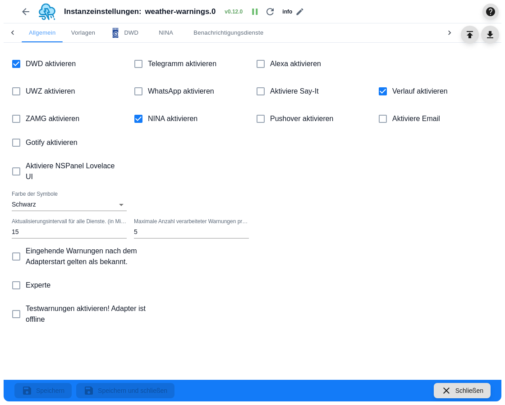
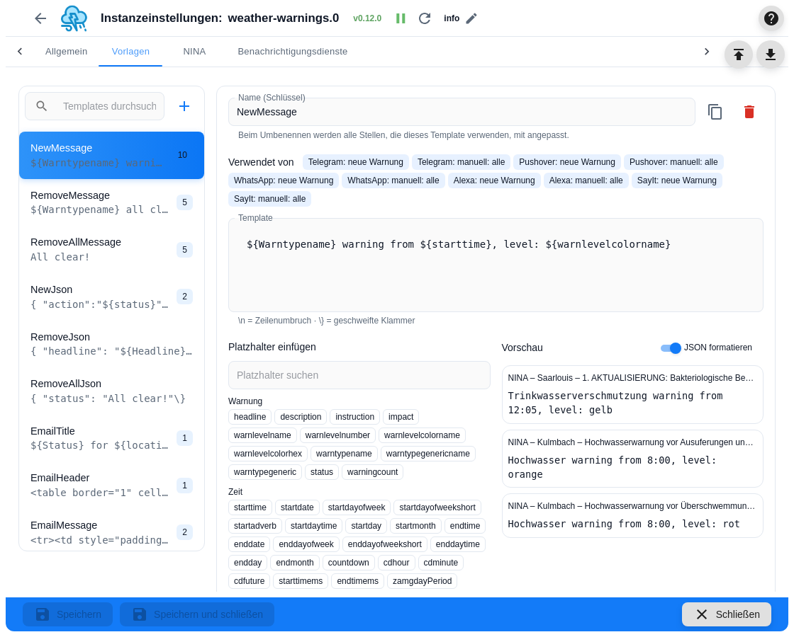
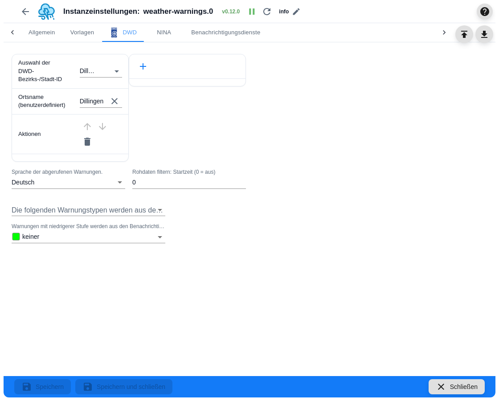
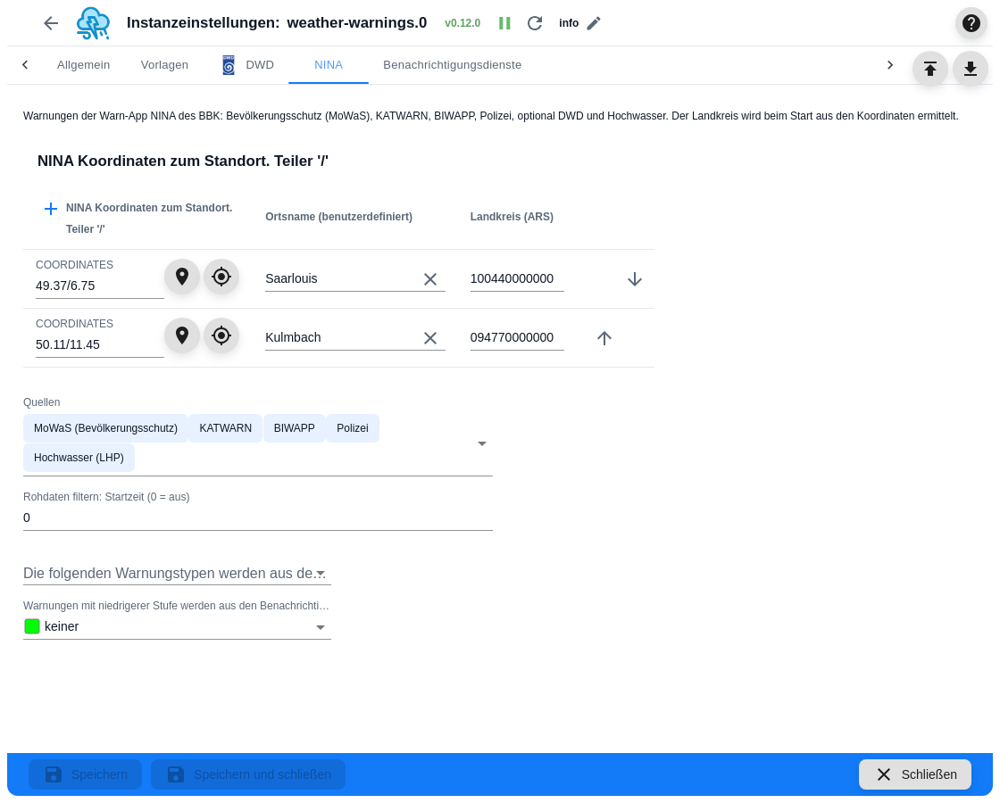
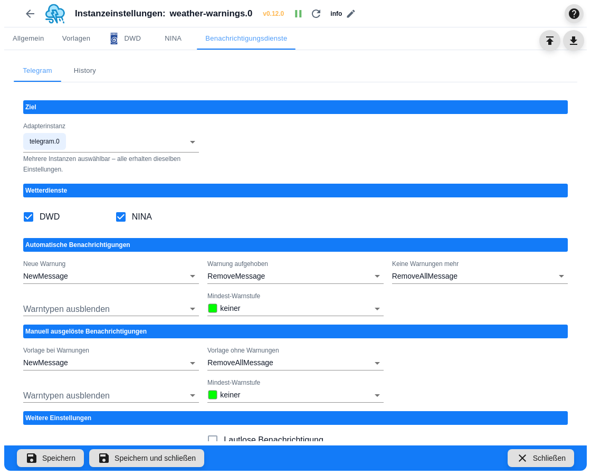

# ioBroker.weather-warnings

**Tests:** 

## weather-warnings Adapter für ioBroker

[English Readme](/#/adapters/weather-warnings) · Den Changelog gibt es nur in der englischen Readme.

Der Adapter holt amtliche Wetter- und Bevölkerungsschutz-Warnungen für deine Orte und
- verschickt sie als Text- oder Sprachnachricht (Telegram, WhatsApp, Pushover, Gotify, E-Mail, NSPanel, Alexa, SayIt),
- schreibt sie in Datenpunkte (Rohdaten, formatierte Werte, nach Warntyp gruppierte Warnungen) für VIS und Skripte.

Alle Texte entstehen aus Vorlagen, die du im Admin mit Live-Vorschau bearbeitest.

### Anbieter

| Anbieter | Gebiet | Ortsangabe | Hinweis |
|---|---|---|---|
| **DWD** (Deutscher Wetterdienst) | Deutschland | Gemeinde oder Kreis aus einer Liste | amtliche Wetterwarnungen |
| **UWZ** (Unwetterzentrale) | Europa | Koordinaten | Wetterwarnungen |
| **ZAMG / GeoSphere** | Österreich | Koordinaten | Wetterwarnungen |
| **NINA** (Warn-App des BBK) | Deutschland | Koordinaten → Landkreis | Bevölkerungsschutz: MoWaS, KATWARN, BIWAPP, Polizei; optional DWD und Hochwasser (LHP) |

Pro Anbieter sind mehrere Orte möglich. Jeder Ort ist ein eigenes Gerät unter `provider.<anbieter>.<ort>`.

### Benachrichtigungsdienste

Telegram, WhatsApp, Pushover, Gotify, E-Mail, NSPanel (nspanel-lovelace-ui), Alexa (alexa2), SayIt sowie zwei Ausgaben innerhalb des Adapters:
- **Verlauf (History)**: Liste der letzten Warnungen in einem Datenpunkt
- **JSON-Array**: die aktuellen Warnungen als JSON für Skripte

Telegram, WhatsApp, Pushover, Gotify und E-Mail können gleichzeitig an mehrere Adapter-Instanzen senden.

## Voraussetzungen

- Node.js 22 oder neuer
- js-controller 6.0.11 oder neuer
- Admin 8.1.0 oder neuer

## Installation

Adapter über den ioBroker-Admin installieren. Beim ersten Start schreibt die Instanz die Nachrichtenvorlagen in der Systemsprache. War die Konfigurationsseite schon offen, **lade sie neu**, damit die Vorlagen erscheinen.

## Konfiguration

### Allgemein

- **DWD / UWZ / ZAMG / NINA aktivieren**: schaltet den Datenabruf dieses Anbieters ein. Jeder Anbieter bekommt einen eigenen Reiter.
- **Telegram / Pushover / … aktivieren**: schaltet einen Benachrichtigungsdienst ein. Seine Einstellungen stehen im Reiter *Benachrichtigungsdienste*.
- **Farbe der Symbole**: Farbsatz für `${iconurl}`.
- **Aktualisierungsintervall**: in Minuten, für alle Anbieter (mindestens 5).
- **Maximale Anzahl verarbeiteter Warnungen pro Anbieter**: Anzahl der Datenpunkt-Plätze `00`, `01`, … pro Ort.
- **Eingehende Warnungen nach dem Adapterstart gelten als bekannt**: Warnungen, die beim Start schon bestehen, lösen keine Benachrichtigung aus.
- **Experte**: zeigt weitere Einstellungen (Ruhezeiten für Sprachausgabe, alternative Icon-URLs, welche Datenpunkt-Ordner geschrieben werden, Testoptionen).
- **Testwarnungen aktivieren**: nutzt eingebaute Testdaten statt der echten Anbieter.

### Vorlagen

Die Nachrichten entstehen aus Vorlagen. Der Editor zeigt
- die Liste der Vorlagen (durchsuchbar) mit der Anzahl der Stellen, die sie verwenden,
- wo eine Vorlage verwendet wird (**Verwendet von**) – beim Umbenennen werden alle diese Stellen mit angepasst,
- eine Palette aller Platzhalter – Klick fügt ein,
- eine **Live-Vorschau**, die der Adapter mit den aktuellen Warnungen erzeugt (oder mit Beispieldaten, wenn keine aktiv sind).

Syntax der Vorlagen:
- `${token}` wird durch einen Wert der Warnung ersetzt, z. B. `${headline}`, `${starttime}`. Ein großer Anfangsbuchstabe (`${Warntypename}`) schreibt den Wert groß.
- `${_meineVorlage}` fügt eine andere Vorlage ein. Vorlagen, deren Schlüssel mit `_` beginnt, werden den Diensten nicht angeboten.
- `${[a,b,c,d,e]warnlevelnumber}` wählt einen Eintrag über einen Zahlen-Platzhalter, z. B. `${[0,🟢,🟡,🟠,🔴]warnlevelnumber}`.
- `${(wert=token)dann#sonst}` oder `${(wert=token)dann}` – Vergleiche `=`, `!=`, `<`, `>`.
- `\n` ist ein Zeilenumbruch; in JSON-Vorlagen muss eine schließende Klammer als `\}` geschrieben werden.

**Vorlagen wiederherstellen** setzt alle Vorlagen auf die Standardvorlagen in der aktuellen Systemsprache zurück (eigene Vorlagen gehen verloren). **Fügt Standardvorlagen hinzu** ergänzt nur fehlende.

Alle Platzhalter

| Platzhalter | Bedeutung |
|---|---|
| `headline`, `description`, `instruction`, `impact` | Texte der Warnung (`impact` nur ZAMG) |
| `warnlevelname`, `warnlevelnumber` | Stufe als Text / Zahl 0–4 |
| `warnlevelcolorname`, `warnlevelcolorhex` | Farbe der Stufe als Text / Hex |
| `warntypename` | Warntyp, wie ihn der Anbieter liefert |
| `warntypegenericname`, `warntypegeneric` | vereinheitlichter Warntyp (siehe unten) als Text / Zahl |
| `weatheremoji`, `iconurl`, `htmlicon` | Emoji, URL des Icons, Icon als Base64-`` |
| `location`, `locationcustom`, `provider` | Gebiet laut Anbieter, dein Ortsname, Anbieter |
| `starttime`, `startdate`, `startday`, `startmonth`, `startdayofweek`, `startdayofweekshort` | Beginn |
| `endtime`, `enddate`, `endday`, `endmonth`, `enddayofweek`, `enddayofweekshort` | Ende |
| `startdaytime`, `enddaytime`, `startadverb` | Tageszeit, „heute/morgen/…“ |
| `countdown`, `cdhour`, `cdminute`, `cdfuture` | Zeit bis zum Beginn |
| `starttimems`, `endtimems` | Zeitstempel in ms (`endtimems` ist 0, wenn die Warnung kein Ende hat) |
| `ceiling`, `altitude` | Höhenbereich (DWD, UWZ) |
| `status`, `warningcount` | neu / bestehend / Entwarnung, Anzahl der Warnungen |
| `zamgdayPeriod` | ZAMG: ganztägige Warnung |

### Anbieter

- **DWD**: Gemeinde oder Kreis aus der Liste wählen (rund 10 000 Einträge). Nach der Eingabe kurz auf einen anderen Reiter und zurück wechseln – die Liste ist zu groß, um sofort aktualisiert zu werden.
- **UWZ**: Koordinaten `Breite/Länge`. Der Adapter ermittelt einmalig das UWZ-Gebiet und speichert es.
- **ZAMG**: Koordinaten in Österreich.
- **Ortsname (benutzerdefiniert)**: eigener Name für den Ort, verfügbar als `${locationcustom}`.
- **Rohdaten filtern: Startzeit**: verwirft Warnungen, die mehr als X Stunden in der Zukunft beginnen (0 = aus).
- **Warntypen**: die gewählten Typen werden verworfen.
- **Stufe**: Warnungen unter dieser Stufe werden verworfen. Das farbige Quadrat zeigt die Farbe der Stufe.

#### NINA

NINA ist die offizielle Warn-App des Bundesamts für Bevölkerungsschutz und Katastrophenhilfe (BBK). Sie enthält Warnungen, die Wetterdienste nicht haben: Gefahrstoffe, Trinkwasser, Bombenfunde, Stromausfälle, Polizeilagen, Hochwasser, …

- **Koordinaten**: werden aus den ioBroker-Systemeinstellungen vorbelegt. Beim Start ermittelt der Adapter aus den Koordinaten den Landkreis und zeigt dessen Schlüssel (ARS) in der Tabelle. NINA warnt pro Landkreis, zwei Orte im selben Landkreis werden deshalb nur einmal abgefragt.
- **Quellen**: welche NINA-Quellen verwendet werden. Standard: MoWaS (Bevölkerungsschutz), KATWARN, BIWAPP und Polizei. **DWD** gibt es als eigenen Anbieter und **Hochwasser (LHP)** ist sehr lokal, deshalb sind beide standardmäßig aus.
- Warnungen ohne Ende (bei MoWaS häufig) zeigen in `${endtime}` „bis auf Widerruf“; sie enden, wenn NINA sie entfernt.
- Entwarnungen beenden die zugehörige Warnung; Aktualisierungen ersetzen die Warnung ohne neue Benachrichtigung (außer die Stufe steigt).
- Die Texte kommen in der Systemsprache, wenn NINA sie liefert (sonst Englisch oder Deutsch; Hochwasserwarnungen gibt es nur auf Deutsch).

### Benachrichtigungsdienste

Jeder aktivierte Dienst hat eine eigene Seite mit denselben Abschnitten:
- **Ziel**: die Adapter-Instanz(en), an die gesendet wird. Ohne gültiges Ziel startet der Dienst nicht (siehe Log).
- **Wetterdienste**: welche Anbieter mit diesem Dienst verschickt werden.
- **Automatische Benachrichtigungen**: Vorlagen für *neue Warnung*, *Warnung aufgehoben* (andere Warnungen noch aktiv) und *keine Warnungen mehr*, dazu ein Typfilter und eine Mindest-Warnstufe. Mit der Vorlage `none` wird für diesen Fall nichts gesendet.
- **Manuell ausgelöste Benachrichtigungen**: Vorlagen für das Schreiben auf `commands.send_message.<dienst>` – eine für „es gibt Warnungen“, eine für „keine Warnungen“.
- **Weitere Einstellungen**: dienstspezifisch, z. B.
  - Telegram: Benutzernamen, Chat-ID, lautlos, Parse-Mode
  - Pushover / Gotify: Priorität, Ton, Gerät, Inhaltstyp
  - NSPanel: Popup, Screensaver-Überschrift oder beides, Priorität, immer an
  - Alexa: Geräte, Lautstärke, Audiodatei vor der Nachricht, Ton pro Warntyp (Experte)
  - SayIt: Instanzen und Lautstärke
  - E-Mail: Empfänger, Titel-, Kopf- und Fußvorlage, Zeilenumbruch
  - Verlauf: jeden formatierten Wert in den Verlauf schreiben

Sprachausgaben (Alexa, SayIt) lassen sich mit **Ruhezeit-Profilen** stummschalten (Experte, Reiter *Zusätzliche Einstellungen*), umschaltbar über `commands.silentTime.*`.

## Warnstufen und Warntypen

| Stufe | Bedeutung | Farbe |
|---|---|---|
| 0 | keine | grün |
| 1 | unerheblich | gelb |
| 2 | mäßig | orange |
| 3 | schwer | rot |
| 4 | extrem | violett (DWD: dunkelrot) |

Jeder Anbieter hat eigene Warntypen. Der Adapter ordnet sie vereinheitlichten Typen zu, die für Filter, Icons und die `alerts`-Datenpunkte verwendet werden:

`storm` (Sturm), `snowfall` (Schneefall), `rain` (Regen), `cold` (Kälte), `forest_fire` (Waldbrand), `thunderstorm` (Gewitter), `black_ice_slippery` (Glätte), `heat` (Hitze), `hail` (Hagel), `fog` (Nebel), `thaw` (Tauwetter), `flood` (Hochwasser), `civil_protection` (Gefahrenlage), `unknown` (unbekannt)

`flood` und `civil_protection` (alle Nicht-Wetter-Ereignisse von NINA) kommen von NINA.

## Datenpunkte

| Datenpunkt | Inhalt |
|---|---|
| `provider.<anbieter>.<ort>.warning.NN` | Rohdaten der Warnung, wie der Anbieter sie liefert (NINA: bereits bereinigt) |
| `provider.<anbieter>.<ort>.formatedKeys.NN` | alle Platzhalter mit aktuellem Wert, dazu deine Vorlagen mit `_` am Anfang |
| `provider.<anbieter>.<ort>.alerts.<typ>` | pro Warntyp: `level`, `start`, `end`, `headline`, `active`, `type` – die höchste aktive Warnung dieses Typs |
| `provider.<anbieter>.<ort>.history`, `.activeWarnings`, `.lastUpdate` | pro Ort |
| `alerts.<typ>` | wie oben, über alle Anbieter und Orte |
| `provider.activeWarnings`, `provider.hasActiveWarning`, `provider.maxLevel`, `provider.maxLevelText` | Zusammenfassung aller Warnungen |
| `provider.history` | Verlauf (Dienst *Verlauf*) |
| `commands.send_message.<dienst>` | aktuelle Warnungen mit diesem Dienst senden (manuelle Vorlagen) |
| `commands.silentTime.*` | Ruhezeit-Profil und Automatik |
| `commands.clearHistory` | löscht den Verlauf |

Die Anzahl der Plätze `NN` ist fest (Einstellung *Maximale Anzahl verarbeiteter Warnungen*). Leere Plätze werden geleert, nicht gelöscht – der Objektbaum ändert sich also nicht mit jeder Warnung.

## Allgemeines Verhalten

- Keine doppelten Nachrichten für dieselbe Warnung: Aktualisierungen werden nur verschickt, wenn sie für dich eine neue Warnung sind.
- `alerts.<typ>` zeigt eine Warnung pro Typ: die **jetzt** aktive mit der höchsten Stufe, sonst die nächste in der Zukunft.
- Zeiten werden in der Zeitzone des ioBroker-Hosts angezeigt – der Host sollte eine echte Zone wie `Europe/Berlin` nutzen, keinen festen Versatz.

## Icons

DWD-Icon: Copyright by Deutscher Wetterdienst

ZAMG-Icon: Copyright by GeoSphere Austria

Wetter-Icons:
- Ersteller: [Adri Ansyah](https://www.youtube.com/channel/UChLOv1L-ftAFc2ZizdEAKgw?view_as=subscriber)
- Iconseite: https://www.flaticon.com/packs/weather-613
- Lizenz: [CC BY 4.0 LEGAL CODE](https://creativecommons.org/licenses/by/4.0/legalcode)
- Änderungen: Im Original sind sie blau, die anderen Farben sind Änderungen am Original.

Hochwasser-Icon (`flood.png`): "Flooding icon by Adriansyah, Creative Commons, via ToSVG" - https://tosvg.com/icon/flooding-1044958 (umgefärbt)

Gefahren-Icon (`civil_protection.png`): "Danger Triangle icon by Paweł Gleń, Creative Commons, via ToSVG" - https://tosvg.com/icon/danger-triangle-1046822 (umgefärbt)