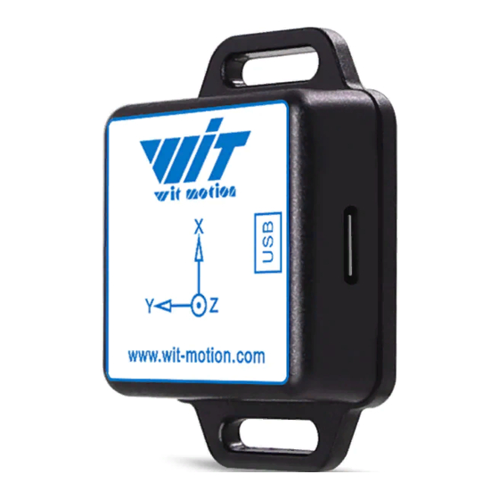

# ioBroker WitMotion

**This adapter uses Sentry libraries to automatically report exceptions and code errors to the developers.** For more details and for information on how to disable the error reporting see [Sentry-Plugin Documentation](https://github.com/ioBroker/plugin-sentry#plugin-sentry)! Sentry reporting is used starting with js-controller 3.0.

Reads data from WT901blecl 5.0 Bluetooth 5.0 9-Axis IMU Sensor (MPU9250) via USB and writes it to ioBroker datapoints.

The following data are read and written to ioBroker:
- Acceleration X/Y/Z
- Gyroscope X/Y/Z
- Magnetometer X/Y/Z

## Supported devices
- [WT901blecl 5.0](https://witmotion-sensor.com/products/bluetooth-5-0-accelerometer-inclinometer-wt901blecl-mpu9250-9-axis-imu-sensor)

## Device manager
The tab **Device manager** in the instance settings (or the device manager of admin) shows the sensor as a card with its connection and the angles (roll, pitch, yaw). The details list all enabled values and the connection. From the card you can test the connection and change the serial port and the baud rate.

## Visualisation
### Devices app
Add a custom widget of the type **Wit Motion** and select the instance. The tile shows a boat, a car or your own picture tilted by the measured angle, or a compass for the top view.

- `1x1` – one axis
- `2x½` – the values only
- `2x1` – one axis with its value or two axes side by side

A click on the tile opens a big view.

### vis-2
The widget set **WitMotion** contains the widget **Orientation** with the same views. The layout follows the size of the widget (bar, compact, wide or big view) or can be fixed in the settings. A click on the smaller layouts opens the big view.

<!--
	Placeholder for the next version (at the beginning of the line):
	### **WORK IN PROGRESS**
-->
## Changelog
### 2.1.2 (2026-10-28)
* (@GermanBluefox) Fixed the missing translations of the widget set, the widget name and the help in vis-2

### 2.1.1 (2026-10-14)
* (@GermanBluefox) Added device manager support
* (@GermanBluefox) Added an orientation widget for vis-2
* (@GermanBluefox) The used serial port (and in test mode the UDP port) is reported to js-controller 8 (`registerUsedResource`)
* (@GermanBluefox) Migrated to devices V3
* (@GermanBluefox) Added selection of the serial device by its stable USB ID (vendor/product/serial), so the connection keeps working even if the OS reassigns the port name
* (@GermanBluefox) Better widget
* (@GermanBluefox) Allowed the selection of USB port by path and UUID
* (@GermanBluefox) Added visualisation for "devices" adapter
* (@GermanBluefox) Added offset configuration for magnetometer
* (@GermanBluefox) Fixed the integration test, because of it the versions 0.1.0 - 2.1.0 were never published

### 0.0.4 (2026-03-26)
* (@GermanBluefox) Tests fixed

### 0.0.3 (2026-01-23)
* (@GermanBluefox) Initial commit

## License

The MIT License (MIT)

Copyright (c) 2026, Denis Haev <dogafox@gmail.com>

Permission is hereby granted, free of charge, to any person obtaining a copy
of this software and associated documentation files (the "Software"), to deal
in the Software without restriction, including without limitation the rights
to use, copy, modify, merge, publish, distribute, sublicense, and/or sell
copies of the Software, and to permit persons to whom the Software is
furnished to do so, subject to the following conditions:

The above copyright notice and this permission notice shall be included in
all copies or substantial portions of the Software.

THE SOFTWARE IS PROVIDED "AS IS", WITHOUT WARRANTY OF ANY KIND, EXPRESS OR
IMPLIED, INCLUDING BUT NOT LIMITED TO THE WARRANTIES OF MERCHANTABILITY,
FITNESS FOR A PARTICULAR PURPOSE AND NONINFRINGEMENT. IN NO EVENT SHALL THE
AUTHORS OR COPYRIGHT HOLDERS BE LIABLE FOR ANY CLAIM, DAMAGES OR OTHER
LIABILITY, WHETHER IN AN ACTION OF CONTRACT, TORT OR OTHERWISE, ARISING FROM,
OUT OF OR IN CONNECTION WITH THE SOFTWARE OR THE USE OR OTHER DEALINGS IN
THE SOFTWARE.