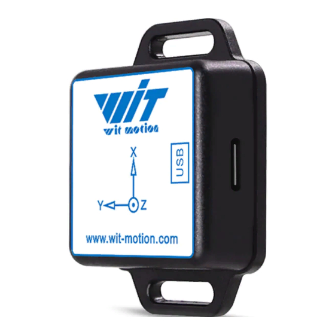

# ioBroker WitMotion

**This adapter uses Sentry libraries to automatically report exceptions and code errors to the developers.** For more details and for information on how to disable the error reporting see [Sentry-Plugin Documentation](https://github.com/ioBroker/plugin-sentry#plugin-sentry)! Sentry reporting is used starting with js-controller 3.0.

Reads data from WT901blecl 5.0 Bluetooth 5.0 9-Axis IMU Sensor (MPU9250) via USB and writes it to ioBroker datapoints.

The following data are read and written to ioBroker:
- Acceleration X/Y/Z
- Gyroscope X/Y/Z
- Magnetometer X/Y/Z

Optionally the adapter calculates the wave height and period from the vertical motion of the sensor (see [Waves](#waves)).

## Supported devices
- [WT901blecl 5.0](https://witmotion-sensor.com/products/bluetooth-5-0-accelerometer-inclinometer-wt901blecl-mpu9250-9-axis-imu-sensor)

## Waves
With **Waves** enabled in the settings, the adapter measures the sea state from the heave of the sensor, the way a wave buoy does. It uses every packet of the sensor (independent of the update intervals of the other states): the acceleration is turned into the vertical with the roll and pitch of the sensor, integrated twice in the frequency domain within the band of the wave periods, and the resulting heave is evaluated:

| State                  | Unit | Meaning                                                                       |
|------------------------|------|-------------------------------------------------------------------------------|
| `waves.height`         | m    | Significant wave height Hs = 4·σ of the heave (about the mean of the highest third of the waves) |
| `waves.heightMax`      | m    | Highest single wave (trough to crest) in the analysis window                  |
| `waves.period`         | s    | Mean period by zero-up-crossing                                               |
| `waves.periodPeak`     | s    | Period of the spectral peak, the period with the most energy                  |
| `waves.length`         | m    | Length of waves of the peak period in deep water, L = g·Tp²/(2π)              |
| `waves.frequency`      | Hz   | Frequency of the spectral peak, 1/Tp                                          |

Settings: **Update interval** (how often the states are written, default 30 s), **Analysis window** (length of the analysed record, default 300 s; the first values come after half of it), **Shortest** and **Longest wave period** (the band, default 2–20 s).

Things to know:
- Mount the sensor near the middle of the boat. Far from it, the pitch of the boat adds vertical motion that is not the sea.
- The values are the motion of the boat. Waves that are short compared to the hull (on a 13 m yacht roughly below 3–4 s) lift the boat less than they are high, so a short wind sea is underestimated.
- While the boat moves, the periods and the frequency are encounter periods: shorter when heading into the waves, longer when running with them. The heights do not depend on this, the length is only right at anchor or drifting.
- The length is that of deep water. Where the water is shallower than half of it, the waves are shorter.
- Below a significant wave height of 5 cm the water counts as calm: the periods, the length and the frequency are 0, as the record is only the noise of the sensor.
- The angles alone (roll and pitch) do not give the wave height on a boat: they show how the boat rolls in its own rhythm, not the slope of the water.
- The sensor should send 10 values per second (its default) or more. Below 1.5 values per second (with the shortest period at 2 s) the adapter warns that short waves are not seen.
- In calm water the noise of the sensor gives a few centimetres.

## Device manager
The tab **Device manager** in the instance settings (or the device manager of admin) shows the sensor as a card with its connection and, one per line, the angles (roll, pitch, yaw) and the height, length and frequency of the waves. The details list all enabled values and the connection. From the card you can test the connection and change the serial port and the baud rate.

## Visualisation
### Devices app
Add a custom widget of the type **Wit Motion** and select the instance. The tile shows a boat, a car or your own picture tilted by the measured angle, or a compass for the top view.

- `1x1` – one axis
- `2x½` – the values only
- `2x1` – one axis with its value or two axes side by side

A click on the tile opens a big view.

If the instance measures the [waves](#waves), the tile, the vis-2 widget and the web component show the significant wave height: in the compact view next to the name, in the bar next to the values. The wide and the big view add the length (λ) and the frequency of the waves. The setting **Show waves** switches them off.

### vis-2
The widget set **WitMotion** contains the widget **Orientation** with the same views. The layout follows the size of the widget (bar, compact, wide or big view) or can be fixed in the settings. A click on the smaller layouts opens the big view.

### Web components
The orientation is also a web component (`common.webComponents`, [`@iobroker/web-components`](https://github.com/ioBroker/web-components)), so Aura, admin and every other host of web components can show it:

- `<iob-witmotion-orientation>` (**Wit Motion**) – the same views as the vis-2 widget: a boat, a car or your own picture tilted by the angle of one or two axes, or a compass for the top view, as compact, bar, wide or big view by the size of the box. A click on the smaller views opens the big view in a dialog of the host.

Settings:

- **Adapter instance**, **Value mode** (instant or average), **Name**, **Layout** (automatic or fixed), **Open big view on click**, **Show waves**
- **Icon type** (boat, car or custom; a custom picture is given by its address)
- **Primary axis**, **Primary view**, **Visual multiplier**, and optionally a **Secondary axis** with its view and multiplier

The devices app offers its own tile **Wit Motion** instead of the web component of the same name.

<!--
	Placeholder for the next version (at the beginning of the line):
	### **WORK IN PROGRESS**
-->
## Changelog
### 2.3.0 (2026-11-17)
* (@GermanBluefox) Added wave height and period from the heave of the sensor (`waves.*`)
* (@GermanBluefox) Added the length and the frequency of the waves (`waves.length`, `waves.frequency`)
* (@GermanBluefox) The devices tile, the vis-2 widget and the web component show the height, length and frequency of the waves
* (@GermanBluefox) The card in the device manager shows each value in a line of its own
* (@GermanBluefox) Added the short form of the web component manifests (tag, name, icon, size) to `common.webComponents`, so that hosts like Aura can list the components before the adapter is installed; the build writes it with `iob-web-components sync-io-package`

### 2.2.0 (2026-11-09)
* (@GermanBluefox) Added the web component `<iob-witmotion-orientation>` for Aura and other hosts (`common.webComponents`)

### 2.1.2 (2026-10-28)
* (@GermanBluefox) Fixed the missing translations of the widget set, the widget name and the help in vis-2

### 2.1.1 (2026-10-14)
* (@GermanBluefox) Added device manager support
* (@GermanBluefox) Added an orientation widget for vis-2
* (@GermanBluefox) The used serial port (and in test mode the UDP port) is reported to js-controller 8 (`registerUsedResource`)
* (@GermanBluefox) Migrated to devices V3
* (@GermanBluefox) Added selection of the serial device by its stable USB ID (vendor/product/serial), so the connection keeps working even if the OS reassigns the port name
* (@GermanBluefox) Better widget
* (@GermanBluefox) Allowed the selection of USB port by path and UUID
* (@GermanBluefox) Added visualisation for "devices" adapter
* (@GermanBluefox) Added offset configuration for magnetometer
* (@GermanBluefox) Fixed the integration test, because of it the versions 0.1.0 - 2.1.0 were never published

### 0.0.4 (2026-03-26)
* (@GermanBluefox) Tests fixed

## License

The MIT License (MIT)

Copyright (c) 2026, Denis Haev <dogafox@gmail.com>

Permission is hereby granted, free of charge, to any person obtaining a copy
of this software and associated documentation files (the "Software"), to deal
in the Software without restriction, including without limitation the rights
to use, copy, modify, merge, publish, distribute, sublicense, and/or sell
copies of the Software, and to permit persons to whom the Software is
furnished to do so, subject to the following conditions:

The above copyright notice and this permission notice shall be included in
all copies or substantial portions of the Software.

THE SOFTWARE IS PROVIDED "AS IS", WITHOUT WARRANTY OF ANY KIND, EXPRESS OR
IMPLIED, INCLUDING BUT NOT LIMITED TO THE WARRANTIES OF MERCHANTABILITY,
FITNESS FOR A PARTICULAR PURPOSE AND NONINFRINGEMENT. IN NO EVENT SHALL THE
AUTHORS OR COPYRIGHT HOLDERS BE LIABLE FOR ANY CLAIM, DAMAGES OR OTHER
LIABILITY, WHETHER IN AN ACTION OF CONTRACT, TORT OR OTHERWISE, ARISING FROM,
OUT OF OR IN CONNECTION WITH THE SOFTWARE OR THE USE OR OTHER DEALINGS IN
THE SOFTWARE.