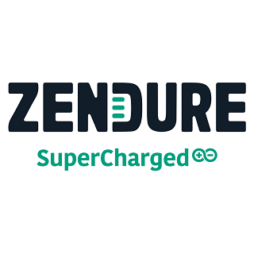

# ioBroker.zendure-solarflow

**Tests:** 

## Sentry

**This adapter uses Sentry libraries to automatically report exceptions and code errors to the developers.** For more details and for information how to disable the error reporting see [Sentry-Plugin Documentation](https://github.com/ioBroker/plugin-sentry#plugin-sentry)! Sentry reporting is used starting with js-controller 3.0.

## Zendure Solarflow adapter for ioBroker

An ioBroker adapter to read and control Zendure Solarflow devices via the Zendure Cloud API, and locally via zenSDK (HTTP) or MQTT for legacy devices.

## Donate

If you find the adapter useful and want to support my work, feel free to donate via PayPal. Thank you!
(personal donation link for Nograx, unrelated to the ioBroker project)

## Features

- Full telemetry from your Solarflow devices, including values not shown in the official app (e.g. battery voltage)
- Control devices like the official app - most settings are available
- Set output/input limits for zero feed-in scenarios without a Shelly Pro EM, or build more complex automations via script/Blockly
- Battery protect: stop input if a battery drops into low voltage (requires output limit set via the adapter)
- Control multiple Solarflow devices at once, with more precise calculations
- Built-in zero feed-in automation (PI-controlled, SOC-weighted power sharing across multiple devices), driven by your grid meter
- Works with all Zendure Solarflow devices
- **zenSDK**: local HTTP control for compatible devices, with data still relayed to the Zendure cloud so you keep full control if internet/Zendure servers are down

## Modes

- **Authentication Cloud Key** (recommended): the official Zendure method. Get a Cloud key from the app. By default zenSDK is used for compatible devices on the same network as ioBroker, giving full local control while still relaying data to the cloud. Cloud-only is also possible. Legacy devices already on a local MQTT server can relay to the cloud too, with no downside.
- **Local**: local-only mode. Point the adapter at a local MQTT server for legacy devices (see below); zenSDK devices are found via mDNS.
- **zenSDK only (mDNS / IP)**: no Zendure cloud and no MQTT server at all. Devices are found via [mDNS discovery](#mdns-discovery) or [configured by IP address](#zensdk-devices-by-ip-address) and polled/controlled locally via zenSDK only, so only zenSDK-compatible devices are supported.

### mDNS Discovery

When zenSDK is enabled, the adapter browses the network via mDNS/Bonjour for devices announcing as `Zendure-<model>-<serialNumber>` as long as it is running. The network is queried again after 5s, 15s, 30s and 60s, then every 5 minutes, so devices connected to the network later (or missed by an earlier query) are still found without restarting the adapter. This fills in or corrects IP addresses for known cloud devices, and auto-creates accessories (Mix series, Smart Meters) that have no cloud productKey and can't otherwise be created. Devices are matched by full serial number, not IP or a shortened suffix. Disable via the "Add devices found via mDNS discovery" setting.

### zenSDK devices by IP address

mDNS uses multicast, which is usually not routed between network segments. If your Zendure devices are in another VLAN / subnet than ioBroker, enter their IP addresses (or host names) in the "zenSDK devices by IP address" section of the adapter settings. The adapter queries each address via zenSDK (`http://<ip>/properties/report`) at start and then every 5 minutes, and identifies the device by the serial number it reports: a device already known (e.g. from the Zendure cloud device list) keeps its existing states and is switched to local zenSDK control, an unknown device is created with its serial number as key, just like a device found via mDNS. Works in every connection mode as long as zenSDK is enabled. Give the devices a fixed IP (DHCP reservation), and make sure ioBroker can reach them on TCP port 80.

## Supported Devices

### zenSDK Compatible Devices ✅ (full local control via HTTP)

> **Recommended by Zendure**: use the Authentication Cloud Key mode above - it gives full local control while keeping the cloud connection for convenience. No need to disconnect these devices from the cloud.

- Solarflow 1600 AC Plus, 2400 AC, 2400 AC Plus, 2400 Pro, 800, 800 Plus, 800 Pro
- Solarflow 3000 Mix AC+, 4000 Mix AC+, 4000 Mix Pro _(no cloud productKey yet - added via [mDNS discovery](#mdns-discovery) only)_

### Smart Meter Accessories 📊 (read-only, zenSDK/mDNS only)

- **Smart Meter 3CT** - apparent power per phase (A/B/C) and total, via current transformers
- **Smart Meter D0** - live utility meter readings via IEC 62056-21 optical interface

### Legacy Devices 🔄 (local MQTT mode via Zendure Cloud Disconnector)

- HUB 1200, HUB 2000, Hyper 2000, AIO 2400, ACE 1500 - all support local mode and can still relay to the cloud

**Local mode benefits:** no data sent to Zendure servers (recommended to send them by relaying), direct/faster MQTT communication, full offline automation, and cloud relay can be re-enabled anytime. Firmware updates via the official app/Bluetooth still work.

## Offline-Mode (Disconnect from Zendure Cloud) for Legacy Devices

⚠️ **Warranty Warning:** Changing the MQTT server directly on the device (via Bluetooth tools or DNS redirect) is not officially supported and **will void your device's warranty**. Proceed at your own risk.

To disconnect a legacy device from the cloud, use the [Solarflow Bluetooth Manager](https://github.com/reinhard-brandstaedter/solarflow-bt-manager) by Reinhard Brandstätter or my [Zendure Cloud Disconnector](https://github.com/nograx/zendure-cloud-disconnector) - both set the device's MQTT URL via Bluetooth. Alternatively, redirect DNS requests for "mq.zen-iot.com" to your own MQTT server via your router.

**Note:** these Bluetooth tools only work for **Legacy Devices**. For **zenSDK** devices, use Zendure's official offline method instead.

Both tools force the default MQTT port (1883, or 8883 with SSL) and require authentication disabled on your server, since the device uses a hardcoded password. You can combine this with your cloud authentication key, or use full local mode.

## Important

To control charging/feed-in via script or Blockly, use the **`setDeviceAutomationInOutLimit`** control parameter - it controls the device without writing to flash memory. Negative values trigger charging from grid.

## Adapter Automation (Zero Feed-In Control)

The adapter includes a built-in zero feed-in controller. It reads your grid meter and continuously adjusts `setDeviceAutomationInOutLimit` of all participating devices, so that the grid power stays close to a configurable setpoint - no external script needed. It works with a single device as well as with a fleet of multiple devices.

### Setup

1. Open the adapter settings, section **Automation**, and check **Enable adapter automation**.
2. Select the **Trigger state**: a state of your grid/smart meter with the current grid power in W (**positive = import from grid, negative = export to grid**). Every value change of this state runs one control cycle, so it should update frequently (every 1-5 seconds is ideal).
3. Save - the adapter restarts and creates the `adapterAutomation` states.
4. Enable automation for each device that should be controlled: `<productKey>.<deviceKey>.adapterAutomation.automationEnabled = true`.
5. Switch on the global switch `adapterAutomation.automationEnabled = true`.

⚠️ While automation is active for a device, do not write `setDeviceAutomationInOutLimit` from your own scripts for that device - the automation will overwrite it. Devices with `automationEnabled = false` are left completely untouched.

### States

Global (`zendure-solarflow.X.adapterAutomation.*`):

| State                            | Default | Description                                                                                                                                                                                            |
| -------------------------------- | ------- | ------------------------------------------------------------------------------------------------------------------------------------------------------------------------------------------------------ |
| `automationEnabled`              | `false` | Global on/off switch for the automation.                                                                                                                                                               |
| `setPoint`                       | `10`    | Target grid power in W. A small positive value (slight import) avoids feeding into the grid.                                                                                                           |
| `setPointNearlyFull`             | `-100`  | Target grid power in W, used instead of `setPoint` when all batteries are at least 90% and there is solar input. Negative values allow feeding into the grid.                                          |
| `acOnlyPenalty`                  | `50`    | Score lead in % that AC-only devices (and devices with `acChargingAllowed`) need over the other devices to become lead device, once the other devices average above 35% SOC. `0` disables the penalty. |
| `surplusChargeTrigger`           | `100`   | Grid export in W beyond the setpoint at which idle AC-only devices start charging from surplus. Minimum `30`.                                                                                          |
| `minIdleBeforeCharge`            | `60`    | Time in seconds a device must be idle (neither charging nor feeding in) before it may start charging. Minimum `5`.                                                                                     |
| `ignoreSuggestedInverseMaxPower` | `false` | If `true`, the device's `inverseMaxPower` is used as maximum output instead of the suggested value (see below).                                                                                        |
| `deviceOrder`                    |         | Read-only. Current device order, the first device is the lead device.                                                                                                                                  |

Per device (`<productKey>.<deviceKey>.adapterAutomation.*`):

| State                          | Description                                                                                                                                                                                                                                                                                                                                                                                         |
| ------------------------------ | --------------------------------------------------------------------------------------------------------------------------------------------------------------------------------------------------------------------------------------------------------------------------------------------------------------------------------------------------------------------------------------------------- |
| `automationEnabled`            | Include this device in the automation (default `false`).                                                                                                                                                                                                                                                                                                                                            |
| `forceAcCharging`              | Charge this device from the grid at its full `chargeMaxLimit` until it is full, regardless of the current demand (default `false`).                                                                                                                                                                                                                                                                 |
| `acChargingAllowed`            | Only for devices that can charge by AC but are not AC-only (e.g. SF 800 / 2400 Pro, Hyper 2000): charge this device from grid surplus like an AC-only device (default `false`).                                                                                                                                                                                                                     |
| `feedInSolarOnly`              | Not for AC-only devices: feed in at most the current solar input, so the battery is not discharged. **Note:** this only applies while the solar input is above 50 W - at or below 50 W (e.g. at night) the device may feed in from its battery as usual (default `false`). The adapter never switches it by itself - set it from your own script, e.g. during a low-price window of a dynamic electricity tariff, to save the battery for more expensive hours. |
| `suggestedInverseMaxPower`     | Read-only. Maximum output power the automation uses for this device, calculated from SOC and the lowest cell voltage to protect the battery.                                                                                                                                                                                                                                                        |
| `suggestedInverseMaxPowerInfo` | Read-only. Reason for the current suggested value.                                                                                                                                                                                                                                                                                                                                                  |
| `status`                       | Read-only. Status code of what the automation currently wants this device to do, see table below.                                                                                                                                                                                                                                                                                                   |

Status codes of `<device>.adapterAutomation.status`. The labels (`common.states`) are in the ioBroker system language (German or English). The lead device variant of a task is its code + 1 (`code % 10 === 1`).

| Code      | Status                                                        |
| --------- | ------------------------------------------------------------- |
| `0`       | Automation disabled globally                                  |
| `1`       | Automation disabled for this device                           |
| `2`       | Waiting for a change of the automation trigger state          |
| `10`/`11` | Feeding in                                                    |
| `20`/`21` | Standby                                                       |
| `30`/`31` | Charging from surplus                                         |
| `40`/`41` | Holding the charge keep-alive                                 |
| `50`/`51` | Force charging                                                |
| `60`/`61` | Waiting before charging may start (see `minIdleBeforeCharge`) |
| `70`/`71` | Waiting for surplus charging                                  |
| `80`/`81` | Fully charged, idle                                           |
| `90`/`91` | Idle                                                          |

### How it works

- **PI controller:** The required output is calculated from the current home usage (grid power + current output) plus a PI correction towards the setpoint. Within a small dead band (setpoint to setpoint + 10 W) nothing is changed, to avoid constant adjustments.
- **Power sharing:** The required power is distributed across the active devices weighted by their SOC - fuller devices take a bigger share. Devices below their own `minSoc` get no share. Power a device cannot deliver (above its maximum) is passed on to devices with headroom.
- **Lead device:** Devices are ranked by SOC and solar input (re-sorted every full hour). The lead device is always active; further devices are added when demand rises (above 70% utilization of the active devices) or when they are nearly full. Once added, devices stay active for at least 5 minutes to avoid flapping. Idle devices are kept at 10 W standby for a few minutes, so they react faster.
- **Battery protection:** `suggestedInverseMaxPower` limits the output at low SOC / low cell voltage (e.g. only 60-500 W when cells are weak) and at night (0-5 h) the limit is derived from the SOC. It never exceeds the device's `inverseMaxPower`.
- **AC-only devices** (e.g. SF 2400 AC, SF 1600 AC+, SF 3000/4000 Mix AC+) are preferred less as lead device once the other batteries are above 35%. When the grid meter shows a surplus (export at least `surplusChargeTrigger` W beyond the setpoint, default 100 W, continuously for 30 seconds), idle AC-only devices (and devices with `acChargingAllowed`) charge with that surplus, up to their `chargeMaxLimit` (Power in W).
- **Charge split:** The surplus is split so that the total charge power of each device (AC plus its own solar input) is weighted by its missing SOC and its battery capacity - a device whose own solar input already charges it gets less AC, the rest goes to the others. The capacity is derived from the attached battery packs (only used if known for all charging devices). For the Hyper 2000, the AC charge power is also limited by the total battery charge power (AC + solar) of its battery configuration: 950 W with one AB1000, 1200 W with one AB2000, 1600 W with two or more batteries.
- **Charging safety:** A device only switches to charging after it has been idle at 0 W for at least `minIdleBeforeCharge` seconds (default 60), so it does not flip directly between discharging and charging. While a surplus is confirmed, a device waiting in feed-in standby is released after `minIdleBeforeCharge` instead of 3 minutes, so it can start charging.
- **Charge control:** The charge power is calculated directly from the grid value without the devices' own (reported) charge power, so it reaches the surplus in one or two steps. After each change it is held until the devices have reached and reported their new charge power (10-30 s); a clear grid import (more than 300 W) reduces it immediately.

## Notes

This adapter authenticates on the official MQTT servers using the Cloud Authorization Code, which you can generate in the Zendure app.

### Sentry (error reporting and device statistics)

This adapter uses Sentry libraries to automatically report exceptions and code errors to the developer. In addition, the adapter sends anonymous device statistics 5 minutes after start and then once every 24 hours: one event per used device class, containing only the device class, product key, product name and connection mode. No device keys, serial numbers, IP addresses or credentials are transmitted. These statistics help to see which devices are in use and where support is missing.

For more details and for information on how to disable error reporting, see the [Sentry-Plugin Documentation](https://github.com/ioBroker/plugin-sentry#plugin-sentry). Sentry reporting is used starting with js-controller 3.0.

## Changelog

<!--
    Placeholder for the next version (at the beginning of the line):
    ### **WORK IN PROGRESS**
-->
### 6.1.3 (2026-10-16)

- Adapter automation: `feedInSolarOnly` now only limits feed-in to the solar input while it is above 50 W; at or below 50 W the battery may be used for feed-in (replaces the previous low solar input warning)
- Fixed adapter crash (`Converting circular structure to JSON`) when the Zendure cloud API does not respond

### 6.1.2 (2026-10-16)

- Adapter automation: `suggestedInverseMaxPower` changes are now ramped instead of a fixed value (should avoid rapid jumps between values)
- Adapter automation: Improvements on handling charge keep alive which could lead to small grid import
- Hyper 2000: `setDeviceAutomationInOutLimit` will now resend current minSoc, socSet and inverseMaxPower again after 10 seconds to ensure it is set correctly in this mode

### 6.1.1 (2026-10-14)

- SF 800 Pro 2 is now detected via mDNS / zenSDK (was reported as unknown model `solarFlow800Pro2`)
- Adapter automation: New per-device state `feedInSolarOnly` to feed in only the current solar input; has to be switched by your own script, e.g. during a low-price window (Thanks to feedback from lesiflo)
- Adapter automation: New state `minIdleBeforeCharge` (default 60 s, previously fixed 5 min) (Thanks to feedback from lesiflo)
- Adapter automation: Faster and fairer surplus charging (Thanks to feedback from lesiflo)
  - A surplus counts as confirmed once it has lasted 30 s without interruption (previously a slow average that took longer the smaller the surplus was). Charging then starts as soon as a device is ready, see `minIdleBeforeCharge`
  - Devices in feed-in standby are released for charging after `minIdleBeforeCharge` instead of 3 minutes
  - The charge power is calculated from the grid value and the devices' reported charge power, so it reaches the surplus in one or two steps
  - The surplus is split so that each device's total charge power (AC + own solar input) follows its missing SOC and battery capacity
- Adapter automation: `acOnlyPenalty` now also applies to devices with `acChargingAllowed` (e.g. devices without solar panels)
- Adapter automation (breaking): `<device>.adapterAutomation.status` is now a number with a states list instead of a text, so it can be used in scripts independent of the system language. The lead device has its own codes (task code + 1), see the status code table.
- Improved battery type detection

### 6.0.0 (2026-10-07)

- Add adapter automation (zero feed-in control), see section "Adapter Automation" above.
- Add connection mode "zenSDK only (mDNS)": no Zendure cloud and no MQTT server, devices are found via mDNS and controlled via zenSDK. Discovery with mDNS now runs as long as the adapter is running. New devices are added automatically.
- (Schattenwelt) Add setting "zenSDK devices by IP address": zenSDK devices can be configured by IP address, so they also work if mDNS doesn't reach them (e.g. devices in another network segment / VLAN). Known devices are matched by serial number and keep their states, unknown devices are created with their serial number as key.
- zenSDK devices: smartMode is no longer turned off in standby (automation limit 0), Note: Currently it's uncertain whether a permanently enabled smartMode increases the device's standby consumption. Thanks to surfer1264 and cliffsolar for input and discussion.
- Output limit can now be set on devices without an autoModel state (previously rejected because autoModel was not '0').
- Disconnect MQTT clients cleanly when the adapter is stopped or restarted.
- Added Sentry (default ioBroker plugin) for error reporting and device statistics.

### 5.3.2 (2026-09-28)

- Fix to ignore MQTT messages from unknown devices

For older changes see CHANGELOG_OLD.md.

## License

MIT License

Copyright (c) 2026 Peter Frommert <peter.frommert@outlook.com>

Permission is hereby granted, free of charge, to any person obtaining a copy
of this software and associated documentation files (the "Software"), to deal
in the Software without restriction, including without limitation the rights
to use, copy, modify, merge, publish, distribute, sublicense, and/or sell
copies of the Software, and to permit persons to whom the Software is
furnished to do so, subject to the following conditions:

The above copyright notice and this permission notice shall be included in all
copies or substantial portions of the Software.

THE SOFTWARE IS PROVIDED "AS IS", WITHOUT WARRANTY OF ANY KIND, EXPRESS OR
IMPLIED, INCLUDING BUT NOT LIMITED TO THE WARRANTIES OF MERCHANTABILITY,
FITNESS FOR A PARTICULAR PURPOSE AND NONINFRINGEMENT. IN NO EVENT SHALL THE
AUTHORS OR COPYRIGHT HOLDERS BE LIABLE FOR ANY CLAIM, DAMAGES OR OTHER
LIABILITY, WHETHER IN AN ACTION OF CONTRACT, TORT OR OTHERWISE, ARISING FROM,
OUT OF OR IN CONNECTION WITH THE SOFTWARE OR THE USE OR OTHER DEALINGS IN THE
SOFTWARE.