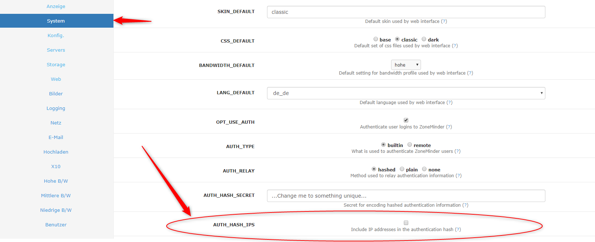

# ioBroker.zoneminder

> [!IMPORTANT]
> This adapter cannot be installed from github

## zoneminder adapter for ioBroker

Connection to your Zoneminder.

## Getting started
Type in your host e.g. 'http://zoneminder/zm' unchanged user and password is 'admin' if you don't have any authentification do not change user or password.

The device intervall is for checking new cameras and some basic information. The value is in seconds.
The monitor intervall is for checking alerts it is also in seconds.

If you want to get alert information please install zmEventNotification to your zoneminder and enable it in the iobroker settings.

### Zoneminder-Settings
To get camera-url link work with user and pw you have to deselect AUTH_HASH_IPS in Settings

## Changelog
<!--
    Placeholder for the next version (at the beginning of the line):
    ### **WORK IN PROGRESS**
-->
### 1.0.1 (2026-10-20)
- (mcm1957) IMPORTANT: password must be reentered once to to added encryption
- (copilot) Adapter requires admin >= 7.7.22 now
- (copilot) Adapter requires js-controller >= 6.0.11 now
- (bluefox) Adapter required node.js >= 22 now
- (bluefox) The adapter was refactored to TypeScript and JsonConfig
- (bluefox) `request` / `request-promise` were replaced by `axios`
- (bluefox) Fixed crashes (unreachable host, no enabled monitor), multiplying login timers and websocket connections, polling that stopped after one error
* (mcm1957) Dependencies have been updated

### 0.3.3 (12.11.2019)
* (MeisterTR) error fixes, fix login error, fixes for latest
* (MeisterTR) added ZmEvents
* (MeisterTR) Selected monitor function and disabled/enabled monitor

### 0.2.1
* (MeisterTR) added info states
* (MeisterTR) added camera-link with auth-key
* (MeisterTR) changed video link

### 0.1.0
* (MeisterTR) First running version

### 0.0.1
* (MeisterTR) initial release

## License
MIT License

Copyright (c) 2023-2026 iobroker-community-adapters <iobroker-community-adapters@gmx.de>  
Copyright (c) 2019 MeisterTR <meistertr.smarthome@gmail.com>

Permission is hereby granted, free of charge, to any person obtaining a copy
of this software and associated documentation files (the "Software"), to deal
in the Software without restriction, including without limitation the rights
to use, copy, modify, merge, publish, distribute, sublicense, and/or sell
copies of the Software, and to permit persons to whom the Software is
furnished to do so, subject to the following conditions:

The above copyright notice and this permission notice shall be included in all
copies or substantial portions of the Software.

THE SOFTWARE IS PROVIDED "AS IS", WITHOUT WARRANTY OF ANY KIND, EXPRESS OR
IMPLIED, INCLUDING BUT NOT LIMITED TO THE WARRANTIES OF MERCHANTABILITY,
FITNESS FOR A PARTICULAR PURPOSE AND NONINFRINGEMENT. IN NO EVENT SHALL THE
AUTHORS OR COPYRIGHT HOLDERS BE LIABLE FOR ANY CLAIM, DAMAGES OR OTHER
LIABILITY, WHETHER IN AN ACTION OF CONTRACT, TORT OR OTHERWISE, ARISING FROM,
OUT OF OR IN CONNECTION WITH THE SOFTWARE OR THE USE OR OTHER DEALINGS IN THE
SOFTWARE.