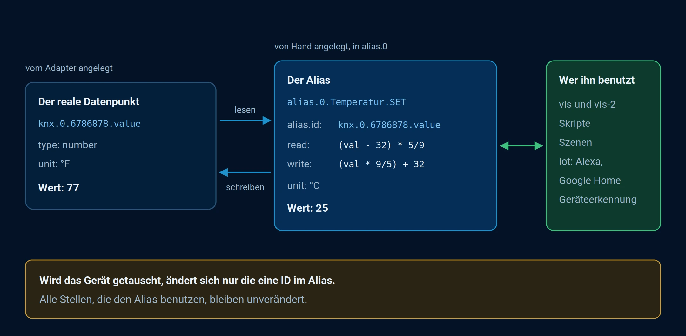

# Alias

An alias is a virtual data point in the namespace `alias.0` that is linked to a real data point. It returns the value of the real data point and passes written values on to it, optionally with a conversion (for example Fahrenheit to Celsius, or a scale of 0 to 255 to 0 to 100).

This page answers: what is an alias for, how do you create an alias, how do you replace a device without changing vis, scripts and scenes, and how does an alias convert values, units and types.

## What is an alias for?

Real devices are sometimes defective and have to be replaced. With the new hardware, the address of the device usually changes too, for example from `hm-rpc.0.ABC123` to `hm-rpc.0.QJU978`.

Since the old address was used in many places such as vis, JavaScript, scenes or others, the user would have to find all these places and replace the address there.

The alias function lets the user assign an alias to the data point of a physical device and use this alias everywhere. If the device has to be replaced, only the ID in the alias needs to be changed.

Another use case is the support of devices in special smart adapters such as iot or material. Aliases can be used to create the required state structure, while the values are still read from physical devices.



_The alias sits between the real data point and everything that uses it. It converts values when reading and when writing._

## How do you create an alias?

An alias is an ordinary object of type state below `alias.0`. There are two ways to create it.

**In the Objects tab.** Create the object there like any other data point (see [Objects tab](/docs/admin/objects.md)), below `alias.0`. This is allowed without expert mode. Then open the object with the pencil icon and enter the ID of the real data point in `common.alias.id`. Name, type, role and unit of the alias are stored in `common`, as for any data point.

**With a script in the JavaScript adapter.** The function `createAlias` creates the alias if it does not exist yet. The namespace `alias.0.` is added automatically:

```js
// creates alias.0.Wohnzimmer.Licht and points it to the real data point
createAlias('Wohnzimmer.Licht', 'hm-rpc.0.ABC123.STATE');

// separate data points for reading and for writing
createAlias('Wohnzimmer.Licht', { id: { read: 'hm-rpc.0.ABC123.STATE', write: 'hm-rpc.0.ABC123.LEVEL' } });
```

The description (`common`, i.e. type, role, unit) is taken from the data point that is read. Values you provide yourself take precedence. All parameters are described in the documentation of the [JavaScript adapter](/adapters/javascript).

**Replacing a device.** If the new device has a different address, only `common.alias.id` of the alias is changed to the new ID. vis, scripts and scenes that use the alias stay unchanged.

## How does an alias work?

All data points that are created in the object namespace `alias.0` are managed as alias data points.

The value of the alias is read from the linked data point (the target), but the object properties (such as `common` and `native`) are read from the alias data point itself.

In effect, an `alias` object mirrors the value of the target object. If permitted, both values can be changed and are synchronized automatically by the ioBroker core system. Both states can also be subscribed to by scripts and behave exactly the same.

Here is an example of such an object:

```
{
  "_id": "alias.0.Light.Device_1.WORKING",
  "type": "state",
  "common": {
    "alias": {
      "id": "admin.0.connected"
    },
    "name": "WORKING",
    "role": "indicator.working",
    "type": "boolean"
  },
  "native": {}
}
```

`native` is always empty because there is no device behind the alias, and all settings are stored in `common`.

`common.alias.id` holds the ID of the data point whose value is read or written.

## How does an alias convert values, units and types?

The alias converts the value automatically if min/max are defined for both objects (alias and target).

For example, if the alias has `min=0,max=100` and the target has `min=0,max=255`, then reading the value 10 from the target gives 3.9215686274509802, and the value 10 written to the alias is converted to 25.5.

Types are converted automatically as well: from string to number, from number to boolean, and so on. It depends on the alias and target types.

In addition, write and read functions can be defined in `common.alias`:

```
{
  "_id": "alias.0.Temperature.SET",
  "type": "state",
  "common": {
    "alias": {
      "id": "knx.0.6786878.value",
      "write": "(val * 9/5) + 32",
      "read": "(val - 32) * 5/9"
    },
    "unit": "°C",
    "name": "Temperature",
    "role": "value.temperature",
    "type": "number"
  },
  "native": {}
}
```

Target

```
{
  "_id": "knx.0.6786878.value",
  "type": "state",
  "common": {
    "unit": "°F",
    "name": "Temperature",
    "role": "value.temperature",
    "type": "number"
  },
  "native": {}
}
```

If conversion functions are defined, the automatic conversion is disabled. For read-only data points the write function can be omitted, and for write-only data points the read function.

For example:

```
{
  "_id": "alias.0.button",
  "type": "state",
  "common": {
    "alias": {
      "id": "knx.0.6786879.value",
      "write": "val ? 1 : 0"
    },
    "name": "Button",
    "role": "button",
    "type": "boolean"
  },
  "native": {}
}
```

Target

```
{
  "_id": "knx.0.6786879.value",
  "type": "state",
  "common": {
    "name": "KNX Switch",
    "role": "value",
    "type": "number",
    "min": 0,
    "max": 1
  },
  "native": {}
}
```

Subscriptions are managed automatically. When an alias is subscribed to, the target ID is subscribed to as well.

The ID of the target can be changed dynamically (via the admin), and the subscription is updated for the new target ID.

## How does an alias read and write through two separate data points?

Since version 3.0 of the js-controller, separate status and command data points can be combined in one alias:

- `alias.id.write` holds the ID of the data point that is set when the alias is written
- `alias.id.read` holds the ID of the data point that is mirrored by the alias

```
{
    _id: "alias.0.aliasName",
    common: {
        name: 'Test AliasC',
        type: 'number',
        role: 'state',
        min: -10,
        max: 10,
        alias: {
            id: {
                read: 'state.id.to.read.from',
                write: 'state.id.to.write.to'
            },
            read: 'val * 10 + 1',
            write: '(val - 1) / 10'
        }
    },
    native: {},
    type: 'state'
}
```
