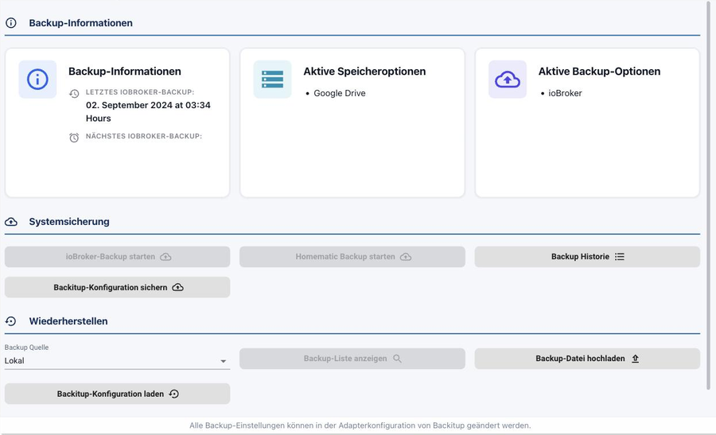
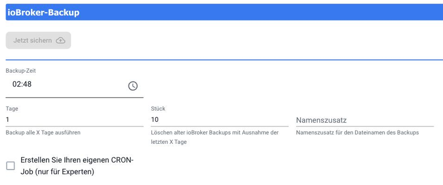

# Data backup

This page explains how to back up ioBroker (create a backup), what a backup contains, how to set up regular backups and how to restore a backup.

An ioBroker installation grows over months: instances, objects, scripts, visualizations, recorded values. A defective SD card or a failed update can wipe it all out. The question is therefore not **whether** to back up, but **when the first backup is created**, and the answer is: before something happens.

## What does an ioBroker backup contain?

An ioBroker backup contains the two databases, that is all **objects** and **states**, the list of installed adapters with their configuration, and the file storage with scripts and visualizations. It does **not** contain the adapters themselves; these are downloaded again during a restore.

Anything an adapter stores outside these databases is not included and needs its own backup: the database of `influxdb` or `sql`, the files of the `history` adapter, the network map of the Zigbee stick, the configuration of a Homematic central unit, a Node-RED flow. The BackItUp adapter has separate switches for exactly this, and they are not set by default.

!> This applies especially to the **recorded values**. A restore brings back a fully configured system in which all charts are empty if the matching switch was missing. Where everything is stored is explained under [Data recording](/docs/config/history.md).

## How do you create a backup with BackItUp?

The usual way is the [BackItUp](/adapters/backitup) adapter. It adds its own menu item **Backup**:



At the top you see the time of the last and the next backup and the active backup and storage options. Below that you can start backups manually and view the history; restoring is done at the very bottom.

### Set up a backup: schedule, storage location and retention

In the configuration of the instance `backitup.0`, the tab **Main settings** has the list *What should be backed up?* with the possible components: besides `ioBroker` these include Homematic, Redis, JavaScript, Zigbee, Zigbee2MQTT, history data, InfluxDB, MySql, PostgreSQL, SQLite3, Grafana, Node-RED and Yahka. Tick everything that actually runs on your system.

Below that, *Storage locations* lists the targets: NAS or copy, FTP, Dropbox, Google Drive, WebDAV and OneDrive.

!> Select at least one target **outside** the ioBroker computer. A backup that only lives on the same SD card is gone together with that card.

The schedule is in the tab **ioBroker**:



| Field | Meaning |
| --- | --- |
| **Backup time** | Time of day of the backup. An odd time is better than a full hour so that not everything runs at once. |
| **Days** | Interval in days. `1` means daily. |
| **Number** | How many backups are kept. Older ones are deleted. |
| **Name suffix** | Becomes part of the file name. Useful when several systems back up to the same target. |

If you need your own schedule, switch on **Create your own CRON job**.

?> The complete description of all backup types and storage targets is in the [documentation of the adapter](/adapters/backitup).

## How do you back up and restore ioBroker without an adapter, on the command line?

ioBroker can also back up without an additional adapter (`iobroker backup`) and restore (`iobroker restore`):

```bash
iobroker stop
iobroker backup
```

The file is stored as `<date>_backupIoBroker.tar.gz` in the directory `/opt/iobroker/backups`. To restore:

```bash
iobroker stop
iobroker restore <name or path of the backup>
iobroker start
```

Called without a parameter, `iobroker restore` lists the existing backups.

!> ioBroker must be stopped for both commands. A backup made while it is running may be incomplete.

## How do you test whether a backup works?

A backup that has never been restored is a guess. It is worth practising the emergency once in peace, on a second computer or in a virtual machine. How that works is described step by step under [Restore](/docs/tutorial/restore.md).

A backup also belongs **before** every larger update, especially before changing the Node.js version or the js-controller.
