# Publishing an adapter on npm (Trusted Publishing)

The first version of an adapter is published to npm by hand, once. After that, GitHub Actions publishes every release via Trusted Publishing (OIDC), with no npm token stored anywhere.

The process in seven steps:

1. Create an npm account and enable 2FA
2. Build the adapter locally and check the package contents
3. Publish the first version manually
4. Open the package settings on npmjs.com
5. Add a trusted publisher for `test-and-release.yml`
6. Check the deploy job in the workflow
7. Trigger an alpha release with the release script

**Prerequisites**

- Adapter created with `@iobroker/create-adapter` (workflow `.github/workflows/test-and-release.yml`, `@alcalzone/release-script` in devDependencies)
- Public GitHub repository `ioBroker.<adaptername>`, package name in `package.json` = `iobroker.<adaptername>` (lower case)
- Node.js 22 or 24 installed locally, `git` set up
- A GitHub-hosted runner (`ubuntu-latest`); npm does not support self-hosted runners for Trusted Publishing

Why: npm revoked all classic tokens on December 9, 2025. Since then `npm login` only gives a two-hour session, and write tokens expire after 90 days at most ([GitHub Changelog](https://github.blog/changelog/2025-12-09-npm-classic-tokens-revoked-session-based-auth-and-cli-token-management-now-available/)). From January 2027, tokens that bypass 2FA can no longer publish directly either ([GitHub Changelog](https://github.blog/changelog/2026-07-08-npm-install-time-security-and-gat-bypass2fa-deprecation/)). Trusted Publishing is set up once and never needs renewing.

## Step 1: Create an npm account and enable 2FA

npm no longer accepts a manual publish without two-factor authentication.

1. Open [npmjs.com/signup](https://www.npmjs.com/signup), enter username, email and password (at least 10 characters), accept the terms, click **Create an Account** and confirm the email. The email address becomes public in the package metadata.
2. Click your avatar at the top right, then **Account**.
3. In the **Two-Factor Authentication** box click **Enable 2FA** (if 2FA is already on, the button reads **Modify 2FA**).
4. Set up an authenticator app or a security key (passkey, YubiKey) and store the recovery codes safely.

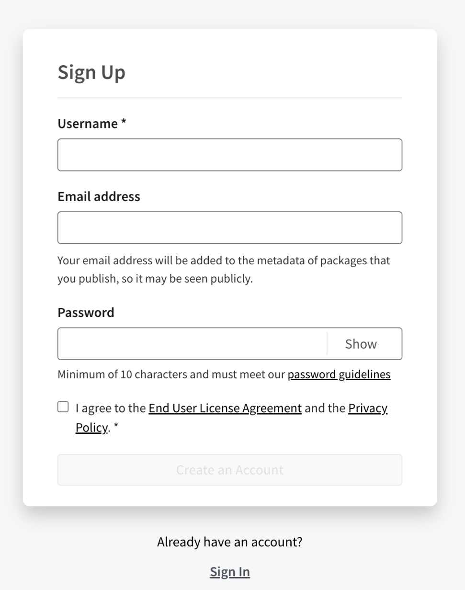

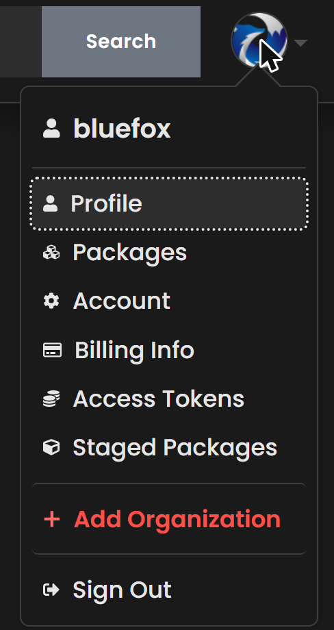

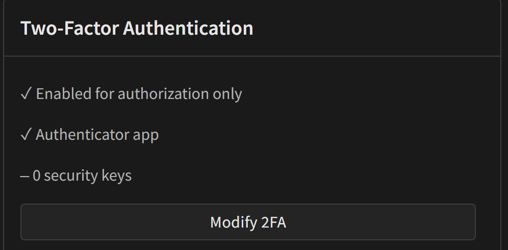

## Step 2: Build and check the adapter locally

The adapter must build cleanly and pass its tests before the first publish, otherwise a broken package stays on npm for good.

```bash
git clone https://github.com/<user>/ioBroker.<adaptername>.git
cd ioBroker.<adaptername>
npm ci
npm run build        # only for TypeScript or React admin
npm run lint
npm test
```

Then look at the package contents without uploading anything:

```bash
npm pack --dry-run
```

The list must contain `io-package.json`, `main.js` or `build/`, `admin/` and `LICENSE`. `src/`, `test/` and `.github/` do not belong in it; the `files` field in `package.json` controls that.

Also check:

- `name` in `package.json` is `iobroker.<adaptername>`
- `version` in `package.json` and `common.version` in `io-package.json` match (`0.0.1` for new adapters)
- `repository.url` points to the GitHub repository, otherwise the provenance check fails later

## Step 3: Publish the first version manually, once

Trusted Publishing can only be configured for a package that already exists on npm. So the first version goes out from your own machine.

```bash
npm login            # opens the browser, sign in with 2FA
npm whoami           # prints your npm username
npm run build        # only for TypeScript or React admin
npm publish          # asks for 2FA in the browser again
```

Shortly after, the package is live at `https://www.npmjs.com/package/iobroker.<adaptername>`.

Then add bluefox as a second owner. The ioBroker repository checker requires this before an adapter is added to the repository (see [Publish](/docs/dev/adapterpublish.md)):

```bash
npm owner add bluefox iobroker.<adaptername>
npm owner ls iobroker.<adaptername>
```

In the browser instead: package page, **Settings** tab, section **Invite maintainer**, enter `bluefox`.

Notes:

- The `npm login` session lasts two hours; after that, run `npm login` again.
- A version number can never be reused once published, not even after `npm unpublish`.
- If npm rejects the name (`Package name too similar to existing package`), the adapter needs a different name.

## Step 4: Open the package settings on npmjs.com

1. Sign in at [npmjs.com](https://www.npmjs.com/login).
2. Avatar at the top right, then **Packages**, then click `iobroker.<adaptername>`.
3. On the package page open the **Settings** tab. Only maintainers see it.

When opening **Settings**, npm asks for the 2FA one-time code from your authenticator app again. The page then shows **Trusted Publisher** at the top, followed by **Package access**, **Publishing access** and **Invite maintainer**.

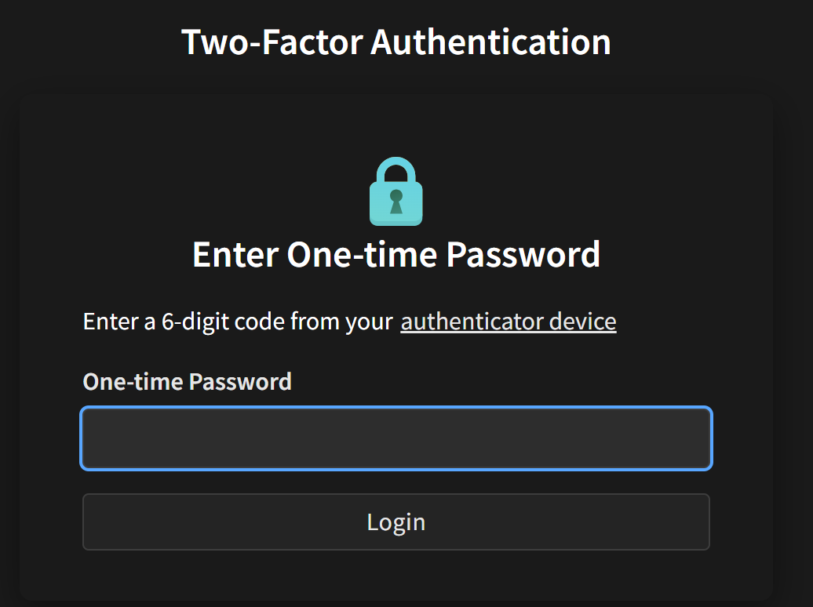

## Step 5: Add the trusted publisher

This allows only the `test-and-release.yml` workflow of your own repository to publish.

1. Under **Trusted Publisher** choose **GitHub Actions** as **Publisher**. If a connection already exists, click **Add trusted publisher** first.
2. Fill in the fields:

| Field | Value | Example |
| --- | --- | --- |
| Label | optional, free text | leave empty |
| Organization or user | GitHub user or organization | `ioBroker` |
| Repository | repo name without owner | `ioBroker.openweathermap` |
| Workflow filename | file name only, no path | `test-and-release.yml` |
| Environment name | leave empty | |
| Allowed actions | tick **Allow npm publish** | `npm stage publish` is always allowed |

3. Save with **Set up connection**.

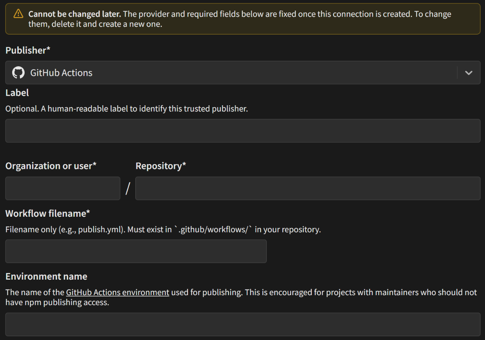

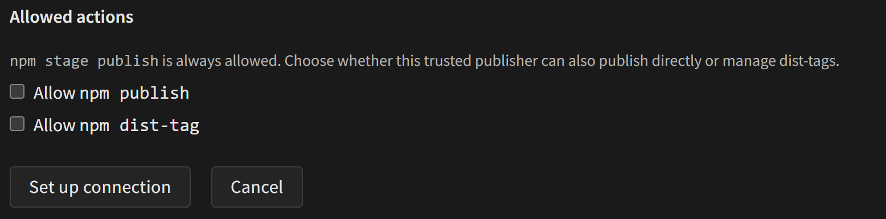

!> **Allow npm publish.** Since September 3, 2026, new configurations only allow `npm stage publish` by default. The ioBroker deploy action calls `npm publish`, so without this box the release fails ([npm docs](https://docs.npmjs.com/trusted-publishers)).

!> **Release within 2 days.** A new configuration expires if it has not completed one successful publish within two days. Then delete it and create it again. So only do step 5 when the alpha release (step 7) can follow right away.

npm does not check the fields when saving. A typo only shows up at release time as error `404`. Mind upper and lower case.

Optional, once the first release via GitHub has worked: under **Publishing access** choose **Require two-factor authentication and disallow bypass 2fa tokens (recommended)** and save with **Update Package Settings**. Tokens are then blocked, Trusted Publishing keeps working. An old `NPM_TOKEN` secret in the GitHub repository can be deleted.

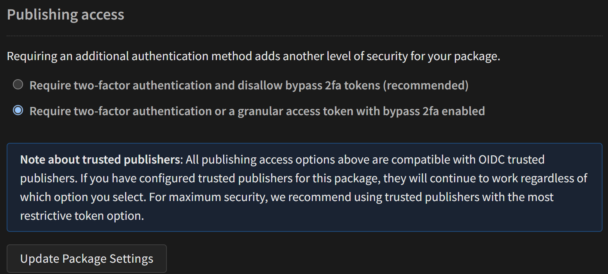

## Step 6: Check the deploy job in the workflow

In `.github/workflows/test-and-release.yml` the `deploy` job must look like this. The two key points: `id-token: write` is set, and there is **no** `npm-token` line.

```yaml
  # Deploys the final package to NPM
  deploy:
    needs: [check-and-lint, adapter-tests]

    # Trigger this step only when a commit on any branch is tagged with a version number
    if: |
      contains(github.event.head_commit.message, '[skip ci]') == false &&
      github.event_name == 'push' &&
      startsWith(github.ref, 'refs/tags/v')

    runs-on: ubuntu-latest

    # Write permissions are required to create Github releases
    permissions:
      id-token: write      # required for Trusted Publishing
      contents: write      # required for the GitHub release

    steps:
      - uses: ioBroker/testing-action-deploy@v1
        with:
          node-version: '24.x'
          # build: true      # uncomment for TypeScript or React admin
          github-token: ${{ secrets.GITHUB_TOKEN }}
          # NO npm-token: ${{ secrets.NPM_TOKEN }} anymore!
```

This is what it looks like in a real adapter, here ioBroker.openweathermap:

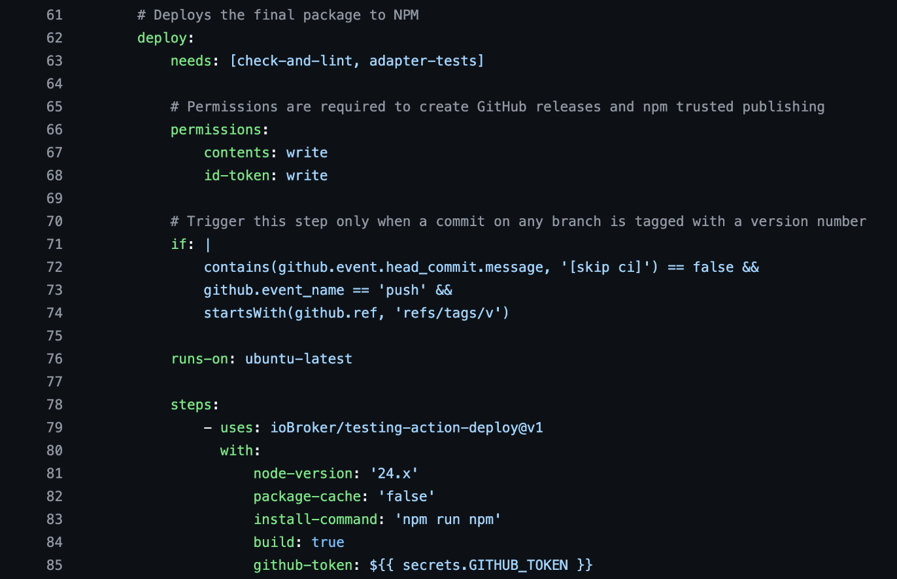

What the action does ([action.yml](https://github.com/ioBroker/testing-action-deploy/blob/master/action.yml)):

- Without `npm-token` it installs npm 11 and authenticates via OIDC.
- If the version contains a hyphen (`0.0.2-alpha.0`), it publishes with `--tag next`. Users on `latest` do not get the alpha.
- It creates a GitHub release automatically, marked as pre-release for prerelease versions.

At the top of the same file, `on: push: tags:` must also contain the pattern `"v[0-9]+.[0-9]+.[0-9]+-**"`, otherwise the workflow does not start for alpha tags. Adapters from create-adapter already have it.

Migrating older adapters: add `id-token: write`, delete the `npm-token` line, commit ([create-adapter migration note](https://github.com/ioBroker/create-adapter/blob/master/docs/updates/20251013_trusted_deploy.md)).

## Step 7: Alpha release with the release script

The release script bumps the version in `package.json` and `io-package.json`, writes the changelog, commits, sets the git tag and pushes. The tag starts the workflow; the rest runs on GitHub.

**1. Prepare the changelog.** In `README.md` under `## Changelog`, fill the placeholder with your changes:

```markdown
### **WORK IN PROGRESS**
- (your-name) First test version
```

**2. Commit everything and switch to the main branch.** The script stops if there are uncommitted changes.

**3. Dry run, changes nothing:**

```bash
npm run release prepatch alpha -- --dry
```

**4. Real alpha release:**

```bash
npm run release prepatch alpha
```

`0.0.1` becomes `0.0.2-alpha.0`. The `manual-review` plugin pauses before the commit so you can check the changes. Press Enter to continue.

**5. Watch the workflow.** Go to **Actions** in the repository. The run for tag `v0.0.2-alpha.0` runs the tests first, then the `deploy` job.

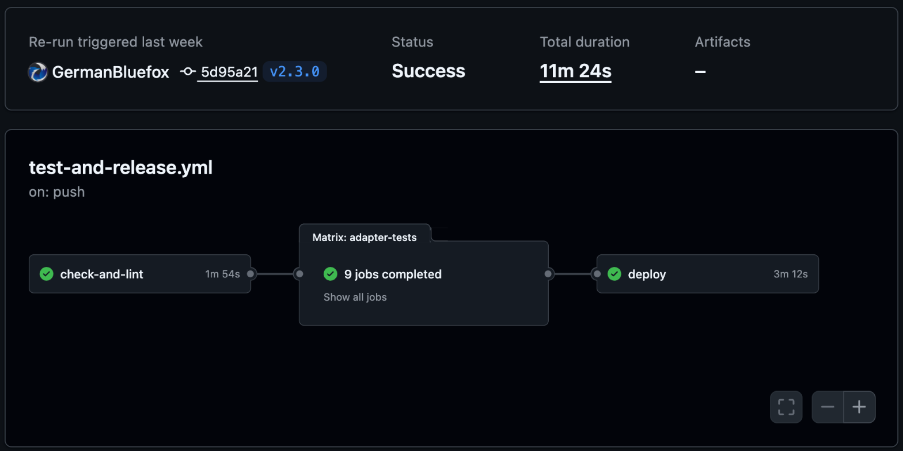

**6. Check the result:**

```bash
npm view iobroker.<adaptername> dist-tags
# { latest: '0.0.1', next: '0.0.2-alpha.0' }
```

On npmjs.com the **Versions** tab now lists the alpha with tag `next`, and the package page shows the **Provenance** box. On GitHub, **Releases** shows a pre-release.

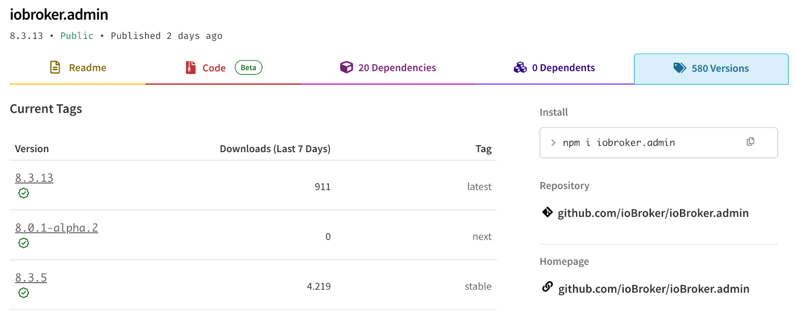

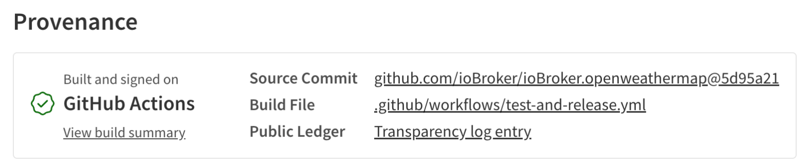

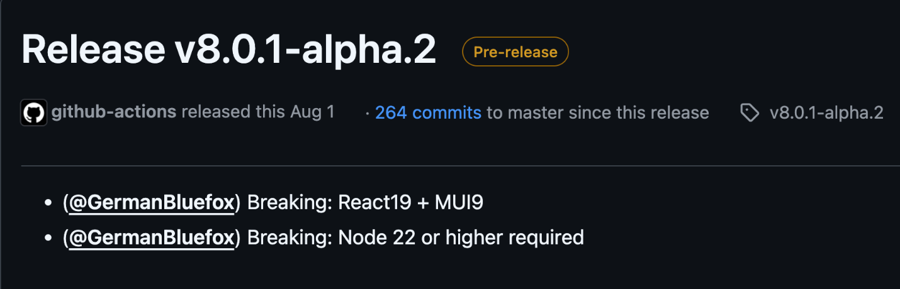

In the package settings, the trusted publisher shows **Status: Valid** after the first successful release:

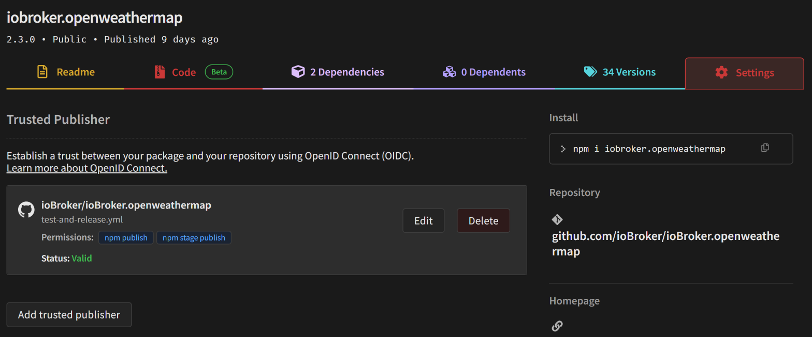

**More versions:**

| Goal | Command | Example |
| --- | --- | --- |
| next alpha | `npm run release prerelease` | 0.0.2-alpha.0 → 0.0.2-alpha.1 |
| start a beta | `npm run release prepatch beta` | 0.0.2 → 0.0.3-beta.0 |
| stable version | `npm run release patch` | 0.0.2-alpha.1 → 0.0.2 |
| new feature | `npm run release minor` | 0.0.2 → 0.1.0 |

Commands from [AlCalzone/release-script](https://github.com/AlCalzone/release-script).

## Troubleshooting

| Message in the log | Cause | Fix |
| --- | --- | --- |
| `E404 Not Found` on `npm publish` in the workflow | Owner, repository or workflow filename misspelled in the trusted publisher | Compare step 5 with the repo, mind upper and lower case |
| `ENEEDAUTH` in the workflow | `id-token: write` missing in the `deploy` job | Add the permission (step 6) |
| `E403`, publishing not allowed | **Allow npm publish** not ticked under **Allowed actions** | Tick it, save, re-run the release |
| Trusted publisher can no longer be edited | Configuration expired after 2 days without a release | Delete, recreate, release right away |
| Workflow does not start for the alpha tag | Prerelease tag pattern missing under `on: push: tags:` | Add `"v[0-9]+.[0-9]+.[0-9]+-**"` |
| `EOTP` on manual `npm publish` | 2FA confirmation missing | Confirm in the browser or `npm publish --otp=<code>` |
| `You cannot publish over the previously published versions` | Version already exists on npm | Create a new version with the release script |
| Script reports uncommitted changes | Working tree not clean | `git status`, commit, start again |

Re-run without a new version: on GitHub open the failed run under **Actions** and click **Re-run failed jobs**.
