# What's new

## Instructions for writers
- Please define the header as
  ## AdapterName (YYYY-MM-DD) - [short description]
- Shot description could be:
  - new adapter
  - stable release
  - new feature
  - new widget
- if your news about the new adapter, please add a GitHub link and a logo of the adapter
  Example:
```markdown
    ## frigate (2023-08-20) - new adapter
    https://github.com/Bettman66/ioBroker.frigate
   
    
```

## ecoflow-mqtt (2024-10-14) - new adapter
https://github.com/foxthefox/ioBroker.ecoflow-mqtt


ioBroker adapter for connection to the Ecoflow MQTT Server (emulating the App communication), provides also a Home Assistant Gateway via discovery function.

## frigate (2023-08-20) - new adapter
https://github.com/Bettman66/ioBroker.frigate


Frigate is an open source NVR built around real-time AI object detection. This adapter parses Frigate's MQTT messages and creates data objects from them

## notification-manager (2023-08-21) - new adapter
https://github.com/foxriver76/ioBroker.notification-manager


Manage ioBroker notifications, e.g., by sending them as messages

## procon-ip (2023-08-24)
https://github.com/ylabonte/ioBroker.procon-ip


ioBroker adapter for basic support of the `ProCon.IP` swimming pool control unit.

## deyeicd (2023-08-29)
https://github.com/raschy/ioBroker.deyeidc


Data Collector vor `Deye`-compatible Inverter

## acme (2023-09-01)
https://github.com/iobroker-community-adapters/ioBroker.acme


This adapter generates certificates using ACME challenges.

## admin (2023-09-01)
Context menu:
- e.g., easy creation of aliases
  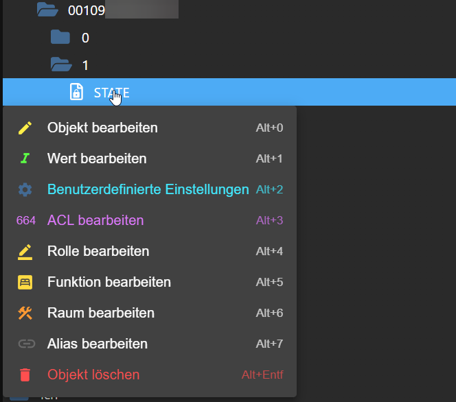

## javascript (2023-09-01)
Playground for JavaScript code:
- You can use ChatGPT (required API key) to generate the script. It is only to test the possibilities of ChatGPT
  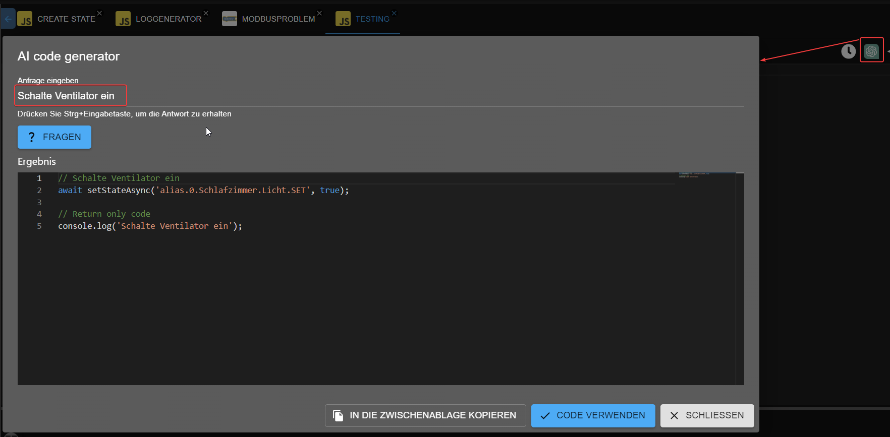

## cec2 (2023-09-06)
https://github.com/iobroker-community-adapters/ioBroker.cec2


Adapter for HDMI CEC - You can monitor / control devices using HDMI CEC. Most modern TVs and multimedia devices support CEC to some extent.

## alexa2 (2023-09-09)
* (Apollon77) Update Alexa2 adapter to adjust to the changed Push-Notification system from Amazon to allow getting history and interaction information again

## vis-2-widgets-material (2023-09-10)
* (bluefox) Door lock widget has been added
  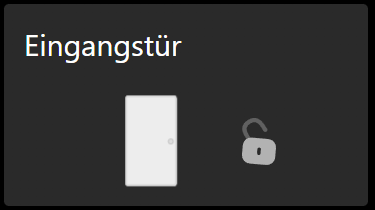
  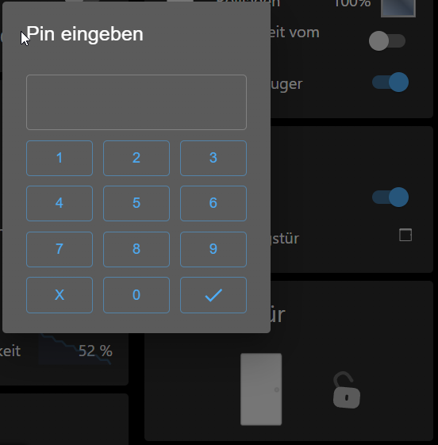

## pushbullet (2023-09-10)


* (bluefox) API has been updated to version 3
* (bluefox) JSON configuration was added
  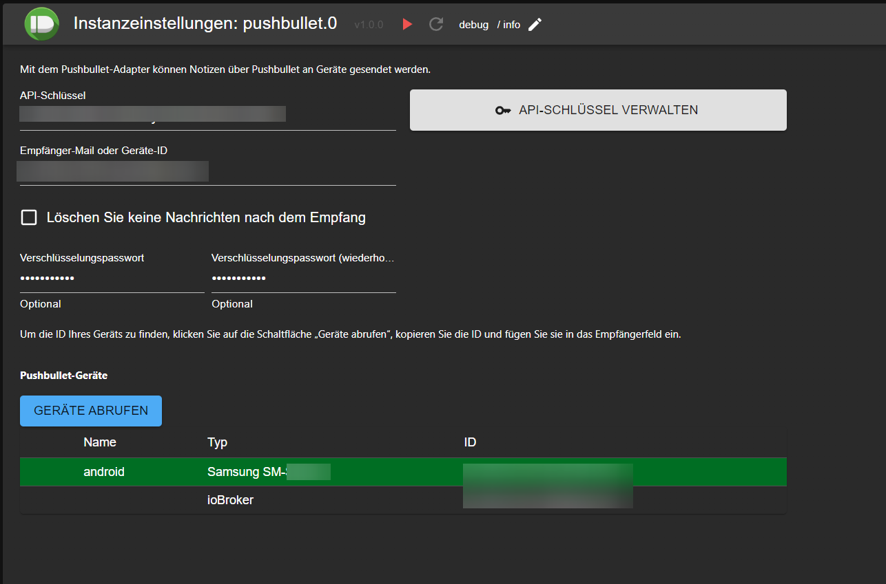

## JSON config Dokumentation
* (bluefox) JSON-Config documentation has been added to the ioBroker website [hinzugefügt](https://www.iobroker.com/docs/dev/adapterjsonconfig.md).

## telegram-menu (2023-09-11)
https://github.com/MiRo1310/ioBroker.telegram-menu


Easily create Telegram Menus

## vis-2 (2023-09-12)
* (bluefox) Horizontaler Menü
  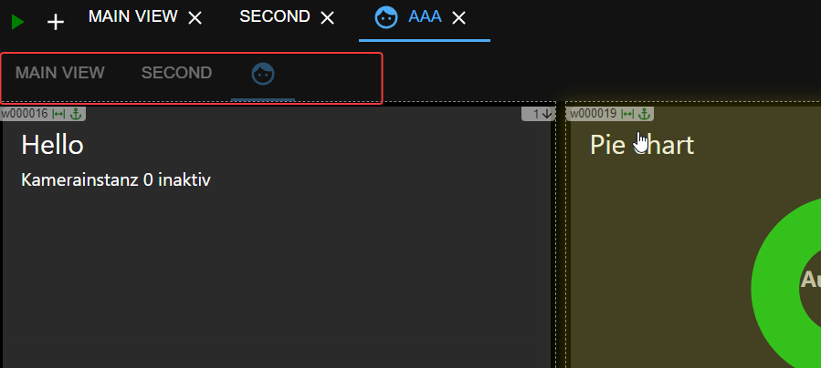

## echarts (2023-09-12)
* (bluefox) Added the ability to export the data to JSON file
  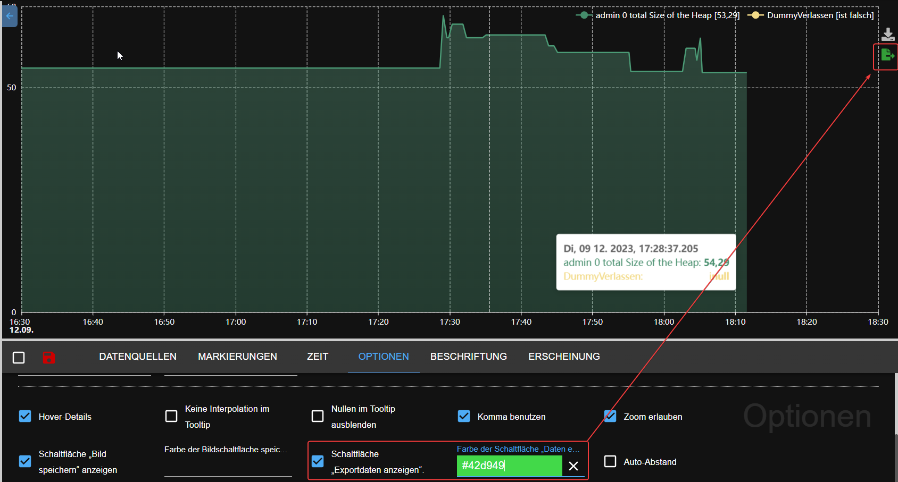
* (bluefox) Added the ability to restore zoom and pan after X seconds of inactivity
  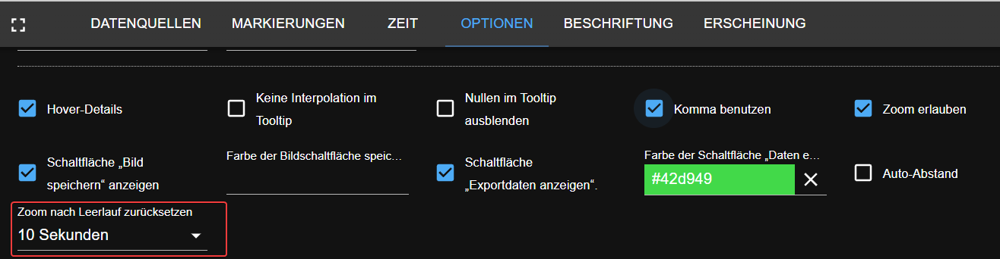
* (bluefox) Show legend as dialog
  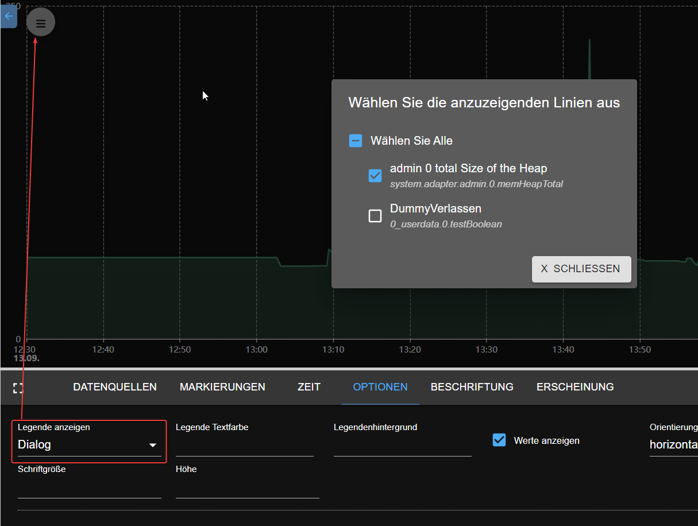

## js-controller (2023-09-14)
* (foxriver76) Release js-controller 5 to stable
* (foxriver76) Upgrade installer to just allow Node.js 16.x+

## apg-info (2023-09-16)
https://github.com/HGlab01/ioBroker.apg-info - new adapter


This adapter provides the peak-times for the Austrian Power Grid, where power consumption shall be avoided. In addition, the adapter provides the PHELIX-AT Day-Ahead (EPEX Spot) prices for Austria.

## tinymqttbroker (2023-09-16) - new adapter
https://github.com/HGlab01/ioBroker.tinymqttbroker


This is a very tiny MQTT broker which is not managing any objects/states in ioBroker but offers a central MQTT broker instance to publish an subscribe topics as MQTT client.

## awtrix-light (2.10.2023) - new adapter
https://github.com/klein0r/ioBroker.awtrix-light


Integrate your Awtrix Light device (e.g. Ulanzi TC001) via HTTP

## webui (3.10.2023) - new adapter
https://github.com/iobroker-community-adapters/ioBroker.webui


This is a complete visualization system for ioBroker.
* completely based on web-components
* wysiwyg editor for UI, but you can also switch to source view, or split view
* multi window ui in edit view, like in visual studio
* bindings per drag/drop of ioBroker objects on ui-elements or properties
* complex bindings with JavaScript inside, and converters
* simple script language which could be created via ui

## heizungssteuerung (4.10.2023) - new adapter
https://github.com/jbeenenga/ioBroker.heizungssteuerung


This adapter can be used to manage heating systems.
You can choose between cooling and heating mode and activate boost or pause for one room.
Furthermore, you can overwrite the target temperature for one room.

## admin and mqtt (11.10.2023) - new feature
Admin and MQTT adapters now check if they are reachable from the public internet if no authentication is enabled. If not, they will show warning in the log and in the admin.

This is a useful feature, as not all users understand how to secure their adapters, and it is hazardous to have MQTT or admin adapter open to the internet without authentication.

## iobroker (11.10.2023) - new feature
Now it is possible to update your node.js via command line: `iob nodejs-update`
https://forum.iobroker.net/topic/69067/neuer-befehl-iob-nodejs-update

You can update to a suggested version (current 18) without additional parameters or specify a version: `iob nodejs-update 20`

## vis-2-widgets-material (13.10.2023) - new widget
Vacuum cleaner widget has been added.

This widget is primary for Xiaomi vacuum cleaner.
But it can be used for any other vacuum cleaner too.
The only difference is that Xiaomi supports room cleaning.

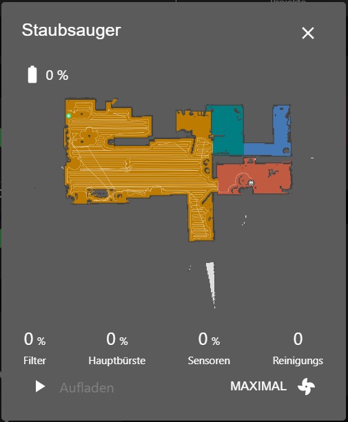

## welcome (17.10.2023) - new adapter
https://github.com/ioBroker/ioBroker.welcome


This adapter shows all web and admin instances of ioBroker on one page on port 80 (configurable)


## govee-local (20.10.2023) - new adapter
https://github.com/boergegrunicke/ioBroker.govee-local


Control Govee devices via local access (no cloud)

## pylontech (23.10.2023) - new adapter
https://github.com/PLCHome/ioBroker.pylontech


Query the cell voltages and the status of pylontech batteries via the console.

## signifylights (26.10.2023) - new adapter
https://github.com/disaster123/ioBroker.signifylights


Signify Lights adapter for all Types of Signify WLAN lights like WIZ, Philips WLAN and many more...

## esphome (01.11.2023) - new feature
In a significant development for home automation enthusiasts,
the ESPHome documentation has officially acknowledged the integration of ioBroker with its native API.
This update follows the acceptance of a recent PR,
placing ioBroker alongside Home Assistant as one of the exclusive home automation systems
to utilize ESPHome's native API for direct client communication.

The native API, known for its highly optimized network protocol,
offers numerous benefits over traditional MQTT methods,
streamlining the way smart devices interact within the ecosystem.
With this recognition, ESPHome reaffirms its commitment to providing efficient
and robust communication channels for the smart home industry.

## vis (06.11.2023) - new feature
The license of vis has been changed to MIT. This means that you can use vis for free in commercial projects and no license is required.

## welcome (07.11.2023) - new feature
Added possibility to add custom links to the welcome page. The pages will be checked if they are alive.

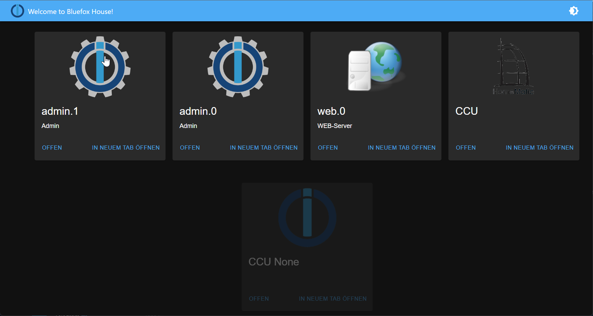

## echarts (08.11.2023) - new feature
Vis-2 widget was added. Now, additionally to the presets, you can use the object ID with history data directly.

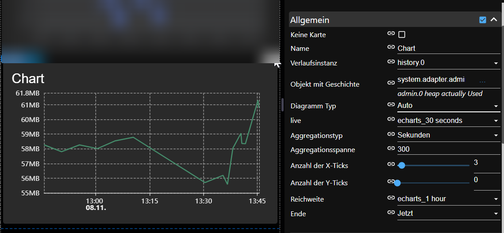

## renacidc (17.11.2023) - new adapter
https://github.com/raschy/ioBroker.renacidc


Reading the data from renacpower solar inverters

## weather-warnings (24.11.2023) - new adapter
https://github.com/ticaki/ioBroker.weather-warnings


This adapter accesses weather warnings of different weather services and outputs them as text or voice messages. Additionally, it creates States grouped by type, which can be used to react to current warnings.

## tractive-gps (06.12.2023) - new adapter
https://github.com/iobroker-community-adapters/ioBroker.tractive-gps


This adapter allows you to connect to the Tractive GPS service and retrieve the location of your pets.

## admin (06.12.2023) - new feature
It is possible to change menu colors in admin

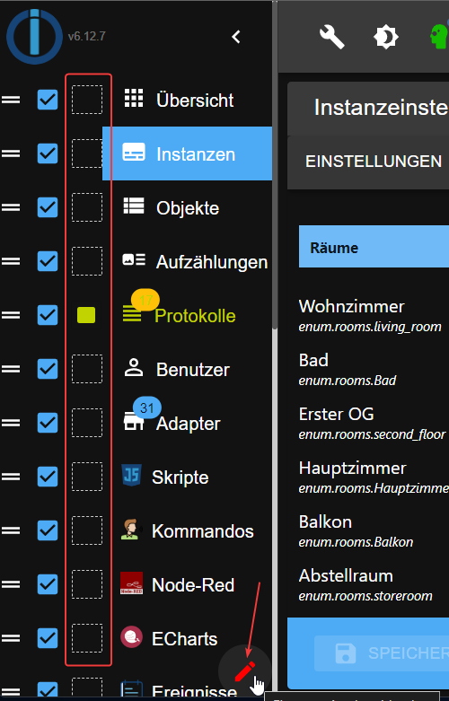

## emporia (07.12.2023) - new adapter
https://github.com/Chris-656/ioBroker.emporia


This adapter retrieves data from emporia energy system.

## reolink (27.12.2023) - new adapter
https://github.com/aendue/ioBroker.reolink


Adapter for ioBroker Plattform to get Reolink camera information..

## vis-2 (08.01.2024) - new adapter
https://github.com/ioBroker/ioBroker.vis-2

vis-2 is now in a stable repository. It is a new generation of vis. It is based on ReactJS and has many new features.

## artnet-recorder (08.01.2024) - new adapter
https://github.com/Bannsaenger/ioBroker.artnet-recorder


Record Art-Net data to a file for later playback

## energiefluss (25.01.2024) - new adapter
https://github.com/SKB-CGN/ioBroker.energiefluss


It provides an animated energyflow of the current consumption for photovoltaics, battery, house-consumption, grid-feed-in (grid-consumption), car charge and up to 10 possible elements (circle or rectangle).

## amtronwallbox (28.01.2024) - new adapter
https://github.com/rg-engineering/ioBroker.amtronwallbox


The adapter serves as an interface to various Amtron wallboxes. The data provided by the box is read out and made available as a state in the adapter. The data is only processed locally, a cloud connection is not necessary.

## zendure-solarflow (30.01.2024) - new adapter
https://github.com/nograx/ioBroker.zendure-solarflow


This project is an ioBroker Adapter to read data from the Zendure Solarflow Cloud API. It uses the official API provided by Zendure.

## echarts (03.02.2024) - new feature
Added "radar" chart type


## soliscloud (3.2.2024) - new adapter
https://github.com/Trixx34/ioBroker.soliscloud


This adapter will read multiple values available from the soliscloud API and store them for use in ioBroker.

## sun2000-modbus (8.2.2024) - new adapter
https://github.com/daolis/ioBroker.sun2000-modbus


Read data from Huawei SUN2000 inverter and LUNA2000 Storage using Modbus TCP.

## scenes (10.2.2024) - new feature
It is possible to use categories in scenes

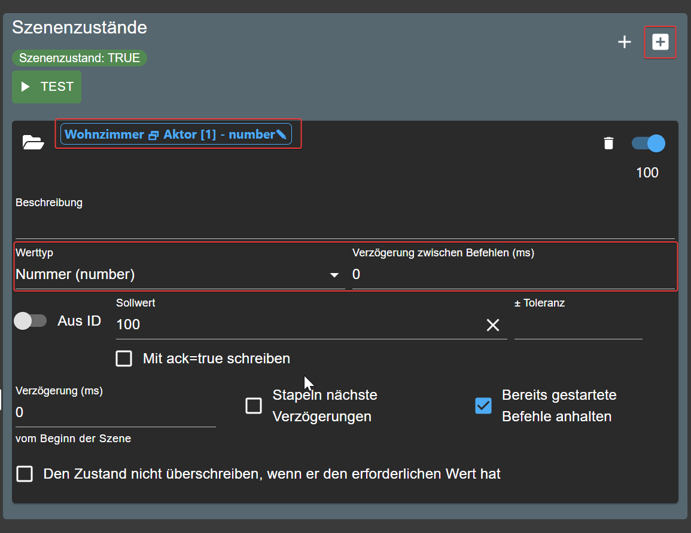

## solaredge (15.2.2024) – new adapter
https://github.com/iobroker-community-adapters/ioBroker.solaredge


Get data from solaredge monitoring portal. Currently, only the /overview data point is used to get the current power and day/month/year/lifetime energy readings.

## elgato-key-light (18.2.2024) – new adapter
https://github.com/iobroker-community-adapters/ioBroker.elgato-key-light


This adapter allows you to control Elgato Key Lights via ioBroker.

## myuplink (18.2.2024) – new adapter
https://github.com/sebilm/ioBroker.myuplink


This ioBroker adapter receives data from myUplink.com.

## sun2000 (19.2.2024) – new adapter
https://github.com/bolliy/ioBroker.sun2000


Read register data from Huawei SUN2000 inverter and LUNA2000 battery using Modbus TCP.

## opcua (21.2.2024) – new feature
The adapter has now free license.

## senec (25.2.2024) – new adapter
https://github.com/nobl/ioBroker.senec


Initially targeted at the Senec Home V2.1 System. In the Senec.Home system, only selected values can be changed by the adapter. Senec currently also no longer provides a reliable way to influence peak shaving via the web interface. Whether other systems (e.g. V3) also work with it depends on whether they are also based on lala.cgi and provide the same JSON information.

## energiefluss-erweitert (11.3.2024) – new adapter
https://github.com/SKB-CGN/ioBroker.energiefluss-erweitert


Adapter provides an animated energyflow for all elements, you add. This could be: photovoltaics, battery, house-consumption, grid-feed-in (grid-consumption), car charge etc.

## nmea (17.3.2024) – new adapter
https://github.com/ioBroker/ioBroker.nmea


This adapter allows connecting ioBroker to NMEA-2000 yacht bus. You can read SOG, COG, GPS position, depth, wind, temperature, and many other data from the NMEA-2000 bus.
And even control the Raymarine autopilot.

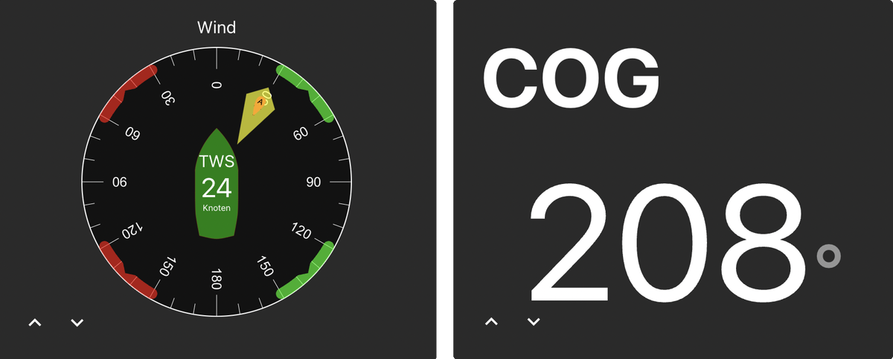

## vis-homekittiles (25.3.2024) – new adapter
https://github.com/Standarduser/ioBroker.vis-homekittiles


Homekit Tiles is a widget set based on the design of Apple HomeKit. The special feature of the widgets is that they do not contain any fixed style elements, but everything is formatted using CSS. As a result, there are no separate settings in the VIS editor for the position and/or size of the icons, labels, etc. The design is adjusted by changing the CSS code. For this purpose, the CSS code from the file /widgets/homekittiles/css/style.css can be used as a template. The code is inserted into the CSS tab in the VIS editor and can be customized as desired. It is also possible to add your own CSS classes via the VIS editor in the "General" section of the widgets.

The widgets are designed for VIS 1.x.

## scheduler (05.4.2024) – new feature
Scheduler supports now holidays and custom types.

## admin (6.4.2024) – new feature
Admin now supports the includes in JSONConfig files:

```json5
{
    "tabs": {
        "tab1": {
            "type": "panel", // data will be combined with the content of "tab1.json". If the same attribute is defined in both files, the value from the included file will be used.
            "#include": "tab1.json"
        }
    }
}
```

https://github.com/ioBroker/ioBroker.admin/blob/master/packages/jsonConfig/SCHEMA.md#includes

## smoothed (8.4.2024) – new adapter
https://github.com/BenAhrdt/ioBroker.smoothed


This Adapter make it easy to select some icons to smooth it according to a selected allgorithem and the smoothtime (filtertime). You can select one id more times to smooth it in defferent allgorithems and or times. The destination is an id in the directory of the flger, wicht delivers you the smoothed values. You can limit the min- or max- values. Limit the decimal places. Or ignore values with a high standard deviation.

## heizoel24-mex (14.4.2024) – new adapter
https://github.com/ltspicer/ioBroker.heizoel24-mex


The MEX is a heating oil level measuring device. This adapter reads the MEX data from the Heizoel24 server.

## hydrawise (17.4.2024) – new adapter
https://github.com/SentiQ/ioBroker.hydrawise


Integrate your Hydrawise controller into ioBroker. You can see all controller information, schedules and sensors. It is also possible to suspend planned watering by x seconds.

## tedee (17.4.2024) – new adapter
https://github.com/TA2k/ioBroker.tedee


Adapter for Tedee Locks. This Adapter uses the local bridge API to control a tedee lock.
All Lock devices by Tedee are supported.

## pid (22.4.2024) – new adapter
https://github.com/mcm4iob/ioBroker.pid


This adapter provides the functionality of a PID controller.


## unifi-protect (28.4.2024) – stable release
https://github.com/iobroker-community-adapters/ioBroker.unifi-protect


Connects to Unifi Protect Controller and pulls all Data from added Cameras.

## air-q (1.5.2024) – new adapter
https://github.com/CorantGmbH/ioBroker.air-q


This ioBroker Adapter is used in connection with our air-Q device. It polls the values from our sensors and displays them for you in the ioBroker environment.

## boschindego (4.5.2024) – new adapter
https://github.com/iobroker-community-adapters/ioBroker.boschindego


Adapter for Bosch Indego Mower to show the state of the mower and control the mower.

## Windows installer (20.5.2024) – new feature
There is a new version for Windows installer available: 3.1.0
New features:
- Update/Upgrade of JS-Controller implemented
- Some bugfixes

## radar-trap (29.5.2024) – new adapter at stable
https://github.com/Steiger04/ioBroker.radar-trap


Adapter to detect speed traps and obstacles.

##  waterkotte-easycon (12.4.2024) – new adapter at latest
https://github.com/theknut/ioBroker.waterkotte-easycon


Adapter for Gree and C&H conditioners.

## vis-2-widgets-inventwo (25.4.2024) – new adapter at latest
https://github.com/inventwo/ioBroker.vis-2-widgets-inventwo


Adds switches, buttons, sliders, and more as widgets for ioBroker VIS 2.0.

## webui (3.10.2023) - new adapter
https://github.com/iobroker-community-adapters/ioBroker.webui


This is a complete visualization system for ioBroker.
* completely based on web-components
* wysiwyg editor for UI, but you can also switch to source view, or split view
* multi window ui in edit view, like in visual studio
* bindings per drag/drop of ioBroker objects on ui-elements or properties
* complex bindings with JavaScript inside, and converters
* simple script language which could be created via ui
## hiob (22.5.2024) – new adapter at latest
https://github.com/moba15/ioBroker.hiob


This app allows you to control your ioBroker Smarthome system via the hiob app. It is a simpler and faster alternative to comparable projects with fewer configuration possibilities. It is mainly intended for Android devices, but also works on Windows and Linux desktops.

## notificationforandroidtv (22.5.2024) – new adapter at latest
https://github.com/DNAngelX/ioBroker.notificationforandroidtv


Notification integration for IoBroker includes support for Notifications for Android TV and Notifications for Fire TV. With this integration, you can send notifications to your Android TV device. It enables an overlay displaying the message content for a customizable duration before disappearing. Additionally, it supports sending images, such as those from security cameras, and custom icons. Icons function similarly to images, appearing smaller and to the left of the notification, while images display larger and above the notification.

These notifications operate within the global scope of your Android TV device, appearing regardless of the active application.

## IOB Mobile App for Android und iOS (04.6.2024) - new app


Wiki: https://github.com/peter9teufel/iobmobile-issues/wiki/IOB-Mobile-Quickstart

## gree-hvac (10.6.2024) – new adapter at stable
https://github.com/XHunter74/ioBroker.gree-hvac


Adapter for Gree and C&H conditioners.

## Admin (10.6.2024) – new feature
- Log tab was improved. (Mostly layout and GUI)
- Added support for the adapter's auto-update option. New version of js-controller required.
- Only installed adapters in the adapter tab or first 100 adapters are shown. To see more adapters, the user must enter some filter.

## opcua (13.6.2024) – new adapter at stable
https://github.com/ioBroker/ioBroker.opcua


ioBroker OPC-UA Adapter.

## e3oncan (25.7.2024) – new adapter at stable
https://github.com/MyHomeMyData/ioBroker.e3oncan


Viessmann E3 series devices (One Base) are doing a lot of data exchanges on CAN bus. This adapter can listen to this communication and extract much useful information. Energy meters E380CA and E3100CB also are supported. This mode of operation is called `Collect`.

Note: This adapter is supported on linux systems only.

## egigeozone2 (6.8.2024) – new adapter at stable
https://github.com/obakuhl/ioBroker.egigeozone2


This is an ioBroker adapter for Android geofencing app "EgiGeoZone". It is able to receive geofence events as HTTP requests when entering or leaving a defined area with your mobile device.

## hiob (17.8.2024) – new adapter at stable
https://github.com/moba15/ioBroker.hiob


This app allows you to control your ioBroker Smarthome system via the hiob app. It is a simpler and faster alternative to comparable projects with fewer configuration possibilities. It is mainly intended for Android devices, but also works on Windows and Linux desktops.

## extron (17.8.2024) – new adapter at stable
https://github.com/Bannsaenger/ioBroker.extron


Control devices from Extron. This Adapter is designed to control some of the Extron Audio Video Products via the Simple Instruction Set Protocol. The functional scope of the devices is tremendous. Not all of the features make sense to be supported with the adapter and the interaction with ioBroker.

## ping (23.08.2024) - new feature
Ping adapter can detect the range of IP addresses if the range has less than 4096 addresses.

Users can add the IP-Addresses directly from notification.

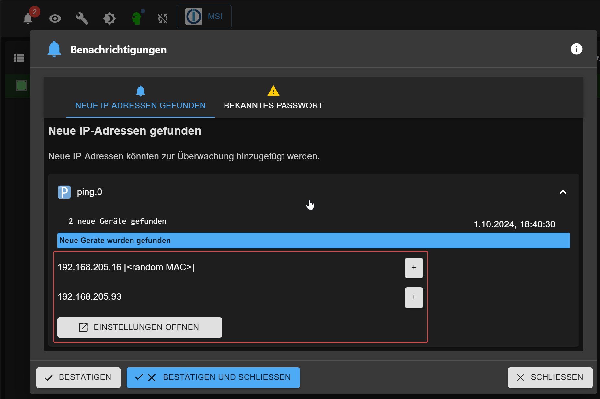

## admin (23.08.2024) - new feature
States could be controlled directly from JSON Config to start range detection or something similar.

## admin (01.09.2024) - new feature
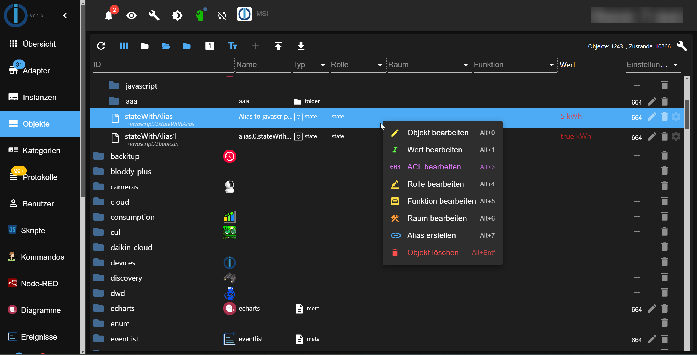

Some users may already be familiar with the context menu in the ioBroker Admin Object Browser. However, we want to remind everyone that a simple left-click provides quick access to the context menu, allowing you to perform various operations on objects, such as creating an alias for them.

## gotify-ws (4.9.2024) – new adapter at stable
https://github.com/simatec/ioBroker.gotify-ws


Gotify-WS is an adapter that establishes a websocket connection to a Gotify server and can therefore receive and process all messages from the server.

## wifilight (05.09.2024) - new feature
The wifilight adapter was completely rewritten and now supports compact mode and JSON config.

## rainbird (17.9.2024) – new adapter at stable
https://github.com/iobroker-community-adapters/ioBroker.rainbird


An ioBroker adapter for Rain Bird with LNK WiFi adapter. This project has no affiliation with Rain Bird.

## vis-2-widgets-rssfeed (18.9.2024) – new adapter
https://github.com/oweitman/ioBroker.vis-2-widgets-rssfeed


This adapter contains only the vis-2 widgets for the adapter rssfeed. For a detailed description of the widgets and functionality see Adapter rssfeed.

## kisshome-research (19.9.2024) – new adapter
https://github.com/ioBroker/ioBroker.kisshome-research


This special adapter was developed for the KISSHome research project. It is not intended for general use.

## admin (21.09.2024) - new feature
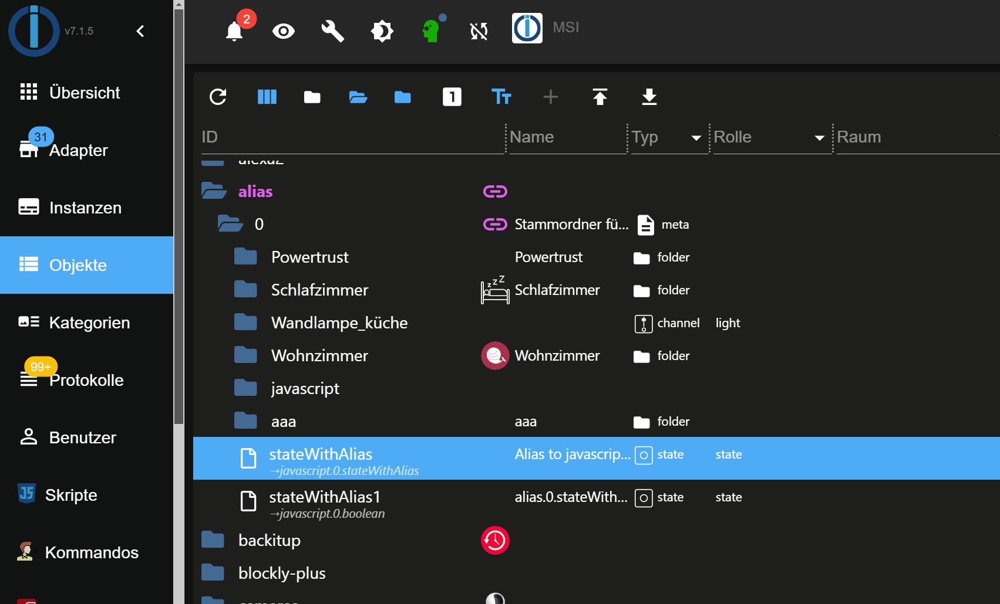

Users can jump from alias target to alias itself.

## admin (28.09.2024) - new feature
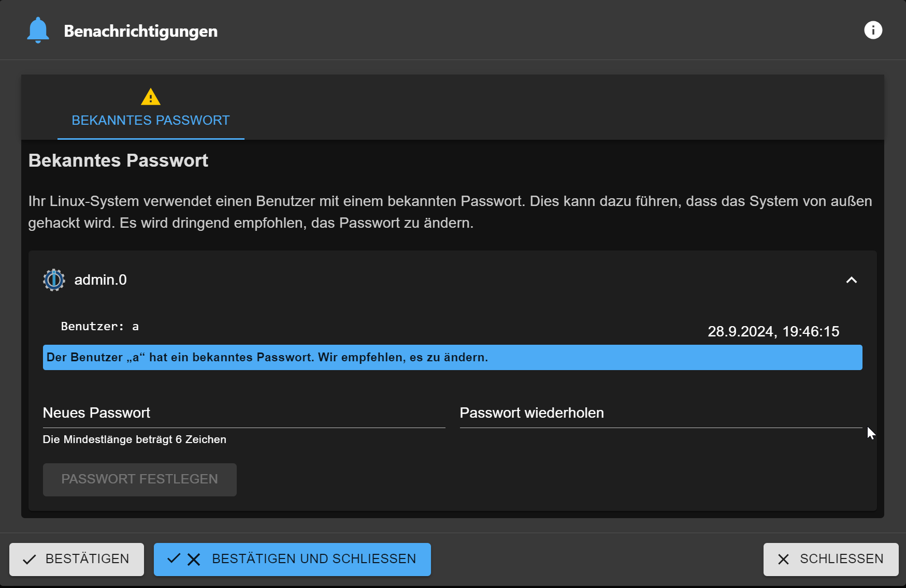

Admin checks now on Linux systems if the system user with a well-known password exist and asks to change it if such a user was found.

Admin supports dynamic notification's GUI.

## node-red (30.09.2024) - new feature
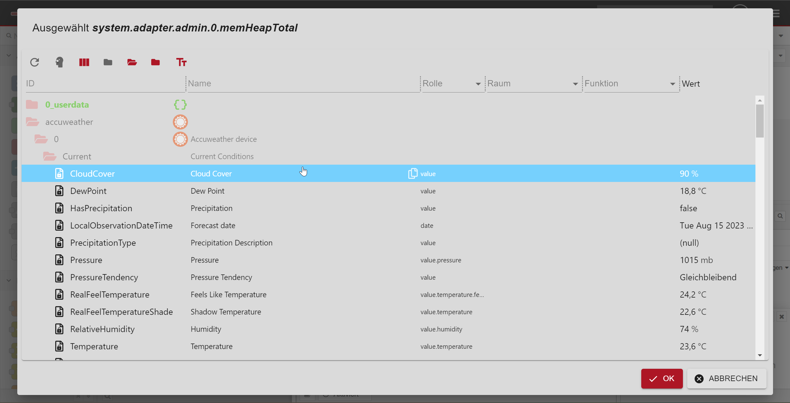

Node-red got at least the same select ID dialog as other adapters.
It requires running admin instance on the same host.

Node-red package version was increased from 3 to 4.0.3

## ecoflow-mqtt (14.10.2024) – new adapter
https://github.com/foxthefox/ioBroker.ecoflow-mqtt


This adapter connects to products of Ecoflow ([https://www.ecoflow.com])

## remeha-home (28.10.2024) – new adapter
https://github.com/simatec/ioBroker.remeha-home


The ioBroker.remeha-home adapter enables the integration and control of Remeha heating systems via the Remeha Home platform. The adapter continuously connects to the Remeha Home API and retrieves current data to make it available in the ioBroker system. This allows the heating system to be optimally monitored and controlled.


## vis-2-widgets-ovarious (12.11.2024) – new adapter
https://github.com/oweitman/ioBroker.vis-2-widgets-ovarious


This adapter contains various vis-2 widgets. Ok, actually, there is only one vis-2 widget, but some more are on the roadmap.

## gotify (16.11.2024) – new adapter
https://github.com/ThomasPohl/ioBroker.gotify


Send push notifications from ioBroker to Gotify.

## google-spreadsheet (3.12.2024) – new adapter
https://github.com/ThomasPohl/ioBroker.google-spreadsheet


This adapter can be used to automatically interact with google spreadsheets.

## minuaru (3.12.2024) – new adapter
https://github.com/minukodu/ioBroker.minuaru


alarmsystem for ioBroker and minuvis

## mytime (29.12.2024) – new adapter
https://github.com/oweitman/ioBroker.mytime


This adapter handles Time (e.g.: countdown, etc.). The countdown functionality provides data points that you can use to manage a countdown (e.g., in a script). The adapter also includes several widgets to visualize these countdowns. Time series can be used to create complex time series at which the data points are triggered.s

## vis-2-widgets-weather-and-heating (29.12.2024) – new adapter
https://github.com/rg-engineering/ioBroker.vis-2-widgets-weather-and-heating


This vis-2-widget shows weather forecast data from `DasWetter.com` or `weatherunderground`. You need DasWetter-Adapter or `weatherunderground`-Adapter running on your system.

## mywallbox (29.12.2024) – new adapter
https://github.com/SKB-CGN/ioBroker.mywallbox


Connect your My-Wallbox (e.g. Pulsar Plus) with ioBroker via the Cloud-Service of My Wallbox

## bluesound (11.1.2025) – new adapter
https://github.com/Uwe1958/ioBroker.bluesound


Adapter to control Bluesound devices

## ta-blnet (11.1.2025) – new adapter
https://github.com/weberk/ioBroker.ta-blnet


An ioBroker adapter for reading data from one or up to eight climate controllers by Technische Alternative using BL-NET. Or an infinite number of climate controllers connected to CMI.

## teslafi (11.1.2025) – new adapter
https://github.com/hombach/ioBroker.teslafi


The TeslaFi adapter enables effortless integration of vehicle data from your TeslaFi account into the ioBroker system. Leverage this data to enhance your Tesla experience and optimize home automation workflows.

## flexcharts (2025-01-15) - new adapter
https://github.com/MyHomeMyData/ioBroker.flexcharts


This adapter brings almost the complete feature set of [Apache ECharts](https://echarts.apache.org/en/index.html) to ioBroker. This adapter is not intended to be used to quickly create a simple chart. But if you have a specific idea in mind for a more complex chart, flexcharts offers the possibility to implement it.

## paperless-ngx (27.1.2025) – new adapter
https://github.com/BenAhrdt/ioBroker.paperless-ngx


paperless-ngx API to get information of running instances from paperless-ngx. For instance, you can read the tags, documents, document-types, user or correspondents of the paperless instance.

## asterisk (12.2.2025) – new adapter
https://github.com/schmupu/ioBroker.asterisk


The Asterisk adapter converts text messages to audio files and calls then over Asterisk by VoIP any telephone number you want and plays the audio message.

## tagesschau (15.2.2025) – new adapter
https://github.com/ticaki/ioBroker.tagesschau


Retrieves news and video links from Tagesschau.

## maxxi-charge (15.2.2025) – new adapter
https://github.com/blabond/ioBroker.maxxi-charge


ioBroker.MaxxiCharge is an adapter for the ioBroker system that enables the integration and control of MaxxiCharge CCU devices. The adapter provides a range of features, including reading device data, adjusting configurations, and sending control commands.

## admin (2.3.2025) - new feature
Admin version 7.5.0 has new important and useful features:
- OAuth2 authentication.
- Rename/Copy of the objects

The authentication process was completely rewritten, and now the logged-in session will be kept properly.

User can rename, move or create a copy of the objects via context menu.

## airquality (3.3.2025) – new adapter
https://github.com/raschy/ioBroker.airquality


Fetch data from German UBA.

## oxxify-fan-control (17.3.2025) – new adapter
https://github.com/N-b-dy/ioBroker.oxxify-fan-control


Integrate your Oxxify fans into your Smart Home. All the provided ioBroker data points are based on the communication protocol described here. As other manufacturers are using the same protocol (e.g. Blauberg vents), it is pretty likely, that they will work as well.

## seplos-v3-sniffer (12.3.2025) – new adapter
https://github.com/DpunktS/ioBroker.seplos-v3-sniffer


This adapter was developed to read the Seplos V3 BMS in a multipack configuration. In the V3 generation, the first BMS acts as the Modbus master, while all other BMS act as slaves. In this configuration, it is no longer possible to access the BMS via Modbus from a third device, since two master devices cannot exist in an RS-485 Modbus system. The adapter passively detects the communication between the devices, which means that the communication of the individual BMS is not disrupted. It can communicate either via a local interface (e.g. /dec/ttyS0) or via Ser2Net (tcp://ip:2001).

## lcn (12.3.2025) – new feature
https://github.com/ioBroker/ioBroker.lcn


LCN adapter is free now. Everyone can use it without any restrictions.

## bayernluft (29.3.2025) – new adapter
https://github.com/iobroker-community-adapters/ioBroker.bayernluft


Connects ventilation devices manufactured by BayernLuft to IoBroker systems.

## controme (3.4.2025) – new adapter
https://github.com/MadErstam/ioBroker.controme


Connect to local Controme mini server using the official API.

Controme is a heating control system with which you can control your floor heating, central heating system, radiators or other forms of climate control. At the core of a Controme Smart-Heat-System is the Controme mini server, a local Raspberry Pi based system. For more information on the Controme Smart-Heat-System, see the Controme website.

## batrium-bms (4.4.2025) – new adapter
https://github.com/bembelstemmer/ioBroker.batrium-bms


An ioBroker Adapter to track Metrics of your Batrium BMS published via UDP.

This Adapter is based on the official Batrium WatchMonUdpListener Implementation on: https://github.com/Batrium/WatchMonUdpListener

## fyta (9.4.2025) – new adapter
https://github.com/muffin142/ioBroker.fyta


Unofficial Adapter to connect ioBroker to FYTA plant sensors. Sensors can be purchased in the FYTA shop.

## shrdzm (16.4.2025) – new adapter
https://github.com/mcm4iob/ioBroker.shrdzm


This adapter integrates the SHRDZM smartmeter interface available from SHRDZM IT Services e.U. into ioBroker. A description of the interface is available [here](https://cms.shrdzm.com/produkt/smartmeter-modul/).

## js-controller (16.4.2025) - new feature
The js-controller 7.0.7 is now available in the latest version. I
It contains bugfixes and improvements. The most important changes are:
- Extended `encryptedNative` and `protectedNative`. Developers can now address `encryptedNative` and `protectedNative` in structures and arrays.
- Typing was improved.

## ankersolix2 (18.4.2025) – new adapter
https://github.com/ronny130286/ioBroker.ankersolix2


Integrate Anker Solix 2. This project is derived from https://github.com/tomquist/solix2mqtt and brings information from the anker api directly into ioBroker.

## devices (20.4.2025) - new feature


The `devices` adapter was updated to version 1.2.0. It was completely rewritten with TypeScript and vite technologies. The new version is faster and more stable.

## mhi-wfrac (30.4.2025) – new adapter
https://github.com/hacki11/ioBroker.mhi-wfrac


Mitsubishi Heavy Industries Air Conditioners with WLAN Adapter WF-RAC.
This Adapter integrates WF-RAC (Wifi) equipped Mitsubishi Heavy Industries Air Conditioners in ioBroker.

## refoss (7.5.2025) – new adapter
https://github.com/Refoss/ioBroker.refoss


Integrate Refoss devices into ioBroker.  
You can find more and detailed information about the device here: [Refoss](https://www.amazon.de/dp/B0D3PY4RVZ)

## plenticore-g3 (9.5.2025) – new adapter
https://github.com/FernetMenta/ioBroker.plenticore-g3


Adapter to communicate with a KOSTAL Plenticore plus via REST API. This API is much more powerful than modbus. It gives access to approximately 200 read-only data points referred to as `processdata` and about 250 writable settings. This API is documented on this URL:

http://<plenticore host>/api/v1

## dnscope (17.5.2025) – new adapter
https://github.com/simatec/ioBroker.dnscope


DNScope allows you to update your dynamic DNS account directly in ioBroker. It is possible to update your DNS account with the current IP address of your environment without any detours or additional hardware.

## skiinfo (16.5.2025) – new adapter
https://github.com/oweitman/ioBroker.skiinfo


With this adapter you can access the current snow depths for mountain, valley and fresh snow, as well as open lifts for various European locations.

## n8n (31.6.2025) – new adapter (development in progress - not yet available at repository)
https://github.com/ioBroker/ioBroker.n8n


With this adapter, you can run n8n workflows in ioBroker and use the data from ioBroker in n8n workflows.

## Backend socket communication (22.6.2025) - new feature
Additionally, to the WebSocket communication in browser the developers can use the backend socket communication to communicate with the ioBroker system.
You can communicate with existing ws or admin adapters or create your own socket server.

This is useful for the 3rd party applications, which need to communicate with ioBroker system.

## vis-2-widgets-collection (13.7.2025) – new adapter at stable repository
https://github.com/Steiger04/ioBroker.vis-2-widgets-collection


Collection of widgets for ioBroker.vis 2.0

## onlycat (21.7.2025) – new adapter at stable repository
https://github.com/Sickboy78/ioBroker.onlycat


Adapter for OnlyCat® cat flaps with prey detection.

## drops-weather (21.7.2025) – new adapter at stable repository
https://github.com/iobroker-community-adapters/ioBroker.drops-weather


This adapter provides rain data from https://www.drops.live

## srm (27.7.2025) – new adapter at stable repository
https://github.com/iobroker-community-adapters/ioBroker.srm


This is an iobroker adapter to connect to Synology routers. The adapter uses the Synology API to get the data. The adapter is tested with the SRM version 1.3.1. and router model RT6600 but should work with other models as well.

## pi-hole2 (16.8.2025) – new adapter at stable repository
https://github.com/oweitman/ioBroker.pi-hole2


Manage a pi-hole installation >=v6. Get information from pi-hole. Start/Stop blocking domains. (for pi-hole <v6 please use adapter ioBroker.pi-hole)

## energy-tracker (21.8.2025) – new adapter at stable repository
https://github.com/energy-tracker/ioBroker.energy-tracker


Adapter for sending meter readings to the Energy Tracker platform.

## vis-2-widgets-icontwo (9.9.2025) – new adapter at stable repository
https://github.com/inventwo/ioBroker.vis-2-widgets-icontwo


Icon adapter for the ioBroker.vis adapter (only for VIS-2)

## pirate-weather (10.9.2025) – new adapter at stable repository
https://github.com/ticaki/ioBroker.pirate-weather


Retrieve data from Pirate-Weather.

## brightsky (14.9.2025) – new adapter at stable repository
https://github.com/ticaki/ioBroker.brightsky


The Bright Sky API is a free, public API that provides weather data from the German Weather Service (DWD). It was developed to simplify access to this data, as the original DWD data is often in difficult-to-interpret formats. Bright Sky converts this data into an easy-to-use JSON format and makes it accessible via an API.

## weathersense (2.10.2025) – new adapter at stable repository
https://github.com/ltspicer/ioBroker.weathersense


WeatherSense is a cloud for weather stations. This adapter reads data from the WeatherSense server.

## sofarcloud (2.10.2025) – new adapter at stable repository
https://github.com/ltspicer/ioBroker.sofarcloud


This adapter reads the data from the SofarCloud server and stores it in the data point sofarcloud.
The SofarCloud server stores data from Sofar inverters.

## ping (05.10.2025) - new feature
Ping adapter can probe the TCP ports.

https://github.com/ioBroker/ioBroker.ping

## vis-jsontemplate (15.10.2025) – new adapter at stable repository
https://github.com/oweitman/ioBroker.vis-jsontemplate


Adapter to visualize JSON data and other data in Vis/Vis2. You can customize the output of the data with a template system. In the templates you can include HTML, CSS and Javascript.

## freeair (18.10.2025) – new adapter at stable repository
https://github.com/Scrounger/ioBroker.freeair


locale connection to your BluMartin FreeAir 100 ventilation system

## unifi-network (18.10.2025) – new adapter at stable repository
https://github.com/Scrounger/ioBroker.unifi-network


Unifi Network uses the websocket interface to receive real-time information from the unifi-network application

## weatherflow-tempest-api (21.10.2025) – new adapter at stable repository
https://github.com/Scrounger/ioBroker.weatherflow-tempest-api


Get data for your Tempest Weather Station from the WeatherFlow Tempest API

## openmediavault (21.10.2025) – new adapter at stable repository
https://github.com/Scrounger/ioBroker.openmediavault


This adapter allows to read information from your OpenMediaVault using the rpc interface.

## admin (21.10.2025) – new feature
Drag and drop of devices between categories

## xsense (22.10.2025) – new adapter at stable repository
https://github.com/arteck/ioBroker.xsense


This ioBroker adapter allows the integration of XSense devices into the ioBroker smart home system.
It is designed to receive data from XSense smoke detectors, CO detectors, and other compatible devices, making them available in ioBroker for automation and monitoring.
The adapter communicates with the XSense cloud server and provides an easy way to integrate XSense devices into existing ioBroker setups.

## sbms (28.11.2025) – new adapter at stable repository
https://github.com/buffoletti/ioBroker.sbms


Simple adapter to make data from Electrodacus SBMS available as states from MQTT, the rawData HTML page or the serial port.

## bmw (28.11.2025) – new adapter at stable repository
https://github.com/TA2k/ioBroker.bmw


This adapter integrates BMW vehicles into ioBroker using the new BMW CarData API with OAuth2 authentication and real-time MQTT streaming. It provides comprehensive vehicle data monitoring for all BMW models linked to your BMW account.

## nspanel-lovelace-ui (3.1.2026) – new adapter at stable repository
https://github.com/ticaki/ioBroker.nspanel-lovelace-ui


The NSPanel Lovelace UI is an alternative user interface for the Sonoff NSPanel, specifically designed for integration with iobroker. It typically relies on Tasmota (firmware) and MQTT (messaging protocol) to provide custom controls and displays directly on the NSPanel's small touchscreen.

## steam (20.1.2026) – new adapter at stable repository
https://github.com/bloop16/ioBroker.steam


This adapter allows you to integrate information from the Steam API into your ioBroker system.

## serial-gps (23.1.2026) – new adapter at stable repository
https://github.com/ioBroker/ioBroker.serial-gps


This adapter reads GPS data from a serial or USB GPS device and makes it available in ioBroker.


## mitsubishi-local-control (28.01.2026) – new adapter at stable repository
https://github.com/Black-Thunder/ioBroker.mitsubishi-local-control


The mitsubishi-local-control adapter integrates Mitsubishi Electric air conditioning systems into ioBroker using a direct local connection.

## autodarts (28.01.2026) – new adapter at stable repository
https://github.com/inventwo/ioBroker.autodarts


Connects to your local Autodarts Board Manager (via IP and port, e.g. 192.168.x.x:3180) and exposes ioBroker states for home automation:

## zwavews (28.01.2026) – new adapter at stable repository
https://github.com/arteck/ioBroker.zwavews


The zwavews adapter connects a zwave-js-ui to ioBroker and creates corresponding data points for devices, values, and statuses. This allows Z-Wave devices to be conveniently used in visualizations, logic, and automations.


## smartfriends (10.2.2025) – new adapter at stable repository
https://github.com/Black-Thunder/ioBroker.smartfriends


This adapter enables a direct local integration of the SmartFriends Box (e.g. Smart Friends Box by Schellenberg, ABUS, Paulmann, STEINEL, etc.) into ioBroker – without using the official cloud.


## meteoswiss (13.2.2026) – new adapter at stable repository
https://github.com/deMynchi/ioBroker.meteoswiss


Provides weather information from MeteoSwiss

## hagelschutz-vkf (25.02.2026) – new adapter at stable repository
https://github.com/UncleSamSwiss/ioBroker.hagelschutz-vkf


Adapter for hagelschutz-einfach-automatisch.ch of the cantonal building insurances.

## ping (28.02.2026) - new feature
https://github.com/ioBroker/ioBroker.ping

Ping adapter can use hping3 to detect iPhones and can send wake-on-lan packets to wake up devices in the network.

## parser (28.02.2026) - new feature
https://github.com/ioBroker/ioBroker.parser

Parser can now parse values of states, ioBroker files and logs. Added export and import of parser rules via CSV files.

## hoymiles-ms (25.03.2026) – new adapter at stable repository
https://github.com/mcm4iob/ioBroker.hoymiles-ms


This adapter integrates the HOYMILES MicroStorage systems into ioBroker. Currently the following systems have been checked to work
- Hoymiles MS-A2
- Hoymiles HiBattery 1920 AC

## smartm (25.03.2026) – new adapter at stable repository
https://github.com/strulli85/ioBroker.smartm


This Adapter reads Data of Photovoltaik SLEnergy Plats out of their Cloud named SmartM.

## pjlink (31.3.2026) – new adapter at stable repository
https://github.com/Bannsaenger/ioBroker.pjlink


PJLink Projector controll

## heos (15.03.2026) – new adapter at stable repository
https://github.com/withstu/ioBroker.heos


The adapter lets control HEOS from ioBroker.

## open-meteo-weather (14.4.2026) – new adapter at stable repository
https://github.com/H5N1v2/ioBroker.open-meteo-weather


This adapter provides precise weather data, forecasts, air quality, and pollen information powered by Open-Meteo.com. It is free for non-commercial use (under 10,000 daily API calls) and requires no API key registration, making the setup process extremely simple.

## nextcloud-monitoring (14.4.2026) – new adapter at stable repository
https://github.com/H5N1v2/ioBroker.nextcloud-monitoringr


This adapter allows for detailed monitoring of your Nextcloud instance via the official OCS API (serverinfo). It provides numerous system data, user statistics, shares, as well as performance values from PHP (OPcache/FPM) and the database directly in ioBroker.

## aurora-nowcastg (14.4.2026) – new adapter at stable repository
https://github.com/chrmenne/ioBroker.aurora-nowcast


Provides current (nowcast) data on aurora activity (northern and southern lights) for a given location, based on publicly available data from the NOAA Space Weather Prediction Center (SWPC).

## grohe-smarthome (2026-02-09) - new adapter at stable repository
https://github.com/patricknitsch/ioBroker.grohe-smarthome


This adapter connects ioBroker to the Grohe Smarthome / Ondus cloud and exposes Grohe devices as states (and some controls) inside ioBroker.
It supports:

Grohe Sense (type 101)
Grohe Sense Guard (type 103)
Grohe Blue Home (type 104)
Grohe Blue Professional (type 105)

The adapter logs in via Grohe’s OIDC/Keycloak flow, stores a refresh token encrypted in a state, and polls the Grohe cloud API on a configurable interval. Important Messages can be send via included notification manager.

## schlueter-thermostat (2026-01-28) - new adapter at stable repository
https://github.com/patricknitsch/ioBroker.schlueter-thermostat


This adapter integrates Schlüter / OJ Microline OWD5 thermostats into ioBroker via the official cloud APIs.
## nextcloudtalk (15.5.2026) – new adapter at stable repository
https://github.com/Rello/ioBroker.nextcloudtalk


This adapter allows sending notifications to Nextcloud Talk rooms.
## mspa (15.5.2026) – new adapter at stable repository
https://github.com/arteck/ioBroker.mspa


Controls MSpa hot tubs via the MSpa Cloud API.
Supports heating, filter, UVC, bubble and jet control with full automation via time windows, PV surplus and frost protection.

## solectrus-influxdb (15.5.2026) – new adapter at stable repository
https://github.com/patricknitsch/ioBroker.solectrus-influxdb


The SOLECTRUS InfluxDB Adapter stores selected ioBroker states into an InfluxDB 2.x database and optionally computes derived values using a built-in formula engine.

It is designed for energy monitoring systems such as photovoltaic installations, battery storage, heat pumps, wallboxes, grid import/export monitoring, and custom sensors.
## brunner-eas3 (21.5.2026) – new adapter at stable repository
https://github.com/JR-Home/ioBroker.brunner-eas3


Adapter for reading data from Brunner combustion control system EAS 3. The data is published via WLAN broadcast messages.

## speedport (3.5.2026) – new adapter at stable repository
https://github.com/hacki11/ioBroker.speedport


Fetches data from Telekom Speedport Router

## life360ng (3.5.2026) – new adapter at stable repository
https://github.com/inventwo/ioBroker.life360ng


This adapter connects to the Life360 cloud services to track people and detect presence at defined places. It retrieves circles, members and places data and persists it as ioBroker states, updated at a configurable interval.

## enpal (29.4.2026) – new adapter at stable repository
https://github.com/inventwo/ioBroker.enpal


Reads energy data from the local InfluxDB 2.x instance provided by Enpal solar systems and exposes ioBroker states for home automation:

Monitor solar power production
Track battery state of charge (SoC)
Analyze grid consumption and feed-in power
Automate based on power generation
Visualize energy flows in ioBroker dashboard

## parcelapp (6.6.2026) – new adapter at stable repository
https://github.com/krobipd/ioBroker.parcelapp


ioBroker adapter for the parcel.app API. Supports all carriers that parcel.app tracks.

## hueemu (6.6.2025) – new adapter at stable repository
https://github.com/krobipd/ioBroker.hueemu


Emulates a Philips Hue Bridge (v2, BSB002) so that ioBroker devices appear as Hue lights to clients that only support the Hue API.

## linky (6.6.2026) – new adapter at stable repository
https://github.com/iobroker-community-adapters/ioBroker.linky


Read data from Linky smart electricity meters, in fact any meter supporting the French Teleinfo protocol: https://www.enedis.fr/sites/default/files/Enedis-NOI-CPT_54E.pdf

## beszel (21.6.2026) – new adapter at stable repository
https://github.com/krobipd/ioBroker.beszel


Connects to a Beszel Hub and exposes server monitoring metrics for all registered systems as ioBroker states.

## homewizard (21.6.2026) – new adapter at stable repository
https://github.com/krobipd/ioBroker.homewizard


Real-time energy monitoring for HomeWizard Energy devices with API v2.
## al-ko (21.6.2026) – new adapter at stable repository
https://github.com/zechnerhubert/ioBroker.al-ko


The ioBroker.al-ko adapter integrates AL-KO Robolinho robotic lawnmowers and other AL-KO smart garden devices into ioBroker using the official AL-KO Cloud API, including real-time updates via WebSocket.

## google-sharedlocations2 (24.6.2026) – new adapter at stable repository
https://github.com/Garfonso/ioBroker.google-sharedlocations2


Share your location with ioBroker via Google Maps. You should create a separate Google account for this purpose, i.e. an account for your ioBroker installation. Do NOT use your personal account.

## govee-smart (24.6.2026) – new adapter at stable repository
https://github.com/krobipd/ioBroker.govee-smart


Control all Govee WiFi products from ioBroker — lights, sensors and appliances. Bluetooth-only devices are not supported. The adapter uses every available Govee channel (LAN, Cloud REST, AWS IoT MQTT, OpenAPI MQTT, App API) and picks whichever delivers the fastest answer for each device

## vs-2-widgets-tibberlink (30.6.2026) – new adapter at stable repository
https://github.com/ssbingo/ioBroker.vis-2-widgets-tibberlink


VIS-2 widgets for visualizing Tibber dynamic electricity tariff data: current price, cheapest time window and monthly cost.

## hassemu (30.6.2026) – new adapter at stable repository
https://github.com/krobipd/ioBroker.hassemu


Emulates a Home Assistant server so displays that only accept an HA dashboard show any web URL instead.

## foxesscloud (16.6.2026) – new adapter at stable repository
https://github.com/inventwo/ioBroker.foxesscloud


Retrieves data from FoxESS Cloud API for solar inverters (e.g., used in Enpal systems) and exposes ioBroker states for home automation

## vis-2-widgets-sigenergy (16.6.2026) – new adapter at stable repository
https://github.com/ssbingo/ioBroker.vis-2-widgets-sigenergy


VIS-2 widget set for the Sigenergy energy storage adapter (ioBroker.sigenergy). Contains 8 widgets for visualisation and control of energy flow, battery status, real-time power, daily statistics, AC charger, DC charger, inverter and SigenMicro micro-inverter overview.

## tidy (5.7.2025) – new adapter at stable repository
https://github.com/inventwo/ioBroker.tidy


The Tidy adapter helps to find unused objects and states to clean up your system. After years of using ioBroker, your system may accumulate "dead" datapoints from deleted scripts, removed adapters, or abandoned configurations. This adapter helps you identify and clean up such datapoints to keep your system tidy and performant.

## dreame (5.7.2025) – new adapter at stable repository
https://github.com/TA2k/ioBroker.dreame


Adapter for Dreame and MOVA robot vacuums and robot mowers.

## playstation (11.7.2026) – new adapter at stable repository
https://github.com/Lucky-ESA/ioBroker.playstation


You can wake up the Playstation or put it into standby mode. Some buttons are also possible. The PSN login can be used to load data from other players.

## miner (11.7.2026) – new adapter at stable repository
https://github.com/SimonFischer04/ioBroker.miner


Interact with different crypto miner apis

## script-restore (4.8.2026) – new adapter at stable repository
https://github.com/ipod86/ioBroker.script-restore


Browse and recover individual scripts from ioBroker backup archives — without restoring the entire backup.

## public-holidays (4.8.2026) – new adapter at stable repository
https://github.com/krobipd/ioBroker.public-holidays


Detects public holidays for 206 countries. Runs completely offline — no cloud, no API calls. Updates daily at midnight.

## hoymiles (4.8.2026) – new adapter at stable repository
https://github.com/Eistee82/ioBroker.hoymiles


ioBroker adapter for Hoymiles HMS-xxxW-xT and HMS-xxx-xWB microinverters with integrated WiFi/Bluetooth DTU (DTUBI).

## blink (4.8.2026) – new adapter at stable repository
https://github.com/Pischleuder1/ioBroker.blink


ioBroker adapter for Blink cameras.

## tesla-wallconnector3 (4.8.2026) – new adapter at stable repository
https://github.com/nobl/ioBroker.tesla-wallconnector3


Reads live data from a Tesla Wall Connector Gen 3 on your local network. The adapter polls the wallbox API and creates ioBroker states for charging status, power, energy, temperatures, WiFi, and more.

## victron-gx (4.8.2026) – new adapter at stable repository
https://github.com/Sefina-DS/ioBroker.victron-gx


This adapter connects ioBroker directly and locally to Victron Energy GX devices (Cerbo GX, Venus GX, Ekrano GX) – without any detour through Home Assistant or the VRM Cloud.

## go-e-charger (4.8.2026) – new adapter at stable repository
https://github.com/hombach/ioBroker.go-e-charger


This adapter integrates one or more go-e Charger wallboxes into your ioBroker home automation. It cyclically polls each wallbox via its local HTTP API, provides all relevant data as ioBroker states, and lets you control charging directly from your smart home.

## simple-proxy-manager (9.8.2026) – new adapter at stable repository
https://github.com/lubepi/ioBroker.simple-proxy-manager


Simple HTTPS/HTTP reverse proxy manager for ioBroker.

## harvia-fenix (9.8.2026) – new adapter at stable repository
https://github.com/meistermopper/ioBroker.harvia-fenix


An ioBroker adapter to integrate and control your Harvia Fenix sauna control unit via the MyHarvia cloud infrastructure.

## harvia-fenix (9.8.2026) – new adapter at stable repository
https://github.com/meistermopper/ioBroker.harvia-fenix


An ioBroker adapter to integrate and control your Harvia Fenix sauna control unit via the MyHarvia cloud infrastructure.

## openmeteo-notify (9.8.2026) – new adapter at stable repository
https://github.com/ipod86/ioBroker.openmeteo-notify


This adapter retrieves weather forecast data from the free Open-Meteo API and makes it available as ioBroker data points. No API key is required. It sends individual notifications for configurable weather events (storms, thunderstorms, official warnings) and provides multiple independently configurable HTML widgets per location.

## dune-hd-remote (9.8.2026) – new adapter at stable repository
https://github.com/sadam6752-tech/ioBroker.dune-hd-remote


Control Dune HD media players via IP network from ioBroker.

## pv-notifications (9.8.2026) – new adapter at stable repository
https://github.com/sadam6752-tech/ioBroker.pv-notifications


Sends Telegram notifications for PV battery status (full, empty, intermediate levels).

## flowers (9.8.2026) – new adapter at stable repository
https://github.com/sadam6752-tech/ioBroker.flowers


Monitor indoor plants via soil moisture, temperature and battery sensors with Telegram notifications.

## cisco-checkpresence (9.8.2026) – new adapter at stable repository
https://github.com/NurPech/ioBroker.cisco-checkpresence


Detects the presence of family members by querying the Cisco Catalyst 9800 Wireless Controller via RESTCONF. Instead of unreliable ping checks, the adapter reads the authenticated client table directly from the WLC — if the controller says a device is associated, it is there.

## f1 (16.8.2026) – new adapter at stable repository
https://github.com/bloop16/ioBroker.f1


Formula 1 live data integration for ioBroker — provides race calendar, championship standings, session results, and real-time live session data via the official F1 Live Timing feed and Jolpica API.

## jetframe (16.8.2026) – new adapter at stable repository
https://github.com/backfisch88/ioBroker.jetframe


JetFrame is an ioBroker adapter for live flight tracking and visualization based on ADS-B data. It detects aircraft flying past your window and displays them in a modern web app with photo, flight information and statistics.

## leapmotor (17.8.2026) – new adapter at stable repository
https://github.com/backfisch88/ioBroker.leapmotor


Unofficial Leapmotor electric vehicle integration for ioBroker. Tested on T03.

## bosch-smart-home-camera (17.8.2026) – new adapter at stable repository
https://github.com/mosandlt/ioBroker.bosch-smart-home-camera


ioBroker adapter for Bosch Smart Home Cameras (Eyes Outdoor, 360 Indoor, Gen2 Eyes Indoor II + Outdoor II). The full core feature set is functional end-to-end and verified live against real hardware.

## solakon-one (20.8.2026) – new adapter at stable repository
https://github.com/berto-1974/ioBroker.solakon-one


Monitors and controls the Solakon ONE hybrid solar inverter (www.solakon.de) with battery storage over the local network via Modbus TCP (Port 502).

## harvia-fenix (20.8.2026) – new adapter at stable repository
https://github.com/meistermopper/ioBroker.harvia-fenix


An ioBroker adapter to integrate and control your Harvia Fenix sauna control unit via the MyHarvia cloud infrastructure.

## metermaster (28.8.2026) – new adapter at stable repository
https://github.com/MPunktBPunkt/ioBroker.metermaster


Receives meter readings from the MeterMaster Android app, stores them as ioBroker data points, and manages ESP32 display nodes for showing meter values on OLED displays.

## eebus-go (1.9.2026) – new adapter at stable repository
https://github.com/FernetMenta/ioBroker.eebus-go


This adapter enables iobroker to become a custom energy manager in the context of §14a EnWG and §9 EEG. §14a EnWG is a German law that requires controllable systems like wallboxes or heatpumps to be dimmable if they can consume more than 4.2kW. §9 EEG requires production systems (e.g. PV inverters) to be curtailable by the grid operator. These laws are enforced by controlboxes that run on or are connected to smart meter gateways. A controlbox signals a limitation event directly to a controllable system or to a custom energy manager.

## goodwe-sems (13.9.2026) – new adapter at stable repository
https://github.com/bueste/ioBroker.goodwe-sems


Reads inverter, battery and power-flow data from the GoodWe SEMS Portal (cloud) - for installations that (e.g. because there is no LAN access to the inverter) cannot be polled with the local ioBroker.goodwe adapter (Modbus/UDP, port 8899).

## husqvarna-automower-connect (13.9.2026) – new adapter at stable repository
https://github.com/bueste/ioBroker.husqvarna-automower-connect


This adapter fetches data from your Husqvarna lawn mower from https://developer.husqvarnagroup.cloud via the "new" WebSocket connection and works with the Automower Connect API v1.0.0/OAS 3.0.

## zeptrion (13.9.2026) – new adapter at stable repository
https://github.com/bueste/ioBroker.zeptrion


Adapter for Feller zeptrion / zApp WLAN actuators (WLAN Nebenstelle 4K = zApp gateway, WLAN Zwischenmodul 2K = zApp booster) for light and shutter/blind control, based on the zrap web service API (Feller document 10.ZEPAPI-E.1612 / version 1.0, firmware from 01.08.18).

## vis-mapwidgets (13.9.2026) – new adapter at stable repository
https://github.com/oweitman/ioBroker.vis-mapwidgets


With this adapter, you can display various elements on a map using the Leaflet widget. These elements can be configured using a JSON data structure.

## electrolux-aeg (13.9.2026) – new adapter at stable repository
https://github.com/TA2k/ioBroker.electrolux-aeg


Adapter for Electrolux and AEG.
Supported appliances are managed through the official Electrolux and AEG connected appliance services.

## creality (13.9.2026) – new adapter at stable repository
https://github.com/inventwo/ioBroker.creality


Connects Creality Klipper printers (primary target: SPARKX i7 with CFS lite) to ioBroker via two local APIs:

Moonraker HTTP (default port 7125) — print stats, temperatures, fans, CFS filament box, G-code
Creality WebSocket (default port 9999) — toolhead LED, pause / resume / stop, leveling / self-test UI state, remaining time (printLeftTime)
Moonraker alone is not enough for Creality UI states (e.g. leveling while Klipper still reports standby) or the toolhead light.

## siku (8.9.2026) – new adapter at stable repository
https://github.com/ChrMaass/ioBroker.siku


This adapter integrates SIKU RV V2 residential ventilation devices and compatible units from the Oxxify smart series into ioBroker. This wording explicitly includes devices marketed as Oxxify.smart 30, Oxxify.smart 50 and Oxxify.smart 50 K.
## goodwe-pv (7.9.2026) – new adapter at stable repository
https://github.com/hombach/ioBroker.goodwe-pv


Communication with GoodWe hybrid inverters of the ET, EH, BH and BT series via the local UDP interface (port 8899). No cloud connection required — the adapter talks directly to the inverter on your LAN.

## goodwe (7.9.2026) – new adapter at stable repository
https://github.com/typhosj/ioBroker.goodwe


Communication with GoodWe Inverter ET/EH/BH/BT Series

## vis2-materialdesign (16.9.2026) – new adapter at stable repository
https://github.com/typhosj/ioBroker.vis2-materialdesign


This adapter is maintained by typhosj. The widgets are based on the original VIS Material Design widget work by Scrounger.

## agent-dvr (16.9.2026) – new adapter at stable repository
https://github.com/ipod86/ioBroker.agent-dvr


Connects ioBroker to AgentDVR: auto-discovers all cameras, mirrors every device property as data points, provides buttons for all common commands (record, arm, PTZ, …), delivers push-triggered gallery updates on new recordings, generates a responsive HTML gallery widget per camera, and includes a built-in live dashboard with per-camera stream selection (MJPEG, MP4/FLV with audio, or go2rtc WebRTC).

## sigenergy (22.9.2026) – new adapter at stable repository
https://github.com/ssbingo/ioBroker.sigenergy


Adapter for Sigenergy solar energy systems via Modbus TCP/RTU
Supports the Sigenergy Modbus Protocol V2.9 (released 2026-05-13).

## navimow (22.9.2026) – new adapter at stable repository
https://github.com/TA2k/ioBroker.navimow


ioBroker adapter for Segway Navimow robotic mowers. Uses the official Navimow SDK REST API and MQTT for real-time updates.

## anker-solix (27.9.2026) – new adapter at stable repository
https://github.com/MatthiasUlrich1/ioBroker.anker-solix


ioBroker adapter for Anker Solix power systems (Solarbank, Smart Meter, PPS, EV charger, and more). It is based on the Home Assistant integration thomluther/ha-anker-solix and uses the same unofficial solixapi Python library.

## fairland (1.10.2026) – new adapter at stable repository
https://github.com/dude2k/ioBroker.fairland


Unofficial ioBroker adapter for Fairland pool heat pumps and pool pumps that use the Fairland iGarden cloud API.

## pwned-check (5.10.2026) – new adapter at stable repository
https://github.com/ipod86/ioBroker.pwned-check


This adapter checks whether your passwords or e-mail addresses have appeared in known data breaches — without ever sending your actual passwords to any server.

## renault (9.10.2026) – new adapter at stable repository
https://github.com/TA2k/ioBroker.renault


This adapter connects ioBroker to the cloud of Renault, Dacia and Alpine. It reads vehicle data (battery, charging, climate control, mileage, location, tyre pressure, ...) and sends remote commands (climate control, charging, charge limits, horn and lights) for connected models such as the Renault Zoe, Megane E-Tech, Renault 5, the Dacia Spring and the Alpine A290.

## octopus-energy-monitor (9.10.2026) – new adapter at stable repository
https://github.com/tipp88/ioBroker.octopus-energy-monitor


The Octopus Energy Monitor adapter periodically fetches daily electricity consumption data from Octopus Energy (Kraken API) and Inexogy (Discovergy/Statistics API), saving it automatically within your ioBroker object tree.

## esphome (9.10.2026) – new adapter at stable repository
https://github.com/DrozmotiX/ioBroker.esphome


Control your ESP8266/ESP32 with simple yet powerful configuration files created and managed by ESPHome. Native integration of ESPHome managed device (Including Dashboard) by its native API and ensures all data is synchronized (live-event handling, no data polling.

## cloud (10.10.2026) – new feature
https://github.com/ioBroker/ioBroker.cloud


The ioBroker Cloud adapter allows remote access to a local ioBroker installation from the internet via the ioBroker cloud. Versions 6.0.1 to 6.2.7 brought credentials manager support, visu app improvements and better connection handling:

**Credentials Manager**
- Cloud credentials can now be stored and managed via the ioBroker credentials manager, so they no longer need to be entered directly in the adapter settings.

**Visualisation App Integration**
- When a visu app writes a state through the cloud, the adapter now correctly respects the target state's type — values are no longer written with the wrong type.
- POST bodies arriving as a binary buffer are decoded properly, so telemetry data sent by visu apps is no longer silently lost on its way through the cloud.
- A new `onScreen` state was added, reflecting which screen the visu app is currently showing.
- Buttons were added to the adapter configuration to check whether the connected applications are running and reachable.

**Connection Reliability**
- State subscriptions are now cleared when the cloud disconnects, preventing stale subscriptions from accumulating across reconnects.
- Commands arriving without a device name or with an empty value body are now logged with a warning instead of being silently dropped, making troubleshooting easier.

## iot (20.9.2026) – new feature
https://github.com/ioBroker/ioBroker.iot


The ioBroker IoT adapter connects your ioBroker installation to Amazon Alexa, Google Home and Nightscout via the ioBroker cloud. Versions 6.0.3 to 7.1.2 brought credentials manager support, cloud connection stability improvements and enhanced remote access:

**Credentials Manager**
- The adapter now supports the ioBroker credentials manager, allowing cloud credentials to be stored and managed centrally rather than entered per-adapter.

**Remote Access and Cloud Connection**
- Remote access via the cloud was improved across several releases: MCP requests from the cloud are now handled directly over MQTT, making the communication channel more reliable.
- The cloud connection is now closed gracefully on adapter restart — the cloud no longer reports a duplicate connection when the adapter comes back online.
- Only one reconnection attempt can be pending at a time, preventing two overlapping connections from being established simultaneously.
## skoda-public-api (11.10.2026) – new adapter at stable repository
https://github.com/tmarthy/ioBroker.skoda-public-api


Reads data from and sends commands to Škoda vehicles through the official MyŠkoda Public API.
## device-monitoring (11.10.2026) – new adapter at beta (latest) repository
https://github.com/BenAhrdt/ioBroker.device-monitoring


Watches your defined device states and generates warnings and alerts when they stop updating within a configured timeout.
## snmp (30.9.2026) – new feature
https://github.com/iobroker-community-adapters/ioBroker.snmp


The SNMP adapter reads and writes data from network devices via SNMP. Version 4.0.0 is a major update that adds SNMP trap reception, an integrated MIB browser, a setup wizard and OID templates — making the adapter usable without prior SNMP expertise:

**SNMP Traps**
- The adapter now listens for incoming SNMP traps (v1, v2c and v3). Each received trap is written to states under the sending device — OID, symbolic name, a JSON representation and a counter. The counter is the state to subscribe to for instant notifications.
- Trap senders are matched to configured devices by their IP address, and v1 traps are normalised to their v2c equivalent so v1 and v2c traps can be handled uniformly.

**MIB Browser**
- A new "MIB" tab lets you upload vendor MIB files. The browser reads the device live, level by level, and resolves OIDs to their symbolic names using the uploaded files.
- Individual values or entire subtrees can be added to an OID group directly from the browser — the plus button on a folder adds every value below it in one walk.
- A device can be read live in the browser before it has ever been saved to the configuration.

**Setup Wizard and OID Templates**
- A setup wizard on the Devices tab guides through adding a new device: specify the address, upload its MIB files, pick the values to read — including a live preview — and save.
- OID groups can be saved as reusable templates (JSON files) and imported into any other group. Ready-made templates are included for common equipment: system group, switch port, computer, printer and UPS.

**Other improvements**
- New "Traps" tab in the configuration alongside the reworked "Devices" (now shown first) and "OID sets" tabs. An incomplete device (no OIDs configured yet) is skipped with a warning instead of disabling the whole instance, so the MIB browser can be used while the adapter is running.
- New option "use MIB names": OIDs can be entered as symbolic names such as `IF-MIB::ifDescr.1` and state object IDs are derived from the MIB symbol accordingly.
- New option "trace all SNMP requests and answers": every request and response is logged as JSON, tagged `[trace]` — useful for support cases.
- New value format "hex dump" for binary OctetString/Opaque/Counter64 data, matching the display format of common MIB browsers; writeable OIDs accept the same notation back.
- States now use correct ioBroker roles: numbers are `value`/`level`, booleans `indicator`/`switch`, text `text`. The non-existent role `type.encoding` is no longer used.
- A device configured with SNMP v3 but a missing or unresolvable authorisation ID is now skipped with a clear warning instead of sending a request without a user name.
- Fixed: rows added by the wizard, the MIB browser or a template import were invisible in the OID table until the dialog was reopened.
- Fixed: SNMP v1 devices reported every subtree walk as an error (NoSuchName at the end of a subtree) — the adapter now handles this correctly.
- Fixed: the live MIB browser skipped every second row of a table.

## lovelace (11.10.2026) – new feature
https://github.com/ioBroker/ioBroker.lovelace


The adapter shows your ioBroker devices in the Home Assistant Lovelace UI. Versions 6.0 to 7.2 brought a new frontend and most of the features that were missing until now:

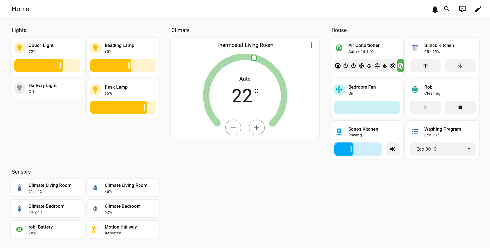

**Dashboards and entities**
- Full dashboard support: create, rename, re-icon, hide and sort dashboards in the UI, the main dashboard included.
- Entities are configured from the frontend, their entity_id included, and a renamed entity keeps its name over a restart.
- The format of the automatically generated entity ids is configurable (object name, room + function, or the ioBroker id).
- Per-user frontend data is stored now: theme, dark mode, sidebar order and the other settings survive a reload.
- Rooms and functions are named in the configured language instead of always English.

**Energy dashboard**
- The energy dashboard works: grid, solar, battery, gas and water sources, fed from the history, sql or influxdb adapter.
- Costs are calculated from a fixed price or from a price entity, and a meter counting Wh is converted instead of being drawn as kWh.
- The electricity states of a device (power, current, voltage, energy, frequency) become sensor entities, e.g. on a socket.

**More device types**
- Vacuum cleaners (with map and fan speed), fans and air purifiers, pumps, air quality monitors, contact sensors, CO alarms, pressure and flow sensors, humidifiers, water heaters and timers.
- Presence and GPS on the map, with `device_tracker` and `person` entities.
- A device that reports a battery level gets a battery sensor, not only the low-battery warning.

**Manually mapped objects**
- Every manual entity type is configured with object pickers now: cover, light, thermostat, lock, media player, fan, vacuum, humidifier, water heater, device_tracker and person.
- An expert table fills any attribute of an entity from a freely picked state.

**Templates and custom cards**
- Markdown and template cards understand Home Assistant templates (`{{ states("...") }}`, `is_state`, `state_attr`, `now()`, ...) next to the ioBroker `{id}` bindings.
- Custom cards are uploaded, replaced and deleted on the settings page, which also shows the version a card reports about itself. The cards folder is watched, so a card dropped in anywhere is picked up.

**Under the hood**
- The Home Assistant frontend was updated to 20260826 (themes need a one-time migration, see the [migration guide](https://github.com/ioBroker/ioBroker.lovelace/blob/master/docs/en/theme_migration.md)), the map draws vector tiles served by the adapter, and browser_mod is at 3.2.3 with its settings finally stored.
- The instance settings were rebuilt with jsonConfig: a YAML editor for the themes, a searchable entity list and the card upload (needs admin 7.9.11 or newer).
- The frontend is served precompressed, which cuts the traffic of a remote connection (e.g. ioBroker.pro) to roughly a quarter, and a secure web server speaks HTTP/2.
- A path traversal in the static file routes was fixed, so updating is recommended.

Documentation: https://github.com/ioBroker/ioBroker.lovelace/blob/master/docs/en/README.md
## onlycat (22.9.2026) – new feature
https://github.com/Sickboy78/ioBroker.onlycat


The OnlyCat adapter provides events from the OnlyCat cat flap — entries, exits and prey detection — and lets you set the active transit policy. Version 0.6.1 added an image to each event, so the photo taken by the flap is now available as a state alongside the event data.

## shelly (20.9.2026) – new feature
https://github.com/iobroker-community-adapters/ioBroker.shelly


The Shelly adapter connects Shelly devices to ioBroker via MQTT or CoIoT. Versions 11.0.0 to 12.0.0 brought a redesigned Device Manager, a new Bluetooth overview and a wave of new supported hardware:

**Device Manager**
- Each device tile now shows when the device was last seen and switches to a "disconnected" state immediately when the device goes offline — no page reload needed.
- Power, voltage, current, energy and frequency values appear automatically in the tile and device details for every device that reports them.
- The BLE gateway script can be installed or updated directly from the Device Manager, either for a single device or for all devices that already have it. The currently installed script version is displayed in the device details.

**Bluetooth Map**
- A new "Bluetooth Map" tab in the adapter settings shows which Bluetooth devices are picked up by which Shelly gateway, including signal strength. Gateways are arranged in a circle and each Bluetooth device is drawn at the gateway that receives it most strongly; all other connections and their RSSI values can be toggled on.
- The Device Manager toolbar gets a "BLE Map" button that opens the map directly. The list of gateways that receive a Bluetooth device now accumulates all receivers instead of showing only the last one; a gateway is removed from the list after one hour of silence.

**New devices**
- Gen 3: Duo Bulb E27, Multicolor Bulb E27, Flood S
- Gen 4: 1L, 2L
- Third-party: FrankEver Smart Sprinkler Controller (experimental), Neo Smart Water Valve, Top AC Portable EV Charger (experimental)
- Monophase mode added for Shelly 3EM G3

**Other improvements and fixes**
- The transition (fade) time can now be set for Shelly Dimmer 1/2 and all Gen2+ dimmers and lights.
- An option was added to suppress the timezone mismatch warning when the device timezone differs from the ioBroker host.
- Several devices (1L Gen3, 1PM Mini Gen3, Pro 2PM, Plug S Gen3) showed an inverted switch state due to a device firmware bug — this is now corrected by the adapter.
- Authentication with Gen2+ devices on firmware 2.x could wrongly report bad credentials even when they were correct — fixed.
- MQTT commands were silently dropped with "mqtt prefix was not set" while a device was reconnecting — fixed.

## hm-rpc (22.9.2026) – new feature
https://github.com/ioBroker/ioBroker.hm-rpc


The HomeMatic RPC adapter connects HomeMatic and Homematic IP devices to ioBroker via BidCos services, Homegear and CUxD. Versions 3.0.1 to 4.1.2 brought a complete device icon set, better roles and thermostat modes, and a series of datapoint and communication fixes:

**Device icons**
- Device icons are now theme-adaptive SVGs that remain visible on the dark admin theme. The full icon set was generated from the OCCU device database, and icons are automatically back-filled for devices that were created before their type had one. The new icon for HmIP-RFUSB is included.

**Thermostat and heating improvements**
- `CONTROL_MODE` and `SET_POINT_MODE` of HmIP thermostats now show human-readable mode names (auto, manual, party) instead of raw numbers.
- `SET_TEMPERATURE` of BidCos heating groups accepts the special values 4.5 (OFF) and 30.5 (ON).
- `LEVEL` and `VALVE_STATE` of HmIP thermostats received better roles.

**Shutters, blinds and lights**
- HmIP shutters and blinds: control channels now carry `level.blind`/`level.tilt` roles, status channels carry `value.blind`/`value.tilt`.
- Philips Hue and Osram Lightify lamps on the CCU lighting gateway: color temperature `WHITE` is now handled in kelvin (2000–6500 K) as the device expects, not as a percentage.
- `HUE` and `SATURATION` are sent together in a single `putParamset` call — HmIP-RGBW devices previously rejected a single-value call with `MISSING_NON_OPTIONAL_PARAMETER`.

**Roles and datapoint quality**
- Read-only datapoints no longer receive the writable roles `level.*` and `switch.*`.
- Text values the CCU delivers for numeric datapoints (e.g. the name of an ENUM state such as `STATE_NOT_AVAILABLE`) are now converted to their numeric index; values that cannot be converted become `null` instead of the wrong type.

**Communication and connection handling**
- CUxD always uses BIN-RPC; Homematic IP and Virtual Devices always use XML-RPC. Username and password are sent with XML-RPC connections even without HTTPS.
- If the RPC server cannot bind to the configured IP address the adapter logs the error and restarts after 30 seconds instead of crashing.
- On stop, the RPC server and client are shut down cleanly, including for XML-RPC and when the CCU is not reachable.
- Events from deleted devices no longer log warnings about missing objects until the next adapter restart.
- The "Don't delete devices" option now also ignores devices the CCU reports as deleted while the adapter is running (e.g. during HmIP firmware updates).

**Other fixes**
- HM-Dis-EP-WM55: fixed writing of display lines and icons — an invalid tone interval was sent when no interval was set.
- Fixed a crash in the device manager on devices without `native` and a duplicate control listing.
- PONG events and requests without a method are logged only at debug level.
## vis-2 (19.8.2026) – new feature
https://github.com/ioBroker/ioBroker.vis-2


vis-2 is the next-generation visualisation for ioBroker. Versions 2.13.8 to 2.15.4 brought a wave of editor and widget fixes, better group handling and improved widget set loading on the cloud:

**Editor and group handling**
- Dissolving a group no longer accidentally deletes a member widget — only the group container is removed.
- The position of members is now correctly restored when a nested group is dissolved.
- "Same width" / "same height" now takes the size of the currently selected widget, not a previously selected one.
- A new group created inside another group is now placed at the correct position.
- The widget selection is stable when a stored selected widget no longer exists.

**Widget fixes**
- Button widgets show the text exactly as entered, no longer forced to upper case.
- The "small" option of the `filter - dropdown` widget is respected again. Its CSS classes `vis-filter-item` and `vis-filter-item-active` are now available for custom styling.
- The read-only option of the Bool SVG widget is respected again.
- URL attributes of the `iFrame 8` widget are no longer mistakenly subscribed as object IDs.
- Visibility and signal conditions no longer fail when the state value is `null`.
- Signal conditions with `exist`/`not exist` now evaluate the state value, not the comparison value.
- Object IDs that are the result of a binding are subscribed correctly.
- The horizontal navigation menu entries can now be scrolled instead of being cut off in a narrow window.
- User-defined styles are applied to `tplValueInput`.
- User permissions are now enforced for widgets inside a group and for widgets embedded via `getWidgetInWidget`.

**Multiple-views widgets**
- Widget HTML element IDs for widgets shown in multiple views changed from `<view>_<widget>` to `v<view>_<widget>` to produce valid HTML. Any user script or CSS addressing such a widget by ID needs to be updated.
- Double-clicking a widget shown in multiple views no longer jumps to the wrong view.

**Cloud widget set loading**
- Widget sets are now loaded according to their own declaration (ES module or global script) rather than a hardcoded table that had gone stale. This fixes `remoteEntryExports is undefined` errors for `echarts`, `openweathermap`, `fullcalendar`, `vis-2-widgets-material` and `vis-2-widgets-energy` when used via the cloud.
- Local installations reachable under a hostname like `iobroker.local` or `iobroker.fritz.box` are no longer misidentified as cloud instances and can load their widget sets normally.

**Other fixes**
- Umlauts in binding patterns are handled correctly.
- Commands sent via the control interface as JSON are executed correctly.

## echarts (31.8.2026) – new feature
https://github.com/ioBroker/ioBroker.echarts


The eCharts adapter creates line, bar, radar, donut and gauge charts from ioBroker history data and JSON states, displayed in the admin tab, in a browser via the web adapter, or embedded in vis/vis-2 views. Versions 3.1.0 to 5.1.1 updated the chart engine, aligned the UI with the current admin design and fixed several editor and server-side rendering issues:

**Chart engine and UI**
- The underlying ECharts library was updated to version 6.1.0, bringing new chart capabilities and rendering improvements.
- The editor, the preset preview and the chart view were aligned with the admin 8 design for a consistent look.
- Many smaller GUI fixes were applied in the follow-up 5.1.1 release.

**State and history display**
- A state that is logged by more than one history instance now appears under every instance that records it, not only under the first one.
- Line breaks in X-axis labels for combined time formats such as `HH:MM / dd.mm.yy` are rendered correctly.

**Preset management and server-side rendering**
- Fixed: creating a preset inside a folder no longer fails.
- Fixed: server-side rendering (used for preview thumbnails and PDF/PNG/SVG/JPG exports) no longer hangs until the caller times out — presets no longer show "timeout" in the preview.

## opcua (13.8.2026) – OPC UA server and client rewritten
https://github.com/ioBroker/ioBroker.opcua


The OPC UA adapter — which lets ioBroker act as both an OPC UA server and client — received a comprehensive overhaul between v1.2.1 and v3.0.0, bringing a reworked server, a modernised configuration UI, encrypted password storage and important bug fixes.

**OPC UA server improvements**
- The server was rebuilt so that tags are now structured as a Unified Namespace — a cleaner, industry-standard layout for browsing variables.
- Connected clients are now shown in the `info.connection` state, making it easy to see what is currently linked to the server.
- The server now uses the certificates configured in the adapter settings instead of ignoring them.

**Authentication and security**
- Passwords are now stored in encrypted form. Existing passwords must be re-entered once after updating.
- Authentication with a username and password now works correctly.

**Configuration and UI**
- The configuration interface was rebuilt with React 19 and MUI 9 and follows the design language of ioBroker Admin 8.

**Stability and reliability**
- The adapter no longer terminates the host process when running in compact mode.
- The client now subscribes only to its own variables instead of all objects, reducing unnecessary load.
- A missing admin dependency and the role for `info.event` have been added.

## flow (12.10.2026) – new adapter at stable repository
https://github.com/ioBroker/ioBroker.flow


Animated, freely arrangeable flow diagram for visualising energy, water, gas or heat flows — works both in ioBroker.vis-2 and the ioBroker.devices widget manager.
## myvbus (10.9.2026) – stable release
https://github.com/iobroker-community-adapters/ioBroker.myvbus


The myVBUS adapter connects ioBroker to RESOL VBus-based devices such as solar thermal controllers and heat pumps. Version 0.7.0 is a maintenance release with dependency updates and minor bug fixes improving overall stability.

## frontier_silicon (14.9.2026) – new feature
https://github.com/iobroker-community-adapters/ioBroker.frontier_silicon


The frontier_silicon adapter controls media players and internet radios that use a Frontier Silicon chipset via the FSAPI protocol — including DAB/FM/internet radio devices from many brands. Version 0.6.0 adds menu navigation controls and preset management that were previously missing:

**Menu navigation**
- Navigation commands (up, down, select, back, home, search) are now available for all device modes — DAB, FM, internet radio and auxiliary — allowing full remote control of the device's on-screen menu from ioBroker without needing to touch the device.

**Preset management**
- New functions allow setting a specific preset directly and navigating through presets one step up or down, making it straightforward to switch between stored stations from automations or the ioBroker UI.
## vbus-gw (18.9.2026) – new feature
https://github.com/pdbjjens/ioBroker.vbus-gw


The VBus-GW adapter connects serial-port based VBus devices (such as VBus/USB or DeltaSol SLT controllers) to the network over TCP, allowing applications that only support TCP-based VBus adapters to reach them. Versions 0.3.2 to 0.4.0 are maintenance releases that keep the adapter up to date with the current ioBroker environment; no user-facing functionality was changed.
## pushover (23.9.2026) – new feature
https://github.com/ioBroker/ioBroker.pushover


The Pushover adapter sends push notifications from ioBroker to smartphones and other devices via the Pushover service. Version 6.1.0 added notification-manager support, per-message credential overrides and several reliability fixes:

**Notification manager**
- The adapter now supports ioBroker system notifications via the notification-manager, so it can receive and forward alerts raised by other adapters without additional scripting.

**Per-message flexibility**
- The Pushover user key and API token can now be overridden individually for each message, making it easy to send a notification to a different account or application without changing the instance settings.

**Fixes**
- Empty `title`, `sound` or `priority` values sent from Blockly or other scripts now correctly fall back to the instance defaults again. An explicitly set priority of `0` is preserved instead of also being treated as empty.
- Invalid notification payloads are now rejected with a clear error instead of crashing the message handler.
- Unsupported commands return the command name in the error response instead of the generic string `send`.

## bluelink (17.9.2026) – stable release
https://github.com/Newan/ioBroker.bluelink


The Bluelink adapter controls Hyundai and Kia vehicles (up to model year 2023) through the Bluelink/UVO connected-car service. Versions 3.1.26 to 3.1.34 resolved login and location issues that affected European users:

**Fixes**
- Login for EU Hyundai and Kia accounts was broken and has been fixed across multiple patch releases.
- Location requests no longer fail for connected vehicles.

## scenes (3.9.2026) – new feature
https://github.com/ioBroker/ioBroker.scenes


The Scenes adapter creates and executes scenes in ioBroker — grouping state changes into reusable automations. Versions 4.0.4 to 5.1.0 added trigger refinements, virtual group improvements and loop protection:

**Trigger improvements**
- A new "Only on change" option is available for each trigger: when enabled (the default), a state written again with its current value no longer re-activates the scene. It can be switched off per trigger when the re-write should still fire.
- If the trigger state is boolean or has a defined list of allowed values (`common.states`), the trigger value is now selected from a dropdown instead of being typed free-form.

**Virtual groups**
- "Sum" was added as a virtual group aggregation function alongside the existing ones.
- The aggregation result for the "any" mode was calculated incorrectly and has been fixed.

**Loop protection**
- If a scene is activated too frequently in a short period, it is now automatically disabled to prevent runaway loops. The threshold is configurable.

**ioBroker.devices widget**
- A widget for the ioBroker.devices adapter was added, making scenes accessible from the devices manager.

## mcp (15.9.2026) – new feature
https://github.com/ioBroker/ioBroker.mcp


The MCP adapter turns ioBroker into a Model Context Protocol server, letting AI clients such as Claude Desktop or ChatGPT read and control your smart home through a defined set of tools. Versions 1.0.11 to 1.1.7 added OAuth login, chunked file reading, a safety option for write operations and setup guides for popular AI clients:

**OAuth authentication**
- MCP clients can now connect through a browser-based OAuth login instead of a manually created token, making initial setup significantly easier.
- OAuth also works as a web extension, using the host `web` adapter instance as the authorisation server (requires OAuth enabled on the web adapter too).
- The OAuth page was corrected in a follow-up fix.

**Large file support**
- `read_file` now reads large files in chunks: optional `offset` and `length` parameters allow reading any section of a file, with at most 512 KiB returned per call. The result includes `size`, `offset`, `length`, `truncated` and `nextOffset` fields so a client can page through a file — this avoids the 1 MB tool-result limit imposed by most MCP clients.

**Write safety**
- A new option "Mark setting states as destructive" (enabled by default) marks the `set_state` and `set_states` tools as destructive in the MCP tool list. AI clients that support the destructive flag will prompt for confirmation before writing. The option can be switched off when a client does not need the extra confirmation.

**Setup guides**
- Step-by-step instructions for connecting ChatGPT and Claude (via ioBroker Remote or directly) were added to the adapter documentation.
- An IP address selector was added to the adapter settings to simplify configuration on multi-homed hosts.

## maxcul (13.8.2026) – new feature
https://github.com/ioBroker/ioBroker.maxcul


The MaxCUL adapter controls EQ-3 MAX! heating devices (thermostats, wall thermostats, window contacts) through a CUL/CUN USB or network stick. Versions 1.3.1 to 2.1.0 added network device support, automatic reconnection and more reliable serial port selection:

**Network device support**
- CUN/CUNO devices connected over TCP are now supported in addition to serial CUL sticks, making the adapter usable with a network-attached MAX! gateway.

**Connection reliability**
- The connection is now re-established automatically after a loss, so a temporary network or serial glitch no longer requires a manual adapter restart.
- A communication error no longer crashes the adapter; the error is caught and a meaningful message is shown in the connection error log.

**Serial port selection**
- The serial port list now also includes the stable symbolic links under `/dev/serial/`, so a CUL stick can be identified by a name that stays the same across reboots rather than by a device path that can change.

**Protocol fix**
- The message counter was sent as `01` for every packet instead of incrementing — this has been corrected, improving communication reliability with MAX! devices.

## vis-2-widgets-energy (13.8.2026) – new feature
https://github.com/ioBroker/ioBroker.vis-2-widgets-energy


The vis-2-widgets-energy widget set adds ready-made energy displays to the ioBroker vis-2 dashboard — power distribution, consumption over time, self-sufficiency, battery storage, costs and dynamic electricity prices. Version 2.0.1 includes a breaking change to the comparison widget and a series of enhancements across the widget set:

**Breaking change – comparison widget unit handling**
- The comparison widget no longer auto-converts W→Wh / kW→kWh or divides Wh values by 1000. It now shows the raw value with the actual datapoint unit. Use the new "factor" field to scale values if needed. The X-axis also now shows the configured device unit instead of always displaying "kWh".

**Comparison widget**
- An option was added to disable chart animations or set their duration.

**Distribution widget**
- An optional second value per node can now be shown inside the node circle — useful for displaying a battery state of charge (SoC %) alongside the power flow.
- The unit of the feed-back (return/export) value now follows the unit of the power line instead of being fixed.

**Consumption widget**
- A per-device scaling factor and a y-axis unit label were added.
- A "stacked" option was added to preselect stacked versus grouped bar display.
- The week view now correctly starts on Monday — Sunday data was previously missing or misplaced.

**Other fixes**
- Fixed a duplicated "inner radius" field in the consumption comparison widget configuration.

## hm-rega (22.9.2026) – new feature
https://github.com/ioBroker/ioBroker.hm-rega


The HomeMatic ReGaHSS adapter connects the HomeMatic CCU logic layer to ioBroker, making programs, variables and service messages from the CCU available as states. Versions 5.1.0 to 6.1.0 modernised the configuration dialog, exposed additional port settings and improved datapoint type handling:

**Configuration**
- The configuration dialog was migrated to JSON config, bringing the modern admin look and improved validation.
- In expert mode, the ports of the ReGaHSS API and the CCU web interface can now be configured independently — useful for non-standard CCU setups.

**Datapoint and state handling**
- Values delivered by the CCU as text for numeric datapoints (e.g. the name of an ENUM state such as `STATE_NOT_AVAILABLE`) are now converted to their numeric index, in line with how hm-rpc handles the same data. Values that cannot be converted are silently skipped instead of written with the wrong type — this removes the recurring "has to be type number but received type string" warnings.
- Write-only datapoints such as `SET_STATE` of CUxD devices no longer receive a value read from the CCU, matching their true write-only semantics.
- When hm-rpc deletes a device during a firmware update, the `*_ALARM` objects for service messages are now recreated immediately instead of being written without objects until the next adapter restart.


## telegram (12.9.2026) – new feature
https://github.com/iobroker-community-adapters/ioBroker.telegram


The Telegram adapter lets ioBroker send and receive messages, images, files and commands through the Telegram messaging service. Versions 6.0.0 and 6.0.2 bring working proxy support, an upgraded Telegram client and new live location states:

**Proxy support**
- The connection to the Telegram servers can now be routed through an HTTP(S) or SOCKS5 proxy via the new "Use proxy" setting in the configuration dialog. The old proxy fields in previous versions had no effect — this replaces them with a working implementation.

**Telegram client upgrade (long polling)**
- The adapter has been migrated to `node-telegram-bot-api` v2. Updates from Telegram are now received via long polling, which makes the "Polling interval" setting obsolete — it has been removed from the configuration dialog.
- Errors that occur while processing an incoming update are now logged by the adapter instead of being printed to the console unhandled.
- When multiple adapter instances are running simultaneously, a 409 conflict from Telegram is now retried quickly rather than triggering a slow full restart.

**Live location states**
- Three new states have been added for received location messages: `communicate.requestLocationLive` (indicates that a live location is still being shared), `communicate.requestLocationHeading` (the direction of movement) and `communicate.requestLocationAccuracy` (the reported accuracy of the position).

**Fixes**
- An empty "API URL" field in the configuration no longer breaks every API call with an "EFATAL: Failed to parse URL" error — the default `https://api.telegram.org` is used again.
- A `text2command` or `assistant` instance stored in the long form (e.g. `system.adapter.text2command.0`, as written by older config UI versions) is now automatically migrated to the short form on startup, so the config dialog shows the correct selected instance again.


## hydrawise (11.9.2026) – new feature
https://github.com/SentiQ/ioBroker.hydrawise


The Hydrawise adapter controls the Hydrawise irrigation system from Hunter Industries, reading zone schedules, run-times and sensor states via the Hydrawise cloud API. Versions 1.1.0 to 2.0.2 added support for the new Hydrawise v2 GraphQL API and improved connection reliability:

**Hydrawise v2 API support**
- The new Hydrawise v2 GraphQL API is now supported alongside the existing REST API — it exposes water usage history, live sensor readings, weather data, a leak indicator and zone commands that were not available before.
- The customer details endpoint now runs on its own five-minute polling timer with automatic back-off after rate-limit responses, keeping the adapter responsive without hammering the API.
- The `info.connection` state now correctly reflects the status of every enabled API — when only the v2 API is active the connection indicator no longer stays red.

**Reliability and performance**
- Object creation now only triggers when the data structure actually changes, reducing unnecessary writes.
- A poll-overlap guard prevents a new polling cycle from starting before the previous one has finished.
- HTTP request timeouts are now handled via the standard `AbortSignal.timeout` mechanism instead of a global `setTimeout`, avoiding stale requests leaking into subsequent cycles.

**Other fixes**
- Relay ID mapping no longer corrupts the built-in Object prototype.
- The `runDefault` reset command no longer accidentally stops the zone it was meant to resume.


## sainlogic (12.9.2026) – new feature
https://github.com/phifogg/ioBroker.sainlogic


The sainlogic adapter reads data from Sainlogic-based personal weather stations and makes temperature, humidity, wind, rain and other measurements available as ioBroker states. Versions 1.2.10 and 1.2.11 fix two data-quality issues:

**Fixes**
- Humidity values from sensors that did not match the expected mapping were not read correctly — this has been corrected.
- Some states were created without a unit definition, which could cause warnings in the adapter log. The missing unit is now set correctly.


## harvia-fenix (2.10.2026) – new feature
https://github.com/meistermopper/ioBroker.harvia-fenix


The harvia-fenix adapter controls Harvia Fenix smart sauna heaters — setting temperature and programs, reading the current state and receiving real-time updates via the Harvia cloud API. Versions 1.1.1 and 1.1.2 fix two stability issues:

**Fixes**
- The `remoteControl` state was flickering on and off whenever a real-time measurement update arrived — this no longer happens.
- A potential infinite loop in the authentication retry logic has been fixed, preventing the adapter from becoming unresponsive after a failed login attempt.


## deyeidc (17.8.2026) – new feature
https://github.com/raschy/ioBroker.deyeidc


The deyeidc adapter reads data from Deye/SolarmanPV solar inverters locally without any cloud connection, making inverter measurements available as ioBroker states. Versions 0.3.2 to 0.4.0 expand the computed fields feature and fix a device compatibility issue:

**Calculated fields**
- The compute module now supports expressions with more than one arithmetic operation, allowing more complex calculated values to be derived from raw inverter data — for example combining multiple measurements into a single aggregated state.

**Device compatibility**
- The serial number check has been made less restrictive, so inverters whose serial number format differs slightly from the expected pattern are no longer rejected.

## dune-hd-remote (3.10.2026) – new feature
https://github.com/sadam6752-tech/ioBroker.dune-hd-remote


The dune-hd-remote adapter integrates Dune HD media players (such as the TV-175L and AV1 4K) into ioBroker, providing remote control over playback, navigation and file system access. Versions 1.2.5 to 1.2.8 include one user-facing improvement:

**Quick access to the PWA remote control**
- A direct link to the adapter's built-in PWA (web app) remote control is now shown next to the instance in the ioBroker admin Instances tab, so the remote can be opened with a single click without navigating to it manually.
## rct (3.10.2026) – new feature
https://github.com/aruttkamp/ioBroker.rct


The RCT adapter reads live data from RCT Power photovoltaic inverters and battery storage systems directly over the local network. Version 1.2.30 adds battery cell-level monitoring and fills in previously missing data points:

**Battery cell monitoring**
- Per-cell statistics are now available under `battery.cells_stat[n]` — each cell exposes seven data points: minimum voltage, maximum voltage, minimum temperature, maximum temperature, index, timestamp and value.
- Cell temperature is additionally written to `battery.cells_[n]`, making it easy to monitor individual cell temperatures without navigating the statistics objects.

**Missing data types**
- Several data points that were present in the RCT device protocol but not yet exposed as ioBroker states have been added.
## easee (14.10.2026) – removed from stable repository
https://github.com/Newan/ioBroker.easee


The easee adapter connected ioBroker to Easee EV wallbox chargers via the Easee cloud REST API, making charger state, power readings and control commands available as ioBroker states. The adapter is no longer maintained and is no longer functional — it has been removed from the ioBroker stable repository. Users should look for an alternative adapter or community fork.


## goodwe (14.9.2026) – new feature
https://github.com/typhosj/ioBroker.goodwe


The GoodWe adapter communicates with GoodWe ET/EH/BH/BT series inverters directly over UDP on the local network, providing live power, battery and grid measurements as ioBroker states. Version 1.2.0 adds battery and EMS settings readout, optional inverter control, and significantly improves connection reliability and communication efficiency:

**Battery and EMS settings**
- Battery settings (registers 45350–45358) and EMS settings (registers 47509–47512) are now available as `Settings.*` states, polled on every cycle when the new `pollSettings` option is enabled.

**Inverter control**
- An optional `enableControl` setting makes four EMS states writable: `Settings.EmsMode`, `Settings.EmsPowerLimit`, `Settings.GridExportEnabled` and `Settings.GridExportLimit`. Values are validated and clamped before being sent; only values that differ from what the inverter already holds are written, and the register group is read back after every write.

**Communication reliability**
- Fixed optional register groups pausing for an hour after a connection loss — they now resume reading immediately after reconnect.
- Fixed UDP answers padded into larger datagrams being silently discarded; on a live inverter this dropped the running-data retry rate from 1.57 % to 0.46 %.
- A register the inverter rejects with a Modbus exception is now reported immediately instead of waiting through the full retry timeout.

**Poll cycle and network discovery**
- `pollCycle` (live data interval) can now be set as low as 2 seconds instead of the previous minimum of 10.
- Optional register groups now share a single round-robin slot polled roughly every 30 seconds instead of all running at once every cycle — reducing default requests from 54 to 32 per minute.
- Network discovery now scans at most four subnets, preventing container bridges and VPN adapters from turning a scan into thousands of probes.

## flowers (5.10.2026) – new feature
https://github.com/sadam6752-tech/ioBroker.flowers


The flowers adapter monitors indoor plants via soil moisture, temperature and battery sensors, and sends Telegram notifications when plants need attention. Versions 0.4.7 and 0.4.8 are maintenance releases that keep the adapter current with the ioBroker tooling environment; no user-facing functionality was changed.
## meteonomiqs (14.10.2026) – new adapter at stable repository
https://github.com/Schimi1983/ioBroker.meteonomiqs


Retrieves weather forecasts from wetter.com via the Meteonomiqs Public Weather API, providing up to 14 days of forecast data including day sections, hourly values, weather warnings, and sun/moon data — all from a single API call per fetch.

## enpal (24.9.2026) – new feature
https://github.com/inventwo/ioBroker.enpal


The enpal adapter reads energy data from the local InfluxDB 2.x database of Enpal solar systems and makes it available as individual ioBroker data points — solar yield, consumption, grid feed-in and battery state. Version 0.4.4 is a maintenance release that keeps the adapter current with the ioBroker tooling environment; no user-facing functionality was changed.


## gree-hvac (8.10.2026) – new feature
https://github.com/XHunter74/ioBroker.gree-hvac


The gree-hvac adapter controls Gree and C&H air conditioners over the local network using the Gree UDP protocol. Versions 4.0.0 to 4.1.1 bring a redesigned admin tab, significantly fewer false "device offline" errors, and a startup fix for devices using the newer encryption protocol:

**Admin tab redesign**
- The admin tab has been migrated from the legacy jQuery/Materialize UI to React (MUI 6), bringing it in line with the modern ioBroker admin look.
- The tab is now fully translated into all 11 adapter languages and follows the light/dark theme of the admin UI.
- Errors reported by the adapter are now shown directly in the tab rather than only in the browser console.
- The tab now automatically detects the running adapter instance instead of always defaulting to instance 0.

**Connection reliability**
- Status requests are now retried twice before reporting a failure, and a device is only reported offline after three consecutive failed polls — single lost UDP packets are logged at debug level instead of raising a warning.
- The default request timeout has been raised from 1000 ms to 2000 ms, reducing false timeouts on slower networks.
- The encryption version negotiated with each device is now saved after the first successful bind and reused on the next start, so devices using the newer AES-GCM protocol no longer log a bind timeout every time the adapter restarts.


## anker-solix (25.9.2026) – new feature
https://github.com/MatthiasUlrich1/ioBroker.anker-solix


The anker-solix adapter integrates Anker Solix solar and battery systems (Solarbank, Power Dock, SOLIX X1 HES and EV chargers) into ioBroker via the Anker cloud API and optionally via local Modbus. Versions 0.10.91 to 0.10.105 add VIS dashboards, HTML live views, new Modbus device profiles and a daily energy fix for SB4 systems:

**VIS / VIS-2 Energy Home widget**
- A new **Energy Home** widget displays live power flows between PV, grid (import/export), battery (charge/discharge) and EV charger as animated SVG lines with overlay cards. States are assigned manually in the widget settings and cover combiner, smartmeter, Solarbank and Modbus sources.
- The widget set is automatically copied to VIS file storage and the VIS-2 catalog is rebuilt when the adapter starts, so no manual upload is required after installation.

**HTML live dashboards**
- A set of solix4-style HTML dashboards is generated under `dashboard.sites.*.html` states — covering live energy flow, settings, daily kWh, diagnosis, device overview and a multi-site overview. These can be embedded in VIS via the **HTML Dashboard** and **Site Dashboard** widgets also added in this release.

**Modbus (local) — new device profiles**
- Profiles for the **Anker SOLIX X1 HES** and the **V1 Smart EV Charger** have been added using the official Anker protocol register maps. The X1 uses little-endian 32-bit and string decoding; existing Solarbank and Gen 2 profiles are unchanged.

**Daily kWh statistics fix for SB4 / Power Dock**
- The daily energy statistics fetch for SB4 and Power Dock systems could silently get stuck and never recover after an empty cloud response. It now logs a warning when the fetch runs or returns empty and falls back to the `solarbank.*.statistics.*` path when the combiner site has no `combiner_box` object yet.


## sonus (16.10.2026) – removed from latest repository
https://github.com/ioBroker/ioBroker.sonus


The sonus adapter enabled voice control of ioBroker via hotword detection and speech recognition. The adapter is no longer maintained and is no longer functional — it has been removed from the ioBroker latest repository. Users should look for an alternative adapter or community fork.


## link (16.10.2026) – removed from repositories
https://github.com/ioBroker/ioBroker.link


The link adapter connected ioBroker installations to the ioBroker.link VPN service, enabling secure remote access to the ioBroker admin interface without port forwarding. The adapter is no longer maintained and is no longer functional — it has been removed from the ioBroker repositories. Users should look for an alternative adapter or community fork.


## sunenergyxt500 (28.9.2026) – new feature
https://github.com/Creekhail/ioBroker.sunenergyxt500


The sunenergyxt500 adapter integrates SunEnergyXT 500 and 500 PRO battery storage systems into ioBroker via the device's local HTTP API, providing real-time monitoring and a self-consumption controller. Versions 0.2.10 to 0.3.4 improve communication reliability, extend the controller feature set, and add firmware-workaround protections:

**Communication reliability**
- Each head now runs its own independent polling cycle, staggered by up to a second, so a slow or unresponsive head no longer delays the others.
- Consecutive connection failures trigger exponential backoff (doubling up to 60 s), reducing load on a weak wireless link.
- Per-head HTTP connections now close after every request (keepAlive off), preventing socket exhaustion on devices with limited TCP resources.

**Controller improvements**
- The inverter output limit (IS) can now optionally be controlled alongside the existing grid setpoint (GS).
- A configurable counter settling time smooths out lagging or slow-updating meter readings before the controller acts on them.
- Setpoints written through the adapter are now remembered and re-applied after an adapter restart.
- Manual state writes are validated against the device's hardware limits before being sent.
- All 57 Tasmota meter types are now selectable as the grid-power source.

**Firmware workarounds**
- The adapter detects when a head echoes back a setpoint that differs from what was commanded (seen after short restarts) and resends the correct value automatically.
- SoC limits, output limits and switch states are now tracked and re-applied when the firmware spontaneously resets them after a restart or at night.
- An optional adapter-side SoC floor keeps the battery pack above the head's own cut-off floor, preventing a firmware 1.1.5 lock-up where a head refuses to charge after reaching its floor.

**Settings UI**
- Each admin settings field now shows a short inline help line, with the full explanation on hover and a direct link to the matching README section.


## eusec (5.10.2026) – new feature
https://github.com/iobroker-community-adapters/ioBroker.eusec


The eusec adapter connects ioBroker to Eufy security cameras, doorbells, floodlights, sensors and HomeBase stations via the Eufy cloud and local P2P connections, providing live video, motion events, two-way audio and device control. Versions 3.0.2 to 3.4.2 bring a major overhaul of the livestream system, new device features and several important fixes:

**Livestream overhaul**
- On-demand livestreams can now be enabled: a camera starts streaming as soon as its player page or RTSP URL is opened and stops automatically when the last viewer leaves — no need to write `start_stream` manually, and a dashboard shows a picture immediately. While one camera on a station streams, other cameras wait and start as soon as the station is free.
- A new "Streams" tab in the instance settings lists every streaming device with its player URL and RTSP URL, removing the need to look them up in go2rtc.
- A new "Livestream quality" setting (low/medium/high) sets the streaming quality before each stream starts, preventing the resolution-switching "Auto" mode that causes green or frozen frames in browsers.
- The default wait time for the first frame has been raised to 15 seconds (configurable), so battery cameras that take time to wake up no longer time out before the stream begins.
- The maximum stream duration now counts from the first frame, not from when the start command is sent.
- Fixed audio and video breaking after 5 seconds (`socket hang up`) — the connection header is now sent with the first data chunk.
- Without a configured hostname, livestream URLs now use the IPv4 address of the ioBroker host instead of its hostname, fixing playback on phones and tablets that cannot resolve mDNS names.
- go2rtc is now supervised and restarted automatically if it exits unexpectedly.
- Fixed on-demand streams showing only a still frame every few seconds and then going black.

**PTZ preset positions**
- Pan-and-tilt cameras now expose `preset_position` (move to a stored position), `save_preset_position` (store the current position) and `delete_preset_position` states.
- Floodlight Cam E30 (T8426) now correctly receives PTZ commands and its livestream is no longer rejected.

**Talkback (audio to device)**
- Devices with a speaker now have a `talkback_play` state: write an HTTP(S) URL or absolute file path to play audio through the device's speaker. A livestream is started for it if none is running and stopped again afterwards.

**Compatibility stream (transcoding)**
- A new "Devices with a compatibility stream" setting re-encodes a camera's stream to 720p H.264 for old WebViews, kiosk tablets and hardware decoders that cannot handle the camera's native resolution or codec.

**Battery cameras — persistent connection**
- A new "Battery devices that stay connected" setting keeps the P2P connection open for battery cameras that run on permanent power (mains adapter or solar panel), so commands reach them instantly without waking them first.

**New and fixed devices**
- eufyCam C31 (T817L) is no longer reported as an unknown device — it now has livestream, motion and person detection, light and alarm states.
- Event pictures that arrive in an encrypted format the adapter cannot read are now fetched directly from the HomeBase over P2P instead of replacing the last known picture with an error file.

**Cloud login fix**
- Fixed login failing since the Eufy cloud began returning HTTP 200 for successful authentication requests instead of the previously expected result code 0.

**Breaking change**
- The tilt-down PTZ button was renamed from the misspelled `titl_down` to `tilt_down`. The existing object is moved automatically on update; scripts and visualizations using the old ID must be updated.

## mqtt-client (17.10.2026) – new feature
https://github.com/iobroker-community-adapters/ioBroker.mqtt-client


The mqtt-client adapter lets ioBroker publish and subscribe to MQTT brokers, mapping states to topics bidirectionally.

**Automatic topic sanitisation**
- Auto-derived topic names no longer contain MQTT wildcard characters (`+`, `#`), slashes or whitespace from the state ID — these characters are replaced by `_` automatically. A warning is now logged when two states would derive to the same topic.

**JSON splitting into states**
- A new "Split JSON into states for topics" option expands JSON objects received on a topic (e.g. from zigbee2mqtt) into a channel with one state per value. Written values are forwarded to `<topic>/set`.

**Connection fixes**
- MQTT version 3 connections now use the protocol name `MQIsdp` so that strict MQTT 3.1 brokers accept them. Protocol versions are clearly labelled 3.1, 3.1.1 and 5.0 in the settings.
- Special characters such as `%` or `:` in the username, password or client ID no longer break the broker connection.

**State and retain fixes**
- Deleting a state that was published with the retain flag now also removes the retained message from the broker.
- The "changes only" and loop-protection logic no longer skips changed values — they now correctly skip unchanged ones.
- A subscribed state is updated properly after an adapter restart even when another object in the adapter's namespace shares the same topic; changing a state's topic now unsubscribes the old topic cleanly.
- Object changes (e.g. `extendObject` calls by another adapter) no longer trigger an extra publish that could overwrite a newer value on the broker.
## hue (17.10.2026) – new feature
https://github.com/iobroker-community-adapters/ioBroker.hue


The hue adapter connects ioBroker to Philips Hue bridges, controlling lights, groups, scenes and sensors via the Hue API.

This release is a maintenance update with no user-facing changes.

## imap (17.10.2026) – new feature
https://github.com/Lucky-ESA/ioBroker.imap


The imap adapter monitors one or more email accounts via IMAP, exposing inbox state, message data and attachments as ioBroker states.

- A meta object for attachments is now created in the object tree, making attachment data accessible as a structured ioBroker object.
- Fixed a password encryption error that occurred when using JS-Controller ≥ 7.2.4 together with Admin < 8.1.1, which prevented the adapter from connecting to the mail server.

## unifi (24.9.2026) – new feature
https://github.com/iobroker-community-adapters/ioBroker.unifi


The UniFi adapter communicates with a UniFi Controller to integrate network devices and clients into ioBroker; version 1.0.2 is a major update bringing a redesigned settings page, significant reliability improvements, and several bug fixes.

**Settings page**
- The adapter settings have been migrated to JSON config — the configuration UI now matches the modern ioBroker admin style.

**Reliability improvements**
- Controller sessions are now reused across polling cycles, reducing unnecessary logins.
- The polling loop now continues running after transient errors — a single failed request no longer stops the adapter.
- A failing endpoint or site no longer aborts the refresh of all other endpoints and sites.
- Polling no longer stops when a manual `trigger_update` overlaps with a scheduled refresh.

**New diagnostic states**
- New states have been added under the `info` object to expose connection diagnostics directly in the object tree.

**Bug fixes**
- Fixed voucher creation — settings were passed in the wrong order since the node-unifi 2 library update, causing vouchers to be created with incorrect parameters.
## vis-2-widgets-sweethome3d (18.10.2026) – new adapter at stable repository
https://github.com/ioBroker/ioBroker.vis-2-widgets-sweethome3d


The vis-2-widgets-sweethome3d adapter provides a vis-2 widget that renders a Sweet Home 3D floor plan and lets users control ioBroker states by interacting with rooms and objects directly on the 3D model.
## mytime (18.10.2026) – new feature
https://github.com/oweitman/ioBroker.mytime


The mytime adapter manages countdowns and time series in ioBroker, providing datapoints for scripting and a set of vis widgets (flip clock, nixie clock, word clock, plain and circle countdown displays).

This release is a maintenance update. Improvements include fixes to the jsonConfig settings dialog, a more reliable getServerTime timer in the widget, and better handling of race conditions with states.
## webuntis2 (18.10.2026) – new adapter at beta (latest) repository
https://github.com/Voodoo2man/ioBroker.webuntis2


The webuntis2 adapter integrates WebUntis school timetable data into ioBroker, providing automatic school discovery along with timetables and other school-related information as ioBroker states.

## wiim (18.10.2026) – new adapter at beta (latest) repository
https://github.com/KaiIOB/ioBroker.wiim


The wiim adapter integrates WiiM and Arylic audio streaming devices into ioBroker via their local LinkPlay API, exposing playback control, device status, and multiroom management as ioBroker states.

## mitsubishi-local-control (2.10.2026) – maintenance
https://github.com/Black-Thunder/ioBroker.mitsubishi-local-control


The mitsubishi-local-control adapter provides local control of Mitsubishi Electric air conditioners via Wi-Fi without requiring any cloud connection; version 2.0.0 is a maintenance release with no user-facing changes.

## daswetter (11.10.2026) – new feature
https://github.com/rg-engineering/ioBroker.daswetter


The daswetter adapter reads weather forecast data from DasWetter.com; version 4.6.0 adds support for the new DasWetter API v2.

**New DasWetter API v2**
- The adapter now supports the new DasWetter.com API v2 — users must obtain a new API v2 key from DasWetter.com to continue receiving forecasts.
- **Important:** The API key is now stored encrypted. After updating, you may need to re-enter your API key in the adapter settings.

**Bug fixes**
- Fixed an incorrect data type for the `LastDownloadTime` data point (v4.6.1).
## zeekr (18.10.2026) – new adapter at beta (latest) repository
https://github.com/solderer-de/ioBroker.zeekr


The zeekr adapter integrates Zeekr electric vehicles into ioBroker, exposing vehicle status, charging information, and remote control functions as ioBroker datapoints.
## time-tracker (18.10.2026) – new adapter at beta (latest) repository
https://github.com/sadam6752-tech/ioBroker.time-tracker


The time-tracker adapter provides clock-in/clock-out time tracking for ioBroker, including a web app, badge terminal support, and reporting.
## device-reminder (18.10.2026) – removed from stable repository
https://github.com/Xenon-s/ioBroker.device-reminder


The device-reminder adapter monitored smart plug power consumption to detect when devices switched on, were running, or finished, and sent notifications via Telegram, WhatsApp, Alexa, sayit, pushover and email. The adapter is no longer maintained and is no longer functional — it has been removed from the ioBroker stable repository. Users should look for an alternative adapter or community fork.
## heatingcontrol (12.9.2026) – new feature
https://github.com/rg-engineering/ioBroker.heatingcontrol


The heatingcontrol adapter controls heating systems by managing thermostat setpoint temperatures according to configurable schedules; versions 3.2.0 and 3.3.1 add new configuration options and a redesigned settings page.

**New options**
- The heating period can now be configured via a datapoint — the same way it can be set in the admin UI — giving scripts and automations direct control over it.
- A new `TemperatureIfNoHeatingPeriod` parameter is available in the Pittini Script profile.
- A new descaling trip function has been added to protect pumps from seizing during extended idle periods.

**Settings page**
- The adapter settings have been redesigned for improved usability.
## google-spreadsheet (28.9.2026) – new feature
https://github.com/ThomasPohl/ioBroker.google-spreadsheet


The google-spreadsheet adapter enables interaction with Google Sheets from ioBroker; version 1.1.0 adds new commands for reading and writing cell ranges, cell formatting, and chart management.

**New spreadsheet commands**
- New `getLastRow` command retrieves the index of the last non-empty row in a sheet — useful for appending data without hard-coding row numbers.
- New range commands: `readRange` reads a block of cells, `writeRange` writes values to a block of cells, and `clearRange` removes all content from a specified range.

**Cell formatting and charts**
- New `setCellFormat` command applies formatting (e.g. number format, text style) to a cell or range directly from ioBroker.
- New `createChart` and `updateChart` commands allow creating and updating embedded charts inside a spreadsheet.
=======
## wireless-mbus (26.9.2026) – new feature
https://github.com/lvogt/ioBroker.wireless-mbus


The wireless-mbus adapter receives data from Wireless Meter-Bus (wM-Bus) devices such as gas and electricity meters; versions 0.12.0 through 0.14.0 bring a redesigned admin UI, a new telegram parser, major reliability improvements, and several new device management features.

**Admin UI**
- The settings page has been migrated to JSON config — a serial port can now be typed in directly, and the separate "custom port" field has been removed.
- A new "Telegram variants" tab in the admin UI shows how many different data layouts each meter has been seen sending.
- Manufacturer-specific data records of a meter can now be described in the admin UI, and the decoded values appear as dedicated ioBroker states.

**Data handling — important change**
- Measured values are now stored as numbers instead of pre-formatted strings. **If you use a history adapter, it will start a new data series for these states after the update.**
- Data states are now linked to the specific data record they were created for — a value from a different record at the same position in a telegram is skipped rather than overwritten.
- The name, unit and role of a data state now follow the decoded telegram automatically unless you have changed them manually. A new option "Overwrite name, unit and role of the data states" resets them all back to the decoded values.
- Telegram variants can be ignored per device, so that values from layouts nobody needs are not written to ioBroker.
- Compact telegrams are now always supported — the separate "Cache for compact frames support" option has been removed.

**Device compatibility**
- Fixed Techem and Diehl (PRIOS) meters that were decoded incorrectly in 0.12.0 — the states written for them carry wrong values and can be deleted.
- The new wireless-mbus-parser library adds decoding of manufacturer-specific data blobs, including support for Itron smoke detectors.

**Reliability and connectivity**
- The adapter now reconnects to the receiver automatically instead of staying idle or stopping when the connection fails.
- Fixed receivers getting stuck after disturbed reception — a damaged telegram no longer prevents the following ones from being processed.
- Fixed the CUL receiver losing the first byte of a command after the serial line had been idle.
- Fixed telegrams getting lost when several meters transmit at the same time.
- Fixed the adapter stopping instead of blocking a device whose telegrams keep failing to decode.
=======
## semp (11.10.2026) – new feature
https://github.com/rg-engineering/ioBroker.semp


The semp adapter connects ioBroker to the SMA SunnyHomeManager via the SEMP protocol, allowing smart energy management of household devices; version 2.1.0 adds SEMP protocol verification and improved input validation.

**Protocol and validation**
- SEMP protocol message verification has been added — incoming messages are now checked against the protocol specification, improving reliability and error detection.
- Additional validation checks for DeviceId and other fields help catch configuration errors early.

**Bug fixes**
- Fixed incorrect usage of type and name when creating objects (v2.1.3).

## mihome-vacuum (8.9.2026) – new feature
https://github.com/iobroker-community-adapters/ioBroker.mihome-vacuum


The mihome-vacuum adapter controls Xiaomi, Viomi, and Dreame robot vacuum cleaners from ioBroker; version 6.1.0 brings a fully reworked VIS 2 widget with many new controls, major improvements to the VIS 1 widget, and several bug fixes.

**VIS 2 widget — major rework**
- The widget has been completely reworked: it follows the VIS 2 theme with an optional accent colour, adapts its layout to its own width, and automatically fills all state attributes from the selected adapter instance.
- New controls added: water level, mop mode, carpet mode, dock station status and actions, map selection and reload, and a schedule section with do-not-disturb settings, next timer display, and timer switches.
- Each control only appears when the robot's firmware actually provides the matching state.
- Room detection is now automatic, and suction levels and status texts are taken directly from the adapter states.
- Reset actions are now confirmed in a dialog to prevent accidental activation.
- The instance selector also recognises state names of Viomi and Dreame robots.

**VIS 1 widget — improvements**
- The VIS 1 widget now includes cleaning settings, dock station status, map selection, do-not-disturb, and next-timer sections previously only available in VIS 2.
- The widget now respects its configured size instead of forcing 1280×800, and the map image label is now correct.
- SVG icons replace the previous Unicode symbols, and state and error texts are translated in all supported languages.
- History length is now configurable per widget.

**Translations**
- Spanish, French, Italian, Dutch, Polish, Portuguese, Russian, Ukrainian, and Chinese translations for the Admin configuration and both widgets have been completed — they previously fell back to English.

**Bug fixes**
- Restored the "Add Alexa/IoT states" option that was accidentally removed, preventing `control.pauseResume` from being deleted on every adapter start.
- Fixed `getCleaningSummary` — it was sending a consumable reset command instead of requesting the cleaning summary.
- Room fan, water, and mop settings are now applied before a room cleaning starts, fixing a race condition where the start command could overtake the settings.
- Map update requests now return a clear error when neither the Xiaomi Cloud map nor Valetudo is enabled, instead of leaving the request pending indefinitely.

## tractive-next (19.10.2026) – new adapter at stable repository
https://github.com/Fraese73/ioBroker.tractive-next


Connects ioBroker to Tractive GPS pet trackers via the unofficial Tractive cloud API, providing tracker position, health, activity, geofence states, and optional live-tracking, LED, and buzzer controls with automatic state discovery.

## ical (3.10.2026) – new stable release
https://github.com/iobroker-community-adapters/ioBroker.ical


The iCal adapter reads iCalendar (.ics) calendar files and exposes events and appointments as ioBroker states; versions 1.21.0 to 1.21.2 bring a fix for past-event retention and internal library updates.

**Calendar event handling**
- Timed events (events with a specific start time, not all-day events) are now retained for the number of days configured in the "past days" (`daysPast`) setting — previously only all-day events were kept for that period.

## s7 (13.10.2026) – new stable release
https://github.com/ioBroker/ioBroker.s7


The S7 adapter connects ioBroker to Siemens S7 PLCs via TCP/IP using the Snap7 library; versions 1.5.0 to 3.0.3 bring a complete internal rebuild and updated minimum requirements.

**Important: updated minimum requirements**
- **js-controller 6.0.11 or newer** and **admin 7.6.17 or newer** are now required (raised in v3.0.3; js-controller 5+ was the initial requirement introduced in v3.0.0).
- Node.js 26 is not supported due to a limitation of the underlying snap7 native library — use Node.js 22 or 24.

**Internal rebuild**
- The adapter has been fully migrated to TypeScript and the admin GUI rebuilt with Vite — no functional changes for users, but the codebase is now aligned with current ioBroker development standards.

## cloud (16.10.2026) – new stable release
https://github.com/ioBroker/ioBroker.cloud


The cloud adapter connects ioBroker to the ioBroker cloud service for Alexa integration and remote access via ioBroker.pro; versions 6.2.8 to 6.2.11 bring several bug fixes.

**Bug fixes**
- The `alive` and `onScreen` states of app devices are now corrected to the proper boolean type if an older adapter version had created them as strings — values written to these states are no longer unexpectedly refused.
- Loading of materialized configurations on ioBroker.pro has been corrected.
- Missing translations added, including Ukrainian words for the Blockly block.
- Responsive layout of the settings dialog has been corrected.

## admin (12.10.2026) – new stable release
https://github.com/ioBroker/ioBroker.admin


The ioBroker admin adapter provides the central web-based management interface for ioBroker; versions 8.0.15 to 8.2.0 bring log file search, AI assistant improvements, significant startup performance gains, and many interface refinements.

**Log search**
- The Log tab now searches through log files of the selected host — including rotated and compressed (`.gz`) archives — by message text, log level and time range (up to 30 days). New entries continue to arrive live, multi-line entries such as stack traces are kept together, and the results can be exported as a text file.

**AI assistant**
- Security fix: the AI assistant no longer trusts endpoint addresses, permissions or confirmations that arrive inside the request — tools are now always run with the rights of the user who asked.
- AI answers and log searches that take longer than 30 seconds are pushed to the browser instead of ending in an empty answer or a timeout.
- A "Maximum answer length" setting has been added for the Anthropic provider.
- Fixed loading of AI models and MCP server info.

**Startup performance**
- Admin no longer reads the full object database at startup to count objects for the start page tile — on a large installation this was 32 MB and blocked the process for seconds, causing false "Detected slow connection!" warnings on fast local networks. The start page now transfers around 2.4 MB.
- The admin GUI no longer gets stuck on its logo if initial settings requests are slow; the interface is shown in any case with an error message and the reconnect option.

**Object browser**
- Objects belonging to an adapter can now only be deleted in expert mode — user-created objects (`0_userdata.*` and `alias.*`) are unaffected.
- "Edit name" (Alt+9) has been added to the object context menu and works without expert mode — the other languages of a translated name are preserved.
- Ctrl+Enter now confirms all object browser dialogs (write value, edit object, custom settings, rename/copy, import). Confirming buttons show the shortcut as a tooltip.
- Objects whose ID contains a "/" character can now be opened from the object tree without the URL being cut off.

**Remote access via ioBroker Cloud / Pro**
- Admin now detects that it is opened through the ioBroker Cloud or Pro remote access service and rewrites links accordingly — quick access, the instance list and the left menu no longer point into the local network. Instances the service does not publish are shown dimmed with a note that they are local only.
- Fixed: ioBroker.pro cloud can now open instance settings.

**HTTP/2 and MCP endpoint**
- Admin with HTTPS enabled now speaks HTTP/2 — the browser loads the page and all its assets over a single connection. A new "Use HTTP/2" option in instance settings allows it to be turned off.
- Fixed: the built-in MCP endpoint (`/mcp`) was returning a 404 page; MCP clients can now connect.

**Menu and navigation**
- A quick filter appears in the menu from 11 entries on — it filters by translated and English tab name, Enter opens the first match, Escape closes the filter.
- Config manager instances can be pinned to the menu directly from the device list toolbar, without the adapter needing its own admin tab.
- Newly installed adapter tabs are now placed in correct order according to `common.adminTab.order`.

**Other improvements and fixes**
- Credentials "Used by" column now also lists scripts that read a credential via `SECRETS.<ID>`.
- Concurrent admin windows no longer overwrite each other's saved GUI settings.
- The start page host info dialog shows a disk-space bar, platform icons, wall-clock time of the host and human-readable labels instead of raw numbers.
- Update dialog global dependency display fixed — hosts that still run an older version are listed individually instead of showing a confusing crossed-out version number.
- Instances whose adapter is no longer installed on their host are now marked clearly instead of appearing as a plain stopped instance.

## docker-manager (19.10.2026) – new adapter at stable repository
https://github.com/ioBroker/ioBroker.docker-manager


Provides a graphical interface inside the ioBroker admin to create, start, stop, configure, update, and delete Docker containers and images directly — without needing command-line tools.

## witmotion (19.10.2026) – new adapter at stable repository
https://github.com/ioBroker/ioBroker.witmotion


Reads acceleration, gyroscope, magnetometer and angle data from WitMotion IMU sensors (e.g. WT901blecl 5.0 Bluetooth 9-axis sensor) connected via USB and writes the values to ioBroker datapoints.

## wattcycle (19.10.2026) – new adapter at stable repository
https://github.com/ioBroker/ioBroker.wattcycle


Reads WattCycle / XDZN BLE batteries via Bluetooth, exposing per-battery states for SoC, voltage, current, power, capacity, cycles, temperatures and individual cell voltages, with a device manager, a vis-2 widget and a devices-app tile.

## teltonika (19.10.2026) – new adapter at stable repository
https://github.com/ioBroker/ioBroker.teltonika


Reads data from Teltonika routers (RUT/RUTX/TRB series) via MQTT and from Teltonika managed switches and other devices via SNMP, exposing temperature, signal strength, mobile operator, connection type, WAN IP, uptime and more as ioBroker states.

## rfxcom (19.10.2026) – new adapter at stable repository
https://github.com/ioBroker/ioBroker.rfxcom


Communicates with the RFXcom USB transceiver to receive data from wireless weather sensors and power switches, and to control Somfy, Curtain and Lighting3 devices over 433 MHz RF.

## opensmartcity (19.10.2026) – new adapter at stable repository
https://github.com/ioBroker/ioBroker.opensmartcity


Connects ioBroker to a FROST server (Fraunhofer Open Source SensorThings API) to read sensor observations from open smart-city infrastructure — such as environmental, traffic or public sensor networks — and makes them available as ioBroker states.

## n8n (19.10.2026) – new adapter at stable repository
https://github.com/ioBroker/ioBroker.n8n


Embeds the n8n workflow automation engine inside ioBroker, allowing n8n workflows to be edited and executed directly — with access to ioBroker states, objects and files as trigger and action nodes — and opens the n8n editor as a tab inside the ioBroker admin interface.

## corrently (19.10.2026) – new adapter at stable repository
https://github.com/ioBroker/ioBroker.corrently


Reads the Corrently green energy index for a configured German postal code and provides the current green status, price, and a 36-hour forecast table so automations can prefer renewable energy periods.

## consumption (19.10.2026) – new adapter at stable repository
https://github.com/ioBroker/ioBroker.consumption


Calculates and visualises energy, water, heating, gas and other resource consumption from counter sensors over time, comparing monthly and yearly values with plans and prior years using charts, heat maps and tables — requires an SQL adapter (ioBroker.sql with MySQL, PostgreSQL or SQLite).

## assistant-satellite (19.10.2026) – new adapter at stable repository
https://github.com/ioBroker/ioBroker.assistant-satellite


Turns the host it runs on into a voice satellite for ioBroker.assistant — detecting the wake word, streaming the microphone audio to the assistant's voice server and playing back the spoken reply via the local speaker.

## text2command (14.10.2026) – new stable release
https://github.com/ioBroker/ioBroker.text2command


The text2command adapter converts natural-language text into ioBroker commands by matching phrases against configurable rules; versions 4.0.0 to 5.0.1 bring updated minimum requirements, a React 19 GUI rebuild, and Ukrainian translations.

**Updated requirements**
- Node.js 22 or newer and admin 7.6.20 or newer are now required.

**Other improvements**
- Admin GUI migrated to React 19.
- Ukrainian language translations added.

## socketio (13.10.2026) – new stable release
https://github.com/ioBroker/ioBroker.socketio


The socketio adapter provides a Socket.IO server for ioBroker clients such as vis, custom scripts and third-party applications; versions 7.1.3 to 9.0.1 bring two stability fixes and updated minimum requirements.

**Bug fixes**
- Fixed a crash on startup ("socketClass is not a constructor") that occurred after package restructuring.
- In compact mode, an error in the adapter no longer exits the entire host process.

**Updated requirements**
- Node.js 22 or newer and admin 7.6.20 or newer are now required.

**Other improvements**
- Ukrainian language translations added.

## openweathermap (13.10.2026) – new stable release
https://github.com/ioBroker/ioBroker.openweathermap


The openweathermap adapter fetches current weather and forecasts from the OpenWeatherMap API; versions 1.4.0 to 2.0.2 add new data points, improve the configuration UI and fix rain/snow values.

**New data points**
- `feels_like` temperature, visibility and the day name (long and short form as text) are now available.
- **Note:** daily rain and snow values are now reported as totals instead of averages — automations or scripts that read these states may need to be adjusted.
- Fixed incorrect NaN values for rain and snow states.

**Configuration improvements**
- The weather widget is now shown as a live preview directly in the adapter's configuration page in admin.
- The API key is now stored encrypted in the configuration.

**Updated requirements**
- Node.js 22 and js-controller 6.0.11 or newer are now required. Admin 7.6.20+ is also required.

## mqtt (13.10.2026) – new stable release
https://github.com/ioBroker/ioBroker.mqtt


The MQTT adapter acts as an MQTT broker (server) and/or client for ioBroker; versions 6.1.4 to 8.1.2 add full MQTT 5.0 support, several new payload and topic options, and two breaking changes.

**MQTT 5.0 support (v8.0.0)**
- Server mode now supports MQTT 5.0 alongside 3.1.1 — both client types can share one instance. Supported features include reason codes, topic aliases, subscription options ("No Local", "Retain As Published", "Retain Handling"), subscription identifiers, message expiry, will delay, shared subscriptions and session expiry interval.
- Client mode: the MQTT version (3.1 / 3.1.1 / 5.0) can now be selected; the adapter falls back to 3.1.1 if the broker refuses the chosen version.
- Server mode: MQTT 5 enhanced authentication with SCRAM-SHA-256 is now available — the password is never sent over the connection and no extra configuration is needed. MQTT 3.1.1 clients are unaffected.

**New topic and payload options**
- Binary topics: raw binary payloads (e.g. Valetudo maps, camera images) can now be stored as files instead of being corrupted as UTF-8 strings.
- "Replace dots in topic names with underscore" keeps MQTT topics that contain dots (e.g. from Wolf heating via ism7mqtt) as a single object level instead of splitting them.
- "Interpretation of the received payload": choose between full JSON unpacking (previous default), numbers and booleans only, or completely unparsed raw string.
- Optional "Parse comma-separated numbers as character codes" setting (off by default) prevents garbled values from devices such as NUKI locks.

**Client mode improvements**
- Loop protection: a value just received from the broker is no longer published straight back.
- New "Do not subscribe to own states" option.

**Bug fixes**
- Fixed: "Publish only on change" not working correctly.
- Fixed: Blockly block produced no code in newer Blockly editors (Blockly 10+).
- Fixed: a rejected login could lose its CONNACK, so the client saw a closed connection instead of the reason.

**Breaking changes**
- Binary states have been removed — use the new "Binary topics" file storage instead.
- Node.js 22 or newer is now required.

<!--  ######################## keep these lines at end of file as a reminder ######################## -->
<!--  #####   ATTENTION: use https://raw.githubusercontent.com/... address for icons !            ### -->
<!--  ######################## keep these lines at end of file as a reminder ######################## -->
