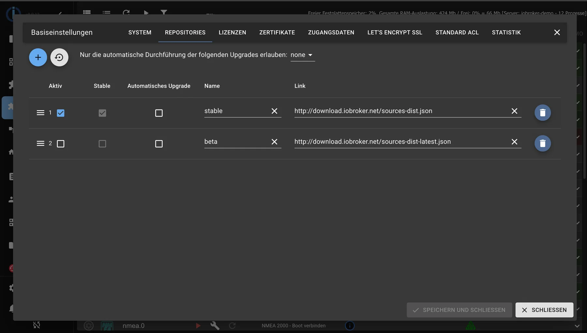

# Install updates

Updates keep a system running, but they are also the most common reason why it suddenly stops working. Both of these issues can be reconciled if you follow a specific order and don't try to do everything at once.

## The golden rule

Make a [backup](/docs/config/backup.md) before every update. Not "one from last week," but one from now. It takes a minute, but could save you an entire evening.

Here are two more rules that have proven effective in practice:

- **Not all at once.** If something's stuck after five updates, you won't know which one it was.
- **Not right before leaving.** A botched update takes time.



_The system settings under Repositories show the source of the adapters. In everyday use, "stable" remains active here._

## The chronological order

1. **Adapter** .
2. **js-controller** .
3. **Node.js** , last and only deliberately.

A new JavaScript controller sometimes requires newer adapters, so the adapters are listed first. Changing the Node.js major version is the most significant change and has its own page: [Updating Node.js.](/docs/install/updatenode.md) More detailed information can be found under [Updating](/docs/install/update.md) .

## If an adapter requires a newer Node.js version

Some adapter versions require a newer Node.js or js-controller version. This is listed in the adapter's changelog or README under Requirements. There are then two options:

- **Prefer Node.js** – back it up first, then [update as described under Node.js.](/docs/install/updatenode.md)
- **Either stick with the current adapter version for now** , or specifically install an older, compatible version: in administrator mode under expert mode via _Install a specific version_ (see [Adapters](/docs/tutorial/adapter.md) ) or on the console:

```bash
iobroker upgrade <adaptername>@<version>
```

From js-controller 6 onwards, an unsuitable version can be hidden so that it is not constantly offered as an update, and later shown again:

```bash
iobroker version <adaptername> --ignore <version>
iobroker version <adaptername> --recognize
```

## Update adapter

In the [Adapters](/docs/admin/adapter.md) tab, adapters with newer versions are highlighted. Before clicking, it's worth checking the adapter's changelog: this will indicate whether it's a bug fix or a redesign that requires further work.

After the update: Check if the instance is running and look at the [log](/docs/admin/log.md) .

Stay on the **stable** repository. The versions there are tested. _Beta_ is for testing purposes, not for a system that needs to work. See [Repositories](/docs/basics/repositories.md) .

## Update the js-controller

It is **not** updated in the Adapter tab, but in the [Hosts](/docs/admin/hosts.md) tab. A notification appears there if a newer version is available. On the command line:

```bash
iobroker upgrade self
```

The user interface will be briefly unavailable during the update. This is normal.

## Update Node.js

This is the step with the most significant consequences and the only one that takes place outside of ioBroker. ioBroker provides its own command for this:

```bash
iobroker nodejs-update
```

Use only **even** version numbers, i.e., the LTS versions. Odd versions are not supported. [See Update Node.js](/docs/install/updatenode.md) for details.

**Under Docker** (an image from buanet), Node.js comes with the image. `iobroker nodejs-update` That's not the way; instead, a new image is created and the container is recreated (`docker pull` and recreate containers or `docker compose pull && docker compose up -d` The data remains in the volume under `/opt/iobroker` - Back it up beforehand anyway. See [Docker](/docs/install/docker.md) and the [buanet documentation](https://docs.buanet.de/de/iobroker-docker-image/) .

## The operating system

Under Linux, the underlying system also needs maintenance:

```bash
sudo apt update
sudo apt upgrade
```

A system that hasn't received security updates for years is a greater risk than an adapter that's one version behind.

**Under Docker** , the operating system also comes with the image. Instead `apt` A new image is created and the container is rebuilt, as described above for Node.js. Adapters and js-controllers will continue to be updated as usual in the admin panel or on the console within the container.

## If an update goes wrong

1. Check the [minutes](/docs/admin/log.md) . They usually state in plain language what's missing.
2. Stop the affected instance and restart it individually.
3. If that doesn't help, restore the backup. Instructions on how to do this can be found under ["Restore configuration"](/docs/trouble/restore.md) and in detail under ["Restore"](/docs/tutorial/restore.md) .

And then ask in the [forum](/docs/trouble/forum.md) . If an update goes wrong for several people, you're usually not alone.