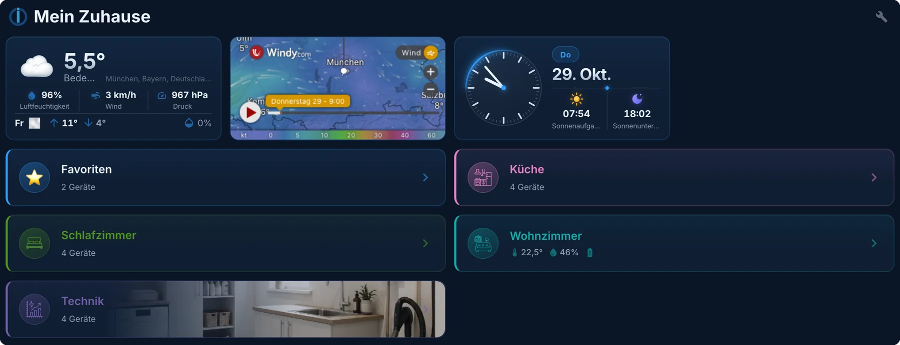
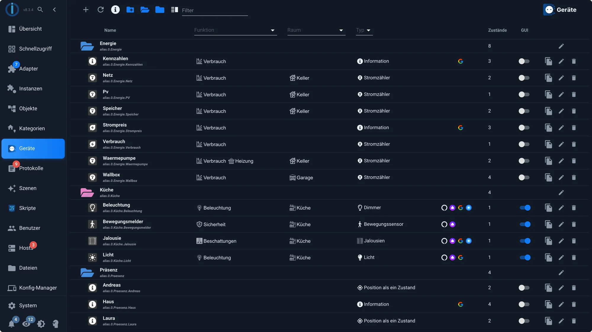
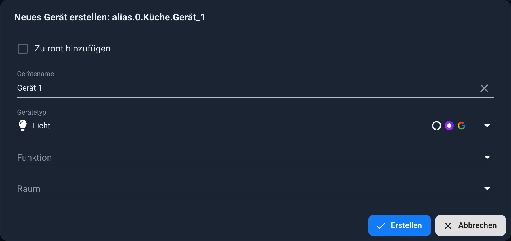
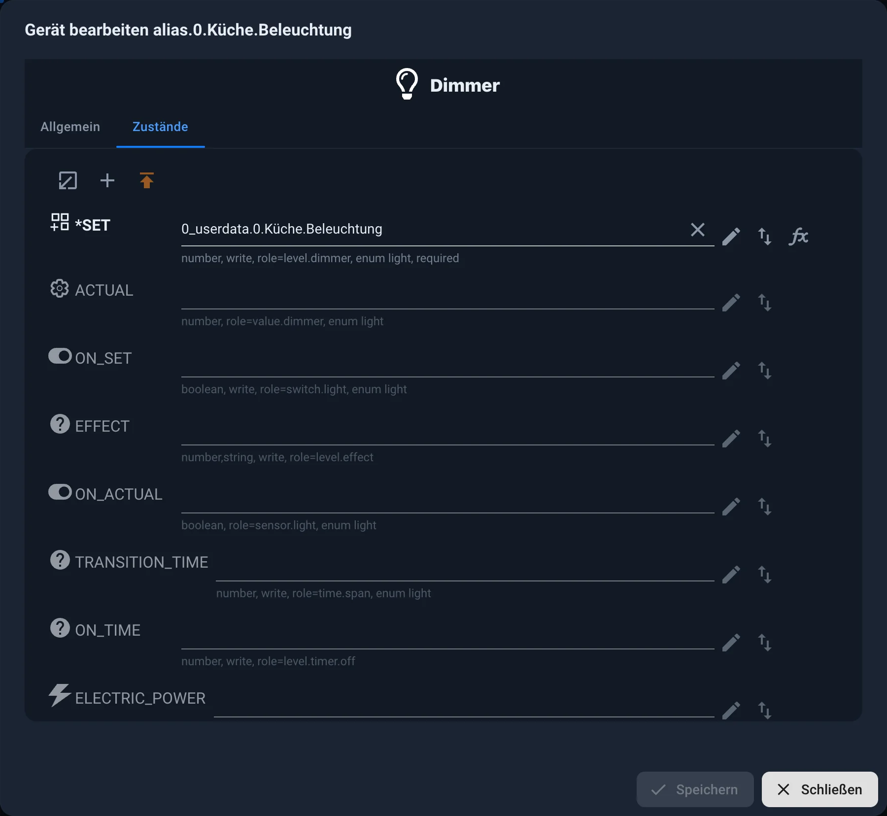
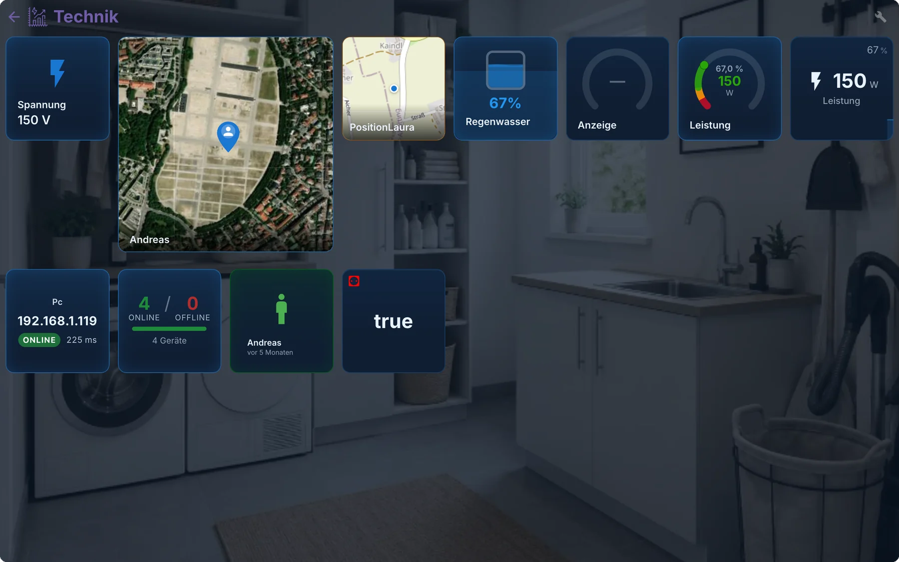
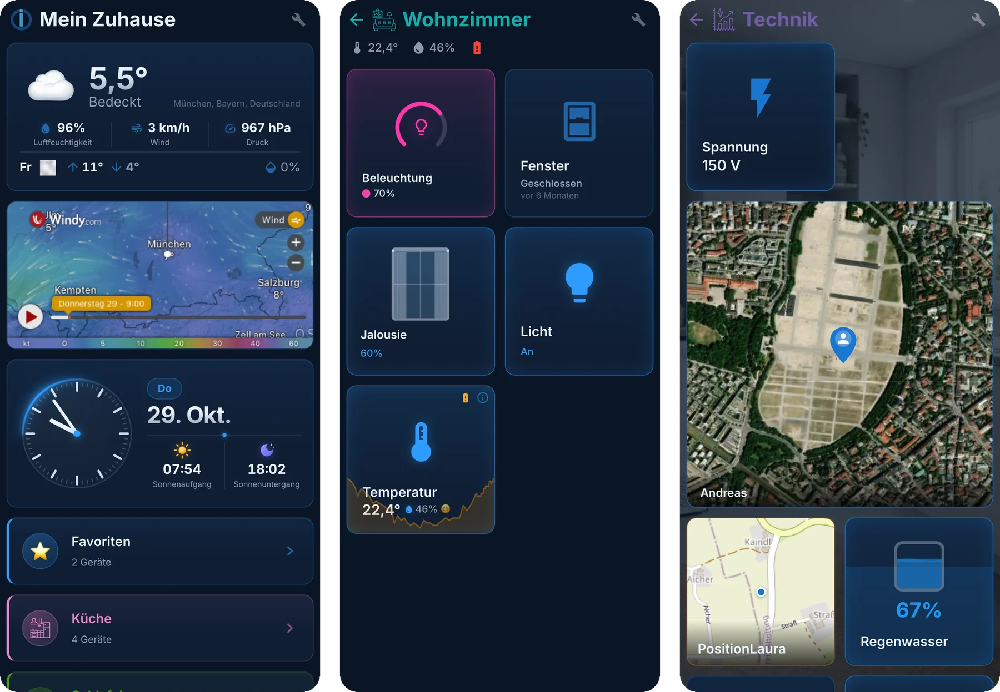
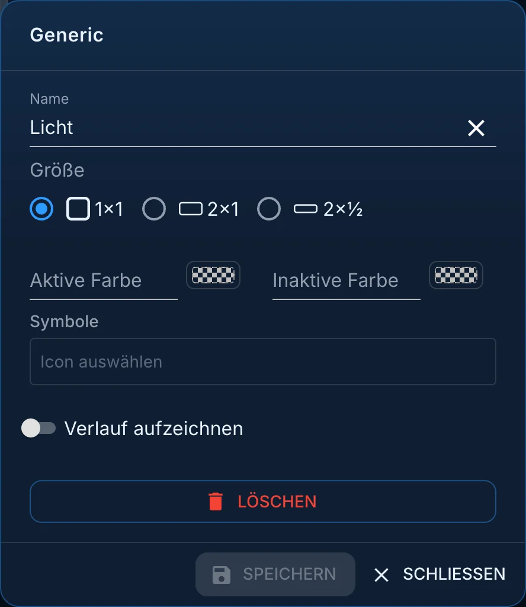
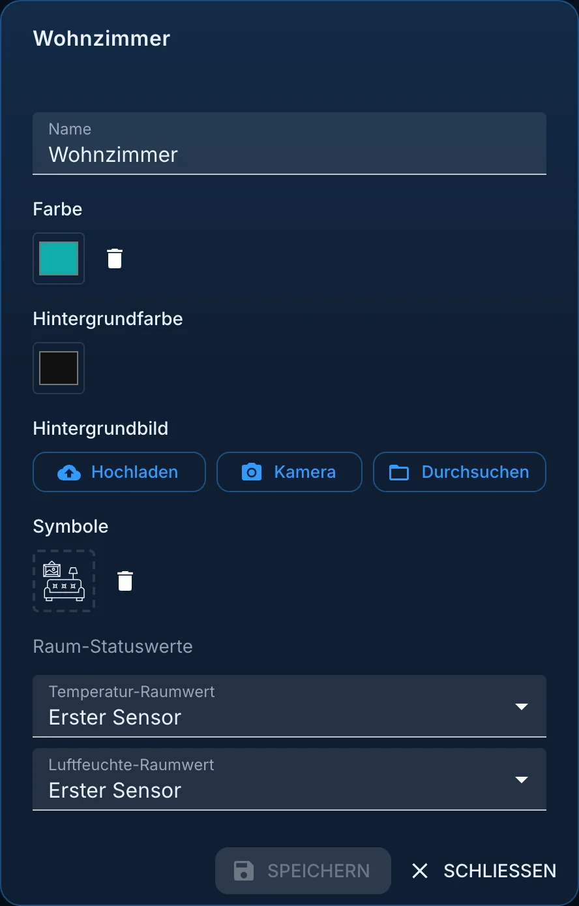
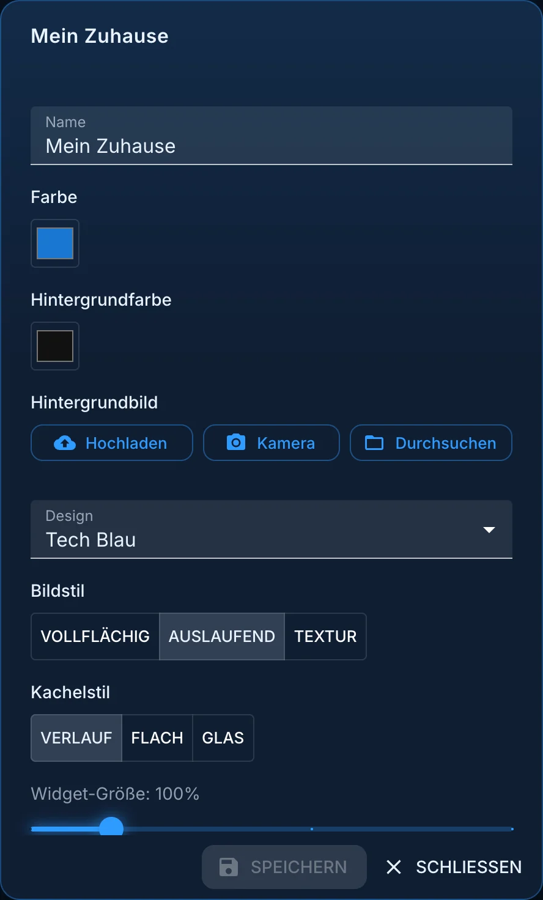
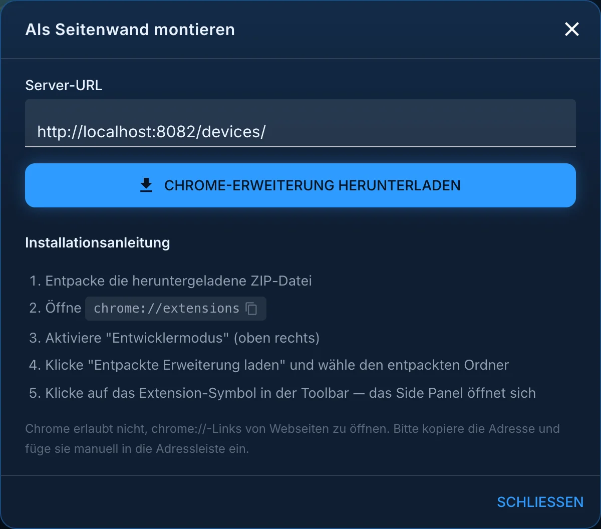

# Surface from the Devices adapter

The [\`devices\`](/adapters/devices) adapter isn't actually a visualization adapter. It assigns data points to **devices** : a switch, a feedback signal, and a counter become a lamp; four values become a thermostat. Since version 4, it can also generate a complete user interface directly from these devices, and that's precisely what this page is about.

The adapter only runs as a tab in the admin panel. It doesn't query any devices and requires virtually no processing power. The images on this page show version 4.2.7 with the **Tech Blue** design, and the admin panel with the **Modern Dark** theme.

## Why the detour is worthwhile

A single data point tells us little. `hm-rpc.1.00085A49A3F98C.4.STATE` is a `boolean` The system knows nothing more than that. Only when it results in a device of type `light` The other adapters will know what to do:

- When creating a widget **, vis-2** suggests the appropriate data points.
- **[Lovelace](/docs/viz/lovelace.md)** builds its surface from it.
- **IoT** reports the device to Alexa or Google as a lamp, not as a switch.
- **Matter** can only pass it on in the first place.
- A script locates the device via its type rather than a cryptic identifier.

There is also a second advantage, which only becomes apparent later: The devices are located below `alias.0.<Name>` If the device is later replaced, the assignment is changed in one place. Visualization, scripts, and recording do not notice this.

## The device list

The tab is called **"Devices"** in the admin panel. Like scripts and logs, it must be enabled in the admin instance settings. It displays either the user interface or the list of devices; the **"Devices"** button in the upper right corner and the " **Back to Devices"** arrow in the user interface toggle between the two.

The devices are stored in folders, usually one per room or area. The list shows the following for each device:

- **Function** and **space** from the [categories](/docs/basics/enums.md) ,
- the **type** , such as dimmer, blind or motion sensor,
- the symbols of the **voice assistants and smart home systems** to which the device of this type can be passed on,
- the number of assigned **states** ,
- the **GUI** switch determines whether the device appears in the interface.
- On the right are the buttons for copying, editing, and deleting.

## Create a device

1. Select the folder where you want to place the device and click **+** . Give it a name and choose a **device type** , such as light, blind, thermostat, or temperature. You can also assign the function and room at the same time.

2. In the **States** tab, assign the data points. Required fields are marked with `*` Fields marked as optional, such as humidity for the temperature sensor, can be omitted. Each field indicates what the data type expects: data type, whether it will write to data, and its role.

3. Save. The device will appear under `alias.0.<Name>` in the object tree.

The **General** tab displays the name, function, room, and color, as well as the **smart name** used by Alexa and other apps. **Disabling "smart" functionality** will completely exclude it from this list.

Almost every model also displays battery, connection, and error **statuses** . These are optional but are evaluated by Lovelace and Matter.

An alias can do more than just point to a data point: Read and write operations can be directed to **different** data points (arrow symbol behind the field), and a conversion can be defined for both directions (symbol). `fx`). This turns a roller shutter that reports 0 for open into a device that behaves like all others.

## Where the devices come from

| Origin                     | Description                                                                                                                                                                                                          |
| -------------------------- | -------------------------------------------------------------------------------------------------------------------------------------------------------------------------------------------------------------------- |
| **Automatically detected** | Adapters like `zigbee` or `hm-rpc` They already provide a usable structure. The devices adapter recognizes them automatically, **but only if a room or function is assigned.** Without an assignment, nothing happens. |
| **Alias**                  | The recommended method for anything made by hand. The equipment is located below. `alias.0`.                                                                                                                         |
| **Linked Devices**         | The predecessor via the adapter `linkeddevices`. No longer intended for new installations.                                                                                                                           |

The types that exist and the data points they expect are listed in the [type-detector](https://github.com/ioBroker/ioBroker.type-detector/blob/master/DEVICES.md) .

## The built-in surface

Once the devices are configured, a user interface can be created if desired. It is accessible via the associated \[link/path]. `web` -Instance reachable, usually under `http://<adresse>:8082/devices/`, and is also listed in the **Devices** tab of the admin.

The homepage displays the rooms as bars, with optional weather, clock, or other tiles above them. Clicking on a room opens its devices. Each tile shows its status and can be directly controlled; where a history is being recorded, a graph is displayed next to it.

On the phone, the same pages automatically arrange themselves into two columns without any settings required:

### Furnish

The wrench icon in the upper right corner switches to **configuration mode** . Each tile then has a handle for moving it, a star for **favorites** , and a gear icon for its settings. The header displays:

| Button                   | Effect                                                                                                         |
| ------------------------ | -------------------------------------------------------------------------------------------------------------- |
| **Add widget**           | An additional tile that is not a device: clock, weather, a website, a line break, even an embedded Vis 2 view. |
| **Group by type**        | Organize the devices in a room under headings such as lights, blinds, climate control.                         |
| **Category settings**    | Name, colors, background image and icon of the room or homepage                                                |
| **Mount as a side wall** | sets up the interface as a sidebar in Chrome, see below                                                        |
| **Playback mode**        | back to normal operation                                                                                       |

What can be adjusted:

- **Which devices appear** is determined by the **GUI** column in the device list. Anything that isn't checked is excluded.
- **Tiles.** Name, size (1x1, 2x1 or 2x½), active and inactive color and symbol can be changed per device. With **"Track History" enabled,** the tile displays a curve.
- **Rooms.** They are taken from the categories and can be named, colored, and given a background image via **upload** , **camera** , or **browse** . The sensor that provides the room temperature and humidity readings in the header is selectable.
- **Favorites** for the devices you use constantly.
- **The appearance** , in the settings of the homepage: the **design** (Automatic according to system design, Dark, Light, Orange Dark, Blue Dark, Tech Blue, Clear Light or Styling Gray), the **image style** of the background images (full coverage, gradient or texture), the **tile style** (gradient, flat or glass) and the **widget size** from 80 to 200%.
- **Multi-user settings** : Rights per user group, as long as the switch for this is turned on.

### As a sidebar in Chrome

**Clicking "Mount as sidebar"** on the homepage downloads a Chrome extension that opens the interface in the browser's sidebar. The dialog box provides the server address and guides you through the installation: extract the ZIP file, `chrome://extensions` Open the browser, enable developer mode, and load the extracted extension. Afterward, clicking the extension icon will open the device options next to any website.

The user interface can be transferred from the phone to the [ioBroker VisuApp](/docs/cloud/app.md) .

This interface **does not replace vis-2** . It is intended for quickly and automatically generated room views. Anyone who wants to build a dashboard exactly to their own specifications should use [vis-2](/docs/viz/vis-2.md) .

## A video about it

The ioBroker channel shows the entire process in just over twenty minutes, from the aliases to the room view to the app: [ioBroker Devices/Device Adapters: Automatic Visualization for Smart Home](https://www.youtube.com/watch?v=C-e8j8NHdi0) (May 2026).

## Further information

- [Categories](/docs/basics/enums.md) and the [Categories](/docs/admin/enums.md) tab: the basis for spaces and functions
- [Roles of data points](/docs/basics/roles.md) : how an adapter recognizes what a data point is
- [Alias](/docs/basics/alias.md) : what's behind `alias.0` is
- [Overview](/docs/viz/README.md) : the other ways to reach a surface