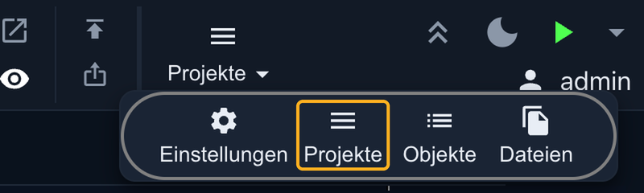
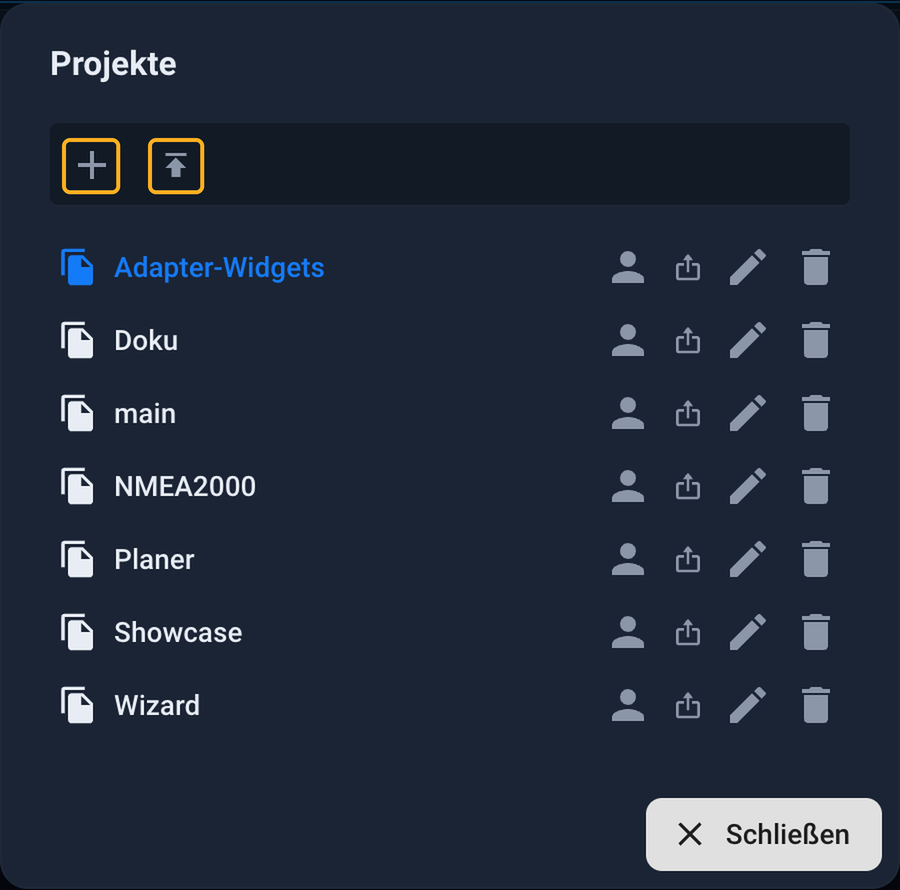
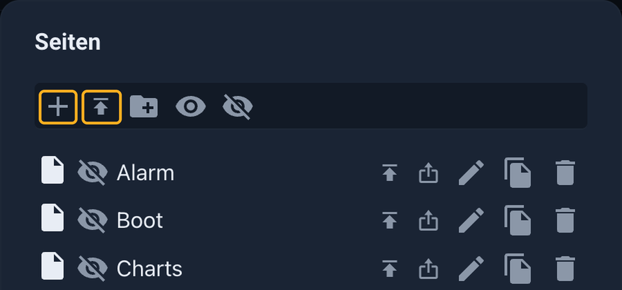

# Import demo project

A real ioBroker system runs at <https://iobroker.click> . There, you can view and interact with pre-built user interfaces live. If you like one, you can import it into your own **vis-2** system and then customize it as needed, instead of starting with a blank page.

This page shows the path from download to the running interface.

## What you download

Each interface includes up to two files. Both are available in the **"Download and set up project"** dialog, which is opened by clicking the **"Download project"** button next to the live demo.

| file                            | Contents                                                   | Necessary? |
| ------------------------------- | ---------------------------------------------------------- | ---------- |
| **Project for vis-2** (`.zip`) | Project pages, widgets, images and settings                | Yes        |
| **Data points** (`.json`)      | The data points used by the project, including demo values | optional   |

The decision is simple:

- **Just adopt the design** : the `.zip` That's sufficient. Omit the data points. The widgets will then initially be empty and will connect directly to your own devices.
- **First, try playing around with it** : load the data points as well. Then the interface will immediately display values and can be used, entirely without your own devices.

Not every interface on iobroker.click is available for download yet. Such entries are marked **"Coming soon"** .

## Step 1: Install the adapter

In the admin interface, under **Adapters** **, web** and **vis-2** are installed. In addition, the adapters belonging to the respective interface are required. These are available in the download dialog. The demo with the Jäger design, for example, requires... `vis-2-widgets-jaeger-design`, whose widgets require their own license, and `mihome-vacuum` for the robot vacuum's map. If such an adapter is missing, the affected widgets will remain empty.

## Step 2: Import data points (optional)

Only necessary if the demo values are desired:

1. Open **objects** in the admin interface.
2. Turn on **expert mode** .
3. Click the upload icon to `.json` -Select the file containing the data points.

A folder will be created under `0_userdata.0`, in the example `0_userdata.0.Demo`, with all data points used by the project.

## Step 3: Import the project

The vis-2 editor can be opened in the admin interface via the vis-2 instance. It can also be accessed directly in the browser via the web adapter's address using the following path: `/vis-2/edit.html`.

The **Projects** menu is located in the upper right corner of the toolbar. Clicking on it expands to four entries. **Selecting Projects** opens the dialog box displaying all projects in the system.

At the very top of the dialog box are two buttons side by side. The **plus button** creates a new, empty project. The button to its right, with the upward-pointing arrow, is the **import button** . It opens the file selection window; there, select the downloaded file. `.zip` Select. The file will remain compressed; it will not be uncompressed.

**Do not change the project name** . The demo images and files will be searched for under this name, for example: `jaeger-design-widgets` If the project is imported under a different name, the images will be missing.

The project then appears in the list. Clicking on the name opens it in the editor.

## Only take part

You don't have to use the entire project. Individual **pages** or **widgets** from a downloaded demo can also be imported into an existing project. This is the right approach if you only like a specific page or a single tile.

**Individual pages** can be imported in the **Pages** dialog ( **Pages** button in the toolbar). The import option is located next to the plus sign.

**Individual widgets** can be imported using the **"Import Widgets"** button in the toolbar. Its counterpart, **"Export Widgets,"** saves the widgets that are selected on the currently open page.

Images required by a widget are located in the file storage under the name of the demo project. Anyone copying individual parts should ensure that these files end up in their own project.

## Step 4: Connect your own devices

The demo displays values from demo data points. To display the values of your own system, each widget must point to its own data points. There are two ways to do this:

- In the editor, click on a widget and replace the demo data point with your own in the **object ID** .
- Alternatively, a script can write the values of your own devices into the demo data points. This leaves the widgets unchanged. This is useful when many widgets use the same data points.

As long as no devices are connected, the values will remain empty. To test this, values can be manually set in the admin interface under **Objects** .

## If something is wrong

| observation                               | Caused                                                                                                             |
| ----------------------------------------- | ------------------------------------------------------------------------------------------------------------------ |
| Widgets are empty or display placeholders | The demo adapter is missing, or the widget set is not loaded. Install the adapter and reload the page.             |
| Widgets do not display any values         | The data points were not imported, or the widgets are still pointing to the demo data points instead of their own. |
| Images are missing                        | The project was imported under a different name. Delete it and import it again with the original name.             |

More information on managing projects, exporting and data backup can be found at [vis-2](/docs/viz/vis-2.md#wo-das-projekt-liegt) .