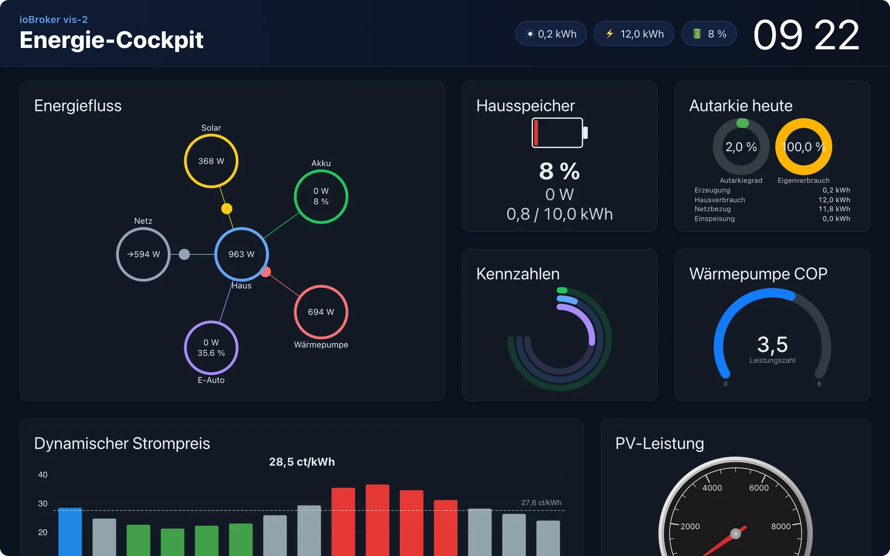
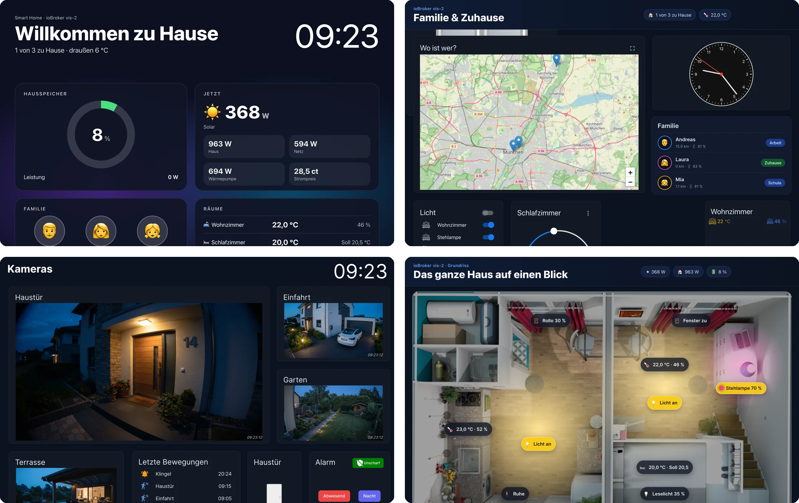
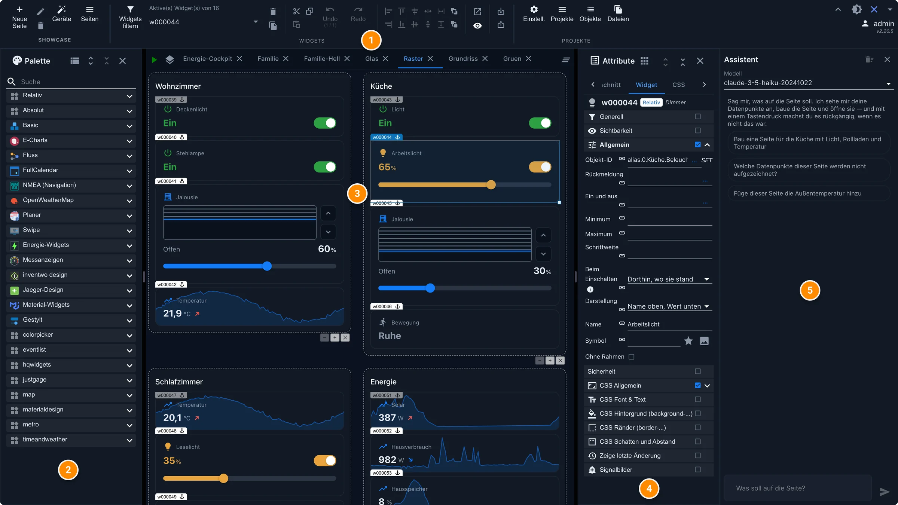
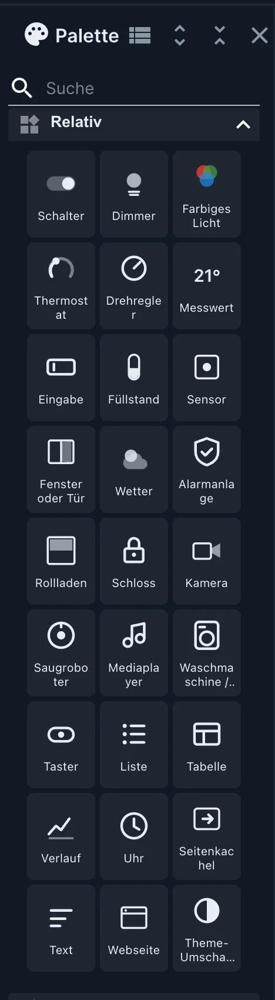
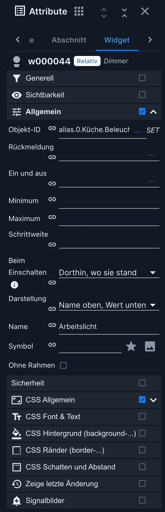
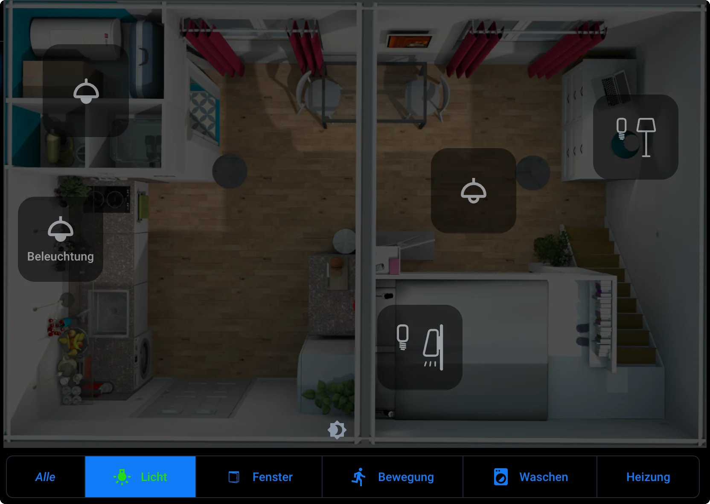
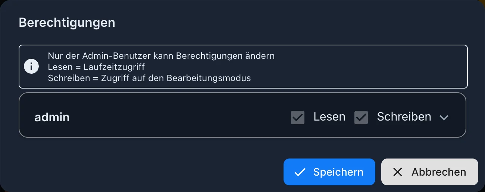
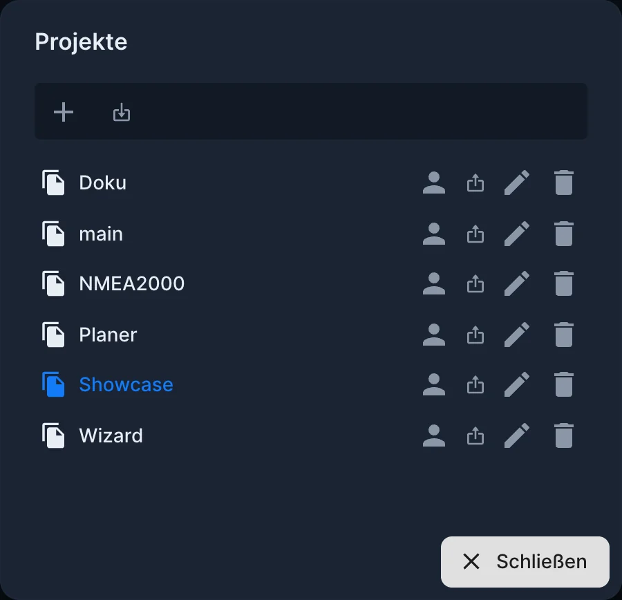

# vis-2

**vis-2** is the visualization tool for ioBroker: a user interface that can be assembled from building blocks without any programming. It is the successor to [vis](/docs/viz/vis.md) and the right choice for any new project.



What sets it apart from other interfaces: vis-2 doesn't build anything automatically. The [Devices adapter](/docs/viz/devices.md) and [Lovelace](/docs/viz/lovelace.md) generate their pages from devices and categories; here, you define each tile yourself. This takes some time and is the only way if you want the interface to look exactly as you envision it. A wall-mounted tablet in the hallway, a floor plan with live data, a camera overview, or a page for your phone: using the same building blocks, something completely different is created each time.



Ready-made examples to try out are available at <https://iobroker.click> .

All images on this page are from vis-2 2.20.5 in the **Modern Dark** theme, using the widget sets that vis-2 itself provides, and some of the common widget adapters.

## License

vis-2 is the only part of ioBroker that requires a license. The source code is licensed under CC BY-NC, which must be confirmed during installation, and the adapter also requires a license. Three versions are available:

| License          | For whom                                                                                      |
| ---------------- | --------------------------------------------------------------------------------------------- |
| **Community**    | Private, free of charge. All you need is an account on [iobroker.net](https://iobroker.net) . |
| **Offline**      | Privately, for a small fee.                                                                   |
| **Commercially** | Commercial use and distribution to customers.                                                 |

The **community license is checked online when the adapter starts** . The device must be connected to the internet at this precise moment. Those who do not want to or cannot do this should use the offline license, which waives the check. Details and prices can be found under [Adapter Licenses](/docs/licenses/adapter.md) and in the [product overview](/productoverview) .

## installation

The adapter is called[`vis-2`](/adapters/vis-2) It requires the [web adapter](/adapters/web) and runs as a **singleton** : there can only be one instance.

After that, there are two addresses:

|                   | address                                 |
| ----------------- | --------------------------------------- |
| Display (Runtime) | `http://<server>:8082/vis-2/index.html` |
| editor            | `http://<server>:8082/vis-2/edit.html`  |

You can reach a specific project and a specific page with `index.html?Projekt#Seitenname`. Both addresses are also listed as references in the **Instances** tab.

On a phone or tablet, the display can be added to the home screen as a shortcut via the browser menu. It then opens the exact project and page from which it was created, and looks almost like a separate app.

## The editor



The editor is divided into five areas:

|       | Area             | Contents                                                                                                                                                                   |
| ----- | ---------------- | -------------------------------------------------------------------------------------------------------------------------------------------------------------------------- |
| **1** | **Toolbar**      | New page, **Devices** , Page list, Cut and paste, Undo and redo, Align multiple widgets, Preview, plus **settings** on the right, **Projects** , **Objects** and **files** |
| **2** | **range**        | All available widgets, grouped by widget set, with search field                                                                                                            |
| **3** | **work surface** | the opened pages as tabs                                                                                                                                                   |
| **4** | **Attribute**    | The settings of the selected item, with the tabs **Page** , **Section** , **Widget** , **CSS** and **Scripts.**                                                            |
| **5** | **assistant**    | the [AI assistant](#der-ki-assistent) that builds and modifies pages on command                                                                                            |

The palette and attributes are accessed via the two icons to the left and right of the sidebar tabs. If the window is narrow or the page resolution doesn't fit between the sidebars, they open as a floating bar above the workspace, only one at a time. On a wide screen or with a page that doesn't have a fixed resolution, they appear side by side.

The **"Change color theme"** icon in the upper right switches between themes, including **Modern Dark** and **Modern Light** . The choice applies to this browser, and widgets from the Relative and Absolute themes inherit their colors from this theme.

**In vis-2, a view is called a "page."** In vis-1, the same thing was called "view," and many online tutorials still use that term. They all mean the same thing: a screen full of widgets.

## pages

A project consists of several pages. Each page has its own settings under **Attributes → Page** , grouped by purpose:

- **CSS in general** , **CSS background** and **CSS font and text** for appearance,
- Behavior **options** ,
- **Navigation** and **application bar** for the menu,
- **Responsive settings** for behavior on narrow screens.

### navigation

Instead of manually linking each page, you can include them in the **navigation** . vis-2 then creates a sidebar with a title, icon, and order, optionally with an application bar at the top. This is the fastest way to create an interface that can be used on a phone.


Some settings you should be aware of:

- **Entry only if condition** : The menu entry only appears as long as a data point fulfills a condition, for example a "Guests" page only in guest mode.
- **Show back path** : The application bar gets a back arrow.
- **Application bar height** : between 24 and 120 pixels, per page or for the entire project.

The menu appearance can be set for all pages at once under **Settings → Navigation Menu** . Individual pages can still display different content; anything left blank on a page is determined by the project settings.

Those who create their own buttons instead of using the menu can highlight the entry of the currently open page: Every widget that leads to a page carries the CSS class `vis-nav-active`, as long as this page is displayed.

```css
.vis-nav-active button {
    border: 1px solid #0d72b8;
}
```

### Which side appears first

Each page can be assigned a **resolution** and a **default** checkbox can be set. `index.html` If a page is accessed without a name, vis-2 opens the page that best fits the screen. This allows you to create two pages, one in portrait and one in landscape orientation, which switch between when the phone is rotated. If only one page is selected, that page will always open.

The resolution is only a guideline in the editor. It is invisible in the running view, and widgets outside of it are still visible.

The " **Basic → Screen Resolution"** widget displays the actual screen size and the corresponding default page. It's very useful during setup; afterwards, you can remove it from the page.

## Widgets

A widget is dragged from the palette onto the page and its data points are assigned under **Attributes → Widget** . The available widget sets depend on which widget sets are installed. vis-2 includes five; all others are custom adapters (see [Widget Sets](/docs/viz/widgetsets.md) ).




For the devices in a house, vis-2 includes two separate sets: **Relative** and **Absolute** . Both contain the same 27 devices, from switches and dimmers to thermostats, roller shutters, locks, and cameras, all in the same style and with the theme's colors.

- **"Relative"** refers to a tile that fills its space within a section. This is the term used for pages that are designed to adapt to any screen size.
- **The absolute value** is as large as you scale it. On a floor plan, it becomes a small round marker with a symbol and value, which glows in the color of its current state.

When you select a device's data point, the widget automatically populates the object's data: name, unit, boundaries, and channel symbol. You don't need to type any of it in.

The classic sentences from vis 1 can also be used. However, they look the same there as in vis 1 and do not follow the theme of vis-2.

### Add devices at once

On a page with sections, the **"Devices"** button in the toolbar opens a wizard: **"Add Devices to Page"** . In four steps (Scope, Check Devices, Setup, Summary), you select devices by room or trade, and vis-2 creates the corresponding tiles. This requires that the devices are already known, most easily via the [Devices adapter](/docs/viz/devices.md) .

### Position: fixed or fluid

By default, a widget is positioned at fixed coordinates. This is appropriate for a floor plan or a wall-mounted tablet whose screen never changes.

For an interface designed to work on both tablets and phones, the page is divided into **sections** . The widgets within these sections automatically arrange themselves, and on a narrow screen, the sections appear stacked vertically. This is simpler than using two pages with fixed coordinates. Setting the position of an individual widget to **relative** achieves the same effect.


## Bonds

Almost every widget has a field for the object ID. Furthermore, **every** attribute can be bound to a data point: simple. `{objekt.id}` write in the field, for example `{hm-rpc.0.OEQ1880105.4.ACTUAL_TEMPERATURE}` The small chain symbol in front of an attribute indicates that it can be bound.

With multiple values and a formula, even more is possible:

```
{h:javascript.0.myCustom.height;w:javascript.0.myCustom.width;h*w}
```

The name under which the value appears in the formula comes before the colon. The last section is the formula itself, which allows any JavaScript function of the browser.

!> **All values arrive as a string.** Anyone performing calculations then puts them into `parseFloat()`, otherwise vis-2 concatenates the numbers instead of adding them.

```
{h:javascript.0.myCustom.height;w:javascript.0.myCustom.width;Math.max(20, Math.sqrt(Math.pow(parseFloat(h), 2) + Math.pow(parseFloat(w), 2)))}
```

A value enclosed in quotation marks, such as JSON from iCal or MQTT like `{"connected":true}`, arrives in the formula as the object that it is.

Two subtleties: A colon **within** a formula is called `::` It's written because the simple character separates the names. And a CSS rule like `{style: value}` would be read as a link; therefore, it belongs in double brackets. `{{style: value}}`.

In addition to data points, there are built-in names:

| name           | Value                                                                                       |
| -------------- | ------------------------------------------------------------------------------------------- |
| `username`     | the logged-in user                                                                          |
| `view`         | Name of the current page                                                                    |
| `wid`, `wname` | Widget identifier and name                                                                  |
| `widget`       | all data from the widget, only in the formula section, for example `{a:a;widget.data.name}` |
| `widgetOid`    | the object ID of the widget, for example `{t:widgetOid.val;t}`                              |
| `language`     | the selected language                                                                       |
| `instance`     | the identifier of this browser                                                              |
| `login`        | whether registration is required                                                            |
| `local_*`      | a variable that is only valid in this browser and is not written back to ioBroker           |

## filter

Each widget has a **filter** field. If you enter a term there, for example... `licht`, the page can be customized with the widget `filter - dropdown` Limit the selection to this group. This way, many widgets can fit on one page without all of them being visible at once.



The entries carry the CSS class `vis-filter-item`, the active additionally `vis-filter-item-active`:

```css
/* Knöpfe, waagerecht oder senkrecht */
.vis-filter-item-active {
    background-color: #ff0000;
}

/* Einträge des Klappfelds */
.vis-filter-item-active.Mui-selected {
    background-color: #ff0000;
}
```

Two things are important to know: A color set within the widget itself is an inline style and cannot be overridden by the project's CSS; if you want to color it via CSS, leave it blank. Also, the entries in a drop-down menu are drawn outside the widget and are therefore only accessible generally, not via the identifier of a specific widget. Buttons, on the other hand, are part of the widget and can be addressed directly.

## The AI assistant

Since version 2.20, the editor has a wizard that lets you tell it in your own words what you want on the page. It looks at the data points, builds the page, and opens it. If it wasn't what you wanted, a single keystroke undoes everything.


Typical orders:

- "Build a page for the kitchen with light, blinds and temperature."
- "Add the outside temperature to this page."
- "Which data points on this page are not recorded?"

In order to function, vis-2 needs access to a language model. This is configured in the instance settings under the **AI Assistant** tab: a key for OpenAI, Anthropic, Gemini, or DeepSeek, or the address of a custom, OpenAI-compatible service, such as a local model. The **maximum response length** is also specified there; it can be quite generous for processing an entire page in one go.

What the assistant sees—the page and the names and values of the data points—is sent to the selected provider. If you don't want this, you can enter a local model as your own service. Depending on the model, these requests cost the provider money.

## Control from outside

vis-2 creates three data points that allow for remote control of a running display:

| Data point                 | Contents                                                       |
| -------------------------- | -------------------------------------------------------------- |
| `vis-2.0.control.instance` | the browser identifier, or `FFFFFFFF` for all                   |
| `vis-2.0.control.data`     | the command's parameters                                       |
| `vis-2.0.control.command`  | The command. **Write this last** ; it will trigger the action. |

Commands: `changeView` (switch to another page, optionally) `projekt/seite`), `refresh` or `reload`, `alert` (`Meldung;Titel;Symbol`), `dialog` and `dialogClose`, `popup` (opens an address in a new window) and `playSound`.

It can be done more concisely as JSON in a single write operation:

```js
setState('vis-2.0.control.command', JSON.stringify({ instance: '*', command: 'refresh', data: '' }));
```

The object must be written as **a string** , i.e., with `JSON.stringify()` An object without `val` holds `setState()` The JavaScript adapter uses the entire state instead of its value, and the command never arrives.

Conversely, vis-2 reports a page change: `control.command` then stands `changedView` and `control.data` on `projekt/seite`, each with `ack=true` This can be addressed in a script.

?>`playSound` It only works after the user has tapped the page at least once. This is a browser rule, not a bug in vis-2. Therefore, no sound will be produced on a wall-mounted tablet that only displays information.

## right

For each ioBroker user, **read** and **write** permissions can be assigned separately, on three levels:

- **Project** : Reading means the user is allowed to open the display; Writing means they are allowed to use the editor.
- **Page** : the same for individual pages.
- **Widget** : Without read permission, the widget will not be drawn in the display; without write permission, it will not be drawn in the editor.



This is assigned in the project dialog via the person icon next to the project. Only the user can change it. `admin` A newly created user has both permissions. If a permission is already missing at the project level, it's pointless to grant it on a page. Anyone accessing a page without the necessary permission will be taken to the project selection screen.

## Settings for operation


The project settings are located under **Settings** . For wall-mounted tablets, these are particularly important:

- **Reload after sleep for longer than (seconds)** : When a tablet's screen turns off, the browser pauses the page. Otherwise, upon waking, it would have to process any missed changes and be sluggish for many seconds. With this setting, the display reloads and reads the values once instead. The minimum time is 30 seconds; empty or 0 means never, which is the default. vis-2 waits for the server to respond before reloading to prevent a device without Wi-Fi from ending up on an error page.
- **Returning to a standby view** : One page and a number of seconds. If no one interacts with the display for that long, it automatically returns to this page. A wall-mounted panel thus returns to the home screen automatically. Every keystroke, click, or touch restarts the timer; a simple mouse movement does not.
- **Dark screen for reconnection** : prevents a tablet in the bedroom from suddenly lighting up brightly at night. Only applies to reconnection, not the initial setup.
- **When making project changes, reload all browsers** : After saving in the editor, all displays will retrieve the new version.

All settings only affect the display. The editor never reloads automatically.

## Where the project is located

A project is a single file in the ioBroker file storage: `vis-2.0/<Projekt>/vis-views.json` In addition, there are the uploaded images and the custom stylesheet. Projects can be created, renamed, exported as a ZIP file, and imported again via the **Projects menu** . Exporting is the easiest way to transfer a user interface to a different system.



Exporting data belongs in the data backup. While an ioBroker backup does include the file storage, restoring a single project from it is more cumbersome than importing a ZIP file.

## Switch from vis 1

Both adapters can be used side-by-side without interfering with each other. This is also the smoothest approach: leave the old project in vis, start a new one in vis-2 next to it, and only switch between them once the new interface is complete.

The classic widget sets are available in vis-2, so there's no shortage of familiar building blocks. An exported project can be imported in the project dialog; how much of it is actually imported depends on the widgets used. So try it on a copy first, not on the running project.