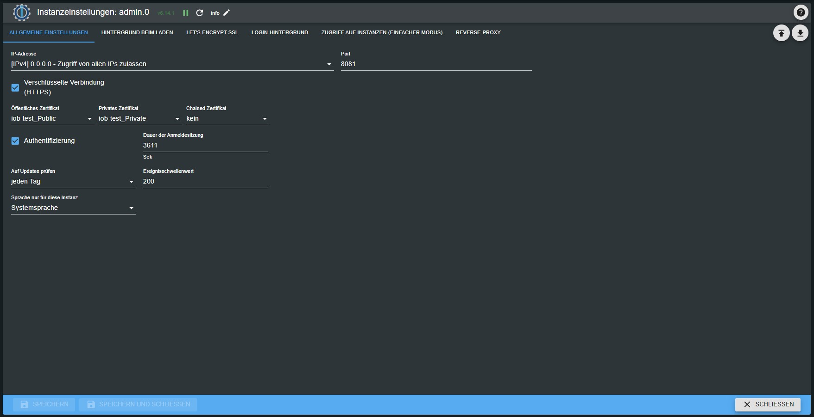
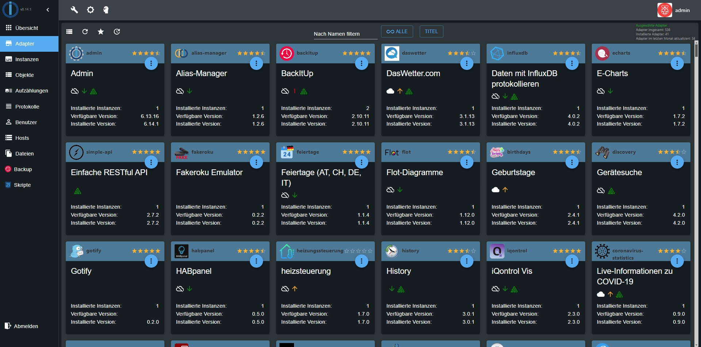
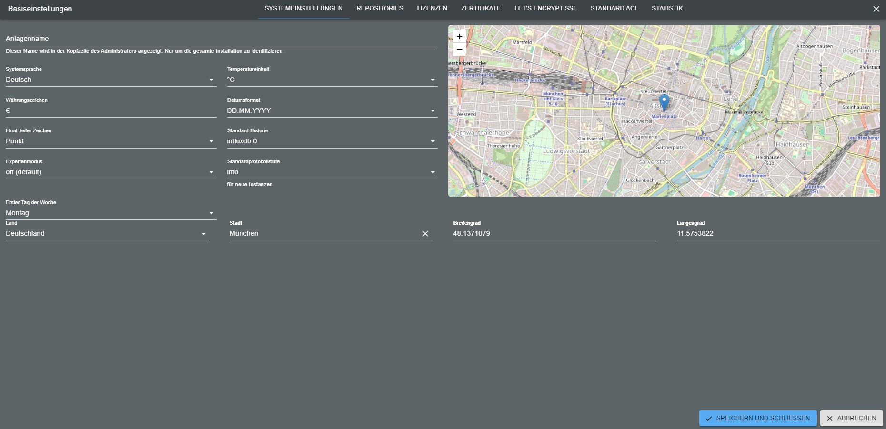

## Описание

Драйвер используется для обслуживания и настройки системы ioBroker и всех установленных драйверов. 
Он представляет собой WEB-интерфейс по адресу `<IP-Адрес сервера>:8081` и устанавливается вместе с ioBroker.

С помощью WEB-интерфейса, предоставляемого драйвером **admin**, реализуются следующие функции:

*   Установка дополнительных драйверов
*   Обзор объектов
*   Обзор состояний объектов
*   Управление пользователями и группами
*   Просмотр журнал (лог-файл) работы системы
*   Управление хостами (работа с распределенной системой - более одного хоста)

## Установка

Этот драйвер устанавливается вместе с ioBroker, ручная установка не требуется.

## Настройка

### Параметры конфигурации

#### IP

IP-адрес с которого доступен драйвер (поддерживаются IPv4 и IPv6). Значение по-умолчанию 0.0.0.0, то есть 
возможно соединение на любой IP-адрес. 

**Изменять не желательно, можно потерять досуп!**

#### Port

Порт, по которому доступен интерфейс драйвера. На сервере может быть запущено 
несколько WEB-сервисов и порт 8081 (настройка по-умолчанию) может быть занят, 
необходимо исключить конфликт занятого порта. Значение можно изменять.

#### Шифрование

Если необходимо использовать протокол HTTPS, необходимо отметить данную опцию.

#### Аутентификация

Если необходима аутентификация пользователя для работы с драйвером, 
необходимо отметить данную опцию (автоматически включится опция HTTPS).

#### Кэш

Необходимо отметить данную опцию, если планируется использовать кэш браузера.

#### Пользователь по-умолчанию

Если опция аутентификации отключена, то драйвер admin будет работать от имени пользователя по-умолчанию (выбирается из списка), в противном случае, от имени пользователя при аутентификации.

#### Проверка обновлений

Периодичность автоматической проверки обновлений системы и установленных драйверов. 
Можно выбрать опцию "ручное" и тогда проверка будет осуществляться только по запросу пользователя.

## Использование

В адресной строке WEB-браузера наберите: `<IP-Адрес сервера>:8081`

### Вкладки

Главное окно интерфейса состоит из нескольких вкладок. 

#### Вкладка "Драйвера"

Здесь можно установить или удалить экземпляры драйверов. В списке отображаются доступные для установки драйвера 
и их версии, а так же версии установленных. Обновить информацию по версиям можно с помощью кнопки в левом 
верхнем углу. В столбце **Версия** предусмотрена цветовая маркировка релиза драйвера 
(красный = в планах, желтый = бета-версия, оранжевый = альфа-версия, зеленый = финальная версия). 
Если установленная версия драйвера ниже версии на сервере (имеются обновления), то заголовок 
станет зеленым и появится в строке драйвера кнопка обновления. Если кнопка со знаком вопроса 
в последнем столбце активная, то нажав по ней, можно перейти на сайт **Github** для ознакомления с информацией об драйвере.

#### Вкладка "Настройки драйверов"

Здесь отображаются установленные экземпляры драйверов и осуществляется настройка/конфигурирование. 
Слева сверху находится кнопка включения режима эксперта - для отображения дополнительных настроек. 

Настройки драйверов:

*   Запуск/станов экземпляра драйвера
*   Открытие всплывающего окна с настройками драйвера
*   Кнопка перезапуска экземпляра драйвера
*   Кнопка удаления экземпляра драйвера
*   Если драйвер подразумевает собственный WEB-сервис, будет доступна кнопка перехода в новом окне.

Если щелкнуть на название драйвера в столбце **Заголовок**, можно изменить название экземпляра. 
В режиме эксперта появляются еще два столбца справа:

*   Столбец **Уровень** - выбор из списка уровень подробности ведения журнала работы адаптера (debug, error, warn, info)
*   Столбец **Max. RAM** - при необходимости можно ограничить выделение памяти ОЗУ для работы драйвера

#### Вкладка "Объекты"

На этой вкладке отображаются объекты системы (переменные, программы, устройства и пр.). 
По-умолчанию, системные объекты скрыты, их можно отобразить нажав кнопку **Показать системные объекты** 
слева сверху. С помощью кнопок со стрелками вверх/вниз можно загрузить/выгрузить объект(-ы) файлом JSON. 
В столбце справа можно нажатием кнопки вызвать окно настроек конкретного объекта (отдельной кнопкой настройки хранения истории) 
и удалить объекты. Если значения отображаются красным цветом, значит они еще не подтверждены - флаг `ack = false`.

#### Вкладка "Состояния"

Отображение в табличной форме состояний всех объектов системы. В шапке таблицы поля для ввода - фильтры для поиска объекта или группы объектов.

#### Вкладка "События"

Отображение в табличной форме изменений состояний объектов в режиме реального времени (можно приостановить, нажав справа сверху соответствующую кнопку).

#### Вкладки "Группы" и "Пользователи"

Добавление пользователей и групп, редактирование привилегий.

#### Вкладка "Категории"

Добавление/редактирование/удаление категорий (к примеру комнат для работы с адаптером **Scenes**).

#### Вкладка "Сервера"

Список серверов с установленным ioBroker, так же здесь отображается версия js-controller на каждом хосте. 
Если имеется новая версия, то заголовок вкладки будет отображаться зеленым цветом и появится кнопка 
обновления версии js-controller до актуальной. Запросить текущую версию (если отключено автоматическое обновление) 
можно с помощью кнопки **Обновить информацию драйвера** в левом нижнем углу окна. 
Так же возле имени хоста имеется кнопка перезагрузки js-controller (не OS).

#### Вкладка "Лог"

Здесь отображается журнал работы сервера. Сверху слева доступны поля для фильтрации записей. 
Можно отображать записи только указанного драйвера, либо всех (включая системный js-controller); 
можно выбрать уровень отображения лога (отладка, инфо, предупреждения, ошибки) и фильтровать по значениям. 

Справа сверху находятся кнопки:

*   Кнопка **Задержать вывод сообщений** - вывод сообщений на странице временно приостанавливается (например, когда сообщения появляются слишком быстро, чтобы не пропустить искомое)
*   Кнопка **Обновить протокол** - обновить журнал вручную (сообщения должны выводиться в режиме онлайн при активной вкладке)
*   Кнопка **Скопировать протокол** - сообщения на экране копируются в буфер обмена для дальнейшего использования (например, для вставки на форум, чтобы описать ошибку)
*   Кнопки **Очистить протокол на экране** и **Очистить протокол на сервере** - соответственно очищает вывод сообщений на вкладке **Лог** и полностью удаляет сообщения из журнала на сервере (применять осторожно).

#### Вкладка "Скрипты"

Эта вкладка активна только если установлен драйвер **Javascript/Coffescript Script Engine**. 
Здесь можно создавать/удалять/редактировать скрипты для автоматизации. 
Более подробно смотри описание данного драйвера.

#### Вкладка "Node-red" и вкладки других драйверов

Эти вкладки видны только если включен соответствующие драйвер (см. пункт ниже).

### Общие настройки

Справа сверху находятся кнопки общих настроек драйвера **Admin**:

*   Кнопка **Видимость вкладок** - можно включать и отключать вкладки, а так же, при установке определенных драйверов, для которых существуют свои вкладки - добавлять их на страницу
*   Кнопка **Системные настройки** - дополнительные настройки работы системы такие как: язык интерфейса, формат даты, единицы измерений, активный репозиторий и пр. (группа основные настройки); редактирование, добавление/удаление ссылок на репозитории (группа репозитории); добавление/удаление собственных сертификатов при использовании HTTPS (группа сертификаты); настройка анонимного сбора статистики (группа статистика)
*   Кнопка **Выйти** - выход из системы.

## Changelog
<!--
    Placeholder for the next version (at the beginning of the line):
    ### **WORK IN PROGRESS**
-->
### **WORK IN PROGRESS**
- (@GermanBluefox) Fixed: after "Check adapters for updates" or `iobroker update`, the adapter list shows when the repository was read and not when it was generated (#3729)
- (@GermanBluefox) Updated @iobroker/json-config to 10.1.20: `cron` in the JSON config does not offer the wizard of schedules anymore, which wrote `{}` into the field
- (@GermanBluefox) Updated @iobroker/gui-components to 10.4.6: the CRON dialog has the new mode "Hourly" for a fixed minute of every hour, does not overwrite a schedule that the simple mode cannot show and does not accept invalid values
- (@GermanBluefox) Fixed: the adapter list does not scroll to the top when an adapter is installed
- (@GermanBluefox) Overview shows a hint when a js-controller update is available (#3722, #1914)
- (@GermanBluefox) Fixed: the repository time stamp is updated on the first click of "Check adapters for updates" (#3724)
- (@GermanBluefox) Updated @iobroker/gui-components to 10.4.5: in the JSON config, `customFilter` of `objectId` with `common.role` as a string shows the matching objects and not all others
- (@GermanBluefox) Updated @iobroker/json-config to 10.1.21: `translate` for `text`, also in tables (#3721)
- (@GermanBluefox) Fixed: about 70 texts were not translated, e.g. "Invalid version of ... Required ... Current"; missing spaces in the Windows update commands of js-controller

### 8.3.11 (2026-11-07)
- (@GermanBluefox) Fixed: in the file rights dialog, a "different" permission could not be set for all files
- (@GermanBluefox) Updated @iobroker/json-config to 10.1.19: added the control `diskSelector` to select a file or a folder on the disk of the host where the instance runs (needs js-controller with `CONTROLLER_READ_DISK_DIR`)
- (@krobipd) Fixed: saving the instance settings writes only the settings changed in the dialog, so a setting the adapter wrote into its native while the dialog was open (e.g. its device list) is no longer set back (json-config 10.1.19)
- (@GermanBluefox) Updated @iobroker/socket-classes to 2.10.3: the host commands `readDiskDir` and `deleteDiskFile` need the permission for `cmdExec`

### 8.3.10 (2026-11-06)
- (@GermanBluefox) Fixed: "REAUTHENTICATE!" log flood (#3110)
- (@GermanBluefox) Fixed: the "connection lost" overlay appears only after 2 seconds; loading a tab shows a spinner instead of it
- (@GermanBluefox) Updated `@iobroker/gui-components` to 10.4.3: the loader uses the background of the theme
- (@GermanBluefox) Updated `@iobroker/json-config` to 10.1.17: `coordinates` shows the position on an OpenStreetMap with `map: true`, a click on the map or dragging the marker sets it, `mapStyle` chooses the colors and `readOnly` only shows it; `custom` shows web components of `@iobroker/web-components` (`webComponent`); the text patterns know `_instance`. Admin provides the map, loaded only when a configuration shows one

### 8.3.9 (2026-11-05)
- (@GermanBluefox) Changed: the dialog "Update all adapters" shows the overall progress and the result of each adapter
- (@GermanBluefox) Added: tabs without permission show a lock instead of errors
- (@GermanBluefox) Added: without write rights, instances, enums, users, files, objects and system settings are read-only
- (@GermanBluefox) Updated `@iobroker/json-config` to 10.1.13: the configuration dialogs use the animated icons: upload with progress and result, trash cans, copy with a check mark instead of the alert "Copied", `sendTo` and `setState` confirm the result in the button, rows of tables light up and slide out; fixes for `fileSelector`, `image` with `base64` and the CSV import into an empty table
- (@GermanBluefox) Updated `@iobroker/gui-components` to 10.4.1: animated trash cans, upload, copy and reload symbols in the file and object browser, placeholder rows while the objects are loading, `UploadImage` shows the upload
- (@GermanBluefox) Added: the rights of each object itself (owner, group, everybody) are checked as well

### 8.3.8 (2026-11-04)
- (@GermanBluefox) Added: menu badges jump when their number grows; a ring turns around the adapter icon while it is installed or updated
- (@GermanBluefox) Changed: instance rows fade into the color of the new status; all elements of a row are centered vertically
- (@GermanBluefox) Updated `@iobroker/gui-components` to 10.3.16: arrow up/down at changed numbers in the object browser, check mark after saving
- (@GermanBluefox) Added: admin serves React 19 and 18 as ES modules under `lib/esm/` for web components (`@iobroker/web-components`)
- (@GermanBluefox) Updated packages (`node-forge` 1.4.3, `@module-federation/vite` 1.23.9)

### 8.3.7 (2026-11-03)
- (@GermanBluefox) The `checkDocker` control showed the Docker of the admin host for an instance on that host, also if the instance uses another Docker - e.g. one on a NAS that the adapter names in `iobDockerApi` of its plugin config, or that is chosen in the instance settings. Now admin asks the js-controller of its host as well, if it can check Docker (`CONTROLLER_CHECK_DOCKER`): it checks the Docker connection of the instance, with the `@iobroker/plugin-docker` of the adapter. If it cannot - an older js-controller, an adapter without the plugin - admin checks the Docker of its host itself, as before
- (@GermanBluefox) Updated `@iobroker/json-config` to 10.1.11: `validatorErrorText` is shown below the element instead of the help text, also in the cells of a table (#1911)
- (@GermanBluefox) History data: live values are marked and replaced with the stored ones every 10 seconds; added a reload button (ioBroker.sql#600)
- (@GermanBluefox) An update can be ignored also if its dependencies are not met (#3713)
- (@GermanBluefox) Added: animated icons for start/stop, status, notifications, menu, reload, delete, connection and the result of a command
- (@GermanBluefox) Added: the start/stop button of an instance shows a ring until the instance really runs or stopped
- (@GermanBluefox) Changed: new expert mode symbol (mortarboard)
- (@GermanBluefox) Added: animated folders in the object browser; the restart button of an instance turns until the instance is alive again
- (@GermanBluefox) Changed: the pause button of the log shows the number of new lines as a badge
- (@GermanBluefox) Fixed: the access control dialog crashed with "Error in GUI" and the owner or group could not be changed, if the children had different owners or groups (#3711)

## License

The MIT License (MIT)

Copyright (c) 2014-2026 bluefox <dogafox@gmail.com>

[Full license text](LICENSE)