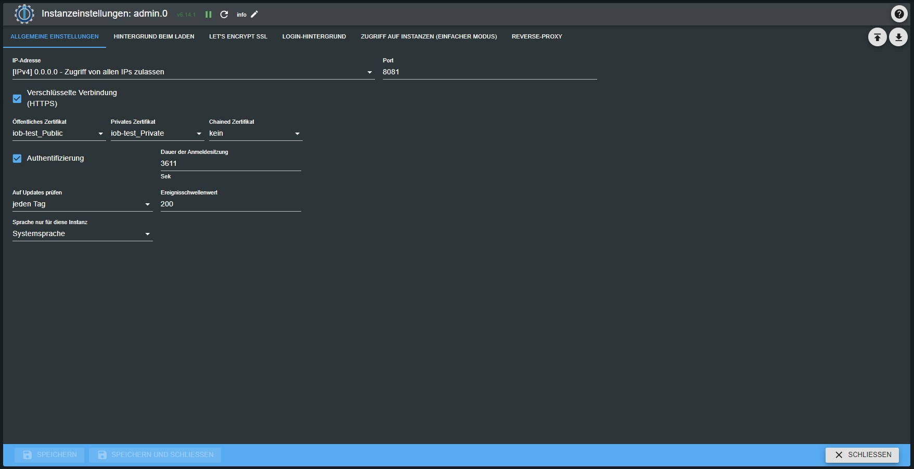
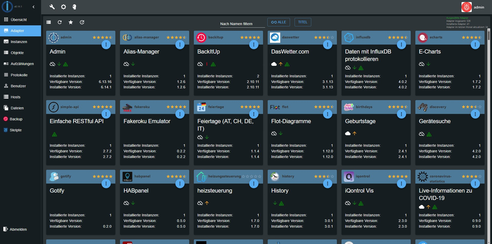
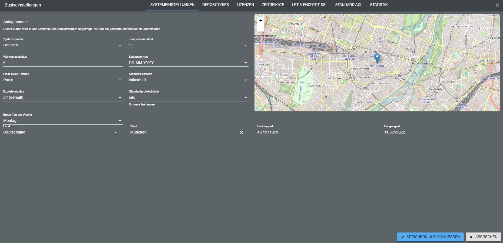

## Описание

Драйвер используется для обслуживания и настройки системы ioBroker и всех установленных драйверов. 
Он представляет собой WEB-интерфейс по адресу `<IP-Адрес сервера>:8081` и устанавливается вместе с ioBroker.

С помощью WEB-интерфейса, предоставляемого драйвером **admin**, реализуются следующие функции:

*   Установка дополнительных драйверов
*   Обзор объектов
*   Обзор состояний объектов
*   Управление пользователями и группами
*   Просмотр журнал (лог-файл) работы системы
*   Управление хостами (работа с распределенной системой - более одного хоста)

## Установка

Этот драйвер устанавливается вместе с ioBroker, ручная установка не требуется.

## Настройка

### Параметры конфигурации

#### IP

IP-адрес с которого доступен драйвер (поддерживаются IPv4 и IPv6). Значение по-умолчанию 0.0.0.0, то есть 
возможно соединение на любой IP-адрес. 

**Изменять не желательно, можно потерять досуп!**

#### Port

Порт, по которому доступен интерфейс драйвера. На сервере может быть запущено 
несколько WEB-сервисов и порт 8081 (настройка по-умолчанию) может быть занят, 
необходимо исключить конфликт занятого порта. Значение можно изменять.

#### Шифрование

Если необходимо использовать протокол HTTPS, необходимо отметить данную опцию.

#### Аутентификация

Если необходима аутентификация пользователя для работы с драйвером, 
необходимо отметить данную опцию (автоматически включится опция HTTPS).

#### Кэш

Необходимо отметить данную опцию, если планируется использовать кэш браузера.

#### Пользователь по-умолчанию

Если опция аутентификации отключена, то драйвер admin будет работать от имени пользователя по-умолчанию (выбирается из списка), в противном случае, от имени пользователя при аутентификации.

#### Проверка обновлений

Периодичность автоматической проверки обновлений системы и установленных драйверов. 
Можно выбрать опцию "ручное" и тогда проверка будет осуществляться только по запросу пользователя.

## Использование

В адресной строке WEB-браузера наберите: `<IP-Адрес сервера>:8081`

### Вкладки

Главное окно интерфейса состоит из нескольких вкладок. 

#### Вкладка "Драйвера"

Здесь можно установить или удалить экземпляры драйверов. В списке отображаются доступные для установки драйвера 
и их версии, а так же версии установленных. Обновить информацию по версиям можно с помощью кнопки в левом 
верхнем углу. В столбце **Версия** предусмотрена цветовая маркировка релиза драйвера 
(красный = в планах, желтый = бета-версия, оранжевый = альфа-версия, зеленый = финальная версия). 
Если установленная версия драйвера ниже версии на сервере (имеются обновления), то заголовок 
станет зеленым и появится в строке драйвера кнопка обновления. Если кнопка со знаком вопроса 
в последнем столбце активная, то нажав по ней, можно перейти на сайт **Github** для ознакомления с информацией об драйвере.

#### Вкладка "Настройки драйверов"

Здесь отображаются установленные экземпляры драйверов и осуществляется настройка/конфигурирование. 
Слева сверху находится кнопка включения режима эксперта - для отображения дополнительных настроек. 

Настройки драйверов:

*   Запуск/станов экземпляра драйвера
*   Открытие всплывающего окна с настройками драйвера
*   Кнопка перезапуска экземпляра драйвера
*   Кнопка удаления экземпляра драйвера
*   Если драйвер подразумевает собственный WEB-сервис, будет доступна кнопка перехода в новом окне.

Если щелкнуть на название драйвера в столбце **Заголовок**, можно изменить название экземпляра. 
В режиме эксперта появляются еще два столбца справа:

*   Столбец **Уровень** - выбор из списка уровень подробности ведения журнала работы адаптера (debug, error, warn, info)
*   Столбец **Max. RAM** - при необходимости можно ограничить выделение памяти ОЗУ для работы драйвера

#### Вкладка "Объекты"

На этой вкладке отображаются объекты системы (переменные, программы, устройства и пр.). 
По-умолчанию, системные объекты скрыты, их можно отобразить нажав кнопку **Показать системные объекты** 
слева сверху. С помощью кнопок со стрелками вверх/вниз можно загрузить/выгрузить объект(-ы) файлом JSON. 
В столбце справа можно нажатием кнопки вызвать окно настроек конкретного объекта (отдельной кнопкой настройки хранения истории) 
и удалить объекты. Если значения отображаются красным цветом, значит они еще не подтверждены - флаг `ack = false`.

#### Вкладка "Состояния"

Отображение в табличной форме состояний всех объектов системы. В шапке таблицы поля для ввода - фильтры для поиска объекта или группы объектов.

#### Вкладка "События"

Отображение в табличной форме изменений состояний объектов в режиме реального времени (можно приостановить, нажав справа сверху соответствующую кнопку).

#### Вкладки "Группы" и "Пользователи"

Добавление пользователей и групп, редактирование привилегий.

#### Вкладка "Категории"

Добавление/редактирование/удаление категорий (к примеру комнат для работы с адаптером **Scenes**).

#### Вкладка "Сервера"

Список серверов с установленным ioBroker, так же здесь отображается версия js-controller на каждом хосте. 
Если имеется новая версия, то заголовок вкладки будет отображаться зеленым цветом и появится кнопка 
обновления версии js-controller до актуальной. Запросить текущую версию (если отключено автоматическое обновление) 
можно с помощью кнопки **Обновить информацию драйвера** в левом нижнем углу окна. 
Так же возле имени хоста имеется кнопка перезагрузки js-controller (не OS).

#### Вкладка "Лог"

Здесь отображается журнал работы сервера. Сверху слева доступны поля для фильтрации записей. 
Можно отображать записи только указанного драйвера, либо всех (включая системный js-controller); 
можно выбрать уровень отображения лога (отладка, инфо, предупреждения, ошибки) и фильтровать по значениям. 

Справа сверху находятся кнопки:

*   Кнопка **Задержать вывод сообщений** - вывод сообщений на странице временно приостанавливается (например, когда сообщения появляются слишком быстро, чтобы не пропустить искомое)
*   Кнопка **Обновить протокол** - обновить журнал вручную (сообщения должны выводиться в режиме онлайн при активной вкладке)
*   Кнопка **Скопировать протокол** - сообщения на экране копируются в буфер обмена для дальнейшего использования (например, для вставки на форум, чтобы описать ошибку)
*   Кнопки **Очистить протокол на экране** и **Очистить протокол на сервере** - соответственно очищает вывод сообщений на вкладке **Лог** и полностью удаляет сообщения из журнала на сервере (применять осторожно).

#### Вкладка "Скрипты"

Эта вкладка активна только если установлен драйвер **Javascript/Coffescript Script Engine**. 
Здесь можно создавать/удалять/редактировать скрипты для автоматизации. 
Более подробно смотри описание данного драйвера.

#### Вкладка "Node-red" и вкладки других драйверов

Эти вкладки видны только если включен соответствующие драйвер (см. пункт ниже).

### Общие настройки

Справа сверху находятся кнопки общих настроек драйвера **Admin**:

*   Кнопка **Видимость вкладок** - можно включать и отключать вкладки, а так же, при установке определенных драйверов, для которых существуют свои вкладки - добавлять их на страницу
*   Кнопка **Системные настройки** - дополнительные настройки работы системы такие как: язык интерфейса, формат даты, единицы измерений, активный репозиторий и пр. (группа основные настройки); редактирование, добавление/удаление ссылок на репозитории (группа репозитории); добавление/удаление собственных сертификатов при использовании HTTPS (группа сертификаты); настройка анонимного сбора статистики (группа статистика)
*   Кнопка **Выйти** - выход из системы.

## Changelog
<!--
    Placeholder for the next version (at the beginning of the line):
    ### **WORK IN PROGRESS**
-->
### **WORK IN PROGRESS**
- (@GermanBluefox) Quick access: filter field above the cards

### 8.3.15 (2026-11-20)
- (@GermanBluefox) Installed version: its changes as tooltip, the change log on click
- (@GermanBluefox) Adapter list: warning when the active repository does not exist
- (@GermanBluefox) Adapters and hosts tabs follow updates of the repository
- (@GermanBluefox) A repository update no longer sends the whole repository to every admin page
- (@GermanBluefox) Fixed: quick access shows newly installed adapters only after a reload
- (@GermanBluefox) Updated @iobroker/gui-components to 10.4.8: status icons no longer cover a narrow ID column (#3741)

### 8.3.14 (2026-11-17)
- (@GermanBluefox) Deleting an adapter in a multihost system deletes it also on the other running hosts that hold its package but no longer need it: each host is asked with `getAdapterUsage` (js-controller 8.0 and newer), which also knows the packages a host keeps for the web extension of an instance on another host. A host that does not run or does not answer keeps the package. `iobroker del` on the command line still deletes on its own host only
- (@GermanBluefox) The dialog "Write value" shows how big a string or JSON value is
- (@GermanBluefox) Fixed: in the dialog "Write value" the value type was empty for JSON values and the type "JSON/Object" did not open the JSON editor
- (@GermanBluefox) Instances can get the log level "off" (no log at all, not even errors), if js-controller 8 runs on their host
- (@GermanBluefox) Updated @iobroker/json-config to 10.1.23: `selectSendTo` shows a text field instead of an endless spinner when the instance gives no list, `autocompleteSendTo` shows its `options`; the dialog of `diskSelector` comes from @iobroker/gui-components
- (@GermanBluefox) Updated @iobroker/gui-components to 10.4.7: new dialog `DialogSelectDiskPath` (file or folder on the disk of a host); the description of a CRON schedule is shown in Portuguese, Dutch and Chinese instead of English
- (@GermanBluefox) Overview: the panels have the same color as the tiles of the quick access
- (@GermanBluefox) Fixed: a `sendTo` button in the configuration showed a success after 30 s and lost the answer of an adapter that needed longer (#3737)
- (@GermanBluefox) Updated @iobroker/socket-client to 5.7.0 (`callbackTimeout`) and @iobroker/json-config to 10.1.24 (`sendTo` timeout)
- (@GermanBluefox) The device manager in the settings or a tab of an instance can be pinned to the navigation, like in the device manager tab (#3738)

### 8.3.13 (2026-11-15)
- (@GermanBluefox) Two-factor authentication with an authenticator app: every user sets it up in the user menu (QR code, backup codes), the login page asks for the code, administrators can switch it off for other users in the user dialog
- (@GermanBluefox) Updated @iobroker/webserver to 3.5.0: two-factor authentication (TOTP) for the login
- (@GermanBluefox) Updated @iobroker/socket-classes to 2.11.0: a user with two-factor authentication cannot connect with the password alone (basic authentication or `?user=&pass=`)

### 8.3.12 (2026-11-13)
- (@GermanBluefox) Fixed: after "Check adapters for updates" or `iobroker update`, the adapter list shows when the repository was read and not when it was generated (#3729)
- (@GermanBluefox) Updated @iobroker/json-config to 10.1.20: `cron` in the JSON config does not offer the wizard of schedules anymore, which wrote `{}` into the field
- (@GermanBluefox) Updated @iobroker/gui-components to 10.4.6: the CRON dialog has the new mode "Hourly" for a fixed minute of every hour, does not overwrite a schedule that the simple mode cannot show and does not accept invalid values
- (@GermanBluefox) Fixed: the adapter list does not scroll to the top when an adapter is installed
- (@GermanBluefox) Overview shows a hint when a js-controller update is available (#3722, #1914)
- (@GermanBluefox) Fixed: the repository time stamp is updated on the first click of "Check adapters for updates" (#3724)
- (@GermanBluefox) Updated @iobroker/gui-components to 10.4.5: in the JSON config, `customFilter` of `objectId` with `common.role` as a string shows the matching objects and not all others
- (@GermanBluefox) Updated @iobroker/json-config to 10.1.21: `translate` for `text`, also in tables (#3721)
- (@GermanBluefox) Fixed: about 70 texts were not translated, e.g. "Invalid version of ... Required ... Current"; missing spaces in the Windows update commands of js-controller
- (@GermanBluefox) Fixed: a single sign-on ignored "Stay logged in" and always kept the login for 30 days in the browser. Tokens of an earlier login are removed before the new ones are stored, so they cannot hide them
- (@GermanBluefox) Updated @iobroker/webserver to 3.4.1: a disabled user cannot sign in with single sign-on anymore, like with a password (apart from `admin`)

### 8.3.11 (2026-11-07)
- (@GermanBluefox) Fixed: in the file rights dialog, a "different" permission could not be set for all files
- (@GermanBluefox) Updated @iobroker/json-config to 10.1.19: added the control `diskSelector` to select a file or a folder on the disk of the host where the instance runs (needs js-controller with `CONTROLLER_READ_DISK_DIR`)
- (@krobipd) Fixed: saving the instance settings writes only the settings changed in the dialog, so a setting the adapter wrote into its native while the dialog was open (e.g. its device list) is no longer set back (json-config 10.1.19)
- (@GermanBluefox) Updated @iobroker/socket-classes to 2.10.3: the host commands `readDiskDir` and `deleteDiskFile` need the permission for `cmdExec`

## License

The MIT License (MIT)

Copyright (c) 2014-2026 bluefox <dogafox@gmail.com>

[Full license text](LICENSE)